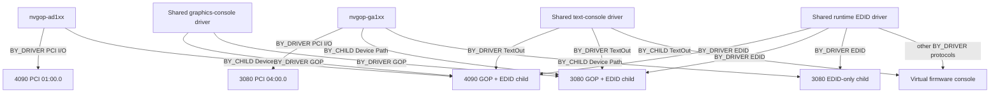

# 2026-11-09 — Stronger read-only per-target identity consistency, host fault tests, and persistent hardware gates

**Implementation on universal main:** `GuRefreshPreparedSequence` now rejects duplicate selected indices, aliased expected EFI handles and PCI_IO protocol pointers, and duplicate selected BDFs before any target refresh. It gathers separate boot-local read-only 256-byte PCI configuration observations for each requested target, then performs a second bounded pass and rejects any changed protocol pointer or full configuration snapshot. It clears the entire published output at entry and publishes the complete ordered collection only after both passes succeed. This closes a bounded **host-source admission/failure-contract gap**, not the physical simultaneous-observation race, original ROM authenticity, GOP/console ownership or per-target mutable transaction isolation. All active app/DXE selected builds still use `GU_PREFLIGHT_ONLY=1` and refuse before `GuInit`, vendor Stop, DMA, selectors and FLR.

**Independent verification:** Universal [commit 2d4fe141](https://github.com/akashskypatel/universal-gpu-unlock/commit/2d4fe14139f6bbad69d05469cc5e4124a7c89ea7) adds meaningful host negative cases for same-index, same-handle, same PCI protocol and same-BDF aliasing; later-target read failure with fully zeroed output; and a prior-target **BAR0 configuration snapshot** change induced during the later target's first pass, detectable only by second-pass full-snapshot equality. CI [42739479432](https://github.com/akashskypatel/universal-gpu-unlock/actions/runs/42739479432) completed with both host and Windows MSVC EFI jobs **PASS**. Host logs report **86 UEFI discovery adapter checks** per GCC/Clang compiler, four selected-entrypoint binaries with **6 checks each**, all refusing without `GuInit`. Earlier [CI 42738611425](https://github.com/akashskypatel/universal-gpu-unlock/actions/runs/42738611425) host failed an authored assertion that wrongly expected both GPU refreshes in a single-target selection; corrected in `00907b12`, with no contract weakening. [CI 42738793244](https://github.com/akashskypatel/universal-gpu-unlock/actions/runs/42738793244) then passed, before the additional BAR/alias negative coverage. No new physical tests were performed.

**Scope of physical passive 0018:** the attached log was independently hashed at 13,111 bytes / 153 lines, SHA-256 `f6bc38be4f27044a9b77b3f276b3fbe49ee51ffef9451bd4c12fddb7a33ad9d4`; it contains exactly two NVIDIA GPU records and two NVIDIA driver-binding owner records, one AMD GOP, zero NVIDIA configured-console matches and the flag `ERROR_CONSOLE_ISOLATION=INDEPENDENT_OBSERVED`. `TOPOLOGY_VERDICT=INCOMPLETE` is correct because NVIDIA GOP paths are absent. **Zero NVIDIA GOPs is not proof of `DriverBinding.Stop(NumberOfChildren=0)`**; actual NVIDIA Stop/destructor/BAR writes, other-card/AMD survival and recovery remain unobserved.

**Public-source SKU limitation:** [ZOTAC's official 3080 catalog](https://www.zotac.com/mu/product/graphics_card/GeForce-RTX-3080/all) lists multiple RTX 3080 **12 GB** board SKUs (Trinity, Trinity OC, AMP Holo, AMP Extreme Holo) and does not positively map the physical `19da:b612` to one exact part/board revision in the reviewed material. Unverified third-party firmware index entries associate the ASUS `1043:88e6` with multiple BIOS versions including the owner-reported `95.02.3C.80.13`, but are neither manufacturer-authenticated nor sufficient proof of physical board SKU, stock ROM region, signer or recovery. No third-party ROM was admitted, executed, flashed, substituted or treated as an original. Official firmware updater packages are not original-card ROM chain-of-custody evidence. Positive manufacturer-origin ROM evidence remains OPEN for both cards.

**Hardware hold and actual non-RE blockers:** real vendor Stop/AMD continuity/cold recovery, original per-card ROM and validated register semantics, separate per-target mutable GPU/DMA state and failure containment are independently OPEN. Windows 617.42 authentic Booter IMAGE/HEADER/SIG/PATCH, nested Falcon invocation/arg3 and exact architecture ABI are the source-specific reverse-engineering workstream, not yet the only blocker. `CAN_DETACH=false CAN_UNLOCK=false CAN_FLASH=false RECOVERY_VERIFIED=false`.

---

# 2026-11-09 — AMD-only monitor routing 0018 closes passive configured-console conflict, not vendor Stop or recovery

**New owner-supplied passive log:** `GPU-TOPOLOGY-DIAGNOSTIC-0018.TXT`, 13,111 bytes / 153 text lines, SHA-256 `f6bc38be4f27044a9b77b3f276b3fbe49ee51ffef9451bd4c12fddb7a33ad9d4`. It reports `READ_ONLY=1 CAN_DETACH=0 CAN_UNLOCK=0 CAN_FLR=0`, 50 PCI handles and 19 relevant bridge/display nodes. The exact NVIDIA pair remains present and firmware-driver-bound: AD102 `0000:01:00.0` `10de:2684` subsystem `1043:88e6` and GA102 `0000:04:00.0` `10de:220a` subsystem `19da:b612`. Both have `GOP_COUNT=0` and observed NVIDIA PCI `BY_DRIVER` ownership; the AMD `0000:0f:00.0` `1002:13c0` is the single GOP endpoint. Configured `ConOut` and `ErrOut` each contain only the path-matched AMD device. `NVIDIA_CONOUT_MATCH=0`, `INDEPENDENT_CONSOLE_ASSOCIATION=1`, `ERROR_CONSOLE_ISOLATION=INDEPENDENT_OBSERVED`, and `NVIDIA_CONOUT_BLOCKER=0`. **Stage 3 PASS (PASSIVE CONFIG) applies only to this 0018 cable/boot configuration.** Strict `TOPOLOGY_VERDICT=INCOMPLETE` is correct because the two NVIDIA GOP/child relationships are not observable in this configuration. Do not change `GuTopoAssess` to return COMPLETE merely because there is no NVIDIA GOP.

**Independent shared-console consumer evidence:** the AMD TextOut interface has one `BY_DRIVER` edge to a ConSplitter agent, one `BY_CHILD_CONTROLLER` edge to the active aggregate console handle, and mapped ConSplitter `.text` SHA `b2ce93060babbb674d67cc9e07fa36a4dde10e7c5c17170d8ea577c920525006`, 22,968 bytes, again matching the previously extracted original MSI 1A70 ConSplitter code-section digest. This validates passive source correlation only; no UEFI image signer/whole-image authenticity, `DriverBinding.Stop` semantics, AMD survival after selective NVIDIA Stop, or cold recovery is demonstrated. The earlier physically observed **mixed-monitor 0017** still shows NVIDIA console conflict and the three-GPU shared GraphicsConsole/ConSplitter opener/child graph. These results represent **different monitor cable configurations**, not conflicting interpretations of one boot.

**Host-only implementation after 0018:** universal-gpu-unlock commit `da4051c4bb961a692f9d47d49544a6efb9f8535f` adds `GuRefreshPreparedSequence` and calls it in the selected preparation-only EFI entrypoint before the existing multi-NVIDIA refusal. It refuses malformed/duplicate selections, revalidates each target's current-boot PCI handle/protocol/location/identity through `GuRefreshPreparedGpu`, and does not publish a partial collection on failure. Snapshots are sequential and observational; this change does **not** supply atomic hardware state, authenticated ROMs, active per-GPU DMA ownership, isolated mutable transactions, vendor Stop/recovery, or genuine Windows 617.42 signed Booter payload/ABI. The new source commit passed [GitHub Actions run 42736793146](https://github.com/akashskypatel/universal-gpu-unlock/actions/runs/42736793146): host GCC/Clang/UBSan checks and Windows MSVC EFI builds both succeeded. Existing mock discovery (61 checks) and selected-entrypoint refusal tests passed; no dedicated negative tests were added for the new aggregate-refresh contract. This is build/host evidence, not on-device or mutating transaction evidence. Keep `GU_PREFLIGHT_ONLY=1`, `CAN_DETACH=false CAN_UNLOCK=false CAN_FLASH=false RECOVERY_VERIFIED=false`. **Reverse engineering is not the sole blocker**: original manufacturer-authentic exact-card ROM, safe original vendor Stop and AMD console continuity, cold recovery and per-card active fail-closed state remain independent prerequisites.

**Manufacturer-original ROM source review (negative provenance result, no GPU reads or writes):** Published [ASUS RTX 4090 TUF support](https://www.asus.com/us/supportonly/tuf-rtx4090-24g-gaming/helpdesk_bios?model2Name=TUF-RTX4090-24G-GAMING) lists `RTX4090_V2.1.exe` with SHA-256 `1dece421d0d1bde86673d0cad30dfae5b4f0d9c8c7fb0572d5dbc35f1a40e55e`, but this is a vendor updater executable, **not** an original ROM from physical card `1043:88e6`, and the support result does not establish the precise SKU/board revision or firmware bits on that card. [ZOTAC's VBIOS FAQ](https://www.zotac.com/us/faq/how-get-updated-vbios-my-graphics-card) states VBIOS files generally are not offered as end-user downloads; no manufacturer-authenticated original ROM for physical `19da:b612` was found. **Exact-card original ROM provenance remains OPEN for both targets.** No updater execution, unsigned third-party ROM substitution, flash, PROM pin relaxation, register/selector read or cold release is permitted on this basis.

---

# 2026-11-09 — Physical 0017 closes MSI original-to-resident shared-console code-section identity; read-only per-target PCI refresh verified, Stop/recovery remain blocked

**Owner-supplied hardware artifact:** GPU-TOPOLOGY-DIAGNOSTIC-0017.TXT, 20,714 bytes / 244 logical lines; SHA-256 b9d26925497ea9c93ccbfe6a5951f3b85fed6488abc2b06dcfa0cb49bd8db437. The diagnostic explicitly reports READ_ONLY=1 CAN_DETACH=0 CAN_UNLOCK=0 CAN_FLR=0. Physical PCI/GOP/console original observations: 50 PCI_IO handles; 19 relevant PCI bridge/display nodes, three GOP paths, three configured ConOut and ErrOut paths. NVIDIA 4090 at 0000:01:00.0 10de:2684 SUB=1043:88e6; NVIDIA 3080 at 0000:04:00.0 10de:220a SUB=19da:b612; AMD iGPU 0000:0f:00.0 1002:13c0 SUB=1462:7e56. Both NVIDIA PCI driver handles BY_DRIVER=1. TextOut consumers of 4090, 3080 and AMD are managed by a shared ConSplitter agent (loaded image handle 0x806ae598), each TextOut interface BY_CHILD to same aggregate controller 0x806acc98. The GOP driver agent is the shared GraphicsConsole image 0x806ac198. NVIDIA_CONOUT_MATCH=2, INDEPENDENT_CONSOLE_ASSOCIATION=0, ERROR_CONSOLE_ISOLATION=CONFLICT, TOPOLOGY_VERDICT=CONFLICT, STATUS=PARTIAL, HARDWARE_TESTED=0. No driver Stop, driver release, BAR0 register access, DMA, FLR, firmware loading or selector mutation is evidenced by the report.

**Original MSI 1A70 source image to actually loaded section correlation (PASS, narrowly scoped):** Previously source-pinned MSI 7E56v1A7.zip matches the vendor-published checksum and contains E7E56AMSI.1A70, from which original GraphicsConsole and ConSplitter PE32+ boot-service images were independently parsed and their executable section bounds/hashes were computed. In physical 0017, SHARED_CONSOLE_TEXT[0] shows loaded GraphicsConsole IMAGE_BYTES=18464, TEXT_RVA=640, TEXT_BYTES=10336, SHA-256 7966680e5bb1d764b7a70b3d20362658e549de51138a3582070ab0cca00ae695. This EXACTLY matches original PE source virtual `.text` 10,336-byte digest. SHARED_CONSOLE_TEXT[1] shows loaded ConSplitter IMAGE_BYTES=28160, TEXT_RVA=640, TEXT_BYTES=22968, SHA-256 b2ce93060babbb674d67cc9e07fa36a4dde10e7c5c17170d8ea577c920525006. This EXACTLY matches original PE source virtual `.text` 22,968-byte digest, excluding the eight source file raw padding bytes. The original PE static relocation scan found zero code-section relocations. The physical logger still flags RELOCATIONS_NOT_CHECKED=1 SIGNATURE_NOT_VERIFIED=1 STOP_NOT_CALLED=1. **One previously independent blocker has therefore advanced:** matching original executable code for these two shared modules to mapped sections is physically established, not just a future task. **This does not establish Authenticode/UEFI trust, full-image attestation, call-instruction invocation, safe Stop, AMD console continuity or recovery.** Detailed source report updated IN PLACE at research/firmware/msi_b850_1a70_shared_console_stop_static_analysis.md, commit ea98d79018efa44756f5111429b0382d44c60422.

**Static Stop consequences remain a separate physical blocker:** The original MSI ConSplitter output Stop RVA 0x1480 ignores two TextOut CloseProtocol statuses, unlinks a shared output node, recalculates shared modes, and masks final uninstall status by returning a previous FreePool status. The GraphicsConsole Stop RVA 0xE28 checks one uninstall status but ignores other cleanup statuses. These are bounded instruction observations, not a measured failure of these services; there is no proven selective one-NVIDIA Stop contract or rollback under three simultaneously attached TextOut children. Existing owner 0016 and new 0017 are sufficient to characterize the all-monitor shared graph; another identical passive scan is not useful.

## Reusable nonmutating per-card source engineering now verified

**universal-gpu-unlock commit b775d5eeeaf9c632b32ec60897e5b6fd4da48030:** src/gpu_discovery.c/h expose GuRefreshPreparedGpu, which uses the same prepared selected-index list, re-resolves that selected handle through the current UEFI PCI_IO protocol, rejects any changed protocol pointer, segment/BDF, PCI ID, class or subsystem, and returns a complete CPU-owned 256-byte PCI configuration snapshot only on successful revalidation. On failure, out protocol pointer is null and the output snapshot zeroed. The legacy GuDiscoverSingleGpu one-card initialization reuses this helper to avoid divergent identity check code. Existing two-NVIDIA guard remains ahead of GuInit and all mutation operations; selected preparation-only mode still refuses unconditionally. The same-boot handle validation is NOT a complete refreshed GOP/ConSplitter opener graph or a new per-GPU mutable Stop/DMA/FLR context. Mock test_gpu_discovery.c extended with meaningful protocol redirect, corrupted selected index, changed BDF/subsystem/class, full PCI read failure and success for both selected steps.

**Independent CI verification:** First source commit b775d5ee triggered Actions 42733470035: host job PASS but Windows MSVC app compile FAILED because the new public gpu_discovery.h declaration used EFI_PCI_IO_PROTOCOL without #include <Protocol/PciIo.h>. This is an actual agent-introduced compiler integration error and not to be hidden. Commit d025dbea47134e061004ce484a7f7af59c992136 fixed the native UEFI header dependency, keeping the host mock include branch intact. Final Actions 42733599285: host PASS (UEFI discovery adapter now 61 checks, selected active refusal still four checks per mocked run, existing inventory/topology/handoff tests pass; HOST_EXIT=0) and Windows MSVC EFI PASS (selected application and DXE PREPARATION_ONLY=1 MULTI_GPU_MUTATION_ALLOWED=0; no-selection/legacy installer refusal still enforced). Final synthetic selected EFI build hashes: app 568750096050AFAA4E3F91000676E8270C337B2BAADD114757BD59786F775236, DXE 53714421DD17C3DBC3E32587EED66D027329E9AFD447F3EF3A89EAC8AF489E44. These are unsigned synthetic CI artifacts, not deployable original MSIs or physically tested devices. There were NO GPU hardware writes in this agent turn.

## Remaining gates after this turn

- **Resolved only as narrow evidence:** physical mapped GraphicsConsole/ConSplitter original MSI `.text` identity is PASS; per-target boot-local PCI identity refresh is PASS HOST/CI; all-3-monitor owner/child graph is PASS PHYSICAL PASSIVE. Do not conflate source/host findings with Stop authorization.
- **Still independent physical blocker:** Stage 3 CONFLICT in the currently observed all-three-monitor configuration, Stage 4 PARTIAL due to proprietary shared-output Stop status-masking/partial-state behavior and missing AMD/non-target NVIDIA survival and independently verified recovery. Even signed Windows Booter bytes would not clear this.
- **Still independent original-card blocker:** ASUS AD102 and ZOTAC GA102 original manufacturer VBIOS / per-card ROM, cold-state/selector read semantics, signed region compatibility are not authenticated; the universal ROM predicate deliberately refuses unknowns.
- **Still independent implementation blocker:** actual per-card mutable transaction state and safe pre/post-release context is not implemented; Gu remains a global singleton, active app/DXE refuse two NVIDIA devices, the new refresh only ensures READ-ONLY PCI target identity. No production safe Stop/DMA/FLR is available.
- **Still downstream authentic signed-Booter blocker:** Windows NVIDIA 617.42 AD102+GA102 production signed IMAGE/HEADER/SIG/PATCH, published nested +0x170 Falcon actual invocation/argument three and outer+0x3E8 contents/acceptance remain source-ungrounded; only original-driver RE or equivalently authentic source evidence may resolve.
- **Still post-action evidence blocker:** per-card actual changed selector/performance, Windows 617.42 takeover and repeatable recovery cannot be observed without a separately authorized successfully safe physical transaction, which is not currently permitted.

**Decision:** The user goal to have reverse engineering as the *only* remaining blocker cannot be declared reached. We did close the original-to-resident MSI `.text` match and the shared read-only per-target PCI refresh/negative tests, without weakening the independent physical and firmware requirements. Do not run live Stop or newly enabled active firmware on the hardware. No repetition of the all-three-monitor mapped hashes is needed. The next relevant physical evidence is either an independently justified passive AMD-only owner graph using the same already trusted source, if that configuration is to be evaluated, or an independently supported selective proprietary Stop + recovery contract; the latter is NOT safe to probe by invoking Stop based on the present record. Per-card original manufacturer ROM provenance is separately needed without flashing.

**Owner / agent — current next steps:** AGENT COMPLETED: verify exact physical 0017 SHA/size/paths and shared `.text` hashes against original MSI 1A70, update static MSI report, implement and verify current-boot per-target PCI identity refresh with failure tests and preserved dual-NVIDIA active refusal, reconcile both repository execution plans and CI errors. AGENT NEXT: continue only source-based readiness/independent Stop fault analysis with grounded original bytes; do not invent active compatibility or soften hardware gates. OWNER NEXT: preserve actual 0017, correct original MSI 7E56v1A7 archive, exact Windows driver/Ghidra project and card data; no more identical mixed-monitor passive hashes. If willing and independently approving *passive only* operation, provide a same-source AMD-only-monitor owner/child graph (no NVIDIA monitor cables) to classify that alternative configuration; that still cannot demonstrate Stop/rollback. Manufacturer-original per-card ROM evidence remains missing; no flashing. OWNER + AGENT HARDWARE: CAN_DETACH=false CAN_UNLOCK=false CAN_FLASH=false RECOVERY_VERIFIED=false; Stage 3 CONFLICT (observed mixed-monitor), Stage 4 PARTIAL; no driver/EFI/BIOS/PCI/GPU mutation.

---

# 2026-11-09 — Non-RE source blockers advanced; physical release/recovery and original ROM provenance still separately blocking

**Scope and execution boundary:** The user requested completing independent engineering blockers until Windows driver reverse engineering is the only blocker. This turn changed the GitHub source and documentation, exercised hosted compile/host tests, and did **not** run on the owner's GPUs, boot an EFI, read or write MMIO, Stop NVIDIA controllers, use DMA/FLR, flash ROM, modify BIOS, ESP or NVRAM, or assert physical recovery. That instruction cannot honestly be marked COMPLETE: original MSI loaded driver equality, safe one-device Stop, AMD/non-target survival, original ASUS/ZOTAC ROM authenticity, isolated active per-card state, and cold recovery require independent proof, not just a signed-Booter code producer.

## Source changes committed to universal main

**Commit e1bfc4767cd150772f2076bb093dc834a3573727:** src/profile.c function GuAd104PromMatches now rejects null/wrong-length ROMs and, after computing a supplied 1-MiB image SHA256, reports it but **returns FALSE for every unpinned image**. Prior implementation returned TRUE for every one-megabyte input, claiming verification without a known authentic per-card digest. This closes that particular permissive predicate by refusing qualification; it does **not** authenticate an original ROM, and no genuine accepted hash is available. Build-Experimental-MSVC.ps1 and Build-Dxe-Driver.ps1 now require -SelectionBdf or -SelectionBdfs and refuse omitted selection before compilation, preventing the supplied scripts from producing unselected legacy mutating images. Selected sources retain their existing explicit preparation-only return before GuInit and GU_PREFLIGHT_ONLY=1. The existing docs/ACTIVE_GPU_PREPARATION.md was updated accordingly, and CI checks the negative no-selection builds. This does not prevent manually building different legacy source configurations.

**Commit 7b052460ff54ff3ca0b32d2e8e8361f836b9162b:** Setup-AdaUnlock.ps1 immediately returns STATUS=REFUSED and exit code 2 before administrator elevation, USB selection/format, NVRAM or ESP modification; historical installer code remains after this mandatory refusal, unreachable from this normal entrypoint. Check-GPU-Unlock.bat was rewritten as a **CUDA ordinal-by-ordinal FP16 GEMM sample**, never a per-card PCI BDF/UUID-mapped raw MMA proof. It prints UNLOCK_VERIFIED=UNKNOWN and exits 2 rather than claiming that an arbitrary FP16 TFLOPS threshold means FULLY UNLOCKED. The research-fork README was replaced with truthful current evidence and blockers; docs/OPERATIONS_AND_PERSISTENCE.md now labels old 44-cycle/secure boot/anti-cheat/NVRAM narratives HISTORICAL, unverified and not instructions for this setup. These are source/claims and default-safety changes, not signed firmware engineering.

**Verification harness repairs:** Commit e13e8e5f6d9e6900fde2cd9eb7c8fbeedf508ca7 corrected PowerShell array -notmatch evaluation in the refusal check. Original new benchmark syntax verification was incorrectly implemented as an indented bash heredoc; CI 42731116454 host job genuinely FAILED with an unterminated heredoc and an unexpected end of file before running host tests. Commit 7ecf9c16ec314ca4c3e3ffa5433ad989229d7879 replaced it with a single python3 -c syntax check. This failure and correction must not be concealed or misclassified as a GPU logic failure.

## Verified run evidence

- GitHub Actions run 42730366368 (source e1bfc476): BOTH host and EFI jobs PASS, including no-selection app/DXE refusal; code was not deployed physically.
- GitHub Actions run 42731116454 (source e13e8e5f): host FAIL from the authored Bash heredoc error; corrected before relying on later results.
- **Final Actions 42731262406** (source 7ecf9c16): host PASS and Windows EFI PASS. Inspected job logs: host HOST_EXIT=0; generic inventory 73 checks, dynamic topology 92 checks, discovery adapter 39 checks, selected-entrypoint-refusal 4 checks across GCC/Clang selected scenarios, existing passive PCI/pinned Windows path/handoff tests and benchmark Python syntax PASS. No CUDA benchmark executed on hardware. Windows MSVC compiled the selected app/DXE EFI and passive targets, verified unselected builder refusal and early legacy installer refusal. Selected app synthetic-CI SHA256 8DB15B71D90A549E6781EF30CE4664949CF591FDE94F76728FA35C9523089D73; selected DXE synthetic-CI SHA256 DB7D2E0E4DB043D39B1DABE717A4FA2F20995C7959E43EB15B08683EB1D8FF2F. These are unsigned, non-deployable CI binaries. The new ROM predicate itself was source-inspected and compiled as part of the app/DXE; no separate ROM behavioral unit test, physical ROM validation, or independent cryptographic acceptance test was run.
- Universal authoritative docs/DUAL_GPU_61742_REMEDIATION_PLAN.md updated in place (commit 73d6771e0ff50e27c370a0ada83114b81ceca254): statuses 1, 6, 7, 11 reconciled as PARTIAL or negative-safe, not active unlock PASS. The source still contains one global mutable GU_PLATFORM Gu; neither source reads nor CI replace that with a safely isolated active two-GPU engine.

## Independent blockers, even if signed Booter RE were fully solved

1. **Stage 3 CONFLICT / Stage 4 PARTIAL:** physical passive 0016 proved that AMD iGPU, RTX 4090 and RTX 3080 share GraphicsConsole/ConSplitter/aggregate console in the mixed-monitor boot. Exact MSI 1A70 PE static Stop status masking and original hashes exist, but no trusted running loaded-code equality, one-selected-GPU Stop, AMD/non-target survival or validated cold-recovery proof. This blocks gates 3–4/7–8 independent of Booter provenance.
2. **Exact-card originals:** no independently authenticated installed ASUS 1043:88e6 AD102 or ZOTAC 19da:b612 GA102 full ROM source/signatures and accepted per-card hash; fail-closed ROM code is not authentic ROM proof. Cold-state read-only register safety and per-card permission profile remain conditional.
3. **Active per-target isolation:** universal GuDiscoverSingleGpu still returns EFI_UNSUPPORTED for two NVIDIA devices. Existing read-only ordered selection is verified; independent per-GPU mutable Stop/DMA/FLR context, non-target isolation and partial-failure state machine are not implemented/validated for physical use.
4. **True Windows 617.42 signed secure stage:** genuine Windows-compatible original production signed IMAGE/HEADER/SIG/PATCH bytes, correct GA102/AD102 selection, same-instance published nested Falcon +0x170 invocation and third-argument ABI, remaining outer+0x3E8 contents and signature acceptance remain OPEN. These are later gates 9–10 and may require source-grounded reverse engineering OR other independently authenticated signed source/ABI evidence. Linux 615.78.08 and 610.43.03 reference material is not a proven substitute.
5. **Windows/result/recovery postconditions:** no authorized one-GPU transaction, selector proof, per-card raw MMA/Nsight/numerical matched post-change measurements, stock 617.42 takeover or cold-boot recovery. A truthful informational measurement utility does not close these gates.

**Decision:** The task cannot truthfully reach an ONLY_REVERSE_ENGINEERING_BLOCKS state with source-only access. Do not erode source verification or manufacture missing hardware evidence. No additional generic NVIDIA diagnostic RE is useful absent authentic Booter bytes/producer or real receiver/descriptor evidence. The next meaningful independent physical step would require a separately reviewed, locally authenticated **passive-only** mapped MSI driver-text source comparison and a sound vendor Stop/recovery model, with independent owner approval before any EFI boot; do not boot an unsigned CI artifact or invoke a vendor Stop. Exact original manufacturer ROM evidence is also missing; do not flash or dump merely for this work.

**Owner / agent — current next steps:** AGENT COMPLETED: fail-closed original ROM predicate, mandatory selected preparation builds, disabled unsafe legacy installer, truthful non-verdict per-ordinal GEMM sample, README/legacy disclaimer, CI negative cases and correction of failed CI, reconciliation of universal/Windows plans. AGENT NEXT: only source-only per-card admission/fault-model and MSI Stop/console evidence if independently grounded, not speculative active transaction or a generic driver decompilation chain. OWNER NEXT: preserve original DriverStore/Ghidra/BIOS and physically captured 0016; there is no immediate Ghidra or active-hardware task. If seeking to advance physical readiness, independently verify and explicitly approve a trusted passive mapped MSI text capture, not a Stop; supply manufacturer-original card ROM provenance without flashing. OWNER + AGENT hardware: CAN_DETACH=false CAN_UNLOCK=false CAN_FLASH=false RECOVERY_VERIFIED=false. Immutable 2026-11-04 audit untouched.

---

# 2026-11-09 — RC diagnostic tail branch closed; stop unproductive RE and distinguish signed-Booter from physical active blockers (ORIGINAL STATIC)

**New user-supplied original-driver report:** `nvlddmkm-61742-booter-discovery-20261109-162828-762395.txt`, **1,519 raw bytes** (33 LF-delimited lines; Windows CRLF source), SHA-256 `017c3fdc7460568021e3150778e9896b7d208c132d00bfa12d8fa7e4f77b75d3`. Original Windows 617.42 `nvlddmkm.sys` MD5 `3fb9afac9d0e394723e830aa14e60512`; Ghidra base `0x140000000`. The existing read-only Ghidra report has `STATUS=COMPLETE`, one `clipped=False` 120-character `FUN_1400F64D0` body, exactly four `UNCONDITIONAL_CALL` incoming records, `HARDWARE_ACTION=NONE GHIDRA_MUTATION=NONE`, elapsed 0.243 seconds. No Linux or Windows production Booter asset or hardware state was observed.

**Actual unclipped C behavior:**
```c
void FUN_1400f64d0(void)
{
    if (DAT_1413b3df8 == '\0') {
        return;
    }
    FUN_1400e3c70(6);
    return;
}
```
This **closes the immediate diagnostic-tail classification** from prior `FUN_140110F00`: unconditional return for this helper on `DAT_1413B3DF8==0`; on the other branch it calls **unclassified** `FUN_1400E3C70(6)` then decompiler prints `return`. That does NOT prove `FUN_1400E3C70` returns, that a debugger never traps, or that any actual RTX card followed this branch. It is **not** a production signed Booter byte producer, certificate validation or a Falcon HS loader. Do **not** automatically decompile `FUN_1400E3C70` or continue the unrelated diagnostic chain. If a future independently grounded image/loader flow directly depends on it, reevaluate then.

**PSDL default-path reconciliation:** The earlier owner original `FUN_140AF59C0` has `MOV R8D,0xA` then direct `CALL FUN_1409060D0`; the latter's original complete switch has explicit modes 2, 5, 6, 9, 0xF–0x13 but not `0xA`. The non-pre-switch-return branch therefore takes default diagnostic `FUN_140110F00(0x744)`, uses a null archive root for lookup (`FUN_1401C7760` returns zero for null), and contains fallback diagnostic `FUN_140110F00(0x770)` followed by `return 0x56` **if those diagnostic calls return**. Under the observed `FUN_1400F64D0` tail flag-zero branch, normal return is shown, but other diagnostic calls and nonzero policy flag remain unclassified. The independent pre-switch early `return 0` can occur and does not itself prove valid archive materialization. **We have a local conditional error source, not proof of an actual on-device secure firmware failure nor a universal no-return claim**. Earlier descriptions of unqualified PSDL archive + certificate *successful dispatch* were corrected; PSDL is not a validated production Windows Booter source.

## Why Windows driver reverse engineering exists, and where it does NOT block

**Target:** independent per-card preboot transaction restoring restricted Tensor Core FP32-accumulation issue rate for AD102 RTX 4090 and GA102 RTX 3080 12 GiB, handoff to unmodified Windows NVIDIA 617.42, measured HMMA/numeric comparison and cold-boot recovery. This is *not* turning on nonfunctional Tensor Cores or CUDA P2P.

**Reverse engineering is an evidence acquisition technique, not a mandatory implementation stage by itself:** It helps locate **authentic Windows 617.42 signed production Booter IMAGE/HEADER/SIG/PATCH assets, the genuine producer/source bytes, the published same-instance 0x9B0 Falcon `nested+0x170` HS loader invocation, third-argument descriptor/ABI and actual GA102/AD102 selection**. These are relevant to the **later secure-firmware construction/execution gates 9–10** and to avoiding incompatibility with the older 610.43.03 reference / Linux 615.78.08 comparison. An independent authenticated exact-architecture firmware source, ABI and compatibility demonstration could close the same gate without further broad `nvlddmkm.sys` reverse engineering. Reproducing a host driver call chain is not required for its own sake.

**Separate immediate physical blocker:** With both NVIDIA display paths configured, B850 passive three-GPU `0016` physically establishes AMD, 4090 and 3080 GOPs under shared GraphicsConsole and ConSplitter aggregate ownership; Stage 3 `CONFLICT`, Stage 4 `PARTIAL`. Vendor `DriverBinding.Stop`, loaded-image equality and safe non-target console/recovery after one-card release are **not** physically demonstrated. This blocks NVIDIA controller release at **gates 3–4/7–8** independently of any Booter blob, and must never be bypassed based on static MSI status masking.

**Separate source/architecture blocker:** Current universal app/DXE active path calls `GuDiscoverSingleGpu`, deliberately refusing multiple NVIDIA display devices before `GuInit`. Passive PCI/BDF/ordered target discovery and diagnostic code have physical+host verification; **no independent per-GPU mutable transaction context** replaces the legacy global `GU_PLATFORM Gu` for actual dual-NVIDIA active use. Existing 610.43.03 assets are not validated for this Windows 617.42 AD102+GA102 system, and merely changing pins or returning `EFI_SUCCESS` cannot establish compatibility. Exact physical VBIOS/ROM original provenance, cold state and rollback remain independent blockers.

**Decision/action this turn:** STOP expanding NVRM-RC diagnostic helpers, arbitrary slot `+0x170` searches, PSDL, SCCK/HULK certificates and generic ACR region helpers; their local direct-signed-Booter hypotheses are exhausted without a source-specific bridge. Resume original signed Windows 617.42 asset or loader provenance RE only when a genuinely new validated producer/invoker/descriptor anchor appears; in parallel prioritize nonmutating original MSI Stop/ownership/recovery analysis, exact-card source validation, and fail-closed universal transaction architecture/specification. Do **not** enable selected active driver path, execute unknown signed payloads or relax tests, approvals or hardware guards. This prioritization does **not** assert that the eventual tensor issue-rate change is achievable, accepted, durable after a driver reset, or beneficial to model inference; those are still separate empirical proof goals.

**Owner / agent — current next steps:** **AGENT COMPLETED:** original report checksum/status verification, full `FUN_1400F64D0` body classification, termination of generic diagnostic chain, explicit differentiation of physical ownership, source execution refusal and signed-firmware provenance blockers; Windows/universal plans reconciled. **OWNER NEXT:** no additional Ghidra run, MMIO, driver Stop or GPU/firmware operation required. Preserve MD5-pinned original DriverStore/Ghidra/BIOS and passive reports; if a passive resident-PE observation is later proposed, require independently verified trusted build/signature and explicit separate approval before booting it. **AGENT NEXT:** advance only independent MSI shared-driver/source recovery and universal read-only/fail-closed engineering using already available evidence; revisit original Windows 617.42 Booter only with a genuinely grounded signed asset producer or published nested Falcon receiver/arg3. **OWNER + AGENT HARDWARE:** `CAN_DETACH=false CAN_UNLOCK=false CAN_FLASH=false RECOVERY_VERIFIED=false`; Stage 3 `CONFLICT`, Stage 4 `PARTIAL`. Immutable 2026-11-04 recovery/process audit unchanged.

---

# 2026-11-09 — Original Windows 617.42 RC diagnostic helper fully classified; PSDL mode-0xA conditional error path narrowed (STATIC, NO BOOTER PRODUCER)

**Owner-supplied original read-only Ghidra report**: `nvlddmkm-61742-booter-discovery-20261109-162035-945995.txt`, exact **3,409 bytes / 113 physical lines**, SHA-256 `382b66a919e3c4a9bd003299eb0713221f52446306d25f819c06e70ad028a970`; original `nvlddmkm.sys` MD5 `3fb9afac9d0e394723e830aa14e60512`, Ghidra base `0x140000000`. `STATUS=COMPLETE`, `DECOMPILER_BEGIN entry=140110f00 clipped=False total_chars=843`, `HARDWARE_ACTION=NONE GHIDRA_MUTATION=NONE`, elapsed 0.274 s. Exactly **24 incoming reference records were printed and `TARGET_INCOMING_REFS_TRUNCATED=true`**; the complete C body does not mean all callers were enumerated. This is static owner-original evidence, not an on-card execution or a new signed asset.

## Direct complete body classification

`void FUN_140110F00(undefined4 param_1)` is a **generic NVRM-RC diagnostic/error-handling helper**, not a Windows signed-Booter blob builder or Falcon HS loader. Its original Ghidra C:
1. Sets a local pointer to zero and calls `FUN_14010FC20(0,param_1,&local_res10,1,0x8D,0xA8,0)`; on return zero it clears an offset `+0xA0` in the resulting record. Neither this callee nor the record's lifetime is classified by the owner report.
2. Captures `DAT_1413B3E18`, increments/decrements global `DAT_1413B4F08` under displayed `LOCK/UNLOCK` operations, conditionally invokes `FUN_1400E0C30(...,unaff_retaddr)` when the counter's prior value was zero. This supports diagnostic/reentrancy control, not Booter image parsing.
3. If `DAT_1413B3E18 != 0` and `(*(uint *)(DAT_1413B3E18+0xB8) & 4) != 0`, calls decompiler-labeled `DbgPrintEx(..., "NVRM-RC: Nvidia Release Debug Break\\n")`. **Ghidra emits `WARNING: Subroutine does not return` on this conditional call.** This is a decompiler/call-model annotation, **not independent evidence of an unconditional actual breakpoint or no-return for every invocation**. The printed message itself does not prove hardware debugger activity.
4. Otherwise proceeds to `FUN_1400F64D0()` and an **explicit decompiled `return;`**. `FUN_1400F64D0` has **no previously complete source classification in the retained cumulative ledger**; it may perform side effects or not return, so a normal return from this tail call is **not independently proved**. The leading `FUN_14010FC20` is also unreviewed. Do not overstate the explicit C `return` as unconditional runtime return.

**Cross-report original source verification, no repeated Ghidra task:** Re-read original complete `FUN_1409060D0` C from MD5-pinned `20261109-153809-780258` alongside the earlier `FUN_140AF59C0` instruction evidence `20261109-154832-197527`: PSDL caller `MOV R8D,0xA` → `CALL FUN_1409060D0`. Callee switch cases are 2,5,6,9,0xF..0x13, **not 0xA**. On the non-early-exit path, mode 0xA enters default `FUN_140110F00(0x744)`, leaves its archive-root `lVar9=0`, and `FUN_1401C7760(lVar9,...)` returns zero. On fallback the helper invokes `FUN_140110F00(0x770)` before the explicit `return 0x56`. **If both diagnostic-helper invocations return**, the missing resource is a source-rooted local conditional failure (not successful staging). If the debug-flag/no-return branch or `FUN_1400F64D0` terminates/interrupts execution, the later return is not reached. A guarded **pre-switch `return 0`** remains visible and has unclassified runtime meaning; it does not imply resource bytes were delivered. This source correction prevents any categorical claim that the PSDL flow always fails, always succeeds, or reaches its guarded dispatch for either real RTX card.

**Status correction:** Previous report `20261109-153809-780258` directly proves resource selection/copy helper capability in supported modes; **the particular PSDL mode 0xA does not demonstrate a successful archive allocation or signed Booter input**. `FUN_140110F00` is now FULLY CLASSIFIED BY BODY as generic diagnostic handling, not a verified `noreturn` or Booter producer. Unreviewed terminal callee `FUN_1400F64D0` is a **bounded conditional-return question only**, not reason to widen generic allocation/Falcon slot scans. Original signed Windows 617.42 IMAGE/HEADER/SIG/PATCH, actual same-instance nested Falcon +0x170 invocation and loader arg3, and the remaining outer+0x3E8 fields all remain OPEN. Stage 3 physical shared-console conflict and Stage 4 recovery remain blocked/partial.

**OWNER next optional one-function static task (ONLY if confirming the diagnostic-helper return contract matters):** Decompile the directly observed `FUN_1400F64D0` called at the tail of the now-complete `FUN_140110F00`. The main signed-Booter P0 investigation **does not require** this diagnostic-only probe. No need to rerun `FUN_140110F00`, other completed PSDL/ACR helpers or broad displacement scans.

```python
exec(open(r"D:\Projects\gpu-unlock\Windows-GPU-UNLOCK\research\ghidra\nvlddmkm_booter_discovery.py", encoding="utf-8").read(), {"currentProgram": state.getCurrentProgram(), "SCAN_STRINGS": False, "TARGET_FUNCTIONS": ["0x1400f64d0"], "FULL_DECOMP_MAX_CHARS": 131072, "__name__": "__main__"})
```

Require original MD5/base, `DECOMPILER_BEGIN entry=1400f64d0 clipped=False`, `STATUS=COMPLETE REPORT=...`, and `HARDWARE_ACTION=NONE GHIDRA_MUTATION=NONE`; disclose incomplete or capped evidence as `PARTIAL`. Do **not** infer global call behavior solely from a `void` return type or Ghidra's `DbgPrintEx` no-return warning.

**Owner / agent — current next steps:** **AGENT COMPLETED:** fully classify `FUN_140110F00` original 843-char body, reconcile earlier mode-0xA/null-archive conditional error source, document conditional debug/noreturn limits and update Windows map and universal plan. **OWNER NEXT:** no P0 task required; preserve original DriverStore/Ghidra project; optional targeted `FUN_1400F64D0` command above only to close diagnostic tail return behavior. The meaningful signed-Booter handoff remains new original-driver evidence of authentic Windows 617.42 signed production IMAGE/HEADER/SIG/PATCH byte producer or an independently rooted real nested Falcon +0x170 invocation/argument three. **AGENT NEXT:** prioritize that signed-image/receiver/source proof and remaining outer+0x3E8 object content, not new generic helper chains. **OWNER + AGENT HARDWARE:** `CAN_DETACH=false CAN_UNLOCK=false CAN_FLASH=false RECOVERY_VERIFIED=false`; Stage 3 `CONFLICT`, Stage 4 `PARTIAL`, no driver/UEFI/BIOS/GPU mutation. Immutable 2026-11-04 recovery/process audit untouched.

---

# 2026-11-09 — PSDL mode 0xA enters archive-helper default/assert path; previous resource-staging interpretation qualified (CROSS-REPORT ORIGINAL STATIC)

**Agent-only cross-verification, not a new owner/Ghidra/hardware run.** Independently compared original MD5-pinned owner raw `nvlddmkm.sys` reports:
- `nvlddmkm-61742-booter-discovery-20261109-153809-780258.txt`, **41,591 bytes**, SHA-256 `cde78ba78929c2dc5b24a002089801c194a84930f2fca98a1524a49a474f8632`; `STATUS=COMPLETE`, unclipped `FUN_1409060D0` and `FUN_1401C7760` C bodies.
- `nvlddmkm-61742-booter-discovery-20261109-154832-197527.txt`, **22,072 bytes**, SHA-256 `8019158e8470134b1e58a0b73da42abecb3a6e7a045d0d78d6b96c5368a284a2`; `STATUS=COMPLETE`, `FUN_140AF59C0` C body and `0x140AF5A8B` exact original machine-instruction window.
Both report the pinned original driver MD5 `3fb9afac9d0e394723e830aa14e60512`; no local changes or hardware actions. The agent compared existing files directly; no new Ghidra C execution or physical test. Previous direct PSDL region-helper report `20261109-155821-559311` remains complete and independent.

**New machine/C cross-report mismatch:**
1. In `FUN_140AF59C0`, the original instruction window shows `MOV R8D,0xA` at `0x140AF5A73` (third argument under the Windows x64 ABI), and `CALL 0x1409060D0` at `0x140AF5A8B`. The original C explicitly prints `FUN_1409060D0(param_1,param_2,10,&local_118)`.
2. The complete `FUN_1409060D0` C switch on `param_3` has explicit cases **2, 5, 6, 9, 0xF, 0x10, 0x11, 0x12 and 0x13**; there is **NO case 0xA**. On the non-early-return path mode `0xA` therefore executes **`default:`**, logging with `FUN_1400E0C90(0xE766F29,0x7431000,param_3)` then calling **`FUN_140110F00(0x744)`**, before jumping to `LAB_140906484`. `FUN_140110F00` is not classified in the archived investigation; whether it returns, halts, traps or has another control-flow effect is **OPEN**.
3. The helper initialized local archive-root `lVar9=0` before the switch. None of the default-branch statements assigns it. If `FUN_140110F00(0x744)` returns normally, the two selector variants call `FUN_1401C7760(lVar9,id)` using a **null archive root**, and fallback also calls `FUN_1401C7760(0,id)`. The separately complete `FUN_1401C7760` code returns 0 for null `param_1`. Thus on this decompiled path `lVar7` stays zero, the helper logs the missing resource, calls `FUN_140110F00(0x770)`, then reaches **`return 0x56`** if the second assert also returns. Under those explicit assumptions, the PSDL-mode call has **no successful archive-resource materialization**.
4. **Crucial limit:** At the top of `FUN_1409060D0` a guarded indirect callback can return 1, causing an **early `return 0` before the switch**. This is a distinct path and its meaning is unclassified; a zero result is not evidence that archive contents were generated. This prevents the categorical statement `every mode-0xA invocation fails`. Any decompiler limitations or hidden `FUN_140110F00` behavior also prevent unconditional runtime conclusions.

**Required correction to prior interpretations:** Earlier notes described the PSDL `FUN_140AF59C0` path as `archives/resource extraction, staging with certificate and guarded dispatch`. This correctly identifies the *present subsequent source blocks* and `param_2+0x2C0` PSDL cert producer/consumer field, but **DOES NOT PROVE THE STAGING/DISPATCH IS REACHABLE IN THE ORDINARY MODE-0xA INPUT PATH**. The specific original source code more strongly supports an unsupported/default mode with null archive and error `0x56` if assert calls return. Do not turn this into a hardware signature/authentication failure claim or treat `RMPsdlCertStatus` presence as successful execution; observed GA102/AD102 route and dynamic object identity remain unknown.

**What is closed:** Cross-report detection of the mismatch, its explicit cases and zero archive-value propagation. PSDL/SCCK/HULK/ACR region helper source bodies remain fully reviewed and do not identify the original signed Windows Booter IMAGE/HEADER/SIG/PATCH, actual published nested Falcon +0x170 call/third argument or outer+0x3E8 region source.

**Optional owner-only bounded discriminator if the distinction between assert/noreturn versus error 0x56 matters:** Decompile **only `FUN_140110F00`**, whose direct call from the helper's mode-0xA default branch is shown in the original unclipped C. This tests control-flow classification rather than searching a speculative source chain; it will not prove production Booter provenance by itself. Skip if optimizing strictly for signed Booter P0; no hardware action is required.

**OWNER — one copyable original-driver read-only Ghidra command, optional:**
```python
exec(open(r"D:\Projects\gpu-unlock\Windows-GPU-UNLOCK\research\ghidra\nvlddmkm_booter_discovery.py", encoding="utf-8").read(), {"currentProgram": state.getCurrentProgram(), "SCAN_STRINGS": False, "TARGET_FUNCTIONS": ["0x140110f00"], "FULL_DECOMP_MAX_CHARS": 131072, "__name__": "__main__"})
```
**Evidence requirements:** original `nvlddmkm.sys` MD5/base; one requested `TARGET_FUNCTION` block with `clipped=False`, `STATUS=COMPLETE REPORT=...`; if undefined/clipped, preserve `PARTIAL/ERROR` and do not claim the helper's behavior is known. `HARDWARE_ACTION=NONE GHIDRA_MUTATION=NONE`. Don't repeat prior PSDL/ACR helpers or run an offset-only scan.

**Owner / agent — current next steps:** **AGENT COMPLETED:** agent-side cross-report switch/argument analysis with exact original report SHA checks, corrected prior resource-staging reachability statement, reconciled both repositories and the authoritative plan. **OWNER NEXT:** no required owner action for P0; optionally run single bounded `FUN_140110F00` decompilation above if assert versus error semantics need closure. Preserve DriverStore source and original Ghidra project; the **next important signed-Booter handoff** is independently grounded Windows 617.42 IMAGE/HEADER/SIG/PATCH producer or a published same-instance nested Falcon loader invocation/arg3. **AGENT NEXT:** prioritize that signed-image producer, verified nested +0x170 real invocation/third argument and remaining outer+0x3E8 source while keeping PSDL as locally unsupported for normal mode 0xA absent stronger evidence. **OWNER + AGENT HARDWARE:** Stage 3 `CONFLICT`, Stage 4 `PARTIAL`; `CAN_DETACH=false CAN_UNLOCK=false CAN_FLASH=false RECOVERY_VERIFIED=false`. No driver, EFI, MMIO, ROM, BIOS or GPU mutation. Immutable 2026-11-04 audit unchanged.

---

# 2026-11-09 — PSDL ACR region grouping, backing allocation, mapping and word-segment copy classified; close direct-Booter-producer side branch (ORIGINAL STATIC)

**New original MD5-pinned Ghidra report:** `nvlddmkm-61742-booter-discovery-20261109-155821-559311.txt` (12,832 raw bytes, 622 physical lines; SHA-256 `5d876ee806f5d191809caa26fe1fa57be31e07499586c29cb9497de895ae956e`). Original Windows 617.42 `nvlddmkm.sys` MD5 `3fb9afac9d0e394723e830aa14e60512`, loaded Ghidra VA base `0x140000000`. `SCAN_STRINGS=SKIPPED_BY_CALLER`, `STATUS=COMPLETE`, elapsed 0.352 seconds, four complete unclipped target C bodies (1,322 / 3,161 / 2,651 / 2,801 decompiled characters), `HARDWARE_ACTION=NONE GHIDRA_MUTATION=NONE`. This tool run did **not** produce any signed Windows Booter IMAGE/HEADER/SIG/PATCH bytes, runtime class/selector evidence, actual secure firmware acceptance, or an identified loader call.

| Function | Source observations and bounded classification |
|---|---|
| `FUN_1409077C0` (1,322 C chars) | A guarded indirect callback selects `param_4` versus `param_5` as the word-copy source; a second guarded callback selects a component/lane index. For `param_8 / (param_9 * 4)` iterations it copies 32-bit words from a segmented source lane into an indexed destination using an output offset from `*param_6` and a row/lane offset derived from `*param_7`. **Generic segmented word copying / data permutation**, not an observed archive record-name lookup, production signed-image origin, signature verifier or Booter-specific header parser. The earlier provisional description `archive-derived PSDL metadata` was too strong and is explicitly corrected. Indirect targets and complete C call ABI are not independently resolved; the 12-parameter displayed prototype should not be promoted to a verified runtime interface. |
| `FUN_140907450` (3,161 C chars) | Walks region request linked list at `param_2+0x2B8`; for pending entries, checks/merges matching region identifiers and size/capacity; registers region entries into 0x38-byte-stride table at `param_2+0x2B0`, count at `+0x2A8`, and inspects region mode `+0x2C8`. Tracks flags/length/alignment and returns 0x1A on some region validation/capacity failures. **ACR region table grouping/validation**, not signed Booter IMAGE/HEADER/SIG/PATCH producer. |
| `FUN_140AF6470` (2,651 C chars) | Iterates the registered 0x38-byte-stride regions, computes aligned size from record length/alignment, creates backing allocation objects using `FUN_1401B9020` and `FUN_1401B87B0` at region offsets +0x18, conditionally +0x20 and +0x28 based on flags `param_2+0x296/+0x439`, annotates object tags 0x16/0x17/0x18, handles failure cleanup, and sets `param_2+0x2C8=2` and `+0x420=1` on completion. **ACR managed backing-object preparation**; allocation is source-static and not a run on the owner's hardware. |
| `FUN_140907250` (2,801 C chars) | For each registered region obtains mapped storage address using `FUN_1401BB0B0`, allocates a 0xD8-byte tracking record at region +0x30, and invokes `FUN_140616D00` with start/end addresses for the region. It then walks the original linked requests at `param_2+0x2B8`, creates local map/offset arguments, calls a guarded indirect function with the per-region tracking record, and on a return-zero path calls `FUN_1401B9430` with region request +0x28 and the allocated object plus mapped-address offset. **ACR region mapping/association**; indirect callback target and data semantics are still unresolved. Neither this call nor a tracking-record allocation independently proves a signed Booter image, SEC2 payload source or published Falcon nested +0x170 receiver. |

**Sequence now supported (static structural relationships only):** `FUN_140AF2D20` (previous report) may read `RMCreateAcrRegion1/2` and has a direct sequential ACR region setup chain `FUN_140907450` (group and validate) → `FUN_140AF6470` (allocate backing objects) → `FUN_140907250` (map and associate). The separate `FUN_140AF59C0` PSDL-status routine consumes the prior RM-configured `param_2+0x2C0` certificate record, calls `FUN_1409060D0(...,0xA,...)` for an archive/resource record, stages it with cert bytes and makes guarded indirect dispatch. **Do not infer a proven temporal/runtime call edge from the region-chain to the separate PSDL-status function** and do not equate an ACR region allocation, packet, or generic data-copy helper to a production Booter asset.

**Closure:** All four owner-requested PSDL/ACR helper bodies are fully resolved in the original driver. The bounded branch is **CLOSED as an independently verified direct signed Windows Booter IMAGE/HEADER/SIG/PATCH producer** and has no direct loader `FUN_140BF3880` CALL, known nested published `+0x170` same-instance dispatch or authenticated SEC2 acceptance in these C bodies. This is a **local negative finding**, not a global absence result. `FUN_140616D00` and `FUN_1401B9430` remain helper callees with unknown full bodies, but there is *no positive signed Booter lead* justifying automatic extension into another generic region-mapping chain. The existing 0x3550-outer +0x3E8 partial field producer and nested 0x9B0 Falcon callback registration analyses remain separate, and must not be conflated with the PSDL `param_2+0x2C0` cert pointer or ACR region state `+0x2C8`.

**Decision / next handoff:** No new owner Ghidra run is requested for this PSDL branch; another general resource-ID scan, `+0x170` scalar match, `FUN_1409077C0` decompilation or passive topology scan would repeat completed work without showing authentic production signed Booter byte provenance. **The next useful original-driver handoff is independent evidence identifying an actual stock Windows 617.42 signed production Booter IMAGE/HEADER/SIG/PATCH producer or a source-grounded same-instance nested Falcon `+0x170` call site with provenance for loader argument three; otherwise defer owner work.** The earlier Linux 615.78.08 and Windows 610.43.03 material is a comparator, not original Windows 617.42 proof.

**Owner / agent — current next steps:** **AGENT COMPLETED:** verify 12,832-byte owner report and MD5, classify all four PSDL/ACR helper bodies, correct the former generic-copy-as-archive-metadata overstatement, close unsupported direct Booter-producer hypothesis, reconcile Windows and universal status. **OWNER NEXT:** preserve MD5-pinned original DriverStore/Ghidra files; no additional owner execution task for this completed path, provide independently grounded signed producer/receiver evidence only if discovered. **AGENT NEXT:** prioritize genuine original Windows 617.42 signed Booter IMAGE/HEADER/SIG/PATCH, published same-instance nested Falcon +0x170 invocation and loader arg3, and remaining outer+0x3E8 source; avoid repeating closed speculative chains or asserting offset-only object identity. **OWNER + AGENT HARDWARE:** Stage 3 `CONFLICT`, Stage 4 `PARTIAL`, `CAN_DETACH=false CAN_UNLOCK=false CAN_FLASH=false RECOVERY_VERIFIED=false`; no driver, EFI, GPU, BIOS or recovery-state mutation. Immutable 2026-11-04 audit untouched.

---

# 2026-11-09 — Original 617.42 PSDL certificate-to-ACR staging and record lookup resolved (STATIC; NOT SIGNED BOOTER PROOF)

**Owner original driver report:** `nvlddmkm-61742-booter-discovery-20261109-154832-197527.txt` (22,072 raw bytes, SHA-256 `8019158e8470134b1e58a0b73da42abecb3a6e7a045d0d78d6b96c5368a284a2`). Original `nvlddmkm.sys` MD5 `3fb9afac9d0e394723e830aa14e60512` at Ghidra VA base `0x140000000`; `STATUS=COMPLETE`, 0.427s, `HARDWARE_ACTION=NONE GHIDRA_MUTATION=NONE`. Four targeted decompilations all `clipped=False`: 3,732 / 7,112 / 2,665 / 524 characters; all four exact `INSTRUCTION_SITE` windows present. `FUN_1401C7760` global incoming-reference enumeration was truncated at 24, **not** its function body. No original Windows Booter source, GPU runtime class/selector or firmware-signature acceptance proved.

## Newly resolved original-driver path

| Function and evidence | Classification / boundary |
|---|---|
| `FUN_140AF2D20(param_1,param_2)` | **PSDL certificate material/configuration producer.** Reads `RMPsdlCertSize` using `FUN_14016AAD0`, allocates a 0x10 descriptor stored at `param_2+0x2C0`; descriptor's offset +8 stores the configured byte count, and offset +0 holds an allocated cert byte buffer populated by `FUN_1400EE6C0(param_1,"RMPsdlCert",...)`. On one return-code branch sets `param_2+0x28E`. Also conditionally reads `RMCreateAcrRegion1/2`, calls `FUN_140907660`, then initialization chain `FUN_140907450` → `FUN_140AF6470` → `FUN_140907250`. These are RM configuration and ACR preparation, not independently authenticated firmware bytes. |
| `FUN_140AF59C0(param_1,param_2)` | **PSDL certificate consumer / archive-backed ACR staging and indirect dispatch.** Requires non-null `param_2+0x2C0` and reads the certificate byte pointer and count. At original instruction `0x140AF5A8B`, calls `FUN_1409060D0(param_1,param_2,0xA,&local_118)`; the instruction window proves `R8D=0xA` and `R9` points to the output. Calls `FUN_1409077C0`, allocates staged managed object using `FUN_1401B9020/1401B87B0`, copies one archive/resource-derived segment followed by certificate payload into a mapping from `FUN_1401BC180`, releases with `FUN_1401BD630`, then issues guarded indirect dispatch with assembled local command fields, cleans archive output through `FUN_140905FA0`, and writes `RMPsdlCertStatus` through `FUN_1400EF640`. This establishes matching field-offset producer/consumer, **not live object identity**, not proof of a real published nested Falcon +0x170 target/arg3, and not signature acceptance. |
| `FUN_1406A8510` | **SCCK certificate/modulus parser.** Reads `scckPublicCert:\"` and `"\"mod\":[\""` from input through `FUN_1406A69F0`, copies parsed modulus data to a separately allocated context at `FUN_1402941C0()+0x68`. No direct Booter/PSDL/SEC2 linkage visible. |
| `FUN_1401C7760` | **Generic resource-ID lookup.** After `FUN_14016AA80`, reads count from `*param_1`, compares target numeric ID to 16-byte-stride records at `param_1+8+16*i` and returns the corresponding record value at `param_1+16+16*i`; returns zero otherwise. Does not independently identify archive records by IMAGE/HEADER/SIG/PATCH names. |

**Four original bounded machine windows:** `0x140AF2D68` loads exact `RMPsdlCertSize` option label; `0x140AF5A8B` is direct archive-helper CALL with code `0xA` inside the **actual** `FUN_140AF59C0` body; `0x140AF5EFB` loads `RMPsdlCertStatus` for status reporting; `0x1406A859D` loads `scckPublicCert:\"` for the certificate parser. Exact label references and same context field do **not** establish a production signed Booter producer, original Windows SEC2 acceptance, or physical action.

**Interpretive resolution:** The formerly unclassified PSDL/SCCK owner bodies are now COMPLETE. `FUN_140AF2D20` and `FUN_140AF59C0` have a real structure-level `param_2+0x2C0` producer/consumer relationship and the latter constructs a resource-and-certificate staging object before **indirect** dispatch. It is a *PSDL-specific ACR path*, not proved to equal the genuine Windows 617.42 signed production Booter IMAGE/HEADER/SIG/PATCH path; sharing generic `FUN_1409060D0` with `FUN_140905460` is not same-instance identity. The function may return/write host status without runtime authenticated firmware or a safe GPU unlock. Prior HULK option body need not be repeated. No code/hardware change is warranted.

**Next smallest source-specific owner probe, optional and passive:** The following four direct unexamined PSDL/ACR helper bodies were reached in the complete owner decompilation, and none is listed as already reviewed in the cumulative ledger: `FUN_1409077C0` (archive-derived PSDL metadata before copying), `FUN_140907450`, `FUN_140AF6470`, `FUN_140907250` (three consecutive ACR setup steps in `FUN_140AF2D20`). Their own full bodies, not broad XREF scans, can discriminate real signed-image source/descriptor traffic from generic preparation. Defer `FUN_140907660` (optional ACR region creation) and `FUN_1406A69F0` (SCCK token parsing) unless direct provenance arises. Avoid all previously reviewed body reruns. If these four are only setup, close these specific Booter-producer hypotheses and reprioritize independent true Windows Booter production/receiver evidence, not unbounded generic follow-up.

**OWNER — single-paste read-only original-driver Ghidra console command:**
```python
exec(open(r"D:\Projects\gpu-unlock\Windows-GPU-UNLOCK\research\ghidra\nvlddmkm_booter_discovery.py", encoding="utf-8").read(), {"currentProgram": state.getCurrentProgram(), "SCAN_STRINGS": False, "TARGET_FUNCTIONS": ["0x1409077c0", "0x140907450", "0x140af6470", "0x140907250"], "FULL_DECOMP_MAX_CHARS": 131072, "__name__": "__main__"})
```
**Acceptance:** matching MD5/base, four complete unclipped decompiler bodies with `TARGET_FUNCTION` markers, no new Ghidra disassembly/database writes, final `STATUS=COMPLETE REPORT=...` and `HARDWARE_ACTION=NONE GHIDRA_MUTATION=NONE`; report `PARTIAL/ERROR` truthfully. This is source static analysis only and cannot prove signed firmware acceptance.

**Owner / agent — current next steps:** **AGENT COMPLETED:** classify four complete PSDL/SCCK/archive lookup bodies, trace source-grounded cert + archive staging, reconcile both repos and preserve chronology. **OWNER NEXT (optional):** run the single read-only command above, attach raw `STATUS/REPORT` output; original DriverStore and Ghidra project unchanged. **AGENT NEXT:** classify returned direct PSDL/ACR helpers only for actual signed image/loader dataflow; independently trace authentic Windows 617.42 Booter IMAGE/HEADER/SIG/PATCH producer, real nested Falcon +0x170 invocation/arg3 and outer+0x3E8 source, rejecting any offset-only identity hypothesis. **OWNER + AGENT HARDWARE:** `CAN_DETACH=false CAN_UNLOCK=false CAN_FLASH=false RECOVERY_VERIFIED=false`; Stage 3 `CONFLICT`, Stage 4 `PARTIAL`. The immutable 2026-11-04 audit was not modified.

---

# 2026-11-09 — Original 617.42 ACR archive-resource descriptor builder and certificate XREF owners resolved (STATIC; NO SIGNED BOOTER PROVEN)

**Owner's new MD5-pinned read-only report:** `nvlddmkm-61742-booter-discovery-20261109-153809-780258.txt`; **41,591 raw bytes / 2,646 physical LF-delimited lines**, SHA-256 `cde78ba78929c2dc5b24a002089801c194a84930f2fca98a1524a49a474f8632`. Imported original `nvlddmkm.sys` MD5 `3fb9afac9d0e394723e830aa14e60512`, base VA `0x140000000`; `STATUS=COMPLETE`, elapsed `0.615` s, `SCAN_STRINGS=SKIPPED_BY_CALLER`, `HARDWARE_ACTION=NONE GHIDRA_MUTATION=NONE`. Seven user-specified ASCII prefixes verified at exact VAs; six **uncapped Ghidra-existing DATA XREFs** across Hulk/SCCK/PSDL names; no existing XREF for DRM XML opening prefix; two existing DDS Unicode DATA XREFs. Four target C bodies each `clipped=False`; **incoming references for generic `FUN_1401BC180/1401BD630` are explicitly truncated at 24** (do not call their global callgraph exhaustive). Loaded Ghidra VAs, not original raw PE file offsets.

| Exact string/VA | Source-rooted existing owner and reference | Closure |
|---|---|---|
| `RMHulkCertSize` `0x140D0AB10` / `RMHulkCert` `0x140D0AB20` | Both one DATA XREF in **`FUN_1402B2980`** at `0x1402B2E7F/0x1402B2EFC`. | **ALREADY FULLY REVIEWED** in the 2026-11-06 cumulative evidence as an option initializer handling `RmActivateHulk`, carveout option, certificate size and certificate host-allocation; no direct signed-Booter image/descriptor producer. Do **not** re-request its body. Separate HULK certificate effects/runtime acceptance remain unproved. |
| `scckPublicCert:` `0x140D16D30` | `FUN_1406A8510` at `0x1406A859D`. | XREF-owner proven; C body **NOT YET REVIEWED**. No automatic Falcon/Booter relationship. |
| `RMPsdlCertSize` `0x140D2C560` / `RMPsdlCert` `0x140D2C570` | Both in `FUN_140AF2D20` at `0x140AF2D68/0x140AF2E25`. | XREF-owner proven; C body **NOT YET REVIEWED**. |
| `RMPsdlCertStatus` `0x140D2C600` | `FUN_140AF59C0` at `0x140AF5EFB`. | XREF-owner proven; C body **NOT YET REVIEWED**. **High-priority bounded discriminator** because an original direct caller of the ACR archive materializer `FUN_1409060D0` occurs at `0x140AF5A8B`, in the same address neighborhood. Determine function ownership and argument identity, not just offset matching. |
| `<c:CertificateCollection` `0x14134E120` | Zero existing Ghidra XREFs, `capped=False`. | Embedded Windows DRM/COPP XML is not evidence of firmware SEC2 signed-Booter verification; zero existing XREFs is not proof of all possible runtime accesses. |
| UTF-16 `DdsCertHoldSr` `0x1416E9770` | Two existing DATA XREFs `0x141664EC3/0x141664F46`, both `FUN_141662D70`. | XREF-owner only, no body; not part of direct ACR link; lower-priority, leave open until positive relationship appears. |

**Four newly completed downstream function classifications:**

1. `FUN_1409060D0(param_1,param_2,param_3,param_4)` (`clipped=False`, 14,838 decompiled characters): **ACR archive/resource selector and descriptor-population helper**. It chooses a context-specific resource tree via guarded calls, switches on a type/code `param_3` (including 2, 5, 6, 9, 0xF–0x13), asks `FUN_1401C7760` for indexed resource records, uses `FUN_1401C77C0` for size, `FUN_1401C7940` for byte copying into host allocation via `FUN_1400FF170`, and `FUN_1401C77F0` for small metadata reads into `param_4`. One branch selects IDs 0x27/0x1A/0x11/0x2E, or 0x25/0x19/0x10/0x2D under a predicate; fallback IDs include 0x23/0x18/0x0F/0x2C; another group includes 0x3E/0x3A/0x3C/0x3B/0x2F/0x3D. **Those IDs are not identified as the genuine 617.42 Booter IMAGE, HEADER, SIG, PATCH labels.** Reported direct callers include original ACR `FUN_140905460` call at `0x140905598` and `0x140AF5A8B` near the PSDL certificate-status owner. Need actual owner/call-parameter chain, archive-index mapping and same-instance target before assigning object identity.
2. `FUN_1401BC180` (`clipped=False`, 3,751 C chars) is a **generic managed object acquisition/ref-count/handle** path, selecting operation class via `FUN_1401BAEF0`, dispatching backing-object operations and incrementing `+0x138` count. Has no locally established signed Booter input or SEC2 transfer.
3. `FUN_1401BD630` (`clipped=False`, 3,793 C chars) is **generic managed-object release/ref-count/cleanup**, decrementing `+0x138` and conditionally freeing/resetting records. Not signed-image producer or direct loader.
4. `FUN_140AF43E0` (`clipped=False`, 10,564 C chars) selects an existing status-record pointer using option flags and reads status words at +0x40/+0x44 with `FUN_1406B63F0`; a wide switch maps completion/error codes to diagnostic events and returns a failure sentinel. **Status/error reporting** on the already-dispatched ACR flow, not an identified Booter image source. Previous statement that it is invoked after successful dispatch means it is reached on the success path of the preceding call, **not** that it confirms secure firmware acceptance or runtime success.

**What this resolves:** Earlier inference that all new `cert` strings were ownerless is superseded. The exact original ACR function has a real archive/resource materialization dependency. Prior HULK certificate initializer is **not new** and needs no repeated review. None of the new owners nor the archive record numbers proves production signed Windows Booter IMAGE/HEADER/SIG/PATCH, signed acceptance, same-instance `FUN_140BF3880` nested +0x170 loader invocation, its argument-three descriptor or `outer+0x3E8` contents. Keep the Linux 615.78.08 bindata comparator separate from Windows 617.42.

**Next smallest discriminating read-only original-driver probe (OWNER OPTIONAL; four unreviewed source-grounded function bodies):** Decompile `FUN_140AF2D20` (PSDL certificate/size), `FUN_140AF59C0` (PSDL status), `FUN_1406A8510` (SCCK public certificate logging/source) and `FUN_1401C7760` (resource-record lookup actually called by `FUN_1409060D0`). Inspect four exact instruction sites that distinguish PSDL/SCCK string reads and the proposed archive-caller correlation. No repeat `FUN_1402B2980`, prior fully completed `FUN_1409060D0`, existing FSP bodies or generalized displacement/XREF scan.

**OWNER — single-paste, read-only Ghidra command against unchanged original MD5-pinned driver:**
```python
exec(open(r"D:\Projects\gpu-unlock\Windows-GPU-UNLOCK\research\ghidra\nvlddmkm_booter_discovery.py", encoding="utf-8").read(), {"currentProgram": state.getCurrentProgram(), "SCAN_STRINGS": False, "TARGET_FUNCTIONS": ["0x140af2d20", "0x140af59c0", "0x1406a8510", "0x1401c7760"], "TRACE_INSTRUCTION_SITES": ["0x140af2d68", "0x140af5a8b", "0x140af5efb", "0x1406a859d"], "FULL_DECOMP_MAX_CHARS": 131072, "__name__": "__main__"})
```

**Acceptance:** MD5/base match; all four `TARGET_FUNCTION` and `DECOMPILER_BEGIN` blocks present with `clipped=False`, four exact `INSTRUCTION_SITE` windows, no truncation unless transparently reported, final `STATUS=COMPLETE REPORT=...` (or `PARTIAL/ERROR` if incomplete), and `HARDWARE_ACTION=NONE GHIDRA_MUTATION=NONE`. This is an original-driver passive static task; it cannot authenticate the firmware or prove Windows runtime call. If a target is undefined/too large, retry only that source-specific function with explicit partial status. Do not broaden automatically. Evaluate the real XREF/call relationships; reject a generic shared helper as evidence of object identity.

**Owner / agent — current next steps:** **AGENT COMPLETED:** verify owner report and source identity; classify four ACR downstream bodies; map all existing certificate XREF owners; close redundant HULK owner review and generic reference/status helpers as direct Booter producers; update execution plan and universal fork. **OWNER NEXT (optional; no hardware):** execute bounded Ghidra command above, attach unchanged `STATUS/REPORT` raw output and preserve original Ghidra/DriverStore bytes. **AGENT NEXT:** classify PSDL/SCCK direct-owner bodies and resource lookup, trace evidence-positive archive-to-ACR descriptor linkage and independently pursue authentic 617.42 Windows IMAGE/HEADER/SIG/PATCH source, real nested +0x170 call/argument three and `outer+0x3E8` producer. **OWNER + AGENT HARDWARE:** `CAN_DETACH=false CAN_UNLOCK=false CAN_FLASH=false RECOVERY_VERIFIED=false`, Stage 3 `CONFLICT`, Stage 4 `PARTIAL`. No driver/GPU/EFI/BIOS mutation. Immutable 2026-11-04 audit unchanged.

---

# 2026-11-09 — Original Windows 617.42 ACR HS execution BODY classified; new certificate-label inventory source-bounded (STATIC REPORT COMPLETE, CERT XREF OPEN)

**Primary owner-supplied original-driver report:** `nvlddmkm-61742-booter-discovery-20261109-152202-652131.txt`, **25,654 raw bytes**, SHA-256 `07950d354256748897b52096eca0dcfe09b5bda844bfac6f24ea2a637a5a6255`, original `nvlddmkm.sys` MD5 `3fb9afac9d0e394723e830aa14e60512`, Ghidra VA base `0x140000000`, final `STATUS=COMPLETE` at 0.522 seconds. `SCAN_STRINGS=SKIPPED_BY_CALLER`; four full decompilations `clipped=False` and four instruction windows; `HARDWARE_ACTION=NONE GHIDRA_MUTATION=NONE`. Loaded Ghidra VAs are not raw file offsets. This evidence **completes the four-body OWNER action from the previous entry**; it is not an executed GPU transaction, cryptographic verification or architecture-dispatch trace.

| Exact original function | New grounded full-body evidence | Disposition |
|---|---|---|
| `FUN_140905460` (`acrExecuteHsBin_IMPL` label at `0x140D1D530`, instruction uses `0x140905AFA/0x140905C36`) | Four-argument routine. Obtains a caller-supplied/guarded descriptor-like `local_210`, passes through `FUN_1409060D0`, copies descriptor-indexed word segments, prepares an object with `FUN_1401B9020` / `FUN_1401B87B0`, invokes `FUN_1401BC180` and `FUN_1401BD630`, assembles local launch fields from `local_210` and performs guarded indirect dispatch; on the successful dispatch branch calls `FUN_140AF43E0`. Other branches use `FUN_140753690`. | **REAL ACR HS execution-preparation path, STATIC.** No direct `FUN_140BF3880` call appears in this decompiled body; neither the named ACR label nor these offset copies prove that the binary is Windows production Booter, that the indirect target is SEC2/GA102/AD102, or that any particular signed image is accepted. Follow only source-specific descriptor, image and indirect receiver producers. |
| `FUN_14094CD30` (`RmDisableFsp` at `0x14094CD6C`, `RmDisableFspFuseErrorCheck` at `0x14094CE1F`) | Reads `RmDisableFsp`, `RmDisableCotCmd`, `RmDisableFspFuseErrorCheck` with `FUN_14016AAD0`, updates `param_2` option/status bytes, initializes callback `FUN_14094CF50` via `FUN_1401342E0` when permitted and performs guarded indirect initialization. | **FSP feature/fuse-check configuration and callback wiring. CLOSED as a direct signed-Booter IMAGE/HEADER/SIG/PATCH producer** in the complete local body; no claim that FSP as a whole is unrelated to security. |
| `FUN_140B606A0` | Sets related object `+0x528=2`, evaluates `RmDisableFsp` and a device predicate, conditionally sets disable flag `param_2+0x58`, then guarded indirect initialization or returns `0x57`. | **FSP initialization gate; CLOSED as direct Booter producer** in this complete body. |
| `FUN_140C8C940` | Constructs an error/diagnostic object, formats `FSP fuse error check has failed. Status = 0x%x.`, stores status and message fields, returns zero. | **FSP fuse-error formatter; CLOSED as direct Booter producer**. Companion `FUN_140C8C7E0` is not retested by this four-body report. |

**Additional owner-supplied case-insensitive `cert` string export:** `Pasted text(7).txt`, **13,307 raw bytes**, SHA-256 `b18639e339d3fbc17e1de9d443eb6ebf4a1a468f86d38454b6969f4cc9210b7e`. Eight certificate-related or certificate-looking records plus one unrelated control name were supplied **without Ghidra reference owners**: `RMHulkCertSize` `0x140D0AB10`, `RMHulkCert` `0x140D0AB20`, `scckPublicCert:\"` `0x140D16D30`, `RMPsdlCertSize` `0x140D2C560`, `RMPsdlCert` `0x140D2C570`, `RMPsdlCertStatus` `0x140D2C600`, an NVIDIA/Microsoft Windows DRM/COPP XML `<c:CertificateCollection` at `0x14134E120`, and UTF-16LE `DdsCertHoldSr` `0x1416E9770`. `RMForceRtd3D3Hot` `0x140D17E70` is unrelated power-state text; do not promote it as a certificate signal. The DRM XML explicitly has `WMDRMReceiver` and `COPPCertificate` fields, a Microsoft/NVIDIA certificate collection and NVIDIA driver version 617.42; it is **not** evidence for signed Falcon Booter firmware content, verification or bypass. The other names might be configuration/certificate inputs, but there is **no established same-function or dataflow link** to `FUN_140905460`, `FUN_140BF3880`, production Booter `IMAGE/HEADER/SIG/PATCH`, the genuine nested `+0x170` receiver or `outer+0x3E8`. Do not infer key semantics from label spelling.

**Next smallest read-only original-driver discriminator:** Reuse the existing MD5-checked `research/ghidra/nvlddmkm_booter_discovery.py`, validate seven exact **ASCII prefixes** at the owner-provided loaded addresses, list bounded existing XREF owners, separately inspect the Unicode `DdsCertHoldSr` existing data references (this does **not** validate UTF-16 bytes), and decompile four previously **unreviewed in this report** ACR downstream helpers. No general memory/string scan, no new database analysis, no hardware change. For the large XML use only its literal opening prefix, not the 12-kB blob.

**OWNER — single-paste, read-only Ghidra command against original MD5-pinned driver:**
```python
exec(open(r"D:\Projects\gpu-unlock\Windows-GPU-UNLOCK\research\ghidra\nvlddmkm_booter_discovery.py", encoding="utf-8").read(), {"currentProgram": state.getCurrentProgram(), "SCAN_STRINGS": False, "SCAN_CSV_LEADS": True, "CSV_LEADS": [("RMHulkCertSize", 0x140d0ab10), ("RMHulkCert", 0x140d0ab20), ("scckPublicCert:", 0x140d16d30), ("RMPsdlCertSize", 0x140d2c560), ("RMPsdlCert", 0x140d2c570), ("RMPsdlCertStatus", 0x140d2c600), ("<c:CertificateCollection", 0x14134e120)], "TRACE_DATA_SITES": ["0x1416e9770"], "TARGET_FUNCTIONS": ["0x1409060d0", "0x1401bc180", "0x1401bd630", "0x140af43e0"], "FULL_DECOMP_MAX_CHARS": 131072, "__name__": "__main__"})
```

**Acceptance and limits:** Require the original MD5/base, seven `CSV_LEAD_VERIFIED` records or explicit `STATUS=ERROR` if the byte spelling is not identical, bounded `XREFS` with `capped=False` (otherwise mark XREF coverage partial), four complete `DECOMPILER_BEGIN`/`END` pairs with `clipped=False` where possible, the Unicode `DATA_SITE` record, and final `STATUS=COMPLETE REPORT=...` or explicitly handle `STATUS=PARTIAL/ERROR`. If a body is too large, reduce just the incomplete named targets, not tests or correctness requirements. Existing Ghidra DATA XREF absence is **not** proof of runtime absence. Investigate a certificate branch further **only if its owning code actually links certificate data to the Booter image/descriptor or receiver**; otherwise close it as unrelated to the P0 producer. Never classify a string-only certificate as an authenticity bypass. Keep separate Windows GA102 versus AD102 architecture and firmware lineages.

**Owner / agent — current next steps:** **AGENT COMPLETED:** classify `FUN_140905460/14094CD30/140B606A0/140C8C940`, close FSP configuration/diagnostic direct-producer candidates and add certificate inventory without asserting XREF or crypto proof. **OWNER NEXT (optional passive-only):** execute the exact command above against original unchanged Ghidra import and attach the raw report; preserve MD5-pinned driver, Ghidra project and DriverStore. **AGENT NEXT:** classify actual certificate XREF owners and ACR downstream descriptor/image/call provenance from the returned report, independently trace authentic 617.42 signed production Booter IMAGE/HEADER/SIG/PATCH producer, the real same-object nested `+0x170` call with argument-three, and `outer+0x3E8` writer. **OWNER + AGENT HARDWARE:** Stage 3 `CONFLICT`, Stage 4 `PARTIAL`; `CAN_DETACH=false CAN_UNLOCK=false CAN_FLASH=false RECOVERY_VERIFIED=false`. No Stop/Disconnect, FWSEC/SEC2, DMA, selector writes, FLR or flashing. Immutable recovery audit unchanged.

---

# 2026-11-09 — Original 617.42 ACR HS and GPU-FSP fuse/config STRING OWNERS resolved; FSP poll callback complete (STATIC XREF/C DECOMP COMPLETE)

**Evidence identity:** Owner report `nvlddmkm-61742-booter-discovery-20261109-151121-536432.txt`, **4,263 raw bytes**, SHA-256 `87f8eed1845ef4b908589d3a429f0a021864f3b139484dc1cf0a9db9d0b1799d`, original Windows NVIDIA 617.42 `nvlddmkm.sys` **MD5 `3fb9afac9d0e394723e830aa14e60512`**, base `0x140000000`. `SCAN_STRINGS=SKIPPED_BY_CALLER`, exactly six `CSV_LEAD_VERIFIED` literal anchors, `STATUS=COMPLETE`, elapsed `0.251` seconds, `HARDWARE_ACTION=NONE GHIDRA_MUTATION=NONE`. **There are 13 DATA XREFs total**: 6 ACR, 2 FSP fuse, 2 RmDisableFsp, 1 RmDisableFspFuseErrorCheck, 1 RMFspg, 1 SEC2 debug-fuse. Each selected string `capped=False`; these are **existing Ghidra references**, not a whole-driver negative search or an executed hardware path. Associated smaller case-insensitive export `Pasted text(5).txt` (16,349 raw bytes; **54 VA-labeled records**, SHA-256 `915788284dd2c227c44c3c9ebb45123de8f6b94838f022ea99821b97f57cac23`) independently repeats the same selected strings and adds `RMROPL2FuseMaskForFModel`, `RMNoECCFuseCheck`, GM200 ACR handler names, FSP fault labels and embedded XML `CertificateCollection`; the latter is DRM/display-protection certificate data, **not** authenticated Falcon Booter image/signature bytes.

| Exact label VA | Verified existing DATA XREFs and owner(s) | Status / scope |
|---|---|---|
| `acrExecuteHsBin_IMPL` `0x140D1D530` | Six references `0x140905AFA / 0x140905B07 / 0x140905C36 / 0x140905C43 / 0x140905BD9 / 0x140905BE4`, **all within `FUN_140905460`**. | **Highest priority original Windows source-specific HS execution body**, new owner now PROVEN STATIC by XREF; what it reads/writes/calls or whether it obtains stock Booter descriptor is **UNKNOWN** until full C. String name may label validation, status reporting, or actual execution; no positive source-to-loader proof yet. |
| `FSP fuse error check has failed. Status = 0x%x.` `0x140D2F9B0` | `0x140C8C7EA` `FUN_140C8C7E0`; `0x140C8C997` `FUN_140C8C940`. | Two exact error-message owners; no decompile in this report. Likely logging vs diagnostic context **hypotheses only**, not proven physical fuse-check or secure acceptance semantics. |
| `RmDisableFsp` `0x140D1D9E0` | `0x140B606D8` `FUN_140B606A0`; `0x14094CD6C` `FUN_14094CD30`. | Two exact configuration-selector candidate owners; registry-name presence does NOT establish setting value, runtime effectiveness, bypass, or GA102/AD102 applicability. |
| `RmDisableFspFuseErrorCheck` `0x140D1DA00` | `0x14094CE1F` `FUN_14094CD30`. | Shares a concrete function with `RmDisableFsp`; **best grounded FSP admission branch decompile target**. No disabling is authorized. |
| `RMFspg` `0x140D13100` | `0x1405AAB89` `FUN_1405AA820`. | Existing broader RM option/registry reader family from prior original-driver investigations; this exact label/owner connection now observed, but no signed producer or runtime selection proved. **Do not repeat generalized option-reader decompile.** |
| `RMSec2UseDebugFuseOnlyBinary` `0x140D0CDA0` | `0x1403361CA` `FUN_140336020`. | The `FUN_140336020` boot/config path was already examined in prior reports, not new original-Booter source evidence. Debug-fuse string is **not** authorization to modify fuses, disable security, or load firmware. |

**New complete tiny callback body:** Original `FUN_140B61310(param_1)` has 151-character C with `clipped=False`: it returns **`FUN_140126650(param_1+0x4410,0,0,0x200BC,0)==0xFF`**. Its four incoming references (`0x14145F228, 0x140E185B8, 0x140B641CB, 0x140B633C1`) are all `DATA`, including previously confirmed FSP monitoring scheduling. **Classify as a read-only status/poll predicate, not a signed Booter producer or direct loader invoker**. The semantics of status `0xFF`, hardware runtime selector, and signal that initiates it are still unresolved; do not infer a physical fuse setting from this predicate.

**Next smallest original-driver discriminator (NOT YET RUN):** Four **previously unclassified** complete bodies `FUN_140905460` (high-priority ACR HS owner), `FUN_14094CD30` (both FSP option names), `FUN_140B606A0` (second FSP option owner) and `FUN_140C8C940` (representative FSP fuse-failure handler). Four bounded exact instruction windows `0x140905AFA, 0x140905C36, 0x14094CD6C, 0x14094CE1F` expose branch-local string uses. This avoids re-running prior `FUN_140B61310`, `FUN_140336020`, `FUN_1405AA820`, `FUN_140BF3880` or general displacements/scans. `FUN_140C8C7E0` is another FSP error-message owner **deferred**, not falsely classified as complete.

**OWNER — single-paste, read-only Ghidra command against original MD5-pinned driver:**
```python
exec(open(r"D:\Projects\gpu-unlock\Windows-GPU-UNLOCK\research\ghidra\nvlddmkm_booter_discovery.py", encoding="utf-8").read(), {"currentProgram": state.getCurrentProgram(), "SCAN_STRINGS": False, "TARGET_FUNCTIONS": ["0x140905460", "0x14094cd30", "0x140b606a0", "0x140c8c940"], "TRACE_INSTRUCTION_SITES": ["0x140905afa", "0x140905c36", "0x14094cd6c", "0x14094ce1f"], "FULL_DECOMP_MAX_CHARS": 131072, "__name__": "__main__"})
```

**Acceptance:** original MD5/base, `STATUS=COMPLETE REPORT=...`, all four target `DECOMPILER_BEGIN` entries with `clipped=False`, and four `INSTRUCTION_SITE` windows, `HARDWARE_ACTION=NONE GHIDRA_MUTATION=NONE`. If clipping/timeouts, mark `PARTIAL` and retarget only incomplete exact body. Inspect actual conditional control flow, input descriptor/byte source and receiver identity; report whether `FUN_140905460` constructs/passes any HS binary, and whether FSP options only initialize status/config flags. Never equate the literal `acrExecuteHsBin_IMPL` with an actual call into `FUN_140BF3880` absent proven target and same instance, or import Linux 615.78.08/Windows 610.43.03 signed blobs as stock Windows 617.42 proof.

**Pending P0:** Genuine Windows 617.42 signed production Booter IMAGE/HEADER/SIG/PATCH origin, real same-instance nested `+0x170` invocation with `FUN_140BF3880` argument-three descriptor producer and `outer+0x3E8` contents. **OWNER NEXT:** supply read-only original Ghidra report; preserve DriverStore and original Ghidra project. **AGENT NEXT:** classify actual ACR/FSP bodies if supplied and close unsupported/diagnostic sources; continue producer/receiver evidence independent of FSP. **No hardware/EFI/driver changes.** Stage 3 `CONFLICT`, Stage 4 `PARTIAL`, `CAN_DETACH=false CAN_UNLOCK=false CAN_FLASH=false RECOVERY_VERIFIED=false`. Immutable recovery audit untouched.

---

# 2026-11-09 — GPU-FSP caller/source branch and case-insensitive string inventory reconciled; ACR/FSP exact XREF probe selected (STATIC COMPLETE, NEXT ORIGINAL DECOMP PENDING)

**Owner-supplied raw evidence:** Original pinned Windows 617.42 Ghidra report `nvlddmkm-61742-booter-discovery-20261109-145712-036199.txt`, **8,340 raw bytes / 196 LF-delimited raw lines**, independently SHA-256 `41b51a3cd8dab2b7f3fc7f9e91784ad16ccc17fc8107f8b5b0f66ecf5b2f7420`; report `STATUS=COMPLETE`, 0.281 s, `nvlddmkm.sys` MD5 `3fb9afac9d0e394723e830aa14e60512`, base `0x140000000`, `HARDWARE_ACTION=NONE GHIDRA_MUTATION=NONE`. One full decompilation `FUN_140B63340`, **`clipped=False` 2,750 C chars**; four existing CALL site instruction windows at `0x140B63538` in `FUN_140B63340`, `0x140B63810` in `FUN_140B63600`, `0x140B64340` in `FUN_140B64140`, `0x1418030F6` in `FUN_141803090`. These are already observed CALLs to the previously full `FUN_141803140` GPU-FSP monitoring constructor, **not unobserved code**. Other three caller bodies NOT decompiled here, so arch/runtime reachability UNKNOWN. Owner also supplied raw `Pasted text(4).txt`, **27,946 B / 194 address-labeled records in 216 logical lines**, SHA-256 `85262ebb041687f49136019271c8cee32a0e62f24fe43b61fd82d70188390e87`, as a broader case-insensitive Ghidra defined-string export; the oversized `0x14134E120` XML `CertificateCollection` is Windows Media DRM/display-protection certificate material, not an NVIDIA signed Falcon Booter payload/signature. Case-insensitive text retrieval is **not** original-driver program control-flow evidence.

**Exact `FUN_140B63340` classification:** Complete source obtains timeout/state through `param_1+0x20A4/0x20B8`, schedules `FUN_140B61310` callback via `FUN_1401148A0(param_1+0x20A0,local_60,FUN_140B61310,0)`, checks its completion/status, conditionally reads five dwords via the previously known low-level `FUN_140126650(param_1+0x4410,0,0,` offsets `0x200BC/0x8F0320/0x8F0324/0x8F0328/0x8F032C`), makes an opaque guarded callback, then passes a status/timer/context object to `FUN_141803140` GPU-FSP monitoring initializer, handles errors and final status bookkeeping. **The dataflow does not visibly allocate/read/copy original Windows signed Booter IMAGE/HEADER/SIG/PATCH, invoke `FUN_140BF3880`, or produce its third-argument binary descriptor.** This closes `FUN_140B63340` **as direct signed-image producer/HS Falcon loader invoker only**. The origin of `param_2`, its `*(param_2+0xF0)` owner pointer, `*(owner+0x18)` status/event interface and actual object alias is unknown: do NOT equate these numeric offsets with the independently proven `outer+0xF0` embedded Falcon owner and `outer+0x108` published nested `0x9B0` instance. `FUN_140B61310` callback body is not yet classified and **could clarify FSP poll semantics**. Three of four CALL sites show `R8D=0` before the monitoring constructor; the fourth passes `R8D=R15D`; these are `FUN_141803140` flags, **not a demonstrated `FUN_140BF3880` descriptor argument**.

**String inventory cross-referenced with earlier dedicated and cumulative research:** Known `gsp_ga10x.bin`/`ucodes_ga10x.bin`, ELF `.fwsignature_` architecture routing, `GSP_LOAD_EXEC_HS_BINARY` DATA/table refs, real `flcnLoadAndExecuteHsBinaryViaDma_GA10X` callback and `flcnCreateHsOvlSigBlob_GA10X`, Falcon reset wrappers, `PAGEdBIN` constructor, `RMDevinitBySecureBoot`/`RmBootFromHs`, `RmDisableGspLoad`, `lsfmFalconReset_IMPL` and `Invalid Bindata Access` already have prior ownership/partial classifications. **Do not reopen** these exact paths based on a new spelling/case-insensitive listing. New `acrExecuteHsBin_IMPL` at `0x140D1D530` is the strongest named HS-execution string anchor with **no prior exact owning-function trace in the ledgers**; `RMSec2UseDebugFuseOnlyBinary` `0x140D0CDA0` is a secondary configuration-only hypothesis (does not license a security-bypass action). The case-insensitive inventory alone also contains FSP-adjacent `GPU-FSP` at `0x1418064A0`, already tied to the diagnostic constructor, and generic `SEC_FAULT` / `GSP_LOCKDOWN_NOTICE` table strings without signed-image producer linkage.

**Additional owner-supplied FSP-only fragments, independently compared against existing notes:** `SEC_FAULT: _FSP_SCPM` `0x140D0A0C0`, `_FSP_DCLS` `0x140D0A100`, `_FSP_WDT` `0x140D0A2B0`, `_FSP_EMP` `0x140D0A350`, `_FSP_UNCORRECTABLE_ERRORS` `0x140D0A370`, `_FAULT_FSP_SCPM` `0x140D15E40`, `_FAULT_FSP_DCLS` `0x140D15E80`, `_FSP_UNCORRECTABLE_ERROR` `0x140D16060`, `_FSP_L5_WDT` `0x140D16090`: fault/status labels, no observed source-to-loader chain, **LOW** direct-producer priority. `HUBCLIENT_FSP` `0x140D20AB0`: hub-client name, **LOW**. `RMFspg` `0x140D13100`: unclassified configuration/feature name, **SECONDARY**. `RmDisableFsp` `0x140D1D9E0` and `RmDisableFspFuseErrorCheck` `0x140D1DA00`: configuration gates, possible *architecture routing* but no documented runtime effectiveness; **SECONDARY**. `FSP fuse error check has failed. Status = 0x%x.` `0x140D2F9B0`: a more focused failure path/branch anchor, **NEW SECONDARY**. Prior FSP polling message `0x140D2F950` and `FSP boot completion` `0x141806480` already fully classified as diagnostic/event setup, **do not repeat**.

**Single best next original-Ghidra bounded read-only task:** Reuse existing MD5-pinned `nvlddmkm_booter_discovery.py` with exactly **six literal-validated CSV anchors** (`acrExecuteHsBin_IMPL`, FSP fuse-error message, two FSP configuration keys, `RMFspg`, and SEC2 debug-fuse key), plus the **one new exact source-rooted callback `FUN_140B61310`**. The script allows 24 caller-selected anchors and four target decompilations; this is no generic string scan. Static outputs reveal only the actual existing XREF owners; follow a function only if its body demonstrably handles HS image/descriptor input or proves architecture dispatch. The owner has not yet executed this command.

```python
exec(open(r"D:\Projects\gpu-unlock\Windows-GPU-UNLOCK\research\ghidra\nvlddmkm_booter_discovery.py", encoding="utf-8").read(), {"currentProgram": state.getCurrentProgram(), "SCAN_STRINGS": False, "SCAN_CSV_LEADS": True, "CSV_LEADS": [("acrExecuteHsBin_IMPL", 0x140d1d530), ("FSP fuse error check has failed. Status = 0x%x.", 0x140d2f9b0), ("RmDisableFsp", 0x140d1d9e0), ("RmDisableFspFuseErrorCheck", 0x140d1da00), ("RMFspg", 0x140d13100), ("RMSec2UseDebugFuseOnlyBinary", 0x140d0cda0)], "TARGET_FUNCTIONS": ["0x140b61310"], "FULL_DECOMP_MAX_CHARS": 131072, "__name__": "__main__"})
```

**Report acceptance and limitations:** original MD5/base, each `CSV_LEAD_VERIFIED` (or explicit `STATUS=ERROR` for byte mismatch; do not substitute near-string), exact `XREFS` counts with `capped=False` where possible, `DECOMPILER_BEGIN entry=140B61310 clipped=False`, final `STATUS=COMPLETE REPORT=...`, `HARDWARE_ACTION=NONE GHIDRA_MUTATION=NONE`. Existing Ghidra XREF `0` is not whole-driver absence. If callback is unrelated polling/status and ACR XREF owner is a generic formatting/config method, mark those direct candidates CLOSED. Prior published same-instance nested `+0x170` loader invocation and Windows 617.42 signed production Booter IMAGE/HEADER/SIG/PATCH and R8 arg3 producer still OPEN; Windows 610.43.03/Linux 615.78.08 comparators must not be substituted.

**Agent/owner state:** AGENT completed owner FSP caller evidence, cross-referenced 194 string records and FSP addendum; classified direct `FUN_140B63340` and selected one bounded source-specific mixed discriminator. OWNER optional next original-Ghidra command above; no GPU/EFI mutation. AGENT next classify callback and exact ACR/FSP owners when report supplied, close no-source cases; independently pursue genuine Windows Booter signed producer and `outer+0x3E8` writer. Stage 3 `CONFLICT`, Stage 4 `PARTIAL`; `CAN_DETACH=false CAN_UNLOCK=false CAN_FLASH=false RECOVERY_VERIFIED=false`. Immutable process/recovery audit unchanged.

---

# 2026-11-09 — GPU-FSP exact callback bodies classified: diagnostic registration, not direct Windows Booter source (STATIC COMPLETE)

**Primary owner report:** `nvlddmkm-61742-booter-discovery-20261109-144850-517589.txt`, independently read 10,259 bytes / 232 LF-delimited lines, SHA-256 `f4f034ee362aeb178c614d2852edebd291158cd1c10a286a2be4852813f85cd3` (Ghidra C presentation embeds additional CR characters); original `nvlddmkm.sys` MD5 `3fb9afac9d0e394723e830aa14e60512`, base `0x140000000`, `SCAN_STRINGS=SKIPPED_BY_CALLER`, `STATUS=COMPLETE`, `HARDWARE_ACTION=NONE GHIDRA_MUTATION=NONE`, elapsed 0.302 s. All four source-rooted instruction windows resolved, all three decompilations `clipped=False`: `FUN_140C8C740` 762 C characters, `FUN_140C8C830` 1,443, `FUN_141803140` 2,189. **Only original static C/instructions; no runtime card class, firmware authenticity or execution proof.**

| Exact original-driver function | Full-body static behavior | Direct-producer disposition |
|---|---|---|
| `FUN_140C8C740(param_1,param_2)` | Calls `FUN_14016A790` with log level `0x8F` and FSP boot-poll error text plus six 32-bit values at `param_1+0x18/+0x1C/+0x20/+0x24/+0x28/+0x2C`; calls `FUN_1400E0C90` with event metadata and same six values; returns. Three incoming existing references are `DATA`, not demonstrated runtime CALLs. | **CLOSED AS DIRECT SIGNED-BOOTER PRODUCER:** diagnostic/error logging callback only in complete body; not direct polling implementation. |
| `FUN_140C8C830(param_1)` | Initializes status/formatting subobjects (`+0x1D8` pointer table, `+0x1E0=0x18`, six stored 32-bit values `+0x1E8..+0x1FC`), invokes `FUN_1402AB030`, formats same FSP message with `FUN_14010D520` into `+0x21C`, records `+0x218=0x8F` and `+0x210=formatted_length+5`, re-registers `+0x200` subobject, returns zero. Ghidra presents stack input values outside its single declared parameter—**the effective call ABI remains unresolved**, but these stores are diagnostic fields, not Booter image/header/signature content. A direct CALL is recorded at `0x141803390` from `FUN_141803140`. | **CLOSED AS DIRECT SIGNED-BOOTER PRODUCER:** builds a diagnostic status record. |
| `FUN_141803140(...)` | Selects allocation or reuse of a `0x308`-byte object by flags `param_3&2`, zeros it, wires multiple interface/vtable pointers `0x140FEEBB0/BC8/BE0/BF8/C10/C28`, registers a `GPU-FSP` event named `FSP boot completion` via `FUN_14171FF10`, calls `FUN_140C8C830` only after event registration success, publishes `*param_1=object` on success; error/cleanup branches return status. Calls to `FUN_141803140` at `0x140B63538`, `0x140B63810`, `0x140B64340`, `0x1418030F6` are existing `UNCONDITIONAL_CALL` references with **unreviewed caller bodies/architecture guards**. | **CLOSED AS DIRECT SIGNED-BOOTER PRODUCER:** monitoring/context initializer; not a demonstrated Falcon loader invoker. |

**Correction to prior hypothesis:** The FSP strings are now actual source-rooted Ghidra functions, not simply unowned strings, but their full bodies are **diagnostic/monitoring setup** and have no visible `FUN_140BF3880` direct call, signed Booter `IMAGE/HEADER/SIG/PATCH` payload acquisition, or argument-three signed-descriptor construction. This does **not** prove the entire GPU-FSP subsystem unrelated to secure boot, nor map FSP runtime selection to the owner's GA102 RTX 3080/AD102 RTX 4090. `GFW secure boot failed` at `0x140EFB958` previously had zero defined Ghidra string XREFs, not an absence proof; no re-scan recommended.

**Cross-reference before selecting next step:** Cumulative/dedicated historical notes had the three exact owners only as **unclassified XREF candidates** from the previous owner report. All known Falcon HS loader `FUN_140BF3880`, signature transformation `FUN_140BF2740`, host GSP/UCODES file staging and unrelated `FUN_1402D4710` offset-only candidate have already been classified; do not reopen or treat these FSP observations as genuine signed-Booter provenance. No new body from the owner report identifies a production signed Windows image producer or actual same-instance nested `+0x170` invocation.

**OWNER — Optional, single read-only, source-rooted original-Ghidra command (NOT EXECUTED IN AGENT ENVIRONMENT; do not run if you are not pursuing GPU-FSP runtime routing):**

```python
exec(open(r"D:\Projects\gpu-unlock\Windows-GPU-UNLOCK\research\ghidra\nvlddmkm_booter_discovery.py", encoding="utf-8").read(), {"currentProgram": state.getCurrentProgram(), "SCAN_STRINGS": False, "TARGET_FUNCTIONS": ["0x140b63538"], "TRACE_INSTRUCTION_SITES": ["0x140b63538", "0x140b63810", "0x140b64340", "0x1418030f6"], "FULL_DECOMP_MAX_CHARS": 131072, "__name__": "__main__"})
```

This decompiles only the containing function of the genuine `0x140B63538` direct CALL to `FUN_141803140`, and inspects the four previously observed direct CALL windows `0x140B63538/0x140B63810/0x140B64340/0x1418030F6`. It is intended to distinguish GPU-FSP architecture/owner routing, **not to assume a production Booter loader/descriptor link**. Require original MD5/base, `STATUS=COMPLETE REPORT=...`, one `DECOMPILER_BEGIN clipped=False` and four valid `INSTRUCTION_SITE` records. If clipping/undefined functions occur, report `PARTIAL`; do not broaden to whole-driver scans.

**AGENT NEXT:** If the optional caller report arrives, classify exact GPU-FSP direct caller architectures then close this secondary branch unless new positive dataflow links signed Booter/loader. Continue higher-priority independently grounded Windows 617.42 signed Booter source, genuine `outer+0x108→nested+0x170` receiver/arg3 and guarded `outer+0x3E8` content provenance; avoid repeated generic displacement/XREF searches. **OWNER NEXT:** preserve MD5-pinned Ghidra, source DriverStore and original report; no repeat of the three completed FSP bodies. **Hardware unchanged:** Stage 3 `CONFLICT`, Stage 4 `PARTIAL`, `CAN_DETACH=false CAN_UNLOCK=false CAN_FLASH=false RECOVERY_VERIFIED=false`; no Stop, firmware/EFI/GPU mutation, DMA, FLR, MMIO or flash.

---

# 2026-11-09 — Original Windows 617.42 FSP/GFW exact string XREF owners resolved; three bounded decompilations next (STATIC COMPLETE XREF / SOURCE BODY NOT RUN)

**Owner report:** `nvlddmkm-61742-booter-discovery-20261109-144316-076973.txt` (2,601 bytes / 31 physical lines, SHA-256 `1880d1d5fd777fc0b2c5a12319f3e2ff6e97f11854008b8c700ee3618908e5d4`), original `nvlddmkm.sys` MD5 `3fb9afac9d0e394723e830aa14e60512`, image base `0x140000000`. `SCAN_STRINGS=SKIPPED_BY_CALLER`, `CSV_LEAD_COUNT=3` with all three exact ASCII bytes validated at supplied VAs; `STATUS=COMPLETE`, elapsed 0.012s, `HARDWARE_ACTION=NONE GHIDRA_MUTATION=NONE`. **Completion covers only the three selected literal validations and existing Ghidra XREF enumeration: no decompilations were requested (`DECOMPILATION=SKIPPED`).**

| Exact anchor | Original existing references | Function ownership / limits |
|---|---|---|
| `0x140D2F950` FSP boot-poll error | `0x140C8C749` DATA in `FUN_140C8C740`; `0x140C8C8D4` DATA in `FUN_140C8C830`; `XREFS=2 capped=False` | **Two previously unreviewed owning functions identified**, but message-use paths, architecture specificity, relationship between functions and actual FSP polling unclassified. |
| `0x141806480` "FSP boot completion" | `0x1418032FC` and `0x141803303` DATA both in `FUN_141803140`; `XREFS=2 capped=False` | **Third previously unreviewed owner identified**; may reference a label/event or timer; no demonstrated secure Booter relation. |
| `0x140EFB958` "GFW secure boot failed [NV_ERR_SECURE_BOOT_FAILED]" | `XREFS=0 capped=False` in original Ghidra *existing reference map* | **No defined reference in this bounded map**; does not establish absence of runtime reference, table lookup, firmware source or error use. Do not create a new lead without independently grounded consuming code. |

**Cross-reference against existing investigation:** Both Windows cumulative and dedicated ledgers had no prior classification or exact-address references to the three function owners `FUN_140C8C740`, `FUN_140C8C830` or `FUN_141803140`. The earlier GA10x Falcon loader `FUN_140BF3880`, signature callback `FUN_140BF2740`, and host GSP/UCODES file-staging chain remain separate. FSP in generic 617.42 Windows driver must **not** be asserted as the path used by AD102 RTX 4090 or GA102 RTX 3080. Numeric/literal matches alone are not object identity or invoker proof.

**Next single original-driver Ghidra command (read-only, three complete bodies plus four source-rooted instruction windows; NOT RUN in agent environment):**

```python
exec(open(r"D:\Projects\gpu-unlock\Windows-GPU-UNLOCK\research\ghidra\nvlddmkm_booter_discovery.py", encoding="utf-8").read(), {"currentProgram": state.getCurrentProgram(), "SCAN_STRINGS": False, "TARGET_FUNCTIONS": ["0x140c8c740", "0x140c8c830", "0x141803140"], "TRACE_INSTRUCTION_SITES": ["0x140c8c749", "0x140c8c8d4", "0x1418032fc", "0x141803303"], "FULL_DECOMP_MAX_CHARS": 131072, "__name__": "__main__"})
```

**Accept:** original MD5/base matches, `STATUS=COMPLETE REPORT=...`, each requested `DECOMPILER_BEGIN` exists with `clipped=False`, no `DECOMPILE_UNAVAILABLE`, all four `INSTRUCTION_SITE` windows resolved, and no Ghidra/hardware mutation. If any body times out/clips, report `PARTIAL` and narrow only that body; an incoming-ref cap alone does not prove exhaustive callers. Classify actual control flow, user of formatted arguments, source and invocation, and architecture discriminator. Close FSP branch if generic status-only or unsupported for GA102/AD102; do not infer Booter source from a diagnostic string. `GFW` zero-XREF string is **DEFERRED** pending a real separately grounded owner.

**Independent P0 still OPEN:** original Windows 617.42 signed production Booter IMAGE/HEADER/SIG/PATCH data/producer; actual same-instance call of published nested `+0x170` loader `FUN_140BF3880` and arg3 descriptor; `outer+0x3E8` producer; per-card class and secure signature acceptance. No EFI source/hardware changes; Stage 3 `CONFLICT`, Stage 4 `PARTIAL`, `CAN_DETACH=false CAN_UNLOCK=false CAN_FLASH=false RECOVERY_VERIFIED=false`.

---

# 2026-11-09 — Original Windows 617.42 defined-string triage: FSP/GFW probes isolated (SOURCE CROSS-REFERENCE; NO NEW GHIDRA RUN)

**Input and scope:** Owner supplied 35+ exact existing Ghidra string VAs. Compared each label against the current cumulative Windows 617.42 ledger, the dedicated Booter ledger, the execution plan, and previously completed original-driver reports before selecting any further probe. A string's presence is not function ownership, source-to-sink flow, runtime selection, verified firmware bytes, or secure authorization.

| Supplied strings / VA groups | Existing record / disposition |
|---|---|
| `0x140D04330` `gsp_ga10x.bin`, `0x140D04340` `gsp_log_ga10x.bin`, `0x140D04360` `ucodes_ga10x.bin`, `0x140D04380` `gsp_tu10x.bin`, `0x140D04390` `gsp_log_tu10x.bin`, `0x140D043B0` `ucodes_tu10x.bin` | Previously traced `FUN_1400F35F0` filename choice → `FUN_1400F3350` read → `FUN_1401AB740` stage → `FUN_1401B2C10` GSP cached `bindataArgs`. The host/UCODES handoff is **not** production signed Booter IMAGE/HEADER/SIG/PATCH provenance nor loader arg3. |
| `0x140D04310` `.fwlogging_kernel_ga10x`; `0x140D09200/210/220` `ad10x/ga10x/ga100` | Previously complete `FUN_1401AA580` logging/LOGKRNL initializer and `FUN_1401AA0E0` architecture ELF signature suffix logic. Neither proves GA102/AD102 physical runtime class nor production Booter producer. |
| `0x140D2EAE0` `flcnLoadAndExecuteHsBinaryViaDma_GA10X`; `0x140D2EB10` `flcnCreateHsOvlSigBlob_GA10X`; `0x140D2EAC0` `flcnWaitForResetToFinish_GA102` | Original existing function/data-XREF review: `FUN_140BF3880` nested +0x170 HS loader; `FUN_140BF2740` nested +0x250 overlay-signature data transformation; `FUN_140BF4F00` +0x130 reset/wait. These exact bodies have been reviewed and are not a new source-specific task. |
| `0x140D0AD10` `RmAllocIsoSysMemFromCarveout` | `FUN_1402B2980` read-option/flag setter previously fully classified; not direct signed Booter byte producer. |
| `0x140D17080` `flcnWaitForResetToFinish_v04_00` | Previously five DATA XREFs in `FUN_1406B8BA0`; alternate reset callback owner, not proven signed-image origin. |
| `0x140D17030/010/16FF0/16C70/16C50` `flcnLoadUcode_GM107`, `flcnBootstrapOS_GM107`, `flcnBootstrapWithNoLoader_GM107`, `flcnEnable_GM107`, `flcnHaltEngine_GM107` | Previously cataloged legacy/GM107 Falcon labels; no proved AD102/GA102 secure Booter execution path. |
| `0x140D12CA0/CC0/CE0` `dispchnUnbindCtx_IMPL`, `dispchnUnbindAllCtx_IMPL`, `dispchnUnbindCtxFromAllChannels_IMPL` | Existing `FUN_14059B580/FUN_14059C510` display-context cleanup classifications and caller correction. Not a demonstrated HS loader identity. |
| `0x140D14BF0/14C00/14C20` `RmEnableFbflcn`, `RmDisableFbflcnDevinitBoot`, `RmMClkSwitchOnFbflcn` | Previously cataloged framebuffer Falcon configuration, not a SEC2 signed Booter descriptor producer. |
| `0x140D02850` bootload vGPU task error; `0x140D0B360` video-engine bootargs override; `0x140D13480/13520` page-retirement/reboot notices; `0x140D05B50/5BB0/297B0` OS/System reboot text; `0x140D1AD10` HOST9; `0x141B58AD1` compiler string | No concrete source-to-loader connection in existing notes; virtualization, video configuration, memory retirement, control labels or generic diagnostic tokens are **low priority** without independent function/data-flow evidence. |
| `0x140D2F950` `Error status 0x%x while polling for FSP boot complete, ...`; `0x141806480` `FSP boot completion`; `0x140EFB958` `GFW secure boot failed [NV_ERR_SECURE_BOOT_FAILED]` | **Previously absent as exact labels from both Windows ledgers**. They are the sole newly selected bounded read-only XREF discriminator. No XREF owner has been observed yet and no GA102/AD102 branch attribution established. |

**External terminology check, not original-driver evidence:** NVIDIA's operational event catalog identifies GPU-FSP `BOOT_TIMEOUT` / legacy Xid 143 as an FSP boot-completion poll timeout (https://docs.nvidia.com/deploy/gpu-operational-events/620/event-catalog.html). NVIDIA's published status header defines `NV_ERR_SECURE_BOOT_FAILED` as a general error code (https://github.com/NVIDIA/nvidia-persistenced/blob/main/nvstatuscodes.h). Neither says which 617.42 Windows function owns these string literals or whether this source path applies to AD102/GA102; in public NVIDIA implementation examples FSP paths can be architecture-specific to newer GPUs. FSP should **not** be equated with the established GA10x Falcon +0x170 HS Booter loader.

**Prior direct GSP load-operation strings rechecked and NOT reopened:** `GSP_LOAD_EXEC_GENERIC_BOOTLOADER`/`GSP_LOAD_EXEC_HS_BINARY` at `0x140D09070/0x140D090A0` had existing DATA/table references `0x1411A7298/0x1411A72A0`, not a proven function owner; repeated numeric/literal XREFs would not prove an image producer. Reuse these only if a new independently grounded consumer joins the actual signed descriptor chain.

**Smallest host-only source change:** Existing read-only `nvlddmkm_booter_discovery.py` now allows caller-provided `CSV_LEADS` to limit the existing exact ASCII-byte-validated, maximum-24 anchor `SCAN_CSV_LEADS` to the three newly relevant FSP/GFW labels; default behavior unchanged. Existing host unit tests expanded for selected-anchor forwarding and wrong-bytes refusal. **No original Ghidra run or GPU action performed here; XREF owners still UNKNOWN.**

**OWNER — single bounded optional original-MD5-pinned Ghidra command (read-only, one line):**
```python
exec(open(r"D:\Projects\gpu-unlock\Windows-GPU-UNLOCK\research\ghidra\nvlddmkm_booter_discovery.py", encoding="utf-8").read(), {"currentProgram": state.getCurrentProgram(), "SCAN_STRINGS": False, "SCAN_CSV_LEADS": True, "CSV_LEADS": [("Error status 0x%x while polling for FSP boot complete, 0x%x, 0x%x, 0x%x, 0x%x, 0x%x", 0x140d2f950), ("FSP boot completion", 0x141806480), ("GFW secure boot failed [NV_ERR_SECURE_BOOT_FAILED]", 0x140efb958)], "__name__": "__main__"})
```

Require `STATUS=COMPLETE` and original report; inspect `CSV_LEAD_VERIFIED`, `STRING_MATCH`, `XREF`, and any per-anchor `capped=True`. `STATUS=COMPLETE` means the requested bounded pass finished, **not** exhaustive owner/firmware proof if XREFs were capped. **AGENT NEXT:** classify exact source owners if any and immediately close FSP as irrelevant if the owners are generic status tables or incompatible card/architecture routes; continue independent Windows Booter IMAGE/HEADER/SIG/PATCH source, genuine nested +0x170 invocation and third-argument provenance regardless. **OWNER NEXT:** preserve original DriverStore and Ghidra inputs; no active hardware. Stage 3 `CONFLICT`, Stage 4 `PARTIAL`, `CAN_DETACH=false CAN_UNLOCK=false CAN_FLASH=false RECOVERY_VERIFIED=false`.

---

# 2026-11-09 — True nested Falcon +0x178/+0x180 callback bodies classified (COMPLETE STATIC; signed Booter producer OPEN)

**Primary report:** `nvlddmkm-61742-booter-discovery-20261109-141803-768375.txt`; original Windows 617.42 `nvlddmkm.sys` MD5 `3fb9afac9d0e394723e830aa14e60512`, Ghidra base `0x140000000`, SHA-256 `dec89f57ef431193919fb690261c24954cdcf606d79510e883cce67ec8d9b12f`, 4,340 bytes / 96 physical lines, `STATUS=COMPLETE`, `HARDWARE_ACTION=NONE GHIDRA_MUTATION=NONE`, both requested C bodies `clipped=False`. The report is an existing-reference-map/read-only inspection; no live driver, secure firmware, signature or selected GPU class was observed.

**Registration provenance (original initializer `FUN_1417E8550`):** machine site `0x1417E8E3E` loads `FUN_140BF3880`, stored into `[R9+0x170]` at `0x1417E8E45`; site `0x1417E8F05` loads `FUN_140BF4D10`, stored into `[R9+0x178]` at `0x1417E8F0C`. Earlier fully decompiled initializer proves the adjacent `+0x180=FUN_140BF37B0` assignment under its conditional class branch, and the new report lists DATA references at `0x1417E8F4D/0x1417E8F54`; the new bounded instruction-site windows did **not** independently print those +0x180 instructions. Do not treat assignments, data references or same numerical offsets on other objects as runtime invocations or alias proof. Special selector paths supply fallback callbacks.

**`FUN_140BF4D10` (source-static classification):** complete body forwards five incoming arguments through four `PTR__guard_dispatch_icall_140e02aa8` indirect transfers: `(param_1,param_2,0x210,param_3)`, `(...,0x19C,param_4)`, `(...,0x198,param_5)`, `(...,0x180,1)`. This is a *parameter/control forwarding callback*; the effective guard-dispatched callee, selector meaning, register path and any runtime side effect are **not established**. It contains no visible signed Booter IMAGE/HEADER/SIG/PATCH byte producer.

**`FUN_140BF37B0` (source-static classification):** reads `bVar1=FUN_1406B63F0(param_1,param_2,0x220)`; if `(bVar1 & 0xF0)==0xF0`, invokes `FUN_1406B6470` four times, with ordered pairs `(0x200,0)`, `(0x208,0xFF020000)`, `(0x200,0x1A09)`, `(0x200,1)`. This is a *conditional selector/control-sequence callback* at the C-call level; physical MMIO offsets, hardware commands, SEC2 semantics and impact on a live GPU are **unproven**. It does not visibly acquire or assemble signed production Booter assets.

**Closure / remaining proof:** both adjacent bodies are now reviewed; do not rerun their same decompilation or reopen unrelated `FUN_1402D4710` numeric-slot hypothesis. Still OPEN: genuine Windows 617.42 GA102/AD102 signed production Booter IMAGE, HEADER, SIG and PATCH source/producer; actual call through the published nested `+0x170` on the known `outer+0x108` instance; construction and provenance of `FUN_140BF3880` argument three; `outer+0x3E8` contents/producer; runtime class selection and signature acceptance. Linux 615.78.08 bindata organization and Windows 610.43.03 package remain comparators only.

**Prior helper investigation reused — no repeated owner Ghidra run:** The existing historical ledger already contains complete `FUN_1406B63F0` read-wrapper C, its `FUN_140126650` lower-level accessor, and machine-verified `EAX` return forwarding (`0x1406B6451..6465`), as well as earlier investigation of `FUN_1406B6470` as a Falcon controller/register-operation backend. This callback now supplies *new ordered call values* through previously characterized helpers, not a reason to rerun those same bodies. An effective physical MMIO target, exact `0x200/0x208/0x220` controller meaning and runtime branch selection remain unproven. **AGENT NEXT:** seek independently grounded production Windows 617.42 signed Booter asset/descriptor producer and an actual same-instance nested `+0x170` invocation. **OWNER NEXT:** no Ghidra or hardware action required until a new source-rooted discriminator is identified. **Active holds unchanged:** Stage 3 `CONFLICT`, Stage 4 `PARTIAL`; `CAN_DETACH=false CAN_UNLOCK=false CAN_FLASH=false RECOVERY_VERIFIED=false`; no Stop, MMIO, DMA, SEC2, FLR, flashing or active EFI action.

---

# 2026-11-09 — Adjacent real-loader callbacks selected from exact original Falcon initializer (STATIC SOURCE-ROOTED TASK, NOT YET EXECUTED)

**Why this is the next original-driver discriminator, rather than another generic scan:** Re-examined actual mounted original Ghidra report `nvlddmkm-61742-booter-discovery-20261109-124151-366226.txt`, **SHA-256 `dcd95658583a74c11c2e82d759a62b7be988a305cf1268a71bda6eae325e17fc`**, pinned original Windows 617.42 `nvlddmkm.sys` MD5 `3fb9afac9d0e394723e830aa14e60512`, `DECOMPILER_BEGIN entry=1417e8550 clipped=False total_chars=22282`, `STATUS=COMPLETE`. In the *known Falcon 0x9B0 callback initializer itself*, code under `LAB_1417e8e3e` installs `FUN_140BF3880` at `[param_1+0x170]`; following shown branch (excluding special `0x20` index 5–10 cases) assigns `FUN_140BF4D10` at `[param_1+0x178]` and `FUN_140BF37B0` at `[param_1+0x180]`. Other branches assign `FUN_140092D80` to `+0x170` and `FUN_1400061B0` to `+0x178` and `+0x180`. These are conditional *constructor registrations*, NOT actual runtime execution or firmware authenticity. A prior exact original machine instruction at `0x1417E8F05` loads `FUN_140BF4D10` for the `+0x178` slot; `0x1417E8E3E` is the real `+0x170` registration code. The later `FUN_1402D4710` same-numeric-offset interface is classified **CLOSED as affirmative Falcon instance evidence** due to its callable `+0x4B0` and 32-bit R8 ABI mismatch; do not reuse it.

**New agent-only conclusion:** The existing cumulative research contains no completed decompilation/classification of `FUN_140BF4D10` or `FUN_140BF37B0`; the former was explicitly listed as a lower-priority `+0x178` callback and the latter not yet entered in the record. The pinned current source and complete C now make them **two exact, same-initializer target functions** to classify before any further pointer-alias or signed-image theories. They may be unrelated register, lifecycle or transport operations; **do not infer** that they manufacture, verify or accept signed Booter data merely from adjacency. Their actual role is **OPEN** until complete original Windows function bodies and call windows are supplied. No new script or broad scan is necessary because the committed read-only MD5-pinned `nvlddmkm_booter_discovery.py` already supports two exact `TARGET_FUNCTIONS` and two exact `TRACE_INSTRUCTION_SITES`.

**One optional original machine read-only PyGhidra Python 3 call (single paste):**

```python
exec(open(r"D:\Projects\gpu-unlock\Windows-GPU-UNLOCK\research\ghidra\nvlddmkm_booter_discovery.py", encoding="utf-8").read(), {"currentProgram": state.getCurrentProgram(), "SCAN_STRINGS": False, "TARGET_FUNCTIONS": ["0x140bf4d10", "0x140bf37b0"], "TRACE_INSTRUCTION_SITES": ["0x1417e8e3e", "0x1417e8f05"], "FULL_DECOMP_MAX_CHARS": 131072, "__name__": "__main__"})
```

**Acceptance for owner report:** Require terminal `STATUS=COMPLETE` and `REPORT=...`, original MD5/base, `DECOMPILER_BEGIN` with **`clipped=False` for both target function bodies**, the two registration windows and `HARDWARE_ACTION=NONE GHIDRA_MUTATION=NONE`. If any target body clips or is undefined, retain `STATUS=PARTIAL` and resolve only its missing bounded source evidence. Classify direct source/file/buffer/descriptor writes, whether either calls `FUN_140BF3880`, and whether actual `nested+0x170` invocation or argument-three producer is connected by object identity; if not, close these two candidates as direct producers without another offset-wide search. Distinguish Ghidra record references from actual runtime invocation and Linux 615.78.08 labels from stock signed Windows 617.42 source. **This task has NOT been executed against original binary here**: the original NVIDIA driver and live Ghidra project are not available to agent, and these function semantics remain UNKNOWN.

**Owner/agent and safety:** AGENT DONE—reconcile complete original initializer report and find previously unclassified adjacent genuine HS callback registrations, select existing source-specific bounded probe, update current authoritative queue. AGENT NEXT—classify the returned two function bodies, then continue independently grounded stock Windows signed Booter IMAGE/HEADER/SIG/PATCH and loader third-argument provenance without assuming external `ucodes_ga10x.bin` is the Booter record producer. OWNER NEXT—preserve original MD5-pinned Ghidra and DriverStore; optionally run the single read-only command and attach raw report; no hardware intervention. Stage 3 `CONFLICT`, Stage 4 `PARTIAL`, `CAN_DETACH=false CAN_UNLOCK=false CAN_FLASH=false RECOVERY_VERIFIED=false`. Immutable process/recovery audit unchanged. No tests or implementation code changed.

---

# 2026-11-09 13:50 PST — Original Windows Falcon-like scalar reader fails semantic alias checks (STATIC COMPLETE)

**Evidence:** Original owner-run Ghidra report `nvlddmkm-61742-booter-discovery-20261109-134945-982118.txt`, 4,084 bytes, 79 lines, SHA-256 `fbd93e7a1e42449b8fec08c9bd38b5e9a52bdfa3d8d71dadafaa21e186f7727b`, pinned Windows 617.42 `nvlddmkm.sys` MD5 `3fb9afac9d0e394723e830aa14e60512`, image base `0x140000000`. This was the exact four-site `TRACE_INSTRUCTION_SITES` run on `FUN_1402D4710` chosen in the prior turn. `STATUS=COMPLETE`, elapsed `0.021` seconds, `HARDWARE_ACTION=NONE GHIDRA_MUTATION=NONE`; deliberately `DECOMPILATION=SKIPPED` (the prior full-function 34,388-character decomp already completed). The latest report's `+4` instruction lookahead ends at `0x1402D65D7`; therefore it does not itself list the final shared-tail call opcode.

## Exact original-driver instruction semantics and correction

- **Selector derivation:** `MOV EAX,R14D; SUB EAX,0x20803125; JZ 0x1402D4E4C` selects `[RDI+0x170]` for `R14D=0x20803125`. The following subtractions `0x3DC`, `1`, `2` and `CMP EAX,0xFF` yield `R14D=0x20803502` for `[RDI+0x418]`, `0x20803504` for `[RDI+0x180]`, and `0x20803603` for `[RDI+0x4B0]`. Earlier complete `FUN_1402D4710` C independently contains corresponding `param_5` cases. The branches are alternatives, not sequential callback loads.
- **Crucial `+0x4B0` type mismatch:** On the `0x20803603` selector, `0x1402D4E19 MOV RAX,qword ptr [RDI+0x4B0]`, followed by `R8=RBX,RDX=RDI,RCX=RSI`, then `0x1402D4E29 CALL qword ptr [0x140E02AA8]`. The CFG indirect-dispatch target is the value loaded into RAX. Thus `+0x4B0` is **callable in this interface's selected branch**. By contrast, the independently established **nested Falcon 0x9B0 instance has `+0x4B0` = embedded-owner *data back-pointer***. Therefore the previous note that three matching offsets strengthen *object identity* was overstated; the exact field use is inconsistent with treating this entire interface as the established Falcon callback object. This is not a universal no-alias proof, since only selected case paths are examined.
- **`+0x170` ABI mismatch:** `0x1402D4E4C MOV RAX,[RDI+0x170]; 0x1402D4E53 JMP 0x1402D65C9`; the shared tail sets `R9D=R12D`, fifth stack argument `[RSP+0x20]=RBX`, **`R8D=R15D`**, `RDX=RDI`, `RCX=RSI`. Writing R8D zero-extends R8, so this does **not visibly pass an intact 64-bit signed-image descriptor pointer** in parameter 3 as expected by the independently completed `FUN_140BF3880` loader contract. Prior complete C renders a CFG guarded indirect call in the shared tail; the exact final CALL opcode is *not* in this latest four-instruction lookahead. A low-32-bit value is not logically impossible as an address in every context, so treat this as **strong adverse ABI evidence**, not absolute nonidentity.
- **`+0x250`** remains a **separate** branch `0x1402D4E58 MOV RAX,[RDI+0x250]`, `R8=RBX,RDX=RDI,RCX=RSI`, guarded call `0x1402D4E68`. The function entry four-instruction window has pushes only, so the RDI assignment/origin was not recovered from this report. Previous complete decomp shows a broad `param_5` control/command dispatcher rather than a signed Booter IMAGE/HEADER/SIG/PATCH blob producer.

**Disposition:** **CLOSE** the `FUN_1402D4710` numeric three-field overlap as *affirmative evidence* that its receiver is the original Falcon instance or that it invokes `FUN_140BF3880`. The earlier positive shape-match inference is explicitly corrected. RDI's underlying allocation, non-exercised variants, dynamic target and genuine other loader invokers remain unknown; do not claim a globally proved no-alias result. No repeat global `+0x170/+0x250/+0x4B0` scans or re-decompilation of this function; reopen it only with independent receiver/target identity evidence. The next independent investigation gate remains genuine stock Windows 617.42 **signed production Booter IMAGE/HEADER/SIG/PATCH producer and `FUN_140BF3880` third-argument descriptor/callsite**; external host `ucodes_ga10x.bin` to GSP `bindataArgs` is a different known source chain. No active firmware/driver/EFI/GPU work or new test run; original process/recovery audit immutable. `CAN_DETACH=false CAN_UNLOCK=false CAN_FLASH=false RECOVERY_VERIFIED=false`.

**Owner / agent current next steps:** AGENT DONE — classify this exact original driver report, recover selector/slot/ABI semantics, retract incorrect three-field identity confidence and reconcile both repositories. AGENT NEXT — original-driver image/header/signature/patch producer and independently grounded same-instance Falcon receiver plus R8 descriptor, without a generic offset search. OWNER NEXT — preserve MD5-pinned original Ghidra and DriverStore; no further run for this candidate is warranted; supply only newly grounded authentic signed-image or Falcon descriptor/callsite evidence. OWNER + AGENT HARDWARE — maintain active refusal until signed firmware authenticity, console ownership release and cold recovery are independently established.

---

# 2026-11-09 13:40 PST — Genuine Windows 617.42 two-slot candidate classified: mutually exclusive branches; parent +0x4B0 field strengthens interface-shape hypothesis (STATIC COMPLETE)

Original owner-run pinned report `nvlddmkm-61742-booter-discovery-20261109-134036-729750.txt`, **39,789 bytes**, SHA-256 `0083198a603d427707b4fe5730564f62f13b2853adcb39a4fda6a58f71b4c99b`, original stock `nvlddmkm.sys` MD5 `3fb9afac9d0e394723e830aa14e60512`, base VA `0x140000000`. Script `SCAN_STRINGS=False`, `TARGET_FUNCTIONS=["0x1402d4710"]`, `TRACE_INSTRUCTION_SITES=["0x1402d4e4f","0x1402d4e58"]`, `FULL_DECOMP_MAX_CHARS=131072`; **STATUS=COMPLETE**, `DECOMPILER_BEGIN clipped=False total_chars=34388`, elapsed `0.525s`, no driver/Ghidra/GPU mutations. `TARGET_INCOMING_REFS_TRUNCATED=true` is the 24-reference caller-list cap, **not** decompilation incompleteness. The candidate is a large `param_5`-keyed control/operation dispatch with many guarded indirect calls and scalar/buffer paths, not a demonstrated direct Booter IMAGE/HEADER/SIG/PATCH producer.

**Exact machine-level branch correction (disproves sequential-execution premise of prior adjacency heuristic):**

```asm
0x1402D4E19 MOV RAX,qword ptr [RDI+0x4B0]
0x1402D4E20 MOV R8,RBX
0x1402D4E23 MOV RDX,RDI
0x1402D4E26 MOV RCX,RSI
0x1402D4E29 CALL qword ptr [0x140E02AA8] ; CFG guard
0x1402D4E2F JMP 0x1402D65E0
...
0x1402D4E4C MOV RAX,qword ptr [RDI+0x170] ; CSV match VA 0x1402D4E4F was displacement bytes
0x1402D4E53 JMP 0x1402D65C9         ; NO fallthrough into +0x250
0x1402D4E58 MOV RAX,qword ptr [RDI+0x250]
0x1402D4E5F MOV R8,RBX
0x1402D4E62 MOV RDX,RDI
0x1402D4E65 MOV RCX,RSI
0x1402D4E68 CALL qword ptr [0x140E02AA8] ; separate guarded call
```

**New positive static discrimination:** Three distinct fields `RDI+0x4B0`, `RDI+0x170`, and `RDI+0x250` are read within the same defined `FUN_1402D4710` function, a stronger object-interface *shape match* than the previous two-field offset-only CSV pairing. Independently established Falcon 0x9B0 nested instance also uses back-pointer `+0x4B0`, HS loader callback `+0x170` and signature transformer callback `+0x250` (in conditional configurations). **This is a testable hypothesis, not proof of shared instance identity.** No instruction in this report establishes RDI's definition, object allocation provenance, `outer+0x108` equality, whether each guarded call reaches the registered Falcon callback, or the argument-three binary descriptor from the genuine loader branch. The unconditional `JMP` after `+0x170` **refutes two consecutive callback reads on one straight-line path**; the two branches remain alternative selector cases. Do not incorrectly mark the *entire* same-instance candidate negative because of the jump. Nor equate `R8=RBX` at the +0x250 branch to `FUN_140BF3880` argument-three without proving the loader target (the +0x250 slot is the distinct signature callback).

**Next smallest read-only original-driver evidence:** Existing committed tool provides `TRACE_INSTRUCTION_SITES` (max four, preceding 12 / following four instructions), so use **only** entry, +0x4B0 branch, the shared +0x170 transfer tail, and the separate +0x250 CFG call; no repeat of 34,388-character full decompilation and no broad displacement scan:

```python
exec(open(r"D:\Projects\gpu-unlock\Windows-GPU-UNLOCK\research\ghidra\nvlddmkm_booter_discovery.py", encoding="utf-8").read(), {"currentProgram": state.getCurrentProgram(), "SCAN_STRINGS": False, "TRACE_INSTRUCTION_SITES": ["0x1402d4710", "0x1402d4e19", "0x1402d65c9", "0x1402d4e68"], "__name__": "__main__"})
```

**Acceptance criteria:** (1) identify where RDI is assigned and whether object bases at these different selector cases are truly one class; (2) at `0x1402D65C9` determine whether `RAX=[RDI+0x170]` survives to the CFG-guarded call, and which `RCX/RDX/R8` values it receives; (3) only if the receiver can be independently linked to `outer+0x108` follow the live class-specific `FUN_140BF3880` third-argument descriptor and signed IMAGE/HEADER/SIG/PATCH producer. The 12+4 bounded windows might not capture an earlier RDI definition, so report that as **OPEN** rather than inferring identity. **OWNER NEXT:** preserve the MD5-pinned Ghidra/DriverStore; optional one bounded read-only four-site report, or new source-grounded Booter record evidence. **AGENT NEXT:** classify receiver lineage and shared guarded tail on received evidence, and continue the independent signed-source investigation without numerical offset broadening. **No hardware change:** Stage 3 `CONFLICT`, Stage 4 `PARTIAL`, `CAN_DETACH=false CAN_UNLOCK=false CAN_FLASH=false RECOVERY_VERIFIED=false`.

---

# 2026-11-09 — Newly re-accessible original manual CSV bytes isolate one two-slot RDI candidate (STATIC EXPORT CORRELATION)

**Correction to immediately preceding archival note:** The previous report truthfully said raw materialization was unavailable **in that session**. The three actual raw files are now present and readable in the active container at `/mnt/data/0x170.csv`, `/mnt/data/0x170(1).csv` and `/mnt/data/0x250-scalar`; byte-level SHA-256 was computed over the files, not inferred from metadata. `0x170.csv` (172,500 bytes; 2,586 CSV data rows) and `0x170(1).csv` (172,500 bytes; 2,586 rows) are **byte-for-byte identical**, both SHA-256 `70e6d8c2529071f169a80d588581732d32ad4ad4673227261a010b242159c50e`. `0x250-scalar` (96,900 bytes; 1,247 data rows), SHA-256 `8de92134a1cfed954e6e2f838c4d7454648dae6adc583904c82dbf08ef56e071`. This resolves the earlier **unverified file-equality** question. The original driver MD5 was pinned in the accompanying Ghidra investigations; standalone CSVs do not themselves contain a driver MD5 header.

**New exact two-slot overlap:** Filtering the `0x170` raw byte matches and `0x250-scalar` Ghidra scalar search entries to **`MOV RAX,qword ptr [BASE+0x170]` and `MOV RAX,qword ptr [SAME BASE+0x250]` within `0x20` bytes of the reported match locations** produces exactly **one** pair across these two files:

- `0x170.csv` `Location=1402d4e4f`, `Label=LAB_1402d4e4c`, `Code Unit=MOV RAX,qword ptr [RDI + 0x170]`. Its memory-search `Location` points to matched displacement bytes; the containing opcode begins at `0x1402D4E4C` as identified by the label.
- `0x250-scalar` `Location=1402d4e58`, `Function Name=FUN_1402d4710`, `Preview=MOV RAX,qword ptr [RDI + 0x250]`. These exported locations differ by `0x9`; the first instruction's known start and second entry differ by `0xC`. Neither CSV establishes in-between instructions or reachable control flow.
- This is **previously unclassified in the authoritative Windows map and Ghidra ledger**, based on a literal repository-document search; it is a single plausible **same register** two-slot *read* correlation, not merely the 66-slot constructor writes. **BUT** it does not prove RDI's originating object, pointer stability between the two reads, the published `outer+0x108` 0x9B0 instance alias, actual indirect CALL/JMP, `FUN_140BF3880` or `FUN_140BF2740` as runtime target, Booter R8 argument-three descriptor producer, signed Windows firmware record or crypto acceptance. It might be a different interface reusing these offsets. The `0x20`/same-RAX filter deliberately excludes other registers, data flow and wider-distance paths, so the count is not a whole-driver absence claim.

**Single next original-driver discriminating investigation:** Reuse existing MD5-pinned read-only Ghidra code; target **only** `FUN_1402D4710` and two exact instruction windows with `getInstructionContaining`, not a new generic scan:

```python
exec(open(r"D:\Projects\gpu-unlock\Windows-GPU-UNLOCK\research\ghidra\nvlddmkm_booter_discovery.py", encoding="utf-8").read(), {"currentProgram": state.getCurrentProgram(), "SCAN_STRINGS": False, "TARGET_FUNCTIONS": ["0x1402d4710"], "TRACE_INSTRUCTION_SITES": ["0x1402d4e4f", "0x1402d4e58"], "FULL_DECOMP_MAX_CHARS": 131072, "__name__": "__main__"})
```

**Acceptance:** Confirm both CSV rows belong to the same actual function and verify `RDI`'s definition and any mutation/CFG merge between them. Trace caller argument/receiver back to `outer+0xF0→embedded+0x18=outer+0x108` only if actual machine-level source evidence permits; inspect whether loaded values are called, and reconstruct `R8` only for a genuine same-instance loader call. If unrelated interface or no call, classify this exact candidate **CLOSED NEGATIVE (STATIC)** and return to original Windows signed Booter IMAGE/HEADER/SIG/PATCH source evidence without additional broad offset scans. `STATUS=COMPLETE/PARTIAL/ERROR` and `REPORT` must be printed by existing script, which changes neither Ghidra DB nor GPU. **The agent did not run original Ghidra or source code execution; no new code, tests or hardware action.** `CAN_DETACH=false CAN_UNLOCK=false CAN_FLASH=false RECOVERY_VERIFIED=false`.

---

# 2026-11-09 — Direct published-pointer receiver scan timed out; manual +0x170/+0x250 export triage is already recorded (STATIC PARTIAL)

**Latest original-driver report:** `nvlddmkm-61742-booter-discovery-20261109-132143-476530.txt` (1,535 bytes, SHA-256 `2480ecbb29d5f09c50b6d0d3a90261c7541bf990e934c9fdaa29ecbbc0b3319d`; `nvlddmkm.sys` MD5 `3fb9afac9d0e394723e830aa14e60512`, image base `0x140000000`). Owner ran existing `TRACE_NESTED_RECEIVER_CANDIDATES=True`, `SCAN_STRINGS=False` read-only on original Ghidra; `SCAN_NESTED_RECEIVER_END examined_instructions=2358272 seeds=431 matched_fields=0 recorded=0 capped=False timed_out=True scan_complete=False`, `ELAPSED_SECONDS=40.035`, terminal `STATUS=PARTIAL`, `HARDWARE_ACTION=NONE GHIDRA_MUTATION=NONE`. This is **NO MATCH IN A TIME-LIMITED, INCOMPLETE LINEAR REGISTER-COPY HEURISTIC**, not a negative driver-wide alias/callsite finding. The tool misses `outer+0xF0 → embedded owner+0x18` paths, cross-function and computed-pointer flows. Neither the absence of logged candidates nor 431 seeds verifies the actual nested 0x9B0 receiver, a signed descriptor, Booter record or real loader execution. No re-run at a larger time limit or unfiltered offset scan is justified by this evidence alone.

**User-requested retrospective export comparison:** The user refers to ChatGPT Library `/gpu-unlock/0x250-scalar` (96,900 B), `/gpu-unlock/0x170.csv` (172,500 B), and `/gpu-unlock/0x170(1).csv` (172,500 B). The Library lists their metadata, but **raw-byte materialization and direct read both failed** with an unavailable authorized backing-path error in this assistant environment. Thus we **did not reopen, rehash, or newly parse these three raw CSVs**; size equality does not prove `0x170.csv` and `0x170(1).csv` identical. We instead cross-checked the previously verified direct CSV parsing preserved in chronological research: `0x170(1).csv` SHA-256 `70e6d8c2529071f169a80d588581732d32ad4ad4673227261a010b242159c50e`, 2,586 raw matches, 1,503 literal `+0x170` memory operands and 331 QWORD stores (181 annotated `=>FUN_*`); the observed nested HS-loader store `FUN_140BF3880` matches byte displacement `0x1417E8E48` (real instruction `0x1417E8E45`), and its `FUN_140092D80` fallback appears at displacement `0x1417E8EFC`. Other callers/owners reuse `+0x170`—numeric equality is **NOT object identity**. `0x250-scalar` SHA-256 previously `8de92134a1cfed954e6e2f838c4d7454648dae6adc583904c82dbf08ef56e071`, 1,247 Ghidra scalar results, 1,051 generic `[base+0x250]` categorizations. The real registration `0x1417E983C MOV [R9+0x250],RAX=>FUN_140BF2740` and fallback `0x1417E985A → FUN_140006190` are already known (raw matched displacement bytes `0x1417E983F`/`0x1417E985D`). Previous 118 QWORD stores across 44 owner functions inside `0x141700000..0x1417FFFFF` further show the offset's ambiguity. These are **historical verified results, not newly verified raw file contents**.

**Resulting execution decision:** The manual exports **corroborate callback registration only**; they do not repair the incomplete `outer+0x108` → same-instance `nested+0x170/+0x250` call chain, establish `FUN_140BF3880` R8/argument-three binary descriptor provenance, identify original Windows 617.42 signed Booter `IMAGE/HEADER/SIG/PATCH` producer or demonstrate cryptographic acceptance. Close the task to compare these old exports and stop requesting the same timeout-prone whole-program heuristic, scalar search or generic displacement scan. **AGENT NEXT:** continue only when a genuine original-driver source-specific producer or validated published-instance callsite is available; prioritize authentic signed Windows IMAGE/HEADER/SIG/PATCH source and independent third-argument producer, retaining the GSP `bindataArgs` handoff as a separate chain. **OWNER NEXT:** preserve original MD5-pinned Ghidra/DriverStore; no repeat scan or hardware action; provide *new source-specific* original-driver data rather than previously classified offset lists. If independent raw CSV byte verification is needed, their contents must be freshly supplied with an authorized attachment; old derived notes remain usable with provenance caveat. All active holds remain: `CAN_DETACH=false CAN_UNLOCK=false CAN_FLASH=false RECOVERY_VERIFIED=false`. No code, firmware, Ghidra DB or GPU changes; no tests run.

---

# 2026-11-09 — Original-driver Booter provenance: host/GSP boundary clarified; existing published-pointer receiver probe selected (NO NEW WINDOWS EXECUTION)

**Source review (static evidence and explicit limits):** Rechecked the pinned original Windows 617.42 cumulative and Ghidra ledgers against the authoritative execution map. Exact previous host chain: `FUN_1400F35F0` selects `ucodes_ga10x.bin`, `FUN_1400F3350` reads it, `FUN_1401AB740` stages it, and `FUN_1401B2C10` populates `GSP_ARGUMENTS_CACHED.bindataArgs`. That establishes a handoff of the archive, **not** a host-side signed Booter IMAGE/HEADER/SIG/PATCH record producer, not the archive index consumer, and not `FUN_140BF3880` third-argument provenance. NVIDIA Linux **615.78.08** `src/nvidia/src/kernel/core/bin_data_pvt.h` was independently reread: its 24-byte `BINDATA_UCODES_BIN_HEADER` carries `NVUCODES` magic, v1, a **number of possible files/indices**, and a GSP pairing fingerprint. It **does not** declare a serialized record table or prove a Windows 617.42 Booter record. The independently checked Linux `bin_data.c` `bindataArchiveGetStorage` iterates an in-memory `BINDATA_ARCHIVE` by `BINDATA_LABEL`, not the 24-byte Windows archive file header. Do not invent a file parser from the header or equate Linux labels/payloads with Windows. Existing original Windows GSP/UCODES fingerprint pairing observation remains STATIC PARTIAL.

**Next executable discriminator selected without implementing a new scan:** Existing committed `research/ghidra/nvlddmkm_booter_discovery.py` already supports opt-in `TRACE_NESTED_RECEIVER_CANDIDATES=True`, `SCAN_STRINGS=False`; verified the current source and existing regression cases in `test_nvlddmkm_booter_discovery.py` by code inspection. This bounded read-only heuristic looks for **a direct `[base+0x108]` pointer load followed by a register-copy-tracked `[pointer+0x170]` or `+0x250` access within 36 instructions of the same Ghidra-defined function**. It reports CFG CALL/JMP proximity and explicit `potential_alias_only=True`; time budget 40 seconds, report cap 48, partial status if cap/time budget hit. This is *not* a repeat of the generic unfiltered `+0x170` displacement scan. It **misses** indirect aliases, interprocedural flows and `outer+0xF0 → owner+0x18` paths, and has no proof of physical instance equality, CALL target, descriptor, signature selection or reachability. A zero candidate report is not a negative whole-driver finding.

**Single optional owner-machine action (only original MD5-pinned Ghidra, no device use):**

```python
exec(open(r"D:\Projects\gpu-unlock\Windows-GPU-UNLOCK\research\ghidra\nvlddmkm_booter_discovery.py", encoding="utf-8").read(), {"currentProgram": state.getCurrentProgram(), "SCAN_STRINGS": False, "TRACE_NESTED_RECEIVER_CANDIDATES": True, "__name__": "__main__"})
```

Require final `STATUS=COMPLETE/PARTIAL/ERROR REPORT=...` and original program MD5 `3fb9afac9d0e394723e830aa14e60512`; attach raw report. **AGENT next** triages only grounded direct publication→callback-read pairs and checks real RCX/RDX/R8 descriptor/target instance; if none, return to **authentic stock Windows production signed Booter IMAGE/HEADER/SIG/PATCH source**, not another numeric scan. **OWNER next** preserve original DriverStore/Ghidra; no repeat completed `FUN_140296090`, `FUN_141750C80`, `FUN_1417E8550` or closed cleanup wrappers. All active hardware actions remain blocked: `CAN_DETACH=false CAN_UNLOCK=false CAN_FLASH=false RECOVERY_VERIFIED=false`. No Windows Ghidra run, full repository test execution, driver download, code change, or hardware test was performed in this source-review turn.

---

# 2026-11-09 13:00 PST — Post-registration subobject helper is zero stub; speculative +0x2C0 helper path closed (STATIC)

Original owner-run pinned `nvlddmkm.sys` MD5 `3fb9afac9d0e394723e830aa14e60512` PyGhidra report `nvlddmkm-61742-booter-discovery-20261109-125859-952151.txt` (2,608 bytes; SHA-256 `e0d00ca172ec3b774304aeea0a5136a663748f2340ce8a51c61d0d81fa455d6e`; `SCAN_STRINGS=SKIPPED_BY_CALLER`, `clipped=False total_chars=57`, `STATUS=COMPLETE`, `HARDWARE_ACTION=NONE GHIDRA_MUTATION=NONE`).

`FUN_140296090(void)` is `return 0;` only. It has **no visible loads/stores, pointer derivation, allocation, decryption, or nested invocation**, so the proposed direct `nested+0x08` subobject-helper → relative `+0x2B8` → nested `+0x2C0` metadata-pointer write is **REJECTED for this implementation (STATIC)**. The report lists the established constructor's incoming call at `0x1417E9BC0` plus other CALL XREFs; `TARGET_INCOMING_REFS_TRUNCATED=true` after 24 printed references, so it is NOT an exhaustive caller inventory and no conclusion about callers follows. The previously examined adjacent `FUN_141750C80` is also a zero-return stub. Combined with complete `FUN_1417E8550` 66-slot callback initializer, constructor object zeroing, `FUN_1406B3FD0` defaults and `FUN_1417E83E0` capability setup, none of these **reviewed direct bodies** establishes a nested `+0x2C0` metadata pointer producer. This is **not** proof that the pointer is never populated by other routines, DMA/copies, or runtime setup, nor that the consumer's `param_2` aliases this instance.

Genuine original stock Windows 617.42 signed Booter IMAGE/HEADER/SIG/PATCH byte and metadata producer, `FUN_140BF3880` third-argument descriptor, the **actual same-instance** `outer+0x108 → nested+0x170` callback invocation, physical GA102/AD102 runtime selector, cryptographic acceptance, shared-console release and cold recovery remain **OPEN/BLOCKED**. Do not run another `FUN_140296090` or `FUN_141750C80` decompilation, widen prior clipped XREF/callback-displacement scans, or promote an offset-only match to object identity. With no novel source-anchored post-construction writer, the speculative `+0x2C0` direct-helper branch is **PAUSED** and investigation returns to the independently required authentic signed Windows Booter provenance and actual loader invocation/arg3 producer. No original 114 MB driver bytes or Ghidra execution available to agent here; this turn only assesses the uploaded result and updates documentation. `CAN_DETACH=false CAN_UNLOCK=false CAN_FLASH=false RECOVERY_VERIFIED=false`.

**Evidence ownership:** Windows execution map retains the sole owner/agent action queue. No code change or physical test.

---

# 2026-11-09 12:43 PST — Original 617.42 nested Falcon initializer complete; metadata-pointer constructor hypothesis closed

Owner-run pinned original Windows 617.42 Ghidra report `nvlddmkm-61742-booter-discovery-20261109-124151-366226.txt` (24,116 bytes, 1,243 physical lines, SHA-256 `dcd95658583a74c11c2e82d759a62b7be988a305cf1268a71bda6eae325e17fc`, driver MD5 `3fb9afac9d0e394723e830aa14e60512`), `STATUS=COMPLETE`, `clipped=False total_chars=22282 output_limit=131072`, read-only / no Ghidra DB or hardware changes.

`FUN_1417E8550(param_1,param_2)` reads the 16-bit selector at `param_2+0x10`, with high family `selector >> 5` and low index `selector & 0x1F`. Its entire visible direct output is **66 contiguous QWORD callback slots at `param_1+0x68` through `param_1+0x270` in 8-byte increments**. No `param_1+0x2C0` store occurs anywhere in this complete body. **Family `0x20`, indices 5–10:** `+0xB0=FUN_1406B8E10` and `+0x170=FUN_140092D80`. **Other visible selector paths:** `+0xB0=FUN_140BF1390` and `+0x170=FUN_140BF3880`. **Signature callback `+0x250=FUN_140BF2740`** is selected only for family `0x20` with low indices 11–15 or 20–24 (literal mask `0x01F0F800`); other visible paths select `FUN_140006190`. These are conditional callback registrations, not an observed runtime selector, not an AD102/GA102 classification, and not evidence that `FUN_140BF3880` was called on the published `outer+0x108` instance.

The previously complete `FUN_1417E99B0` 0x9B0-byte constructor zeroes `+0x2C0`; complete defaults `FUN_1406B3FD0` and capability setup `FUN_1417E83E0` also have no direct setter. `FUN_140BF1390` consumes `*(param_2+0x2C0)` when non-null and its count is at least three, but that consumption does not identify an actual metadata-pointer producer, establish that its `param_2` aliases the constructed object, or establish signed Windows Booter IMAGE/HEADER/SIG/PATCH bytes. The **direct constructor-initializer setter hypothesis is CLOSED (STATIC)**; indirect/post-construction writes remain OPEN. Independent original-driver signed image producer, actual same-instance nested `+0x170` invocation, `FUN_140BF3880` argument-three descriptor source and guarded `outer+0x3E8` region contents remain OPEN. No active firmware/EFI/driver/Stop/DMA/FLR test is authorized or verified.

**Status:** 66 callback slots **PASS (STATIC)**; constructor-time direct `+0x2C0` setter **NEGATIVE in reviewed complete bodies**; metadata producer, runtime selector/invocation, actual Windows Booter byte source/acceptance and per-GPU recovery **OPEN/BLOCKED**. No Ghidra, GPU, EFI or repository source-code mutation performed by this analysis. Owner/agent current steps are maintained only in the evidence-to-execution map; `CAN_DETACH=false CAN_UNLOCK=false CAN_FLASH=false RECOVERY_VERIFIED=false`.

---

# 2026-11-09 12:29 PST — Nested Falcon +0x2C0 consumer gives source-specific constructor-initializer completion target (STATIC PARTIAL, NO NEW ORIGINAL DRIVER RUN)

**New cross-report source-specific lead:** Original owner Ghidra `nvlddmkm-61742-booter-discovery-20261106-162523-880517.txt`, `nvlddmkm.sys` MD5 `3fb9afac9d0e394723e830aa14e60512`, completed `FUN_140BF1390` decompilation `clipped=False total_chars=24864 output_limit=131072`. In this HS preparation callback, `puVar4 = *(uint **)(param_2 + 0x2c0)`; null or `*puVar4<3` branches away from metadata-derived resource/staging handling. `FUN_140BF1390` **consumes** the pointer, does not establish its originating producer. Independent original `FUN_1417E8550:0x1417E885A/0x1417E8861` instructions conditionally install the function at `[nested+0xB0]`, in the same 0x9B0 Falcon class initializer family which registers the real HS DMA loader `FUN_140BF3880` or fallback at nested `+0x170`; this is static registration only, not actual invocation or source authentication.

**Producer candidate constrained to constructor-linked functions, not a scalar-wide search:** Original complete `FUN_1417E99B0` constructor `nvlddmkm-61742-booter-discovery-20261105-160902-590021.txt` calls `FUN_1400DF9F0(puVar4,0,0x9B0)`, which initializes nested `+0x2C0` to zero prior to its later initializer and publication, assuming successful path. Separate original complete `FUN_1406B3FD0` (`...20261105-123638-627493.txt`) writes configuration fields `+0x3F0`, `+0x438..0x458`, `+0x988..0x9A4` but not `+0x2C0`. Separate original complete `FUN_1417E83E0` (`...20261105-122903-717830.txt`) writes capability bytes `+0x27A`, `+0x27D`, `+0x27E`, `+0x285`, `+0x28E`, `+0x291`, `+0x294`, `+0x296`, `+0x297`; no direct `+0x2C0` setter in those reviewed bodies. None of this proves whether an indirect/post-init setter populates the pointer.

**Crucial incomplete original report:** `FUN_1417E8550` full C was **not** printed in prior `...20261105-121819-595158.txt` (decompiler `clipped=True` at 20K cap); a later targeted/focused `...20261105-122400-588278.txt` reports full C `total_chars=22282` but only excerpts for other callbacks. The unprinted last ~2,282 chars may contain other function slot/field writes and cannot be treated as absent. Therefore the only warranted new original-driver run is the same **one known exact function**, using already-implemented full-output limit; this is completion of incomplete evidence, not redoing a completed body. Do not add new code, broad `+0x2C0` searches or another `+0x170` global scan.

**Owner's single read-only Ghidra Python 3 command (original MD5-pinned project):**

```python
exec(open(r"D:\Projects\gpu-unlock\Windows-GPU-UNLOCK\research\ghidra\nvlddmkm_booter_discovery.py", encoding="utf-8").read(), {"currentProgram": state.getCurrentProgram(), "SCAN_STRINGS": False, "TARGET_FUNCTIONS": ["0x1417e8550"], "FULL_DECOMP_MAX_CHARS": 131072, "__name__": "__main__"})
```

**Acceptance:** `DECOMPILER_BEGIN entry=1417e8550 clipped=False total_chars=22282` (the length may vary with Ghidra version); `STATUS=COMPLETE REPORT=...`; no Ghidra/hardware mutation. Inspect the full C's `param_1+0x2C0` assignment or any indirect initialization, and whether the table stores a *function* or a *metadata pointer* at that offset; both interpretations require precise source and same-instance evidence. If no writer exists in this routine, record only that local negative, then trace grounded downstream post-construction methods; **do not claim whole-driver producer absence**. This record does not equate the HS prep metadata with `FUN_140BF3880` argument-three transport descriptor or signed Windows Booter assets.

**Prior completed R14 trace unchanged:** `FUN_1402EA6F0` machine `getter→R14` and conditional candidate outer `+0x3F0/+0x3F8` fields remain as in previous snapshot; no new original file was run. **Independent P0 OPEN:** production Windows 617.42 GA102/AD102 signed IMAGE/HEADER/SIG/PATCH record and loader descriptor, actual same-instance nested `+0x170` indirect call, runtime selection, console teardown/recovery. `CAN_DETACH=false CAN_UNLOCK=false CAN_FLASH=false RECOVERY_VERIFIED=false`. Immutable audit, universal-gpu-unlock active code and physical hardware unchanged. Agent/owner current next steps replaced in authoritative execution map, not added as a second action queue.

---

# 2026-11-09 12:05 PST — Original Windows 617.42 getter-return → R14 → descriptor fields exact machine dataflow (STATIC PASS, RUNTIME OPEN)

**New original owner Ghidra output (independently read from supplied mounted attachment):** `nvlddmkm-61742-booter-discovery-20261109-120551-287574.txt`, **2,933 raw bytes, 53 CRLF physical lines, SHA-256 `a0aacb3235af09b2b2244aa33d900d789e7ca89a7b72b00499812c547378c5b1`**. Loaded `nvlddmkm.sys` MD5 `3fb9afac9d0e394723e830aa14e60512`, image base `0x140000000`, `MODE=PASSIVE READ_ONLY EXISTING_REFERENCE_MAP NO_DATABASE_WRITES`, `SCAN_STRINGS=SKIPPED_BY_CALLER`, `DECOMPILATION=SKIPPED`, two requested exact `INSTRUCTION_SITE` windows both present, `ELAPSED_SECONDS=0.011`, `STATUS=COMPLETE`, `HARDWARE_ACTION=NONE GHIDRA_MUTATION=NONE`. Complete means those instruction windows were collected, not dynamic receiver or firmware validation.

**Machine-confirmed def-use (formerly OPEN):** `FUN_1402EA6F0:0x1402EA7B5 CALL [guard]`, `0x1402EA7BB TEST RAX,RAX`, `0x1402EA7BE JNZ 0x1402EA7E3` establish that only a non-null getter result reaches the observed block. At `0x1402EA7E3 CMP DWORD[RSI+0x584C],4`, `0x1402EA7EA` saves old R14, **`0x1402EA7EF LEA R14,[RAX+8]`** defines the pointer. `0x1402EA7F3 JZ 0x1402EA852` skips size init if context+0x584C == 4, but R14 is already set; the path joins subsequent mapping/parent callback. For other context states, `0x1402EA7F5 MOV EAX,DWORD[R14+8]`; `0x1402EA7F9 TEST EAX,EAX`; `0x1402EA7FB JNZ 0x1402EA806`; `0x1402EA7FD MOV EAX,0x2000`; **`0x1402EA802 MOV DWORD[R14+8],EAX`**. Therefore on this machine path the conditional size write is exactly **`getter_result+0x10`**, not merely inferred from Ghidra C or a numeric offset-match. It occurs only with non-null getter, context flag !=4, original size zero, and the upstream `nested+0x528` state gate 2/3 from the separately completed full C.

**Later fifth-argument linkage (already-original machine, no repeat):** pinned `...20261106-164730-008919.txt` `FUN_1402EA6F0:0x1402EA872 MOV QWORD[RSP+0x20],R14`, `0x1402EA87A MOV R10,[parent_vptr+0x158]`, `0x1402EA887` CFG call with `R8D=5`, `R9=mapped_resource_address`. Thus `getter_result+8` is passed to the 0x3550 parent `+0x158` callback as the fifth argument; its forwarding thunk `FUN_140179130` and the three class-selector `outer+0x308` address encoder bodies are independently fully reviewed. Their `*param_5=base+offset` success write is **conditional on correct runtime class, valid encoding type 5, non-null pointer, bounds, and actual call**. Under the already-established but runtime-*conditional* 0x3550 outer constructor root/embedded vptr class and guard `outer+0x3518==0`, the getter target is `FUN_1405785E0` returning `outer+0x3E8`, so the relative positions become **`outer+0x3F0` address-output field and `outer+0x3F8` DWORD size field**. This closes machine-level pointer definition and size write **only**. It does not prove that the constructed instance and vptrs are those used for a particular 4090 or 3080 runtime call, or that this region contains signed Booter IMAGE/HEADER/SIG/PATCH.

**New action priority:** No further instruction run is needed for `R14`, scalar `outer+0x1D0`, cleanup wrappers, canonical assembled Linux wrapper negative scan, nor `FUN_14091F870` (already independently identified as GSP suspend/resume metadata). Research continues to require **independent stock Windows 617.42 signed Booter source and source-to-host-arg3 producer**, the **exact published nested Falcon `outer+0x108` / `nested+0x170` invocation** and untouched independent firmware/console/recovery evidence. The `outer+0x3E8` **whole region contents** remain partially mapped and not validated as a signed Booter asset. No code or tests changed, no actual original-driver executable access, no hardware activity; all active hardware gates remain false. Sole owner/agent queue updated in the execution map in place; cumulative historical notes retained.

---

# 2026-11-09 — Existing original-driver calls resolve conditional writers within outer+0x3E8 descriptor-like region (STATIC PARTIAL)

**Source reuse, no new owner Ghidra run:** Re-read complete original 617.42 Ghidra decompilation `nvlddmkm-61742-booter-discovery-20261106-162950-226286.txt`, previously verified 3,913 bytes, SHA-256 `444f593cb10e01810bc0d145fef8c78a3ef296468cc7ad171ec33988172b9da7`, `FUN_1402EA6F0` unclipped 1,917 chars; its full C and prior machine CALL windows (`...20261106-164730-008919.txt`, SHA-256 `7e925a2f58a0c446904fc9aab469fe47d2ac6818e459d61ec9cc3186cb4b103d`) independently establish state gates, parent getter and encoder dispatch setup. Cross-referenced original constructor `...20261106-172617-217613.txt`, SHA-256 `2e5ddaacb5e1ba1204d6cb822345328194ec5d1a5567435ad53f12ae1e6a7fca`, machine parent forwarding `...20261106-172232-079805.txt` SHA-256 `09494d212df6ab23cb665d6a9f819256ccbdc6eabbc3002d94564a3c2711caa1`, and three fully decompiled region encoders `...20261106-173559-777188.txt` SHA-256 `c72a9ff8c1f2bffa2fbc647864ae1cba188fbe60d1602972153adfcdcaf75a6a`. Original 617.42 `nvlddmkm.sys` Ghidra MD5 remains `3fb9afac9d0e394723e830aa14e60512`. No original driver bytes or Ghidra program were available for a new run; the source reports were read as indexed Project text. Reported hashes originate from prior independently verified record; not re-hashed this turn.

**Conditional concrete object bridge, not actual GPU runtime:** `FUN_14017AF30` zeros the full 0x3550-byte outer class, installs its root vptr `0x140E763F0` and embedded parent at `outer+0xF0` with vptr `0x140E764A8`. The same construction family publishes a separate 0x9B0 Falcon object at `outer+0x108`, with `nested+0x4B0` back-pointer to the embedded parent. `FUN_1402EA6F0`, called by static nested callback family `FUN_140BF1390` and `FUN_1406B8E10`, obtains this style of back-pointer `lVar1=*(param_2+0x4B0)` and uses the parent's vtable `+0x30` with `R8D=0`. **If** this is the original 0x3550 outer instance, and vptrs remain as constructed, parent `+0x30` resolves `FUN_140178DD0` → root `+0x2D8` resolves `FUN_1405785E0`, which returns `outer+0x3E8` when its guard `outer+0x3518` is zero. The alternate 0x588 outer constructor has a different embedded parent `+0x30` zero stub; it is not evidence of this region path.

**Conditional field writes:** `FUN_1402EA6F0` checks `nested+0x528` state 2 or 3, and null getter fails. When `context+0x584C != 4`, `*(int*)(getter+0x10)` is read and if zero is set to `0x2000`, and the value is used as an allocation-size argument. Under the proper getter alias the DWORD write is **outer+0x3F8**; the size is **not a verified Booter image length**. Its second indirect call then passes method action `5`, mapped resource address, and fifth argument `getter+8` to parent `+0x158`. The original machine window at `0x1402EA887` confirms `[RSP+0x20]=R14`, `R8D=5`, `R9` mapped address, and selection `[parent_vptr+0x158]`; prior C relates `R14` to `getter+8` but the short machine windows do not independently show where `R14` was first defined. This parent thunk `FUN_140179130` adjusts `RDX-0xF0`, forwards fifth arg, and dispatches `[outer+0x308]`. All three previously fully reviewed class-installed implementations `FUN_14056B9A0`, `FUN_140576DE0`, and `FUN_14056D670` handle selector `5`: if output pointer nonnull and relative address within a per-class bound, they write `base + offset` to `*param_5`. Therefore the second **possible** write is QWORD **outer+0x3F0** under the same alias, class and bounds conditions. They are address encoders, NOT DMA/secure-loader calls. Full-region content is **not** recovered. Initial zeroing is concrete but does not establish post-init values or receiver selection.

**Evidence significance:** This is the first documented cross-report *conditional partial population* of the previously unknown 0x98-byte `outer+0x3E8` getter region. The previous label **'producer entirely unknown'** is now superseded narrowly: initial zeroing and potential size/encoded-address field producers have concrete static origins; remaining fields, actual instance/selector, and stable runtime contents are **OPEN**. A possible size+address structure does not identify an authenticated production Windows Booter header, signature or firmware image. In particular this is **not the same object** as `FUN_140BF3880`'s third-argument transport descriptor until a real caller and byte-source trace proves equality. The canonical 615.78.08 assembled-wrapper negative result, the closed scalar outer+0x1D0 callback and two cleanup call sites remain closed.

**Next smallest owner-local read-only discriminator, only if original machine def-use is required:**
```python
exec(open(r"D:\Projects\gpu-unlock\Windows-GPU-UNLOCK\research\ghidra\nvlddmkm_booter_discovery.py", encoding="utf-8").read(), {"currentProgram": state.getCurrentProgram(), "SCAN_STRINGS": False, "TRACE_INSTRUCTION_SITES": ["0x1402ea7e3", "0x1402ea802"], "__name__": "__main__"})
```
The owner should return `STATUS=COMPLETE` with both bounded instruction windows; classify whether `R14` is the getter return and whether the DWORD write uses the same pointer. There is no need to re-decompile either fully reviewed function. **Agent next** then traces remaining originally grounded writer/caller candidates, production Windows signed IMAGE/HEADER/SIG/PATCH bytes, and the exact *published 0x9B0 nested Falcon* `+0x170` invoker/real loader argument-three producer; these are not proven by this descriptor-like object chain.

**Safety:** Hardware Stage 3 `CONFLICT`, Stage 4 `PARTIAL`. `CAN_DETACH=false CAN_UNLOCK=false CAN_FLASH=false RECOVERY_VERIFIED=false`. No tests run, no code changed, no original binary/Ghidra execution and no hardware/UEFI/driver mutation in this turn. Immutable audit and universal active readiness unchanged; only source-evidence documents updated on Windows main.

---

# 2026-11-09 11:45 PST — Exact outer+0x1D0 original Windows callback classified; direct signed-Booter producer lead CLOSED

**Uploaded original-driver evidence, checked directly:** `nvlddmkm-61742-booter-discovery-20261109-114546-169175.txt`, **1,501 bytes, 42 physical lines, SHA-256 `a493a7eb10a31c626eff9d1b2376714b37433ea934d1834d8c32435d4471c0bf`**. Report pins Windows NVIDIA `nvlddmkm.sys` MD5 `3fb9afac9d0e394723e830aa14e60512`, Ghidra base `0x140000000`, `STATUS=COMPLETE`, `DECOMPILER_BEGIN entry=1405798e0 clipped=False total_chars=159 output_limit=131072`, `HARDWARE_ACTION=NONE GHIDRA_MUTATION=NONE`, elapsed 0.251s. Incoming refs shown at `0x14140FA28`, `0x140E0BEA0`, `0x140179661`, `0x140179668` are all labeled **DATA**; they do not establish runtime class selection or call invocation. Raw text measured from owner upload in the active agent runtime.

**Complete decompiler-visible behavior:** `int FUN_1405798e0(longlong param_1) { uint uVar1=FUN_140126650(param_1+0x4410,0,0,0x110abc,0); return (uVar1&0x1ff)<<8; }`. This passes the exact `0x110ABC` scalar offset as the fourth helper argument, masks the 9 lowest bits, then shifts 8 bits (output 0..0x1FF00 in 0x100 steps). It does **not** directly construct Booter IMAGE/HEADER/SIG/PATCH bytes, populate a host loader argument-three descriptor, write `outer+0x3E8`, invoke nested `+0x170` or call `FUN_140BF3880`. The fifth helper argument is zero. The interpretation of underlying `0x110ABC` hardware/storage register semantics or physical state is not established by this wrapper.

**Independent historical callee classification, NO redundant probe:** the original 2026-11-06 14:42 pinned report already fully decompiled `FUN_140126650` (previously recorded SHA `cb2cdc089c4487f0a2b5528ab90da74cfb79f007fd25004f2db549e93802f1b6`). It is a general lower-level **value-returning** accessor with conditional calls to `FUN_1401253F0`, `FUN_140304880`, `FUN_1400EB3D0`, and guarded interface method at `+0x58`; source notes explicitly state no physical MMIO or signed Booter source proven. The `FUN_140179580` callback table sets `outer+0x1D0` to `FUN_1405798E0` or `FUN_140006190` zero stub by static class selector; `FUN_140579FF0:0x14057A0BF` reads a `+0x1D0` slot before guarded call at `0x14057A0C6`. The full newly returned callback is therefore **scalar access/return transformation**, not direct signed firmware production. Do not conflate this **outer +0x1D0** with the independently allocated 0x9B0 Falcon's **nested +0x170**.

**Disposition:** **CLOSE only the directly tested `FUN_1405798E0` signed image/header/patch/signature producer and HS-loader invoker hypothesis**. Do not infer whole-driver Booter absence, no firmware source, runtime AD102/GA102 selection, exact object alias, actual MMIO read, cryptographic acceptance, or recoverability. The owner-provided 3-file canonical assembled-wrapper scan remains complete and negative for that specific reference layout only. All real Windows 617.42 signed-image producer and `FUN_140BF3880` third-argument source/receiver proofs remain OPEN, along with `outer+0x3E8` region writer and actual nested instance invocation.

**Agent / owner current steps (sole queue updated in execution map):** Agent resumes original-driver source-specific IMAGE/HEADER/SIG/PATCH producer, published nested 0x9B0 exact invoker/arg3 and independent `outer+0x3E8` writer. Owner preserves original DriverStore/Ghidra and has no newly justified repeat run. No code/tests/UEFI/driver/hardware actions this turn. `CAN_DETACH=false CAN_UNLOCK=false CAN_FLASH=false RECOVERY_VERIFIED=false`.

---

# 2026-11-09 — Existing exact Windows 617.42 initializer report resolves new outer+0x1D0 callback producer; one unreviewed callee remains

**Original historical evidence reused, no new Ghidra run:** owner report `nvlddmkm-61742-booter-discovery-20261106-173012-731422.txt` previously recorded SHA-256 `923aebb90264f128ce0ae847635feab8aefaccbe5b608f4e4ce6cc7c093aa795`, source MD5 `3fb9afac9d0e394723e830aa14e60512`, `STATUS=COMPLETE`, `FUN_140179580` unclipped `total_chars=28191`. Agent re-read its indexed original Ghidra C in this turn; the raw source was not independently re-hashed (Project source raw materialization unavailable). The full C has **exactly two direct `(param_1+0x1D0)` callback assignments**: at shared `LAB_140179661`, `FUN_1405798E0`; on a branch gated by `uVar3 == 2` and `(uVar8 & 0x30FE) != 0`, `FUN_140006190` (previously proven constant-zero stub). The control flow routes other selector conditions into the shared real-callback label; this is *static selector possibility*, not physical GA102/AD102 branch resolution.

**Independently already captured actual consumer:** original report `nvlddmkm-61742-booter-discovery-20261106-180030-581593.txt` (historically SHA `b79eec6788139e804ca846b4a61e0e50dbc5515fe9c6e3c893b81c8fc1531dea`, 617.42 original MD5) has `FUN_140579FF0:0x14057A0BF` machine `MOV RAX,[RDX+0x1D0]`, followed by CFG `CALL` at `0x14057A0C6`, and nested-state setup immediately preceding. **This is an actual indirect callback slot read**, but the supplied data do not prove that RDX is always the same constructed outer instance, the real branch is chosen for physical AD102/GA102, nor that `FUN_1405798E0` returns signed image data. Crucially `outer+0x1D0` is not `nested+0x170`. The outer `+0x3E8` content writer and `FUN_140BF3880` third argument are still untraced.

**Next single bounded original-driver experiment (owner-local, read-only, no redundant initializer decomp):**

```python
exec(open(r"D:\Projects\gpu-unlock\Windows-GPU-UNLOCK\research\ghidra\nvlddmkm_booter_discovery.py", encoding="utf-8").read(), {"currentProgram": state.getCurrentProgram(), "SCAN_STRINGS": False, "TARGET_FUNCTIONS": ["0x1405798e0"], "FULL_DECOMP_MAX_CHARS": 131072, "__name__": "__main__"})
```

Accept `STATUS=COMPLETE` and `DECOMPILER_BEGIN clipped=False` only for the requested `FUN_1405798E0` body, or record `PARTIAL`; classify direct writes/callees and whether any actual signed resource is produced. If it merely reads/writes Falcon state/register configuration, close this *direct* producer lead while preserving higher-level original Booter provenance as OPEN. Do not re-run `FUN_140179580`, `FUN_140579FF0`, `FUN_140006190`, the known cleanup wrappers, broad `+0x170` displacement scans or the finished three-file wrapper probe. No hardware, driver, Ghidra database or UEFI mutations; `CAN_DETACH=false CAN_UNLOCK=false CAN_FLASH=false RECOVERY_VERIFIED=false`.

---

# 2026-11-09 11:31 PST — Original Windows 617.42 pinned reference-wrapper scan COMPLETE, zero matching assembled wrappers

**User original report:** `nvfw-hs-wrapper-61742-20261109-113101.json`, 2,187 bytes / 55 physical lines, SHA-256 `8918f4208e1b9cdc78ef57a847a190d1409912a5df54f2ffe63f9975b9ae218f`, independently read/hashed in the agent environment. It records `mode=read_only_pinned_linux_reference_wrapper_candidate_scan`, `status=COMPLETE`, `total_candidates=0`, `hardware_action=NONE`, `falcon_argument_three_or_receiver_proven=false`, `signature_authenticated=false`, `windows_signed_booter_producer_proven=false`.

**Exact per-file negative evidence:** all three original Windows 617.42 DriverStore `nv_dispsi.inf_amd64_ccd7fbb71bb72370` files had `pinned_input=true`, previously pinned SHA-256 verified, `status=COMPLETE`, `truncated=false`. `nvlddmkm.sys` (113,971,432 bytes, SHA-256 `db407b964c11441642a1642a0922c35990de974c267a08537c3432765365f84b`) had **three 8-byte `0x10de`/v1 markers** but no valid *full wrapper* under the scanner's declared alignment/offset/signature/header checks. `gsp_ga10x.bin` (27,043,992 B, SHA-256 `f89d8f615e6146ed2808df974b7af7f1aabda876596391b0aabcc32ba293c34f`) had **0 markers/0 candidates**. `ucodes_ga10x.bin` (58,215,936 B, SHA-256 `eed53d76248582d71c629e8b6230aee48ce673c91d782301c94e98ac6a6db7aa`) had **0 markers/0 candidates**. A raw 8-byte marker is not an authenticated Booter header or signed-image producer; the three candidate sites were not otherwise individually classified.

**Disposition and scope:** **CLOSED (TESTED NEGATIVE):** the *NVIDIA Linux 615.78.08 exporter-style, already-assembled GA102/AD102 `nvfw_bin_hdr` + HS-signature + patch-metadata + load-header + image wrapper* in these three exact Windows 617.42 original files. **OPEN:** all more general Windows production Booter storage hypotheses, including separate embedded or compressed IMAGE/HEADER/SIG/PATCH assets and GSP-side UCODES consumption, exact source-to-transport `FUN_140BF3880` third argument, actual call on the specifically published 0x9B0 Falcon instance at `outer+0x108` and nested `+0x170`, guarded `outer+0x3E8` data writer, physical AD102/GA102 selection, cryptographic acceptance and recovery. No replay of identical wrapper scan or cleanup/offset branch is justified. NVIDIA Linux release source identifies distinct production data records *before* the reference wrapper exporter assembles them; therefore its assembled-output absence cannot prove those separate records absent on Windows.

**Agent follow-up performed:** Re-read existing original-driver evidence before proposing new Ghidra work; formerly suggested `FUN_140179580` (outer callback registration), `FUN_1401793C0` (flags), parent `+0xE0` record getter and `+0x60` configuration initializer have **already** been fully reviewed; those functions are not new source producer evidence. Original-driver receiver and descriptor path still lacks an independently grounded next invoker site. No code added or host/physical tests run in *this* turn; the owner provided a completed read-only host result. Owner should preserve the original binary/Ghidra project and supply only a new actual image-record producer or independently grounded same-instance Falcon receiver/descriptor callsite rather than repeat a prior probe.

**Implementation state unchanged:** `CAN_DETACH=false CAN_UNLOCK=false CAN_FLASH=false RECOVERY_VERIFIED=false`; Stage 3 shared-console `CONFLICT`, Stage 4 `PARTIAL`. The immutable process/recovery audit and universal active launcher are untouched. The sole current owner/agent queue is updated *in place* in `research/nvidia_unlock_evidence_to_execution_map.md`.

---

# 2026-11-09 — Agent-only pinned Windows 617.42 source candidate collector implemented (HOST STATIC; ORIGINAL-FILE RUN OPEN)

**New committed host-only artifacts:** `research/probe_nvfw_hs_wrapper.py` and `research/firmware/test_probe_nvfw_hs_wrapper.py`; test command `python -m unittest -v research/firmware/test_probe_nvfw_hs_wrapper.py` (7/7 synthetic positive/negative checks PASS in the local container), `python -m py_compile research/probe_nvfw_hs_wrapper.py` PASS. These tests verify parser acceptance/refusal for constructed reference wrappers, not successful detection in a real NVIDIA file. No NVIDIA binary in the agent runtime, no original 617.42 Ghidra execution, no hardware activity.

**Source-level correction and scope:** NVIDIA public `615.78.08` `nouveau/extract-firmware-nouveau.py` uses a **384-byte** signature stride for GA102 and AD102 Booter load/unload (not a single 768-byte signature; a two-signature group totals 768). `booter()` writes a 24-byte `0x10de` version-1 outer header, 36-byte HS header, signature array, 24-byte patch/meta/count block, 36-byte one-app internal load header, then firmware image, declaring total size rounded to 256 bytes. **It does not explicitly write trailing padding** despite the rounded declared size. The new scanner validates this precise *Linux assembled-output* relationship, bounded image length, signature count and offsets and writes only a JSON report with candidate metadata and SHA-256s; the three input names must match the already recorded Windows 617.42 SHA-256 pins. This corrects the prior notes' imprecise phrase that the exporter 'pads' the physical blob.

**Original-Windows evidence boundary:** The new script has **NOT run against** `nvlddmkm.sys`, `gsp_ga10x.bin` or `ucodes_ga10x.bin` from the owner's original DriverStore. `STATUS=COMPLETE` describes bounded scanning, **not** proof of Windows production Booter or image authenticity. An exact wrapper hit would be only a static format candidate; a miss cannot disprove Windows 617.42 Booter storage because NVIDIA Linux 615.78.08 assembles this wrapper from separate `image_prod`/`header_prod`/`sig_prod`/`patch` records, and Windows may use different storage. Cryptographic acceptance, exact image producer, genuine `outer+0x108`→nested `+0x170` runtime receiver, `FUN_140BF3880` argument-3 descriptor and independent `outer+0x3E8` writer all remain OPEN. No +0x170 offset-wide scan or previously completed function decomp was repeated.

**Owner next (optional host-only evidence):** run only the pinned read-only wrapper probe on the original three installed DriverStore inputs and supply its JSON output. This is no Ghidra/UEFI/GPU action, and is not mandatory if source-identifying original-driver evidence becomes available by another path. No repeat of the two cleanup wrapper call sites. **Agent next:** classify any actual pinned original-file candidate via independent file source and caller cross-function identity; if no candidates, redirect to genuine 617.42 source/receiver/descriptor trace without declaring Booter absence. Preserve original Ghidra and DriverStore files.

**Hardware refusal unchanged:** Stage 3 `CONFLICT`, Stage 4 `PARTIAL`; `CAN_DETACH=false CAN_UNLOCK=false CAN_FLASH=false RECOVERY_VERIFIED=false`. Immutable recovery audit unchanged, universal-GPU active code unchanged, physical transactions not tested.

---

# 2026-11-09 — Agent-only Linux Booter packaging comparator and Windows evidence boundary (no original-driver execution)

**Exact verified external source:** NVIDIA `open-gpu-kernel-modules` release tag `615.78.08`, `nouveau/extract-firmware-nouveau.py` `booter()`, Git blob SHA `32247740dadd0e613c142bec4fd1f42a25c192a8`, https://github.com/NVIDIA/open-gpu-kernel-modules/blob/615.78.08/nouveau/extract-firmware-nouveau.py . This is a **Linux reference**, not verified Windows 617.42 implementation or a replacement for original Windows signed firmware.

**Source-level facts:** the Linux extraction function reads **separate** `image_prod`, `num_sigs`, `sig_prod`, `patch_loc`, `patch_meta`, and `header_prod` records from the architecture-specific `g_bindata_kgspGetBinArchiveBooter{Load,Unload}Ucode_{GPU}.c` source. It checks `num_sigs` in [1,15], signature size divisibility and load-header size. It builds a host-side `0x10de` / v1 24-byte outer `nvfw_bin_hdr`, 36-byte `nvfw_hs_header_v2`, signed image subrecords and 36-byte one-app `nvfw_hs_load_header_v2`; firmware image starts at `120 + signatures_size` and final total size is padded to 256 bytes. These are **reference extraction output semantics**, not a recovered Windows 617.42 `nvlddmkm.sys` producer nor proof that an assembled wrapper is in the driver on disk.

**ABI clarification:** previously statically decompiled Windows `FUN_140BF3880(param_1,param_2,param_3)` consumes a transport structure at `param_3`, including `+0` source pointer, `+8` size and optional `+0x40` memory descriptor. That host-side input is *not* automatically the `nvfw_hs_load_header_v2` image-internal structure. The original Windows call that constructs/passes `param_3` is still missing, and no produced signed Booter IMAGE/HEADER/SIG/PATCH group has been recovered from the pinned `nvlddmkm.sys` MD5 `3fb9afac9d0e394723e830aa14e60512` or its DriverStore inventory. A `0x10de` candidate or Linux segment match, if found later, will require full bounds, exact source record, consumer/caller alias and cryptographic evidence; a no-match does **not** disprove the existence of Windows Booter assets.

**Original-program access and safety:** This agent session had GitHub repository notes and tagged public Linux source, but **no original Windows 617.42 driver bytes or Ghidra project**, so did not execute PyGhidra or make a runtime driver/provenance finding. The corrected two cleanup wrapper owners `FUN_14017BA40` and `FUN_14017BA70` remain CLOSED as direct signed-image invoker candidates, not whole-driver absence. No new code, host tests, EFI deployment, GPU mutation, Stop, DMA, FLR, flashing or recovery attempt. Existing `0016` topology `CONFLICT` and all 16 execution-gate statuses are unchanged. `CAN_DETACH=false CAN_UNLOCK=false CAN_FLASH=false RECOVERY_VERIFIED=false`.

**Agent next:** original 617.42 signed Booter bytes/producer, same-instance `outer+0x108`→nested `+0x170` invocation, arg3 pointer/source, independent `outer+0x3E8` writer. Do not rerun completed cleanup or generic displacement scans. **Owner next:** preserve MD5-pinned original driver, DriverStore and Ghidra project; no additional run of `0x14017BA49/BA7D` is needed. Only new, independently grounded image-producer or receiver/descriptor callsite evidence merits another original-driver report. Hardware remains blocked until firmware authenticity, console release and cold recovery are separately established.

---

# 2026-11-09 10:56 PST — Correction: Ghidra direct-call XREFs to FUN_14059B580 belong to two separate cleanup wrappers, NOT FUN_14017AF30

**User-provided original report integrity:** `nvlddmkm-61742-booter-discovery-20261109-105642-560073.txt`, **2,043 bytes, 36 physical lines**, SHA-256 **`0cf605fdd0a1b19ac42e2014432f2f15898bbe80c4d1feeb40dc1b175ae79183`**, independently measured from the uploaded raw CRLF file. Target original Windows NVIDIA `nvlddmkm.sys` 617.42, Ghidra base `0x140000000`, MD5 `3fb9afac9d0e394723e830aa14e60512`. Passive read-only existing instruction/reference map, `SCAN_STRINGS=SKIPPED_BY_CALLER`, `DECOMPILATION=SKIPPED no explicit TARGET_FUNCTIONS provided`, `HARDWARE_ACTION=NONE GHIDRA_MUTATION=NONE`, elapsed `0.082s`, final `STATUS=COMPLETE REPORT=D:\Projects\gpu-unlock\ghidra\nvlddmkm-61742-booter-discovery-20261109-105642-560073.txt`. Complete refers **only** to the two requested bounded instruction windows; not a whole-function or program caller/firmware producer analysis.

**Explicit correction of prior false claim:** Prior 10:44 agent documents claimed that `FUN_14059B580` CALL XREFs at `0x14017BA49` and `0x14017BA7D` were calls “from `FUN_14017AF30`.” That attribution is **falsified** by the new Ghidra-defined enclosing functions: `FUN_14017BA40` owns `0x14017BA49`, and `FUN_14017BA70` owns `0x14017BA7D`. The earlier raw `TARGET_CALLER from=...` listed only addresses and reference kind; their mere proximity to `FUN_14017AF30` did not support our stated function owner. The earlier evidence for the *separate outer constructor's* published Falcon dispatch-object chain remains intact; the reported direct link from that constructor to display cleanup was not established. This correction is placed in the authoritative map, chronological notes and dedicated Booter ledger, and the mirrored universal-fork plan.

**Exact callsite ABI and subobject address derivation:**

| Owner / site | Machine evidence | Incoming object/base passed to `FUN_14059B580` | Subsequent observed helper/offset |
|---|---|---|---|
| `FUN_14017BA40:0x14017BA49` | `PUSH RBX; SUB RSP,0x20; MOV RBX,RCX; CALL 0x14059B580` | original incoming `RCX` unchanged by wrapper before call | `LEA RCX,[RBX+0x8]; CALL 0x1403FCDE0; LEA RCX,[RBX+0x110]; ADD RSP,0x20` |
| `FUN_14017BA70:0x14017BA7D` | `PUSH RBX; SUB RSP,0x20; LEA RBX,[RCX+0x8]; MOV RCX,RBX; CALL 0x14059B580` | original incoming `RCX+0x8` | `LEA RCX,[RBX+0x8]` = original incoming `+0x10`; `CALL 0x1403FCDE0; LEA RCX,[RBX+0x110]` = original incoming `+0x118`; `ADD RSP,0x20` |

This establishes two distinct **defined wrapper functions** with shifted receiver bases, shared cleanup-like call sequence and adjacent subobject forwarding; **it does not establish them as destructors, live runtime entrypoints, or a registered Falcon object of known type.** The short existing instruction window ends just after stack adjustment, so any final tail `JMP`/return and the callers of these wrappers are not available in this source; do not invent their targets. Combined with the **previously fully decompiled** `FUN_14059C510` (`dispchnUnbindAllCtx_IMPL`) and `FUN_14059B580` context-unbind/error handling, the two wrappers are consistent with **cleanup/subobject handling**, not a demonstrated producer/loader of signed Booter image bytes.

**Disposition:** The two exact requested read-only callsite checks are complete. Retract claims that the actual outer `FUN_14017AF30` constructor is proven to call `FUN_14059B580` at these two sites. No published nested Falcon `0x9B0` `outer+0x108` → `nested+0x170 FUN_140BF3880` alias is established by these cleanup wrapper calls. The candidate branch is **CLOSED AS UNPROVEN DIRECT FIRMWARE PRODUCER/INVOKER**, not proven impossible elsewhere. Avoid another decompile of `FUN_14059B580/FUN_14059C510/FUN_140588AD0`, wrapper proximity scans or 246-candidate +0x170 sweep.

**Next agent work and owner boundary:** Actual production **Windows 617.42 GA102/AD102 signed Booter IMAGE/HEADER/SIG/PATCH producer and authenticated byte provenance** remain top priority, alongside a **true instance-specific** `outer+0x108 → nested Falcon +0x170` invoker and its actual `FUN_140BF3880` descriptor argument three. Independently identify guarded `outer+0x3E8` region's writer/contents. The original host-captured GA10x `ucodes_ga10x.bin` and `gsp_ga10x.bin` are identified and hashed elsewhere, but their NVUCODES fingerprint/ELF signatures are **not proof of signed production Booter bytes**. NVIDIA Linux `615.78.08` IMAGE/HEADER/SIG/PATCH labels are comparison-only, not a Windows 617.42 loading or acceptance guarantee. **No new owner-local Ghidra command is justified solely by these two cleanup callsites**. Owner may provide new original source-specific firmware/descriptor evidence; agent can continue on source-linked evidence without asking for duplicate scans.

**Unchanged risk gates:** Passive `0016` three-GPU console topology PASS, original MSI 1A70 Stop static analysis PASS, active stage 3 `CONFLICT`, stage 4 `PARTIAL`, physical Stop/recovery and secure firmware transaction not attempted. `CAN_DETACH=false CAN_UNLOCK=false CAN_FLASH=false RECOVERY_VERIFIED=false`; immutable recovery audit unchanged. No code, tests, GPU or Ghidra database operations in this turn.

---

# 2026-11-09 10:44 PST — Full +0x170 guarded-caller decomp closes two direct Booter invoker leads: display unbind and scalar op dispatcher

**Exact owner-local original uploaded report:** `nvlddmkm-61742-booter-discovery-20261109-104424-635607.txt`, **23,169 bytes / 1,211 physical lines**, SHA-256 `58ab8c33fb06d8e5b9ebbdd2e3d3855e9b4f88a2d0c18befd676030df4c90054` independently computed from uploaded bytes. Imported original Windows NVIDIA `nvlddmkm.sys` 617.42 MD5 `3fb9afac9d0e394723e830aa14e60512`, image base `0x140000000`. Run `MODE=PASSIVE READ_ONLY EXISTING_REFERENCE_MAP NO_DATABASE_WRITES`; strings skipped; four bounded instruction windows; **all three C decompilations complete / `clipped=False`**: `FUN_14059B580` 5,526 chars, `FUN_14059C510` 2,127 chars, `FUN_140588AD0` 9,712 chars. `ELAPSED_SECONDS=0.461`, `STATUS=COMPLETE REPORT=D:\Projects\gpu-unlock\ghidra\nvlddmkm-61742-booter-discovery-20261109-104424-635607.txt`, `STOCK_WINDOWS_BOOTER_ORIGIN_PROVEN=FALSE`, `AD102_GA102_RUNTIME_SELECTOR_PROVEN=FALSE`, `FIRMWARE_SIGNATURE_AUTHENTICATED=FALSE`, `HARDWARE_ACTION=NONE GHIDRA_MUTATION=NONE`. This is static-read proof only, not dynamic call, physical execution or original signed image authenticity.

**Candidate 1 — nested pointer +0x170 receiver is a display-channel context object (strong static classification; instance alias not proven):**

`FUN_14059B580(longlong param_1)` reads `lVar1 = *(* (param_1+0x160) + 0xE8)`, then `lVar2 = *(lVar1+0x21F0)`. It checks `param_1+0x188==3` and `lVar2+0x298` flag, iterates context/interface collections with `FUN_140270550`/`FUN_1402707B0`, uses `FUN_140586B50` and `FUN_14010DC60` on selected channel entries, and may zero a 0x18-stride record at `*(lVar2+0x370)`. Then it **always reaches**, along the decompiler-presented normal path, `FUN_14059C510(lVar2,param_1)` followed by indirect guarded `[lVar2+0x170](lVar2,param_1)`, checking its result and logging an error on nonzero. Exact assembly around `0x14059B965..0x14059B97D` agrees: `RDX=R12`, `RCX=R13`, direct `CALL 0x14059C510`, `RAX=[R13+0x170]`, then CFG `CALL`. Neither observed argument is proven `FUN_140BF3880`'s third-argument signed binary descriptor; report C passes **two** visible arguments and no direct `FUN_140BF3880` call. It is possible the callee needs fewer than three args; absence of a Ghidra C third argument is NOT a physical ABI proof that `R8` is always zero/irrelevant.

`FUN_14059C510(param_1=lVar2,param_2=caller param_1)` follows `*(*(param_2+0x160)+0xE8)` for a display object and calls `FUN_14010DC60` to obtain interface `DAT_140ECBB78`. It uses **literal function name `dispchnUnbindAllCtx_IMPL`** and `FUN_14014A490`, `FUN_14014A6A0`, `FUN_1403EAF50` to unbind/reset multiple contexts and later `FUN_1400F9E30` with `param_2+0x198/0x190/0x1A4` fields. It contains no direct image/file/source/header/signature copy, Falcon loader call or crypto acceptance in its **complete** body. The earlier guessed “firmware precursor” interpretation of `FUN_14059C510` is **rejected STATIC**. Ghidra shows **two conventional direct incoming CALL XREFs into `FUN_14059B580` from `FUN_14017AF30:0x14017BA49` and `0x14017BA7D`**; because `FUN_14017AF30` is also a known 0x3550-object constructor, their exact caller argument/branch deserves an optional **single** bounded machine-window check before concluding every cross-class alias impossible. Critically, these CALL XREFs are to `FUN_14059B580`, **not** direct code calls to nested `FUN_140BF3880`.

**Candidate 2 — selector-driven operation/query handler, not a proven Falcon HS loader invoker:**

`FUN_140588AD0(longlong param_1,longlong param_2)` obtains `lVar11 = *(*(param_1+0x1C0)+0x128)`, `lVar12=*(lVar11+0x22F8)`, `lVar2=*(lVar11+0x2208)`, and `uVar8=*(lVar2+0x1CE8)`. It reads `param_2+0x04` operation selector, `+0x08` index, `+0x0C` bounds, `+0x10` operation mode and `+0x14` scalar input/output, with broad switch cases invoking `FUN_140910A70`, `FUN_140910B60`, `FUN_140910AF0`, `FUN_1401425E0` and several guarded indirect callbacks. Two machine windows at `0x140588DD2` and `0x1405890AC` directly read `[RDX+0x170]` and call the CFG dispatch; the neighboring branches instead invoke `[RDX+0x180]`, and readback branches use `MOVZX EAX,AL`. This is structurally **scalar operation/query dispatch**, not a function that constructs an HS signed binary descriptor, image/header/signature bytes or a known Falcon `+0x170` receiver. Specific branch target and callback ABI remain unresolved because CFG lifting hides dynamic targets; no global “cannot execute Booter anywhere” conclusion is justified.

**Corrected dispatch evidence hierarchy:** The physical/later runtime object identity of the **distinct 0x9B0 Falcon instance** built by `FUN_141752AA0 → FUN_14056C510 → FUN_1417E99B0`, published at `outer+0x108` and linked back by `nested+0x4B0`, is not proven equivalent to these `[large context+0x21F0]` or `[controller state+0x1CE8]` objects. Numeric `+0x170` alone or generic guarded callback instructions are insufficient. The **real loader `FUN_140BF3880` body and its argument-3 source/size/optional-memory-descriptor contract are already complete**, as are nested `+0x170` registration and nested `+0x250` signature transform registration; no direct callback receiver/descriptor producer relation is identified here. Old 246 transfer candidates / 80 recorded remain reporting-capped `STATUS=PARTIAL`, and should not be re-scanned or regarded as a negative whole-driver search.

**Next smallest optional owner-local PyGhidra callsite instruction check**, using existing script only; new direct-call XREF evidence is concrete, never a speculative offset candidate:

```python
exec(open(r"D:\Projects\gpu-unlock\Windows-GPU-UNLOCK\research\ghidra\nvlddmkm_booter_discovery.py", encoding="utf-8").read(), {"currentProgram": state.getCurrentProgram(), "SCAN_STRINGS": False, "TRACE_INSTRUCTION_SITES": ["0x14017ba49", "0x14017ba7d"], "__name__": "__main__"})
```

**AGENT AFTER:** inspect `RCX` source and branch semantics for the two calls. If shown as display-channel unbind/error cleanup and no `outer+0x108` nested pointer alias, **stop this branch**. Redirect to exact original signed production GA102/AD102 Windows 617.42 Booter IMAGE/HEADER/SIG/PATCH record provenance, publication-to-loader **same-instance** invocation and argument-three descriptor creation, plus separate `outer+0x3E8` content writer and authenticated recovery requirements. NVIDIA 615.78.08 Linux `kernel_gsp_booter.c` is only a comparison contract and cannot replace Windows production bytes.

**No code or physical state changed:** Windows three-GPU shared-console `0016` passive PASS, MSI original 1A70 Stop STATIC PASS, Stage 3 `CONFLICT`, Stage 4 `PARTIAL`; Windows binary/hardware not present to agent; no Ghidra DB changes, NVIDIA driver detach, vendor Stop, FWSEC/SEC2/DMA, FLR, selector/MMIO changes, flashing or NVRAM edits. `CAN_DETACH=false CAN_UNLOCK=false CAN_FLASH=false RECOVERY_VERIFIED=false`. Immutable process/recovery audit unchanged. Authoritative owner/agent row updated in place in the current execution map.

---

# 2026-11-09 — Agent-only P0 reconciliation complete; bounded unclassified Falcon +0x170 transfer consumers selected

**Scope and source integrity:** Agent had no stock Windows 617.42 `nvlddmkm.sys` executable, local 617.42 Ghidra database or runtime GPU access. Direct bytes of the four uploaded Nov 9 read-only Ghidra reports were independently verified against mounted originals: `095203-574467` **4,245 bytes / 72 lines / SHA-256 4efda188613c7c9f2b8ce4864619b9a3d5d200db604cce626ce60a2332799d0d**; `100251-168740` **1,977 bytes / 63 lines / SHA-256 acdf0d107225b9646e3d80b6444d0b67b7db6bc79528baa7b04cecb36d3cb36d**; `101251-279764` **3,558 bytes / 60 lines / SHA-256 5d8b0e972dda0097f8363543c7aac0a2c4e527593d25d793139fcba48fccfc45**; `102152-704825` **2,638 bytes / 98 lines / SHA-256 205317327f43b00a35c3e1836adcf4b01a6af667397df2d968ca4f15eb09b535**. All four pin `nvlddmkm.sys` MD5 `3fb9afac9d0e394723e830aa14e60512`, print `STATUS=COMPLETE` and `HARDWARE_ACTION=NONE GHIDRA_MUTATION=NONE`. These reports are **static owner-run outputs**, not a new Ghidra run or runtime GPU validation in this agent turn.

**Closed direct producer paths:** Fully decompiled `FUN_140578C60` is indexed `outer+0x480+0x28*index` under nested count `+0x460`; `FUN_140579C20` initializes `param_3+4=0x110000` and nested `+0x4E8` register-like metadata, consistent with `FUN_1406B2F10` calling parent +0x60 with `R8=RBX+0x41C` and checking `[RBX+0x420]`. These bodies do NOT directly produce signed Booter bytes, directly invoke `FUN_140BF3880` or prove selected runtime vptr and actual NVIDIA card class. Prior `0x140E0BE84/0x140E0BEA4` DATA references are **32-bit RVAs in a likely PE CFG valid-target table**, not secondary virtual instances. Stop re-decompiling these functions, their callers, the fully reviewed nested constructor, and old HS string owners.

**Existing original-driver Falcon-specific chain (STATIC, already proved but not executed):** One constructor path `FUN_141752AA0 → FUN_14056C510 → FUN_1417E99B0` allocates a distinct 0x9B0 Falcon dispatch object; the embedded owner at outer+0xF0 publishes it at `embedded+0x18=outer+0x108`, and its `nested+0x4B0` returns the embedded-owner pointer via `FUN_1402E7E60`. `FUN_1417E8550` conditionally assigns nested `+0x170 = FUN_140BF3880` (real HS DMA loader) or `FUN_140092D80` (unsupported fallback); distinct `+0x250 = FUN_140BF2740` signature-layout transform is conditionally registered. `FUN_1417E83E0` capability initialization does not replace nested `+0x170` in its reviewed body. **NONE of the supplied static reports proves a CFG-indirect invocation with the particular published nested object or supplies the signed Booter image/header/signature descriptor.**

**Current loader ABI proof (STATIC, prior complete decomp):** `FUN_140BF3880(param_1,param_2,param_3)` reads `param_3+0` (source image-pointer), `+8` size (256-byte alignment on one path), `+0x40` optional existing memory descriptor, plus transfer-offset/count/flags at `+0x0C..+0x3C`; it may allocate/map temporary memory, copy bytes and issue Falcon register/helper operations. Those behaviors support a **generic high-security Falcon binary loader**, not specifically NVIDIA GSP production Booter image. Its ultimate invocation and `param_3` producer remain missing.

**Two previously observed, not-yet-fully-decompiled caller families selected as bounded passive discriminators (NOT proven invokers):**
1. `FUN_14059B580` instruction `0x14059B970` does `RAX=[R13+0x170]`, `RCX=R13`, `RDX=R12`, CFG CALL. On the same path it previously calls `FUN_14059C510(R13,R12)`; the origin of `R13` and third-argument `R8` is NOT established. Full function and precursor decompilation not recorded in the current cumulative notes. This is the higher-priority receiver/arg3 identity check.
2. `FUN_140588AD0` at `0x140588DD2` and `0x1405890AC` loads `RAX=[RDX+0x170]`, then guarded calls with `RCX=RDI`, zero-extends `AL`; adjacent alternatives use `RDX+0x180`. These conditional paths were inspected only as bounded machine windows, not full decompilations. Their object may be a different interface; do not infer Falcon identity from offset or function VA proximity.

The 2026-11-05 literal displacement scan observed 2,445 raw `+0x170` hits, 1,901 existing instruction candidates, **246 transfer-filtered candidates, only first 80 recorded**, `STATUS=PARTIAL` for reporting cap. Four inspected instruction windows lacked same-instance proof. The 0x2710 writer hypothesis was subsequently closed as zero-initialization, not nested-object pointer publication. **No repeat of that global scan, no increase of candidate cap, no generic numeric search.**

**One exact next owner-only PyGhidra command (script already exists, no implementation work needed):**

```python
exec(open(r"D:\Projects\gpu-unlock\Windows-GPU-UNLOCK\research\ghidra\nvlddmkm_booter_discovery.py", encoding="utf-8").read(), {"currentProgram": state.getCurrentProgram(), "SCAN_STRINGS": False, "TARGET_FUNCTIONS": ["0x14059b580", "0x14059c510", "0x140588ad0"], "FULL_DECOMP_MAX_CHARS": 131072, "TRACE_INSTRUCTION_SITES": ["0x14059b970", "0x140588dd2", "0x1405890ac", "0x14059c510"], "__name__": "__main__"})
```

The owner-provided Ghidra report should show `DECOMPILER_BEGIN clipped=False` for all three named functions plus bounded exact instruction contexts; if clipped or unavailable the script must retain `STATUS=PARTIAL` instead of asserting a completed trace. **Agent after:** compare candidate `R13/RDX` provenance to `outer+0x108` publication (or embedded+0x18), verify `R8` actually addresses a descriptor with `+0/+8/+0x40` fields and independently trace signed production image/header/signature bytes. If no alias, classify unrelated, do not repeat broad scans; prioritize the separate original `outer+0x3E8` content writer and stock Windows signed source. There is **no static proof** yet that any candidate invokes the exact nested Falcon object.

**Independent Linux source verification (COMPARATOR ONLY):** Fetched original NVIDIA `open-gpu-kernel-modules` release `615.78.08` source `src/nvidia/src/kernel/gpu/gsp/kernel_gsp_booter.c` (Git blob SHA `db329104eb98aa5abbd18188fc4b00a7f2771bed`). `kgspAllocateBooterLoadUcodeImage_IMPL` requests `kgspGetBinArchiveBooterLoadUcode_HAL`, and helper `s_allocateUcodeFromBinArchive` obtains `IMAGE_PROD`, `HEADER_PROD`, `SIG_PROD`, `PATCH_SIG`, `PATCH_LOC`, `PATCH_META`, `NUM_SIGS` under production branch; DEBUG has separate `IMAGE_DBG/HEADER_DBG/SIG_DBG` records. Missing parts yield `NV_ERR_NOT_SUPPORTED`; header `numApps != 1` and nonzero `patchSig` shown in source trigger `NV_ERR_INVALID_DATA`. This provides a **seven-label original Linux production contract**, not proof these sources, layouts, addresses or signatures exist or are accepted in Windows 617.42; do NOT import Linux 615.78.08 production blobs or 610.43.03 assets into a Windows active procedure. The 24-byte Linux `NVUCODES` header's `numEntries` is a build-time possible-file count, not seven Booter records or an image list. Link: https://github.com/NVIDIA/open-gpu-kernel-modules/blob/615.78.08/src/nvidia/src/kernel/gpu/gsp/kernel_gsp_booter.c.

**Parallel universal fork review (source plan only):** The current `universal-gpu-unlock/docs/DUAL_GPU_61742_REMEDIATION_PLAN.md` confirms exact MSI 1A70 original-module Stop status masking and physical `0016` three-GPU shared-console ownership; the already-built opt-in passive `SHARED_CONSOLE_TEXT` capture has not been physically run on this topology. Original GraphicsConsole expected mapped `.text` **10,336 B, SHA-256 7966680e5bb1d764b7a70b3d20362658e549de51138a3582070ab0cca00ae695** and ConSplitter **22,968 B, SHA-256 b2ce93060babbb674d67cc9e07fa36a4dde10e7c5c17170d8ea577c920525006** remain source-derived comparison targets, not verified running bytes. Physical UEFI/Windows detachment and recovery not authorized. The universal fork's prior parent-wrapper status text was stale at Nov 9 09:43 and is being reconciled in place to the completed 10:21 static method classification; it does not change firmware compatibility or active readiness.

**Safety/readiness unchanged:** MSI B850, RTX 4090 `01:00.0`, RTX 3080 `04:00.0`, AMD iGPU; Stage 3 `CONFLICT` and Stage 4 `PARTIAL`. The physical `0016` ownership graph remains PASS only for non-mutating inventory, vendor `Stop`/console recovery untested, stock Windows secure Booter producer and AD102/GA102 runtime selection unproven. `CAN_DETACH=false CAN_UNLOCK=false CAN_FLASH=false RECOVERY_VERIFIED=false`. No source code changes, tests, driver modification or hardware execution in this turn. Immutable audit `windows_gpu_unlock_process_and_recovery_audit_2026-11-04.md` untouched. The **only current owner/agent action queue** is the Windows execution map, updated in place.

---

# 2026-11-09 10:21 PST — FUN_140579C20 fully classified: nested configuration/register-like layout, not direct signed Booter producer

**Uploaded owner-local report and byte verification:** `nvlddmkm-61742-booter-discovery-20261109-102152-704825.txt`, **2,638 bytes / 98 physical lines**, SHA-256 `205317327f43b00a35c3e1836adcf4b01a6af667397df2d968ca4f15eb09b535` (verified against actual mounted file bytes), original 617.42 `nvlddmkm.sys` MD5 `3fb9afac9d0e394723e830aa14e60512`, base `0x140000000`. `MODE=PASSIVE READ_ONLY EXISTING_REFERENCE_MAP NO_DATABASE_WRITES`, `SCAN_STRINGS=SKIPPED_BY_CALLER`, `DECOMPILER_BEGIN entry=140579c20 clipped=False total_chars=956 output_limit=131072`, `STATUS=COMPLETE`, elapsed `0.249s`, `HARDWARE_ACTION=NONE GHIDRA_MUTATION=NONE`. Exact `REPORT=D:\Projects\gpu-unlock\ghidra\nvlddmkm-61742-booter-discovery-20261109-102152-704825.txt`. This is Ghidra static evidence only.

**Complete original function `FUN_140579C20(undefined8 param_1,longlong param_2,undefined1 *param_3)` (STATIC):** Ghidra reads `lVar1=*(param_2+0x190)` when nonnull, then follows `lVar1=*( *(lVar1+0x18)+0x4E8 )`. If the resulting writable nested pointer is zero, it logs via `FUN_1400E0C90(0xE7235B1,0x56F0000)` and calls `FUN_1401000C0(0x56F)` before returning; the helpers' broader consequences are not classified in this report. Otherwise, the function writes to **separate output** `param_3`: byte `+0=0`, dword `+4=0x110000`, `+8=0x111000`, `+0xC=0x110600`. The nested pointer gets dword `+2=0x08080808`, dword `+8=0`, and four 8-byte-width pairs `(+0x10,+0x14)=(0x110C00,8)`, `(+0x18,+0x1C)=(0x110C04,8)`, `(+0x20,+0x24)=(0x110C80,8)`, `(+0x28,+0x2C)=(0x110C84,8)`. These numeric constants are **register/address-like hypotheses only**: the report does not prove GPU MMIO address mapping, a GPU register write, DMA, HS firmware byte production, Booter cryptographic acceptance or GPU-class selection. Neither `param_2==0` nor `param_3==0` is shown to be safely handled: the linked pointer is dereferenced before the only final null check and output pointer is written unconditionally on the success branch.

**Static caller/consumer causal match (important):** Earlier `FUN_1406B2F10:0x1406B313D` instruction window proved it calls parent `+0x60` after `[RDI+0x10]!=0` and `[RDI+0x11]==0`, using `RCX=R14`, `RDX=RDI` (embedded parent), `R8=RBX+0x41C`. It then directly tests `CMP dword ptr [RBX+0x420],0`. If parent `FUN_140178460` correctly forwards the observed receiver to `FUN_140579C20`, the latter writes `*(uint32 *)(param_3+4)=0x110000`, exactly `[RBX+0x420]`, making the post-call nonzero test true on that write path. This establishes **strong, specific static path consistency** across wrapper/candidate/caller; it does NOT prove vptr and receiver identity or actual execution. The earlier use of “output/status” should not imply a status-code enum; this is a constant that resembles an address, and its actual role awaits a consuming hardware/API code path.

**Additional incoming references:** `TARGET_CALLER` lists `0x14140FA64` (DATA, consistent with but not independently verified as `.pdata` unwind), `0x140E0BEA4` (DATA, 32-bit RVA `0x00579C20` in prior observed ascending probable CFG valid-target table rooted `0x140E02C20`), and `0x140E76760` (DATA, conditional root `+0x370` eight-byte method pointer). These are **DATA metadata** not direct CALLs. The prior 2026-11-09 10:12 report established that only the latter is a hypothesized class/vtable slot under constructor root `0x140E763F0`, whose span crosses an embedded-parent vptr and remains unverified at runtime.

**Disposition of parent-method side branch:** Both `FUN_140578C60` (256×0x28 record getter) and `FUN_140579C20` (nested register-like configuration initializer) are fully classified and **CLOSED (STATIC) as *direct* producer candidates for signed Windows Booter image/header/signature bytes**. Do not claim every downstream effect of their metadata is unrelated or that their conditional root vptr actually dispatches on the installed RTX 4090/3080. There is no evidence that the constants `0x110000`, `0x110C00`, etc., can safely be read or written as hardware MMIO addresses; **no extra MMIO scan or write follows**.

**Explicit current next steps, maintained solely in the execution map:** **AGENT** switch to independently proving a real consumer/invoker for the *published 0x9B0 nested Falcon HS dispatch object* and `FUN_140BF3880` registered at nested `+0x170`, including the exact source/shape of its third-argument production signed Booter descriptor and the separate `outer+0x3E8` region's writer/source. Cross-check original Windows 617.42 signed GA102/AD102 source, no Linux/FWSEC signature substitution, no same-offset object alias assumptions; identify a truly unreviewed exact instruction site before asking for more PyGhidra output. **OWNER** preserve original MD5-pinned driver/Ghidra and matched DriverStore package; **no new owner-local run due for this now-closed +0xE0/+0x60 path**, and no physical GPU action. The immutable process/recovery audit is untouched.

**Unchanged execution boundaries:** physical read-only `0016` complete shared-console graph PASS, Stage 3 `CONFLICT`, Stage 4 `PARTIAL`, original MSI 1A70 Stop STATIC PASS, no live Stop/recovery/GPU secure transaction, signed Booter runtime architecture selection and acceptance OPEN. `CAN_DETACH=false CAN_UNLOCK=false CAN_FLASH=false RECOVERY_VERIFIED=false`.

---

# 2026-11-09 10:12 PST — Conditional +0x60 root forwarding candidate targets FUN_140579C20; alternative DATA reference corroborates PE CFG table

**Exact original uploaded report:** `nvlddmkm-61742-booter-discovery-20261109-101251-279764.txt`, **3,558 bytes / 60 physical lines**, SHA-256 `5d8b0e972dda0097f8363543c7aac0a2c4e527593d25d793139fcba48fccfc45` (computed from uploaded bytes in this turn). Ghidra loaded `nvlddmkm.sys` 617.42, MD5 `3fb9afac9d0e394723e830aa14e60512`, image base `0x140000000`; `SCAN_STRINGS=SKIPPED_BY_CALLER`, `MODE=PASSIVE READ_ONLY EXISTING_REFERENCE_MAP NO_DATABASE_WRITES`, `DECOMPILATION=SKIPPED`, `HARDWARE_ACTION=NONE GHIDRA_MUTATION=NONE`, elapsed 0.015s, final `STATUS=COMPLETE REPORT=D:\Projects\gpu-unlock\ghidra\nvlddmkm-61742-booter-discovery-20261109-101251-279764.txt`. Complete describes the requested static reads, **not** original Windows signed Booter provenance, hardware unlock or runtime invocation.

**Exact conditional +0x60 chain (STATIC):** Previously constructor-observed `outer[0]=0x140E763F0` and embedded-parent vptr `outer+0xF0=0x140E764A8`. `FUN_140178460` machine instructions: `ADD RDX,-0xF0; MOV RAX,[RDX]; MOV RAX,[RAX+0x370]; JMP [0x140E02AA8]` (CFG tail). **Only if** incoming `RDX` is that constructed embedded parent and adjusted-root vptr remains `0x140E763F0`, its slot address is `0x140E763F0+0x370=0x140E76760`. New initialized `.rdata` QWORD `0x140E76760 = 0x140579C20`; the existing defined function is `FUN_140579C20`. Subsequent QWORDs `0x14057A670`, `0x1405797F0`, `0x1401787F0` are code-pointer candidates. `INBOUND_ROOT VA=140e76760 count=0` does not disprove runtime dynamic indexing. The constructed embedded-parent table head lies `0xB8` beyond root and the computed slot even farther across it; **root vtable extent, actual runtime vptr, and executable method semantics remain unverified**.

**Existing caller path sharpened (STATIC):** In `FUN_1406B2F10`, prior to CFG CALL at `0x1406B313D`, `[RDI+0x10]` must be nonzero and `[RDI+0x11]` zero on the visible branch. `MOV RAX,[RDI]`; `RAX=[RAX+0x60]`; `RDX=RDI`; `RCX=R14`; `R8=RBX+0x41C`. After the call the function checks `[RBX+0x420]`. This is consistent with an output/status-style callback but **neither return meaning nor firmware role is proven**. The report did not decompile `FUN_140579C20`.

**Important correction to a prior inference:** The separate `DATA_SITE 0x140E0BE84` reference to `FUN_140578C60` is **four little-endian bytes `60 8C 57 00` = RVA `0x00578C60`**, so image base `0x140000000` yields `0x140578C60`. It is **NOT a second 64-bit vtable function-pointer entry**. The 64-byte sample at `0x140E0BE70` yields 16 monotonically ascending 32-bit RVAs, including `0x00578C60` at index 5 and `0x00579C20` at index 13; the latter resolves to the current conditional +0x370 candidate `FUN_140579C20`. `DATA_SITE` reports both entries within a large defined region rooted at `0x140E02C20`, and a single incoming DATA reference from `0x141002A80` to that root. Earlier original Ghidra/header evidence placed `0x141002A80` exactly `+0x80` from PE load-config root `0x141002A00`, matching the `GuardCFFunctionTable` field of `IMAGE_LOAD_CONFIG_DIRECTORY64`. **The sorted RVA bytes strongly corroborate the already documented PE CFG valid-target table hypothesis, rather than a second NVIDIA-specific method table**. Exact Ghidra-typed/load-config decoding remains unverified, and CFG inclusion itself is not proof of runtime dispatch.

**Factual correction to prior turn:** The uploaded `nvlddmkm-61742-booter-discovery-20261109-100251-168740.txt` is correctly **1,977 bytes, SHA-256 `acdf0d107225b9646e3d80b6444d0b67b7db6bc79528baa7b04cecb36d3cb36d`, but has 63 physical lines (including blank lines), not the previously documented 45**. Corrected the three active research documents; prior semantic classification of `FUN_140578C60` as an indexed 40-byte record getter remains valid.

**Next one bounded owner-local PyGhidra command** using the existing pinned original driver and read-only script (no new Python source or repository build necessary). Do not repeat prior `FUN_140578C60` or Falcon string-owner decompilations:

```python
exec(open(r"D:\Projects\gpu-unlock\Windows-GPU-UNLOCK\research\ghidra\nvlddmkm_booter_discovery.py", encoding="utf-8").read(), {"currentProgram": state.getCurrentProgram(), "SCAN_STRINGS": False, "TARGET_FUNCTIONS": ["0x140579c20"], "FULL_DECOMP_MAX_CHARS": 131072, "TRACE_INSTRUCTION_SITES": ["0x140579c20"], "__name__": "__main__"})
```

**AGENT NEXT:** inspect whether the full `FUN_140579C20` body consumes/updates the nested `+0x41C/+0x420` output/status fields or supplies firmware bytes. If unrelated to signed firmware, close this parent-interface side path and **prioritize the real signed Windows 617.42 GA102/AD102 Booter image/header/signature producer, the `outer+0x3E8` getter-region content origin, and actual nested Falcon `+0x170` loader invoker/third-argument descriptor**. The verified original BIOS 1A70 shared-console Stop/static masking and universal passive graph `0016` remain independent of the driver Booter analysis.

**No active-gate change:** Stage 3 `CONFLICT`, Stage 4 `PARTIAL`, no actual GPU Stop, DMA, FWSEC/SEC2/Booter transaction, FLR, Windows post-unlock test, or cold recovery verified. `CAN_DETACH=false CAN_UNLOCK=false CAN_FLASH=false RECOVERY_VERIFIED=false`. Immutable `windows_gpu_unlock_process_and_recovery_audit_2026-11-04.md` unchanged. Owner/agent next actions updated **in place** in the authoritative execution map.

---

# 2026-11-09 10:02 PST — Parent +0xE0 candidate FUN_140578C60 classified as 256-record array getter, not signed Booter image producer

**Original owner Ghidra report:** `nvlddmkm-61742-booter-discovery-20261109-100251-168740.txt`; **1,977 bytes, 63 physical lines, SHA-256 `acdf0d107225b9646e3d80b6444d0b67b7db6bc79528baa7b04cecb36d3cb36d`**. Imported Windows NVIDIA `nvlddmkm.sys` 617.42, MD5 `3fb9afac9d0e394723e830aa14e60512`, base `0x140000000`. `SCAN_STRINGS=SKIPPED_BY_CALLER`, `MODE=PASSIVE READ_ONLY EXISTING_REFERENCE_MAP NO_DATABASE_WRITES`, `STATUS=COMPLETE`, `DECOMPILER_BEGIN entry=140578c60 clipped=False total_chars=355`, `HARDWARE_ACTION=NONE GHIDRA_MUTATION=NONE`, elapsed 0.249s. `REPORT=D:\Projects\gpu-unlock\ghidra\nvlddmkm-61742-booter-discovery-20261109-100251-168740.txt`. Only original static data/reference/decompilation evidence; no physical GPU run.

**Exact function behavior (STATIC):** The unclipped function `FUN_140578C60(undefined8 param_1,longlong param_2,uint param_3)` does not use `param_1` in its visible body. If `param_2` is nonzero, it reads `lVar1 = *(param_2+400 decimal)`, i.e. `*(param_2+0x190)`. It checks `param_3 < *(uint*)(*(longlong*)(lVar1+0x18)+0x460)`. On true, returns `param_2 + ((ulonglong)param_3*5 + 0x90)*8` = **`param_2+0x480+0x28*index`**; otherwise zero. Entry machine instructions `TEST RDX,RDX; JZ; MOV RAX,[RDX+0x190]` agree. The `param_2==0` branch assigns zero to `lVar1` but the subsequent `lVar1+0x18` chain is still dereferenced: **null safety is not proven; the function may fault for invalid inputs**. No direct image/header/signature byte construction, FWSEC/SEC2 launch or secure Booter loader invocation exists in the complete 355-character function.

**Cross-checked against already-decompiled original driver (STATIC, conditional identity):** Earlier `FUN_140579FF0` reads nested context from `[outer+0x190]` and `+0x18`, sets nested `+0x460=0x100` (256) and on the successful initialization path zeros **`outer+0x480` for exactly `0x2800` bytes**, i.e. **`256 × 0x28`**. The new record getter uses the same base, stride and nested count path. Earlier `FUN_1406BB9A0` loads embedded-parent receiver from `[nested+0x4B0]`, calls parent virtual `+0xE0`, and consumes the returned pointer as a record, writing byte `+0` and fields `+4,+8,+0x10,+0x18`. These independent static findings form a **strong, internally consistent indexed record-array contract**, not physical runtime alias proof. In particular it is NOT the separate conditional `outer+0x3E8` getter region whose producer remains unknown.

**Original virtual-table qualification remains essential:** The new function has two `TARGET_CALLER` **DATA** references, `0x140E0BE84` and `0x140E76718`; the latter is the conditional computed `root_vptr=0x140E763F0,+0x328` site. Parent embedded vptr `0x140E764A8` sits `0xB8` beyond this root head, so `0x140E76718` is not yet authenticated as the actual root method at runtime. Its new body **closes only this candidate method's static semantic classification as record access**; it does not prove actual runtime dispatch or the root-table extent. Second `0x140E0BE84` source underscores multiple potential table/class uses.

**Next bounded owner-local PyGhidra read** uses the existing script to inspect only the remaining parent `+0x60` virtual forwarding candidate: `FUN_140178460` loads adjusted root vptr `+0x370`; under the same root-vptr hypothesis `0x140E763F0+0x370=0x140E76760`. Compare `0x140E0BE84` alternative table and machine-level `FUN_1406B2F10` +0x60 caller in one read. Do not assume either slot is a true root method before provenance; do not endlessly decompile record handlers. Run:

```python
exec(open(r"D:\Projects\gpu-unlock\Windows-GPU-UNLOCK\research\ghidra\nvlddmkm_booter_discovery.py", encoding="utf-8").read(), {"currentProgram": state.getCurrentProgram(), "SCAN_STRINGS": False, "TRACE_STATIC_BYTES": ["0x140e76760", "0x140e0be70"], "TRACE_DATA_SITES": ["0x140e76760", "0x140e0be84"], "TRACE_INSTRUCTION_SITES": ["0x140178460", "0x1406b313d"], "__name__": "__main__"})
```

**Agent follow-up:** classify returned candidate bytes, references and parent receiver; if only record/management access, close this side path and move to concrete `outer+0x3E8` contents/producer and nested Falcon `+0x170` HS loader argument-3 descriptor/invoker plus independent genuine signed GA102/AD102 Windows 617.42 Booter source. Original `FUN_140BF3880` and `FUN_140BF2740` bodies and `FUN_1406BB9A0` have already been decompiled; avoid redundant scans.

**Unchanged readiness:** passive physical `0016` and original MSI 1A70 Stop STATIC PASS; Stage 3 `CONFLICT`, Stage 4 `PARTIAL`; no physical Stop, recovery, signed-image acceptance, selector release, or Windows post-unlock benchmarks. `CAN_DETACH=false CAN_UNLOCK=false CAN_FLASH=false RECOVERY_VERIFIED=false`. No source/driver/GPU/EFI mutation; immutable recovery audit untouched. Current owner and agent next steps updated **in place** in `research/nvidia_unlock_evidence_to_execution_map.md`.

---

# 2026-11-09 09:52 PST — Candidate Windows 617.42 virtual +0x328 slot contains a real function pointer, not a proven Booter method

**Owner-supplied original report:** `nvlddmkm-61742-booter-discovery-20261109-095203-574467.txt`, **4,245 original bytes / 72 physical lines**, SHA-256 `4efda188613c7c9f2b8ce4864619b9a3d5d200db604cce626ce60a2332799d0d`. Ghidra program `nvlddmkm.sys` MD5 `3fb9afac9d0e394723e830aa14e60512`, base `0x140000000`; passive, read-only, original existing reference map, `SCAN_STRINGS=SKIPPED_BY_CALLER`; `DECOMPILATION=SKIPPED`; `HARDWARE_ACTION=NONE GHIDRA_MUTATION=NONE`. Final `STATUS=COMPLETE` and `REPORT=D:\Projects\gpu-unlock\ghidra\nvlddmkm-61742-booter-discovery-20261109-095203-574467.txt` (0.018 seconds) establish **only requested static read completion**.

**New bytes and reference evidence:** `STATIC_QWORD0_LE` at candidate `0x140E76718` is **`0x0000000140578C60`**. The next three QWORDs are `0x140578C10`, `0x140578CA0`, `0x140578D40`; additional addresses in the 64-byte cluster point to other `0x14057xxxx` code. Ghidra's `DATA_SITE` declares the slot in initialized nonexecuting `.rdata`, with `OUTBOUND target=140578c60 kind=DATA function=FUN_140578c60(140578c60)`; `INBOUND_ROOT VA=140e76718 count=0 capped=False`. **This closes only the candidate byte/function-existence subquestion.** Zero direct inbound XREFs to a slot do not disprove dynamic virtual use, and the outbound DATA classification is not a runtime call.

**Prior context independently reconfirmed in this report:** `FUN_140178F50` adjusts `RDX -= 0xF0`, reads `RAX=[RDX]`, then `RAX=[RAX+0x328]` and CFG-tail `JMP [0x140E02AA8]`. Caller `FUN_1406BB9A0:0x1406BBA10..0x1406BBA27` loads `RDX=[RDI+0x4B0]`, then `RAX=[RDX]` and `RAX=[RAX+0xE0]` before CFG CALL. Wrapper `FUN_140179070` reads `[RDX+0x1F8]` and adjusts by `-0xF0`; wrapper `FUN_140178460` adjusts `-0xF0` and reads `[vptr+0x370]`. These are static instructions; no fresh runtime receiver or class identity is established. The constructor-observed root vptr `0x140E763F0` and embedded-parent vptr `0x140E764A8` are `0xB8` apart. The inferred slot `0x140E76718` lies `0x270` beyond the embedded-parent head, so the table-extent/alias hypothesis remains genuinely unresolved. **Do not label `FUN_140578C60` a confirmed root method or signed Booter loader.**

**Next bounded owner-local action** (original MD5-pinned Ghidra project only, no script changes): run `exec(open(r"D:\Projects\gpu-unlock\Windows-GPU-UNLOCK\research\ghidra\nvlddmkm_booter_discovery.py", encoding="utf-8").read(), {"currentProgram": state.getCurrentProgram(), "SCAN_STRINGS": False, "TARGET_FUNCTIONS": ["0x140578c60"], "FULL_DECOMP_MAX_CHARS": 131072, "TRACE_INSTRUCTION_SITES": ["0x140578c60"], "__name__": "__main__"})` as a single PyGhidra console command. Existing `TARGET_FUNCTIONS` uses an existing function only, a bounded decompiler and prints final `STATUS=COMPLETE|PARTIAL|ERROR` and `REPORT=...`. **Agent** should classify the returned full `FUN_140578C60` body against the already completed constructor and `FUN_1406BB9A0` analyses, without repeating the old decompilations. If this is unrelated to secure Booter bytes, mark this particular candidate rejected; continue tracing actual vptr provenance and Windows-signed image producer independently.

**Unchanged gates:** full passive three-GPU opener graph `0016` PASS, original MSI 1A70 shared-console Stop source STATIC PASS, physical shared console `CONFLICT`, runtime Stop/recovery and mapped MSI code equality NOT TESTED, signed Windows 617.42 Booter producer/acceptance and GA102/AD102 selector OPEN. `CAN_DETACH=false CAN_UNLOCK=false CAN_FLASH=false RECOVERY_VERIFIED=false`. No GPU mutation or active unlock authorized. Owner/agent next steps are updated **in place** in `research/nvidia_unlock_evidence_to_execution_map.md`.

---

# 2026-11-09 — Parent +0xE0 forwarding resolved to outer vptr +0x328; target bytes not yet traced

**New user-uploaded original Ghidra report:** `nvlddmkm-61742-booter-discovery-20261109-094336-040400.txt` (2,427 bytes / 68 physical lines, SHA-256 `7d2677698492e00d20a87981eed7a5e5a0bfdbb597632b4f3b6ecb6287f499c0`). Imported NVIDIA Windows 617.42 `nvlddmkm.sys` MD5 `3fb9afac9d0e394723e830aa14e60512` at `0x140000000`; `SCAN_STRINGS=False`; read-only existing Ghidra references, no DB or driver/GPU mutation; final `STATUS=COMPLETE` with report path, elapsed 0.795 s. Both requested C bodies completed **unclipped** (`FUN_140179070` 156 characters and `FUN_140178460` 102 characters), and existing instruction context for `FUN_140178F50` and CALL enumeration completed. This is bounded static reference/inspection success, not signed firmware provenance or physical GPU use.

**Exact newly solved CFG path:** at `0x140178F50` the existing instructions read `ADD RDX,-0xF0`; `0x140178F57 MOV RAX,[RDX]`; `0x140178F5A MOV RAX,[RAX+0x328]`; and `0x140178F61 JMP [0x140E02AA8]` (CFG dispatcher). Thus the embedded-parent table's verified `+0xE0` callback `FUN_140178F50` *tail-dispatches* to an **adjusted receiver's virtual +0x328 method**. The report's `FUNCTION_CALLS_END ... recorded=0` is not absence-of-invocation evidence: it excludes **JMP** aliases and this is explicitly a jump. **Effective virtual target remains unread and unproven**.

**Constructor-conditioned next candidate:** previous Ghidra machine evidence in `FUN_14017AF30` observed `outer+0xF0` parent vptr `0x140E764A8` and `outer+0` root vptr `0x140E763F0`. Only if RDX is exactly that embedded subobject, `RDX-0xF0` retrieves the root, and if `[outer]` remains `0x140E763F0`, static potential target pointer location equals **`0x140E76718`** (`0x140E763F0+0x328`). **Important ambiguity:** the other proven table begins at `0x140E764A8`, only `0xB8` after the root table pointer. The candidate `0x140E76718` lies **`0x270` beyond that second anchor**, so a contiguous root-table span to `+0x328` is **not established**; a different object/subclass/vptr may be in use. Do not label the candidate a real Booter method until static bytes, XREFs and receiver identity are verified.

**Two additional tiny wrapper bodies:** `FUN_140179070` (embedded-parent `+0x50`) fully decompiled to one CFG forwarding call with `(param_1,param_2-0xF0)` and return; Ghidra reports only 2 incoming DATA references at `0x140E06588/0x140E764F8`. `FUN_140178460` (parent `+0x60`) fully decompiled to a CFG forwarded call with 3 incoming DATA pointers `0x140E06420/0x140E75CC8/0x140E76508`; no effective target/argument origin in its lifted C. Neither body directly constructs signed HS image bytes; further *machine-instruction* inspection is necessary. No runtime class selection or signed Booter acceptance is proven.

**Next single bounded static owner-local action** in the existing original-driver Ghidra program: `TRACE_STATIC_BYTES=['0x140e76718','0x140e763f0','0x140e764a8']`, `TRACE_DATA_SITES=['0x140e76718']`, `TRACE_INSTRUCTION_SITES=['0x140179070','0x140178460','0x140178f50','0x1406bba27']`, `SCAN_STRINGS=False`. Existing script `research/ghidra/nvlddmkm_booter_discovery.py` can do all without editing; output ends with `STATUS=COMPLETE|PARTIAL|ERROR` and report path. Check whether `STATIC_QWORD0_LE` at candidate slot is an executable function or table/metadata/padding; if not, report a **candidate contradiction**, not negative proof of all Falcon invocation. Inspect actual wrapper receiver assignment before any target decompilation. Original Ghidra project and `nvlddmkm.sys` are absent in this agent runtime; no new local execution occurred.

**Unchanged execution dependencies:** physical `0016` three GPU ownership graph PASS, original MSI 1A70 shared-console Stop static analysis PASS, active GPU detach unsafe/not tested, running MSI mapped code hash not yet captured, original signed Windows GA102/AD102 Booter descriptor/producer and nested HS invocation still OPEN, independent cold-boot recovery NOT VERIFIED. Stage 3 `CONFLICT`, Stage 4 `PARTIAL`, `CAN_DETACH=false CAN_UNLOCK=false CAN_FLASH=false RECOVERY_VERIFIED=false`. No change to immutable recovery audit or separate NVIDIA parent 22-case model. Current owner/agent next steps updated **in place** in `research/nvidia_unlock_evidence_to_execution_map.md`.

---

# 2026-11-09 — New Ghidra HS string-owner XREFs reconciled against already-completed Falcon investigation

**User report:** `nvlddmkm-61742-booter-discovery-20261109-092446-213315.txt`, 2,510 bytes / 36 lines, SHA-256 `fced743031b238a7fe22859de4f5ff5a541961824375d95e62084573ef410bd9`. Identity `nvlddmkm.sys` MD5 `3fb9afac9d0e394723e830aa14e60512` at 0x140000000, `SCAN_STRINGS=False`, `DECOMPILATION=SKIPPED`, `HARDWARE_ACTION=NONE GHIDRA_MUTATION=NONE`, `STATUS=COMPLETE` (0.100 seconds). Complete means only the three requested XREF lists were enumerated.

**Direct new observations:** `flcnCreateHsOvlSigBlob_GA10X` at `0x140D2EB10` has 8 uncapped DATA refs, all in `FUN_140BF2740` at `0x140BF2887/2894/2968/297C/2AAF/2AB9/2ADD/2AE7`; `flcnLoadAndExecuteHsBinaryViaDma_GA10X` at `0x140D2EAE0` has 6 uncapped DATA refs in `FUN_140BF3880` at `0x140BF396F/397C/3A44/3A4F/3A99/3AA6`; `RmAllocIsoSysMemFromCarveout` at `0x140D0AD10` has 1 uncapped DATA ref `0x1402B2DAE` in `FUN_1402B2980`. These 15 references are DATA, not executable CALL sites. Ghidra listed the root strings under memory block `.text`; that alone establishes no executable call.

**Critical previously-known context:** The earlier separate Booter ledger as of 2026-11-06 13:44 called the SigBlob/carveout owners untraced, but the subsequent cumulative 2026-11-06 14:01 report already FULLY DECOMPILED `FUN_140BF2740` (Falcon HS overlay-signature data word rearrangement, no proven signer) and `FUN_1402B2980` (carveout option read, flag written at context+0xA10, no direct Booter producer). 14:09/14:16 proved `FUN_140BF2740` is conditionally installed into nested Falcon callback slot +0x250 and the +0x258 companion callback was inspected; the DMA loader `FUN_140BF3880` nested +0x170 had already been established. **This 2026-11-09 report corroborates their DATA ownership, not new runtime invocation, signing, or unsigned-to-signed image provenance.** The dedicated `research/ghidra/windows_61742_booter_investigation.md` has been updated to reconcile the stale note.

**Latest already-unresolved higher-value Windows Booter path:** Cumulative 2026-11-06 18:15 pinned embedded parent vtable `0x140E764A8`: +0x50 -> `FUN_140179070`, +0x60 -> `FUN_140178460` (not yet fully decompiled); +0xE0 -> `FUN_140178F50` is a CFG-indirect forwarding wrapper with unknown effective target, and +0xE8 -> `FUN_1400061B0` is a proven no-op body. The bounded next Ghidra probe must decompile the two +0x50/+0x60 functions and inspect real machine-code target-pointer setup for `FUN_140178F50`; it must not repeat the already analyzed string-owner functions. `outer+0x3E8` original descriptor producer, actual nested +0x170/+0x250 invocation, signed Windows GA102/AD102 Booter, crypto acceptance and physical class selection remain OPEN.

**Next exact owner-local read-only script settings:** `SCAN_STRINGS=False`, `TARGET_FUNCTIONS=['0x140179070','0x140178460']`, `FULL_DECOMP_MAX_CHARS=131072`, `TRACE_FUNCTION_CALLS=['0x140178f50']`, `TRACE_INSTRUCTION_SITES=['0x140178f50']`; final console `STATUS=COMPLETE|PARTIAL|ERROR` plus REPORT path. The original driver/Ghidra program is not accessible in the agent runtime, so this remains NOT EXECUTED. No source-code changes to the existing tested, bounded Ghidra discovery script are necessary.

**Separate original MSI verification:** extracted 1A70 GraphicsConsole .text virtual 10,336-byte SHA `7966680e5bb1d764b7a70b3d20362658e549de51138a3582070ab0cca00ae695` and ConSplitter virtual 22,968-byte SHA `b2ce93060babbb674d67cc9e07fa36a4dde10e7c5c17170d8ea577c920525006` were independently recomputed from the original PE section headers and bytes. The ConSplitter SizeOfRawData 22,976-byte digest contains padding and is unsuitable for later mapped-hash comparison. Existing universal passive `SHARED_CONSOLE_TEXT` source/CI PASS (`4b30cb50`, run `42661212909`); live hashing NOT TESTED.

**Gates:** `0016` three-GPU opener graph PASS (physical passive), original MSI shared-driver Stop static matrix PASS, resident original-PE code match OPEN, Windows signed Booter source OPEN, actual Stop/cold recovery NOT TESTED. Stage 3 CONFLICT; Stage 4 PARTIAL; CAN_DETACH=false CAN_UNLOCK=false CAN_FLASH=false RECOVERY_VERIFIED=false. Preserve the immutable audit and 22-case NVIDIA parent Stop model. Update current owner/agent rows in place in `research/nvidia_unlock_evidence_to_execution_map.md`.

---
# 2026-11-09 — Original MSI console Stop callback family resolved; output Stop masks EFI errors; read-only mapped text collector compiled

**Source:** owner-provided exact BIOS package 7E56v1A7.zip (MSI SHA-256 `1d924e6bebb76b09fb7cccfb4551f659a2c0b95563194923c013b792ec7645a9`); original GraphicsConsole PE SHA `7fb940fd81d384bace5579cecb5ab20d6b963698b7e4294d05fa11015a030c65`, ConSplitter PE SHA `3f5af6315d9f965de35694de32b5b0fab13350ca1377a38b6356dc6c376cb558`. Offsets and findings in [bounded source analysis](firmware/msi_b850_1a70_shared_console_stop_static_analysis.md), committed to `main` as a durable, address-backed failure/ownership matrix. Used objdump x86-64 original-binary disassembly and PE header/relocation table parsing; **Ghidra decompilation was not run**, and no firmware Stop or hardware operation was performed.

**Resolved exact ConSplitter DriverBinding roles (correcting prior ambiguity):** the compiled PE initializer installs **three** records: output table `0x5F20` (Supported `0x1314`, Start `0x13A0`, Stop `0x1480`), **text-input** table `0x5DE8` (Stop `0x19C8`), and **pointer-input** table `0x5E30` (Stop `0x1DB8`). The input Stop uses SimpleTextInput and SimpleTextInputEx GUIDs; the pointer Stop uses SimplePointer and AbsolutePointer. These two other tables **are not independently registered StandardError output callbacks**. The known StandardErrorDevice GUID does not occur in the extracted ConSplitter PE. The physical `0016` equality of ConsoleOutHandle and StandardErrorHandle is one *aggregate handle* and does not prove where every error-output policy is implemented.

**ConSplitter output Stop `0x1480` exact branches:** `NumberOfChildren=0` returns success without detach (`0x14AC–0x14B3`); nonzero requires exactly one child, nonnull ChildHandleBuffer and child identity matching stored virtual handle `0x6390` (`0x14B8–0x14D5`), otherwise EFI_INVALID_PARAMETER (`0x161F`). It searches shared list at `0x6508` by node controller at +0x18; on match it makes **two CloseProtocol calls whose statuses are ignored** (`0x150F`, `0x1531`), unlinks the shared node via `0x5A04` (`DEC` shared count at `0x6500`), runs shared graphics/mode recalculation helper `0x4664` (returns void; can change buffers `0x6418`/`0x6410`), and captures **FreePool(node) status into RBP** (`0x155B`, `0x1575`). It then invokes UninstallMultipleProtocolInterfaces for the ConsoleOutDevice marker (`0x1578`) but **does not check or preserve that call's result**; returns the earlier FreePool result via `MOV RAX,RBP` at `0x161A`. **This is PROVEN STATIC EFI status masking**, not a claim that the uninstall failed in any physical boot. The global empty-list branch may free buffers/clear flags; it is not demonstrated safe for AMD or the other NVIDIA GPU. For a nonexistent target controller, the list search can leave initial EFI_UNSUPPORTED while traversing later cleanup conditionals; runtime reachability unknown.

**GraphicsConsole Stop `0xE28` exact branches:** GET_PROTOCOL OpenProtocol via BS +0x118 at `0xE67`; failure returns EFI_NOT_STARTED. An initial CloseProtocol(SimpleTextOut) at `0xE99` ignores status. UninstallMultipleProtocolInterfaces(SimpleTextOut) at `0xED1` **checks error** at `0xED7`, returning failure without subsequent GOP close/private frees. On success, GOP CloseProtocol and three FreePool calls at `0xEF4`, `0xF05`, `0xF13`, `0xF20` have ignored statuses and Stop returns zero. Its compiled Stop does not inspect NumberOfChildren/ChildHandleBuffer. Shared ownership under `0016` remains an observed dependency, **not** proven AMD survivor behavior.

**Correct comparable original `.text` fingerprints:** GraphicsConsole RVA 0x280, virtual 10,336 B, SHA-256 `7966680e5bb1d764b7a70b3d20362658e549de51138a3582070ab0cca00ae695`; ConSplitter RVA 0x280, virtual 22,968 B, SHA-256 **`b2ce93060babbb674d67cc9e07fa36a4dde10e7c5c17170d8ea577c920525006`**. Both extracted PE relocation directories have **zero fixups into `.text`**. **Correction:** the earlier ConSplitter raw `.text` SHA `e0a2a59faeafcfe1ecc0462b8d35892037d6a32914718d44b6a292a950b153f5` hashes SizeOfRawData 22,976 B including 8 padding bytes; it is **not** the digest expected from existing mapped-image GuLoadedPeTextRange, which uses VirtualSize 22,968 B. Hash equality on a later boot would be strong source↔loaded-code correlation but not full signature or runtime Stop safety.

**Agent passive implementation:** universal-gpu-unlock `main` commit [`4b30cb50`](https://github.com/akashskypatel/universal-gpu-unlock/commit/4b30cb5088dab9fb97e87f894ad7d76b0f2c831a) added `ReportSharedConsoleMappedText` to the existing standalone passive diagnostic, called on already-resolved GOP/TextOut consumer LoadedImage handles. It de-duplicates at most 8 image handles, caps each read at 8 MiB, uses existing strict PE `.text` parser and SHA-256, prints `SHARED_CONSOLE_TEXT` with RVA/bytes/mapped hash, and marks SIGNATURE_NOT_VERIFIED/STOP_NOT_CALLED. It makes **no EFI driver Stop or ownership change**. CI [run 42661212909](https://github.com/akashskypatel/universal-gpu-unlock/actions/runs/42661212909) completed **SUCCESS**, with host and MSVC EFI jobs both passing; no direct new branch behavior test or physical firmware capture was run. Original diagnostic-only/active preflight guards unchanged. A future *separately reviewed and locally signed passive* `0017` (or other next free number) may provide resident-source correlation. Do not claim a hash match yet.

**Windows 617.42 Booter evidence reconciliation:** the current read-only ledger [`research/ghidra/windows_61742_booter_investigation.md`](ghidra/windows_61742_booter_investigation.md) has a later **2026-11-06 13:44 PST** static finding than the older parent +0x50/+0x60 tasks in this plan. It records `flcnCreateHsOvlSigBlob_GA10X` at `0x140D2EB10` as **UNTRACED**, `RmAllocIsoSysMemFromCarveout` at `0x140D0AD10` as UNTRACED, and HS-loader name at `0x140D2EAE0` as the comparator. The next bounded existing script mode is `TRACE_DATA_SITES=["0x140D2EB10","0x140D2EAE0","0x140D0AD10"]`, `SCAN_STRINGS=False` with pinned nvlddmkm.sys MD5 `3fb9afac9d0e394723e830aa14e60512`. No original driver binary/Ghidra project is accessible in this analysis runtime, therefore this task is **not executed** and signed Windows Booter source/acceptance stays OPEN.

**State and owner/agent actions:** Three-GPU physical passive ownership graph PASS (`0016`); source PE static stop entry/branch/failure matrix PASS; **Stage 3 CONFLICT** (both NVIDIA ConOut/ErrOut configured), **Stage 4 PARTIAL** overall (running source identity and physical Stop/recovery remain unknown); `CAN_DETACH=false CAN_UNLOCK=false CAN_FLASH=false RECOVERY_VERIFIED=false`. Owner has no immediate GPU action. Optional next passive loaded-code hash capture only after reviewed local unsigned-build/signing procedure; original `0016` need not be repeated unchanged. Agent may continue offline Ghidra on original PEs if exact full decompiler C is needed and on the Windows driver when original Ghidra context is available. Keep the existing 22-case NVIDIA **parent** Stop model unchanged; do not confuse with new MSI shared-console faults. The single authoritative current task table is updated **in place** in `research/nvidia_unlock_evidence_to_execution_map.md`.

---
# 2026-11-09 — MSI 1A70 exact ZIP verified; original GraphicsConsole/ConSplitter PE32+ and real Stop entrypoints extracted

**Correction to previous pending-source status:** The owner uploaded **`7E56v1A7.zip`**, which is the **correct archive filename** for the publicly listed `7E56v1A70` release. It is **13,723,045 bytes**; **SHA-256 `1d924e6bebb76b09fb7cccfb4551f659a2c0b95563194923c013b792ec7645a9`**, an exact match with MSI's published checksum. `zipfile.testzip()` found no damaged members. Release-note `7E56v1Ax.txt` identifies **B850 GAMING PLUS WIFI (MS-7E56) V1.A7**, release **2025-05-06**, AGESA PI-1.2.0.3c and Ryzen 9000 security update. Its embedded **`E7E56AMSI.1A70`** image is **33,554,432 bytes (32 MiB)**, SHA-256 **`f9e32efb322221d829822ede474cf3a9fce20cc0324f98f4380741de0f5118e3`**. This matches the BIOS version suffix previously photographed on the running MSI motherboard (BIOS *build* 2025-04-18 vs release date 2025-05-06). The different uploaded `7E56v1AA3.zip` was not used; it is **not** the reported running 1A70 version. **No flashing, firmware execution or OS/EFI changes performed.**

**FFS GUID typo correction:** The **real GraphicsConsole** GUID is `43e7abdd-e352-4cfb-a230-4cdc1d350e5c` (**12 hex digits in the final UUID group**). Previous 2026-11-09 notes/action queue sometimes accidentally wrote `43e7abdd-e352-4cfb-a230-4cdc1d350e5c7`, which is **invalid UUID syntax and not a firmware GUID**. The corrected GUID matches the `0016` path bytes `dd ab e7 43 52 e3 fb 4c a2 30 4c dc 1d 35 0e 5c`. ConSplitter GUID is `628a497d-2bf6-4264-8741-069dbd3399d6`.

**Offline original firmware extraction (exact checked bytes):** The 32-MiB image contains LZMA GUID-defined section `ee4e5898-3914-4259-9d6e-dc7bd79403cf` at raw image offset **`0x113C418`**, whose LZMA payload decompresses to **15,167,504 bytes**, SHA-256 **`c297b1213cc3d90a40480bfbd6cce7ce56b9751e03443e5f96c2a89fc6a4df74`**. Target DXE driver FFS headers/section boundaries and PE signatures were parsed and header checksums validated:

| Module | Original decompressed-FV FFS offset | FFS size / SHA-256 | PE32+ body size / SHA-256 | `.text` raw SHA-256 |
|---|---|---|---|---|
| **GraphicsConsole** `43e7abdd-e352-4cfb-a230-4cdc1d350e5c` | `0x806D58` | 18,762 B / `5412867986e89d54f3b58d31f56880cff75c8e2484deb343f60c6c40d742af13` | **18,464 B** / `7fb940fd81d384bace5579cecb5ab20d6b963698b7e4294d05fa11015a030c65` | `7966680e5bb1d764b7a70b3d20362658e549de51138a3582070ab0cca00ae695` |
| **ConSplitter** `628a497d-2bf6-4264-8741-069dbd3399d6` | `0x7FFE30` | 28,450 B / `113f352a786ef0deaa93ea9e97de4237efcd8fb2a03d0d0e236f8aa6e1b78fa0` | **28,160 B** / `3f5af6315d9f965de35694de32b5b0fab13350ca1377a38b6356dc6c376cb558` | `e0a2a59faeafcfe1ecc0462b8d35892037d6a32914718d44b6a292a950b153f5` |

Both original PE bodies are `MZ`/`PE\0\0`, x86-64 (`0x8664`), PE32+ (`0x20B`), UEFI **Boot Service Driver subsystem 11**, with `SizeOfImage` equal to the **18,464/28,160** bytes independently reported by `0016`'s *loaded* image identities. This is **strong original-package ↔ loaded-metadata correlation**, **not proof that RAM-mapped code bytes equal original PE** (runtime relocation/patching and signer attestation remain separate).

**Actual MSI GraphicsConsole `DriverBinding.Stop` static evidence (not upstream extrapolation):** PE `.data` at RVA `0x2C48` has **Supported `0xA80` / Start `0xB3C` / Stop `0xE28` / Version `0x10`**; the module's initializer references this table (RVA `0x795`). Disassembly of Stop `0xE28` shows a `SimpleTextOut` protocol `OpenProtocol` call via Boot Services `+0x118` (GET_PROTOCOL), `CloseProtocol` `+0x120`, and `UninstallMultipleProtocolInterfaces` `+0x150` (not the same exact call as the generic edk2's `UninstallProtocolInterface`). The branch at RVA `0xED7` checks the uninstall status; on failure it returns without the subsequent GOP close/free; on success it closes GOP and makes three Boot Services `FreePool(+0x48)` calls. **Original PE code path STATICALLY OBSERVED; firmware callback runtime result and AMD survivor UNKNOWN**.

**Actual MSI ConSplitter output `DriverBinding.Stop` static evidence:** PE data RVA `0x5F20` has **Supported `0x1314` / Start `0x13A0` / Stop `0x1480` / Version `0x10`**, referenced by initialization at `0xF8C`. Separate binding records exist at data `0x5DE8` (Stop `0x19C8`) and `0x5E30` (Stop `0x1DB8`); these other functions must **not** be mislabeled as specific StdErr callbacks without additional role evidence. In output Stop `0x1480`: `NumberOfChildren==0` returns `EFI_SUCCESS` (`0x14AC`→`0x14B1`); nonzero requires **exactly one** child (`0x14B8`) and non-null `ChildHandleBuffer` matching the stored virtual handle at `0x6390` (`0x14C2`–`0x14D5`). Invalid mismatch reaches `0x161F` (`EFI_INVALID_PARAMETER`). The recognized controller is looked up in shared list `0x6508` and its `SimpleTextOut` (`387477c2-69c7-11d2-8e39-00a0c969723b`) `CloseProtocol` is called for controller and virtual child (`0x150F`, `0x1531`), followed by linked-list unlink helper `0x5A04` (which adjusts links/count), additional shared-state recalculation `0x4664` and node free. The conditional `UninstallMultipleProtocolInterfaces(+0x150)` at `0x1578` refers to genuine `ConsoleOutDeviceGuid=d3b36f2c-d551-11d4-9a46-0090273fc14d` at RVA `0x5C70`. It is **not equivalent** to blindly using edk2 `ConSplitterStdErrDriverBindingStop`: that separate upstream procedure is not proven installed here. The output Stop's return path appears to preserve a prior result from `FreePool` (`0x155B`→`0x1575`→`0x161A`) rather than forwarding the subsequent protocol uninstall result; this **possible swallowed-error condition requires CFG-level confirmation** before promoting it to a complete fault conclusion.

**Implications and explicit current blockers:** Under physical `0016`, three distinct TextOut handles are `BY_DRIVER` consumed by ConSplitter and linked by `BY_CHILD_CONTROLLER` to one shared `ConsoleOutHandle=StandardErrorHandle`; both NVIDIA GOPs and AMD GOP are `BY_DRIVER` consumed by GraphicsConsole. The extracted executable callback tables make child-count/handle and error-propagation questions concrete; they **do not** prove that the running signed MSI image bytes have not changed, that actual `Stop`/partial teardown returns, or that AMD and the other NVIDIA path remain usable afterward. `Stage 3=CONFLICT`; `Stage 4=PARTIAL` overall (three-GPU passive graph complete; original image/Stop static analysis advanced). `CAN_DETACH=false CAN_UNLOCK=false CAN_FLASH=false RECOVERY_VERIFIED=false`. Keep the **22-case NVIDIA parent Stop host model** unchanged; model authentically identified *MSI shared-driver* failures separately without simulating a successful hardware recovery.

**Next agent tasks:** (1) decompile the exact two original PEs using bounded Ghidra/PyGhidra, confirm other bindings' roles, `0x1480` complete status propagation, shared mode/free/uninstall helpers and the exact `0xE28` error branches; tool report ends with `STATUS=COMPLETE|PARTIAL|ERROR` and file path, (2) assess whether a further approved read-only capture of the loaded AMI `.text` hashes is needed to connect manufacturer package to the actual resident firmware, (3) record new MSI-specific failure cases separately from NVIDIA parent model; parallel Windows 617.42 GA102/AD102 signed Booter provenance continues. **Owner:** no additional BIOS, flash, cabling or GPU task is currently due. The seven-row in-place action queue is the current authority in `research/nvidia_unlock_evidence_to_execution_map.md`.

---

# 2026-11-09 — Exact MSI 7E56v1A70 hash identified; edk2 Stop comparator traced (installed AMI binary still unavailable)

**Firmware provenance progress (public source; not binary extraction):** The official MSI [B850 GAMING PLUS WIFI support BIOS listing](https://pl.msi.com/Motherboard/B850-GAMING-PLUS-WIFI/support) lists `7E56v1A70` (release 2025-05-06), 13.40 MB package, **published package SHA-256 `1d924e6bebb76b09fb7cccfb4551f659a2c0b95563194923c013b792ec7645a9`**. Owner's photographed running BIOS `E7E56AMSI.1A70` (build 2025-04-18) is the same **version suffix**. Different build/release dates are not evidence of a mismatch. The original vendor ZIP and contained BIOS bytes were **not acquired** in this session (download path inaccessible here), therefore **no local file hash, FFS extraction or running-binary equality was verified**. A matching version name alone does not authenticate contents. Do not use a later BIOS build as a substitute for the installed AMI driver code.

**Authoritative read-only upstream comparator, NOT proof of installed MSI callbacks:** fetched `tianocore/edk2` `master`, `MdeModulePkg/Universal/Console/GraphicsConsoleDxe/GraphicsConsole.c` blob SHA `170dc7d002f3036384bda0a18b1831fae6f4ad34` and `MdeModulePkg/Universal/Console/ConSplitterDxe/ConSplitter.c` blob SHA `5f9f68cb9e91a260be55c77c5e0c449472222e3e`. These are **upstream C sources**, not the original signed MSI 1A70 drivers; even matching known FFS GUIDs does not make the bodies equivalent.

**Upstream GraphicsConsole Stop (source lines 613–664):** `GraphicsConsoleControllerDriverStop` attempts to obtain `SimpleTextOut` on its controller with `EFI_OPEN_PROTOCOL_GET_PROTOCOL`, obtains its private data, then calls `UninstallProtocolInterface(SimpleTextOut)`. **Only on successful uninstall** does it close its GOP protocol and free line/mode/private buffers; otherwise it returns the failure status. The implementation does not branch on `NumberOfChildren` in this Stop body. An existing shared consumer may prevent uninstall, but exact EFI firmware/error outcome on the B850 is **unmeasured**.

**Upstream ConSplitter Stop (source lines 1424–1465, 1654–1687, 1704–1736):** `ConSplitterConOutDriverBindingStop` returns `EFI_SUCCESS` immediately for `NumberOfChildren == 0`; otherwise it calls `ConSplitterStop` with `mConOut.VirtualHandle`, `gEfiConsoleOutDeviceGuid` and `gEfiSimpleTextOutProtocolGuid`, which reads the protocol with `GET_PROTOCOL` and closes the device-GUID opens on the virtual and controller handles; then it calls `ConSplitterTextOutDeleteDevice`. `ConSplitterStdErrDriverBindingStop` is **separate**: it uses `mStdErr.VirtualHandle` and `gEfiStandardErrorDeviceGuid`, then also calls TextOut deletion. The exact ConSplitter output-list deletion function (source around line 3129) may update shared graphics-output count and uninstall the virtual GOP when none remain; this is a **conditional comparator scenario**, not an observed MSI side effect. Inspecting only `SimpleTextOut` openers in physical `0016` does not establish which of MSI's ConOut vs StdErr DriverBinding callbacks will be invoked, what `NumberOfChildren` would be, or whether MSI's code matches edk2.

**Implication for physical `0016`:** Each of the three distinct TextOut handles has one ConSplitter `BY_DRIVER` and `BY_CHILD_CONTROLLER` to the same boot-local aggregate system output/error handle, with GraphicsConsole opening all three GOPs `BY_DRIVER`. In an edk2-like implementation, a nonzero-child ConSplitter Stop might remove a particular TextOut member before GraphicsConsole uninstall, but shared membership, ConOut/StdErr split, and result of an interrupted/missing callback create unresolved hazards. **Do not conclude that one-GPU detachment is safe or impossible** without the actual MSI executable. The Windows single-RTX `prepare-console.c` initiates two `DisconnectController` stages with post-return checks; a nonreturning proprietary callback prevents those checks, and its classifier is not valid for 3 GPU routes.

**Exact next static dependency:** obtain a **manufacturer-provenance-matched** original MSI `7E56v1A70` package, verify the **ZIP SHA-256 above** and image `E7E56AMSI.1A70`, then identify and extract FFS `43e7abdd-e352-4cfb-a230-4cdc1d350e5c7` (GraphicsConsole) and `628a497d-2bf6-4264-8741-069dbd3399d6` (ConSplitter) PE32/TE binaries with a trusted **offline UEFI FV/FFS decompressor**. Record both FFS/module offsets, compression types and executable SHA-256. Cross-check image identity with `0016` LoadedImage FilePath GUIDs and mapped image sizes (18,464/28,160 bytes, **not** original file hashes). Then determine actual MSI DriverBinding function slots, Stop offset/flow, child-count paths and shared ConOut/StdErr cleanup before any physical transaction. If the correct package cannot be acquired, keep `AMI_ORIGINAL_STOP_SOURCE=BLOCKED`; no guessed binary equivalence.

**No change in authorization:** Stage 3 `CONFLICT`, Stage 4 `PARTIAL` overall (three-GPU passive graph `PASS`), `CAN_DETACH=false CAN_UNLOCK=false CAN_FLASH=false RECOVERY_VERIFIED=false`. No SPI dumps, flashing, console edits, Stop, DMA or GPU writes. See the **in-place** active owner/agent queue in `research/nvidia_unlock_evidence_to_execution_map.md`.

---

# 2026-11-09 — Physical `0016` completes AMD/4090/3080 shared-console opener graph (observational, no Stop)

**Raw evidence (owner-uploaded):** `GPU-TOPOLOGY-DIAGNOSTIC-0016.TXT`; 20,172 bytes, **242 physical lines**, SHA-256 `888feaf7eb18a958a0d3a5f6f82fec9c9def18bf7457485deab6f7a21c438814` (hash computed on exact uploaded file). Header: `READ_ONLY=1 CAN_DETACH=0 CAN_UNLOCK=0 CAN_FLR=0`. `PCI_HANDLE_COUNT=50`, included PCI display/bridges=19, `GOP_NODES=3 CONOUT_PATHS=3`. All NVIDIA original loaded mapped GOP `.text` digests continue matching pinned code samples: AD102 `77632902f0ceb0ba2848200f396ab61eacd7910e9cce7c535f65d6cdbe2b6c32`; GA102 `615b37a708b1894e18d7fa60cfcdacaa4d8b598863a10b8103d231a595847b2b`. Full mapped image SHA differs across passive boot captures, consistent with potentially relocated loaded mappings, **not** signer authentication. The log's `HARDWARE_TESTED=0` / `NO_STOP_EVIDENCE=1` means no GPU actuation, **not** that the passive firmware observation did not occur.

**New AMD graph observed (same boot):** `PCI[17]=0000:0f:00.0 1002:13c0 SUB=1462:7e56 CLASS=0300` uniquely matches `INDEPENDENT_GOP[2] PCI_INDEX=17 GOP_HANDLE=0x7daff618 PCI_MATCHES=1`; `INDEPENDENT_GOP[2] GOP_OPEN_STATUS=0 COUNT=2`. GOP `BY_DRIVER` opener `INDEPENDENT_GOP_EDGE[2,1] ATTR=0x10 COUNT=1 AGENT=0x806aca18 CONTROLLER=0x7daff618`; this is **the same** agent as NVIDIA `GOP_EDGE[1,0,1]` (4090) and `GOP_EDGE[5,1,1]` (3080), linked to firmware FFS `43e7abdd-e352-4cfb-a230-4cdc1d350e5c7` / GraphicsConsole (mapped 18,464 bytes; identity observation, not authenticated original bytes).

**New AMD TextOut graph observed:** `INDEPENDENT_TEXTOUT[17,2,256]` on `0x7daff618` exists; opener `[17,2,256,1] ATTR=0x10 COUNT=1 AGENT=0x806ad098 CONTROLLER=0x7daff618 BY_DRIVER=1` resolves DriverBinding and LoadedImage `IMAGE_HANDLE=0x806ae598 IMAGE_BYTES=28160`, same ConSplitter FFS `628a497d-2bf6-4264-8741-069dbd3399d6` previously identified for both NVIDIA TextOut handles. AMD opener `[17,2,256,2] ATTR=0x8 COUNT=1 AGENT=0x806ad098 CONTROLLER=0x806acc98 BY_CHILD=1` points to **this boot's** `ConsoleOutHandle=StandardErrorHandle=0x806acc98`. `INDEPENDENT_TEXTOUT_SUMMARY DRIVER_EDGES=1 UNRESOLVED=0 FREE_STATUS=0 STATUS=OBSERVED_ONLY`; `INDEPENDENT_GOP_GRAPH_SUMMARY GOP_PATH_MATCHED=1 UNRESOLVED=0 STATUS=OBSERVED_ONLY`. The `INDEPENDENT_TEXTOUT_ALIAS[2,1]` denotes the GOP opener's controller handle is already the observed AMD GOP/TextOut handle: **one AMD TextOut child edge, not two**. The same-boot 4090 TextOut handle is `0x7eb65f98`; 3080 TextOut handle is `0x7dce2a18`; both have ConSplitter `BY_DRIVER` and `BY_CHILD_CONTROLLER` to `0x806acc98` in `0016`. Hence all **three distinct TextOut handles** have one shared ConSplitter `BY_DRIVER` and one `BY_CHILD_CONTROLLER` to the single aggregate console child. Treat all addresses as boot-local.

**Admission state unchanged:** `CONOUT_VARIABLE BYTES=120`, `ERROUT_VARIABLE BYTES=120`, error classification `NVIDIA=2 INDEPENDENT=1`, `ERROR_CONSOLE_ISOLATION=CONFLICT`, `TOPOLOGY_VERDICT=CONFLICT NVIDIA_CONOUT_BLOCKER=1`, `INDEPENDENT_CONSOLE_ASSOCIATION=0`. Although physical AMD+NVIDIA ownership graph is now **PASS (PHYSICAL PASSIVE)**, the full Stage 4 remains **PARTIAL** due to unauthenticated original firmware image bytes, actual vendor `Stop` semantics, AMD survival after Stop and rollback/cold-boot recovery. Stage 3 remains **CONFLICT**. No UEFI configuration/driver Stop, GPU registers, DMA, FLR, firmware mutation or unlock were executed; `CAN_DETACH=false CAN_UNLOCK=false CAN_FLASH=false RECOVERY_VERIFIED=false`.

**Investigation disposition:** the specific passive **AMD GOP/TextOut instrumentation/observation gap is closed** by `0016`; do not ask for an identical capture or a new BIOS screenshot. **Next primary agent target**: obtain/identify authentic original exact-version MSI B850 BIOS `E7E56AMSI.1A70` modules for FFS `43e7abdd-e352-4cfb-a230-4cdc1d350e5c7` GraphicsConsole and `628a497d-2bf6-4264-8741-069dbd3399d6` ConSplitter, pin original binary hashes, and statically analyze their actual DriverBinding `Stop` bodies, child-count and reference/unwind effects against the **three-input/one-output** captured graph. Upstream edk2 is comparator evidence, **not** proof of MSI's installed AMI callbacks. Owner's only potential new input is a **read-only, unmodified, original exact-version manufacturer BIOS package**, with URL and SHA; no flashing or SPI dumping. Parallel: unresolved Windows 617.42 signed GA102/AD102 Booter producer, original ROM provenance, nonreturning NVIDIA parent Stop and independent cold-boot recovery. The authoritative current implementation plan/action list is maintained **in place** in `research/nvidia_unlock_evidence_to_execution_map.md`.

---

# 2026-11-09 — Three-display AMD TextOut observation gap identified and passive collector extended (source/CI, not hardware)

**Question:** Does existing all-three-display physical `GPU-TOPOLOGY-DIAGNOSTIC-0015.TXT` prove the AMD iGPU's GOP/TextOut openers share the same GraphicsConsole/ConSplitter dependency as both NVIDIA outputs, and can the missing data be obtained without Stop/DisconnectController? **Answer:** No: the AMD opener graph was **not collected** by the old passive diagnostic; this is an instrumentation scope gap, not a negative AMD opener result. A source-only passive extension has now been implemented and compiled, but **not yet physically exercised or independently verified against actual AMD opener records**.

**Physical evidence re-read:** `0015` (224 lines, physical all-three displays) includes AMD `PCI[17]=0000:0f:00.0 ID=1002:13c0 SUB=1462:7e56 CLASS=0300`, a distinct AMD `GOP[2]` whose path matches the AMD controller, and AMD's configured `ConOut[2]` / `ErrOut[2]`. Its `CONSOLE_HANDLE ACTIVE=ERROR=0x806acc98` is the aggregate `SimpleTextOut` handle (no DevicePath). The NVIDIA branches are **directly observed**: 4090 `PCI[1]`, GOP[0], GOP TextOut handle `0x7eb65f98`; 3080 `PCI[5]`, GOP[1], GOP TextOut handle `0x7dce2a18`. Both NVIDIA GOPs have `BY_DRIVER` opener agent `0x806aca18` whose LoadedImage is 18,464-byte GraphicsConsole (FFS `43e7abdd-e352-4cfb-a230-4cdc1d350e5c7`). Both NVIDIA TextOut handles have `BY_DRIVER` agent `0x806ad098`, 28,160-byte ConSplitter (FFS `628a497d-2bf6-4264-8741-069dbd3399d6`) and exactly one real `BY_CHILD_CONTROLLER` edge each to `0x806acc98`. `GOP_OPEN_CONTROLLER` and `GOP_HANDLE` are two observations of the **same per-GPU TextOut handle**, not extra child records. NVIDIA PCI `BY_CHILD_CONTROLLER=0` is distinct from TextOut children. `0011` (AMD-only monitor) has only AMD configured `ConOut`/`ErrOut` but no AMD protocol-opener trace; same-looking boot-local handle pointers between captures prove nothing across boots.

**Source-level root cause (confirmed):** In `akashskypatel/universal-gpu-unlock/src/gpu_topology_efi.c` before this change, `CaptureGop` (then lines 908–923) enumerated **all** GOP protocol handles. However `ReportNvidiaGopGraph` (then lines 793–906) skipped every non-`0x10de` PCI display function at its vendor guard (then lines 808–809), so `0015` emitted NVIDIA GOP/TextOut opener lines but no AMD opener graph. This is **not** a firmware teardown finding, an AMD absence, or evidence that GPU-console detach is safe.

**Passive implementation completed:** [universal source commit `ba672fd9`](https://github.com/akashskypatel/universal-gpu-unlock/commit/ba672fd9e74fb137f08e040ae8022a685b716281) adds `ReportIndependentGopGraph` to the **standalone diagnostic**, matching already captured non-NVIDIA display PCI paths to GOP paths, refusing ambiguous/no matches, inspecting GOP opener `ATTR`/`AgentHandle`/`ControllerHandle` and distinct TextOut handles, and reporting `INDEPENDENT_GOP_EDGE`, `INDEPENDENT_TEXTOUT_EDGE`, owner-image metadata and a separate `INDEPENDENT_GOP_GRAPH_SUMMARY`. The TextOut reporting helper now takes a scope string so existing NVIDIA log labels retain their runtime spelling; repeated candidate aliases are not recaptured by this independent pass. [Follow-up commit `770b6292`](https://github.com/akashskypatel/universal-gpu-unlock/commit/770b62922e567c59722a62546bb76421bd2cb629) makes **zero independent GOP observations** distinct from a complete report. Original diagnostic-only preprocessor safety guard, topology admission and active app/DXE preflight-only refusal are unchanged. The pass **does not** invoke driver callbacks or GPU mutation.

**Verification limits (independent evidence):** First CI [run 42649273416](https://github.com/akashskypatel/universal-gpu-unlock/actions/runs/42649273416) completed **success** for `ba672fd9`, including MSVC EFI compilation and existing host suites. Host job logs explicitly record `PASS dynamic multi-GPU topology: 92 checks` under GCC, Clang and UBSan; existing inventory/selector, discovery, preparation-only refusal and Windows handoff checks also passed. Final CI [run 42649655315](https://github.com/akashskypatel/universal-gpu-unlock/actions/runs/42649655315) completed **success** for `770b6292`. **Those existing host tests do not execute the newly added independent-GOP EFI branch**, and the CI-generated artifact is **unsigned**; do not represent green CI as physical AMD opener proof or a deployable signed EFI. No new negative path hardware result has been obtained.

**Next gate:** agent reviews the compiled source, validates local build/signing and deploy procedure against the actual locked-down BIOS/Secure Boot setup, and provides an exact build SHA and checksum; owner only **after** this review performs one passive-only all-three-monitor USB diagnostic run, without BIOS/console changes, and supplies the resulting fresh non-overwriting log. Then independently map AMD `BY_DRIVER`/`BY_CHILD_CONTROLLER` TextOut records to the aggregate console **within that same boot**. Preserve `0015` and `0011` as prior configurations, not interchangeable boot-local pointer addresses. In parallel continue genuine AMI GraphicsConsole/ConSplitter `Stop` identity and Windows 617.42 signed Booter provenance research. Stage 3 stays `CONFLICT`, Stage 4 stays `PARTIAL` pending AMD observation and vendor callback safety, and `CAN_DETACH=false CAN_UNLOCK=false CAN_FLASH=false RECOVERY_VERIFIED=false`.

---

# 2026-11-09 — Exact MSI B850 BIOS version and graphics detection captured (owner F12 screenshots, passive evidence)

**Hardware/firmware identity observed:** MSI B850 GAMING PLUS WIFI (`MS-7E56`), system-board revision 1.0, **American Megatrends International** BIOS **`E7E56AMSI.1A70`**, build date **2025-04-18**, in owner-supplied 2026-11-09 screenshots of `System Status` and `DMI Information`. This identity is from the actual running BIOS interface, not inferred from a generic manual. No DMI serial or machine UUID is reproduced in these notes.

**Setting captured:** `Advanced → Integrated Peripherals → Graphics Card Detection` with displayed value **`Auto`** and help: “To detect if any discrete VGA card or CPU integrated graphics unit could be found in the system.” This exactly matches the function name/path and description of the generic MSI AMD 800-series `AMDAM5800BIOS_English.pdf` **p. 30**. Separate earlier owner images captured `Advanced → Integrated Graphics Configuration → Initiate Graphic Adapter=PEG`, with choices `IGD` and `PEG`, `Integrated Graphics=Game Mode`, `UMA Frame Buffer Size=Auto` and `HybridGraphics=Disabled`; MSI manual **p. 31** calls `Initiate Graphic Adapter` a primary boot-display selector. Neither screen proves exclusion of NVIDIA GOP devices from configured firmware console output.

**Prior-report qualification:** Earlier owner wording `GPU Discovery=Automatic/Ignore` is **not** the exact label in the new screenshot. The pictured setting reads `Graphics Card Detection=Auto`; its dropdown is **closed**, so an `Ignore` choice remains user-reported but **not screenshot-verified**. No independent `GPU Discovery` control has been established. Even if `Ignore` is available, its effect on UEFI `ConOut`/`ErrOut`, GOP driver binding, PCI discovery or Windows visibility has **not** been physically observed. Do not treat a likely headless-POST/display-presence policy as AMD-exclusive console routing.

**Effect on gates:** BIOS version/path/value/help owner capture is **COMPLETE (PASSIVE PHOTOGRAPHIC)**, and the active evidence-to-execution map's owner row was updated in place to avoid repeated work. The prior physical mixed three-display `0015` snapshot still reports both NVIDIA GOPs participating in configured `ConOut`/`ErrOut` and shared GraphicsConsole/ConSplitter text-output ownership. The BIOS setup value during `0015` is not logged; current BIOS photos cannot retroactively establish it. Therefore **Stage 3 CONFLICT**, **Stage 4 PARTIAL**, `CAN_DETACH=false CAN_UNLOCK=false CAN_FLASH=false RECOVERY_VERIFIED=false`. No active GPU, firmware, or BIOS mutation was conducted.

**Remaining concrete research direction:** recover complete AMD `EFI_SIMPLE_TEXT_OUTPUT_PROTOCOL` opener/child graph and actual installed AMI GraphicsConsole/ConSplitter DriverBinding/`Stop` callback behavior; in parallel resolve the Windows 617.42 signed GA102/AD102 Booter producer and hardware-safe exact-card passive admission guards. Only optional owner screenshot still relevant to BIOS identification is the open `Graphics Card Detection` dropdown to confirm the actual offered choices; it is **not** required before the other agent workstreams proceed. The authoritative live owner/agent queue and 16 execution gates are maintained in `research/nvidia_unlock_evidence_to_execution_map.md`.

---

# 2026-11-09 — MSI AMD 800 BIOS manual resolves graphics-detection wording (owner read-only evidence)

**Source:** owner-provided `AMDAM5800BIOS_English.pdf` (69 pages; source manual created 2025-05-23), examined PDF p. 30 and p. 31. **Independent owner BIOS photos** show `Advanced → Integrated Graphics Configuration` with `Initiate Graphic Adapter=PEG` and `IGD/PEG` choices, `Integrated Graphics=Game Mode`, `UMA Frame Buffer Size=Auto`, `HybridGraphics=Disabled`. The owner separately reports a `GPU Discovery` option with `Automatic/Ignore`; that precise name, its menu path, selected state, BIOS version and on-screen description have **not** been independently captured.

**Manual finding (not a runtime test):** PDF **p. 30** under `Advanced → Integrated Peripherals` documents `Graphics Card Detection`: “Allows the system to detect if there is any discrete graphics card or integrated graphics unit.” PDF **p. 31** under `Advanced → Integrated Graphics Configuration` documents `Initiate Graphic Adapter` as selection of the **primary boot device**, with `IGD=Integrated Graphics Display` and `PEG=PCI-Express Graphics Device`. The manual does not list values for `Graphics Card Detection` or state that it controls UEFI GOP registration, configured `ConOut`/`ErrOut`, PCI enumeration or Windows driver visibility. Hence it does **not** establish that the owner's reported `GPU Discovery` name is this exact option; BIOS screenshot/help/firmware IFR is needed to establish identity.

**Relevant historical MSI behavior (context; not B850 proof):** MSI's 2020 BIOS-release text, reproduced at https://videocardz.com/press-release/msi-launches-combopi-bios-for-300-400-and-500-series-motherboards , documents discrete graphics identification allowing AM4 hosts to boot to an OS **without a graphics card**. MSI `VGA Card Detection=Ignore` on older AMD boards is independently reported as a headless-boot/POST presence-check bypass (https://forums.unraid.net/topic/87743-681-msi-x470-wont-boot-without-gpu/ and https://www.reddit.com/r/MSI_Gaming/comments/ifhxnr/booting_b550_headless_without_a_gpu/). This is more consistent with a **presence-check policy** than an AMD-exclusive output-routing policy, but the exact B850 control implementation remains unproven. Neither assume `Ignore` suppresses the GPU from Windows nor assume it detaches a connected NVIDIA GOP.

**Impact on execution sequence:** For physical all-three-displays case `0015`, two NVIDIA GOPs still appear in configured `ConOut`/`ErrOut`, with NVIDIA → GraphicsConsole → ConSplitter TextOut ownership; Stage 3 remains **CONFLICT**. Headless/VGA-presence bypass is **not** a GOP-console isolation guarantee. Preserve `0011` AMD-only passive observation, 22-scenario NVIDIA parent `Stop` host model and outstanding AMD-side TextOut and real AMI GraphicsConsole/ConSplitter `Stop` evidence. The investigation has still not executed or authorized a vendor `Stop` or SEC2/FWSEC active path: `CAN_DETACH=false CAN_UNLOCK=false CAN_FLASH=false RECOVERY_VERIFIED=false`.

**Next read-only evidence:** owner captures the `GPU Discovery`/graphics detection screen, exact menu path, current value, help text and BIOS version without changing BIOS values or monitor cables. Agent maps this to the documented setting using exact-version firmware/IFR if necessary. Do not run an `Ignore` experiment or promote Stage 3 without proof of a *distinct* AMD-exclusive console-output setting and a separately reviewed passive protocol.

---

# 2026-11-08 — Stage 3 firmware-only feasibility and legacy single-RTX source gap review (read-only)

**Question:** Can MSI B850 retain AMD as sole configured UEFI `ConOut`/`ErrOut` while all three displays remain connected? **Result:** Not established. The physical `0011` AMD-only case is PASS (PASSIVE CONFIG), but physical `0015` with all three display cables reports both NVIDIA GPUs in configured `ConOut`/`ErrOut` (CONFLICT). The BIOS setting itself is not in these logs; do **not** infer that an actual `IGD` preference was set, or that changing it necessarily excludes NVIDIA paths. MSI's official motherboard support text calls `Initiate Graphic Adapter = IGD` a **primary boot display selector**, not a documented exclusive `ConOut` policy. The official B850 board guide documents BIOS version and `F12` screenshots. No publicly verified B850-specific firmware option excluding connected NVIDIA displays from both `ConOut`/`ErrOut` was found in this scoped research. Absence from documents is not proof no option exists.

**Source-grounded dual-GPU incompatibility:** `internal-boot/boot/prepare-console.c::Displays` accepts one AMD plus one RTX under its standard branch and refuses unrelated third physical GOP; its AMD PCI check `1002:164e/1043:8877` is historical, versus this board `1002:13c0/1462:7e56`. Its nonaggregate `Consumers` assumes one RTX and a particular AMD/TextOut shared opener layout; its aggregate branch assumes older GA104 private/EDID children. Current physical `0015` proves both NVIDIA GOPs feed one GraphicsConsole and ConSplitter and each TextOut has one `BY_CHILD_CONTROLLER` opener toward the live output/error console. The actual AMD-side TextOut opener graph was not captured by `0015`. Importantly, zero `EFI_PCI_IO_PROTOCOL` child openers on NVIDIA PCI controllers is not proof there are no child edges on *other protocols*. `Driver` (lines 290–300) checks image identity/Stop RVA/size/type without authenticating original signed bytes. Nonaggregate `GuPrepareConsole` stages `DisconnectController` on one RTX with shared ConSplitter then GraphicsConsole, but neither per-output shared lifetime nor AMD survival/nonreturning callback recovery is proven. Existing 22-scenario host-only NVIDIA parent Stop model is not a substitute for the proprietary AMI shared-console Stop paths.

**Next supported action (no mutation):** Owner records *actual* B850 BIOS version, `Initiate Graphic Adapter` value and all relevant graphics/console setting choices via BIOS F12 screenshot to FAT32 USB; do not change BIOS settings/NVRAM or flash. Agent evaluates a **documented exclusive console selection** only if the actual BIOS exposes one. Any new passive physical run must test a genuinely different supported policy; unchanged three-monitor diagnostic repeats are not useful. In parallel, independent AMI GraphicsConsole/ConSplitter Stop-body authenticity and AMD-side protocol opener evidence remain OPEN. All active guards retain `CAN_DETACH=false CAN_UNLOCK=false CAN_FLASH=false RECOVERY_VERIFIED=false`; no driver Stop or GPU modification was performed. The [authoritative 16-gate snapshot and owner/agent queue](nvidia_unlock_evidence_to_execution_map.md) were updated **in place**; the immutable Nov 4 audit stays unchanged.

---

# 2026-11-08 — Physical 0015 completes observable NVIDIA GraphicsConsole→ConSplitter→aggregate TextOut ownership; active teardown still blocked

**Source artifact:** Uploaded `GPU-TOPOLOGY-DIAGNOSTIC-0015.TXT`, 18,468 bytes, 224 physical lines, SHA-256 `482721c373679054631bee69bf43c7cbae5bbcede63690927c9a9dae0cc443e6`, run by the user on the MSI B850 with monitors on AMD iGPU, RTX 4090 and RTX 3080. `READ_ONLY=1 CAN_DETACH=0 CAN_UNLOCK=0 CAN_FLR=0`, `PCI_HANDLE_COUNT=50`, `INCLUDED=19`, GOP count 3 (AMD/4090/3080), selected both NVIDIA targets PASSIVE_IDENTIFIED 2/2. `ConOut`/`ErrOut` each contain all three outputs, `NVIDIA_CONOUT_MATCH=2`, `ERROR_CONSOLE_ISOLATION=CONFLICT`, `TOPOLOGY_VERDICT=CONFLICT NVIDIA_CONOUT_BLOCKER=1`. The diagnostic's `HARDWARE_TESTED=0` means there were **no GPU hardware writes**, not that read-only hardware evidence is simulated.

**PCI / GOP owners and stable mapped NVIDIA executable sections:** Each NVIDIA PCI controller has its separate `BY_DRIVER` owner: RTX 4090 `0x80c65c18` / `nvgop-ad1xx`, RTX 3080 `0x80df0798` / `nvgop-ga1xx`. Both PCI `BY_CHILD_CONTROLLER` opener counts remain **zero**. Each NVIDIA GOP has an `EFI_OPEN_PROTOCOL_BY_DRIVER` (ATTR 0x10) opener from the **same** graphics console agent `0x806aca18`, verified through DriverBinding/LoadedImage to FFS `43E7ABDD-E352-4CFB-A230-4CDC1D350E5C` (18,464 B; public AMI modules label it GraphicsConsole). Mapped `.text` 4090 SHA `77632902f0ceb0ba2848200f396ab61eacd7910e9cce7c535f65d6cdbe2b6c32` (RVA 640, 137711 B), 3080 SHA `615b37a708b1894e18d7fa60cfcdacaa4d8b598863a10b8103d231a595847b2b` (RVA 640, 134451 B): **exact matches** to the pinned earlier captured image code sections. Full memory SHA changed since 0014: 4090 `2547d7bf0dda2daeef7f35f04264298ad9463e1b64e8a692966a6bc3e5456f66`, 3080 `e3a6d751701f77485eff6bad2586d2229b46e275d0b233e01f8506580b92a1e1`. This does **not** prove original ROM, full image integrity, manufacturer signatures or outside-`.text` state. The mapped SHA drift cause is still unlocalized.

**New downstream SimpleTextOut result — physically confirmed `BY_CHILD_CONTROLLER`:** On RTX 4090 GOP handle `0x7eb65f98` and RTX 3080 GOP handle `0x7dce2a18`, `EFI_SIMPLE_TEXT_OUTPUT_PROTOCOL` exists with `TEXTOUT_STATUS=0 PRESENT=1`. Each protocol's bounded `OpenProtocolInformation` shows 3 records: ATTR 0x1 `BY_HANDLE_PROTOCOL` from diagnostic agent `0x8247ef98`, ATTR **0x10 `BY_DRIVER`** from shared agent `0x806ad098`, and ATTR **0x8 `BY_CHILD_CONTROLLER`** from the **same** shared agent `0x806ad098` to **`0x806acc98`**, exactly equal to physical report `CONSOLE_HANDLE ACTIVE=0x806acc98 ERROR=0x806acc98`. The separate source selectors `GOP_OPEN_CONTROLLER` and `GOP_HANDLE` happen to reference the same underlying handle for each GPU; duplicate log snapshots of the same 3 protocol opener entries are **not extra edges/consumers**. Both TextOut `BY_DRIVER` agents resolve `BINDING_STATUS=0 LOADED_STATUS=0 IMAGE_HANDLE=0x806ae598`, `IMAGE_BYTES=28160`, file-path FFS node GUID **`628A497D-2BF6-4264-8741-069DBD3399D6`**. Independent AMI firmware inventories call this module **ConSplitter** (public naming, not live code-signature authentication). Thus both NVIDIA outputs feed one shared ConSplitter and one aggregate console child, while NVIDIA PCI itself still has zero `BY_CHILD_CONTROLLER` openers.

**Existing Windows-fork source limitation exposed:** `internal-boot/boot/prepare-console.c` already pins FFS `OutFile=628a497d-...` and `GfxFile=43e7abdd-...`, so the discovered GUID roles align with previously studied AMI split-console internals. But its `Displays()` models only `Amd` and one `Rtx` and rejects other physical GOP paths; on this 3-GOP B850 it is **not a validated two-NVIDIA console detacher**. Its historical hard-coded AMD `PciFor(...,0,12,0x164e1002,0x88771043,...)` also mismatches actual AMD iGPU `1002:13c0` / `1462:7e56`. The user has **not** authorized crossing current active gates; do not alter identifiers to force a pass, call actual `DriverBinding.Stop`, or attempt driver release. Any safe design would need independent per-target contexts, shared-consumer reference accounting, AMD console-preservation evidence, failure-safe nonreturn handling and separately demonstrated recovery.

**Correct next engineering action:** Stage 4 owner-to-aggregate TextOut relationship is now **PASS (PHYSICAL PASSIVE)**. Full Stage 4 stays PARTIAL for original ROM/firmware signer provenance, proprietary private contexts, true Stop semantics and recovery. Analyze shared GraphicsConsole/ConSplitter `Stop` and detach/restore behavior with code/static evidence and existing 22-case NVIDIA parent Stop host model, without physical mutating calls. Do not repeat unchanged all-three-monitor passive inventory unless a new measurable question appears. Stage 3 all-three display stays `CONFLICT`; all gates `CAN_DETACH=false CAN_UNLOCK=false CAN_FLASH=false RECOVERY_VERIFIED=false`. [Current 16-stage plan](nvidia_unlock_evidence_to_execution_map.md); [universal remediation snapshot](https://github.com/akashskypatel/universal-gpu-unlock/blob/main/docs/DUAL_GPU_61742_REMEDIATION_PLAN.md). The immutable Nov-4 audit was not edited.

---

# 2026-11-08 — Physical 0014 resolves shared GOP consumer as GraphicsConsole and confirms both mapped GOP .text hashes

**Exact immutable input:** Uploaded `GPU-TOPOLOGY-DIAGNOSTIC-0014.TXT`, 14,809 bytes / 184 physical lines, SHA-256 `286fbd6d55ca2194a5c46fe3125a7326a02083d170db3e2993f43e11a3142c96`, generated by source `universal-gpu-unlock` commit `195d21c` and run on physical MSI B850 with all 3 monitors connected. `READ_ONLY=1 CAN_DETACH=0 CAN_UNLOCK=0 CAN_FLR=0`, 50 PCI handles / 19 scoped nodes, 3 GOPs (AMD, 4090, 3080), ordered two-NVIDIA selection PASSIVE_IDENTIFIED 2/2. `ConOut`/`ErrOut` each contain AMD+4090+3080; `NVIDIA_CONOUT_MATCH=2 ERROR_CONSOLE_ISOLATION=CONFLICT TOPOLOGY_VERDICT=CONFLICT`. The report's `HARDWARE_TESTED=0` means no GPU hardware *mutation*, not that the read-only UEFI ran only on a simulator.

**NVIDIA GOP mapped code-section exact match (new fact, Stage 4 PASS PASSIVE CODE CONSISTENCY):** RTX 4090 `nvgop-ad1xx` (EFI image 162,016 bytes; PCI owner agent `0x80c65c18`) has `MAPPED_TEXT_SHA256=77632902f0ceb0ba2848200f396ab61eacd7910e9cce7c535f65d6cdbe2b6c32 TEXT_RVA=640 TEXT_BYTES=137711`, exactly equal to previously independently pinned `IMG00.BIN` code-section SHA. RTX 3080 `nvgop-ga1xx` (158,432 bytes; owner agent `0x80df0798`) has `MAPPED_TEXT_SHA256=615b37a708b1894e18d7fa60cfcdacaa4d8b598863a10b8103d231a595847b2b TEXT_RVA=640 TEXT_BYTES=134451`, exactly equal to earlier pinned `IMG01.BIN` code-section SHA. Both `.text` ranges were independently accepted by bounded PE32+ mapped-image parser. This **resolves equality of those captured executable section bytes in current firmware**, not other sections, exact original vendor ROM, or signer authenticity (`TEXT_RELOCATIONS_NOT_CHECKED=1 SIGNATURE_NOT_VERIFIED=1`). Physical whole mapped SHA at 0014: 4090 `dc88fd06a71551a20379792d3325c3e201b59de754bae4ef116b44a650a5aa7d`, 3080 `c7101f91e34ac992a0a73e8c420ee07c3bad516051c640eeac94a54757b60837`. Both differ from 0013 whole mapped SHA and raw images; non-code differences can stem from relocations/data but exact cause is **UNRESOLVED**. No security-signature conclusion follows.

**Shared GOP `BY_DRIVER` agent physically identified, new Stage-4 closure:** Both mapped NVIDIA GOP interfaces are opened by the same agent `0x806aca18` (different from their respective PCI `BY_DRIVER` agents). The new `EFI_DRIVER_BINDING_PROTOCOL` query returns `BINDING_STATUS=0 BINDING_PRESENT=1 DRIVER_BINDING_HANDLE=0x806aca18 IMAGE_HANDLE=0x806ac198 VERSION=16` for each; `EFI_LOADED_IMAGE_PROTOCOL` query reports 18,464 bytes and `SOURCE_DEVICE=0x8240e118` with FFS FilePath node `04061400ddabe74352e3fb4ca2304cdc1d350e5c` (GUID **`43E7ABDD-E352-4CFB-A230-4CDC1D350E5C`**) and FV Source node `0407140067f3605c05a59a41859e2a4ff6ca6fe5` (volume GUID **`5C60F367-A505-419A-859E-2A4FF6CA6FE5`**). This corresponds to **GraphicsConsole** as labeled by independent AMI UEFI module mappings (e.g. AMI dump inventories), while standard upstream edk2 `GraphicsConsoleDxe.inf` may use a *different* FILE_GUID; identify the running vendor module by its GUID, not by assuming a bit-identical edk2 binary. The report did **not** hash this shared module's bytes or validate its signature. Both NVIDIA PCI `BY_CHILD_CONTROLLER` opener counts remain 0/0. The GOP record's `ControllerHandle` values (4090 `0x7eb68818`, 3080 `0x7dce2c98`) appear in ATTR `0x10` (BY_DRIVER), not ATTR `0x8` (BY_CHILD_CONTROLLER); do not silently relabel them children.

**Next source implemented without GPU mutation:** [`universal-gpu-unlock` commit `c684f93`](https://github.com/akashskypatel/universal-gpu-unlock/commit/c684f9344ce5d9c0d9de4d95287013e0ba7fa91a) adds read-only `SimpleTextOut` protocol availability/opener enumeration on each GOP handle and the separate `ControllerHandle` candidate referenced by its GOP `BY_DRIVER` opener. It logs `NVIDIA_TEXTOUT`, `NVIDIA_TEXTOUT_EDGE`, `NVIDIA_TEXTOUT_OWNER`, and `NVIDIA_TEXTOUT_SUMMARY` with bounded `OpenProtocolInformation` and loaded-image owner paths; no `DriverBinding.Stop`, controller disconnect, console NVRAM writes, MMIO, DMA or FLR. [Host + MSVC EFI GitHub CI 42554123054](https://github.com/akashskypatel/universal-gpu-unlock/actions/runs/42554123054) **SUCCESS**; actual downstream TextOut/ConSplitter relationships **NOT PHYSICALLY RUN YET**. This is the next specific evidence to acquire; vendor graphics-console teardown/restore may be unsafe or non-returning, and the previous 22-scenario zero-child parent Stop host model does not qualify real hardware behavior.

**Current admission:** Stage 3 AMD-only configuration was PASS (passive `0011`), all-three `0014` remains CONFLICT. Stage 4 image-link, GOP consumer identification and code-section consistency are PASS (PHYSICAL PASSIVE) sub-gates; full Stage 4 remains PARTIAL for original signer/ROM provenance and downstream console ownership/Stop. Keep `CAN_DETACH=false CAN_UNLOCK=false CAN_FLASH=false RECOVERY_VERIFIED=false` and preserve immutable `windows_gpu_unlock_process_and_recovery_audit_2026-11-04.md` unchanged. [Active snapshot plan](nvidia_unlock_evidence_to_execution_map.md), [universal passive diagnostic instructions](https://github.com/akashskypatel/universal-gpu-unlock/blob/main/docs/READ_ONLY_GPU_TOPOLOGY_DIAGNOSTIC.md).

---

# 2026-11-08 — Physical all-three-display `0013` protocol-owner graph; shared GOP BY_DRIVER agent unresolved; passive agent+PE text probe built

**Physical input, exact raw evidence:** `GPU-TOPOLOGY-DIAGNOSTIC-0013.TXT`, 12,665 bytes, 162 lines, SHA-256 `c38502b049efb94ee86b4302f52d74625aa1c67e3201868a691dc3437ae2c2a7`. `READ_ONLY=1 CAN_DETACH=0 CAN_UNLOCK=0 CAN_FLR=0`; 50 PCI handles / 19 display+bridge scope, both exact BDF/subsystems `0000:01:00.0 10de:2684 SUB=1043:88e6` and `0000:04:00.0 10de:220a SUB=19da:b612`, stable distinct root ancestry, one GOP each, `SELECTION_SEQUENCE=PASSIVE_IDENTIFIED COMPLETED=2`. The AMD iGPU also has one GOP. `ConOut` and `ErrOut` both configure AMD+4090+3080; `NVIDIA_CONOUT_MATCH=2 NVIDIA_CONOUT_BLOCKER=1 ERROR_CONSOLE_ISOLATION=CONFLICT TOPOLOGY_VERDICT=CONFLICT`. This is a **physical PASS (passive scan), NOT Stage-3 clearance or driver release**.

**PCI controller owners, confirmed separately from GOP consumers:** 4090 PCI index 1 `BY_DRIVER=1` agent/image `0x80c65c18`/`nvgop-ad1xx`, 162,016 loaded bytes; 3080 PCI index 5 `BY_DRIVER=1` agent/image `0x80df0798`/`nvgop-ga1xx`, 158,432 loaded bytes. Their `EFI_PCI_IO_PROTOCOL OpenProtocolInformation` records each contain exactly two edges: a `BY_HANDLE_PROTOCOL` (ATTR 0x1) entry from `0x8247ef98` with open-count 40/38, and a `BY_DRIVER` (0x10) entry from the respective NVIDIA GOP driver. **`BY_CHILD_CONTROLLER` (0x8) edges: 0 on BOTH cards**. `GRAPH_STATUS=OBSERVED_ONLY` means the PCI record capture completed, **NOT** that all firmware child/private contexts are known or Stop will be safe. The ATTR 0x1 open counts are not independent unique users; `HandleProtocol` may itself open in this mode (UEFI 2.10 protocol services).

**New unresolved GOP protocol agent:** `GOP[0]` mapped to 4090 and `GOP[1]` to 3080 each expose two GOP-opener records: ATTR 0x1 from `0x8247ef98` (count 171/161) and ATTR `0x10` from the SAME third agent **`0x806aca18`**, with reported controller handle `0x7eb65f98` (4090) or `0x7dce2a18` (3080). This agent is **NOT either NVIDIA PCI `BY_DRIVER` agent**; the opened GOP protocol itself is being managed by another driver in this boot. Do not interpret the `ControllerHandle` column as a `BY_CHILD_CONTROLLER` relationship unless the ATTR 0x8 bit is actually present. The agent's image, identity, loaded source and exact interposition role are **UNKNOWN** until independently inspected. Its shared appearance is strong reason not to infer safe detachment from the zero PCI child-edge counts.

**Loaded image SHA read-back:** Physical `MAPPED_IMAGE_SHA256` for 4090 `60a6996e7e6127e00317b41679aff09c1d61a5dbfb9a364e72fad0af306298fc`, for 3080 `486ecfa32aee7ed50553a914b5fe5e0320a7b8fc3dd613f65739522cf6391170`; neither equals earlier archived raw `IMG00.BIN` SHA `0fbd44f3455d4df5ade4bc738dbbc73fbd213487a7456a953af9e8ccbc14c2ba` or `IMG01.BIN` SHA `a9da4af0bf448feb458f55da926329e135b2739e043dd0bfda69915747b728e9`. A PE-mapped hash can differ after relocation or load-time changes; the exact cause is **UNRESOLVED**, not evidence of malicious modification, a signed original file or driver mismatch.

**Uploaded independent host-only `Stop` model report:** `nvgop-stop-recovery-fault-matrix(2).json`, 44,989 bytes, 1,527 lines, SHA-256 `2699816c5d74b160e7bef82a0a4be05a65452805e948f0d63eebd586bf4e1ff0`, schema `nvgop-host-teardown-model/1`, `STATUS=COMPLETE`, 22 scenarios (11/card), 8 `INTERRUPTED_NOT_EFI_STATUS` and 14 `RETURNED_STATUS_UNDETERMINED`; every scenario has `RECOVERY_UNPROVEN`, `physical_gpu_behavior=NOT_OBSERVED`, `hardware_tested=false`, `can_detach=false`, `can_unlock=false`. This validates report content/structure as uploaded, **not model source execution or physical firmware behavior**. The nonreturning callback remains an externally recoverable-only case, not a caller timeout.

**Follow-up implemented in separate passive universal fork:** [`195d21c`](https://github.com/akashskypatel/universal-gpu-unlock/commit/195d21c3d22529b3c29615d967777fa194e35af0) adds a bounded read-only `NVIDIA_GOP_AGENT` lookup from GOP protocol-opening agent to `EFI_DRIVER_BINDING_PROTOCOL`, `ImageHandle`, `EFI_LOADED_IMAGE_PROTOCOL`, image file and source paths. Adds a strict, independently host-tested PE32+ mapped `.text` section range parser and `MAPPED_TEXT_SHA256` per NVIDIA PCI owner, explicitly printing `TEXT_RELOCATIONS_NOT_CHECKED=1 SIGNATURE_NOT_VERIFIED=1`. [GitHub CI 42552326254](https://github.com/akashskypatel/universal-gpu-unlock/actions/runs/42552326254) host GCC/Clang/UBSan and MSVC diagnostic/preparation-only builds **PASS**. **No new physical GOP-agent or `.text` observations yet.** Compare future `MAPPED_TEXT_SHA256` only as prior capture consistency with pinned `IMG00`/ `IMG01` relocation-free `.text` SHA (`77632902f0ceb0ba2848200f396ab61eacd7910e9cce7c535f65d6cdbe2b6c32`, `615b37a708b1894e18d7fa60cfcdacaa4d8b598863a10b8103d231a595847b2b`); this never proves signer/authenticity. If PE metadata differs or parser returns UNAVAILABLE, keep image match OPEN.

**Admission and owner next steps:** Request one updated physical passive selected EFI run in all-three-display configuration (`0012`/`0013`) to identify shared GOP opener agent and `MAPPED_TEXT_SHA256`; no need for another fault-model report unless its source changes. Then reconcile exact current-boot loaded driver/agent graph, original signed image provenance and separate confirmed cold-boot recovery before any actual `DriverBinding.Stop`/active CUDA tests. **No code changes to original audit or active unlock.** `CAN_DETACH=false CAN_UNLOCK=false CAN_FLASH=false RECOVERY_VERIFIED=false`.

---

# 2026-11-08 — Passive GOP child/protocol graph and mapped memory fingerprint source implemented; authentic image and Stop proof still open

**Implementation commit:** [`universal-gpu-unlock/main a864841`](https://github.com/akashskypatel/universal-gpu-unlock/commit/a864841132523babd4c61bf5a522af994665b566) changes only the isolated passive diagnostic, shared read-only path helper and expanded host tests/build linking. Adds `GuTopoPathOnController` validating a complete normalized PCI-device-path prefix (not a mere root-port prefix), and at runtime records bounded `EFI_PCI_IO_PROTOCOL` `OpenProtocolInformation` records for each NVIDIA device (`NVIDIA_PCI_EDGE` / `BY_DRIVER` / `BY_CHILD_CONTROLLER`), selected children (`NVIDIA_PCI_CHILD` mapping to observed GOP handles and full controller-path prefix), and actual `EFI_GRAPHICS_OUTPUT_PROTOCOL` openers (`NVIDIA_GOP_OPENERS` / `NVIDIA_GOP_EDGE`). Provider-allocated buffers are freed, openers >256 are flagged `UNKNOWN_OR_OVERFLOW`, owner count drift is flagged `PARTIAL_OR_DRIFT`, and the graph explicitly reports `READ_ONLY NO_DRIVER_CALLBACKS NO_DETACH`. Read-only GOP capture retains bounded 32-handle inventory, 128 PCI display/bridge nodes and 4096 overall handle limit.

**Mapped image fingerprint, NOT signer authentication:** The previously physically observed `nvgop-ad1xx` (4090; image size 162016) and `nvgop-ga1xx` (3080; 158432) `EFI_LOADED_IMAGE_PROTOCOL` handles have an `ImageBase`/mapping on which the existing `GuSha256` can compute a bounded (<=8 MiB) `MAPPED_IMAGE_SHA256` during a subsequent physical passive run. This image-memory SHA may include PE relocations and therefore cannot be equated with a vendor-signed GOP EFI/option-ROM byte hash; the code prints `RELOCATED_POSSIBLE=1 SIGNATURE_NOT_VERIFIED=1`. **No user-provided vendor-trusted original image/signing chain has yet been matched. Authentication of actual bytes and ROM provenance remains UNRESOLVED; never pin the new mapped hash as an admission oracle.** The diagnostic does not modify `ConOut`, `ErrOut`, UEFI variables, GOP bindings, or NVIDIA hardware and does not invoke `DriverBinding.Stop`.

**Independent verification:** [GitHub Actions 42549815967](https://github.com/akashskypatel/universal-gpu-unlock/actions/runs/42549815967) **host+EFI SUCCESS**: 92 host topology assertions each under GCC/Clang/UBSan, selected active app/DXE refusal source kept, and MSVC passive diagnostic/selected EFI and preparation-only EFI builds. **No physical `a864841` graph/hash output yet**, no image signing check, vendor callback, hardware rollback or GPU actuation. The established `0011` AMD-only and `0012` all-three physical logs belong to the prior diagnostic binary; do not attribute new graph or digest fields to those artifacts.

**Owner/agent next acquisition:** Build the updated signed/trusted passive selected EFI from current `main` with BDF order `0000:01:00.0,0000:04:00.0`, boot with all three displays attached as in `0012` to enumerate both GOP child/protocol edges, and supply the numbered log for inspection. Existing `0012` `ConOut`/`ErrOut` conflict is expected on this passive run; it is not a reason to alter console variables or run the active detacher. Authentication requires a separately trusted original GOP/ROM file and valid signing provenance; source/memory SHA alone cannot provide it.

**Existing model reuse and pinned capture references:** The Windows fork already provides [`research/gop/nvgop_stop_model.py`](https://github.com/akashskypatel/Windows-GPU-UNLOCK/blob/main/research/gop/nvgop_stop_model.py), a host-only, **22-scenario** fault model for previously captured `IMG00.BIN` (4090; SHA-256 `0fbd44f3455d4df5ade4bc738dbbc73fbd213487a7456a953af9e8ccbc14c2ba`) and `IMG01.BIN` (3080; `a9da4af0bf448feb458f55da926329e135b2739e043dd0bfda69915747b728e9`). The previously accepted [`report-exact-machine-gop.py`](https://github.com/akashskypatel/Windows-GPU-UNLOCK/blob/main/research/profile/report-exact-machine-gop.py) captured `.text` checksums `77632902f0ceb0ba2848200f396ab61eacd7910e9cce7c535f65d6cdbe2b6c32` (4090) and `615b37a708b1894e18d7fa60cfcdacaa4d8b598863a10b8103d231a595847b2b` (3080). The older `IMGnn.BIN` hashes represent internal captured-data integrity and are **not an authenticated NVIDIA signer or genuine card ROM proof**. Future mapped-memory hashes from the new EFI may be compared for byte identity with prior captures, but a mismatch can result from PE relocations. **Do not create a redundant Stop simulator or replace the prior image fingerprints with untrusted values.**

**Future vendor Stop physical failure contract only (not executed):** Safe entry cannot be claimed merely from an opener graph. Model Stop returning error after partial changes, returning success while ownership or DMA remains inconsistent, non-target GPU drift, and Stop that **never returns**. A synchronous callback that never returns is outside any caller-side in-process timeout/rollback guarantee. In post-mutation ambiguous states never retry, never proceed to the second GPU or Windows handoff, and never elevate `CAN_DETACH` without independent recovery proof. Preserve `CAN_DETACH=false CAN_UNLOCK=false CAN_FLASH=false RECOVERY_VERIFIED=false`. Details/status in the [16-stage execution map](nvidia_unlock_evidence_to_execution_map.md) and [universal remediation plan](https://github.com/akashskypatel/universal-gpu-unlock/blob/main/docs/DUAL_GPU_61742_REMEDIATION_PLAN.md).

---

# 2026-11-08 — User-corrected two-display cabling and physical 0011/0012 console and NVIDIA GOP-driver-image comparison

**Correction to previous physical 0009/0010 reporting:** The operator explicitly confirms that the earlier `0009` and `0010` “multi-monitor” tests actually had monitors connected to the **AMD iGPU and RTX 4090 only**; no RTX 3080 display cable was connected in those boots. Prior claims that `0009`/`0010` were all-three-GPU monitor configurations, and that their zero RTX 3080 GOP was an unexplained three-display discrepancy, are **INCORRECT**. Their actual `ConOut`/`ErrOut` NVIDIA-4090 conflict remains valid **for their real two-display configuration**; it cannot stand in for all-three-cabling evidence or establish that the IGD primary setting failed under all-three conditions. Older independent `0007` three-GOP observations retain their own provenance. This note supersedes contradictory descriptions in older, retained historical entries.

**New physical passive `0011`, AMD iGPU monitor ONLY:** Uploaded `GPU-TOPOLOGY-DIAGNOSTIC-0011.TXT`, 9,548 bytes, 121 physical lines, SHA-256 `cda76fe9179aee1c1245bcc1968d0b1c3dc96710570d74c812ba5d7b627dfaa1`. `PCI_HANDLE_COUNT=50` (scoped display/bridges 19), exact AD102 `0000:01:00.0 10de:2684 SUB=1043:88e6`, GA102 `0000:04:00.0 10de:220a SUB=19da:b612`, distinct validated roots/ancestry and both NVIDIA `BY_DRIVER=1 OPENERS_KNOWN=1`. `PCI_CAPTURE=1 GOP_CAPTURE=1 CONOUT_CAPTURE=1`, GOP AMD/4090/3080 `1/0/0`; configured `ConOut` is 36 bytes, sole AMD path; independently configured `ErrOut` is 36 bytes, sole AMD path; `ERROR_CONSOLE_CAPTURE=1 CLASSIFIED=1 NVIDIA=0 INDEPENDENT=1 UNMATCHED=0 AMBIGUOUS=0 ERROR_CONSOLE_ISOLATION=INDEPENDENT_OBSERVED`. `NVIDIA_CONOUT_MATCH=0 INDEPENDENT_CONSOLE_ASSOCIATION=1 NVIDIA_CONOUT_BLOCKER=0`. Therefore **Stage 3 configured-output/error console isolation is PASS (PHYSICAL PASSIVE CONFIG)** for AMD-only cabling. Strict `TOPOLOGY_VERDICT=INCOMPLETE` remains because both NVIDIA GOP counts are zero; this is **not** a proprietary NVIDIA Stop, which was never called.

**New physical passive `0012`, ALL THREE GPUs have connected monitors:** Uploaded `GPU-TOPOLOGY-DIAGNOSTIC-0012.TXT`, 11,025 bytes, 145 physical lines, SHA-256 `83e51f5f0bb60b7acbd403538aade4cc10c68815807b57c49656999f2aac6b76`. Same 50 PCI protocol handles, 19 scoped nodes, exact 4090/3080 identity and distinct roots; three GOPs (4090=1, 3080=1, AMD=1). Configured `ConOut` and `ErrOut` each contain 120 bytes, three paths (4090, 3080, AMD); `ERROR_CONSOLE_CAPTURE=1 CLASSIFIED=1 NVIDIA=2 INDEPENDENT=1 UNMATCHED=0 AMBIGUOUS=0 ERROR_CONSOLE_ISOLATION=CONFLICT`; `NVIDIA_CONOUT_MATCH=2 INDEPENDENT_CONOUT_MATCH=1 INDEPENDENT_CONSOLE_ASSOCIATION=0`, `TOPOLOGY_VERDICT=CONFLICT NVIDIA_CONOUT_BLOCKER=1`. **Stage 3 remains CONFLICT under all-three preboot cabling**. This is *new actual three-display evidence*, not the user-corrected `0009`/`0010` two-display captures.

**Stage 4 exact bound-driver-image association PHYSICALLY OBSERVED in BOTH new captures:** Each of the two NVIDIA PCI display controllers reports exactly one `BY_DRIVER` agent, a successfully resolved `EFI_DRIVER_BINDING_PROTOCOL`, `ImageHandle`, and `EFI_LOADED_IMAGE_PROTOCOL` (`BINDING_STATUS=0 LOADED_IMAGE_STATUS=0`). 4090 PCI `01:00.0` agent `0x80c65c18`, file-path `nvgop-ad1xx`, loaded image `ImageSize=162016`, loaded-image source-device path terminates at the 4090's observed PCI route. 3080 PCI `04:00.0` agent `0x80df0798`, file-path `nvgop-ga1xx`, `ImageSize=158432`, source-device path terminates at the 3080's deeper bridge chain. The file names are decoded from literal Media FilePath device-path nodes (UTF-16LE), **not proven signed driver source images**. Image handles and memory addresses remain boot-local and must not be reused later. This supports **PASS (PHYSICAL PASSIVE)** only for controller→bound-driver→loaded-image association; Stage 4 in full remains **PARTIAL** pending trustworthy image bytes/signature/fingerprint, full GOP child/protocol-open ownership graph, actual vendor Stop semantics, partial-failure/timeout and post-Stop independent AMD output/recovery.

**Next actionable work and constraints:** Stop running cable-only repeats: these two logs have measured the three relevant passive console topologies (AMD only, AMD+4090, and AMD+4090+3080), and the new driver-owner capture has run physically. Next study loaded-image bytes/provenance, the GOP child ownership graph and any vendor Stop destructive MMIO/poll paths using read-only tooling and fail-closed host models, without crossing the active authorization boundary. Continue parallel Windows 617.42 signed Booter descriptor/dispatch investigation; unrelated to cable effects. Both logs say `HARDWARE_TESTED=0 PHYSICAL_DISPLAY_OWNER=UNKNOWN` and `READ_ONLY=1 CAN_DETACH=0 CAN_UNLOCK=0 CAN_FLR=0`; that means the diagnostic executed on physical UEFI but **no mutating firmware transaction was tested**. Preserve `CAN_DETACH=false CAN_UNLOCK=false CAN_FLASH=false RECOVERY_VERIFIED=false`, and do not alter the immutable recovery audit. See [current authoritative 16-gate execution map](nvidia_unlock_evidence_to_execution_map.md) and [universal remediation snapshot](https://github.com/akashskypatel/universal-gpu-unlock/blob/main/docs/DUAL_GPU_61742_REMEDIATION_PLAN.md).

---

# 2026-11-08 — Physical 0010: all-monitor configured ConOut + ErrOut conflict persists; Stage 4 read-only binding-image capture built

**Physical evidence:** Uploaded `GPU-TOPOLOGY-DIAGNOSTIC-0010.TXT`, 8,415 bytes / 108 physical lines, SHA-256 `070f237cbb50c97d583f0bda0a5eefaefe919d3dc72d32964176015b9b68b21a`. On the operator-requested all-three-monitor trial, it reports `READ_ONLY=1 CAN_DETACH=0 CAN_UNLOCK=0 CAN_FLR=0`, `PCI_HANDLE_COUNT=50 INCLUDED=19 EXCLUDED=31`, RTX 4090 `0000:01:00.0 10de:2684 SUB=1043:88e6` (`GOP_COUNT=1`), RTX 3080 12 GB `0000:04:00.0 10de:220a SUB=19da:b612` (`GOP_COUNT=0`), AMD iGPU independent GOP `0f:00.0` and both NVIDIA PCI controllers still `BY_DRIVER=1 OPENERS_KNOWN=1`. Ordered passive selection: `SELECTION_SEQUENCE=PASSIVE_IDENTIFIED COMPLETED=2`. Configured `ConOut` has 72 bytes, two 36-byte paths resolving exactly to RTX 4090 then AMD; `NVIDIA_CONOUT_MATCH=1 INDEPENDENT_CONOUT_MATCH=1 INDEPENDENT_CONSOLE_ASSOCIATION=0`, `TOPOLOGY_VERDICT=CONFLICT NVIDIA_CONOUT_BLOCKER=1`, same physical topology as `0009`.

**New `ErrOut` proof from updated diagnostic `e145ce18`:** `ERROUT_VARIABLE STATUS=0 BYTES=72 ATTRS=0x7 CONFIGURED_ONLY=1`; `ERROR_CONSOLE_CAPTURE=1 CLASSIFIED=1 NVIDIA=1 INDEPENDENT=1 UNMATCHED=0 AMBIGUOUS=0 NOT_DETACH_EVIDENCE=1`; `ERROR_CONSOLE_ISOLATION=CONFLICT`. Two `ERROUT[n]` paths are byte-identical to the configured `ConOut[n]` paths. `ConOutDev` additionally lists two `POSSIBLE_ONLY=1` outputs; it is **not** the source of the topology verdict. `ConsoleOutHandle` still has no DevicePath, so `PHYSICAL_DISPLAY_OWNER=UNKNOWN` remains appropriate. Thus **Stage 3 is blocked under all-three-display cabling** on actual physical passive evidence. The log does not attest the BIOS `Initiate Graphic Adapter → IGD` value itself, only the observed post-boot configured outputs. Repeating unchanged all-display cabling without a different documented policy change has low value.

**New independent read-only source progression (not yet run on hardware):** [universal source `e1fc407a`](https://github.com/akashskypatel/universal-gpu-unlock/commit/e1fc407a2573611ffde5c3c29b61318bb800cd15) adds `ReportNvidiaDriverOwners` to the separate diagnostic EFI: for each captured NVIDIA display PCI controller with one observed `BY_DRIVER` agent, obtains its `EFI_DRIVER_BINDING_PROTOCOL`, `ImageHandle`, `EFI_LOADED_IMAGE_PROTOCOL` and bounded image `FilePath`/source device path if present, explicitly reporting missing/unknown links and marking `IMAGE_PROVENANCE_UNVERIFIED=1 NOT_STOP_EVIDENCE=1`. No driver `Supported/Start/Stop`, controller disconnect, MMIO mutation, DMA, FLR, or console/NVRAM variables are written. [CI run `42546463301`](https://github.com/akashskypatel/universal-gpu-unlock/actions/runs/42546463301) **host and MSVC EFI build PASS**; it contains **no physical run or binary authenticity/Stop/rollback test**. Both active app/DXE multi-NVIDIA refusal and strict `GuTopoAssess` remain unchanged.

**Current nonmutating next action:** Cold-boot with **only the AMD motherboard display connected** (previous `0008` proved AMD-only configured `ConOut`, but its `ErrOut` remains UNKNOWN); run the newly built standalone selected passive EFI on same `01:00.0,04:00.0` ordered BDFs; record AMD-only configured `ErrOut` and per-card `NVIDIA_DRIVER_OWNER[n]`/loaded-image path status. This one run resolves missing *observations*, not vendor Stop safety. If `ErrOut` is AMD-only, report Stage 3 **PASS (PASSIVE CONFIGURATION)** for AMD-only; Stage 4 stays PARTIAL pending trusted image fingerprint, GOP child/driver graph and proprietary Stop/rollback. Full all-three preboot console remains CONFLICT; all active gates remain `CAN_DETACH=false CAN_UNLOCK=false CAN_FLASH=false RECOVERY_VERIFIED=false`. See [execution map](nvidia_unlock_evidence_to_execution_map.md) and [universal operator procedure](https://github.com/akashskypatel/universal-gpu-unlock/blob/main/docs/READ_ONLY_GPU_TOPOLOGY_DIAGNOSTIC.md#resolve-a-configured-nvidia-firmware-console-msi-b850).

---

# 2026-11-08 — Console-isolation blocker source corrected and separate ErrOut passive probe implemented

**Concrete source clarification:** `universal-gpu-unlock/src/gpu_topology_efi.c::ConsoleRead` already used UEFI Global `ConOut` (configured/default console output) to populate `Snapshot.console[]`; `GuTopoAssess` computed `NVIDIA_CONOUT_MATCH` and `NVIDIA_CONOUT_BLOCKER` from those **configured ConOut** paths. `ConOutDev` was independently logged as `POSSIBLE_ONLY=1`, but was **not** the source of the `0009` `CONFLICT` verdict. The logs happened to contain matching AMD/4090 paths in both variables, so earlier narrative attribution to `ConOutDev` requires this explicit correction. UEFI specification distinguishes `ConOut`/`ErrOut` default outputs from `ConOutDev`/`ErrOutDev` possible outputs. In both `0008` and `0009`, live `ConsoleOutHandle` has a SimpleTextOut interface but no DevicePath; do not infer the actual physical display owner from the handle alone.

**Implemented read-only diagnostic improvement:** `universal-gpu-unlock` commit [`e145ce18`](https://github.com/akashskypatel/universal-gpu-unlock/commit/e145ce18bbc44e51de3790d96462e11d56b66dfa) shares bounded configured-console parsing between `ConOut` and separate `ErrOut`, prints `CONOUT_VARIABLE`, `ERROUT_VARIABLE`, bounded `ERROUT[n]` paths and `ERROR_CONSOLE_CAPTURE`/`ERROR_CONSOLE_ISOLATION` ownership summaries. Pure host helper `GuTopoConsoleOwners` independently counts NVIDIA, non-NVIDIA, unmatched and ambiguous error-output paths. Existing `GuTopoAssess`, all active GPU safety gates, and the disabled mutating entrypoints remain unchanged. [GitHub Actions 42545089397](https://github.com/akashskypatel/universal-gpu-unlock/actions/runs/42545089397) `host` and `efi` **PASS** with updated host negative/classification checks and MSVC diagnostic EFI compilation. **No physical run of this updated EFI yet**, hence `ErrOut` ownership and actual AMD-only error-console routing remain UNKNOWN.

**One explicit nonmutating physical next step:** MSI motherboard documentation identifies `Settings → Advanced → Integrated Graphics Configuration → Initiate Graphic Adapter → IGD` as the primary boot display preference; exact board/BIOS availability is to be checked by the operator. Record original setting, use the motherboard output for firmware display, select IGD if available, F10/save, perform full power-off, cold boot with **all three monitors connected**, and use the previously reviewed passive selection EFI rebuilt from the updated source, not an active driver. A Stage-3 configured-console candidate requires `NVIDIA_CONOUT_MATCH=0 NVIDIA_CONOUT_BLOCKER=0`, AMD independent GOP/ConOut association, and independently classified `ErrOut` with zero NVIDIA/unknown/ambiguous paths. If 4090 remains in configured `ConOut`, retain `CONFLICT`; the previously observed AMD-only display-cable arrangement (`0008`) remains the nonmutating workaround for *this specific console-path dependency*, not active unlock eligibility. No direct `SetVariable(ConOut)`, GOP disconnect or UEFI/NVIDIA firmware write is recommended. See [read-only operator procedure](https://github.com/akashskypatel/universal-gpu-unlock/blob/main/docs/READ_ONLY_GPU_TOPOLOGY_DIAGNOSTIC.md#resolve-a-configured-nvidia-firmware-console-msi-b850) and the updated [16-gate execution map](nvidia_unlock_evidence_to_execution_map.md). `CAN_DETACH=false CAN_UNLOCK=false CAN_FLASH=false RECOVERY_VERIFIED=false` throughout.

---

# 2026-11-08 — Physical passive dual-display comparison: 0009 all three GPU displays vs 0008 AMD-only console

**New user-supplied physical EFI diagnostic:** `GPU-TOPOLOGY-DIAGNOSTIC-0009.TXT`, 7,808 bytes / 98 physical lines, SHA-256 `d6694213dedf3dd804eb862a940e8434bc7913de31af5e1cb655f2c09729844a`; operator reports monitors connected to all three GPUs (AMD iGPU, NVIDIA RTX 4090, NVIDIA RTX 3080). Compared against re-uploaded byte-identical `GPU-TOPOLOGY-DIAGNOSTIC-0008(1).TXT`, 7,284 bytes / 89 lines / SHA-256 `549301ee28fb0b8ee286b3083375b1431ff7358c9e04f5e57243a5c53f7bca6a`, with operator-reported monitor connected only to AMD iGPU. Logs contain observed PCI/GOP/`ConOutDev` topology, not proof of cable routing or active monitor ownership; `PHYSICAL_DISPLAY_OWNER=UNKNOWN` in both.

**Identity and ordered selection stable:** each log reports `PCI_HANDLE_COUNT=50`, scoped 19 display/bridge PCI nodes, capture of PCI/GOP/console paths complete, both NVIDIA `BY_DRIVER=1 OPENERS_KNOWN=1`, exact RTX 4090 `0000:01:00.0 10de:2684 SUB=1043:88e6` (parent/root index 0, depth 1) and RTX 3080 12 GB `0000:04:00.0 10de:220a SUB=19da:b612` (parent 4, root index 2, depth 3); `ANCESTRY=1 ROOT_VALID=1`, `SELECTION_SEQUENCE=PASSIVE_IDENTIFIED COMPLETED=2`, `NON_SELECTED_NVIDIA_COUNT=0`. The AMD `0000:0f:00.0 1002:13c0 SUB=1462:7e56` stays present/bound on its independent branch.

**Configuration-specific GOP and possible console:** `0008` has 1 AMD GOP / 0 NVIDIA GOPs, a single 36-byte AMD `ConOutDev` possible path, `NVIDIA_CONOUT_MATCH=0 INDEPENDENT_CONSOLE_ASSOCIATION=1 NVIDIA_CONOUT_BLOCKER=0`, yet `TOPOLOGY_VERDICT=INCOMPLETE` because the strict code marks any NVIDIA GPU with no GOP as incomplete. `0009` has 1 AMD GOP, 1 RTX 4090 GOP, **0 RTX 3080 GOPs**, and 72-byte `ConOutDev` variable containing distinct 36-byte possible paths (4090 then AMD); `NVIDIA_CONOUT_MATCH=1 INDEPENDENT_CONSOLE_ASSOCIATION=0 NVIDIA_CONOUT_BLOCKER=1`, `TOPOLOGY_VERDICT=CONFLICT`. Earlier `0007` mixed-display report had **3 GOPs** and **2 NVIDIA possible-console matches**; the RTX 3080's absence from `0009` GOPs despite its physical monitor cable is an **unresolved discrepancy** (do not infer `DriverBinding.Stop`, damaged firmware, absent monitor or lack of output). Both active aggregate `ConOut` handles have working `SimpleTextOut` but report `CONSOLE_HANDLE_DEVICE_PATH STATUS=EFI_UNSUPPORTED` / `PATH_PRESENT=0`; `ConOutDev` is marked `POSSIBLE_ONLY=1`, not a live active-display routing proof.

**Boundaries:** Both `0008` and `0009` are physical **passive diagnostic executions**, with `READ_ONLY=1 CAN_DETACH=0 CAN_UNLOCK=0 CAN_FLR=0`, and `HARDWARE_TESTED=0` meaning *no mutation*; they do not execute vendor NVIDIA Stop, SEC2/FWSEC/Booter, DMA, selector writes, FLR or Windows driver handoff. The AMD-only possible-console condition is an observed preflight improvement; neither `0008`'s incomplete assessment nor `0009`'s configured-console conflict authorizes actuation. Preserve `CAN_DETACH=false CAN_UNLOCK=false CAN_FLASH=false RECOVERY_VERIFIED=false`; all active recovery and 617.42 signed Windows Booter producer/descriptor/HS loader-invocation questions remain open. Snapshot changes are recorded in the current `nvidia_unlock_evidence_to_execution_map.md` and universal fork `docs/DUAL_GPU_61742_REMEDIATION_PLAN.md`, not as another active implementation hypothesis.

---

# 2026-11-08 — Physical generic ordered dual-GPU diagnostic 0008 with AMD iGPU-only monitor: console conflict cleared, NVIDIA GOPs absent

**File and operator configuration:** User uploaded `GPU-TOPOLOGY-DIAGNOSTIC-0008.TXT`, 7,284 bytes, 89 physical lines, SHA-256 `549301ee28fb0b8ee286b3083375b1431ff7358c9e04f5e57243a5c53f7bca6a`. User reports exactly one monitor connected to AMD integrated graphics, with all other monitors physically disconnected from NVIDIA GPUs. The *same generic* ordered dual-BDF diagnostic used for `0007` is now physically captured under AMD-only cabling. The physical output topology claim depends on the user-described cable configuration; the firmware's `PHYSICAL_DISPLAY_OWNER=UNKNOWN` remains explicit. The log is read-only and never changes GPU state.

**Stable underlying PCI and ordered selection:** `PCI_LOCATE_STATUS=0 PCI_HANDLE_COUNT=50`, `PCI_TOPOLOGY_SCOPE=DISPLAY_AND_PCI_BRIDGES INCLUDED=19 EXCLUDED=31 TOTAL_PROTOCOL_HANDLES=50 STRICT_INCLUDED_FULL_256=1`. `PCI_CAPTURE=1 GOP_CAPTURE=1 CONOUT_CAPTURE=1`. RTX 4090 at `0000:01:00.0`, `10de:2684` subsystem `1043:88e6`, PCI index 1, root index 0, depth 1, ancestry/root valid; RTX 3080 at `0000:04:00.0`, `10de:220a` subsystem `19da:b612`, PCI index 5, root index 2, depth 3, ancestry/root valid. Both retain `BY_DRIVER=1 OPENERS_KNOWN=1` (logged agent addresses are ephemeral boot-local tokens, not persistent identities). Both operator-supplied BDFs resolve in correct order; `SELECTION_STEP[0/1]=PASSIVE_IDENTIFIED` and `SELECTION_SEQUENCE=PASSIVE_IDENTIFIED COMPLETED=2 NON_SELECTED_NVIDIA_COUNT=0`. No GPU was silently skipped or preempted by the AMD iGPU.

**Material A/B contrast with `0007` on the same generic passive code:** Mixed-monitor `0007` had three GOPs, each NVIDIA card `GOP_COUNT=1`, three `ConOut` paths, `NVIDIA_CONOUT_MATCH=2`, `INDEPENDENT_CONSOLE_ASSOCIATION=0`, `TOPOLOGY_VERDICT=CONFLICT NVIDIA_CONOUT_BLOCKER=1`. AMD-only `0008` has **one** GOP (associated with AMD `0000:0f:00.0`) and **one** `ConOut` path (also AMD); both NVIDIA cards now have `GOP_COUNT=0`, `NVIDIA_CONOUT_MATCH=0 INDEPENDENT_CONOUT_MATCH=1 INDEPENDENT_GOP_COUNT=1 INDEPENDENT_CONSOLE_ASSOCIATION=1 NVIDIA_CONOUT_BLOCKER=0`. Independent AMD-only firmware console association is therefore **PASS (PASSIVE, current generic EFI)**. However, `STATUS=PARTIAL TOPOLOGY=1 TOPOLOGY_VERDICT=INCOMPLETE`, not COMPLETE: in `src/gpu_topology.c::GuTopoAssess`, missing per-NVIDIA GOP sets `incomplete=1` even with a valid independent console. This is an independently meaningful negative observation and must not be overwritten or asserted away for a green topology result.

**Interpretation and blockers:** The NVIDIA GPUs remain PCI `BY_DRIVER` bound while having zero observed GOP handles; no NVIDIA driver release/`DriverBinding.Stop` was executed or inferred. The precise cause of absent GOP protocols was not observed; the monitor-disconnected configuration is a plausible factor but not independently proven as mechanism. `CONSOLE_HANDLE_DEVICE_PATH STATUS=EFI_UNSUPPORTED PATH_PRESENT=0` still prevents attributing the aggregate console protocol handle to physical output hardware. Historical Windows DIAG07/DIAG08/DIAG10 AMD-only passive evidence is consistent and now supplemented by current generic diagnostic `0008`, rather than needing another cable-only test. None proves AMD console survival **after** NVIDIA proprietary `Stop`, partial teardown recovery, signed Windows 617.42 Booter/SEC2 firmware invocation, DMA/FLR, Windows handoff after mutations or tensor-performance improvement. `CAN_DETACH=false`, `CAN_UNLOCK=false`, `CAN_FLASH=false`, `RECOVERY_VERIFIED=false` remain unchanged.

**Engineering implication (not code authorization):** For general AMD/iGPU, Intel, headless compute-only and mixed-display setups, separate read-only `selected PCI identity`, `current driver ownership`, `observed optional GOP presence`, `non-NVIDIA console-only association`, `same-boot Stop preconditions` and `post-Stop rollback verified` states instead of allowing a missing NVIDIA GOP to appear as an unqualified console conflict. Preserve raw `GOP_COUNT=0` and strict incomplete result until the per-architecture active ownership contract explicitly accounts for it; do not widen the active hardware gate or suppress assertions merely to make CI pass. Future work remains offline independent per-device owner/Stop/firmware/cleanup evidence; do not repeat the same AMD-only wiring experiment unless acquiring a materially different observation.

**Records updated:** `universal-gpu-unlock/docs/READ_ONLY_GPU_TOPOLOGY_DIAGNOSTIC.md`, `universal-gpu-unlock/docs/DUAL_GPU_61742_REMEDIATION_PLAN.md`, `Windows-GPU-UNLOCK/research/nvidia_unlock_evidence_to_execution_map.md`. Preserve earlier chronological notes and the immutable 2026-11-04 process-and-recovery audit.

---
# 2026-11-08 — Physical generic ordered dual-GPU passive EFI output `GPU-TOPOLOGY-DIAGNOSTIC-0007.TXT`

**Evidence source:** Newly uploaded `GPU-TOPOLOGY-DIAGNOSTIC-0007.TXT`, 8,407 bytes, 107 physical lines, SHA-256 `67302542890272d2b45942b885e5ef054d9e3e8515551da79a8940c4a3770787`. User ran the directly deployed, signed `-ImageKind Diagnostic -SelectionBdfs '0000:01:00.0,0000:04:00.0' -NoWindowsHandoff -DiagnosticSaveLog` image and provided the USB log. The log itself does not independently attest the signed binary or USB backup, but shows a complete physical passive EFI run. The user's simpler `Read-Host` confirmation now accepts exactly `YES`, `Yes`, `yes` or `y` by `-cne` checks, preserving an explicit negative/cancel behavior.

**Physical generic diagnostic PASS (discovery and ordered selection only):** `PCI_LOCATE_STATUS=0 PCI_HANDLE_COUNT=50 PCI_TOPOLOGY_SCOPE=DISPLAY_AND_PCI_BRIDGES INCLUDED=19 EXCLUDED=31 STRICT_INCLUDED_FULL_256=1`; `PCI_CAPTURE=1 GOP_CAPTURE=1 CONOUT_CAPTURE=1 PCI_NODES=19 GOP_NODES=3 CONOUT_PATHS=3`. `SELECTION_SEQUENCE=BEGIN REQUESTED=2` records both operator-selected PCI locations, followed by ordered independent `SELECTION_STEP[0]` and `SELECTION_STEP[1]` each `PASSIVE_IDENTIFIED` and `END STATUS=OBSERVED`; aggregate `SELECTION_SEQUENCE=PASSIVE_IDENTIFIED COMPLETED=2 NON_SELECTED_NVIDIA_COUNT=0`. The new generic selection code has therefore physically run on the actual dual-GPU system, unlike the previously compile-only generic build; this is not an unlock attempt.

**Per-target hardware identity and PCI/GOP relationships:** `0000:01:00.0` = NVIDIA `10de:2684`, subsystem `1043:88e6`, class `0300`, PCI index 1, root-port index 0, path depth 1, `ANCESTRY=1 ROOT_VALID=1`, one GOP, `BY_DRIVER=1 OPENERS_KNOWN=1`, observed opener `0x80c65c18`. `0000:04:00.0` = NVIDIA `10de:220a`, subsystem `19da:b612`, class `0300`, PCI index 5, root-port index 2, path depth 3 (downstream of 00:02.1/02:00.0/03:00.0 bridge hierarchy), `ANCESTRY=1 ROOT_VALID=1`, one GOP, `BY_DRIVER=1 OPENERS_KNOWN=1`, opener `0x80df0798`. AMD independent display `0000:0f:00.0`, `1002:13c0`, `BY_DRIVER=1`, one GOP. These are physical observations, not static, user/vendor-pinned targets. EFI handle/agent pointer values are boot-local, not persistent identifiers.

**Still a deliberate topology conflict under current mixed-console arrangement:** `NVIDIA_GPU_COUNT=2 INDEPENDENT_GOP_COUNT=1 INDEPENDENT_CONOUT_MATCH=1 NVIDIA_CONOUT_MATCH=2 GOP_UNMATCHED=0 INDEPENDENT_CONSOLE_ASSOCIATION=0`, hence `STATUS=PARTIAL TOPOLOGY=2`, `TOPOLOGY_VERDICT=CONFLICT NVIDIA_CONOUT_BLOCKER=1`. The live ConOut variable still contains two NVIDIA paths and one AMD path. `CONOUTDEV[0..2]` are possible outputs only and are not proof of active display ownership. `CONSOLE_HANDLE_DEVICE_PATH STATUS=EFI_UNSUPPORTED PATH_PRESENT=0` and `PHYSICAL_DISPLAY_OWNER=UNKNOWN`; `ConOut` protocol interface matching the console handle does not identify its physical backend. In `src/gpu_topology.c`, nonzero NVIDIA `ConOut` matches force conflict despite an independent AMD GOP and AMD `ConOut` match. This is **not a failure of GPU discovery or ordered target selection**. Historical Windows DIAG07 in AMD-only monitor cable configuration remains separate positive passive evidence; test a *new passive* capture in AMD-only arrangement to verify removal of the two NVIDIA ConOut paths, without executing driver Stop.

**Safety and scope:** The EFI reports `READ_ONLY=1 CAN_DETACH=0 CAN_UNLOCK=0 CAN_FLR=0`, `HARDWARE_TESTED=0`, and ends `DIAGNOSTIC FINISHED; GPU hardware untouched.` No proprietary NVIDIA GOP `DriverBinding.Stop`, MMIO writes, GSP/SEC2/Boooter images, DMA, FLR, active app/DXE execution, Windows driver acceptance, benchmark or physical recovery occurred. No mutation permission follows from the new passive capture. `CAN_DETACH=false CAN_UNLOCK=false CAN_FLASH=false RECOVERY_VERIFIED=false` remain authoritative.

**Project synchronization:** Update the authoritative current-state `research/nvidia_unlock_evidence_to_execution_map.md` and universal `docs/DUAL_GPU_61742_REMEDIATION_PLAN.md` to reflect physical generic ordered-selection validation and still-blocked proprietary release/firmware stages. The immutable 2026-11-04 process-and-recovery audit is unchanged.

---
# 2026-11-08 — Universal active app/DXE dynamic ordered-target preparation; mutation still blocked

**Request:** Prepare the non-diagnostic mutating app/DXE paths with the same ordered GPU targeting workflow as the passive topology diagnostic, and keep discovery adaptable across different PCI and GPU configurations. Implementation is in `akashskypatel/universal-gpu-unlock/main`; see its `docs/ACTIVE_GPU_PREPARATION.md` and the active execution-map snapshot for current gates.

**Source findings and changes (not hardware execution):** `src/gpu_discovery.c` now exposes `GuPrepareGpuSequence`, collecting a bounded fresh EFI PCI_IO inventory (up to 4096 handles and 16 NVIDIA display-class devices), reporting actual PCI segment:BDF, vendor/device/subsystem/class and current-boot handle tokens; explicit selections are atomically ordered through shared pure `GuFindGpuSequence`. The active interactive `src/app.c` and DXE `src/dxe_main.c` continue using the shared `GuDiscoverSingleGpu` boundary. For operator-selected builds, compile-time `GU_ACTIVE_SEQUENCE_PREPARE_ONLY` makes `GuDiscoverSingleGpu` always return `EFI_UNSUPPORTED` **before `GuInit`**, including a one-NVIDIA host; each entrypoint additionally contains its own refusal immediately after discovery; `GU_PREFLIGHT_ONLY=1` blocks the port's guarded GPU write/DMA/FLR helpers. These are genuine non-diagnostic source trees linked with legacy vendor code for compile verification, but **do not execute an unlock or driver Stop** in the selected preparation mode. `GuPrepareGpuSequence` is read-only PCI identity collection, **not** the strict PCI/GOP/ConOut diagnostic topology/driver ownership assessor. It does not reinitialize each GPU between steps and does not make handles durable across Stop/FLR.

**Build support:** Shared `src/Gpu-Selection-Build.ps1` now validates one `-SelectionBdf` or 2–16 distinct `-SelectionBdfs` (operator-supplied current PCI locations), generates a temporary `gpu-selection.h` with ordered locations and keeps short hash-based output names for more than two cards. It is reused by `Build-Gpu-Topology-Diagnostic.ps1`, `Build-Experimental-MSVC.ps1` and `Build-Dxe-Driver.ps1` so neither setup/vendor-specific GPU BDFs nor card subsystems are hardcoded. Selected active app/DXE images are named `GPU-ACTIVE-PREP-*` and `GPU-ACTIVE-PREP-DXE-*`. They compile with a synthetic, **non-deployable** Windows ESP GUID profile (`GU_HOST_TEST_PROFILE`) and are **not** authorized for installation, NVRAM persistence, driver detachment or GPU mutation. The selected app's existing boot-log initialization may still write a file: this is not the standalone passive-only diagnostic. Non-selected legacy one-card builds remain separate and may still reach old mutating logic, which is not generally qualified.

**Known hardware and firmware blockers preserved:** `src/checks.c::GuCheckConfig` and `src/port.c::GuTargetConfig` retain narrow legacy active PCI segment/function geometry requirements. `src/msi_release.c` still contains pinned Z790 GOP/USB/driver path and three-stage vendor DriverBinding.Stop assumptions. `src/port.c` still has singleton global `GU_PLATFORM Gu` covering PCI, BAR, FLR and DMA. `src/boot_io.c`, `src/profile.c` and vendor 610 routines still require unverified per-architecture authenticated firmware inputs and have not established Windows 617.42 production signed Booter provenance. Therefore an ordered PCI selection is neither secure firmware qualification nor permission to reuse one `Gu` across two active transactions. The next active implementation would need per-target isolated state, fresh same-boot PCI/GOP/owner/console identity, independent firmware and cleanup/rollback contracts, and meaningful fault-injection and physical recovery evidence.

**Verification:** Final [GitHub Actions run 42525760457](https://github.com/akashskypatel/universal-gpu-unlock/actions/runs/42525760457) **PASS** both host and Windows EFI build jobs at source commit `4e69a7c8cdc46023fbd21d6de7855f914a10cfd5`. Existing inventory/selector **73 checks** under GCC, Clang, GCC UBSan; topology **72 checks** under GCC, Clang, GCC UBSan; actual UEFI discovery adapter **39 checks** under GCC and Clang; selected-entrypoint refusal **4 checks per build**, compiled under GCC/Clang with *both* single- and dual-request generated headers, all recording zero calls to `GuInit`. Windows MSVC compiled default, single-, dual- and three-target passive EFIs and the full non-diagnostic selected app/DXE preparation EFIs. App binary SHA-256 `b04c0238479d1cf62901256ed916afc2d43b02942a483bafbbbd0a6752991ccf`; DXE SHA-256 `b2a227145a2048026651cc0d8589da35ee4be15d5016b46103db5a01426e41ec`, both selected for **synthetic** `0000:09:02.0,0001:2A:03.1`. [Selected active-build artifacts `13635198013`](https://github.com/akashskypatel/universal-gpu-unlock/actions/runs/42525760457/artifacts/13635198013); [selected passive EFI artifacts `13635163109`](https://github.com/akashskypatel/universal-gpu-unlock/actions/runs/42525760457/artifacts/13635163109). **No physical test of new binary, NVIDIA Stop, firmware signing acceptance, GPU MMIO writes, DMA, FLR, driver handoff, rollback or benchmark took place.**

**Transparent integration errors corrected before final verification:** An intermediate CI edit produced invalid YAML and a no-jobs failed run; the workflow was restored from its last known-valid blob and rebuilt without duplicate sections. First full active-source CI build also failed because private `src/local/boot_profile.h` was unavailable on hosted runners. Selected preparation builds now compile using the repository's synthetic host-only profile; no private boot data was embedded. Later CI passed. The immutable 2026-11-04 process/recovery audit was not changed.

**Final gates:** `CAN_DETACH=false`, `CAN_UNLOCK=false`, `CAN_FLASH=false`, `RECOVERY_VERIFIED=false`; active firmware and driver-recovery workflow is still blocked despite prepared multi-GPU targeting.

---
# 2026-11-08 — Ordered dual-GPU passive selection in universal (source/host/EFI compiled; physical not run)

**User request:** Allow selecting two NVIDIA GPUs in an explicit processing order for non-mutating, sequential diagnostic reporting, without reintroducing B850 / ASUS RTX 4090 / ZOTAC RTX 3080 hardware pins or enabling active sequential unlock.

**Implementation:** In `akashskypatel/universal-gpu-unlock/main` commit [`6e8c57931d924e48838cc1bc98dc01af0404ddbb`](https://github.com/akashskypatel/universal-gpu-unlock/commit/6e8c57931d924e48838cc1bc98dc01af0404ddbb), shared pure `GuFindGpuSequence` validates an ordered list of current segment:BDFs, resolves indices against the dynamic NVIDIA inventory, rejects invalid/duplicate/missing targets, and writes output indices only after all inputs succeed. Existing one-target `GuFindGpuAtLocation` remains. The standalone EFI adds a build-time `-SelectionBdfs 'SSSS:BB:DD.F,SSSS:BB:DD.F'` option (precisely two targets) while retaining `-SelectionBdf`. A generated header supplies the ordered locations; `gpu_topology_efi.c` performs one bounded passive PCI/GOP/ConOut snapshot, validates both selected records against topology indices/handles and then emits ordered `SELECTION_STEP[0]`/`SELECTION_STEP[1]` identity, root/bridge, GOP and protocol ownership counts, plus `SELECTION_SEQUENCE` status and separate `TOPOLOGY_VERDICT`. **Sequential processing means sequential CPU report generation from one snapshot, not separate hardware passes, state resets, or firmware transactions.** Incomplete/contradictory topology still blocks overall EFI success. `-SelectionBdfs` cannot be combined with `-SelectionBdf` or Windows handoff, and duplicate or missing GPU targets refuse the sequence rather than silently accepting partial results. The EFI contains no vendor Stop/driver detachment, MMIO write, DMA, FLR, SEC2 or NVRAM mutation; optional `-SaveLog` only creates a numbered EFI log file.

**Verification:** Final source commit [`b213f8c73ba027da63327d2f9fe5af4b9bed79ad`](https://github.com/akashskypatel/universal-gpu-unlock/commit/b213f8c73ba027da63327d2f9fe5af4b9bed79ad) preserves the legacy single-target `SELECTION_VERDICT` log fields and CI additionally rejects duplicate build-time BDF lists (`DUPLICATE_SELECTION_REJECTED=1`). [GitHub Actions run `42522394307`](https://github.com/akashskypatel/universal-gpu-unlock/actions/runs/42522394307) **PASS** host and Windows EFI jobs. `tests/test_gpu_inventory.c` returned **73 assertions** under GCC, Clang and GCC UBSan, including ordered dual selection, swapped enumeration order, third NVIDIA device, missing/duplicate location, invalid pointers/count and outputs cleared on failure; topology tests **72** under GCC/Clang/UBSan, legacy discovery mocks **15** under GCC/Clang. MSVC compiled the default EFI, two single-BDF images and the dual-BDF EFI `GPU-SELECTION-0000-09-02-0--0001-2A-03-1-DIAGNOSTIC.EFI` using **synthetic PCI addresses**; the dual image SHA-256 is `f7842401563030f2b071f4f18e14cd0011e84d3e680afdea3fc3ab51ae112923`. The unsigned artifacts are in [artifact `13634081841`](https://github.com/akashskypatel/universal-gpu-unlock/actions/runs/42522394307/artifacts/13634081841). These tests compiled firmware, but **did not execute it on physical GPUs**. The active app and DXE still invoke `GuDiscoverSingleGpu`, which refuses any more than one NVIDIA display before `GuInit`; the shared mutable active transaction state, proprietary GOP `Stop`, Windows 617.42 signed Booter, recovery and post-unlock performance remain unresolved. All `CAN_DETACH`, `CAN_UNLOCK`, `CAN_FLASH`, `RECOVERY_VERIFIED` gates remain false.

---
# 2026-11-08 — Universal dynamic GPU discovery corrected: no B850 or fixed 4090+3080 admission pins

The authoritative active-state snapshot is `research/nvidia_unlock_evidence_to_execution_map.md`; this is a new chronological source/verification note. The user clarified that generic hardware discovery must work on other motherboards, GPU combinations, and one-to-many NVIDIA topologies. The previous `universal-gpu-unlock` iteration had improperly hardcoded the observed B850 ASUS RTX 4090 + ZOTAC RTX 3080 BDF, PCI/subsystem identities and AD102/GA102 target enum into reusable discovery. That was an **implementation mistake**; the B850 captures are valid evidence for this user's active firmware investigation, **not appropriate global discovery predicates**.

**Now implemented on `akashskypatel/universal-gpu-unlock/main`:** Shared `GuCollectGpuInventory` dynamically scans NVIDIA PCI display class `03xx` records (up to 16 NVIDIA devices), without static board/model/slot/subsystem pins. Removed `GuPinnedAd102`, `GuPinnedGa102`, `GuFindPinnedGpuPair` and `GuFindPinnedGpuTarget`. Generic `GuFindGpuAtLocation` optionally resolves a unique operator-supplied current PCI segment:BDF; `GuFindExactGpu` remains available for optional identity validation supplied by callers. The separate `gpu_topology` assessor observes any NVIDIA count, independent GPU root/bridge ancestry (shared roots are allowed), all applicable NVIDIA GOP/owner paths, and any non-NVIDIA console (AMD/Intel/etc.); it no longer hardcodes exactly two NVIDIA cards or AMD-only console. It fails closed on conflicting or incomplete topology. PCI collector bounds are distinct (4096 scanned handles, 128 included display/bridge nodes) and guarded before array insertion; unrelated host bridge full PCI config reads remain out of scope and are not declared harmless.

**Standalone EFI:** The untargeted diagnostic discovers arbitrary hardware. Optional `src/Build-Gpu-Topology-Diagnostic.ps1 -SelectionBdf 'SSSS:BB:DD.F'` creates a read-only, unsigned `GPU-SELECTION-<PCI-location>-DIAGNOSTIC.EFI` and captures a selected NVIDIA GPU and the count/identity of other NVIDIA GPUs. It is not tied to any PCI ID, motherboard or fixed two-card profile. Selection never calls `GuInit`, proprietary `DriverBinding.Stop`, MMIO writes, DMA, SEC2/FWSEC, FLR, or NVRAM; the build rejects automatic Windows handoff for selection-mode images. Removed unused fixed board, PCI bus and BAR constants from `src/port.h`. The legacy `src/app.c` / `src/dxe_main.c` **still fail closed on any more than one NVIDIA display before `GuInit`**; active firmware qualifier/ROM/ownership/recovery work is not made generic merely by generalizing discovery.

**Independent evidence:** [GitHub Actions run 42520307922](https://github.com/akashskypatel/universal-gpu-unlock/actions/runs/42520307922) **PASS** host and Windows EFI build jobs. Inventory: **58 assertions each** GCC/Clang/GCC UBSan; topology: **72 assertions each** GCC/Clang/GCC UBSan; active discovery-adapter mocks: **15 assertions** GCC and Clang. Positive checks now include 1/2/3 NVIDIA GPUs, swapped enumeration, shared root ports, Intel independent console, NVIDIA `0x0380` display subclass and different subsystem/device identities. Negative checks include duplicate BDF/handle/protocol, invalid paths and owner/console conflicts, capacity overflow, missing target BDF, and changed PCI identity. MSVC compiled generic EFI, handoff-only EFI with a CI synthetic ESP GUID, and two selection variants with synthetic BDFs. [Unsigned selected diagnostic build artifacts](https://github.com/akashskypatel/universal-gpu-unlock/actions/runs/42520307922/artifacts/13632589349). Previous sequential commits had CI failures while interfaces and tests were temporarily inconsistent; the final run covers the integrated source. Tests are mocks and build verification, **not** a new physical B850 or other-host run.

**Boundary:** Prior physical `GPU-TOPOLOGY-DIAGNOSTIC-0006.TXT` captured 50 PCI handles and 19 included B850 nodes using the **older fixed-pair diagnostic**; it is not evidence that the new generalized image has been physically executed. No NVIDIA GOP `Stop`, secure production Windows 617.42 Booter, signed loader acceptance, DMA/FLR, stock-driver post-mutation, recovery or speed improvement has been executed/established. `CAN_DETACH=false CAN_UNLOCK=false CAN_FLASH=false RECOVERY_VERIFIED=false`. The immutable November 4 recovery audit remains untouched.

---
# 2026-11-08 — Explicit read-only GPU target selection implemented, host/EFI compile verified (NO physical unlock)

**User request:** Independently fix/test the two-NVIDIA discovery *selection* blocker with a **non-mutating EFI**, while preserving the live legacy `GuDiscoverSingleGpu` fail-closed refusal. The authoritative execution snapshot is `research/nvidia_unlock_evidence_to_execution_map.md`, not this chronological note.

**Implemented in `akashskypatel/universal-gpu-unlock/main`:**
- Shared pure `src/gpu_inventory.[ch]::GuFindPinnedGpuTarget` requires exactly the previously pinned AD102 (`0000:01:00.0 10de:2684 SUB=1043:88e6`) and GA102 (`0000:04:00.0 10de:220a SUB=19da:b612`), plus an explicit `GU_GPU_TARGET_AD102` or `GU_GPU_TARGET_GA102`. Returns distinct selected and other indices, regardless of enumeration order, and fails closed for missing/extra/incorrect GPUs, unknown targets and aliased output pointers. A positive return is observational only.
- Existing standalone `src/gpu_topology_efi.c` reuses the strict captured PCI/GOP/ConOut topology and invokes the pure selection helper **only in special diagnostic builds**. It binds its selected record back to the matching verified same-boot topology node; outputs `PASSIVE_SELECTION`, `NON_TARGET_PRESENT`, `SELECTION_VERDICT`, `TOPOLOGY_VERDICT`, and retains hard `CAN_DETACH=0 CAN_UNLOCK=0 CAN_FLR=0`. A refused selection logs the actual evaluated topology result (including when topology assessment never ran) and is durably recorded when `-SaveLog` is enabled, not returned before log save. The mixed-monitor NVIDIA `ConOut` conflict remains a separate stop reason, even if identity selection succeeds.
- `src/Build-Gpu-Topology-Diagnostic.ps1 -SaveLog -SelectionTarget AD102` and `-SelectionTarget GA102` compile **two separate unsigned** `GPU-DISCOVERY-{AD102,GA102}-DIAGNOSTIC.EFI` images. Their source list does **not** include legacy `app.c`/`dxe_main.c`, global `GuInit`, vendor `msi_release.c`, MMIO writes, DMA, firmware SEC2/FWSEC, FLR, S3, DXE NVRAM persistence or Windows ESP handoff. `-WindowsEspGuid` is specifically rejected with `-SelectionTarget`.
- Existing `tests/test_gpu_inventory.c` independently checks AD102/GA102 choice, swapped enumeration, invalid pins, unknown targets and output errors. Existing `tests/test_gpu_discovery.c` continues verifying two-device **active refusal before `GuInit`**. No active source path has been relaxed.

**Verification evidence:** [universal source commit `53c96d0f0de37cf0d60282f4dc1127074caf9e02`](https://github.com/akashskypatel/universal-gpu-unlock/commit/5cc6fb6977b24c5c2d639ba0ffdc45d07354055c), [GitHub Actions run `42518171170`](https://github.com/akashskypatel/universal-gpu-unlock/actions/runs/42518171170) **PASS** both Windows MSVC isolated EFI build and Ubuntu host tests. The host inventory selector reported **73 checks** each under GCC, Clang and GCC UBSan; topology host mocks **58 checks** each under GCC/Clang/UBSan; discovery adapter **15** under GCC and Clang. Windows CI built the AD102 diagnostic (SHA-256 `caeed6c3e2401059e32205756d1492ddd3bcef722a0d46b8466cdf2afce11cb6`) and GA102 diagnostic (SHA-256 `818d7079ec33e9f028246bf380e8a6cada2fbe0d5b2b17d8f6e84b222332efab`); [unsigned artifact `13631899107`](https://github.com/akashskypatel/universal-gpu-unlock/actions/runs/42518171170/artifacts/13631899107).

**Precise scope:** Source compiled and host mocks ran, but **neither new selection EFI image was run on the user's MSI B850**. No physical GPU driver detachment, NVIDIA GOP Stop, signed Booter/SEC2, DMA/FLR, Windows post-mutation result, recovery or tensor rate gain has been observed. The pre-existing passive physical topology `0006` and AMD-only DIAG07 evidence are still the only relevant physical proof. `GuDiscoverSingleGpu` retains `EFI_UNSUPPORTED` for two NVIDIA displays. `CAN_DETACH=false CAN_UNLOCK=false CAN_FLASH=false RECOVERY_VERIFIED=false`.

---

# 2026-11-08 — Source-verified universal dual-GPU execution boundary and blocker integration

The authoritative status snapshot is `research/nvidia_unlock_evidence_to_execution_map.md`; `universal-gpu-unlock/docs/DUAL_GPU_61742_REMEDIATION_PLAN.md` owns candidate implementation responsibilities. Current direct inspection of `universal-gpu-unlock/main` (source-only, **not a hardware run**) confirmed two disjoint execution routes. The separate `src/gpu_topology_efi.c` is read-only, evaluates exact PCI/GOP/ConOut topology and may optionally attempt a pinned Windows Boot Manager handoff. Its existing physical B850 `0006` report confirms exact pair and ancestry but reports the mixed-monitor NVIDIA `ConOut` conflict; original DIAG07/08/10 already closed the distinct AMD-only passive console evidence gate.

For *both* legacy mutating entrypoints, `src/app.c` and `src/dxe_main.c` call shared `GuDiscoverSingleGpu` first. On the observed two-NVIDIA host, `src/gpu_discovery.c` recognizes the exact `10de:2684/1043:88e6` + `10de:220a/19da:b612` pair, logs it, then unconditionally returns `EFI_UNSUPPORTED` for more than one NVIDIA display **before `GuInit`**. As a result, the current two-card entrypoint never reaches cold-profile preparation, GOP Stop, SEC2/FWSEC, DMA, selector writes or FLR. This is *intentional refusal* rather than a failed unlock attempt. The code still has one global `GU_PLATFORM Gu`; simply permitting two cards cannot safely select a target or isolate the non-target.

The legacy one-GPU interactive source sequence is assets/cold-profile preparation → staged Windows image → operator choice → `GuMsiPreflight` → three agent-specific `DisconnectController` calls and exclusive PCI reclaim via `GuMsiRelease` → `gpu_unlock_610_load_shared` and `gpu_unlock_610_unlock` → `GuMsiFinish` → Windows handoff. This is **unvalidated on the B850 dual-GPU host**. The three-driver ownership predicates in `msi_release.c` do not establish NVIDIA proprietary `DriverBinding.Stop` return or rollback; static DIAG10 teardown analysis still admits BAR0 writes and potentially unbounded polling. `src/profile.c::GuAd104PromMatches` logs a SHA-256 yet approves every exactly 1 MiB ROM without comparing against a verified digest, so it is **not** card-specific ROM attestation. `src/app.c` prints “100% UNLOCKED!” prior to actual release and signed-firmware transaction; that is a correctness/claims defect, not evidence.

Cross-fork blocker disposition remains unchanged: exact two-card passive topology and DIAG07 AMD-only preboot console **CLOSED (PASSIVE)**; same-boot loaded NVIDIA driver/child/owner *observation* grounded by DIAG07/DIAG10 but vendor Stop/recovery **OPEN**; per-target cold-state/ROM authenticity **OPEN**; Windows 617.42 genuine signed Booter producer/descriptor, nested HS invocation, acceptance and architecture-specific GA102/AD102 paths **BLOCKED**; independent DMA/FLR/stock-driver and benchmark proof **NOT EXECUTED**. Universal can host an offline immutable-identity reconciliation and per-target read-only evidence/stop-reason contract now, then later guarded independent single-target contexts after firmware/recovery prerequisites. It cannot by itself prove proprietary signing, accepted hardware firmware or recovery. No physical mutation or newly executed test occurred in this source audit. `CAN_DETACH=false CAN_UNLOCK=false CAN_FLASH=false RECOVERY_VERIFIED=false`.

---
 
# 2026-11-07 — Active Windows 617.42 execution path reconciled with universal-gpu-unlock; DIAG07 console gate already closed

## Authoritative evidence hierarchy and correction

The [current execution map](research/nvidia_unlock_evidence_to_execution_map.md) is the **status snapshot**. This section is a chronological evidence correction and integration decision, not a parallel active plan. Prior version v77 documented the already completed AMD-only physical console trial: original **DIAG07.TXT** (SHA-256 `16c4beb57abc9d2d695ab0b2e93bebafcdecc33021c4a07de522f89eb59a8872`), only AMD motherboard monitor connected, both RTX 4090 and RTX 3080 still installed and proprietary nvgop DriverBinding owners PCI `BY_DRIVER` bound with zero display children. One AMD GOP; `ConOut`, `ConOutDev`, `ErrOut` and `ErrOutDev` all AMD-only; `capture-complete=1`, `diagnostic-result status=0`. The existing `research/profile/verify-console-survivor.py` accepted original DIAG07 as `observed_amd_only_console` while explicitly retaining `can_detach=false`, `can_unlock=false`. DIAG08 and DIAG10 continued the single-AMD-GOP configuration; DIAG10 also captured two NVIDIA loaded-driver/private contexts, `context+0x98=0` for each, but **never invoked vendor `Stop`**. The recent recommendation to repeat the same AMD-only cable trial as a new prerequisite was **incorrect**.

Universal diagnostic **0006** (SHA-256 `9f21795f3fe2112eb7ea3131952c109f42627935d2df31c4f37c4f2a9fa2edc5`) is a different, mixed-monitor configuration. Its new scoped strict collector physically validates all 50 PCI protocol handles, 19 display/PCIe bridge nodes, exact `01:00.0 10de:2684/1043:88e6` RTX 4090 and `04:00.0 10de:220a/19da:b612` RTX 3080, distinct AMD root-port ancestry, and matching GOP paths. `NVIDIA_CONOUT_MATCH=2` and `TOPOLOGY=GU_TOPO_CONFLICT` accurately report **both NVIDIA monitors connected**; they do not contradict DIAG07's AMD-only cable setup. Previous AMD host bridge `1022:14d8` offset `0xBC` volatility was resolved as a *collector scope* issue, not declared a harmless register.

## Cross-fork implementation boundary and open authorization

Universal currently has a **separate non-mutating** `gpu_topology_efi.c` diagnostic and a shared NVIDIA inventory/selector. Both legacy active entrypoints `app.c` and `dxe_main.c` still call `GuDiscoverSingleGpu`, which returns `EFI_UNSUPPORTED` for two NVIDIA displays **before `GuInit`**; `GU_PLATFORM Gu` and firmware/DMA/FLR state remain singleton, and older `610.43.03` firmware assets are not proven compatible with Windows 617.42. Do not equate successful passive topology or compiled EFI handoff with active dual-GPU admission.

**Now closed (PASSIVE):** exact two-card enumeration and PCI ancestry, bound vendor GOP driver identity/private-context capture, and the AMD-only *preboot* console configuration in DIAG07/08/10. **Reusable without mutation:** offline reconciliation of DIAG07/DIAG10 nvgop loaded-image/driver binding/child ownership evidence with universal `0006` PCI route by exact immutable BDF, device/subsystem and image fingerprint, never across-boot handle addresses; meaningful host negative predicates and safe refusal. **Still BLOCKED:** actual NVIDIA `DriverBinding.Stop` destructor MMIO/poll/return/late protocol cleanup and physical AMD console recovery after it; genuine production Windows 617.42 signed Booter IMAGE/HEADER/SIGNATURE origin and real nested HS invocation/acceptance; ZOTAC GA102 and AD102 per-architecture UEFI secure stage, selector/WPR2/cold ROM evidence, per-target DMA/FLR and rollback, stock Windows post-mutation enumeration and numerical HMMA proof.

**Next concrete actions:** keep parallel read-only tracks: (a) complete the current 617.42 Ghidra loader-producer/dispatch investigation (parent methods `FUN_140179070` and `FUN_140178460`, forwarding wrapper `FUN_140178F50`) without fabricating signed Booter bytes, and (b) review the already captured DIAG07/DIAG10 GOP owner/private-object graph and host `nvgop_stop_model.py` for a fail-closed single-target admission/recovery specification. Import only proven read-only semantics to universal after comparing the shared source; do **not** enable active dual-NVIDIA, stop drivers, write GPU registers, mutate NVRAM or repeat DIAG07 solely as a discovery test. `CAN_DETACH=false CAN_UNLOCK=false CAN_FLASH=false RECOVERY_VERIFIED=false`.

---

# 2026-11-07 — B850 physical passive EFI 0006: strict GPU PCI topology PASS; NVIDIA configured-console conflict remains

## Exact user-supplied report and interpretation

`GPU-TOPOLOGY-DIAGNOSTIC-0006.TXT`: 7,525 bytes, 97 physical lines, SHA-256 `9f21795f3fe2112eb7ea3131952c109f42627935d2df31c4f37c4f2a9fa2edc5`. The scoped strictly read-only PCI topology collector committed at universal fork `8f8fbb9beefe987ea85525510464aaded86c2f66` **now succeeds on the user-reported MSI B850**. `PCI_LOCATE_STATUS=0 PCI_HANDLE_COUNT=50 PCI_LIMIT=128`, `PCI_TOPOLOGY_SCOPE=DISPLAY_AND_PCI_BRIDGES INCLUDED=19 EXCLUDED=31 TOTAL_PROTOCOL_HANDLES=50 STRICT_INCLUDED_FULL_256=1`, `PCI_CAPTURE=1 GOP_CAPTURE=1 CONOUT_CAPTURE=1 PCI_NODES=19 GOP_NODES=3 CONOUT_PATHS=3`. All 50 PCI protocol handles were classified by standard vendor/device and class twice, with 19 display or PCI-to-PCI bridge nodes admitted to the topology graph; admitted devices retain complete 256-byte PCI config double-read stability, device path, BDF, owner and root-port analysis. The earlier AMD root-complex `1022:14d8 CLASS=0600` vendor-config `0xBC` volatility is no longer a topology-scanning blocker, **not** asserted harmless or masked.

The strict pinned RTX 4090 (`0000:01:00.0 10de:2684 SUB=1043:88e6`) has PCI parent/root `0000:00:01.1 1022:14db`, `DEPTH=1 ANCESTRY=1 ROOT_VALID=1 GOP_COUNT=1`. The pinned RTX 3080 (`0000:04:00.0 10de:220a SUB=19da:b612`) has nearest bridge `0000:03:00.0 1022:43f5` and root `0000:00:02.1 1022:14db` via `0000:02:00.0 1022:43f4`, `DEPTH=3 ANCESTRY=1 ROOT_VALID=1 GOP_COUNT=1`. Both root ports are distinct (`DISTINCT_ROOTS=1`) and all GOPs are accounted for (`GOP_UNMATCHED=0 EXACT_PAIR=1`). This is **verified passive UEFI graph evidence**, not an NVIDIA GPU firmware transaction or proof of CPU-direct x8/x8 wiring; the RTX 3080 follows a chipset/PCIe bridge chain.

The remaining assessment is **CONFLICT**. Current log prints `STATUS=PARTIAL TOPOLOGY=2 EXACT_PAIR=1`, where `2` is `GU_TOPO_CONFLICT` in `GuTopoAssess`, rather than incomplete enumeration. The conflict is directly attributable to `NVIDIA_CONOUT_MATCH=2`; both NVIDIA GOP paths remain in UEFI configured `ConOut` in addition to `AMD_CONOUT_MATCH=1`, producing `AMD_CONSOLE_ASSOCIATION=0` under the conservative requirement of no configured NVIDIA outputs. `ConOutDev` still lists all three *possible* console outputs. The live `ConsoleOutHandle` matches SimpleTextOut/ConOut interface but lacks DevicePath, so it cannot identify a physical GPU (possibly virtual/aggregate). User confirmed BIOS output over AMD motherboard monitor, but did **not** verify NVIDIA GOP Stop or AMD console survival after stopping one. `WINDOWS_HANDOFF=REQUESTED` does not prove successful `StartImage`, though the log was saved. Active unlock/driver release remains blocked.

## Implemented log clarity and next physical gate

Universal fork [`837c1be333d8cfa9c09d44021ec2eae64b744e9d`](https://github.com/akashskypatel/universal-gpu-unlock/commit/837c1be333d8cfa9c09d44021ec2eae64b744e9d) adds the separate `TOPOLOGY_VERDICT=CONFLICT NVIDIA_CONOUT_BLOCKER=1` output, leaving `STATUS=PARTIAL` stable for current parsers. The uploaded `0006` predates this string. [GitHub Actions run `42433578045`](https://github.com/akashskypatel/universal-gpu-unlock/actions/runs/42433578045) PASS verifies the Windows MSVC diagnostic EFI variants and existing host tests, including 58 topology checks per GCC/Clang/UBSan pass. This does **not** validate the new console result on hardware. Physical evidence is sufficient to close **strict passive PCI topology implementation** but not **independent AMD recovery-console authorization**. Next low-impact experiment, if convenient, is a full power-off, leave **both NVIDIA boards installed**, connect the monitor only to the motherboard AMD output, remove NVIDIA display cables temporarily and rerun the passive EFI. A zero NVIDIA `ConOut` count would be helpful but would still not establish safe NVIDIA proprietary GOP `Stop`; if paths stay configured, do not equate `ConOut` with active hardware routing. Driver 617.42 signed Booter/FWSEC/SEC2 source, vendor GOP driver-binary identity and Stop/restore, single-card active transaction boundaries, PCIe recovery and Windows post-boot benchmark controls are OPEN. `CAN_DETACH=false CAN_UNLOCK=false CAN_FLASH=false RECOVERY_VERIFIED=false`. The authoritative current execution state is `research/nvidia_unlock_evidence_to_execution_map.md` (not these chronological notes).

---

# 2026-11-07 — B850 passive EFI 0005: virtual/aggregate console candidate and scoped strict PCI topology capture

## Uploaded evidence and precise comparison

Uploaded `GPU-TOPOLOGY-DIAGNOSTIC-0005.TXT`: 12,574 bytes, 156 text lines, SHA-256 `3698eec60fd84769cdf2e15f5a34b8c5e2c578e0b0d56eb159311f67b5b37d0f`. Compared to the preceding uploaded `0004` log, the differences are exactly: AMD host bridge config DWORD `0xBC` values, `AllHandles` count 579 → 578, newly added `CONSOLE_BINDING_ONLY` and `ConOutDev` reporting, and log filename. All 50 PCI protocol handles, relevant PCI identities, bridge windows, BDFs, owner-agent tokens, GPU paths and three GOP/ConOut paths remained equal. For AMD `0000:00:00.0 1022:14d8 CLASS=0600`, strict full 256-byte reread fails at offset `0xBC`: `FIRST=b000a851 SECOND=1831e7e1 XOR=a8314fb0`. Other 63 DWORDs in the same snapshot compare equal; device-specific `0xBC` meaning remains unknown. Strict `PCI_CAPTURE=0 STATUS=ERROR EXACT_PAIR=0` correctly represents this **old** all-PCI-functions collector. Independent passive inventory **PASS**: 578 all handles, 50 PCI protocols, 19 relevant display/bridge records, no errors/truncation; RTX 4090 `01:00.0 10de:2684 1043:88e6`, RTX 3080 `04:00.0 10de:220a 19da:b612`, AMD `0f:00.0 1002:13c0 1462:7e56`.

`EFI_SYSTEM_TABLE.ConsoleOutHandle=0x806acc98` and `StandardErrorHandle=0x806acc98`; `HandleProtocol(SimpleTextOut)` succeeds and interface `0x84104040` equals `SystemTable.ConOut`; `HandleProtocol(DevicePath)` returns `EFI_UNSUPPORTED`, `PATH_PRESENT=0`. This evidence is **consistent with** an aggregate/virtual active text console but does not prove its implementation or physical AMD ownership. `ConOutDev` variable was successfully read (120 bytes, attributes `0x6`), parsed three possible output paths matching all three GPU GOP and configured `ConOut` paths exactly (RTX 4090, RTX 3080, AMD iGPU). Both NVIDIA `ConOut` entries remain. User-reported BIOS video through AMD is real supporting preboot display evidence but not a demonstrated NVIDIA-independent active text-console/safe GOP-release pathway. `WINDOWS_HANDOFF=REQUESTED` still does not establish saved successful `StartImage` execution.

## Root-cause-correct strict collector scope and verification

Universal fork source commit [`8f8fbb9beefe987ea85525510464aaded86c2f66`](https://github.com/akashskypatel/universal-gpu-unlock/commit/8f8fbb9beefe987ea85525510464aaded86c2f66) changes **passive-only strict PCI capture**: every PCI protocol handle is visited and standard vendor/device + class/revision classifier is read twice; if those identity fields change, collection fails. Only PCI display `03xx` and PCI-to-PCI bridge `0604` nodes enter the topology graph; all other functions including volatile `1022:14d8` host bridge are not topology dependencies. This is **not** a `0xBC` mask/known-harmless claim. For each included display GPU and PCI bridge, two full 256-byte configuration snapshots must still match exactly, with BDF, PCI/DevicePath protocol identity, paths and BY_DRIVER observations rechecked; the broader independent passive inventory still remains. Existing topology tests gained 14 assertions for included/excluded classes and changing classifier fields. [GitHub Actions run `42432931241`](https://github.com/akashskypatel/universal-gpu-unlock/actions/runs/42432931241) **PASS**: topology 58 assertions under GCC, Clang and GCC UBSan; previous host checks; Windows MSVC handoff/no-handoff EFI builds (CI handoff GUID synthetic/non-deployable). Source/CI PASS is **not** physical B850 acceptance. The next signed read-only USB run must show `PCI_TOPOLOGY_SCOPE`, identity/bridge inventory and actual `STATUS`. Even if strict PCI capture succeeds, both NVIDIA configured ConOut paths presently make `GuTopoAssess` return a conflict. Do not relax the NVIDIA console rule or attempt vendor GOP Stop, active firmware/SEC2, NVIDIA driver 617.42 Booter or unlock until independent console recovery and secure path are proven. `CAN_DETACH=false`, `CAN_UNLOCK=false`, `CAN_FLASH=false`, `RECOVERY_VERIFIED=false`.

---

# 2026-11-07 — B850 passive EFI 0004: recurrent AMD 1022:14d8 0xBC drift and console handle capture implemented

## Exact user-supplied capture evidence

`GPU-TOPOLOGY-DIAGNOSTIC-0004.TXT` is 11,607 bytes (141 physical lines), SHA-256 `7431bccd33d3ead0f064cacc91044f1bb73d32d99a91d83e631704a73fbf147f`. Compared against uploaded `0003`, only two lines differ: the PCI reread difference and `LOG_FILE` filename. The AMD host bridge `0000:00:00.0 1022:14d8 CLASS=0600` again changes one 32-bit config field at offset `0xBC` between two full 256-byte config reads; `0004` gives `FIRST=ef020000 SECOND=17cbd4cb XOR=f8c9d4cb`, while `0003` gave `FIRST=b000a851 SECOND=18571ecb XOR=a857b69a`. All other 63 DWORDs are identical within each capture. This proves instability of the read *under the collector's conditions*, not the meaning or safety of the vendor-specific register. Strict PCI capture is correctly rejected at index zero: `PCI_CAPTURE=0 PCI_NODES=0 EXACT_PAIR=0 STATUS=ERROR`. Do not silently mask, skip or accept an unrelated vendor field in the absence of a reviewed, topology-specific validation contract.

The independent read-only collector completes (`ALL_HANDLES=579 PCI_PROTOCOLS=50 RELEVANT=19 RECORDS=19 ERRORS=0 TRUNCATED=0`). NVIDIA RTX 4090 `01:00.0 10de:2684 1043:88e6`, RTX 3080 `04:00.0 10de:220a 19da:b612`, AMD iGPU `0f:00.0 1002:13c0 1462:7e56` and their PCI path prefixes are unchanged. Three GOPs match three UEFI `ConOut` configured output paths: AMD plus **both** NVIDIA. BIOS display through the motherboard monitor is user-confirmed, but active `ConsoleOutHandle` device and proprietary NVIDIA GOP release/recovery remain UNKNOWN. A saved `WINDOWS_HANDOFF=REQUESTED` line does not prove `StartImage` succeeded. Separate numbered logs alone do not prove separate cold-boot replication.

## Current supplementary implementation

Universal fork commit [`35f97fa`](https://github.com/akashskypatel/universal-gpu-unlock/commit/35f97fa9696cdbb28784d686ef6aa538f4015022) adds bounded read-only logging of `EFI_SYSTEM_TABLE.ConsoleOutHandle`, its SimpleTextOut protocol identity and possible DevicePath, as well as `ConOutDev` firmware-variable paths. UEFI specification distinguishes the active SimpleTextOut console handle from the configured `ConOut` paths and all *possible* `ConOutDev` paths; a virtual console handle need not identify a single physical GPU. No GPU, PCI, NVRAM, EFI console variable, proprietary NVIDIA driver or boot-order write is introduced. GitHub Actions run [`42431717899`](https://github.com/akashskypatel/universal-gpu-unlock/actions/runs/42431717899) **PASS** for EFI build plus existing host checks. New ConOutDev parsing is not host-tested and physical B850 execution still requires the next diagnostic boot. Strict PCI validation and active refusal unchanged. Actual NVIDIA GOP Stop, 617.42 signed Booter, SEC2, write-enable proof, and recovery remain blocked. Authoritative status and next gates are in `research/nvidia_unlock_evidence_to_execution_map.md`.

---

# 2026-11-07 — Passive B850 EFI 0003: single AMD root-complex PCI DWORD drift; AMD and both NVIDIA console paths coexist

## Input and exact evidence

User-supplied `GPU-TOPOLOGY-DIAGNOSTIC-0003.TXT` (SHA-256 `33eee83dcc74f808af92febe831cbc70d6bea17f8f96c24164d73c80ec9a9235`, 141 text lines) captures 50 PCI handles with successful enumeration, but the first handle `0x7edf5a18` (`0000:00:00.0 1022:14d8`, `CLASS=0600`, AMD Raphael/Granite Ridge root complex) fails a strict 256-byte PCI config re-read because **one DWORD at offset `0xBC`** changed: `FIRST=B000A851`, `SECOND=18571ECB`, `XOR=A857B69A`; the other 63 DWORDs matched. Exact register semantics on device `1022:14d8` are unknown; being outside the standard PCI header does not prove harmlessness. No bypass or changed stable-read rule has been implemented. `PCI_CAPTURE=0`, `PCI_NODES=0`, `EXACT_PAIR=0`, `STATUS=ERROR` remain expected. The separate passive `AllHandles` reporter completes with 579 handles, 50 PCI protocols, 19 display/bridge records, zero errors and no truncation, identifying AD102 RTX 4090 `01:00.0 10de:2684 1043:88e6`, GA102 RTX 3080 `04:00.0 10de:220a 19da:b612`, AMD iGPU `0f:00.0 1002:13c0 1462:7e56`.

The user confirmed that BIOS setup displayed through the AMD motherboard-connected monitor. The uploaded EFI `0003` log now has **three GOP paths and three `ConOut` variable paths**; their paired paths match each other and can be assigned by PCI path prefix to RTX 4090, RTX 3080 and AMD iGPU. This supports a usable AMD firmware GOP/console-variable association but **NOT** AMD-only console routing: the NVIDIA entries remain in `ConOut`. The strict topology model `GuTopoAssess` marks any NVIDIA `ConOut` association a conflict. Actual `EFI_SYSTEM_TABLE.ConsoleOutHandle` identity, the `ConOutDev` variable, proprietary NVIDIA GOP driver identity, safe Stop and recovery were not observed by this log. The `WINDOWS_HANDOFF=REQUESTED` line is not a stored `StartImage` success result. Comparing `0002` with `0003`: all captured records/paths match; only three new drift lines and the filename differ. These uploads do not establish independent cold boots.

## Current code and planned validation

Current universal fork [`ec0cecf`](https://github.com/akashskypatel/universal-gpu-unlock/commit/ec0cecf034984c7e2b6918695493074f187f8a18) contains precise drift telemetry and [CI run `42426660363`](https://github.com/akashskypatel/universal-gpu-unlock/actions/runs/42426660363) passed host checks and Windows MSVC diagnostic EFI builds. No active GPU mutations were added; the hardware unlock remains blocked. Next: vendor-source interpretation of `1022:14d8` config `0xBC` or an independently validated topology-specific stable-read contract; add passive readout of live ConsoleOutHandle and ConOutDev associations, inspect AMD-primary firmware routing, and obtain another distinct passive cold-boot report before considering any NVIDIA GOP detachment. The authority plan is `research/nvidia_unlock_evidence_to_execution_map.md`; this section preserves the concrete capture observations. Signed driver 617.42 Booter provenance, SEC2 acceptance, GPU selector context and real recovery remain OPEN.

---

# 2026-11-07 — Universal fork passive B850 PCI drift localized; AMD display was not connected

## Physical-style user-supplied capture, not an unlock result

The user supplied `GPU-TOPOLOGY-DIAGNOSTIC-0001.TXT` (11,067 bytes, SHA-256 `1acc874082ace67413f57b180c571969e58d1e05bbca164c3c97c78009d7b4ef`). Strict PCI discovery returns EFI_SUCCESS with 50 handles (limit 128), but handle index 0 (boot-local handle `0x7edf5a18`) fails the second 256-byte PCI config comparison: `pci-refresh-config-changed` / `EFI_COMPROMISED_DATA`. Therefore `PCI_CAPTURE=0`, `PCI_NODES=0`, `EXACT_PAIR=0`, and `STATUS=ERROR` remain correct; config DWORD differences were not included in that run. The supplementary bounded read-only `AllHandles` collector reports `COMPLETE=1`, 579 total handles, 50 PCI protocols, 19 relevant records, zero errors and no truncation. It independently observes both GPU pinned identities (4090 `01:00.0 10de:2684 1043:88e6`; 3080 `04:00.0 10de:220a 19da:b612`) and AMD iGPU `0f:00.0 1002:13c0 1462:7e56`, including stable path observations and BY_DRIVER open records (boot-local agent handles, not independently named GOP binaries).

Both GOP device paths extend the corresponding NVIDIA PCI paths and the two `ConOut` paths match those GOP paths byte-for-byte. **The user clarified there was no monitor connected to the AMD iGPU motherboard output.** The current absence of an AMD preboot `ConOut` association is therefore an observation under that cable configuration, not proof the AMD GOP cannot serve as an independent recovery console. The user subsequently **connected a monitor to the AMD motherboard output and confirmed BIOS setup is displayed through the AMD iGPU**. This is direct user-reported evidence of firmware/setup iGPU video output. It does **not** establish the diagnostic application's UEFI `ConOut` variable, `EFI_SYSTEM_TABLE.ConOut` controller association, or long-term console survival if any NVIDIA GOP is released. Keep NVIDIA monitor cables unchanged and cold-boot the next passive diagnostic to observe whether the AMD path appears in GOP and ConOut records.

## Passive implementation and next evidence gate

Universal fork commit [`ec0cecf034984c7e2b6918695493074f187f8a18`](https://github.com/akashskypatel/universal-gpu-unlock/commit/ec0cecf034984c7e2b6918695493074f187f8a18) adds fail-closed reporting of up to the first 12 changed 32-bit PCI config words (`OFFSET`, `FIRST`, `SECOND`, `XOR`) plus the total change count. No changed bit is masked or accepted, and no active path, local signing script, PCI mutation, driver detachment, MMIO/DMA/FLR, BootOrder or NVRAM is modified. [GitHub Actions run `42426660363`](https://github.com/akashskypatel/universal-gpu-unlock/actions/runs/42426660363) PASS includes existing host negative tests and Windows MSVC EFI builds with/without Windows handoff (CI handoff uses a synthetic, non-deployable ESP GUID). The signed local EFI and real updated boot have **not** been verified. Next: rebuild/re-sign locally, cold-boot with AMD motherboard display attached, inspect AMD vs NVIDIA GOP/ConOut and exact first-device PCI config drift, then assess the root cause without weakening identity/ownership validation. Actual GPU unlock and Windows 617.42 signed Booter, SEC2 execution, vendor GOP Stop, recovery remain blocked; `CAN_DETACH=false` and `CAN_UNLOCK=false`.

---

# 2026-11-07 — Universal fork shared PCI inventory implementation passed 72 bounded host checks; active dual-GPU transaction remains blocked

## Implementation evidence and scope

Commit [`2f0043d4e9880be6273edd996e279343ed652ddb`](https://github.com/akashskypatel/universal-gpu-unlock/commit/2f0043d4e9880be6273edd996e279343ed652ddb) was written to `akashskypatel/universal-gpu-unlock` `main` from original baseline `051afe4dcfa06c8407c805f4875732227d54ac90`. GitHub readback verified branch head, exactly 13 intended changed paths and exact expected blob hashes. New `src/gpu_inventory.[ch]` implements bounded CPU-only callback-driven NVIDIA display enumeration (1,024 UEFI handles maximum, 16 NVIDIA display records maximum), rejection on failed reads, duplicate BDF/handle/protocol, malformed BDF and count overflow, plus deterministic exact-card selectors for this ASUS AD102 `10de:2684/1043:88e6/01:00.0` and ZOTAC GA102 `10de:220a/19da:b612/04:00.0` host. New `src/gpu_discovery.[ch]` reads EFI PCI config `0x00/0x08/0x2c` and `GetLocation` through read-only UEFI services, logs all NVIDIA display devices and exact-pair selection, frees the enumeration buffer, and binds the original singleton `Gu` only if exactly one NVIDIA display GPU is present and a refreshed full 64-DWORD PCI identity/config check passes. With two NVIDIA cards, it always returns `EFI_UNSUPPORTED` **before `GuInit`, any `GuMsiRelease`, secure firmware transaction, MMIO write, DMA or FLR**. Both original duplicated Discover routines are replaced with the shared call, and both MSVC build-script source lists include the new files. Existing precompiled EFI binaries were **not** rebuilt.

## Independent host evidence and limitations

Local host check commands compiled and executed `tests/test_gpu_inventory.c` (**57 assertions**) and `tests/test_gpu_discovery.c` (**15 assertions**) using **GCC 14.2** with `-fsanitize=undefined` and **Clang 17** with strict `-Wall -Wextra -Werror -pedantic`. Each emitted an explicit PASS and the final local check emitted `HOST_TEST_STATUS=COMPLETE`. Tests exercise reversed enumeration, exact versus wrong BDF/subsystem/PCI device ID, duplicate identities, incomplete reads, extra NVIDIA devices, ignored AMD iGPU and NVIDIA audio, handle re-resolution drift, failed `FreePool`, mock single-card preservation and refusal **before `GuInit`**. Mock UEFI and pure C callbacks do **not** execute firmware, perform MMIO, validate an actual PCI ancestor/owner/GOP graph or establish physical driver 617.42 compatibility. The shipped MSVC firmware toolchains/actual UEFI link were **not** run in this environment. Static source mock pass must not be described as real EFI boot success.

**Remaining implementation proof gaps:** read-only controller ancestry/parent ports, GOP/driver ownership graph, AMD independent-console survivor during vendor `Stop`, validated per-device live transaction contexts and recovery, original signed Windows 617.42 Booter source, actual loader path/signature acceptance, per-card runtime testing and matched HMMA controls. This implementation does not yet permit manual selection of one target for **active** work while both NVIDIA cards are present. Do **not** remove the fail-closed multi-device branch to rush that milestone.

**Original Windows investigation remains authoritative for physical gates:** `CAN_DETACH=false`, `CAN_UNLOCK=false`, `CAN_FLASH=false`, `RECOVERY_VERIFIED=false`. The last 617.42 Ghidra `FUN_140179070`/`FUN_140178460`/indirect `FUN_140178F50` follow-up task is still open. Recovery audit unchanged.

---

# 2026-11-07 — Cross-fork source audit: Universal GPU Unlock v1.7.5 blocks the installed RTX 4090 + RTX 3080 pair; compatibility remediation specified

## Cross-fork source evidence (not a new GPU run)

Read-only inspection of the common upstream/fork source tree at commit `3d712d07c9f6031a70a6c53cab5f72e01cb799f7` confirmed that `src/app.c::Discover` and `src/dxe_main.c::Discover` both enumerate recognized NVIDIA endpoints and reject whenever `found != 1`. With the exact known AD102 `10de:2684` and GA102 **`10de:220a`** (12 GiB ZOTAC) installed, both present devices qualify and therefore **two supported devices cause `EFI_UNSUPPORTED` before active transaction**. The sample `0x2216` label for a 12 GiB RTX 3080 is not the observed card identity. The global singleton `GU_PLATFORM Gu` and each entry point's single selected `PciIo`/single unlock call independently rule out an implemented two-card transaction in v1.7.5. The `PMC_BOOT_0>>24` family check in `GuMsiReadyForWindows` only admits chip groups after FLR, not dual-card enumeration.

`GU_BOOT_TIMEOUT_US=20000000u` is a real timeout extension but not a secondary-slot firmware success guarantee. `src/profile.c` and `src/vendor/prep_610.c` embed 610.43.03-specific asset checks and geometry; this **does not alone prove failure** under Windows 617.42, but **no signed current Windows Booter/driver acceptance evidence** has been acquired. `GuAd104PromMatches` computes/logs the 1 MiB board ROM SHA256 but does not compare it to a pinned expected card hash, so the routine's name must not be treated as proof of exact-ROM attestation. Early UI in `src/app.c` prints '100% UNLOCKED!' before the actual secure transaction, and `Check-GPU-Unlock.bat` benchmarks CUDA ordinal zero only; neither can substitute for post-boot per-GPU HMMA/accuracy evidence. The fork offers optional `Driver0001`/`DriverOrder` EFI NVRAM installation, so RAM-only GPU register intent does not imply no boot/security side effects.

Verified source entities: [universal fork commit](https://github.com/akashskypatel/universal-gpu-unlock/tree/3d712d07c9f6031a70a6c53cab5f72e01cb799f7); [app.c](https://github.com/akashskypatel/universal-gpu-unlock/blob/3d712d07c9f6031a70a6c53cab5f72e01cb799f7/src/app.c); [dxe_main.c](https://github.com/akashskypatel/universal-gpu-unlock/blob/3d712d07c9f6031a70a6c53cab5f72e01cb799f7/src/dxe_main.c); [profile.c](https://github.com/akashskypatel/universal-gpu-unlock/blob/3d712d07c9f6031a70a6c53cab5f72e01cb799f7/src/profile.c); [unlock_610.c](https://github.com/akashskypatel/universal-gpu-unlock/blob/3d712d07c9f6031a70a6c53cab5f72e01cb799f7/src/vendor/unlock_610.c).

## New implementation plan and evidence reuse

A **planning-only** remediation specification was committed to [universal fork: docs/DUAL_GPU_61742_REMEDIATION_PLAN.md](https://github.com/akashskypatel/universal-gpu-unlock/blob/051afe4dcfa06c8407c805f4875732227d54ac90/docs/DUAL_GPU_61742_REMEDIATION_PLAN.md) (commit `051afe4dcfa06c8407c805f4875732227d54ac90`). It orders: accurate success/driver documentation; shared read-only two-GPU enumeration; explicit BDF/subsystem/ancestry/owner admission; isolated per-card state; B850/AMD-console survivor and non-target GPU ownership/recovery review; exact ROM and signed 617.42 Windows Booter provenance; host-only source/negative tests; manual one-target-only evidence; only then consideration of sequential two-target boot and separate HMMA/numerical/driver acceptance tests. It reuses the existing Windows fork's `gpu-family.h`, `gpu-path.h`, PCI read-only collector, GOP `Stop` fault model, and 610-versus-615 / 617.42 firmware inspectors where semantically applicable. No active enablement or code implementation has yet been performed.

**Windows project gates unchanged:** `PASSIVE_EVIDENCE_ESTABLISHED / ACTIVE_IMPLEMENTATION_BLOCKED / PHYSICAL_UNLOCK_NOT_TESTED`; `CAN_DETACH=false`, `CAN_UNLOCK=false`, `CAN_FLASH=false`, `RECOVERY_VERIFIED=false`. Existing 18:15 Falcon vtable findings and pending `FUN_140179070`/`FUN_140178460`/`FUN_140178F50` read-only follow-up remain the active 617.42 firmware work, not superseded by a plan in the other fork. No firmware, GPIO, GOP `Stop`, MMIO writes, PCIe FLR or flash was executed by this source audit.

---

# 2026-11-06 18:15 PST — Parent interface +0x50/+0x60 targets resolved, +0xE8 no-op verified; +0xE0 record callback is still an indirect forwarding wrapper

## Original report and integrity

Original user-supplied `nvlddmkm-61742-booter-discovery-20261106-181530-276068.txt`: **4,062 bytes**, **97 physical lines**, SHA-256 **`e5b9e456f95ad5f969c23e61d161848bb1522ae9f3e64f8b26d382e23dfa7208`**, independently measured from the uploaded bytes. Original imported Windows 617.42 NVIDIA `nvlddmkm.sys`, MD5 `3fb9afac9d0e394723e830aa14e60512`, loaded image base `0x140000000`. Script reports `MODE=PASSIVE READ_ONLY EXISTING_REFERENCE_MAP NO_DATABASE_WRITES`, `SCAN_STRINGS=SKIPPED_BY_CALLER`, `HARDWARE_ACTION=NONE GHIDRA_MUTATION=NONE`, final **`STATUS=COMPLETE`** in **11.913 seconds**. The specific `FUN_1400061B0` incoming reference list reports `TARGET_INCOMING_REFS_TRUNCATED=true` (24-entry cap), but the two requested C bodies and both static `.rdata` slot reads are complete. Never interpret the capped incoming reference enumeration as exhaustive.

## Embedded parent vtable slot readback and defined code targets

With earlier constructor-installed embedded parent vptr **`0x140E764A8`**, this report reads the two outstanding candidate vtable locations in initialized `.rdata`, confirms both data definitions and direct outgoing Ghidra references:

| Embedded-parent virtual slot | Exact VA | Verified little-endian QWORD | Defined target | Prior grounded machine-caller |
|---|---|---|---|---|
| `+0x50` | `0x140E764F8` | `0x0000000140179070` | **`FUN_140179070`** | `FUN_1406B2F10` CFG call at `0x1406B319F` via `[parent_vptr+0x50]`, before nested-state registration |
| `+0x60` | `0x140E76508` | `0x0000000140178460` | **`FUN_140178460`** | `FUN_1406B2F10` CFG call at `0x1406B313D` via `[parent_vptr+0x60]`, passing `nested+0x41C` |
| `+0xE0` | `0x140E76588` | `0x0000000140178F50` (18:08 confirmed) | **`FUN_140178F50`** | `FUN_1406BB9A0` first record-pointer getter-like guarded callback at `0x1406BBA27` |
| `+0xE8` | `0x140E76590` | `0x00000001400061B0` (18:08 confirmed) | **`FUN_1400061B0`** | `FUN_1406BB9A0` second guarded callback after writing record fields at `0x1406BBA94` |

These are **verified static pointer contents under the constructor-installed parent table**, not runtime confirmation that the nested `+0x4B0` pointer retains that vptr, that AD102/GA102 choose the path, or that a signature or HS loader is present. The new `+0x50/+0x60` target bodies **have not been decompiled** in the current report.

## Important semantic distinction — `FUN_140178F50` not yet resolved

The complete decompiler output for **`FUN_140178F50(void)`**, 102 characters, is:

```c
void FUN_140178f50(void)
{
    (*(code *)PTR__guard_dispatch_icall_140e02aa8)();
    return;
}
```

This proves the function **invokes a CFG-guarded indirect dispatch**, *not* that the dispatch helper `0x140E02AA8` is the effective record implementation. The decompiler emits neither its target-pointer source nor a proven ABI/return value; `void` is a decompiler-inferred prototype and must not be used to deny the caller's use of an `RAX`-returned record pointer. This is a **forwarding/wrapper candidate requiring machine instructions** to establish the effective target and argument/return propagation. The record-provider semantic status is thus **OPEN**, despite `DECOMPILER_END` and `clipped=False`.

The other callback **`FUN_1400061B0(void)`** decompiles completely to an empty function that directly returns (49 C characters). This **confirms an inert no-op body** at the `+0xE8` table entry for the observed static table, not a firmware transfer or record memory writer. Its global incoming reference listing is capped at 24 sites, but that cap does not affect the complete function body. The no-op status is conditional on use of this exact installed parent table; alternative class tables or runtime replacement remain unverified.

## Unchanged larger dependency and next narrow probe

Earlier static analysis confirms the rooted Falcon outer object `0x3550` bytes, embedded parent at `outer+0xF0`, conditional getter function `FUN_1405785E0` returns `outer+0x3E8` with optional `0x98` only when guard `outer+0x3518` is zero; the guard writer and its two state-flag conditions are known. Nothing in this 18:15 report identifies the **contents, provenance, or actual secure-firmware relevance** of that region. `FUN_140118320` has already been closed as 71-entry nested-state registration; outer `+0x308` callbacks have already been closed as bounded address encoders. Do not re-open them as if they were Booter loader implementations.

**Next original Windows NVIDIA 617.42, read-only, MD5-pinned Ghidra Python 3 command:**

```python
exec(open(r"D:\Projects\gpu-unlock\Windows-GPU-UNLOCK\research\ghidra\nvlddmkm_booter_discovery.py", encoding="utf-8").read(), {"currentProgram": state.getCurrentProgram(), "SCAN_STRINGS": False, "TARGET_FUNCTIONS": ["0x140179070", "0x140178460"], "FULL_DECOMP_MAX_CHARS": 131072, "TRACE_FUNCTION_CALLS": ["0x140178f50"], "TRACE_INSTRUCTION_SITES": ["0x140178f50"], "__name__": "__main__"})
```

Fully decompile newly verified parent `+0x50` target `FUN_140179070` and parent `+0x60` target `FUN_140178460`. Separately use existing CALL-trace and instruction-window facilities at **`FUN_140178F50`** to recover the actual `RAX` target pointer and any tail-call/CFG forwarding setup that Ghidra C obscured. Do not equate a CFG dispatcher with a record producer; inspect actual machine registers and the receiver layout. If the wrapper is a jump-only thunk with zero CALL-site hits, the explicit entry instruction window is still useful; a complete report may therefore show `FUNCTION_CALLS_END ... recorded=0` without resolving forwarding. Follow only the actual grounded target(s) in a later turn.

Signed production Windows Booter source/image/wrapper/signatures, actual nested HS loader invocation, AD102 RTX 4090 / GA102 RTX 3080 runtime class, cryptographic acceptance, recovery and tensor improvements remain **OPEN**. Physical actions not authorized: `CAN_DETACH=false`, `CAN_UNLOCK=false`, `CAN_FLASH=false`, `RECOVERY_VERIFIED=false`. Immutable recovery audit untouched.

---

# 2026-11-06 18:08 PST — Embedded-parent record callbacks resolved to two code pointers; nested Falcon registration cap and parent-vtable call sources proved

## Original user-run report identity and scoped verification

Original mounted `nvlddmkm-61742-booter-discovery-20261106-180848-544980.txt`: **25,418 bytes**, **555 physical lines** (`splitlines()`), SHA-256 **`e7491d31b1b66b851e15fbcaa917d9c791da7e230ad75fe6746b4adaaa637507`**, independently measured directly from the uploaded file. Pinned original Windows 617.42 `nvlddmkm.sys` MD5 `3fb9afac9d0e394723e830aa14e60512`, image base `0x140000000`. Ghidra script recorded `MODE=PASSIVE READ_ONLY EXISTING_REFERENCE_MAP NO_DATABASE_WRITES`, `SCAN_STRINGS=SKIPPED_BY_CALLER`, `HARDWARE_ACTION=NONE GHIDRA_MUTATION=NONE`, **`STATUS=COMPLETE`** in **0.291s**. This run completed two 64-byte `.rdata` static reads, two defined DATA-site inspections, 28 bounded existing CALL sites of `FUN_1406B2F10` (not capped; limit 32), and an unclipped 492-character complete decompilation of `FUN_140118320` (limit 131072). The method slots and static C are proven only on the imported driver; no physical dual-GPU runtime test occurred.

## Record handler candidates at embedded-parent vtable `+0xE0/+0xE8`

The preceding 18:00 machine CALL trace found `FUN_1406BB9A0` reading `RDX=[nested_state+0x4B0]`, `RAX=[RDX]` and then `RAX=[RAX+0xE0]` for the per-record getter and `RAX=[RAX+0xE8]` for the subsequent record callback, both dispatched through the CFG helper at `0x140E02AA8`. This original 18:08 report verified both exact candidate `.rdata` entries under the constructor-installed **embedded parent vptr `0x140E764A8`**:

| Parent method offset | Exact `.rdata` address | `STATIC_QWORD0_LE` / defined DATA outbound | Role in the observed instruction caller |
|---|---|---|---|
| `+0xE0` | `0x140E76588` | `0x0000000140178F50` → `FUN_140178F50` | first guarded call returns a pointer used for record initialization |
| `+0xE8` | `0x140E76590` | `0x00000001400061B0` → `FUN_1400061B0` | second guarded call after record fields are set |

Both sites have `defined=True` with outgoing `DATA` references to those functions; `INBOUND_ROOT count=0`, which does not negate virtual table traversal. **Only the static table slot contents are verified**: the actual `nested_state+0x4B0` receiver at runtime must be the constructed embedded parent with an unchanged vptr, and an AD102/GA102 path must reach the call; these conditions remain unproven. The full function bodies of `FUN_140178F50` and `FUN_1400061B0` were **not** requested in this report and must not be assigned specific record/DMA/firmware semantics based on the pointer locations alone. Prior cumulative notes have described `FUN_1400061B0` as a no-op/fallback in some unrelated callback tables, but a fresh full-body review is appropriate before treating this call as inert.

## `FUN_140118320` — nested Falcon-state registration, **not** image/descriptor construction

The final direct status call of `FUN_1406B2F10` has now been completely decompiled:

```c
if (nested_state == NULL) {
    /* logging/reporting calls */
    return 0x1F;
}
uint32_t count = *(uint32_t *)(context + 0x40F8);
if (count < 0x47) {
    *(uint64_t *)(context + 0x3EC0 + (uint64_t)count * 8) = nested_state;
    *(uint32_t *)(context + 0x40F8) = count + 1;
    return 0;
}
/* logging/reporting calls */
return 2;
```

The 0x47 entries have indices 0..70; `context+0x3EC0` through `context+0x40F7` is a contiguous 71×8-byte registration array, followed by its 32-bit count at `context+0x40F8`. This **closes the final direct status callee as a registration/limit mechanism**, not a signed Windows Booter descriptor builder. The register array offset **`context+0x3EC0`** must not be confused with the unrelated conditional outer-object getter **`outer+0x3E8`**. `0x1F` means a null input in this body; overflow status literal is `2`, not proven to map to a named error enum. No direct byte producer for `outer+0x3E8` is identified.

## `FUN_1406B2F10` parent callbacks — exact instructions and conditional table slots

The 28-CALL instruction listing includes **two CFG guarded virtual-method invocations of the nested state's parent `RDI = [nested+0x4B0]`**, different from record methods `+0xE0/+0xE8`:

- At `0x1406B313D`, `RAX=[RDI]`, `RAX=[RAX+0x60]` (`0x1406B3139`) then a CFG call with `RCX=context`, `RDX=RDI`, `R8=&nested_state[0x41C]`. This method is conditional on parent flags at `+0x10/+0x11`; the caller checks nested `+0x420` afterward and can log if zero.
- At `0x1406B319F`, `RAX=[RDI]`, `RAX=[RAX+0x50]` (`0x1406B319B`) then CFG call with `RCX=context`, `RDX=RDI`, immediately before `FUN_140118320(context,nested_state)`.

Under the **same conditional installed embedded table `0x140E764A8`**, these source slots calculate to **`+0x60 → 0x140E76508`** and **`+0x50 → 0x140E764F8`**. Unlike `+0xE0/+0xE8`, the target bytes at `+0x50/+0x60` were **not inspected in this report**; no function address is yet proven for either. The CFG helper is not the effective code target.

## Next actionable static investigation and unchanged blocking gates

Priorities: (1) decompile **`FUN_140178F50`** (verified record-return callback) and **`FUN_1400061B0`** (verified second record callback / formerly seen fallback) to classify their actual behavior; (2) read the two exact parent vtable entries `0x140E764F8/+0x50` and `0x140E76508/+0x60`, with existing Ghidra reference metadata, without asserting their targets until inspected; (3) follow only actual descriptor/data producer/consumer chains thus grounded. This is narrower than further global scans and avoids repeating `FUN_140118320` or `FUN_1406B2F10` decompilation.

```python
exec(open(r"D:\Projects\gpu-unlock\Windows-GPU-UNLOCK\research\ghidra\nvlddmkm_booter_discovery.py", encoding="utf-8").read(), {"currentProgram": state.getCurrentProgram(), "SCAN_STRINGS": False, "TARGET_FUNCTIONS": ["0x140178f50", "0x1400061b0"], "FULL_DECOMP_MAX_CHARS": 65536, "TRACE_STATIC_BYTES": ["0x140e764f8", "0x140e76508"], "TRACE_DATA_SITES": ["0x140e764f8", "0x140e76508"], "__name__": "__main__"})
```

All static analysis is read-only on the original MD5-pinned Windows 617.42 driver; the Ghidra script has explicit report path, status and scope bounds. An unavailable slot or clipped target needs a targeted follow-up, not negative proof. `CAN_DETACH=false`, `CAN_UNLOCK=false`, `CAN_FLASH=false`, `RECOVERY_VERIFIED=false`. Windows signed Booter source/image/wrapper/signature, actual HS loader invocation, physical AD102/GA102 runtime selection, cryptographic acceptance and recovery remain OPEN. The immutable recovery audit is untouched.

---

# 2026-11-06 18:00 PST — Falcon state allocation and CFG-indirect record handlers resolved to concrete pointer-source slots, not yet code targets

## Source and completion

Original user-uploaded report `nvlddmkm-61742-booter-discovery-20261106-180030-581593.txt`: **20,318 bytes**, **526 physical lines**, SHA-256 **`b79eec6788139e804ca846b4a61e0e50dbc5515fe9c6e3c893b81c8fc1531dea`** verified directly from provided mounted report. Imported original Windows NVIDIA 617.42 `nvlddmkm.sys` MD5 `3fb9afac9d0e394723e830aa14e60512`, image base `0x140000000`. Run was `MODE=PASSIVE READ_ONLY EXISTING_REFERENCE_MAP NO_DATABASE_WRITES`, `SCAN_STRINGS=SKIPPED_BY_CALLER`, `HARDWARE_ACTION=NONE GHIDRA_MUTATION=NONE`, final **`STATUS=COMPLETE`**, elapsed **0.296s**. `FUN_1406B2F10` C decompilation completed unclipped (**2,865 characters**, output limit 131,072); CALL traces completed for `FUN_140579FF0` (**13** calls) and `FUN_1406BB9A0` (**5** calls), neither capped. This verifies the bounded static traces, **not** runtime AD102/GA102 selection, firmware acceptance or hardware recovery.

## Falcon nested-state allocator/status helper `FUN_1406B2F10(param_1=context,param_2=nested_state)`

On entry, `lVar1 = *(nested_state+0x4B0)` retrieves a back-reference which the earlier Falcon dispatch-object analysis tied to the embedded owner `outer+0xF0` **on the observed construction path**. It calls `FUN_14010DC60(lVar1,&DAT_140E9CD80)` for another related interface/type, and returns **`0x56`** if that result is nonnull and its byte `+0x50` is nonzero. If that check does not reject, it writes nested state `+0x459=1`, `+0x4C8=0`, sets `+0x528=1` only if previously zero, sets `+0x4B8=&DAT_140E8AAE8`, and `+0x4C0=1`. The function calls `FUN_1401BC9A0((*(uint32*)(context+0x5364)>>22)&3,"Falcon Inst")`; the literal label is static code evidence, **not proof of a specific active Falcon instance or GPU**.

On its `*(byte*)(nested_state+0x45D) != 0` branch, it allocates **0x68 bytes** via `FUN_1400FF170`, stores pointer at nested `+0x4E8`, zeros it, then allocates **`*(byte*)(nested+0x45E) * 0xD0` bytes**, storing that pointer in the first allocation at `+0x48`, and zeros the second allocation. The preceding `FUN_140579FF0` writes WORD **0x0201** to nested `+0x45D`, i.e. byte `+0x45D=1` and `+0x45E=2` under normal byte interpretation; under those exact observed conditions this yields **0x1A0 bytes** for the second allocation. The separate nested `+0x460` record-count field is set to **0x100**, and `FUN_1406B2F10` checks that a nonzero count does not exceed **256**; neither the allocated 2×0xD0 structure nor the 256 record count proves any relationship to signed Booter bytes or the outer getter region. Allocation failure returns `0x51`; count out of range returns `0xFFFF` and invokes `FUN_1406B3200` cleanup.

The function copies context `+0xE98` into nested `+0x434`, and conditionally invokes one **CFG-guarded indirect callback** involving parent `lVar1` and nested `+0x41C`, with an additional check of `nested+0x420`. Another **CFG-guarded indirect callback** takes context and parent pointer. It also reads `RmDisableRiscvDebugInfoBreakpoint` under a conditional `nested+0x528` state and sets nested `+0x295`. The effective targets of both guarded callbacks are **not determined** by this decompilation. It finally calls **`FUN_140118320(context,nested_state)`** and returns its status (with logging on error). This is **a concrete newly grounded downstream callee**, not an established descriptor/firmware source.

**No direct write or known producer of `outer+0x3E8` appears in this complete function**. Initializing Falcon-related data structures does not itself prove secure HS loader invocation or signed image availability.

## Original machine-instruction provenance of three indirect CFG targets

1. `FUN_140579FF0:0x14057A0BF` reads `MOV RAX,qword ptr [RDX+0x1D0]`, immediately before **`0x14057A0C6 CALL qword ptr [0x140E02AA8]`**, with `RCX=RSI` already set and nested configuration writes preceding. Ghidra C shows an anonymous indirect call with `param_1`, but assembly identifies the **function pointer as a field at the object in RDX, apparently the outer param_2 on this path**. Do not confuse the CFG guard helper with this effective callback. Earlier full `FUN_140179580` initializer stored class-selected functions at outer `+0x1D0`; exact runtime selector and callback body have not been resolved for this call.
2. `FUN_1406BB9A0:0x1406BBA10..0x1406BBA27` gets `RDX=[RDI+0x4B0]` from the nested-state parameter, sets `R8D=record_index`, `RCX=context`, `RAX=[RDX]`, then **`RAX=[RAX+0xE0]`** before CFG CALL `0x1406BBA27`. The first callback therefore comes from **the parent-interface virtual slot `+0xE0`**, and the function's result is subsequently used as the record pointer. The report does not identify its concrete code target or prove the output is always valid.
3. `FUN_1406BB9A0:0x1406BBA83..0x1406BBA94` likewise gets `RDX=[RDI+0x4B0]`, `RAX=[RDX]`, then **`RAX=[RAX+0xE8]`** before a second CFG CALL at `0x1406BBA94`, after initializing the record's `+0`, `+0x4`, `+0x8`, `+0x10` and `+0x18` fields. This is a second **parent-interface virtual slot `+0xE8`** target, not the CFG helper itself.

The previously confirmed `FUN_14017AF30` constructor installs embedded parent-interface table **`0x140E764A8` at outer+0xF0**. Under the **unproven requirement that the actual nested `+0x4B0` parent pointer refers to that embedded interface and the vptr remains unmodified at the CALL**, slot `+0xE0` computes to candidate `.rdata` VA **`0x140E76588`**, and slot `+0xE8` to **`0x140E76590`**. These addresses and their targets have **not been inspected in the current report**; must read actual bytes/defined outgoing references before naming functions or claiming actual caller reachability.

## Implications, explicit unknowns and next bounded run

The user-requested three-way next investigation (status helper + two caller CALL windows) completed. It established concrete Falcon-related nested state initialization and a **new receiver/vtable path for two record callbacks**; it did **not** establish contents/producer of conditional `outer+0x3E8` getter region, the provenance of Windows signed production Booter image/wrapper/signatures, real AD102/GA102 object selection, or actual nested HS loader `+0x170/+0x250` invocation. The outer `+0x308` methods remain fully proven as bounded address **encoders**, not DMA/firmware transfers.

**Next original MD5-pinned read-only Ghidra Python 3 command:**

```python
exec(open(r"D:\Projects\gpu-unlock\Windows-GPU-UNLOCK\research\ghidra\nvlddmkm_booter_discovery.py", encoding="utf-8").read(), {"currentProgram": state.getCurrentProgram(), "SCAN_STRINGS": False, "TARGET_FUNCTIONS": ["0x140118320"], "FULL_DECOMP_MAX_CHARS": 131072, "TRACE_FUNCTION_CALLS": ["0x1406b2f10"], "TRACE_STATIC_BYTES": ["0x140e76588", "0x140e76590"], "TRACE_DATA_SITES": ["0x140e76588", "0x140e76590"], "__name__": "__main__"})
```

This inspects the two exact **conditional parent vtable candidate slots** `0x140E76588` / `0x140E76590` (64-byte static `.rdata` windows and existing defined data refs), decompiles the **actual named downstream final status call `FUN_140118320`**, and prints bounded CALL windows in `FUN_1406B2F10` so its two indirect call target-pointer sources can be recovered. If a slot points to an executable implementation, follow only that verified function next; the helper alone does not establish Booter semantics. All steps are read-only, no new code or hardware action; capped/unavailable data will be explicitly `PARTIAL`.

**Authorization gates unchanged:** `CAN_DETACH=false`, `CAN_UNLOCK=false`, `CAN_FLASH=false`, `RECOVERY_VERIFIED=false`; immutable recovery audit untouched.

---

# 2026-11-06 17:51 PST — Three Falcon outer setup helpers classified; getter-region producer still missing

## Original report identity and read-only completion

Source: original uploaded report `nvlddmkm-61742-booter-discovery-20261106-175135-701109.txt`, **8,169 bytes, 425 physical lines**, SHA-256 **`439664b2dfa6e6664af69119c4c970efd3fe383c5db3e872a84e9595212deec6`** (measured directly from user-mounted bytes). Imported original Windows NVIDIA 617.42 `nvlddmkm.sys` MD5 `3fb9afac9d0e394723e830aa14e60512`, image base `0x140000000`; `MODE=PASSIVE READ_ONLY EXISTING_REFERENCE_MAP NO_DATABASE_WRITES`, string scan skipped. Final `STATUS=COMPLETE`, `ELAPSED_SECONDS=0.293`, `HARDWARE_ACTION=NONE GHIDRA_MUTATION=NONE`. All three requested C decompilations completed **without clipping**: `FUN_140577EC0` 2,558 characters, `FUN_140579FF0` 2,131 characters, `FUN_1406BB9A0` 1,310 characters; report limit was 131,072 per target. These facts concern static code only, not physical or runtime execution.

## `FUN_140577EC0(param_1, param_2)` — configuration and flag initialization, not direct descriptor bytes

The function uses `FUN_14016AAD0` to query the literal configuration names **`RmDisableGsp`**, **`RmDisableGspLoad`**, **`RmGspRtosOverrides`**, **`RmSpdmEnableFuzz`**, **`RmBootFromHs`**, and **`RmStressTest`, `RmStressTestMaskLo`, `RmStressTestMaskHi`, `RmStressTestMaxLoops`, `RmStressTestFlags`**. It conditionally writes outer-object candidate flag/parameter fields:

| Input or state | Directly visible field effect |
|---|---|
| `RmDisableGsp == 1` | `param_2+0x58 = 1` |
| `RmDisableGspLoad` query succeeds | `param_2+0x3C1 = (value == 1)` |
| `RmGspRtosOverrides` low two bits == `2` | `param_2+0x3C2 = 1` |
| `RmSpdmEnableFuzz == 1` | `param_2+0x3C3 = 1` |
| `RmBootFromHs`, after `(value >> 12) & 3` | `3` clears `param_2+0x3C7`; `1` sets it; other values preserve its current value |
| `RmStressTest`, masks and loop/flags options | `+0x3C2`, `+0x3CC`, `+0x3D0`, `+0x3D4`, `+0x3D8`, `+0x3DC` |

It also conditionally updates a related state object's `+0x528` when `param_1+0x25E0` refers to a flagged object, and calls `FUN_1402E9ED0(param_1, related_state)` at exit. **No direct write to `param_2+0x3E8` or direct signed Booter byte producer is present in this complete body**. A flag read in the stock driver is **not** evidence that toggling a registry value is a safe or sufficient unlock procedure; no configuration mutation is authorized.

## `FUN_140579FF0(param_1, param_2)` — status-gated nested initialization

This is the **status producer** checked by the earlier decompiled guard writer `FUN_140578210`:

- Reads related state via `*(param_2+0x190)` (Ghidra prints `+400` decimal) and `+0x18`; if resulting pointer `lVar4` is null, logs and returns **`0x3D`**. The code's inferred null handling should not be extrapolated into a safe runtime calling sequence.
- If `param_2+0x58` is **nonzero**, it logs a condition and **returns 0 without running the following setup block**; this is a distinct skipped-initialization success outcome, not evidence of an executable firmware loader.
- If `param_2+0x58` is zero, initializes `lVar4` fields at `+0x438`, `+0x43C`, `+0x448`, `+0x45D`, `+0x460` (literal `0x100`), `+0x4C4` (literal `0xDA3DE400`), invokes an indirect CFG-guarded call with target **not resolved by C**, sets flags around `+0x4F8/+0x4F9`, and calls **`FUN_1406B2F10(param_1,lVar4)`**. Its nonzero return is propagated, with logging.
- After that success, directly clears **`param_2+0x480` for `0x2800` bytes** via `FUN_1400DF9F0`, i.e. half-open range `[outer+0x480, outer+0x2C80)` under the outer-object alias. The separate getter's candidate **`outer+0x3E8`** lies **before** this cleared region; interpreting its optional `0x98` output as a length would place the presumed `[+0x3E8,+0x480)` region immediately adjacent to the cleared buffer. **Adjacency is a static layout clue, not proof `0x98` is a valid firmware descriptor length, buffer ownership, or source.**
- It then obtains a different buffer pointer `puVar2 = *(lVar4+0x4E8)`; null pointer or zero field `*(puVar2+0x48)` triggers logged **`0x3D`**. Otherwise writes `*puVar2=0x16`, `*(puVar2+0xC)=0x78`, calls `FUN_1400E62E0(puVar2+0x30,0xB5)` and `FUN_1400E7440(puVar2+0x30,0xB5,0x32)`, writes `puVar2[1]=2`, and returns 0. The buffer's source and semantics remain **unverified**; do not label it a signed SEC2 Booter header without further evidence.

No direct write to outer+0x3E8 was seen in this function either. A nested function or indirect callback could be responsible, but is not proven.

## `FUN_1406BB9A0(param_1, param_2)` — conditional array/record initializer with two unresolved callbacks

Called from the earlier 17:48 guard writer `FUN_140578210` using **`param_2=lVar6`**, a related **nested/secondary state pointer**, **not** the outer object itself. It checks a literal `+0x4C4` state value and a context flag at `param_1+0x23B0→+0x59E` before and within the loop, with logging/helper calls on special state. When the loop executes, it iterates `uVar2=0..*(uint32*)(param_2+0x460)-1` and obtains a record pointer through the first **unresolved CFG guard-dispatched call**, passing `(param_1, *(param_2+0x4B0), uVar2)` in Ghidra C. It writes the record index to byte 0 and, on its ordinary branch, sets fields at record `+0x4=0xFFFFFFFF`, `+0x8=0`, `+0x10=0`, `+0x18=0`, then invokes a second **unresolved guarded callback** with the record pointer. The first output pointer is **not yet independently proven non-null** in this static view.

Under the preceding `FUN_140579FF0` initialization branch (which sets related state `+0x460=0x100`), the loop is configured for **256 records** if the same state instance reaches it and no early exit changes the count. This is **not** evidence of a signed-image copy, DMA, cryptographic acceptance, or physical GPU unlock. The guard-dispatch helper `0x140E02AA8` is not the actual callback target; this C output omits the RAX target setup and the receiver/ABI.

## Decision and remaining status

The three precisely selected setup callees were all completely reviewed. **No direct producer or byte source for the `outer+0x3E8` getter region was established**; do not mark descriptor sourcing complete. `FUN_140577EC0` is primarily configuration/feature initialization. `FUN_140579FF0` provides the status gate and buffered nested-state setup. `FUN_1406BB9A0` touches records reached through unresolved callbacks, not a directly established contiguous getter region. There is still a unique direct guard-byte writer `FUN_140578210` linked to the root-interface slot `+0x2B8` and a conditional getter at root `+0x2D8` returning outer+0x3E8. The three previously decompiled outer `+0x308` callbacks remain **address encoders**, not real firmware transfers.

Open proof gaps: actual producer/contents/consumer of `outer+0x3E8`, code target of the `FUN_140579FF0` CFG dispatch and both `FUN_1406BB9A0` guarded callbacks, linkage to Windows production Booter image/wrapper/signature, nested HS loader callback invocation, class choice on RTX 4090 AD102 and RTX 3080 GA102, cryptographic acceptance, and recovery. `CAN_DETACH=false`, `CAN_UNLOCK=false`, `CAN_FLASH=false`, `RECOVERY_VERIFIED=false`.

## Next original Ghidra Python 3 bounded, read-only investigation

The strongest **concrete unexplored direct callee** in the status-gated setup path is `FUN_1406B2F10` (`FUN_140579FF0` passes the context and the same nested-state pointer). Decompile it while recovering existing CALL instruction windows for the two other complete functions with currently **unresolved indirect** dispatches. This is narrower than a driver-wide `+0x3E8` scan and avoids re-decompiling the same finished setup bodies:

```python
exec(open(r"D:\Projects\gpu-unlock\Windows-GPU-UNLOCK\research\ghidra\nvlddmkm_booter_discovery.py", encoding="utf-8").read(), {"currentProgram": state.getCurrentProgram(), "SCAN_STRINGS": False, "TARGET_FUNCTIONS": ["0x1406b2f10"], "FULL_DECOMP_MAX_CHARS": 131072, "TRACE_FUNCTION_CALLS": ["0x140579ff0", "0x1406bb9a0"], "__name__": "__main__"})
```

Inspect whether `FUN_1406B2F10` populates state that indirectly reaches `outer+0x3E8`, sets up descriptor content, or merely prepares nested memory/queues. At both `FUN_140579FF0` and `FUN_1406BB9A0` guarded CALL sites, use pre-call assembly to recover the actual pointer source in `RAX`; the guard helper itself is not the callback. If the per-function CALL-site cap is reached the report will be `PARTIAL` even when the target decompilation completes; follow only the grounded truncated function next. This run is explicitly read-only and MD5 pinned.

---

# 2026-11-06 17:48 PST — Falcon outer descriptor getter guard writer and condition resolved; root-interface association strengthened

## Original report and exact completion scope

Original user-uploaded read-only Ghidra report `nvlddmkm-61742-booter-discovery-20261106-174800-556033.txt`: verified **12,139 bytes, 354 physical lines**, SHA-256 **`41eb0cc757fdd0e5a346d3007d2676052a5c9d277b373b1b1de07b7b85e5d543`**. Pinned Windows NVIDIA 617.42 `nvlddmkm.sys` MD5 `3fb9afac9d0e394723e830aa14e60512`, base `0x140000000`, `MODE=PASSIVE READ_ONLY EXISTING_REFERENCE_MAP NO_DATABASE_WRITES`, `SCAN_STRINGS=SKIPPED_BY_CALLER`, `HARDWARE_ACTION=NONE GHIDRA_MUTATION=NONE`. Final `STATUS=COMPLETE`, `ELAPSED_SECONDS=0.268`. Full `FUN_140578210` decompilation **unclipped** (2,307 C characters, cap 65,536); one 17-instruction vicinity trace at `0x1405783B2` and complete existing CALL enumeration, **9** recorded, no cap. `STATUS=COMPLETE` concerns only these static queries, not execution on the dual-GPU host.

## Exact guard-value producer and branch reachability

`FUN_140578210(longlong param_1,longlong param_2)` uses `param_1` as the containing device/state context, `param_2` as the pointer to the large destination object (outer candidate). It obtains a state pointer `lVar6` by reading `*(param_2+0x190)` in the displayed machine assembly (Ghidra C shows `(param_2+400)` decimal) followed by `*(+0x18)`. The C may dereference assumed live pointers even when zero, so no claim of safe runtime reachability or physical alias is implied.

On the normal path, before the flag assignment it calls `FUN_14017F730`, `FUN_140577EC0(param_1,param_2)`, `FUN_14017F6D0(param_1)` and then **`iVar5=FUN_140579FF0(param_1,param_2)`**. Only if this status equals zero does it call **`FUN_1406BB9A0(param_1,lVar6)`**, invoke a CFG guarded function pointer loaded from `*(param_2+0x2B0)` at `0x14057833D..0x14057834A`, and continue to the gate assignment. The guarded pointer's **effective target is not identified** by this report. On nonzero `FUN_140579FF0` status, it logs/forwards an error and returns that status without the visible `+0x3518` assignment.

### Complete decompiled condition (only on `FUN_140579FF0` success path)

```c
char blocked =
    ((*(longlong *)(param_1 + 0x2690) != 0) &&
     (*(char *)(*(longlong *)(param_1 + 0x2690) + 0x248) != 0))
    ||
    ((*(longlong *)(param_1 + 0x25E0) != 0) &&
     (*(char *)(*(longlong *)(param_1 + 0x25E0) + 0x2A0) != 0));
*(uint8_t *)(param_2 + 0x3518) = blocked ? 1 : 0;
*(uint32_t *)(param_2 + 0x351C) = 0;
*(uint32_t *)(param_2 + 0x3524) = 0;
```

This C pseudocode restates the machine path at `0x140578389..0x1405783C4`: `MOV RAX,[RDI+0x2690]`, `CMP byte ptr [RAX+0x248],0`, `CMP byte ptr [RSI+0x2A0],0`, conditional `MOV AL,1` / `XOR AL,AL`, then **`0x1405783B2 MOV byte ptr [RBX+0x3518],AL`**, followed by zero stores at `+0x351C` and `+0x3524`. The source values are **two state flags**, not signed firmware bytes. The offset gate `+0x3518` becomes `1` if either state flag is set and `0` only if both are absent/clear; this is a static assignment rule, not the actual observed hardware state.

## Stronger evidence of outer root-interface membership, with remaining ABI limit

`TARGET_CALLER` includes **DATA** reference `0x140E766A8` to `FUN_140578210`; earlier read-only constructor analysis verified root interface pointer `0x140E763F0` installed at outer base, so `0x140E766A8 = 0x140E763F0 + 0x2B8`. The independent getter `FUN_1405785E0` is referenced at `0x140E766C8 = root+0x2D8` and checks **the same `param_2+0x3518` field** before returning `param_2+0x3E8` and optional literal `0x98`. This is **strong class/interface-level association** of the guard writer and getter with the same rooted outer-object layout. The full Ghidra C and instruction window use `RBX+0x3518` for the writer. The report does not include machine proof of every root invocation's receiver argument ABI nor actual alias/reachability on 4090/3080, and a DATA reference is not a runtime CALL. Do not promote static table membership to physical dispatch proof.

## Status of descriptor and signed Booter dependency

**Proven:** static gate assignment on writer's successful branch, two upstream state flag sources and reset of outer `+0x351C/+0x3524`; conditional getter returns an in-object pointer `outer+0x3E8` iff gate is zero. **Not proven:** contents, producer, actual size/format of region `outer+0x3E8` (getter optional `0x98` output alone is not signed Booter metadata); function-pointer target at `outer+0x2B0`; physical class selector for RTX 4090/RTX 3080; where Windows signed Booter image/wrapper/signatures come from; actual nested Falcon HS loader callback invocation/crypto acceptance; recovery. All three known `outer+0x308` callbacks remain closed as bounded address encoders, not actual DMA or firmware transfers.

## Next exact read-only original-Ghidra Python 3 command

Because the guard write itself is resolved, focus on its **three concrete setup/initialization callees** with plausible producer/consumer proximity, all directly observed on the 17:48 trace: `FUN_140577EC0` (pre-init), `FUN_140579FF0` (success-gating init), and `FUN_1406BB9A0` (post-success state/descriptor helper). None has been decompiled in the present evidence, and proximity does not establish that any writes `outer+0x3E8`:

```python
exec(open(r"D:\Projects\gpu-unlock\Windows-GPU-UNLOCK\research\ghidra\nvlddmkm_booter_discovery.py", encoding="utf-8").read(), {"currentProgram": state.getCurrentProgram(), "SCAN_STRINGS": False, "TARGET_FUNCTIONS": ["0x140577ec0", "0x140579ff0", "0x1406bb9a0"], "FULL_DECOMP_MAX_CHARS": 131072, "__name__": "__main__"})
```

Inspect `param_2+0x3E8`, `param_2+0x3518`, propagated pointers, descriptors, any signed image byte sources and gating errors. Only if a helper accesses or modifies the correct outer object/region should its child calls be followed. If all three lack the producer, do not claim that bytes are never written: inspect grounded other object-initializer or indirect callback paths, including `outer+0x2B0`, without broad global offset matching. `FULL_DECOMP_MAX_CHARS=131072` is permitted by the existing script, 3 targets within its cap of 4, read-only identity-checked and produces explicit `STATUS`/`REPORT`.

**Gates unchanged:** `CAN_DETACH=false`, `CAN_UNLOCK=false`, `CAN_FLASH=false`, `RECOVERY_VERIFIED=false`. No source/firmware edits or hardware transaction occurred; immutable recovery audit untouched.

---

# 2026-11-06 17:41 PST — Exact outer-object getter-guard offset `+0x3518` write candidate found in `FUN_140578210`

## Original user report; verified complete bounded read-only scan

Original uploaded `nvlddmkm-61742-booter-discovery-20261106-174125-575444.txt`, independently read from supplied sandbox path; **2,339 bytes, 31 physical lines**, SHA-256 **`d20451fefcf3c614fb141189099d472f1b191b41681cb7f00b0ff596bc5d6db7`**. Imported Windows 617.42 `nvlddmkm.sys` MD5 `3fb9afac9d0e394723e830aa14e60512`, image base `0x140000000`; `MODE=PASSIVE READ_ONLY EXISTING_REFERENCE_MAP NO_DATABASE_WRITES`, `HARDWARE_ACTION=NONE GHIDRA_MUTATION=NONE`, `SCAN_STRINGS=SKIPPED_BY_CALLER`, `DECOMPILATION=SKIPPED` explicitly. `STATUS=COMPLETE` after 0.103 seconds. Exact displacement scan: `SCAN_SLOT_DISPLACEMENT=0x3518`, `SLOT_SCAN_FOCUS=write`, max recorded 80, 12 executable blocks scanned, 19,689,472 bytes examined, `raw_hits=11`, `distinct_instruction_candidates=8`, `recorded=1`, `capped=False`, `scan_complete=True`, `selected_candidates=1`. This **proves completion of this limited direct-displacement write filter**, not all possible writes to any object or hardware behavior.

## Concrete write lead and relation to already-confirmed getter

Only filtered write candidate from the existing Ghidra instruction listing:

```asm
0x1405783B2  MOV byte ptr [RBX + 0x3518], AL
; containing defined function: FUN_140578210(0x140578210)
```

The earlier complete `FUN_1405785E0` body (conditional outer root-vtable candidate via slot `0x140E766C8`) checks `*(byte *)(param_2 + 0x3518) != 0` and returns null if set; when zero, returns `param_2+0x3E8` and optionally stores literal `0x98` through `param_3`. Therefore this literal-offset write is a **strong, newly grounded candidate for the getter's guard-byte producer**. However the scan does **not** establish that `RBX` at `0x1405783B2` aliases the same `0x3550`-byte object as getter `param_2`, nor which value is placed in `AL` or which branch makes the write reachable. There are 8 distinct instructions containing the displacement, but only one matched the script's direct-memory-write syntax. Absence of other filtered hits does not rule out computed address, block zeroing, nonliteral displacement, or unvisited runtime code. The nearby VA of getter/candidate does not substitute for an object-alias proof.

**Interpretation boundary:** Neither the exact write nor the getter establishes the bytes/producer of `outer+0x3E8`, a signed Windows Booter descriptor, a live nested `+0x170/+0x250` HS loader invocation, GPU physical class selection, firmware crypto acceptance, or physical recovery. The previously classified alternative-parent `+0x158` callbacks remain **bounded address encoders**, not DMA/Booter transport routines.

## Next read-only, source-anchored Ghidra probe

Decompile only the defined candidate writer function, show an existing instruction window at the exact write, and include bounded existing CALL contexts:

```python
exec(open(r"D:\Projects\gpu-unlock\Windows-GPU-UNLOCK\research\ghidra\nvlddmkm_booter_discovery.py", encoding="utf-8").read(), {"currentProgram": state.getCurrentProgram(), "SCAN_STRINGS": False, "TARGET_FUNCTIONS": ["0x140578210"], "FULL_DECOMP_MAX_CHARS": 65536, "TRACE_INSTRUCTION_SITES": ["0x1405783b2"], "TRACE_FUNCTION_CALLS": ["0x140578210"], "__name__": "__main__"})
```

Check the provenance of RBX and AL, conditions determining AL and execution of the store, whether RBX truly aliases the 0x3550-byte Falcon outer object (including any offsets or wrappers), and which caller supplies the relevant object/class. If the relationship holds, trace only concrete producers/consumers that set/clear the guard and populate/copy the `outer+0x3E8` region. Do not confuse a textual `[register+0x3518]` match with proven object identity. The repo script is unchanged, MD5 pinned, read-only and ends with explicit `STATUS` and `REPORT`.

**Gates:** `CAN_DETACH=false`, `CAN_UNLOCK=false`, `CAN_FLASH=false`, `RECOVERY_VERIFIED=false`. Active implementation remains blocked; no GPU/UEFI test authorized.

---

# 2026-11-06 17:35 PST — All three alternative-parent +0x158 callback bodies are address encoders, not DMA or signed-Booter transfers

## Original Windows Ghidra 617.42 evidence and execution scope

Original user-uploaded `nvlddmkm-61742-booter-discovery-20261106-173559-777188.txt`: independently verified **5,836 bytes**, **376 physical lines**, SHA-256 **`c72a9ff8c1f2bffa2fbc647864ae1cba188fbe60d1602972153adfcdcaf75a6a`**. Imported original Windows NVIDIA 617.42 `nvlddmkm.sys` MD5 `3fb9afac9d0e394723e830aa14e60512`, loaded base `0x140000000`. `SCAN_STRINGS=SKIPPED_BY_CALLER`, `MODE=PASSIVE READ_ONLY EXISTING_REFERENCE_MAP NO_DATABASE_WRITES`, final `STATUS=COMPLETE`, elapsed 0.258 seconds, `HARDWARE_ACTION=NONE GHIDRA_MUTATION=NONE`. Full Ghidra C output, unclipped for all requested functions: `FUN_14056B9A0` 955 C characters, `FUN_140576DE0` 1,014, and `FUN_14056D670` 1,018; per-target limit 131,072. Completion is scoped to static decompilation; driver runtime branch and physical GPU actions remain unproven.

## Correction to earlier vocabulary: `+0x158` is an address-encoding/translation interface

The prior names **'resource-transfer candidate'** and **'DMA/resource-transfer callback'** were provisional interpretations from a virtual invocation, not established function semantics. This report **disproves that characterization for all three implementations installed by `FUN_140179580` into `outer+0x308`**. The previously machine-proven alternative-parent `+0x158` forwarding thunk `FUN_140179130` adjusts embedded `RDX` receiver by `-0xF0`, loads an indirect target from `[outer+0x308]` to `RAX`, then CFG-calls that target. The full constructor-time initializer selects among `FUN_14056B9A0` / `FUN_140576DE0` / `FUN_14056D670` based on a class selector. Each target **only encodes/validates a region-relative offset into a 64-bit address**, with an output parameter and status codes. None directly copies firmware bytes, maps a resource, submits DMA, invokes a nested Falcon loader, authenticates signatures, or performs an unlock. The `+0x158` method can serve address calculation within a larger resource flow, but the method itself is not a transfer or signed-image producer.

## Exact observed parameter behavior and statuses

All three functions have Ghidra prototype `undefined8 fn(undefined8 param_1, undefined8 param_2, undefined4 param_3, ulonglong param_4, longlong *param_5)`; the first two arguments are unused in the shown C body. `param_3` selects a region/type; `param_4` is an unsigned offset tested against a per-region maximum, and `param_5` is a required output pointer. The logic, for all three, is:

```c
if (param_5 == NULL) return 0x1F;
switch (param_3) { /* choose base and inclusive maximum offset */
    default: return 0x2C;
}
if (max_offset < param_4) return 0x37;
*param_5 = base + param_4;
return 0;
```

The `0x37` bound test is **strict `<`**: `param_4 == max_offset` is accepted. This does **not** prove no 64-bit wraparound in the later `base+offset` expression or establish address-space provenance. These codes are directly observable return constants; their exact NVIDIA named error-symbol translations are not proven. `0x1F` = output pointer null, `0x2C` = unsupported selector, `0x37` = offset exceeds selected bound, `0` = successful output write.

## Explicit address bases and permitted offsets from full C bodies

Each cell is **`base / maximum param_4`**, in hex; two's-complement negative literals below are normalized to their 64-bit unsigned bit patterns for clarity. A dash means the function returns `0x2C` for that selector.

| param_3 | `FUN_14056B9A0` | `FUN_140576DE0` | `FUN_14056D670` |
|---:|---|---|---|
| 0 | `0x0 / 0x100000000` | `0x100000 / 0x80000` | `0x100000 / 0x80000` |
| 1 | `0x100000000 / 0x100000000` | `0x180000 / 0x80000` | `0x180000 / 0x80000` |
| 2 | `0x200000000 / 0x100000000` | `0x1200000 / 0x80000` | `0x1200000 / 0x80000` |
| 3 | `0x2000000000000000 / 0x100000000` | `0x2000000000000000 / 0x4000000` | `0x2000000000000000 / 0x4000000` |
| 4 | `0x6180000000000000 / 0x800000000000` | `0x6060000000000000 / 0x20000000000000` | `0x7400000000000000 / 0x400000000000000` |
| 5 | `0x8180000000000000 / 0x800000000000` | `0x8060000000000000 / 0x20000000000000` | `0x9400000000000000 / 0x400000000000000` |
| 6 | `0xA000000000000000 / 0x2000000000000` | `0xA000000000000000 / 0x2000000000000` | `0xA000000000000000 / 0x200000000000000` |
| 7 | — | `0x80000 / 0x80000` | `0x80000 / 0x80000` |

The specific region numbering, GPU MMIO/virtual vs physical semantics, and which target is selected for **either physical RTX 4090 AD102 or RTX 3080 GA102** are unresolved. These look like region-relative address encodings, but those high-level labels require more driver/type evidence.

## Distinct open dependency: getter-provided region and gate

The earlier fully decompiled conditional getter `FUN_1405785E0` (under confirmed root interface setup and conditional receiver alias) returns **`outer+0x3E8`** when the byte at **`outer+0x3518` is zero**, writes `0x98` through an optional output pointer, and otherwise returns null. Today's three callbacks **do not initialize this region or guard byte**, and their return values are not the descriptor contents. No production Windows Booter image source, descriptor bytes/signatures, nested Falcon `+0x170/+0x250` invocation or actual AD102/GA102 runtime object selection is proven. The 0x98 output remains a fixed value, not a proved signed-Booter descriptor length/type. The prior search for the `outer+0x308` writer is CLOSED; *that* callback is now semantically classified, so do not repeat it.

## Next grounded, bounded read-only Ghidra lead

Use the existing MD5-pinned script's **exact displacement write** filter for the distinctive object-gating field `outer+0x3518` (not a generic 0x3E8 all-driver search), with the prior scanner's explicit byte/time/candidate caps:

```python
exec(open(r"D:\Projects\gpu-unlock\Windows-GPU-UNLOCK\research\ghidra\nvlddmkm_booter_discovery.py", encoding="utf-8").read(), {"currentProgram": state.getCurrentProgram(), "SCAN_STRINGS": False, "SCAN_SLOT_DISPLACEMENT": "0x3518", "SLOT_SCAN_FOCUS": "write", "SLOT_SCAN_MAX_RECORDED": 80, "__name__": "__main__"})
```

Correlate `SLOT_CANDIDATE` instructions with the **specific 0x3550-byte outer-object** using register provenance and object creation/consumer call chains; arbitrary `[reg+0x3518]` writes alone are offset collisions, not alias proof. The script scans a bounded existing executable listing, makes no Ghidra modifications and prints a final status/report. `STATUS=PARTIAL` may mean scan budget or candidate cap; a zero-hit `COMPLETE` cannot exclude computed-address/short-displacement/block copy writers. A genuine guard-byte writer would reveal when the object-level descriptor view is enabled/disabled, and can guide a later targeted `outer+0x3E8` producer trace. Treat any candidate as a lead only; do not infer hardware readiness.

**Authorization unchanged:** `CAN_DETACH=false`, `CAN_UNLOCK=false`, `CAN_FLASH=false`, `RECOVERY_VERIFIED=false`. Immutable recovery audit untouched.

---

# 2026-11-06 17:30 PST — Alternative Falcon getter exposes a fixed outer buffer; transfer callback selection fully recovered

## User-run source and completion

Original mounted report `nvlddmkm-61742-booter-discovery-20261106-173012-731422.txt`: **30,807 bytes**, SHA-256 `923aebb90264f128ce0ae847635feab8aefaccbe5b608f4e4ce6cc7c093aa795`, **1,714 physical lines** as splitlines. Windows NVIDIA 617.42 `nvlddmkm.sys` MD5 `3fb9afac9d0e394723e830aa14e60512`, image base `0x140000000`. Original script reported `STATUS=COMPLETE`, `ELAPSED_SECONDS=0.394`, no hardware or Ghidra database writes, scan skipped. Both Ghidra C outputs **fully untruncated**: getter `FUN_1405785E0` 251 chars, outer initializer `FUN_140179580` 28,191 chars (per-target output limit 131,072). Incoming method references are DATA only for the getter (`0x140E0BE6C` and `0x140E766C8`); constructor `FUN_14017AF30` has confirmed CALL to initializer at `0x14017B23E`. This report is static, not proof of physical GPU execution or cryptographic acceptance.

## Getter at root-vtable candidate `0x140E766C8`

Complete Ghidra C of `FUN_1405785E0(undefined8 param_1,longlong param_2,undefined8 *param_3)`:

```c
if (*(char *)(param_2 + 0x3518) != 0)
    return 0;
if (param_3 != 0)
    *param_3 = 0x98;
return param_2 + 0x3E8; // Ghidra writes +1000 decimal
```

The previously established parent `+0x30` `FUN_140178DD0` performs `RDX -= 0xF0` (if `RDX` is the embedded parent, this becomes outer), reads `*(outer)` and then the root table's `+0x2D8` slot to dispatch through CFG. The separate constructor wrote root `0x140E763F0` and candidate slot `0x140E766C8` contains defined `FUN_1405785E0`. Therefore, **conditional on that root remaining effective and the receiver alias being correct**, the getter returns a pointer to **outer+0x3E8** when `outer+0x3518` byte is zero and optionally reports a **literal 0x98 length-like value** to a non-null third argument. It does not load image bytes or parse signatures within its body. `0x98` is an output literal, **not by itself proof of a valid descriptor size**, Booter header format, signature authentication, runtime call or existence of appropriate contents at the region. The producer, consumer, contents and lifetime of outer+0x3E8 are OPEN.

## Exact constructor-time transfer callback writer `FUN_140179580`

`FUN_140179580(param_1=outer,param_2=class_descriptor_A,param_3=class_descriptor_B)` reads the 16-bit selector `uVar1=*(ushort*)(param_2+0x10)` and separately `uVar2=*(ushort*)(param_3+0x10)`; `uVar3=uVar1>>5`, `uVar7=uVar1&0x1F`, `uVar11=uVar1`, `uVar12=uVar1`. Its now-complete C explicitly **writes `*(code**)(param_1+0x308)`** on every shown path. The exact class-driven selection for this field is:

| Primary selector condition (from `param_2+0x10`) | Callback stored at `outer+0x308` |
|---|---|
| `(uVar1 & ~0x1F)==0x20` and `(uVar1&0x1F)` in **5..10** | `FUN_14056B9A0` |
| Group `0x20`, low 5-bit selector not 5..10 and `(1 << low5) & 0x03F8F800` nonzero (bits **11..15 or 19..25**) | `FUN_140576DE0` |
| Other selectors, including group != `0x20` or failing mask | `FUN_14056D670` |

Direct excerpt around `+0x308` writes includes `pcVar4=FUN_14056B9A0` for group 0x20/low 5..10; alternative `pcVar4=FUN_140576DE0` when the mask passes; `*(code **)(param_1+0x308)=pcVar4`; fallback label `LAB_14017A7FB` stores `FUN_14056D670`. Other callback slots up to at least `+0x3B8` are also architecture-conditioned, with explicit zero/not-supported stubs on some **other** slots. Do not transfer those fallback classifications to these three `+0x308` targets before decompiling them. This **closes the missing constructor-time writer provenance** from the 17:22/17:26 snapshots. The prior assumption that the constructor had no such setter was only true for direct stores in `FUN_14017AF30`; it calls the initializer which does perform the write.

## Scope limits and next exact step

The three callback implementations are *not decompiled in this report*. Calling `FUN_140179130` through the CFG helper with `RDX` adjusted to outer and target loaded from `[outer+0x308]` is established by the prior assembly; the complete callback initializer supplies three possible code targets. Nothing proves which 16-bit selector is present for the physical AD102 RTX 4090 or GA102 RTX 3080, whether any of these callbacks performs a secure Booter resource transfer, where the outer+0x3E8 descriptor-like region is populated, or whether nested Falcon `+0x170/+0x250` callbacks actually execute. Signed firmware origin and physical recovery remain OPEN.

**Next bounded original Windows 617.42 Ghidra Python 3 command:**

```python
exec(open(r"D:\Projects\gpu-unlock\Windows-GPU-UNLOCK\research\ghidra\nvlddmkm_booter_discovery.py", encoding="utf-8").read(), {"currentProgram": state.getCurrentProgram(), "SCAN_STRINGS": False, "TARGET_FUNCTIONS": ["0x14056b9a0", "0x140576de0", "0x14056d670"], "FULL_DECOMP_MAX_CHARS": 131072, "__name__": "__main__"})
```

Use full, read-only decompilation of the **three newly grounded concrete callback targets**. Classify real resource movement vs wrappers/error fallbacks; inspect arguments, status codes, any DMA mapping/copy, and evidence (if any) of descriptor/payload producer linkage. Distinguish a target's function body from actual class/receiver reachability. The script's `MAX_TARGETS=4` supports 3 explicit targets and 131,072 characters per function. If the report is `PARTIAL` from clipping, follow up with focus terms; never infer absence from unprinted lines. Later pursue the producer/contents of `outer+0x3E8` and the `outer+0x3518` condition using only concrete cross-references/known call chains, not global raw-offset scans.

**Active authorization remains false:** `CAN_DETACH=false`, `CAN_UNLOCK=false`, `CAN_FLASH=false`, `RECOVERY_VERIFIED=false`. Immutable recovery audit and implementation source untouched.

---

# 2026-11-06 17:26 PST — Constructor root vptr machine-store confirmed; candidate getter dispatch function resolved

## Source integrity and limited result

Original uploaded report `nvlddmkm-61742-booter-discovery-20261106-172617-217613.txt` (8,339 bytes; SHA-256 `2e5ddaacb5e1ba1204d6cb822345328194ec5d1a5567435ad53f12ae1e6a7fca`). Imported Windows NVIDIA 617.42 `nvlddmkm.sys` MD5 `3fb9afac9d0e394723e830aa14e60512`, base `0x140000000`. This original report ended `STATUS=COMPLETE`, `ELAPSED_SECONDS=0.266`, `HARDWARE_ACTION=NONE GHIDRA_MUTATION=NONE`. It performed two 64-byte `.rdata` reads, two defined-reference inspections, two constructor instruction windows and one full 3,590-character C decompilation (`clipped=False`, limit 16,000); no GPU/runtime or database mutation. No inference of runtime GPU choice or signed firmware provenance is permitted.

## Verified static object and method pointer chain

1. `FUN_14017AF30` allocates or reuses an outer object of **0x3550 bytes**; `FUN_1400DF9F0(puVar3,0,0x3550)` zeroes it. `puVar1=puVar3+0x1E` in eight-byte units is embedded owner **outer+0xF0**. The C and machine windows agree: at `0x14017B21D` `LEA RAX,[0x140E764A8]`, then at `0x14017B22B` `MOV [RSI],RAX` writes the embedded-owner table. At `0x14017B231` `LEA RAX,[0x140E763F0]`, then `0x14017B23B` `MOV [RDI],RAX` installs the **outer root interface pointer**. These are true machine stores, not just decompiler assignments.
2. The preceding `FUN_140178DD0` (`parent +0x30` dispatch entry in `0x140E764A8`) subtracts `0xF0` from its `RDX` receiver, loads the outer's root pointer, then reads the root pointer's **`+0x2D8`** function slot into `RAX` before tail-jumping via CFG helper `0x140E02AA8`. Given the newly machine-confirmed root pointer `0x140E763F0` **and no subsequent replacement on the actual invoking path**, that candidate slot address is **`0x140E766C8`**.
3. This report reads `STATIC_QWORD0_LE=0x00000001405785E0` at `0x140E766C8`; defined DATA outbound resolves the value to executable **`FUN_1405785E0`**. There are zero direct incoming XREFs to the slot, which does not rule out vtable-indirect use. The root `.rdata` head `0x140E763F0` itself begins with QWORD `0x140E768E0` (function UNKNOWN), and has uncapped DATA incoming references `0x14017B231`, `0x14017B23B`, `0x140E763A0`. The candidate slot lies beyond other adjacent interface heads; this does **not** prove a conventional flat vtable extent, and dynamic root replacement or alternate ABI/receiver alias remains unverified. **Do not yet assert `FUN_1405785E0` returns a valid descriptor.**
4. The other embedded-owner entry `+0x158 → FUN_140179130` subtracts `0xF0` and reads an actual target pointer from outer-instance field **`outer+0x308`**, then invokes CFG. The complete `FUN_14017AF30` C does **not** visibly assign a function pointer directly to this field after initial zeroing. It does call `FUN_140179580(puVar3,lVar5,lVar7)` immediately after both interface assignments and `FUN_1401793C0` later on the full success path. Side effects in these callees and later runtime writes remain unresolved; the absence of a direct constructor C store is not proof the callback stays null.
5. The full constructor requires class descriptor lookups for IDs `0x74BC71` and `0x34A6D6` and success through `FUN_14173CE00`, `FUN_141752AA0`, `thunk_FUN_14056A280`, and `FUN_141750C80` before successful post-initialization / return. This is constructor control flow, **not** actual hardware class or callback reachability for either NVIDIA card.

## Relation to historical evidence

Older original-driver evidence already described `FUN_140179580` as an architecture-conditioned outer callback/function-pointer initializer writing at least `outer+0x1B0..+0x278`, **but its decompilation was clipped**. The newly important `outer+0x308` pointer's initializer was not proven by that prior excerpt. An earlier complete body of `FUN_1401793C0` covers flags (`+0x58`, `+0x104`, `+0x3C3..+0x3E1`) and showed no direct signed Booter source; re-running that known function is lower priority than the unresolved initializer and new getter candidate. The constructed `0x9B0` nested Falcon dispatch object and `+0x170` loader callback remain a **separate object**.

## Bounded next original-Ghidra Python 3 command

```python
exec(open(r"D:\Projects\gpu-unlock\Windows-GPU-UNLOCK\research\ghidra\nvlddmkm_booter_discovery.py", encoding="utf-8").read(), {"currentProgram": state.getCurrentProgram(), "SCAN_STRINGS": False, "TARGET_FUNCTIONS": ["0x1405785e0", "0x140179580"], "FULL_DECOMP_MAX_CHARS": 131072, "__name__": "__main__"})
```

Classify `FUN_1405785E0` as the **conditional** getter target, looking for descriptor return/output, error fallback, delegation and actual signature/firmware byte provenance. Recover the **complete** `FUN_140179580` constructor-time callback initializer (previously clipped), specifically seeking writes to `outer+0x308` and identifying the controlling class/architecture branches and concrete stored code pointers. `FULL_DECOMP_MAX_CHARS=131072` is within the existing script's opt-in bound; if either function is still clipped (`STATUS=PARTIAL`), constrain a later run with focused terms rather than interpreting absent output as absence of writes. No repo source, tests or hardware actions needed for this static step.

**Unresolved gates:** `CAN_DETACH=false`, `CAN_UNLOCK=false`, `CAN_FLASH=false`, `RECOVERY_VERIFIED=false`. No signed Windows Booter provenance, actual loader invocation, exact AD102/GA102 runtime branch, cryptographic acceptance or physical recovery proven.

---

# 2026-11-06 17:22 PST — Alternative parent methods forward through outer-object pointer sources; CFG helper is not the effective target

## Original read-only report and completion scope

`nvlddmkm-61742-booter-discovery-20261106-172232-079805.txt` (original uploaded bytes independently measured): **3,567 bytes**, **55 physical lines**, SHA-256 **`09494d212df6ab23cb665d6a9f819256ccbdc6eabbc3002d94564a3c2711caa1`**. Pinned imported Windows 617.42 `nvlddmkm.sys` MD5 `3fb9afac9d0e394723e830aa14e60512`, image base `0x140000000`. Read-only existing Ghidra reference map, no Ghidra DB writes and no hardware action. `SCAN_STRINGS=SKIPPED_BY_CALLER`; `DECOMPILATION=SKIPPED` by caller. `ELAPSED_SECONDS=0.014`, final **`STATUS=PARTIAL` ONLY because the `.rdata` guard-dispatch data site's incoming reference list reached its ten-reference cap** (`INBOUND_ROOT count=10 capped=True`, `DATA_SITES_COMPLETE=FALSE`). Both explicit instruction entry windows and bounded CALL enumeration completed and are usable. This `PARTIAL` does not mean runtime use was tested, and the data-site's inbound list is incomplete.

## Exact instruction-level forwarding

```asm
; alternative parent vtable +0x30 -> FUN_140178DD0
140178DD0  ADD RDX,-0xF0
140178DD7  MOV RAX,qword ptr [RDX]
140178DDA  MOV RAX,qword ptr [RAX+0x2D8]
140178DE1  JMP qword ptr [0x140E02AA8]

; alternative parent vtable +0x158 -> FUN_140179130
140179130  SUB RSP,0x38
140179134  MOV R10,qword ptr [RSP+0x60]
140179139  ADD RDX,-0xF0
140179140  MOV qword ptr [RSP+0x20],R10
140179145  MOV RAX,qword ptr [RDX+0x308]
14017914C  CALL qword ptr [0x140E02AA8]
140179152  ADD RSP,0x38
140179156  RET
```

The `+0x30` method has **zero instructions classified as CALL**, since its guard dispatch is a tail `JMP`. The `+0x158` method has exactly **one existing CALL**, at `0x14017914C`, preceded by forwarding of the stack argument via `R10`. Interpreting the guard-dispatch convention, `RAX` supplies the indirect target to the CFG helper, not the helper address itself. The exact runtime code target is **not shown** in this report. `RDX-0xF0` is consistent with adjusting the embedded owner at `outer+0xF0` back to the outer object, **conditional on the relevant caller actually supplying that embedded owner pointer**. This relationship is a static object-layout hypothesis supported by the earlier constructor, not physical GPU selection or runtime alias proof.

## Guard helper / actual target distinction

`DATA_SITE 0x140E02AA8` is defined in `.rdata`; its direct outbound DATA reference points to `_guard_dispatch_icall` at `0x140CEDC00`. This is the CFG dispatch **helper**, not the resolved callback body. The incoming reference collection is capped; do not claim only the ten reported references exist, and do not waste follow-up effort treating them as exact target-producer paths. The prior full 102-character Ghidra C outputs hid target preparation and rendered `(*(code *)PTR__guard_dispatch_icall_140e02aa8)()` for both methods. Their `void` signature is not proof of the forwarded method's return semantics.

## Immediate provenance hypotheses and limits

1. **Getter source:** instruction sequence reads `object = RDX-0xF0`, then `vptr = *(object)`, then target pointer `*(vptr+0x2D8)`. The previously decompiled constructor `FUN_14017AF30` appears to assign primary outer pointer `0x140E763F0`; if that remains the effective vptr on a relevant instance, the *calculated candidate slot VA* would be `0x140E763F0+0x2D8=0x140E766C8`. This calculation is **conditional**, and the candidate crosses known adjacent interface-table heads, so do **not** treat the address as the getter target or a proven valid vtable slot until its actual bytes/typed data and construction-to-call alias are confirmed.
2. **Transfer source:** instruction `MOV RAX,[RDX+0x308]` after subtracting `0xF0` reads the candidate outer-instance field `outer+0x308` as a function pointer. Its writer/initializer, runtime contents, and relation to a signed Booter transfer are **not established**. No transfer, memory-copy or firmware-signature validation happens in the wrapper itself; the actual callback may do such work and is currently unknown.

Neither thunk by itself produces Windows SEC2 Booter signed image, header, patch/signature descriptor, selects RTX 4090/3080, or proves any nested `+0x170/+0x250` invocation. Do not conflate `0x140E02AA8` guard helper with the underlying indirect target or assume this parent implementation is production-capable.

## Next bounded original-Ghidra Python 3 read-only command

```python
exec(open(r"D:\Projects\gpu-unlock\Windows-GPU-UNLOCK\research\ghidra\nvlddmkm_booter_discovery.py", encoding="utf-8").read(), {"currentProgram": state.getCurrentProgram(), "SCAN_STRINGS": False, "TARGET_FUNCTIONS": ["0x14017af30"], "FULL_DECOMP_MAX_CHARS": 16000, "TRACE_STATIC_BYTES": ["0x140e763f0", "0x140e766c8"], "TRACE_DATA_SITES": ["0x140e763f0", "0x140e766c8"], "TRACE_INSTRUCTION_SITES": ["0x14017b21d", "0x14017b22b"], "__name__": "__main__"})
```

This inspects `FUN_14017AF30` fully (prior focused excerpt omitted constructor lines), two exact constructor instruction sites, and the conditional candidate outer-vtable slot `0x140E766C8` plus its presumed table head `0x140E763F0`. Check whether `outer+0x308` is initialized or modified in the constructor, and whether `0x140E766C8` really holds a defined executable pointer or lands in another interface table. If a writer is absent, it stays an **OPEN** producer lead; look next at concrete subsequent object initializer/caller paths, not a global `+0x308` heuristic scan. No source-code changes or active EFI/GPU operations required.

**Gates unchanged:** `CAN_DETACH=false`, `CAN_UNLOCK=false`, `CAN_FLASH=false`, `RECOVERY_VERIFIED=false`.

---

# 2026-11-06 17:19 PST — Both resolved alternative Falcon-parent methods decompile to CFG guard-dispatch calls

## Original Windows 617.42 evidence and integrity

Original user-uploaded `nvlddmkm-61742-booter-discovery-20261106-171949-123339.txt`, **1,765 bytes, 59 physical lines**, SHA-256 `60eada4479bddf695cdf0b963703b044d0063e20380b01c55984347695a83be1`. Target NVIDIA Windows `nvlddmkm.sys` MD5 `3fb9afac9d0e394723e830aa14e60512`, image base `0x140000000`; `SCAN_STRINGS=SKIPPED_BY_CALLER`; `MODE=PASSIVE READ_ONLY EXISTING_REFERENCE_MAP NO_DATABASE_WRITES`; final `STATUS=COMPLETE`, `ELAPSED_SECONDS=0.252`, `HARDWARE_ACTION=NONE GHIDRA_MUTATION=NONE`. Both requested decompilations succeeded and were **not clipped** (`total_chars=102` each, `output_limit=65536`). A complete decompiler output is not proof that the compiler's/guard's actual runtime target or calling convention was recovered.

## Complete selected decompilations

```c
void FUN_140178dd0(void) {
    (*(code *)PTR__guard_dispatch_icall_140e02aa8)();
    return;
}

void FUN_140179130(void) {
    (*(code *)PTR__guard_dispatch_icall_140e02aa8)();
    return;
}
```

| Alternative parent slot | Function | Ghidra incoming references (all `DATA`, **not CALL**) | Supported conclusion |
|---|---|---|---|
| `0x140E764A8+0x30=0x140E764D8` | `FUN_140178DD0` | `0x140E0653C`, `0x140E764D8` | No descriptor construction/return is visible directly in this 102-character C; CFG guard-dispatch call needs instruction-level and ABI inspection. |
| `0x140E764A8+0x158=0x140E76600` | `FUN_140179130` | `0x1413DCC08`, `0x140E065A0`, `0x140E76600` | No resource-copy, DMA or firmware bytes visible directly; same CFG guard-dispatch call requires target-setup analysis. |

**Interpretation boundary:** Both function-pointer slots are populated by different code addresses; both **Ghidra-rendered bodies** only call the pointer named `PTR__guard_dispatch_icall_140e02aa8` and return. Do **not** assert descriptor production, resource-transfer functionality, explicit fallback, signed Windows Booter source, a null return, or an actual runtime dispatch target from this C alone. The decompiler prints `void`, but that may conceal relevant machine registers/ABI and does not establish the virtual method's effective return semantics. The `TARGET_CALLER` report entries are DATA references, not proof of a live invocation. Previous 0x588-byte constructor's concrete zero/not-supported stubs are still scoped to that class, not automatically this parent.

## Next limited original-Ghidra Python 3 instruction inspection

The existing `nvlddmkm_booter_discovery.py` has read-only instruction-window and existing-CALL tracing modes. Run against the same verified imported driver:

```python
exec(open(r"D:\Projects\gpu-unlock\Windows-GPU-UNLOCK\research\ghidra\nvlddmkm_booter_discovery.py", encoding="utf-8").read(), {"currentProgram": state.getCurrentProgram(), "SCAN_STRINGS": False, "TRACE_INSTRUCTION_SITES": ["0x140178dd0", "0x140179130"], "TRACE_FUNCTION_CALLS": ["0x140178dd0", "0x140179130"], "TRACE_DATA_SITES": ["0x140e02aa8"], "__name__": "__main__"})
```

Inspect at each function's **entry** and around any CALLs to determine whether the guard helper is a tail/indirect-call thunk, what register/memory location supplies the guarded target, whether there is any setup or return-value propagation, and whether `0x140E02AA8` is defined as guard-dispatch-related data in the existing Ghidra map. This command is bounded and does not create instructions, change database state, or operate hardware. If the instruction bodies contain no actual descriptor or transfer logic, record the slot as a guard trampoline and follow only grounded receiver/target producers next. Status COMPLETE proves the limited read, not an unlock path.

Remaining proof gaps: Windows-signed SEC2 Booter asset/descriptor provenance, direct producer→loader argument chain, invocation of nested Falcon callbacks (`+0x170/+0x250`), RTX 4090 vs 3080 runtime class selection, signature acceptance, and physical recovery. Authorization unchanged: `CAN_DETACH=false`, `CAN_UNLOCK=false`, `CAN_FLASH=false`, `RECOVERY_VERIFIED=false`.

---

# 2026-11-06 17:16 PST — Alternative Falcon parent table resolves descriptor and resource-transfer function targets

## Pinned source and passive scope

User-uploaded original Ghidra report `nvlddmkm-61742-booter-discovery-20261106-171443-533390.txt`: **2,917 bytes**, **45 physical lines**, SHA-256 `74d0bf91846531a401c5874b97d7d1114a5b460f40f0d30914474039d3c97928`. Target `nvlddmkm.sys` MD5 `3fb9afac9d0e394723e830aa14e60512`, loaded image base `0x140000000`, Windows NVIDIA version 617.42. Script reported `MODE=PASSIVE READ_ONLY EXISTING_REFERENCE_MAP NO_DATABASE_WRITES`, final `STATUS=COMPLETE`, `ELAPSED_SECONDS=0.013`, `HARDWARE_ACTION=NONE GHIDRA_MUTATION=NONE`. String scan was intentionally skipped. `TARGET_FUNCTIONS` was **not supplied**, so the report contains **no decompilation**.

## Direct table and reference evidence

| Table slot | 64-byte read: initial little-endian QWORD | Defined DATA outbound | Static interpretation |
|---|---|---|---|
| `0x140E764A8` (alternative parent head) | `0x140EBF210` | Target function UNKNOWN | First QWORD is not evidence of an executable method. Table head has 3 uncapped incoming DATA references. |
| `0x140E764D8` (`head+0x30`) | `0x140178DD0` | `FUN_140178DD0` | Actual function pointer for the descriptor-getter **candidate**; behavior unknown. |
| `0x140E76600` (`head+0x158`) | `0x140179130` | `FUN_140179130` | Actual function pointer for resource-transfer **candidate**; behavior unknown. |

The parent-head inbound DATA reference sites are `0x14017B21D` and `0x14017B22B` (both within `FUN_14017AF30`), plus `0x140E763B8` (rdata; function UNKNOWN). These reinforce the prior 0x3550-byte constructor's `outer+0xF0` interface selection; they do **not** demonstrate which physical GPU runs that constructor. Both method-slot addresses have zero direct incoming references in the bounded reference map, which is expected to be possible for indirect vtable calls and is **not** proof the methods are unused. The last examined method slot is 24 bytes before adjacent distinct table head `0x140E76618`; inspect boundaries instead of conflating interfaces.

## Narrow conclusion and outstanding proof

**STATIC TARGETS RESOLVED:** parent interface `0x140E764A8` is distinct from previously rejected 0x588-byte owner table `0x140EDE188`; its `+0x30` and `+0x158` method pointers resolve to **different defined functions** (`FUN_140178DD0`, `FUN_140179130`). This disproves any claim that these two slots directly contain the previously established zero-return (`FUN_140006190`) and not-supported (`FUN_140092D80`) fallback targets. It does **not** yet prove the new functions themselves produce a signed descriptor, perform a real transfer, or refrain from calling fallback helpers. The original Windows signed Booter image/header/signature/patch source, descriptor provenance, actual nested `+0x170/+0x250` callback invocation, per-GPU selection, cryptographic acceptance, and physical recovery remain OPEN.

## Next bounded original-Ghidra Python 3 run (read-only)

Decompile both resolved method bodies **completely**, without scanning unrelated driver strings:

```python
exec(open(r"D:\Projects\gpu-unlock\Windows-GPU-UNLOCK\research\ghidra\nvlddmkm_booter_discovery.py", encoding="utf-8").read(), {"currentProgram": state.getCurrentProgram(), "SCAN_STRINGS": False, "TARGET_FUNCTIONS": ["0x140178dd0", "0x140179130"], "FULL_DECOMP_MAX_CHARS": 65536, "__name__": "__main__"})
```

Classify parameters, return values, fallback/error branches, any sources of firmware bytes and descriptors, downstream calls and whether the transfer reaches any concrete memory/DMA handling. If the script reports clipped output or `STATUS=PARTIAL`, do not treat absent lines as negative evidence; use bounded focus terms or separately inspect the affected function. Do not assert caller reachability or hardware result from static decompilation.

Current authorization remains `CAN_DETACH=false`, `CAN_UNLOCK=false`, `CAN_FLASH=false`, `RECOVERY_VERIFIED=false`. No GPU access, driver patches, test changes or EFI execution are authorized by this finding.

---

# 2026-11-06 17:10 PST — Alternative 0x3550-byte Falcon owner has distinct `0x140E764A8` interface table

## Pinned report and scope

User-uploaded `nvlddmkm-61742-booter-discovery-20261106-171033-809747.txt`, **3,499 bytes**, SHA-256 `3353f3a802ae410335cc9d5875145fa5d3d1703b0e0313adfc6a1e7fc3472900`, 70 physical lines (mounted source measured directly). Original Windows 617.42 `nvlddmkm.sys` MD5 `3fb9afac9d0e394723e830aa14e60512`, base `0x140000000`; `HARDWARE_ACTION=NONE GHIDRA_MUTATION=NONE`, elapsed 0.274s, final `STATUS=COMPLETE`. Requested `FUN_14017AF30` focused decompilation produced `total_chars=3590`, `excerpt_truncated=False`, with one match each for `FUN_141752B20` and `FUN_141752AA0`. This is **complete coverage of selected excerpts**, not the full 3590-character function body; omitted portions are explicitly shown as `... omitted lines ...`. This report adds one verified instruction window at `0x14017B258`, not hardware runtime execution.

## Exact selected C and prior machine-link evidence

Selected C in `FUN_14017AF30`: `puVar1=puVar3+0x1E` is pointer arithmetic on an eight-byte type, so `puVar1` points at embedded `outer+0xF0`. The function calls `FUN_141752B20(puVar1,lVar5)` at focused line L87, then the excerpt shows other embedded heads initialized: `puVar3[2]=&PTR_DAT_140E76420`, `puVar3[0x22]=&PTR_DAT_140E76618`, `puVar3[1]=&PTR_DAT_140E76408`, and `puVar3[0x2E]=&PTR_DAT_140E76670`. At **L94** it writes `*puVar1=&PTR_DAT_140E764A8` and `*puVar3=&PTR_DAT_140E763F0`. This is the **concrete alternative parent-interface base** for the 0x3550-byte outer class, distinct from the 0x588-byte `FUN_14179E530` owner's `0x140EDE188` fallback table. The new excerpt also invokes `FUN_140179580` before status-gated `FUN_14173CE00(puVar3+1)` and `FUN_141752AA0(puVar1,lVar5)`.

Machine instruction context at `FUN_14017AF30:0x14017B258` shows `MOV RDX,RBP`, `MOV RCX,RSI`, `CALL 0x141752AA0`, `MOV EBX,EAX`, `TEST EAX,EAX`, conditional jump on nonzero. Thus the constructor **checks nested-builder completion status** after passing this embedded owner. Prior independent complete construction chain `FUN_141752AA0 -> FUN_14056C510 -> FUN_1417E99B0 -> FUN_1402E7E60` linked the constructed 0x9B0 Falcon object's `+0x4B0` back to the owner and published dispatch pointer at owner `+0x18`, on successful construction. However, this does not prove the physical 4090/3080 instances select the 0x3550-byte class or ever invoke their HS loader.

## New vtable discriminator and caution

The independent 16:47 trace of `FUN_1402EA6F0` resolved virtual method offsets: parent `+0x30` obtains a descriptor-like pointer (returns `0x56` when null), parent `+0x158` handles mapped-resource transfer with action `5`, `R9=mapped address` and fifth argument descriptor-relative pointer. For the **new** parent base `0x140E764A8`, the *candidate entry addresses* are **`0x140E764D8`** (`+0x30`) and **`0x140E76600`** (`+0x158`). These are address arithmetic only; actual bytes/function pointers have **not** been read yet. Crucially the earlier 17:04 table `0x140EDE188` has zero-return getter `FUN_140006190` and not-supported transfer `FUN_140092D80`; that finding cannot be carried over to this newly identified table. Also `0x140E76618` is an adjacent **different embedded-object table head**, 24 bytes above the candidate `+0x158` entry; verify typed data and boundaries.

Next exact read-only Ghidra Python 3 command:

```python
exec(open(r"D:\Projects\gpu-unlock\Windows-GPU-UNLOCK\research\ghidra\nvlddmkm_booter_discovery.py", encoding="utf-8").read(), {"currentProgram": state.getCurrentProgram(), "SCAN_STRINGS": False, "TRACE_STATIC_BYTES": ["0x140e764a8", "0x140e764d8", "0x140e76600"], "TRACE_DATA_SITES": ["0x140e764a8", "0x140e764d8", "0x140e76600"], "__name__": "__main__"})
```

Check three static windows and their Ghidra DATA refs first. If entries contain actual defined executable functions, those bodies are the next step for determining whether the descriptor is generic or production signed Windows Booter material. Do not yet assert source firmware bytes, cryptographic acceptance, invocation of registered nested `+0x170/+0x250`, per-device selection or hardware readiness. All active gates remain `CAN_DETACH=false`, `CAN_UNLOCK=false`, `CAN_FLASH=false`, `RECOVERY_VERIFIED=false`. Immutable process/recovery audit untouched; no source or test work necessary this turn.

---

# 2026-11-06 17:04 PST — Specific embedded-parent table proven fallback: null descriptor getter and not-supported transfer

## Input and integrity

Original user-run `nvlddmkm-61742-booter-discovery-20261106-170453-759736.txt`: **5,358 bytes**, SHA-256 `67b7e8acf11f5fa33f513bf8bdbada7969aa384596f4d22e8ac597fee68fd7fb`, **113 physical lines**; pinned Windows NVIDIA 617.42 `nvlddmkm.sys` MD5 `3fb9afac9d0e394723e830aa14e60512`, base `0x140000000`. `SCAN_STRINGS=SKIPPED_BY_CALLER`, final `STATUS=COMPLETE`, `ELAPSED_SECONDS=0.255`, `HARDWARE_ACTION=NONE GHIDRA_MUTATION=NONE`. Two static 64-byte `.rdata` reads, two constructor instruction windows, two defined-data outbound refs and a complete 57-character C decompilation of `FUN_140006190` succeeded. **Scope caveat:** `TARGET_INCOMING_REFS_TRUNCATED=true` means incoming reference enumeration for the ubiquitous stub was capped; not a full-XREF result. This does not clip or invalidate the full function body.

## Exact constructor and two method implementations

1. At `FUN_14179E530:0x14179E7F8`, `LEA RCX,[0x140EDE188]`; at `0x14179E806`, `MOV qword ptr [RDI+0xF0],RCX`. Thus the 0x588-byte outer constructor installs the **address** `0x140EDE188` at its embedded `outer+0xF0` object's leading pointer, after `FUN_141752B20(outer+0xF0,...)` at `0x14179E7E6` and before the previously established call to `FUN_141752AA0(outer+0xF0,...)` at `0x14179E841`. The existing bidirectional builder chain `FUN_14056C510 -> FUN_1402E7E60` stores this embedded-owner pointer in the nested 0x9B0 object's `+0x4B0` and publishes the dispatch pointer at owner `+0x18` on successful construction. **This is a concrete static constructor-to-owner-table assignment**, not runtime invocation.
2. The candidate getter entry at `0x140EDE188+0x30=0x140EDE1B8` stores `0x140006190`; defined DATA reference targets `FUN_140006190`. Ghidra full body: `undefined8 FUN_140006190(void) { return 0; }`. The decompiler rendered the function without args because it is a generic constant-zero stub; it does **not** produce a descriptor pointer.
3. The candidate resource-transfer method entry at `0x140EDE188+0x158=0x140EDE2E0` stores `0x140092D80`; Ghidra DATA references defined `FUN_140092D80`. Earlier independent complete Ghidra analysis already established that function's entire body returns constant `0x56`. Prior NVIDIA 615.78.08 status-header comparison interprets `0x56` as `NV_ERR_NOT_SUPPORTED`; that cross-version symbolic mapping is **not** a Windows 617.42 export. Do not decompile the same stub again.

## Narrow conclusion and still-open variants

Previously completed `FUN_1402EA6F0` assembly loaded parent from `[nested+0x4B0]`, called `parent->vtable+0x30` with `R8D=0`, tested the returned pointer for null and returned `0x56` on that branch. It calls `parent->vtable+0x158` only on the later mapped-resource handoff branch. **On a nested object constructed with the 0x588-byte `FUN_14179E530` embedded-owner table and retaining it**, the `+0x30` getter returns zero and the resource handoff is not reached by that route; its `+0x158` callback is an independent not-supported fallback. This falsifies the hypothesis that this specific parent table provides a functional signed Windows Booter descriptor producer or accepted resource-transfer method. It does **not** exclude distinct parent implementations, table replacement during initialization, different class branches or physical GPU runtime selection. No observed GPU execution, cryptographic acceptance, signed production asset, or tested rollback.

## Next smallest read-only task

Investigate **another already-grounded constructor** rather than global vtable/XREF searches: `FUN_14017AF30` independently creates an outer 0x3550-byte object and calls the same nested builder on an embedded `outer+0xF0` context. We need its concrete first-qword interface installation and to check whether that table's `+0x30/+0x158` are supported methods. One bounded focused C report and known callsite:

```python
exec(open(r"D:\Projects\gpu-unlock\Windows-GPU-UNLOCK\research\ghidra\nvlddmkm_booter_discovery.py", encoding="utf-8").read(), {"currentProgram": state.getCurrentProgram(), "SCAN_STRINGS": False, "TARGET_FUNCTIONS": ["0x14017af30"], "DECOMP_FOCUS_TERMS": ["FUN_141752B20", "FUN_141752AA0"], "TRACE_INSTRUCTION_SITES": ["0x14017b258"], "__name__": "__main__"})
```

The output must distinguish complete targeted excerpt versus absent/more-than-eight focus matches, validate report identity, and not infer unsupported code coverage from a clipped excerpt. All active gates remain `CAN_DETACH=false`, `CAN_UNLOCK=false`, `CAN_FLASH=false`, `RECOVERY_VERIFIED=false`. Immutable process/recovery audit untouched; no source-code edits or hardware tests performed in this turn.

---

# 2026-11-06 16:52 PST — Corrected parent-vtable base: 0x140EBF210 is metadata-like, not an established callable table

## Original static report, identity and partial boundary

User-provided `nvlddmkm-61742-booter-discovery-20261106-165202-840297.txt` verified from mounted bytes: **4,046 bytes**, SHA-256 `c31bee93acf451eeb0b23462f984b46f6fdf6edf951c451b27905fe3be6ae135`, **63 physical lines**; pinned Windows NVIDIA 617.42 `nvlddmkm.sys` MD5 `3fb9afac9d0e394723e830aa14e60512`, base `0x140000000`. `SCAN_STRINGS=SKIPPED_BY_CALLER`, read-only existing reference map, `HARDWARE_ACTION=NONE GHIDRA_MUTATION=NONE`. Four requested `STATIC_BYTES` regions all read 64 bytes without error. Data sites for `0x140EDE188`, `0x140EBF210`, `0x140EBF240`, `0x140EBF368` were read, but `0x140EBF210` has `INBOUND_ROOT count=10 capped=True`; therefore `DATA_SITES_COMPLETE=FALSE` and overall **`STATUS=PARTIAL`**, elapsed 14.625 s. This cap limits reference enumeration only; it does not invalidate already recorded bytes or imply no references elsewhere.

## Evidence of an incorrectly calculated vtable base

Earlier active plan (16:47) suggested using `0x140EBF210`, the first qword **stored at** `0x140EDE188`, as the callable parent vtable and calculated method addresses `0x140EBF240` (getter `+0x30`) and `0x140EBF368` (transfer `+0x158`). **That derivation was unsupported and is corrected here.** The actual qword values from the 64-byte window beginning at `0x140EBF210` are: `0x0060E6AF00000020`, `0x140E51850`, `0`, `0x140EBF238`, `0x140EBF248`, `1`, `0x140EBF260`, `0`. At `0x140EBF240`, the qword is `0x140EBF260`, followed by zeros. These are metadata/descriptor-like, not a straightforward executable vtable at those offsets. The full 64 bytes at `0x140EBF368` are eight pointers: `0x14056CA00`, `0x14056CAA0`, `0x14056C790`, `0x14056C640`, `0x1400061B0`, `0x1400061B0`, `0x140006190`, `0x14000B520`. Ghidra `DATA_SITE 0x140EBF368` confirms an outbound DATA ref to defined executable `FUN_14056CA00`, but its location was selected by the incorrect base calculation; **no logical link to `FUN_1402EA6F0`'s resource-transfer call is established**. Do not decompile `FUN_14056CA00` merely because it happens to occupy this wrongly computed offset.

`0x140EDE188` is the original `.rdata` interface-head region **referenced** by two instructions within the independently established embedded-owner constructor `FUN_14179E530` (`0x14179E7F8`, `0x14179E806`, plus a third inbound DATA ref `0x140EDE0B0`). Its decoded qwords from `+0x00..+0x38` are `0x140EBF210`, `0x14010DC40`, `0xF0`, `0x14056CE70`, `0x140006190`, `0x140006190`, `0x140006190`, and `0x14056CA90`. This is consistent with a **mixed metadata / function-pointer interface table**, but class selection, owner alias and method ABI are unverified. The actually observed `FUN_1402EA6F0` machine-level dispatches `owner->[vtable+0x30]` and `owner->[vtable+0x158]` remain independent verified facts. **If** the actual parent instance's first qword is `0x140EDE188`, then its candidate entries are `0x140EDE1B8` (observed static pointer `0x140006190`) and `0x140EDE2E0` (not inspected). The presence of the repeated `0x140006190` could indicate a stub/fallback; it would be premature to assign descriptor-getter semantics without inspecting the target body and confirming the instance.

## Focused next read-only evidence

Use the existing script with `TRACE_STATIC_BYTES` and `TRACE_DATA_SITES` only at the **correct** candidate entry addresses, plus two known constructor data-reference machine windows, and a bounded function body for the pointer already observed in the getter candidate:

```python
exec(open(r"D:\Projects\gpu-unlock\Windows-GPU-UNLOCK\research\ghidra\nvlddmkm_booter_discovery.py", encoding="utf-8").read(), {"currentProgram": state.getCurrentProgram(), "SCAN_STRINGS": False, "TRACE_STATIC_BYTES": ["0x140ede1b8", "0x140ede2e0"], "TRACE_DATA_SITES": ["0x140ede1b8", "0x140ede2e0"], "TRACE_INSTRUCTION_SITES": ["0x14179e7f8", "0x14179e806"], "TARGET_FUNCTIONS": ["0x140006190"], "__name__": "__main__"})
```

Verify `.rdata` contents, target function entry if defined, exact constructor store receiver, whether `0x140006190` can return a non-null descriptor, and how the parent vtable is installed. This must precede naming the concrete `+0x158` transfer method or connecting it to a signed Windows production Booter resource. Firmware/header/signature/patch source, runtime physical AD102/GA102 selection, actual nested `+0x170/+0x250` invocation and hardware recovery remain unproved. `CAN_DETACH=false`, `CAN_UNLOCK=false`, `CAN_FLASH=false`, `RECOVERY_VERIFIED=false`. Immutable recovery/process audit unchanged; no source-code changes or new runtime tests were performed.

---

# 2026-11-06 16:47 PST — Parent Falcon interface vtable offsets +0x30 and +0x158 proven by full bounded CALL trace

## Original report identity and scope

User-uploaded `nvlddmkm-61742-booter-discovery-20261106-164730-008919.txt`: **15,416 bytes**, SHA-256 `7e925a2f58a0c446904fc9aab469fe47d2ac6818e459d61ec9cc3186cb4b103d`, **318 physical lines**. Imported original Windows 617.42 `nvlddmkm.sys` MD5 `3fb9afac9d0e394723e830aa14e60512`, image base `0x140000000`. The **previously missed** opt-in trace ran successfully: `FUNCTION_CALLS_BEGIN entry=1402ea6f0 name=FUN_1402ea6f0 max_calls=32`, `FUNCTION_CALLS_END entry=1402ea6f0 recorded=18 capped=False`, `ELAPSED_SECONDS=0.033`, `STATUS=COMPLETE`. No Ghidra/database or GPU mutation, `SCAN_STRINGS=SKIPPED_BY_CALLER`, `DECOMPILATION=SKIPPED` by explicit caller choice. Complete refers only to the existing instruction CALL enumeration, not signature validation or execution.

## Exact new low-level receiver and method-slot evidence

1. **Parent owner and descriptor getter.** At `0x1402EA745`, `MOV RBX,[RDI+0x4B0]` with non-null check; `RDI` is the nested Falcon callback object's `param_2` from its entry. At `0x1402EA7A5`, `MOV RAX,[RBX]` gets the parent's first-qword interface pointer; at `0x1402EA7B1`, `MOV RAX,[RAX+0x30]` gets its method slot; at `0x1402EA7B5`, `CALL qword ptr [0x140E02AA8]` CFG-dispatches the target in `RAX` with `RCX=RSI` (caller context), `RDX=RBX` (parent), `R8D=0`. Return `RAX` is immediately tested for null; prior unclipped `FUN_1402EA6F0` C treats the result as a descriptor-like pointer. This is a **machine-level indirect call through owner_vtable+0x30**, not proof of the actual concrete destination, a signed asset or runtime execution.
2. **Mapped buffer transfer and parent action 5.** On the success/allocation path, `0x1402EA852..0x1402EA861` calls `FUN_1401BB0B0` on resource `[RDI+0x550]` with `(1,0)` to obtain `RAX` mapped address. Before `0x1402EA887` guard call, instructions are: `MOV RCX,[RBX]`; `MOV R9,RAX`; `MOV R8D,5`; `MOV [RSP+0x20],R14`; `MOV RDX,RBX`; `MOV R10,[RCX+0x158]`; `MOV RCX,RSI`; `MOV RAX,R10`; `CALL [0x140E02AA8]`. Therefore the method is selected from **parent_vtable+0x158** and receives `(context, parent, 5, mapped_address, R14)`. Prior full C maps the fifth argument to a descriptor-relative address (`lVar6+8`), but this bounded CALL window itself does **not** show the original `R14` definition; classify its exact provenance as supported jointly by the decompilation, not the 12-instruction excerpt alone. Return `EAX` tested at `0x1402EA88F`, with logging and memory cleanup on nonzero return. Again, an indirect call *instruction* is not proof of a real runtime callback invocation or firmware acceptance.
3. **Different indirect call mechanism at entry.** `0x1402EA704 MOV RAX,[RDX+0x1B0]` precedes guarded `0x1402EA711`; branch guarded `0x1402EA733` reloads `RAX=[RDI+0x1B0]`. These are direct field function-pointer dispatches, not `+0x30`/`+0x158` parent vtable entries. This distinction closes misleading attribution of all CFG calls to the same vtable.

## Concrete candidate vtable data link and next bounded probe

A **prior independent** complete constructor analysis (historical notes and ledger) recorded `FUN_14179E530` storing `PTR_DAT_140EDE188` at embedded `outer+0xF0`, which is the owner context associated with nested pointer `outer+0x108` (`owner+0x18`). Earlier static data results reported `0x140EDE188 -> 0x140EBF210`. This suggests a *candidate* parent vtable base `0x140EBF210`; at newly proven offsets `+0x30` and `+0x158`, candidate entry addresses are **`0x140EBF240`** and **`0x140EBF368`**. Whether the candidate head is the **actual concrete vtable for this callsite** (including class selection on RTX 4090 or RTX 3080), whether these entries contain executable function pointers, and whether the guard calls are reached, are all **UNPROVEN**. Also note a **separate unrelated owner** has registered callback offset `R8+0x158` in `FUN_1417930C0`; that numeric equality must not be used as pointer alias proof.

Read four 64-byte initialized non-executable windows and Ghidra data references (no new scan, no Ghidra modification):

```python
exec(open(r"D:\Projects\gpu-unlock\Windows-GPU-UNLOCK\research\ghidra\nvlddmkm_booter_discovery.py", encoding="utf-8").read(), {"currentProgram": state.getCurrentProgram(), "SCAN_STRINGS": False, "TRACE_STATIC_BYTES": ["0x140ede188", "0x140ebf210", "0x140ebf240", "0x140ebf368"], "TRACE_DATA_SITES": ["0x140ede188", "0x140ebf210", "0x140ebf240", "0x140ebf368"], "__name__": "__main__"})
```

If data/references verify a candidate executable target, follow it only after establishing the actual embedded-owner instance and vtable binding. **Not proven:** signed Windows production Booter image/header/signature/patch bytes and producer, third argument of `FUN_140BF3880`, real `+0x170/+0x250` dispatch, per-device AD102/GA102 runtime class selector, signature acceptance or safe physical recovery. All gates remain `CAN_DETACH=false`, `CAN_UNLOCK=false`, `CAN_FLASH=false`, `RECOVERY_VERIFIED=false`. No physical actions or firmware/driver writes.

---

# 2026-11-06 16:37 PST — No function-CALL trace despite STATUS=COMPLETE: stale/misrouted source or option

## Source report identity

Original user-uploaded report `nvlddmkm-61742-booter-discovery-20261106-163742-289621.txt`: **1,052 bytes**, SHA-256 `f2b7ff30cf658c26d014d325dd13b7361a512144b9f18c02f113be68b870abc0`, **15 physical lines**. Correct original Windows 617.42 `nvlddmkm.sys` MD5 `3fb9afac9d0e394723e830aa14e60512`, base `0x140000000`. It says `STATUS=RUNNING`, `SCAN_STRINGS=SKIPPED_BY_CALLER`, `DECOMPILATION=SKIPPED no explicit TARGET_FUNCTIONS provided`, `ELAPSED_SECONDS=0.005`, and final `STATUS=COMPLETE`; no driver/Ghidra mutation.

**Critical discrepancy:** The entire report lacks `FUNCTION_CALLS_BEGIN`, any individual `FUNCTION_CALL`, and `FUNCTION_CALLS_END`. GitHub main as of prior commit `7f1933e7a7638606ece5c92f987bfd128a52bf93` already defines `inspect_function_calls`, consumes `globals().get('TRACE_FUNCTION_CALLS', ())`, and emits BEGIN/END even if zero existing CALL instructions are found in a requested defined function. Accordingly **the requested call trace did not execute**: an older/different local script, or missing/mispassed `TRACE_FUNCTION_CALLS` option, caused the no-op behavior. The report cannot isolate which mechanism was responsible. A no-op `STATUS=COMPLETE` is not successful evidence collection, not an absence-of-CALL finding, and not resolution of the unknown parent interface.

## Status effect and next action

The last independently valid 16:32 static report remains authoritative: `FUN_1402E7CE0` is a generic resource allocation/backing/mapping helper and does not reveal the production Windows Booter asset. The CFG-guarded parent-interface receiver for resource transfer in `FUN_1402EA6F0`, signed descriptor producer and runtime Falcon callback invocation remain unresolved. No code fix is warranted because the intended tracer already exists in the current script.

After pulling `main`, run the following guarded source check and **read-only** trace in Ghidra Python 3:

```python
src = open(r"D:\Projects\gpu-unlock\Windows-GPU-UNLOCK\research\ghidra\nvlddmkm_booter_discovery.py", encoding="utf-8").read(); assert "def inspect_function_calls(program, targets, log):" in src and "FUNCTION_CALLS_BEGIN entry=" in src and "globals().get('TRACE_FUNCTION_CALLS', ())" in src, "Local Ghidra discovery script lacks TRACE_FUNCTION_CALLS: pull origin main"; exec(src, {"currentProgram": state.getCurrentProgram(), "SCAN_STRINGS": False, "TRACE_FUNCTION_CALLS": ["0x1402ea6f0"], "TARGET_FUNCTIONS": [], "__name__": "__main__"})
```

Verify new report contains `FUNCTION_CALLS_BEGIN entry=1402ea6f0`, `FUNCTION_CALLS_END entry=1402ea6f0 ... capped=False`, and `STATUS=COMPLETE REPORT=...`. If these are absent, retain **NO TRACE EVIDENCE** even if final status says COMPLETE. If capped/missing target, report PARTIAL. No speculative vtable target or production Booter claim is justified; all active gates remain `CAN_DETACH=false`, `CAN_UNLOCK=false`, `CAN_FLASH=false`, `RECOVERY_VERIFIED=false`.

---

# 2026-11-06 16:32 PST — Resource allocation/mapping confirmed; targeted parent-interface CALL trace prepared

## Complete original-driver report and scope

User-uploaded `nvlddmkm-61742-booter-discovery-20261106-163259-813855.txt`: **4,443 bytes**, SHA-256 `a03a9646fa0fe7c69de33e4de2b15449f5ab1c0a8a82c3c8fab255a235ddbdb7`, **155 physical lines**, pinned Windows 617.42 `nvlddmkm.sys` MD5 `3fb9afac9d0e394723e830aa14e60512`. `FUN_1402E7CE0` C is full (`clipped=False total_chars=1227 output_limit=131072`); callsite instruction windows at `0x140BF16CF`, `0x1406B92E1` are present. No database or GPU writes; `STATUS=COMPLETE`, elapsed 0.253 s. Completion here means two given instruction windows and one decompiled body, **not** production Booter proof.

## Grounded allocation and callsite findings

`FUN_1402E7CE0(param_1,param_2,param_3,param_4,param_5,param_6,param_7)` checks `param_1+0xA0D` and whether `*param_4` already exists. `FUN_140637160()` can select resource flag `0x200000000000` on one `param_7==1` branch. When allocating, it calls `FUN_1401B9020(param_4,param_1,param_5,param_6,1,param_7,1,flags)`, then `FUN_1401B87B0(*param_4)`; on success/reuse it calls `FUN_1401BC180(param_1,*param_4,0)` and stores the mapping through `*param_3`. The failure paths log errors, free/unmap through `FUN_1401BD630`, `FUN_1401BABD0` and `FUN_1401BA330`, clear output pointers, return upstream error or `0xFFFF`. There is **no visible firmware archive read, binary copy, descriptor parse or signature authentication in this helper**. It is a resource/mapping helper, not an established producer of production Windows signed Booter bytes. Mapping/buffer semantics in static code do not prove external helper implementations are safe on hardware.

The first trace `FUN_140BF1390:0x140BF16CF` shows `RDX=RBX`, `RCX=R15`, `CALL FUN_1402EA6F0`, followed by `MOV R14D,EAX; TEST EAX,EAX`; prior operations conditionally write literal dword `0x4E56524D`, call an interface through parent `[vtable+0x28]`, write two header/status fields, but there is no established Booter metadata meaning. Second trace `FUN_1406B8E10:0x1406B92E1` similarly sets `RDX=RBX`, `RCX=RBP`, then checks `EAX`; its nearby `[vtable+0x20]` guarded call and field writes are separate preceding actions. **Neither earlier vtable call can be equated to the later guarded parent-interface transfer in `FUN_1402EA6F0` without that function's actual instruction-register trace**. Prior full `FUN_1402EA6F0` body established conditional size default `0x2000`, allocation at nested `+0x550` with mapped-pointer helper and guarded transfer of `(parent,5,mapped_address,descriptor+8)`; **signed-image source and target identity still absent**.

## Bounded next evidence capture; source-only change

The existing `research/ghidra/nvlddmkm_booter_discovery.py` already reports targeted decompilation and explicit `TRACE_INSTRUCTION_SITES`, but the precise guarded CALL VAs inside `FUN_1402EA6F0` have not yet been grounded. Added opt-in `TRACE_FUNCTION_CALLS`: read-only enumeration of **existing** `CALL` instructions for at most 2 explicitly selected functions, up to 32 callsites per function, each with 12 preceding and 4 following existing instructions from within the same Ghidra function body. Missing functions/cap saturation produce `PARTIAL`; no disassembly, program mutation, runtime inference or hardware operations. Added host-only tests exercising two CALL contexts, cap/partial and malformed requests; **these tests have not been executed yet**.

After updating the local repository, run:

```python
exec(open(r"D:\Projects\gpu-unlock\Windows-GPU-UNLOCK\research\ghidra\nvlddmkm_booter_discovery.py", encoding="utf-8").read(), {"currentProgram": state.getCurrentProgram(), "SCAN_STRINGS": False, "TRACE_FUNCTION_CALLS": ["0x1402ea6f0"], "TARGET_FUNCTIONS": [], "__name__": "__main__"})
```

Check report `FUNCTION_CALLS_BEGIN`, `FUNCTION_CALL ...`, `FUNCTION_CALLS_END`, and explicit final `STATUS`+report path. Inspect the exact parent/vtable register setup for descriptor getter and method/action-5 transfer; connect only a real register-backed receiver, not the CFG dispatcher symbol. If no suitable calls appear, retain target identity as unresolved rather than inventing it. Stop all active actions: `CAN_DETACH=false`, `CAN_UNLOCK=false`, `CAN_FLASH=false`, `RECOVERY_VERIFIED=false`. Immutable process/recovery audit remains unchanged.

---

# 2026-11-06 16:29 PST — Full parent-interface resource handoff and 0xF4 status callback analysis; Booter origin unproven

## Provenance and completion

Original user-run report `nvlddmkm-61742-booter-discovery-20261106-162950-226286.txt`: **3,913 bytes**, SHA-256 `444f593cb10e01810bc0d145fef8c78a3ef296468cc7ad171ec33988172b9da7`, 184 physical lines (mixed CRLF/decompiler line endings). The report records pinned Windows 617.42 driver `nvlddmkm.sys` MD5 `3fb9afac9d0e394723e830aa14e60512`, Ghidra base `0x140000000`, passive existing-reference-map mode, `SCAN_STRINGS=SKIPPED_BY_CALLER`, `HARDWARE_ACTION=NONE GHIDRA_MUTATION=NONE`, elapsed 0.251 seconds and final `STATUS=COMPLETE`. Both requested targets are full `clipped=False` C at `output_limit=131072`: `FUN_1402EA6F0` 1,917 characters and `FUN_140BF5150` 217 characters. This closes the precise two-function static decompilation, not the secure-boot/hardware gates.

## Exact findings: FUN_1402EA6F0

`FUN_1402EA6F0(param_1,param_2)` is directly called from `FUN_140BF1390` at `0x140BF16CF` and elsewhere from `0x1406B92E1`; it also has DATA references. It obtains an initial value through a CFG-guarded callback and `FUN_14001ADB0` (the meaning of those values is **not determined**). It reads `lVar1=*(param_2+0x4B0)`, fails with `0x55` when null, and on the branch `(*(int*)(param_2+0x528)-2U < 2)` (integer state 2 or 3) makes an unresolved guarded indirect call `(param_1,lVar1,0)` returning `lVar6`. Null `lVar6` yields `0x56`. The code treats `lVar6` as a descriptor-like memory object. When `*(int*)(param_1+0x584C)!=4`, it reads `*(int*)(lVar6+0x10)`, defaults it to `0x2000` when zero (also writes the default back), and **only if** the resource `*(param_2+0x550)` is null, calls `FUN_1402E7CE0(param_1,param_2,param_2+0x558,param_2+0x550,size,uVar3,1)`. The helper is not yet decompiled; its exact role, input source and allocation semantics remain unverified. Then `FUN_1401BB0B0(*(param_2+0x550),1,0)` obtains a mapped address `uVar7`, which the function passes to an unresolved guarded indirect callback along with `(param_1,lVar1,5,uVar7,lVar6+8)`. This establishes *static resource-to-parent-interface transfer* and an apparently descriptor-relative parameter, not a known runtime implementation of the interface method or any link to a production signed Windows Booter descriptor/image. The wrapper reports errors and invokes `FUN_1401BABD0` / `FUN_1401BA330` on the guarded callback failure path; do not infer safe ownership/cleanup without confirming helper contracts and object lifetime.

## Exact findings: FUN_140BF5150

The complete 217-character `FUN_140BF5150(param_1,param_2)` body reads `uVar1=FUN_1406B63F0(param_1,param_2,0xF4)` and returns `CONCAT31((uint3)(uVar1 >> 0x15),~(byte)(uVar1 >> 0xD)) & 0xFFFFFF01`. In other words, the low return bit reflects the inversion of the source bit at index 13, while additional returned bits originate from the source shifted 21 places and packed into higher return bytes; do not simplify this to a one-bit Boolean without resolving caller ABI. **No wait, register write, cleanup, timeout, descriptor handling or signing is present in this callback body.** Any repeated polling/timeout behavior belongs to `FUN_1401148A0` or its callers and remains unproven in the hardware context. It has only incoming DATA references in this report, including `0x140BF250C` from the previously inspected callback registration.

## Next bounded read-only discriminator

Read `FUN_1402E7CE0` to determine whether it merely allocates/maps a buffer or actually obtains signed image bytes; also collect direct caller instruction windows at `0x140BF16CF` and `0x1406B92E1` for target receiver context. Existing script with 131072 character limit:

```python
exec(open(r"D:\Projects\gpu-unlock\Windows-GPU-UNLOCK\research\ghidra\nvlddmkm_booter_discovery.py", encoding="utf-8").read(), {"currentProgram": state.getCurrentProgram(), "SCAN_STRINGS": False, "TARGET_FUNCTIONS": ["0x1402e7ce0"], "FULL_DECOMP_MAX_CHARS": 131072, "TRACE_INSTRUCTION_SITES": ["0x140bf16cf", "0x1406b92e1"], "__name__": "__main__"})
```

Do not equate `+0xF4` or `+0x65C` register offsets to nested callback slots, and do not infer that the parent-interface fifth action (`5`) is a documented Windows Booter command without its true guarded target. Original Windows production signed Booter image/header/signature/patch origin, GSP/SEC2 cryptographic acceptance, physical AD102/GA102 selection, and recovery remain unproved. **All active gates unchanged:** `CAN_DETACH=false`, `CAN_UNLOCK=false`, `CAN_FLASH=false`, `RECOVERY_VERIFIED=false`.

---

# 2026-11-06 16:25 PST — Complete Falcon +0xB0 preparation callback establishes resource/0x65C path; signed Booter provenance still open

## Original pinned source and result integrity

User-supplied `nvlddmkm-61742-booter-discovery-20261106-162523-880517.txt`: **26,845 bytes**, SHA-256 `c9f5c5d026a8ea4981acdd322638f77154a54282a0819869f6463b6bca62e1dd`, **1,316 physical lines**, Windows 617.42 `nvlddmkm.sys` MD5 `3fb9afac9d0e394723e830aa14e60512`, Ghidra base `0x140000000`. `TARGET_FUNCTIONS=["0x140bf1390"]`, `SCAN_STRINGS=SKIPPED_BY_CALLER`, output line `DECOMPILER_BEGIN entry=140bf1390 clipped=False total_chars=24864 output_limit=131072`, `DECOMPILER_END`, `ELAPSED_SECONDS=0.405`, `STATUS=COMPLETE`, `HARDWARE_ACTION=NONE`, `GHIDRA_MUTATION=NONE`. **This closes only the previously clipped C-body/output-limit task**: it is not hardware-execution evidence. The prior 16:18 report used an old script; current report confirms the intended extended output-format version.

## Complete-function findings and precise semantics

`FUN_140BF1390(param_1,param_2)` is a concrete callback previously conditionally registered at `FUN_1417E8550:0x1417E8861` into nested dispatcher `+0xB0`. Entry dereferences `param_2+0x4B0` into `lVar2` and fails with `0x55` if null. It uses `param_1+0x2550/+0x23B0` state and class checks derived from `(uint)*(param_2+0x4C4)>>8`, with case values `0x8F99E1`, `0xE97B6C`, `0x2B3A54`, `0xDD7BAB`; no runtime mapping to either physical RTX 4090 or RTX 3080 is established. It checks `FUN_1406B94D0`, `param_2+0x459/+0x45A`, dereferences metadata pointer `param_2+0x2C0` (requires count `>=3`), branches on metadata fields, allocates/reuses a resource `param_2+0x2A0` with `FUN_1401B9020` and `FUN_1401B87B0` and obtains mapping via `FUN_1401BB0B0`. The function conditionally writes the literal dword `0x4E56524D` and adjacent version/flag bytes into a returned pointer; do **not** translate that little-endian dword into an unverified firmware header format. On subsequent branches, helper calls `FUN_1406B4560`, `FUN_1406A2F10` and `FUN_1406B99D0` stage/transfer metadata-derived ranges and `FUN_1406B6470` programs controller-style controls. All are **static code behavior**, not measured GPU authorization or proof of signed Booter source.

**New completion callback anchor:** On a later path, `FUN_1401148A0(param_1+0x20A0,0,FUN_140BF5150,param_2)` registers the actual `FUN_140BF5150` callback pointer with dispatcher state and the `param_2` object. Its concrete semantics remain unreviewed. Near completion, the routine probes `0x65C` via `FUN_1406B9810(param_1,param_2,0x65C)` or a conditional guarded alternate and checks low 2 bits; one loop waits for `(value & 3)==0` (with yield `thunk_FUN_1401C2702`), another waits for `(value & 3)==2` or branches when they equal 3. Neither visible loop contains a local retry counter or deadline. It later sets `*(byte *)(param_2+0x45A)=1` and takes guarded indirect calls/error return paths. The absence of a local deadline **does not prove absence of an externally enforced timeout**; any active recovery guarantee is unresolved.

The complete body shows **no direct call instruction represented in C** to either `FUN_140BF3880` (HS loader at nested `+0x170`) or `FUN_140BF2740` (overlay transform at `+0x250`). CFG-guarded calls appear as `(*(code *)PTR__guard_dispatch_icall_140E02AA8)(...)` with targets erased by decompiler lifting, so this result **cannot rule out indirect calls** or prove those callbacks take input from a signed image. The metadata pointer `+0x2C0` is consumed, **not constructed**, in this function; its producer/source, signed bytes, patch/header signatures and `FUN_140BF3880` third argument remain untraced. The full function also does not establish a direct physical GPU class selector, authenticated firmware acceptance, or a successful active unlock.

## Next narrow read-only investigation

Two **new-to-current-review**, grounded calls inside this completed C body merit full read-only classification: `FUN_1402EA6F0` (conditional metadata/staging helper shortly after the literal-header write) and `FUN_140BF5150` (deferred completion callback registered by `FUN_1401148A0`). Use existing source and request full unfiltered C with 131,072-character cap:

```python
exec(open(r"D:\Projects\gpu-unlock\Windows-GPU-UNLOCK\research\ghidra\nvlddmkm_booter_discovery.py", encoding="utf-8").read(), {"currentProgram": state.getCurrentProgram(), "SCAN_STRINGS": False, "TARGET_FUNCTIONS": ["0x1402ea6f0", "0x140bf5150"], "FULL_DECOMP_MAX_CHARS": 131072, "__name__": "__main__"})
```

If a call is a generic CFG guard, require machine-level instruction and receiver provenance before assigning the target; do not infer from C decompiler parameter lists alone. Do not restart `+0x4B0` global scans or repeat the now complete `FUN_140BF1390` body. The immutable recovery audit stays untouched. All active gates remain `CAN_DETACH=false`, `CAN_UNLOCK=false`, `CAN_FLASH=false`, `RECOVERY_VERIFIED=false`.

---

# 2026-11-06 16:18 PST — Falcon +0xB0/+0x240 callback registrations identified; clipped decompilation caused by stale local output-limit implementation

## Input verification and discrepancy

User-uploaded report `nvlddmkm-61742-booter-discovery-20261106-161801-432055.txt`: exactly **23,761 bytes**, SHA-256 `0005aa3dea3a04cb9a6d61869a701657e8c365733bc1cebc429f90dc447bca8c`, **1,106 physical lines**. Report pins original Windows 617.42 `nvlddmkm.sys` MD5 `3fb9afac9d0e394723e830aa14e60512`, base `0x140000000`, has two valid bounded machine-instruction windows, no GPU/database mutation, elapsed 0.409 s, final **`STATUS=PARTIAL`**. Target `FUN_140BF1390` emitted precisely the former default **20,000 characters** of decompiled C and `DECOMPILER_OUTPUT_INCOMPLETE=TRUE`. Its log line is `DECOMPILER_BEGIN entry=140bf1390 clipped=True`, with **no** `total_chars` or `output_limit` markers. By contrast GitHub `main` already includes the opt-in `FULL_DECOMP_MAX_CHARS` code and always prints `total_chars=... output_limit=...` in non-focused mode. Thus the report was produced using an old local implementation (or other old script copy), **not evidence that the new 131,072-character budget is inadequate**. The `FULL_DECOMP_MAX_CHARS` runtime option would be ignored by the old implementation. Do not misreport this as a successful full C review.

## Two callback slots newly established by machine instruction

- `FUN_1417E8550:0x1417E885A LEA RAX,[0x140BF1390]` followed at `0x1417E8861 MOV [R9+0xB0],RAX`: conditional registration of the previously partially decompiled firmware-preparation/callback candidate. Adjacent class/group predicate uses `R8D & 0xffffffe0` and a bitmask test `0x30FE` for one nearby alternative `FUN_140BF78C0`; the full branch graph is not shown by this window. Do not assert which physical GPU selects this callback.
- `FUN_1417E8550:0x1417E97D6 LEA RAX,[0x140BF4DB0]` followed at `0x1417E97DD MOV [R9+0x240],RAX`: class-conditional registration of the already fully decompiled parent-interface +0x140 guarded-dispatch and 0x668 register/status routine. The visible alternative is `FUN_1400061B0` stored at `[R9+0x240]` after class-group `0x20` and mask `0x20807E0` checks; precise runtime class remains unproven.

These are **DATA XREF registration locations**, not executable direct calls to either callback. The object layout is consistent with prior known nested Falcon builder, `+0x4B0` back-pointer and `+0x170/+0x250` registrations, but neither a same-instantiated-object *invocation* nor any signed production Booter descriptor is proved.

## Corrective next read-only run (no source-code change)

GitHub source does not need another edit. First update the user's local checkout from `main`; the exact Ghidra Python one-liner below checks two new-source markers before any execution and then requests full C for only `FUN_140BF1390`:

```python
src = open(r"D:\Projects\gpu-unlock\Windows-GPU-UNLOCK\research\ghidra\nvlddmkm_booter_discovery.py", encoding="utf-8").read(); assert "FULL_DECOMP_MAX_CHARS" in src and "output_limit=%d" in src, "Local script is stale: pull origin main"; exec(src, {"currentProgram": state.getCurrentProgram(), "SCAN_STRINGS": False, "TARGET_FUNCTIONS": ["0x140bf1390"], "FULL_DECOMP_MAX_CHARS": 131072, "__name__": "__main__"})
```

Accept a complete full-body review only if the report prints `DECOMPILER_BEGIN ... total_chars=<actual> output_limit=131072 clipped=False` and `STATUS=COMPLETE`. If still clipped, do not infer missing calls, loader input or return behavior. After seeing the body, focus on the exact producer/consumer chain for `FUN_140BF3880` argument 3, the Falcon instance and parent-interface callback ABI, rather than more global displacement searches. No active UEFI vendor Stop, secure GPU code execution, BAR/selector writes, PCI FLR, DMA or ROM flash; `CAN_DETACH=false`, `CAN_UNLOCK=false`, `CAN_FLASH=false`, `RECOVERY_VERIFIED=false`.

---

# 2026-11-06 16:12 PST — Nested parent-interface callback and 0x668 status wait; large HS-path decompilation incomplete

## Source identity and verification boundary

User-uploaded `nvlddmkm-61742-booter-discovery-20261106-161258-492358.txt`: 26,848 bytes, SHA-256 `14d5fa7c2c85beb1764e6ce65dac3c1f26063d252b1f55b4b517223dc613d274`, 1,219 physical lines. The Ghidra program matches original Windows 617.42 `nvlddmkm.sys`, MD5 `3fb9afac9d0e394723e830aa14e60512`, base `0x140000000`. `SCAN_STRINGS=SKIPPED_BY_CALLER`, four instruction sites successfully displayed. `FUN_140BF4DB0` has `DECOMPILER_BEGIN ... clipped=False`; `FUN_140BF1390` has `clipped=True` and explicitly `DECOMPILER_OUTPUT_INCOMPLETE=TRUE`. Overall `STATUS=PARTIAL`, elapsed 0.438 s, `HARDWARE_ACTION=NONE`, `GHIDRA_MUTATION=NONE`. Do not represent the clipped function as fully classified.

## New machine-level details

- `FUN_1402E7E60:0x1402E7E64`: `MOV [RCX+0x4B0],RDX`; immediately calls `FUN_1406B3FD0` with the unchanged `RCX`. This reconfirms the independently established dispatcher-to-embedded-parent store, not a runtime callback.
- `FUN_140BF1390:0x140BF13C3`: `MOV R12,[RDX+0x4B0]`, while `RCX+0x2550` supplies another object and `RDX+0x27F` supplies a byte; the **visible decompiler prefix** reads `param_2+0x4C4` as several class/tag predicates, invokes helpers including `FUN_1406B94D0`, `FUN_14010DC60(parent,&DAT_140EE8790)` on a conditional branch, checks `param_2+0x2C0` metadata, and enters buffer/mapping helper calls `FUN_1401B9020`, `FUN_1401B87B0`, `FUN_1406B4560`, `FUN_1406B99D0`. It also contains guarded indirect dispatches whose concrete targets are unresolved. These support a substantial HS-path preparation/dispatch hypothesis, **not a proven signed Booter image source**, and the rest of the body is missing from the report.
- `FUN_140BF2740:0x140BF2786`: `MOV R8,[RDX+0x4B0]`, alongside reads of `+0x308/+0x318/+0x320/+0x328`; this matches previously reviewed signature-layout transformation, still without proving `RDX` aliases a specific instantiated nested object at runtime.
- `FUN_140BF4DB0:0x140BF4DCF..0x140BF4DE0`: `MOV RDX,[RDX+0x4B0]; MOV RAX,[RDX]; MOV RAX,[RAX+0x140]; CALL [0x140E02AA8]`, with CFG guard dispatch. This is an **actual machine-level indirect call sequence through a parent interface**, not a resolved target identity or observation that the callback was executed. The complete decompilation reads status/control address `0x668` using `FUN_1406B9810`, checks bit `0x10`, issues a guarded callback with `0x668,0`, initializes a wait context via `FUN_140114E70`, then while bit `0x1` is unset calls `FUN_140114740(...,0x92D)` and checks multiple error/state fields before further reads. The actual timeout/error guarantees of the helper and physical recovery behavior are **OPEN**. Decompiler output omits the vtable target at the initial guarded call; prefer machine-level ABI for the call target.

Four incoming refs to `FUN_140BF1390` are DATA (`0x1414692B4`, `0x140E199E8`, `0x1417E885A`, `0x1417E8861`); six incoming refs to `FUN_140BF4DB0` are DATA (`0x141469458`, `0x1410DB744`, `0x1410DB754`, `0x140E19A5C`, `0x1417E97D6`, `0x1417E97DD`). DATA references are candidates for callback slot publication, not direct CALLs.

## Next bounded investigation and source change

The existing targeted Ghidra script previously clipped full decompiled output at 20,000 characters. Added an **opt-in** `FULL_DECOMP_MAX_CHARS` (validated integer 256..131072; default remains 20000) for complete C body reports, preserving `PARTIAL` when a new cap is still hit. Existing host-only tests were expanded to check explicitly extended output, still-clipped output, and invalid limits; **not claimed executed** until an independent run confirms them. This changes only read-only report formatting, not analysis state or device behavior.

After updating the local checkout, run:

```python
exec(open(r"D:\Projects\gpu-unlock\Windows-GPU-UNLOCK\research\ghidra\nvlddmkm_booter_discovery.py", encoding="utf-8").read(), {"currentProgram": state.getCurrentProgram(), "SCAN_STRINGS": False, "TARGET_FUNCTIONS": ["0x140bf1390"], "FULL_DECOMP_MAX_CHARS": 131072, "TRACE_INSTRUCTION_SITES": ["0x1417e885a", "0x1417e97d6"], "__name__": "__main__"})
```

Inspect `FUN_140BF1390` full flow and exact instructions at the two DATA registration sites. Resolve the callback slots, parameter receiver, and any actual propagation into `FUN_140BF3880` third argument before claiming a production Booter source. No active GPU detach, DMA, SEC2 execution, FLR, selector/driver mutation, SPI, persistent boot changes or firmware flashing; `CAN_DETACH=false`, `CAN_UNLOCK=false`, `CAN_FLASH=false`, `RECOVERY_VERIFIED=false`.

---

# 2026-11-06 16:06 PST — Complete Windows 617.42 +0x4B0 displacement scan identifies focused Falcon reader candidates

## Source and actual coverage

User-uploaded original Ghidra report `nvlddmkm-61742-booter-discovery-20261106-160635-159733.txt`: 44,053 bytes, SHA-256 `73afd4f30ec263ccd5f99e7c5612adde02a84bf3e859c9f29b30596f1825f6c9`, 348 physical lines. The report pins `nvlddmkm.sys` MD5 `3fb9afac9d0e394723e830aa14e60512`, image base `0x140000000`, `SCAN_STRINGS=False`, `SCAN_SLOT_DISPLACEMENT=0x4b0`, `SLOT_SCAN_FOCUS=all`, `SLOT_SCAN_MAX_RECORDED=5000`. It inspected 12 initialized executable blocks / 19,689,472 bytes, detected 402 raw 4-byte hits, verified 318 distinct existing instruction candidates spread across **244 unique owning functions**, and recorded all 318; `capped=False`, `scan_complete=True`, `ELAPSED_SECONDS=0.174`, `STATUS=COMPLETE`. Explicit `DECOMPILATION=SKIPPED`, `HARDWARE_ACTION=NONE`, `GHIDRA_MUTATION=NONE`. Report `COMPLETE` refers only to the scanner's defined literal-disp32 coverage, not to every possible computed alias or a firmware provenance claim.

## Grounded related sites and classification

| Existing Ghidra function | Exact site and instruction | Meaning supported by present evidence |
|---|---|---|
| `FUN_1402E7E60` | `0x1402E7E64 MOV qword ptr [RCX+0x4B0],RDX` | The **previously independently decompiled** nested 0x9B0 Falcon dispatch-object to embedded-parent back-pointer store; the current scan independently locates its literal instruction |
| `FUN_140BF2740` | `0x140BF2786 MOV R8,qword ptr [RDX+0x4B0]` | Previously fully decompiled overlay-signature-layout transform; whether its `RDX` is the particular allocated dispatcher at runtime remains unproven |
| `FUN_140BF4F00` | `0x140BF4F19 MOV RAX,qword ptr [RDX+0x4B0]` | Previously investigated GA102 reset/wait callback reader; static pointer offset alone is not execution proof |
| `FUN_140BF1390` | `0x140BF13C3 MOV R12,qword ptr [RDX+0x4B0]` | **New investigation candidate**; reader confirmed, function body/receiver and callback relationship not yet classified |
| `FUN_140BF4DB0` | `0x140BF4DCF MOV RDX,qword ptr [RDX+0x4B0]` | **New investigation candidate**; receiver and purpose not yet classified |

The 318 hits span many unrelated driver classes; the matching numeric `+0x4B0` is not an alias. The report gives no new executable HS-loader `+0x170` invocation, does not decompile the new readers, and does not reveal the signed Windows Booter image/header/signature/patch producer or `FUN_140BF3880` argument three. The prior `FUN_1400AF170` computed `+0x2710` writer hypothesis remains rejected; the previous generic `+0x308..+0x338` constructor/source triage should not be repeated without new object linkage.

## Next exact read-only discrimination

Run the existing bounded original-driver Ghidra script with two new `TARGET_FUNCTIONS` and four anchored `TRACE_INSTRUCTION_SITES`:

```python
exec(open(r"D:\Projects\gpu-unlock\Windows-GPU-UNLOCK\research\ghidra\nvlddmkm_booter_discovery.py", encoding="utf-8").read(), {"currentProgram": state.getCurrentProgram(), "SCAN_STRINGS": False, "TARGET_FUNCTIONS": ["0x140bf1390", "0x140bf4db0"], "TRACE_INSTRUCTION_SITES": ["0x1402e7e64", "0x140bf13c3", "0x140bf2786", "0x140bf4dcf"], "__name__": "__main__"})
```

Read the complete unclipped bodies of `FUN_140BF1390` and `FUN_140BF4DB0` (record `PARTIAL` if unavailable/clipped). Compare actual register owners with the already proven constructor write and signature-transform reads. This can close or narrow the same-instance hypothesis without GPU activation. No installed-driver patch, EEPROM/SPI, UEFI vendor Stop, DMA, FLR, register or selector writes are authorized; `CAN_DETACH=false`, `CAN_UNLOCK=false`, `CAN_FLASH=false`, `RECOVERY_VERIFIED=false`.

---

# 2026-11-06 — Host-only bounded +0x4B0 scalar-displacement scan preparation (database run pending)

The authoritative execution plan identified a narrow same-instance Falcon question: whether the nested dispatcher `+0x4B0` embedded-owner back-pointer read by `FUN_140BF2740` can be traced to a real caller/receiver for callbacks at nested `+0x170/+0x250`. The existing read-only Windows 617.42 PyGhidra scanner already discriminates raw four-byte displacement hits against **existing** executable instructions, but previously retained no more than 80 candidates. This repository update adds the opt-in integer `SLOT_SCAN_MAX_RECORDED` parameter (1..5000, default unchanged at 80), reports its value in `SLOT_SCAN_BEGIN`, and keeps `STATUS=PARTIAL` when a result cap or scan time/byte budget truncates coverage. Added host-only regression checks for two actual decoded candidate sites, cap truncation, and invalid limit rejection. Tests are committed as source, **not yet claimed executed**; Ghidra output and physical GPU results remain absent.

Read-only Ghidra command after updating the local checkout:

```python
exec(open(r"D:\Projects\gpu-unlock\Windows-GPU-UNLOCK\research\ghidra\nvlddmkm_booter_discovery.py", encoding="utf-8").read(), {"currentProgram": state.getCurrentProgram(), "SCAN_STRINGS": False, "SCAN_SLOT_DISPLACEMENT": "0x4b0", "SLOT_SCAN_FOCUS": "all", "SLOT_SCAN_MAX_RECORDED": 5000, "__name__": "__main__"})
```

Limits: literal `disp32` operand filter only; incidental numerical matches do not establish object identity. Even a complete bounded scan neither proves that `FUN_140BF2740` was invoked on the known nested Falcon instance nor finds signed Windows production Booter bytes; these remain hard gates. The known `FUN_1400AF170` `+0x2710` writer hypothesis stays rejected. No EFI, GPU, driver, BAR, DMA, FLR or boot-order change in this commit; `CAN_DETACH=false`, `CAN_UNLOCK=false`, `CAN_FLASH=false`, `RECOVERY_VERIFIED=false`.

---

# 2026-11-06 15:51 PST — Full three-function Ghidra review closes generic constructor-offset candidates

## Input and evidence boundary

Original user Ghidra report `nvlddmkm-61742-booter-discovery-20261106-155100-035396.txt`: 38,306 bytes, SHA-256 `44cbba5bad1a5cf094ccf702d42aa76a33cb9a5135e83d09c7b889e2a02ebc11`, 1,757 physical lines in local decoded file. Driver identity `nvlddmkm.sys` MD5 `3fb9afac9d0e394723e830aa14e60512`, Ghidra base `0x140000000`; `SCAN_STRINGS=False`, full `TARGET_FUNCTIONS=[0x14188A3F0,0x1408CE000,0x140028730]` without focus terms; `TRACE_INSTRUCTION_SITES=[0x14192FB61,0x140032254,0x140044FE6]`. `STATUS=COMPLETE`, `ELAPSED_SECONDS=0.332`, all three decompilations `clipped=False`; `HARDWARE_ACTION=NONE`, `GHIDRA_MUTATION=NONE`. This closes the prior output-filter `STATUS=PARTIAL` *for the three specific function bodies*, not the overarching Windows Booter investigation.

## Proven first candidate: broad zero initializer, not populated HS signature descriptor

`FUN_14188A3F0` (`undefined8 *param_1, longlong param_2, undefined8 param_3, undefined2 param_4, undefined2 param_5`) starts by setting `*param_1=&PTR_FUN_140E40C90`, various state flags, initializes a spinlock, list heads and other extensive object fields. Full C explicitly writes `param_1[0x61]=0` (`+0x308`), `param_1[0x62]=0` (`+0x310`), `param_1[99]=0` (`+0x318`), `*(undefined4 *)(param_1+100)=0` (`+0x320`), `param_1[0x65]=0` (`+0x328`) and subsequent zeroed fields at `+0x330/+0x338` (corroborated by `XORPS XMM0,XMM0; MOVUPS [RSI+0x328/+0x338],XMM0`). Thus the prior `RBP/EBP` ambiguity is **RESOLVED**: those initial values are zero, not unexamined signature bytes. The single shown direct caller `FUN_14192FB50` at `0x14192FB61` uses `MOV RBX,RCX` and directly invokes the initializer; afterward it sets its own interface pointer at `[RBX]` from `0x140E45620`, a `+0x8D0` flag and advances to `[RBX+0x900]`. This is consistent with a broad object-class initialization flow; a **later population of these fields is not excluded**, and the object is not proved to be the separate nested Falcon 0x9B0 dispatcher.

## Proven second candidate: broad conditional object copy, no source provenance

`FUN_1408CE000(param_1,param_2,param_3)` checks `param_2` and computes `lVar12=(longlong)param_2-(longlong)*(short *)*param_2`; after `thunk_FUN_140BDF9D0(param_1,param_2,param_3)` returns zero, it copies hundreds of bytes from fields of `lVar12` into `param_3`. Exact corresponding 16-byte copy regions: source `[RBX+0x3E0]` to `[RSI+0x308]`, `+0x3F0 -> +0x318`, `+0x400 -> +0x328`, `+0x410 -> +0x338`; adjacent C fields confirm `param_3+0x310` comes from source `+0x3E8` and fields through `+0x3B0` are transferred similarly. It subsequently performs additional copy loops and `FUN_1408CD7B0(lVar12,param_3+0x10)` validation, returning the status; no direct call to `FUN_140BF2740` or `FUN_140BF3880` and no source signed Booter bytes or receiver identity. The targeted report lists only DATA incoming refs (`0x14143CF38`, `0x1410B5094`, `0x1410B50A4`, `0x140E121C4`, `0x1408CED8F`, `0x1408CED9B`). Static copying is not independent signature or Booter production; indirect use remains unproven rather than categorically absent.

## Proven third candidate: unrelated multi-interface object layout

`FUN_140028730` accepts 6 arguments and installs many static `PTR_FUN_...` and `DAT_...` table pointers at diverse offsets; full C includes `param_1[0x67]=&DAT_140E22AD0` (exact byte displacement `+0x338`) and multiple other interface heads at `+0x...`. It allocates/initializes linked list and nested helper objects, including `FUN_14157D750(0x130)`, and on some path initializes a returned object. Direct caller `FUN_140032140` passes existing `RBX/RDI/RSI/RBP` registers, checks returned object and flag `+0x172`; caller `FUN_140044FA0` has its own interface initialization and afterwards sets another `[RBX]` table at `0x140E3AD70` and uses `[RBX+0x790]`. These are concrete *multi-interface constructor* paths with static table values at `+0x338`, not evidence of HS signature descriptor source data. Nothing in these three full bodies established an alias to the nested Falcon object built through `FUN_141752AA0`.

## Refined structural target — anchored owner back-pointer

The global `+0x108` scan in prior turn was `STATUS=PARTIAL`, and that numeric field is demonstrably ambiguous: the embedded Falcon owner is at `outer+0xF0` and publishes its nested pointer at `embedded+0x18`, which also equals `outer+0x108`; nested `+0x108` is a *different function-pointer callback slot* in `FUN_1417E8550`. Do **not** infer absence of Falcon consumers from the zero candidates. Stronger common structural clue: the separately constructed nested 0x9B0 object has a `nested+0x4B0` back-pointer to the embedded owner, and the real `FUN_140BF2740` transform reads `param_2+0x4B0`. This makes `0x4B0` a more useful specific scalar search than another six-offset intersection, **but matching values still do not prove param_2 is that exact allocated instance**. Next user search: Ghidra `Search → For Scalars...` for `0x4B0`, export Location/Preview/Function Name, then trace actual writes/reads and owner pointer provenance. If capped at 5,000 records mark incomplete. Do not repeat completed constructor decompilations without a grounded new call/alias.

**Hard gates unchanged:** stock Windows 617.42 production signed Booter image/header/signature/patch bytes and producer remain unidentified, `FUN_140BF3880` third argument untraced, actual nested `+0x170/+0x250` runtime dispatch and AD102/GA102 eligibility unproved, cryptographic acceptance and physical recovery unverified. `CAN_DETACH=false; CAN_UNLOCK=false; CAN_FLASH=false; RECOVERY_VERIFIED=false`. Prior historical notes retained unchanged below.

---

# 2026-11-06 15:44 PST — Focus-filter suppression, zero-initialization and adjacent structure-copy findings

## User-run report and exact completion boundary

Uploaded `nvlddmkm-61742-booter-discovery-20261106-154439-186410.txt`, 8,797 bytes, SHA-256 `2d8c4e2af45dfaa7e8b77747641a7edaeea2e59a4b423ed255f481f3fd55cf6e`, 157 physical lines (LF-normalized when read as text). Imported original Windows 617.42 NVIDIA `nvlddmkm.sys` MD5 `3fb9afac9d0e394723e830aa14e60512`, Ghidra VA base `0x140000000`. Inputs `TARGET_FUNCTIONS=[0x14188A3F0,0x1408CE000,0x140028730]`, `DECOMP_FOCUS_TERMS=[0x308,0x310,0x318,0x320,0x328,0x338]`, `TRACE_INSTRUCTION_SITES=[0x14188A4F7,0x14188A539,0x1408CE31F,0x140028ACE]`, `SCAN_STRINGS=False`; `HARDWARE_ACTION=NONE`, `GHIDRA_MUTATION=NONE`, `ELAPSED_SECONDS=0.363`, `STATUS=PARTIAL`. Each of the three Ghidra decompiler operations **completed successfully**, with C output lengths 3442, 12567 and 17087 characters and `excerpt_truncated=False`. Two reports have all six `FOCUS_TERM ... matches=0`, `FOCUS_INCOMPLETE=TRUE`, and therefore print no code despite successful decompilation. Do not misstate this as a function-decompiler failure or negative evidence for the field writes.

## Exact machine-to-C conclusions

- `FUN_14188A3F0`: `0x14188A4ED XORPS XMM0,XMM0` zeroes XMM0, and `0x14188A4F7 MOVUPS [RSI+0x328],XMM0`, `0x14188A507 MOVUPS [RSI+0x338],XMM0`, `0x14188A51C MOVUPS [RSI+0x348],XMM0` clear 48 bytes in three 16-byte spans. Nearby `[RSI+0x308]`, `[RSI+0x310]` qwords and `[RSI+0x320]` dword receive `RBP/EBP`; the excerpt does not include earlier `RBP` definition, so do NOT yet call these proven zero. A `LEA RCX,[RSI+0x830]` plus `MOV R8D,0x10` and an adjacent call show broader object setup. The function has one direct inbound `CALL` at `0x14192FB61` and one `.pdata`/DATA ref; caller context could identify object allocation. This currently looks like possible general object init/clearing, not demonstrated firmware source.
- `FUN_1408CE000`: machine sequence copies contiguous 16-byte values from `[RBX+0x3E0]` into `[RSI+0x308]`, `[RBX+0x3F0]` into `[RSI+0x318]`, `[RBX+0x400]` into `[RSI+0x328]`, and `[RBX+0x410]` into `[RSI+0x338]` (source offset minus destination offset consistently `0xD8`); nearby copies span earlier/later fields. Its printed focused C lines L174..L195 confirm `*(uint64*)(param_3+0x308)=*(uint64*)(lVar12+0x3E0)`, the analogous `+0x310` from `+0x3E8` (decimal `1000`), `+0x318` from `+0x3F0`, `+0x328` from `+0x400`, `+0x338` from `+0x410`, and follow-on fields. This is a **copy/transfer between existing structures**, not direct firmware image/signature byte manufacture. The report lists only DATA refs to this function, not a receiver-proven direct invocation.
- `FUN_140028730`: bounded instruction window shows a wide heterogeneous constructor/layout: `[RBX+0x318]=R11`, dword at `+0x320`, word/byte at `+0x324/+0x326`, dword at `+0x328`, `[RBX+0x340]=R10`, `[RBX+0x380]=R9`, `[RBX+0x350]=R8`, `[RBX+0x378]=RDX`, `[RBX+0x338]=RCX`, several later fields. Previously uploaded scalar CSV annotated `RCX=>DAT_140E22AD0` at `0x140028ACE`, suggesting static data or interface pointer rather than signed bytes, but this *function's full C and pointer origin remain unreviewed*. Direct caller references `0x140032254` and `0x140044FE6` are grounded; inspect their instruction setup.

## Corrected output strategy and next proof requirements

The old script's exact-term focus search is performed against the **Ghidra C string**, not assembly. It can render offsets as decimal (example: `param_3+800` instead of `+0x320`) or combine accesses, so absence of literal `0x308` etc. in a function C string is not proof the corresponding assembly instructions are absent. The two omitted bodies are only 3442 and 17087 characters, so the simplest stable repair is to increase existing `MAX_DECOMP_CHARS` from 14000 to 20000 and **omit `DECOMP_FOCUS_TERMS`** on the next bounded run. An existing host-only test class was expanded with a 17087-character complete-output regression. This is an output/observability adjustment, not new Ghidra analysis capability or any hardware mutation.

**NEXT:** obtain full C for `FUN_14188A3F0`, `FUN_1408CE000`, `FUN_140028730` and bounded call windows `0x14192FB61/0x140032254/0x140044FE6`. Require actual caller/base-object/argument identity to match `FUN_140BF2740` descriptor and separately published Falcon 0x9B0 object before promoting any writer to signed image provenance. Stock Windows signed Booter input, HS loader third argument, dynamic architecture selector, actual nested invocation, firmware authentication and physical recovery remain OPEN. `CAN_DETACH=false; CAN_UNLOCK=false; CAN_FLASH=false; RECOVERY_VERIFIED=false`. All older investigation notes retained below unchanged.

---

# 2026-11-06 — Cross-correlated seven full Ghidra scalar exports; distinguish callback-table writes from descriptor data

## Input integrity and parsing

Seven user CSV exports (`0x108`, `0x308`, `0x310`, `0x318`, `0x320`, `0x328`, `0x338`) parsed locally as CSV using backslash escape (`\,` inside Preview), five columns `Location, Preview, Hex (Unsigned), Decimal (Signed), Function Name`. Every file read from the actual mounted upload. SHA-256:

- `0x108`: `f0af89f09dd778aa37b5259892a45bcbe6baefdbe1e34ed8a5d3d3469463f825`
- `0x308`: `a006bdea25e71fc09395c71403a463257b72beb67ae7e428ca92e2c7d0c7f05c`
- `0x310`: `6a45269e0a65017dc3747076386cffccc2039dfdd4d005dcf5a08f54d352cf7a`
- `0x318`: `6317f95a6cab71b8a0f0870e211eafa01fe988a0ec255062434f08d64885cd17`
- `0x320`: `26a7783eb524228bb29446ddb137180db8cd13e32c20263725ee3e8b9d14a88c`
- `0x328`: `9f645fe5e81372c9e37eaecbbd9143e513dd98b284ef9982ae71bfd5dcf98d65`
- `0x338`: `8119b5523f03544f7d95ab5b790c2cff899ffe1848577fe86febfa903336d7ee`

Exact parsed record counts (excluding header): `0x108=1571`, `0x308=487`, `0x310=509`, `0x318=1026`, `0x320=416`, `0x328=664`, `0x338=479`. Total **5,152** scalar-reference rows across **2,523 distinct named functions**. Every file has fewer than the user's 5,000-result search allowance. **48 function names** contain all six candidate descriptor offsets; **21** contain all seven offsets. These counts reflect syntactic scalar references and **do not** prove shared base pointer, type, or control-flow relation. `0x318` additionally includes some ordinary immediates like `ADD RDX,0x318`, not structure-field accesses.

## Exact known consumer field accesses from uploaded CSVs

`FUN_140BF2740` consumes packed/overlapping locations: `0x140BF2766 MOVUPS XMM2,xmmword ptr [RDX+0x328]`, `0x140BF276D MOV R13,qword ptr [RDX+0x320]`, `0x140BF2777 MOVUPS XMM0,xmmword ptr [RDX+0x308]`, `0x140BF2790 MOVUPS XMM1,xmmword ptr [RDX+0x318]`, `0x140BF27B8 MOVSD XMM0,qword ptr [RDX+0x338]`. A 16-byte read from `+0x308` accesses the bytes including `+0x310` without encoding scalar `0x310`, so its absence as a separate CSV row in that function is **not** proof it does not access the second pointer. This is the real source-layout fingerprint; compare candidate writers by access width and actual object provenance.

## High-count false-positive class: callback-table initialization

`FUN_14179B2F0` stores `FUN_140571320` at `[R9+0x308]` repeatedly (e.g. `0x14179C19E`), `FUN_140571000` at `[R9+0x310]` (`0x14179CDF9`), `FUN_140570960` at `[R9+0x318]` (`0x14179CE69`), multiple fallback function addresses at `+0x320`, `FUN_140570BC0` at `+0x328` (`0x14179CF51`), and `FUN_140570910` at `+0x338` (`0x14179D048`). These rows are *function pointer values* according to Ghidra Preview `=>FUN_...`, not data-descriptor source pointers. Similar dense clusters appear in `FUN_1416F9A60`, `FUN_1417B48D0`, `FUN_1417C6B20`, `FUN_14177F520`, etc. Never infer a signed-image producer merely from co-occurrence of all six offsets.

**Crucial +0x108 alias collision:** user `0x108` CSV records `0x1417E8B32 MOV qword ptr [R9+0x108],RAX=>FUN_140BF54E0` in `FUN_1417E8550`, clearly a **nested dispatcher callback table entry**, whereas the independently proven constructor publishes the **nested dispatch pointer at an outer object's `+0x108`**. Those are different objects with identical displacement. The earlier broad `+0x108` heuristic therefore cannot type objects by offset alone.

## Ranked non-function-pointer write candidates (still not proven Falcon objects)

A bounded host-side grouping heuristic distinguished ordinary first-operand `MOV`/SIMD writes without `=>FUN_` targets and grouped them by (function name, base register, offset). Nine function/base pairs have such writes at **all six** offsets; many look like bulk clear/initialization, not necessarily signed descriptor production. Do not equate base-register equality within one function with cross-block SSA identity.

| Target | Exact scalar export evidence | Interpretation limit |
|---|---|---|
| `FUN_14188A3F0` | `[RSI+0x328]` 16-byte store `0x14188A4F7`, `[RSI+0x338]` 16-byte store `0x14188A507`, `[RSI+0x308]` qword `0x14188A539`, `[RSI+0x310]` qword `0x14188A540`, `[RSI+0x320]` dword `0x14188A547`; `0x14188A68A LEA RCX,[RSI+0x318]` | Best shape match to reader's pointer/metadata/16-byte fields, but values, clearing purpose, owner type and actual invocation unproved |
| `FUN_1408CE000` | `0x1408CE31F` `[RSI+0x308]` MOVUPS; `0x1408CE32D` `[RSI+0x318]` MOVUPS; `0x1408CE33B` `[RSI+0x328]` MOVUPS; `0x1408CE349` `[RSI+0x338]` MOVUPS | Four contiguous 16-byte stores; could be generic zero/fill/copy, no verified source or Falcon receiver |
| `FUN_140028730` | `0x140028A6B/72/79` qword writes to `[RBX+0x308/+0x310/+0x318]`, `0x140028A80/96` dword writes `+0x320/+0x328`, but `0x140028ACE` writes `RCX=>DAT_140E22AD0` to `+0x338` | Mixed object/table type; lower priority and a useful counterexample, not proven descriptor |

Other untyped all-six writers include `FUN_1400A1380` (single-byte stores at each field), `FUN_14017E8F0` (qword writes with same `RDX`), `FUN_1402BF540` (uniform qword writes with `RAX`), `FUN_1402EB5F0`, `FUN_14037A8B0`, `FUN_140615960`, `FUN_140B0AD80` and `FUN_14188B2F0`; neither a same-register write nor SIMD data move identifies a signature buffer without a concrete pointer origin and call edge.

## Next bounded read-only Ghidra investigation / stop rule

Run existing `nvlddmkm_booter_discovery.py` with `SCAN_STRINGS=False`, `TARGET_FUNCTIONS=[0x14188A3F0,0x1408CE000,0x140028730]`, `DECOMP_FOCUS_TERMS=[0x308,0x310,0x318,0x320,0x328,0x338]`, `TRACE_INSTRUCTION_SITES=[0x14188A4F7,0x14188A539,0x1408CE31F,0x140028ACE]`. Do not re-run prior broad `+0x108/+0x250` searches. If C excerpts are truncated/empty, retain `STATUS=PARTIAL` and request focused function/prototype evidence, not invented semantic conclusions. Verify source values and receiver type, especially whether the function is initializing the same `param_2` object consumed by `FUN_140BF2740` and is connected to the separately constructed 0x9B0 Falcon dispatcher; otherwise classify as unrelated initializer. Production signed Windows Booter image/header/signature/patch byte origin, `FUN_140BF3880` third-argument producer, runtime signed acceptance, AD102/GA102 device selector and recovery remain unproven. All active gates remain `false`.

---

# 2026-11-06 15:13 PST — Timed-out receiver scan and GUI scalar-search pivot

## Raw report, bounded outcome and verification

User-supplied `nvlddmkm-61742-booter-discovery-20261106-151326-858537.txt`, mounted 1,535 bytes, 19 logical lines, SHA-256 `9b7d7c7e39cbbcc086758e4aba8fea665838ca2881b2e658bfe55258843e1949`. Original Windows 617.42 `nvlddmkm.sys`, MD5 `3fb9afac9d0e394723e830aa14e60512`, loaded base `0x140000000`; script `SCAN_STRINGS=False`, `TRACE_NESTED_RECEIVER_CANDIDATES=True`. `SCAN_NESTED_RECEIVER_END examined_instructions=2139136 seeds=408 matched_fields=0 recorded=0 capped=False timed_out=True scan_complete=False`; `ELAPSED_SECONDS=40.019`; final `STATUS=PARTIAL`, `DECOMPILATION=SKIPPED`, `HARDWARE_ACTION=NONE`, `GHIDRA_MUTATION=NONE`. This confirms the new scanner executed against Ghidra under its intended time budget; it did **not** complete a whole-program candidate scan and did not yield a receiver-specific Falcon call.

## Interpretation limits and disposition

408 seeds are syntactic loads from `+0x108` of possibly unrelated structures, not 408 proven outer Falcon objects. Zero matches denotes only no observed *simple linear same-function* alias from those seeds to `+0x170/+0x250` within 36 subsequent instructions in the visited interval. Failure from deadline is **not** evidence that any invocation is absent. Even an uncapped `COMPLETE` zero result would omit different access paths, e.g. `outer+0xF0` owner then `owner+0x18` nested pointer, stack-local forwarding, other function boundaries and complex aliasing. Do not repeat this exact global scan, raise the time budget or misstate this as a negative full-driver result.

## Next targeted Ghidra GUI evidence

User has unrestricted GUI scalar searches up to 5,000 hits. Prioritize **Search → For Scalars… → Specific Scalar**, with separate queries `0x308`, `0x310`, `0x318`, `0x320`, `0x328`, `0x338`; keep Location, Preview and Function Name in each CSV export. Ghidra Scalar Table distinguishes actual instruction/scalar locations; unlike Search Memory hex-byte `08 03` etc., results are not arbitrary internal byte offsets. Analyze write instructions (`MOV [register+0xNNN],...`), address-taking `LEA`, or setup calls for **multiple descriptor fields in the same function**, and compare their base-object identities to `FUN_140BF2740`'s consumed `param_2`. These six offsets are supported by earlier completed transform decompilation as input fields, but not yet proven to belong to the same pointer that is published at outer+0x108. Use separate `0x108` search for possible consumers and `0x170/0x250` only within plausible owning functions; scalar equality alone is insufficient. GUI Decompiler Find and dual Decompiler/Listing cross-highlighting can inspect function bodies without Ghidra database edits.

## Next proof boundary

No changes to the bounded scanner are required in response to a normal enforced deadline. The authoritative P0 remains actual signature-transform source descriptor producer, signed Windows Booter image/header/signature/patch byte source, loader `FUN_140BF3880` third argument, real nested instance invocation and hardware architecture-specific acceptance. No live GPU operation, driver detach, firmware change or Ghidra database mutation. `CAN_DETACH=false`; `CAN_UNLOCK=false`; `CAN_FLASH=false`; `RECOVERY_VERIFIED=false`. All previous dated notes remain unchanged below.

---

# 2026-11-06 14:59 PST — Implemented read-only nested Falcon receiver-candidate heuristic (live Ghidra not yet run)

## Concrete code change and source correction

Added opt-in `TRACE_NESTED_RECEIVER_CANDIDATES=True` to the existing `research/ghidra/nvlddmkm_booter_discovery.py`. It traverses **Ghidra-recognized instructions** under a 40-second time limit, identifies `MOV Rxx,qword ptr [Ryy+0x108]`, tracks simple same-function register copies (dropping volatile aliases after `CALL`), and logs a nearby access through `[alias+0x170]` or `[alias+0x250]`, the instruction addresses, owner function, slot, distance and proximity of a CALL/JMP. It records at most 48 candidates and reports `STATUS=PARTIAL` on candidate/output cap or deadline; otherwise retains the script's normal explicit final `STATUS=<...> REPORT=<...>` line. No Ghidra writes, analysis, memory modification, GPU execution, driver detachment or firmware flashing.

The first direct-to-main implementation commit `15707a0c610965f23878025cf17622a21f05efce` introduced a **source-generation bug**: a JavaScript string-replacement expression interpreted the Python regex `$'` sequence as an insertion of remaining existing file contents. It added 457 unintended lines and made the source invalid. The mistake was immediately recognized, disclosed and corrected in a separate direct-to-main commit `954caabef8cd3a31b3bad6bc3f50d39c778b6427`: the corrected script was rebuilt from the known-good pre-change blob, then the intended function and hook were inserted without replacement-string interpolation. Verified current script length 40,751 characters, Git blob `3715c8dbe9d0b084f77517c74643165bc5465027`, containing one `scan_nested_receiver_candidates` function and intact regex definitions; **do not run/checkout the initial broken commit**.

## Verification status and limitations

Four local **isolated host-only checks** of the same scanner/alias logic passed: positive pointer-load/copy and nearby guarded transfer; a CALL invalidating volatile aliases; a register overwrite invalidating an alias; and marking a truncated output cap partial. The tests were added to the repository's existing host-only `research/ghidra/test_nvlddmkm_booter_discovery.py` (Git blob `be3b78e5c81021cd874f6e251baad33999b77206`). Full repository test-suite execution has **not** been performed or claimed, and the new code has **not yet run in the real Ghidra/PyGhidra Java environment**. Static code/blob inspection is not a substitute for live Ghidra API verification.

**Interpretation limit:** even a reported matching pointer at `+0x108` is not typed as the specific separately allocated Falcon 0x9B0 nested dispatcher. Linear lookahead does not prove control-flow reachability. This detector will miss many indirect aliases, alternate compiler layouts, Ghidra undefined instructions and code that follows the equivalent `outer+0xF0 -> +0x18` pointer route. The `nearby_transfer` marker signals only transfer *proximity*, not that the transfer invokes `FUN_140BF2740` or `FUN_140BF3880`. A scan with zero candidates does NOT close the invocation gap. Avoid promotion of offset-only evidence to production signed Booter identity.

## Required next Ghidra evidence

Invoke the updated committed script once in the original 617.42 `nvlddmkm.sys` import using `SCAN_STRINGS=False` and `TRACE_NESTED_RECEIVER_CANDIDATES=True`. Prioritize any `RECEIVER_CANDIDATE` by object/receiver provenance: does it dereference the *same* nested pointer published via `FUN_14179E530 -> FUN_141752AA0 -> outer+0x108`, and perform a verified invocation at nested `+0x250` signature transform or nested `+0x170` HS DMA loader? If none, pivot to the producer of descriptor fields `param_2+0x308..+0x338` consumed by `FUN_140BF2740` and third argument of `FUN_140BF3880`. Stock Windows signed Booter bytes/header/signature/patch, dynamic GA102/AD102 selection, authentication acceptance and physical recovery remain open. `CAN_DETACH=false; CAN_UNLOCK=false; CAN_FLASH=false; RECOVERY_VERIFIED=false`.

---

# 2026-11-06 14:47 PST — Low-level Falcon diagnostic wrapper return ABI conclusively resolved

## Report identity and exact scope

User-uploaded Ghidra instruction-window report `nvlddmkm-61742-booter-discovery-20261106-144750-888583.txt`, **1,770 bytes**, SHA-256 `e7efbc1660c7aa164a136b8a3ecd3f8e4dbd08dfafa284a3ed9f5439fc6686ce`, 30 physical lines, checked against its mounted original. Imported Windows NVIDIA 617.42 `nvlddmkm.sys` identity MD5 `3fb9afac9d0e394723e830aa14e60512`, base VA `0x140000000`. `TRACE_INSTRUCTION_SITES` selected the final instruction `0x1406B6465` in `FUN_1406B63F0`; `SCAN_STRINGS=SKIPPED_BY_CALLER`, `DECOMPILATION=SKIPPED` (already completed previously), `STATUS=COMPLETE`, `ELAPSED_SECONDS=0.009`, `HARDWARE_ACTION=NONE`, `GHIDRA_MUTATION=NONE`. This output proves an existing static instruction path; it does not report live device reads.

## Exact wrapper ABI proof from x64 instructions

At `0x1406B6437`, `MOV R9D,[RBX+0x420]`; at `0x1406B6440`, `ADD R9D,EDI` (base register offset plus requested relative offset). At `0x1406B6448..0x1406B644B`, `CMP EDX,0xD` then `CMOVGE EDX,EAX` after `XOR EAX,EAX` changes the selected index to zero when it is signed-greater/equal to 13. Following `XOR R8D,R8D`, `0x1406B6451 CALL 0x140126650`; `0x1406B6456 MOV RBX,[RSP+0x40]`; `0x1406B645B MOV RSI,[RSP+0x48]`; `0x1406B6460 ADD RSP,0x30`; `0x1406B6464 POP RDI`; `0x1406B6465 RET`. **No instruction after the call writes or aliases `RAX/EAX`**, so this return path propagates `FUN_140126650`'s returned value. Previous complete `FUN_140126650` decompilation explicitly returns `ulonglong`, and its callers `FUN_140BF2B30` capture `EAX` after calling the wrapper at `0x140BF2D29` (numeric offset `0x240`) and `0x140BF2D3D` (offset `0x250`). This confirms the wrapper's Ghidra `void` prototype was incorrectly inferred for the observed path; caller uses its low 32 bits. No mutation/retyping of the program was performed.

## P0 implication and closure

**Closed**: `FUN_140BF2B30 -> FUN_1406B63F0 -> FUN_140126650` read-result ABI along the shown wrapper path; separate Ghidra scalar `0x250` occurrence means a register/state offset argument to the wrapper, not the `FUN_1417E8550` nested Falcon signature callback field `[R9+0x250]`. This does not prove a Windows production signed Booter byte source, an invocation of `FUN_140BF2740` or `FUN_140BF3880` through the specific 0x9B0 dispatcher, any signed descriptor producer, dynamic GA102/AD102 selection, or physical signature acceptance.

**Next static P0**: Follow the separately built nested Falcon dispatch object from the established `FUN_14179E530 -> FUN_141752AA0 -> (outer+0x108)` chain to an exact consumer/indirect transfer, or identify field writers for the `FUN_140BF2740` source descriptor (`param_2+0x308/+0x310/+0x318/+0x320/+0x328..+0x338`) and `FUN_140BF3880`'s third argument. Avoid broad scalar/offset searches and repeated completed decompilations. Do not infer same type from same numeric offset or cryptographic acceptance from a callback table.

**Gates unchanged:** `CAN_DETACH=false`, `CAN_UNLOCK=false`, `CAN_FLASH=false`, `RECOVERY_VERIFIED=false`. Previous chronological notes retained unchanged below.

---

# 2026-11-06 14:42 PST — Low-level Falcon read accessor return established; wrapper ABI still to verify

## Report identity and evidence boundary

User-supplied read-only Ghidra output `nvlddmkm-61742-booter-discovery-20261106-144233-698600.txt`, 7,307 bytes, SHA-256 `cb2cdc089c4487f0a2b5528ab90da74cfb79f007fd25004f2db549e93802f1b6` (258 logical text lines), for Windows 617.42 original `nvlddmkm.sys`, MD5 `3fb9afac9d0e394723e830aa14e60512`, loaded image base `0x140000000`. Call: `SCAN_STRINGS=False`, `TARGET_FUNCTIONS=[0x140126650]`, `TRACE_INSTRUCTION_SITES=[0x1406b63f0,0x140bf2d29,0x140bf2d3d]`. `STATUS=COMPLETE`, `ELAPSED_SECONDS=0.264`, single decompilation `clipped=False`, all three bounded instruction sites returned, `HARDWARE_ACTION=NONE`, `GHIDRA_MUTATION=NONE`. `TARGET_INCOMING_REFS_TRUNCATED=true` limits only the listed incoming references, not the function-body decompilation. Evidence is static, with no claim of a live GPU register read.

## Exact return-producing accessor body

`FUN_140126650(longlong *param_1,undefined4 param_2,undefined4 param_3,undefined4 param_4,undefined8 param_5)` **does return** `ulonglong uVar4`. If `param_1` is null, `uVar4=0x3D`. On other paths it derives a context from `*param_1`, tests availability through fields `+0x9AB`, `+0x21F0` and a nested `+0x288`, and can obtain another object using `FUN_1403042C0`. It selects result-producing operations including `FUN_1401253F0`/`local_48`, conditional `FUN_140304880(...)`, `FUN_1400EB3D0(context, object, param_4)`, and an indirect CFG-guarded function pointer at `[lVar5+0x58]` invoked with `param_4`; there are error/fallback values such as `0xD0D0D0D0`. The function returns `uVar4` at the end; this demonstrates a general lower-level, value-returning access helper, not proven physical MMIO or a signed-blob operation. The numerous direct incoming caller references (list capped at 24) also do not make this a Booter-specific routine.

## Wrapper return ABI: strong evidence, not complete epilogue proof

Previous `FUN_1406B63F0` complete decompilation rendered a `void` function which ends with a call to `FUN_140126650(param_1+0x4410, index, 0, *(int*)(param_2+0x420)+offset, 0)`; today the callee is proven value-returning. The current machine sites show `0x140BF2D29 CALL 0x1406B63F0` followed at `0x140BF2D3A MOV R14D,EAX` (intervening register setup instructions do not write `EAX`), and `0x140BF2D3D CALL 0x1406B63F0` followed immediately at `0x140BF2D42 MOV R13D,EAX`. This independently supports that the diagnostic caller **expects** a numeric return from the wrapper. Whether the wrapper preserves `RAX/EAX` from the final callee through *all relevant epilogues* is NOT directly shown, because `TRACE_INSTRUCTION_SITES=0x1406B63F0` captures its entry prologue rather than its end. Do not silently override the Ghidra prototype or claim full ABI proof. An exact final-call/epilogue machine trace could close this minor discrepancy.

## Significance for the 0x250 lead and main investigation

The 14:33 decompilation proved the numeric `0x250` immediate in `FUN_140BF2B30` is a third argument to `FUN_1406B63F0`, which computes a low-level read offset and now has a definitively value-returning callee. This **does not** alias the separately registered nested Falcon callback slot `[R9+0x250]` holding `FUN_140BF2740` and supplies no signed Booter image/header/signature bytes, no actual overlay-to-loader descriptor flow, and no nested `+0x250` or `+0x170` invocation. The primary P0 remains receiver-specific tracing from constructor chain `FUN_14179E530 -> FUN_141752AA0` and published nested pointer at `outer+0x108`, plus writer provenance of signature transform inputs at `param_2+0x308..+0x338` and loader's signed third-argument descriptor. Linux 615.78.08 signed Booter archive is reference only, not a proven stock Windows source.

**Gate status:** `CAN_DETACH=false`; `CAN_UNLOCK=false`; `CAN_FLASH=false`; `RECOVERY_VERIFIED=false`. No physical action and no Ghidra mutation; previous chronological notes remain unchanged below.

---

# 2026-11-06 14:37 PST — Diagnostic callback +0x218 proven; register-read wrapper narrowed

## Input identity and completion boundary

User-uploaded `nvlddmkm-61742-booter-discovery-20261106-143742-215152.txt`, **4,682 bytes** and SHA-256 `7e6b1c9f78634ad5cb2902d08c8d1bc62c2f9e126beae3601d2e3051e7b7a215`, obtained by inspecting the mounted original file, against the imported original Windows NVIDIA 617.42 `nvlddmkm.sys` MD5 `3fb9afac9d0e394723e830aa14e60512`, Ghidra image base `0x140000000`. Inputs `SCAN_STRINGS=False`, `TRACE_INSTRUCTION_SITES=[0x1417E9665,0x1417E966C]`, `TARGET_FUNCTIONS=[0x1406B63F0]`. `ELAPSED_SECONDS=0.249`, `STATUS=COMPLETE`, `clipped=False` for the requested decompilation; `TARGET_INCOMING_REFS_TRUNCATED=true` applies to the **caller list**, not to the decompiled function body. `HARDWARE_ACTION=NONE` and `GHIDRA_MUTATION=NONE`; no runtime or signature-acceptance conclusion follows.

## Machine-proven diagnostic callback slot and branch

Within `FUN_1417E8550`, instruction `0x1417E9665` loads the address of `FUN_140BF2B30` into `RAX`, and `0x1417E966C` stores `RAX` to `[R9+0x218]`, thereby conditionally registering the already-characterized diagnostic/state-dump function in the **same Falcon callback initializer family** that also installs the HS loader at `+0x170` and signature transformation at `+0x250`. The captured alternate path at `0x1417E9655/5C` installs `FUN_1400061B0` at `[R9+0x218]`. The shown control flow checks `(R8D & 0xFFFFFFE0)==0x20`; for that group, if `((R10D << (R8D & 31)) & 0x020807E0)!=0`, the fallback is selected; otherwise the diagnostic `FUN_140BF2B30` is selected. The captured path is **not a full classification of all invocations or live GPU selectors**. These writes are callback registration, not proof that either target executes.

## Exact low-level read wrapper; return-value ABI ambiguity

The complete `FUN_1406B63F0(longlong param_1,longlong param_2,int param_3)` decompilation reads `param_2+0x459` and calls logging/assert helpers on a false state, reads the index at `param_2+0x430`, clamps it to `0` when greater than `0xC` (negative handling not established), then forwards the calculated offset `*(int *)(param_2+0x420)+param_3` to `FUN_140126650(param_1+0x4410,index,0,offset,0)`. This confirms the previously studied `FUN_140BF2B30` immediates `0x240` and `0x250` are inputs to a low-level offset-based read helper, **not** Falcon dispatch object field accesses or signed-image lengths. The underlying register accessor `FUN_140126650` has not been decompiled in this report; do not claim its exact MMIO semantics or physical side effects.

**Explicit Ghidra prototype discrepancy:** current body is rendered `void FUN_1406B63F0(...)` and makes a trailing call to `FUN_140126650`; previous fully decompiled callers such as `FUN_140BF2B30` assign its return value (`uVar5/uVar6`) and later log that value. A no-return-value interpretation is inconsistent across the independent decompilations. It is possible the wrapper forwards a callee `EAX` value, but **no instruction-level proof** of return forwarding is present in this report. Resolve by checking the epilogue, actual `RAX/EAX` definition at the call site and the callee's body; do not silently 'fix' the prototype based on expectations.

## Boundaries and next priorities

The scalar `0x250` search lead remains closed as a *direct signed Booter producer*. New structural `+0x218` diagnostic registration does not close the original P0: no actual nested Falcon dispatch invocation, no Windows signed Booter image/header/patch/signature provenance, no proved `FUN_140BF2740` input-descriptor producer or dependency to `FUN_140BF3880`'s third argument, no AD102/GA102 runtime selection proof, no hardware recovery. Highest-priority next work should follow the specific nested 0x9B0 object published via `FUN_141752AA0` at `outer+0x108` to a real receiver-specific consumer and source fields `param_2+0x308/+0x310/+0x318/+0x320/+0x328..+0x338`. As an optional narrow **diagnostic ABI** task, decompile `FUN_140126650` and inspect instructions at `0x1406B63F0`, `0x140BF2D29`, `0x140BF2D3D` without scanning the executable again. Avoid spending P0 work on repeated offset-number coincidences.

**Gate state:** `CAN_DETACH=false`; `CAN_UNLOCK=false`; `CAN_FLASH=false`; `RECOVERY_VERIFIED=false`. No GPU or Ghidra database mutation. Older chronological investigation notes follow unchanged.

---

# 2026-11-06 14:33 PST — Scalar-immediate +0x250 lead resolved as a diagnostic read

## Input and evidence classification

User-provided Ghidra report `nvlddmkm-61742-booter-discovery-20261106-143351-673596.txt`, SHA-256 `0dd81f8f76f1ae470a9204b98a2832d09ab175544134efa42c65245e0167e751` (12,549 bytes, 300 physical text lines). Windows 617.42 `nvlddmkm.sys` MD5 `3fb9afac9d0e394723e830aa14e60512`, image base `0x140000000`. Read-only `TARGET_FUNCTIONS=[0x140BF2B30]`, `TRACE_INSTRUCTION_SITES=[0x140BF2D2E]`, `SCAN_STRINGS=False`; `DECOMPILER_BEGIN ... clipped=False`, `ELAPSED_SECONDS=0.314`, `STATUS=COMPLETE`, `HARDWARE_ACTION=NONE`, `GHIDRA_MUTATION=NONE`. Only the requested function and instruction vicinity are characterized, not dynamic hardware behavior.

## Concrete result: immediate offset passed to register/state read helper

At `0x140BF2D1D`, `MOV R8D,0x240`, then `RDX=RBX`, `RCX=RDI`, `CALL 0x1406B63F0`. At `0x140BF2D2E`, `MOV R8D,0x250` followed by the same receiver-argument setup and another `CALL 0x1406B63F0`. The complete decompilation confirms both are inside `if (*(char *)(param_2+0x4AD) != 0)` and capture `uVar5=FUN_1406B63F0(param_1,param_2,0x240)` and `uVar6=FUN_1406B63F0(param_1,param_2,0x250)`. When `*(char *)(param_3+5)!=0`, those values and dozens of other sampled values are passed to repetitive `FUN_1400E0C90` diagnostic/logging calls. Other sampled numeric offsets include `0x80`, `0x3EC`, `0x388`, `0x4C`, `0x40`, `0x44`, `0x8`, `0xC`, `0x528`, `0x52C`, `0x534`, `0x10C`, `0x118`, `0x110`, `0x114`, `0x11C`; additional guarded indirect queries have unresolved identities. The helper `FUN_1406B63F0` has **not** been decompiled in this report, so its exact hardware/read mapping should not be asserted from the call signatures alone.

**Resolution:** this particular `0x250` is a third-argument **numeric immediate to a register/state read helper**, not `MOV [R9+0x250],RAX` and not a Falcon nested signature-callback invocation, signature size or cryptographic data producer. The apparent neighborhood relationship to `FUN_140BF2740` and `FUN_140BF3880` was not supported by the complete function body. Classification: diagnostic/state dump, no direct signed-Booter producer or loader dataflow shown.

## Incoming pointer metadata and next task

Ghidra lists four refs to `FUN_140BF2B30`, all `DATA`: `0x1414692D8` (`.pdata`), `0x140E199F4` (`.rdata`), `0x1417E9665` and `0x1417E966C` inside `FUN_1417E8550`. These two initializer sites can identify its separate diagnostic callback slot if exact instructions are inspected, but even a proven callback registration would not establish runtime invocation or production Booter byte source. Do not divert P0 into generic `0x250` numeric offsets again.

**Priority:** resume proof of an actual nested 0x9B0 Falcon receiver consumer from the existing `FUN_14179E530 -> FUN_141752AA0 -> outer+0x108` published pointer path, or trace producer fields for `FUN_140BF2740` signature-transform inputs (`param_2+0x308/+0x310/+0x318/+0x320/+0x328..+0x338`) and an exact data dependency to `FUN_140BF3880` third argument. Only if needed, run a bounded `TRACE_INSTRUCTION_SITES` at `0x1417E9665/6C` and optionally decompile `FUN_1406B63F0` to verify the read helper. No driver, GSP, FLR, UEFI or GPU actions.

**Gates:** `CAN_DETACH=false`; `CAN_UNLOCK=false`; `CAN_FLASH=false`; `RECOVERY_VERIFIED=false`. Existing investigation notes retained unchanged below.

---

# 2026-11-06 14:22 PST — Complete Falcon helper decompilations and Ghidra 0x250 raw/scalar export triage

## Additional single-function lead from scalar export (not yet decompiled)

The scalar CSV has one `0x250` occurrence in the narrowly relevant `0x140BF0000..0x140BF9000` neighborhood: `0x140BF2D2E`, owned by `FUN_140BF2B30`, with instruction preview `MOV R8D,0x250`. This is a 32-bit **immediate argument/register assignment**, not an access to `nested+0x250`, and not automatically a firmware buffer size or a signed Booter record. The function sits by address between `FUN_140BF2740` (overlay transformation) and `FUN_140BF3880` (HS DMA loader), but address proximity does not establish a call/dataflow edge. The cumulative notes contained no previous exact analysis of `FUN_140BF2B30` or `0x140BF2D2E`. One bounded read-only decompilation and instruction context can reject or confirm a concrete relation without another broad scalar search. Next command: `TARGET_FUNCTIONS=["0x140bf2b30"]`, `TRACE_INSTRUCTION_SITES=["0x140bf2d2e"]`, `SCAN_STRINGS=False`. Mark clipping/absence of grounded evidence as unresolved, not as Booter proof.

## Evidence identity and completion boundary

User-uploaded files verified locally: `nvlddmkm-61742-booter-discovery-20261106-142253-997463.txt` (16,724 bytes, SHA-256 `08d5d18d7a4ee5242a5ecfc555f5ea35f1a087528a4ad02d81fdb532a33890a3`); raw Ghidra memory-byte search `0x250` (272,384 bytes, SHA-256 `2929e0b81ce7dd146e565680299ebbbac58f538658314ad79e9616cbf7d74c07`); Ghidra scalar search `0x250-scalar` (96,900 bytes, SHA-256 `8de92134a1cfed954e6e2f838c4d7454648dae6adc583904c82dbf08ef56e071`). All export parsing was local/offline and read-only. Script report for original NVIDIA 617.42 nvlddmkm.sys MD5 `3fb9afac9d0e394723e830aa14e60512` at Ghidra base `0x140000000`: `SCAN_STRINGS=False`, four `TRACE_INSTRUCTION_SITES` at `0x1417E97FD/0x1417E985A/0x1417E988B/0x1417E98B3`, targets `FUN_140BF3E60`, `FUN_1401BC180`, `FUN_1401BD630`. `STATUS=COMPLETE`, elapsed 0.330 seconds; all three `DECOMPILER_BEGIN` entries `clipped=False`, `HARDWARE_ACTION=NONE`, `GHIDRA_MUTATION=NONE`. This does not revise the separate earlier 14:16 `STATUS=PARTIAL` from a saturated transfer scan.

## Specific new function classifications (all static, not runtime proof)

- `FUN_140BF3E60` (registered at Falcon `+0x248` on a class-gated branch): flags at `param_1+0x996/+0x5346` gate an early return or call to `FUN_1406B63F0(param_1,param_2,0xF4)` and a conditional wait/poll loop using `FUN_140114E70` and `FUN_140114740(param_1+0x20A0,local_38,0x4DF)` until a status/result condition. No direct blob creation, cryptographic signing, image bytes, or call to `FUN_140BF3880`. Exact hardware status meanings, timeouts and live termination unresolved.
- `FUN_1401BC180` (used by `FUN_140BF2740` as `FUN_1401BC180(param_1,param_3,0)`): a general resource/buffer acquisition or mapping helper. Inspects descriptor at `param_2`, including `+0x68`, `+0x8C`, backing pointer `+0x128`, and reference count `+0x138`. Branches over `FUN_1401BAEF0` modes and allocation/indirect transfer paths; no evidence the backing memory is a Windows production Booter signed descriptor. Its Ghidra entry incoming-reference printout is capped by MAX_INCOMING_REFS=24; **this does not clip the function body**.
- `FUN_1401BD630` (called after the 32-bit transformation by `FUN_140BF2740`): a general resource reference-release helper. Decrements descriptor `+0x138`, conditionally frees/releases backing resources and clears `+0x128/+0x130/+0x138` on final release. **Correct earlier characterization:** this is NOT proven signature cryptographic finalization; the prior phrase 'finalizes signature' was too strong. Its incoming-reference listing also caps at 24, but its decompilation is complete.

## Two exported 0x250 searches: counts and exact-vs-byte addressing

| Source | Parsed records | Evidence interpretation |
|---|---:|---|
| `0x250` raw bytes `50 02` | 4,227 | Byte occurrences across code/data/metadata, including `??` unknown bytes and unwind metadata, not 4,227 defined semantic offsets or invocation sites |
| `0x250-scalar` (literal scalar hexadecimal 0x250 / signed decimal 592) | 1,247 | Ghidra-recognized scalar operands; many are ordinary immediates, stack offsets/adjustments, and unrelated object fields. 1,051 records matched the local parser's generic `[base+0x250]` category, which is *not* a verified callback receiver type |
| Prior bounded programmatic `+0x250` transfer scan | 403 selected, only first 80 recorded | Heuristic CFG-guard-nearby patterns; `STATUS=PARTIAL`/cap reached, no receiver alias proven |

Both actual callback-write instructions are present in scalar export: `0x1417E983C MOV [R9+0x250],RAX=>FUN_140BF2740`, and `0x1417E985A MOV [R9+0x250],RAX=>FUN_140006190` (fallback). Their matching raw byte locations are `0x1417E983F` and `0x1417E985D`, because byte search points *inside* a machine instruction, not at its start. In `0x141700000..0x1417FFFFF`, the scalar data contain **118** qword stores to `[R8/R9/R10+0x250]` across **44** function owners. Nearby initializer `FUN_1417EA590` stores a different function (`FUN_140C0A4D0`) at `+0x250` on various branches. Hence same-offset matches, even near other constructor code, are **insufficient** to claim the Falcon `0x9B0` nested receiver. Exact counts are from the user-uploaded CSVs, not the Ghidra programmatic report. The earlier 403-candidate scan must not be silently reclassified as complete.

## Updated proof boundary / next static task

The existing `FUN_141752AA0` constructor path previously proved nested dispatch publication at `outer+0x108` with nested `+0x4B0` back-pointer; `FUN_1417E8550` registers conditional nested `+0x170` HS loader and `+0x250` overlay transformer. The new helpers explain resource lifetime, **not a producer/consumer connection** from the transform's output to the loader's third argument. Next read-only investigation should follow exact object/receiver provenance from this constructor and seek initialized source descriptor fields consumed by `FUN_140BF2740` (`param_2+0x308/+0x310/+0x318/+0x320/+0x328..+0x338`), or a receiver-provenanced indirect invocation, rather than continue broad numerical displacement searches. No on-host source change or GPU action performed. `CAN_DETACH=false`; `CAN_UNLOCK=false`; `CAN_FLASH=false`; `RECOVERY_VERIFIED=false`. Older notes retained unchanged.

---

# 2026-11-06 14:16 PST — Falcon companion callback and capped +0x250 transfer scan

## User-run report and exact verification boundary

Report: `nvlddmkm-61742-booter-discovery-20261106-141633-101372.txt`, locally SHA-256 `ed737a70ad058d34eeaf24c8b0ec176e45dbe4b747e9bd1fedffe8064961c27f`, 22,738 bytes and 307 logical lines. Original Windows 617.42 `nvlddmkm.sys` MD5 `3fb9afac9d0e394723e830aa14e60512`, base VA `0x140000000`. Inputs: `SCAN_STRINGS=False`, `SCAN_SLOT_DISPLACEMENT=0x250`, `SLOT_SCAN_FOCUS=transfer`, `TRACE_INSTRUCTION_SITES=[0x1417E980B,0x1417E9853,0x1417E98A4]`, `TARGET_FUNCTIONS=[0x1406B4360]`. `ELAPSED_SECONDS=1.475`; `HARDWARE_ACTION=NONE`; `GHIDRA_MUTATION=NONE`. **Overall `STATUS=PARTIAL`** from the 80-result scan cap, despite complete three instruction windows and complete unclipped (`clipped=False`) target decompilation. This is read-only static analysis, not observed hardware behavior.

## Complete adjacent +0x258 callback — no direct signed Booter descriptor

`FUN_1406B4360(param_1,param_2)` reads `param_2+0x293`, `+0x980`, `+0x459`, `+0x430` (bounded to maximum `0xC`) and `+0x420`. Its two `FUN_140126F40` calls pass first argument `param_1+0x4410`, a selected index, and calculated offsets `(param_2+0x420)+0x40` and `+0x44`. When flag `+0x293` is zero or pointer `+0x980` is null, both data values are zero. Otherwise first data value is `*(+0x980 pointer+8)`; second combines bits from `param_2+0x4C4`, the pointed object's `+0xC` and `+0x10` fields: `((param_2+0x4C4)&7)<<26 | (*(ptr+0xC)&0x03FFFFFF) | (*(ptr+0x10)&0xE0000000)`. This is **static register-field/helper-call evidence**, not confirmation of hardware MMIO or register addresses; no signed Booter image/signature is created in the complete function and it does not directly call `FUN_140BF3880`. Close only its candidacy as a *direct* image/descriptor producer. Its actual runtime callback invocation and helper effects remain open.

## Branch evidence and correction of earlier broad inference

`FUN_1417E8550` at `0x1417E97E4..0x1417E980B` tests `(R8D & 0xFFFFFFE0)==0x20` and the unsigned low selector range `11..15`, then installs `FUN_140BF3E60` at `[R9+0x248]` and jumps to `0x1417E9826`. The alternate visible path installs `0x140006190` at `[R9+0x248]`, then checks group `0x20` before the same `+0x250` bitmask test. Therefore the prior phrase implying an **unguarded** group-0x20 bypass was too strong: this shown jump is preceded by an earlier guard. The full function's other possible ingress routes and live GPU selector remain unproven. The `+0x250` real transform is registered when the shown `TEST ((R10D << (R8D & 0x1F)) & 0x01F0F800)` passes; failed path at `0x1417E9853` writes fallback `0x140006190` at `[R9+0x250]`. `FUN_1406B4360` is installed at `[R9+0x258]` on successful branch, also in another shown branch at `0x1417E987B/882`; failed path at `0x1417E988B/892` installs fallback `0x1400061B0`. Joined processing at `0x1417E98A4` tests mask `0x03F8FFE0` for further as-yet unresolved slots. `R10D` meaning, live R9 object, actual callback execution and exact GA102/AD102 mapping remain open.

## Slot-scan result: full memory traversal but incomplete evidence capture

The scan visited all **12 executable blocks**, **19,689,472 bytes**; **1,475** raw displacement hits, **1,220** distinct matching instruction candidates, **403** transfer-filtered matches (`GUARD_TRANSFER_NEARBY`) and **80** recorded (script cap). Output: `capped=True`, `scan_complete=False`, `SLOT_SCAN_COMPLETE=FALSE`, overall `STATUS=PARTIAL`. This reflects output truncation, not failure to visit all blocks or an elapsed-time timeout. Many matches load an arbitrary object field `[register+0x250]` and invoke CFG guard dispatch pointer `0x140E02AA8`. They are plausible indirect-call patterns but cannot be attributed to the **specific** separately allocated 0x9B0 Falcon dispatch object's signature transformer from the displacement alone. Do not promote 403 candidates to real Falcon invocations, nor increase the result cap without type/object provenance filtering.

## Next bounded proof task

Instead of another generic offset search, first inspect `FUN_140BF3E60`, the newly exposed `+0x248` companion callback, plus `FUN_1401BC180` (obtains the overlay output buffer in the complete `FUN_140BF2740` body) and `FUN_1401BD630` (its finalization helper). Request exact machine windows at `0x1417E97FD`, `0x1417E985A`, `0x1417E988B`, `0x1417E98B3`. From complete output, seek an exact producer/consumer chain into `FUN_140BF3880`'s signed-descriptor third argument; if absent, keep the source and actual `+0x250/+0x170` invocations OPEN. Retain `STATUS=PARTIAL` if any requested decompilation clips/times out.

**Hardware gates:** `CAN_DETACH=false`; `CAN_UNLOCK=false`; `CAN_FLASH=false`; `RECOVERY_VERIFIED=false`. Stock Windows signed Booter bytes, runtime signed acceptance, per-GPU execution, and recovery have not been demonstrated. Older cumulative findings follow unchanged.

---

# 2026-11-06 14:09 PST — HS overlay signature callback registered at nested Falcon initializer +0x250

## User-supplied report and verification boundary

Report: nvlddmkm-61742-booter-discovery-20261106-140949-974069.txt. Locally verified file SHA-256: 5e8f31b87959ad7bece299fe2742acddc64dddd622cdda33a722bf0f7f623a01; 4,370 bytes, 75 CRLF lines. Ghidra original Windows 617.42 nvlddmkm.sys MD5 3fb9afac9d0e394723e830aa14e60512, base VA 0x140000000. SCAN_STRINGS=False; TRACE_INSTRUCTION_SITES 0x1417E9835/0x1417E983C; TRACE_DATA_SITES 0x1414692CC/0x140E199F0/0x140D2C460/0x140D17080. STATUS=COMPLETE, ELAPSED_SECONDS=0.017, DECOMPILATION=SKIPPED, HARDWARE_ACTION=NONE, GHIDRA_MUTATION=NONE. No full new function decompilation or runtime action occurred in this report.

## Exact new callback registration: proven by existing machine instructions

Both Ghidra instruction windows identify FUN_1417E8550. At 0x1417E9835: LEA RAX,[0x140BF2740]; at 0x1417E983C: MOV qword ptr [R9+0x250],RAX. Thus FUN_140BF2740, already decompiled as a Falcon HS overlay 32-bit signature-blob transform, is **conditionally installed in callback slot +0x250** on the R9 receiver in the same initializer previously shown to register the HS DMA loader at +0x170 and Falcon reset/wait at +0x130. At 0x1417E9843/0x1417E984A, adjacent FUN_1406B4360 is installed to [R9+0x258] on that visible path; its body and actual use are UNREVIEWED. These are machine-proven registration writes, NOT invocation.

The visible condition at 0x1417E981B..0x1417E9833 uses (R8D & 0xFFFFFFE0) == 0x20 on one ingress, then tests ((R10D << (R8D & 0x1F)) & 0x01F0F800) != 0. Bitmask 0x01F0F800 has set bit positions 11..15 and 20..24. The earlier 0x1417E980B branch jumps directly to 0x1417E9826 and can bypass the visible group comparison, so **do not claim the group condition holds on every reachable ingress**. The source/value of R10D and complete R9 receiver/class mapping are not established by this bounded window. On mask-test failure the branch goes to 0x1417E9853; subsequent fallback/default fields are not yet inspected. No runtime selector or per-GPU eligibility claim is supported.

The known +0x130 and +0x170 callback registration and the newly proven +0x250/+0x258 callbacks share FUN_1417E8550 and use its R9 object-receiver register, providing a stronger **structural registration** relationship between HS blob transformation and HS DMA loading. The complete 14:01 body of FUN_140BF2740 did not directly invoke FUN_140BF3880. Neither a return/call chain nor the loader's third-argument signed-image descriptor producer nor actual nested Falcon callback invocation is yet proven.

## Resolved secondary DATA references and reset strings

| Reference anchor | Exact report result | Interpretation |
|---|---|---|
| 0x1414692CC (.pdata) | One outbound DATA pointer to FUN_140BF2740; no incoming refs to that site | Exception/unwind-related static metadata, not a runtime caller; precise table layout unreviewed |
| 0x140E199F0 (.rdata), defined-data root 0x140E02C20 | One outbound DATA pointer to FUN_140BF2740; none inbound to exact leaf, one DATA ref from 0x141002A80 to root | Static pointer metadata, no established invocation |
| lsfmFalconReset_IMPL at 0x140D2C460 | Five inbound DATA refs, all in FUN_140AEC8E0: 0x140AEC92A/937/9ED/9F8 and 0x140AECA56 | Reset-string owner known; function-body semantics/call relation not established here |
| flcnWaitForResetToFinish_v04_00 at 0x140D17080 | Five inbound DATA refs, all in FUN_1406B8BA0: 0x1406B8C5F/6C/D59/D64/D97 | Consistent with previously identified alternative reset/wait callback at +0x130; not a Booter byte source |

## Outcome and next evidence gate

**Closed by this report:** whether the named HS overlay function is actually stored in a callback slot (YES, on a conditionally visible path at R9+0x250); whether adjacent +0x258 registration exists (YES). **Still OPEN:** exact branch reachability and default callbacks, R10D selector meaning, GPU-specific mapping, R9 live instance identity, any indirect invocation of +0x250 or +0x170, producer/consumer dataflow from HS overlay output to signed loader descriptor, production signed Booter sources, cryptographic acceptance and recovery. Secondary reset name owners do not close the main signed-image producer gap.

**Next bounded read-only Ghidra task:** inspect existing instruction windows at 0x1417E980B, 0x1417E9853 and 0x1417E98A4; single-target decompile FUN_1406B4360 to classify the paired +0x258 handler. Optionally use SCAN_SLOT_DISPLACEMENT=0x250, SLOT_SCAN_FOCUS=transfer to find candidate +0x250 indirect invokers; this is a heuristic, bounded full-executable scan, and may return PARTIAL at its 192 MiB/90 sec/80 candidate cap. Neither a missed scan nor a candidate is enough to rule out or prove a dynamic invocation. Separate proof must follow exact receiver and argument provenance to FUN_140BF3880. No GPU/UEFI/driver operations.

CAN_DETACH=false; CAN_UNLOCK=false; CAN_FLASH=false; RECOVERY_VERIFIED=false. Earlier chronological notes retained unchanged below.

---

# 2026-11-06 14:01 PST — Complete overlay-signature transformation and direct carveout-lead closure

## Identity and execution scope

User-supplied Ghidra report: nvlddmkm-61742-booter-discovery-20261106-140131-545800.txt. Verified local SHA-256: 7507d13f2fa2547ac1797cae1d7e744834d6d28584cc0bfdf96cfece115330dc; 18,192 bytes, 905 raw text lines. Imported original Windows NVIDIA 617.42 nvlddmkm.sys, MD5 3fb9afac9d0e394723e830aa14e60512, Ghidra image base 0x140000000. Caller requested TARGET_FUNCTIONS 0x140BF2740/0x1402B2980 and TRACE_INSTRUCTION_SITES 0x140BF2887/0x140BF2968/0x140BF2AAF/0x1402B2DAE, SCAN_STRINGS=False. Both DECOMPILER_BEGIN entries report clipped=False; four instruction windows inspected; elapsed 0.341 seconds, STATUS=COMPLETE, HARDWARE_ACTION=NONE, GHIDRA_MUTATION=NONE. This is static-only evidence, not a runtime firmware/GPU test.

## HS overlay-signature routine: actual 32-bit data-layout construction observed

Complete decompilation of FUN_140BF2740(param_1,param_2,param_3,param_4) examines descriptor-related fields in param_2: source pointer +0x308, second pointer +0x310, 64-bit list/index pointer +0x318, packed quantity/stride fields +0x320, 16 bytes of descriptors at +0x328, +0x338 and a required +0x4B0 back-pointer. Some required nonzero pointers trigger error/assert helpers if missing. The same +0x4B0 displacement appeared in prior FUN_140BF4F00 Falcon reset/wait callback; this supports a possible common layout, NOT proven shared instance or call chain.

When gating conditions permit, FUN_1401BC180(param_1,param_3,0) provides the destination; a null destination returns 0x1A. FUN_1400DF9F0(destination,0,param_4) zeroes it. A guarded indirect call receives param_1, the +0x4B0 context and a descriptor dword; its actual dynamic target is not established. When a descriptor count is nonzero, nested loops index 4-byte words from the source and write them to the destination in a rearranged order, using offsets, counts and index fields from the source descriptor. The function invokes FUN_1401BD630(param_1,param_3) after processing and can return zero. The label flcnCreateHsOvlSigBlob_GA10X now aligns with real data transformation, not only a diagnostic message. Nonetheless no key operation, cryptographic signature generation/verification, byte-format proof, bound safety at runtime, signature acceptance or specific signed Booter provenance was established. The complete body has no direct call to FUN_140BF3880 and does not prove that its output becomes the HS DMA-loader signed-image descriptor.

Ghidra records four incoming references to FUN_140BF2740, all DATA: 0x1414692CC, 0x140E199F0, 0x1417E9835 and 0x1417E983C. The last two near-adjacent instruction addresses are high-yield candidates for callback-pointer publication. This report does not include machine-instruction context at those two references, so no callback offset, receiver or actual invocation can yet be claimed. The first two are static data-reference candidates, NOT calls.

## Carveout configuration: direct producer hypothesis closed

Complete FUN_1402B2980 decompilation reads the RM option RmAllocIsoSysMemFromCarveout using FUN_14016AAD0(param_1,option,&local_24) and on success assigns *(bool *)(param_1+0xA10)=(local_24!=0). It does not itself allocate a carveout or produce signed HS data. Only the claim that THIS FUNCTION directly produces the loader descriptor is rejected; downstream uses of the flag remain unknown. The same option initializer processes RmActivateHulk, RMHulkCertSize and RMHulkCert, including host allocation for a certificate option. That distinct certificate configuration is not demonstrated to supply the Falcon SEC2 Booter image/signatures and must not be conflated with the HS overlay source.

## Additional user-supplied flcn/falcon strings (name-only triage)

| Supplied anchor(s) | Bounded interpretation / priority |
|---|---|
| flcnCreateHsOvlSigBlob_GA10X 0x140D2EB10 | HIGH: complete transformation function FUN_140BF2740 now known; trace function-pointer registration, source and sink, not string again |
| flcnLoadAndExecuteHsBinaryViaDma_GA10X 0x140D2EAE0; flcnWaitForResetToFinish_GA102 0x140D2EAC0 | Already decompiled as FUN_140BF3880 and FUN_140BF4F00; distinct loader +0x170 and reset +0x130 callback registration known, but runtime invocation unresolved |
| lsfmFalconReset_IMPL 0x140D2C460; flcnWaitForResetToFinish_v04_00 0x140D17080 | SECONDARY: targeted string DATA references may locate alternative Falcon reset owners, but string names do not prove an HS Booter link or support for this exact hardware |
| flcnLoadUcode_GM107 0x140D17030; flcnBootstrapOS_GM107 0x140D17010; flcnBootstrapWithNoLoader_GM107 0x140D16FF0; flcnEnable_GM107 0x140D16C70; flcnHaltEngine_GM107 0x140D16C50 | GM107/legacy-named Falcon API family; no confirmed GA102/AD102 runtime route from these strings |
| FBFLCN, HUBCLIENT_FBFLCN, HUBCLIENT_FBFALCON, HUBCLIENT_AFALCON, HUBCLIENT_DFALCON, FB Falcon, RmEnableFbflcn, RmDisableFbflcnDevinitBoot, RmMClkSwitchOnFbflcn | FB Falcon / framebuffer hub and configuration names, not evidence of the secure SEC2 Booter data source |
| CTRL_FLCN_GET_CTX_BUFFER_INFO/SIZE, Falcon ucode, Falcon Inst, falcon instance | Generic control, context, ucode and diagnostics; no exact HS descriptor provenance identified |
| Generic falcon assert or halt [NV_ERR_FLCN_ERROR], MINION NVLink fatal interrupt notices, PMU Falcon ECC error | Error/status evidence only; duplicate generic error row is one string occurrence, not independent proof |

All newly supplied string addresses are indices reported by the user, not verified executable call sites or a complete cross-reference mapping in this run. No blanket assertion of irrelevance is made; priority is evidence-based and limited.

## Next proof target and remaining gates

Inspect read-only machine instruction windows at 0x1417E9835 and 0x1417E983C and DATA references at 0x1414692CC and 0x140E199F0, with secondary DATA anchors 0x140D2C460 (lsfm reset) and 0x140D17080 (versioned reset/wait). Resolve an actual callback registration and exact receiver; only then connect the signature-transform output to the separately allocated nested 0x9B0 Falcon HS dispatcher and FUN_140BF3880 third argument, if evidence supports it. No decompilation re-run of these completed targets needed.

Still OPEN: stock Windows production Booter source bytes/header/patch/signatures and hashes; actual loader descriptor producer; call/receiver chain to nested +0x170 invocation; per-architecture selection; signature acceptance; device and recovery tests. CAN_DETACH=false, CAN_UNLOCK=false, CAN_FLASH=false, RECOVERY_VERIFIED=false. Previous cumulative entries follow unchanged.

---

# 2026-11-06 — Passive Ghidra XREF ownership for HS overlay signature and carveout leads

## Input, identity and tool boundary

User-supplied **read-only** Ghidra report `nvlddmkm-61742-booter-discovery-20261106-135257-286388.txt`, SHA-256 `dfefbbe62f3886c587b791ab540a25470c1ea000f95ee2fb480359dda432a3db` (2,510 bytes), produced from the original Windows 617.42 `nvlddmkm.sys` imported at `0x140000000`; MD5 `3fb9afac9d0e394723e830aa14e60512`. Configuration: `SCAN_STRINGS=False`, `TRACE_DATA_SITES=["0x140d2eb10","0x140d2eae0","0x140d0ad10"]`; **no** `TARGET_FUNCTIONS`. Report recorded `STATUS=COMPLETE`, `DECOMPILATION=SKIPPED`, `ELAPSED_SECONDS=0.009`, `HARDWARE_ACTION=NONE`, `GHIDRA_MUTATION=NONE`. `STATUS=COMPLETE` covers the bounded static XREF inspection only.

## Verified function ownership — not evidence of executable call edges

| Grounded Ghidra string anchor | Existing Ghidra memory metadata | All inbound DATA sites, grouped by owning function | Scope |
|---|---|---|---|
| `flcnCreateHsOvlSigBlob_GA10X` at `0x140D2EB10` | initialized `.text`, defined data, root `0x140D2EB10` | 8/8: `FUN_140BF2740` at `0x140BF2887`, `0x140BF2894`, `0x140BF2968`, `0x140BF297C`, `0x140BF2AAF`, `0x140BF2AB9`, `0x140BF2ADD`, `0x140BF2AE7` | New exact owner; function-body semantics, inputs, outputs and callers UNREVIEWED |
| `flcnLoadAndExecuteHsBinaryViaDma_GA10X` at `0x140D2EAE0` | initialized `.text`, defined data, root `0x140D2EAE0` | 6/6: `FUN_140BF3880` at `0x140BF396F`, `0x140BF397C`, `0x140BF3A44`, `0x140BF3A4F`, `0x140BF3A99`, `0x140BF3AA6` | Confirms prior loader's string-reference ownership; prior decompilation still does not identify signed-descriptor producer or runtime invocation |
| `RmAllocIsoSysMemFromCarveout` at `0x140D0AD10` | initialized `.text`, defined data, root `0x140D0AD10` | 1/1: `FUN_1402B2980` at `0x1402B2DAE` | Secondary allocation lead; no proved relationship to Falcon HS descriptors |

`INBOUND_ROOT` for each anchor was **not capped**; the report contains 8 + 6 + 1 inbound references. All reference kinds are `DATA`; they are neither direct call edges nor evidence that the same live object or runtime path reaches these functions. The report does not include decompiled bodies or instruction operands. The apparent relationship between an overlay signature blob and an HS binary loader is a **hypothesis**, not a verified call, data producer, accepted signature or Windows Booter source.

## Outcome, unresolved proof and next bounded action

**Advanced (STATIC):** narrowed previously unowned `flcnCreateHsOvlSigBlob_GA10X` to the exact reference-containing function `FUN_140BF2740`. The parallel XREFs independently confirm the earlier `FUN_140BF3880` HS-DMA-loader and identify `FUN_1402B2980` for the carveout string. Neither XREF adjacency nor a name with `SigBlob` proves actual cryptographic signing or image acceptance.

**Still OPEN:** call sites into `FUN_140BF2740`; data/length/format and destination of any returned or written signature structure; signed Booter image/header/signature/patch byte producer on stock Windows 617.42; verified connection from this function to the `FUN_140BF3880` third argument; production signature verification/acceptance; AD102/GA102 runtime selection; actual invocation on the separately allocated nested Falcon dispatch object's `+0x170` callback; hardware behavior and recovery.

**Next read-only Ghidra execution:** target `FUN_140BF2740` and `FUN_1402B2980` with exact bounded `TRACE_INSTRUCTION_SITES` `0x140BF2887`, `0x140BF2968`, `0x140BF2AAF`, `0x1402B2DAE`. Analyze direct incoming `CALL` references and output/provenance in decompilation, and only then compare an established data dependency with previously decompiled `FUN_140BF3880`. Any clipped decompilation must remain `PARTIAL`. No Ghidra mutation or target device operation authorized.

**Gate status:** `CAN_DETACH=false`; `CAN_UNLOCK=false`; `CAN_FLASH=false`; `RECOVERY_VERIFIED=false`. The prior dated investigation notes follow unchanged.

---

# 2026-11-06 13:44 PST — Triage of two user-supplied Ghidra string batches and passive vtable-head report

## New user inputs and verification boundary

New user-supplied *string index*, with exact Ghidra VAs, includes previously investigated GA102/AD102 diagnostic names, Falcon HS loader/reset messages, GA10x GSP/UCODES filenames and suffixes; and **new, previously untraced literal** `flcnCreateHsOvlSigBlob_GA10X` at `0x140D2EB10`. Additional untraced literal `RmAllocIsoSysMemFromCarveout` at `0x140D0AD10` is a secondary memory-resource lead. The user also supplied `HOST9` at `0x140D1AD10`, `_ORI_ORI compile type=2` at `0x141B58AD1`, `VESA DMT` at `0x1419AD1BC/0x1419AD144`, and two NOT_DEFINED six-byte string candidates at `0x144FE6AD1/0x144DAD1C0`; their relevance to HS Booter is NOT demonstrated by mere string content.

User-run Ghidra report `nvlddmkm-61742-booter-discovery-20261106-134412-095150.txt`, SHA-256 `5758270902695f785a915d27185c055fe2bd25f0a472cf45ec81b6254aec636f`, original Windows 617.42 `nvlddmkm.sys` MD5 `3fb9afac9d0e394723e830aa14e60512`, image base `0x140000000`. Bounded `TRACE_DATA_SITES` for four `.rdata` interface heads `0x140EDE0D0/0x140EDE0E8/0x140EDE100/0x140EDE188` and exact `TRACE_INSTRUCTION_SITES` at `0x14179E837/0x14179E84A`. Complete at `STATUS=COMPLETE`, elapsed 0.045s, `DECOMPILATION=SKIPPED`, `HARDWARE_ACTION=NONE`, `GHIDRA_MUTATION=NONE`. This status certifies **only these read-only sites**, not a runtime vtable invocation.

## Which strings were investigated before this turn

| Supplied string(s) | Prior code evidence | Current conclusion |
|---|---|---|
| `CNvDisplay_Ampere_GA102`, `m_pDispDbg->pDispGA102`, `CNvDisplay_Ada_AD102`, `m_pDispDbg->pDispAD102` | `FUN_1415A8FB0` was traced as display-manager diagnostic serialization, but decompilation clipped | Display-diagnostic paths; no production HS Booter link established, not exhaustive exclusion |
| `flcnLoadAndExecuteHsBinaryViaDma_GA10X` at `0x140D2EAE0` | Six string XREFs; complete `FUN_140BF3880` decompilation, registered nested `+0x170` by `FUN_1417E8550` | SEC2/Falcon generic HS binary DMA loader established; actual invocation and descriptor byte producer OPEN |
| `flcnWaitForResetToFinish_GA102` at `0x140D2EAC0` | Complete `FUN_140BF4F00` decompilation; registered at nested `+0x130` for selector-dependent branch | Reset/wait implementation; no HS descriptor byte source |
| `ga100`, `ga10x`, `ad10x` | Complete `FUN_1401AA0E0` resolves family/revision-dependent ELF signature/filename suffix, including group 0x170 and 0x190 | Architecture suffix routing, not physical-card runtime selector evidence |
| `gsp_ga10x.bin`, `gsp_log_ga10x.bin`, `ucodes_ga10x.bin` | `FUN_1400F35F0` selects filenames, `FUN_1400F3350` reads files; `FUN_1401AB740` stages GSP/UCODES and `FUN_1401B2C10` stores cached UCODES args | Windows external firmware file/staging path established; source-to-HS descriptor and Booter record content UNKNOWN |
| `.fwlogging_kernel_ga10x` | `FUN_1401AA580` completely classified as GSP logging-buffer/LOGKRNL descriptor initializer with architecture-specific fwlogging data | Related family examined; literal-specific refs not independently mapped, no Booter link |
| `flcnCreateHsOvlSigBlob_GA10X` at `0x140D2EB10` | **No exact string or OvlSigBlob lead appears in existing cumulative notes or Ghidra ledger** | **New high-priority UNTRACED HS overlay-signature-blob lead; no owner/caller/signature format proven** |
| `RmAllocIsoSysMemFromCarveout` at `0x140D0AD10` | No exact function owner/caller analysis in retained records | New SECONDARY carveout-allocation string, not demonstrated signed-image staging |
| `HOST9`, `_ORI_ORI compile type=2`, `VESA DMT`, two NOT_DEFINED short strings | No exact owner/call trace in retained notes | LOW PRIORITY or ambiguous; do not reinterpret as signed firmware or GPU-specific security operations without a grounded XREF |

## New vtable-data and constructor status from 13:44 report

At `0x14179E837`, machine code sets `RDX=RBP`; `0x14179E83A LEA RCX,[RDI+0xF0]`; `0x14179E841 CALL FUN_141752AA0`; `0x14179E848 TEST EAX,EAX`; and `0x14179E84A JZ 0x14179E859`. This reinforces the **direct nested-construction call and status gate** of the separately complete `FUN_14179E530` body. It does NOT call the HS dispatcher through nested+0x170.

Four initialized `.rdata` interface/vtable-like heads and their **single immediate outbound DATA pointer** from the bounded trace:

| Head | Outbound `DATA` pointer | Inbound status |
|---|---|---|
| `0x140EDE0D0` | `0x140EDE068` | 3 DATA refs incl. two from `FUN_14179E530` |
| `0x140EDE0E8` | `0x140E9CD80` | 3 DATA refs incl. two from `FUN_14179E530` |
| `0x140EDE100` | `0x140E8EC18` | 3 DATA refs incl. two from `FUN_14179E530` |
| `0x140EDE188` | `0x140EBF210` | 3 DATA refs incl. two from `FUN_14179E530` |

These immediate outbound DATA references can be table/type metadata. The user-run script does NOT resolve a real method consumer of outer+0x108 and nested+0x170; finding the constructor call is not finding the indirect invoker. Current validated relationship: PAGEdBIN outer callbacks and separately allocated nested Falcon dispatch share one successful outer `0x588` construction branch, with **distinct outer+0x170 and nested+0x170 addresses**.

## Recommended next bounded discriminator (read-only only)

The best untraced lead from the strings is the HS overlay signature blob name, potentially relevant to the *signature side* of the as-yet-unproven signed HS descriptor. First retrieve **existing Ghidra XREF owners only**, rather than decompiling an arbitrary neighboring address or assuming the name identifies a specific signed production Booter. Compare to known DMA-loader string and secondary carveout-allocation string:

```python
exec(open(r"D:\Projects\gpu-unlock\Windows-GPU-UNLOCK\research\ghidra\nvlddmkm_booter_discovery.py", encoding="utf-8").read(), {"currentProgram": state.getCurrentProgram(), "SCAN_STRINGS": False, "TRACE_DATA_SITES": ["0x140d2eb10", "0x140d2eae0", "0x140d0ad10"], "__name__": "__main__"})
```

From the returned exact XREF sites, choose a single real function owner next. If `flcnCreateHsOvlSigBlob_GA10X` is only diagnostic logging, mark that lead closed rather than promoting a string to evidence of signature creation. Independently keep actual instance-specific nested Falcon +0x170 invocation and real `FUN_140BF3880` third-argument producer as P0. No active GPU state changes or firmware writes.

CAN_DETACH=false; CAN_UNLOCK=false; CAN_FLASH=false; RECOVERY_VERIFIED=false. Immutable process/recovery audit unchanged. Existing stable research paths updated in place, no new numbered copies.

---
# 2026-11-06 13:34 PST — Same outer construction path proven for PAGEdBIN callbacks and nested Falcon HS dispatcher

Primary Ghidra report: nvlddmkm-61742-booter-discovery-20261106-133402-701773.txt, uploaded SHA-256 09f119d59eaf7678eeca9574f4a789001b6d0b9f32b661a9a06fbccdd8c9bf05. Driver MD5 3fb9afac9d0e394723e830aa14e60512, VA base 0x140000000. One full unclipped FUN_14179E530 decompilation plus three resolved instruction sites, STATUS=COMPLETE, HARDWARE_ACTION=NONE, GHIDRA_MUTATION=NONE. Expanded header listing Pasted text(3).txt, uploaded SHA-256 806afe7cf2675794575178ea532a6dee00fbcdc5bb9ee2342f0959ba60b6bfcc.

## MAJOR NEW PROVEN STATIC OBJECT LINK

FUN_14179E530 allocates or reuses a 0x588-byte outer object and zeroes it. It resolves two interface descriptors: lVar8 via DAT_140EA93F8 or fallback id 0x74BC71, and lVar10 via DAT_140EA93D0 or fallback id 0x34A6D6. On the successful path it sets outer+0x118=outer+0x08, outer+0x120=outer+0xF0, outer+0x110=outer+0x10, outer+0x128=outer. It calls FUN_14173CE10(outer+0x08), FUN_141752B20(outer+0xF0,lVar8), FUN_14179DE70(outer,lVar8,lVar10), and FUN_14173CE00(outer+0x08). If that succeeds it DIRECTLY calls FUN_141752AA0(outer+0xF0,lVar8). The earlier proven FUN_141752AA0 -> FUN_14056C510 -> FUN_1417E99B0/FUN_1417E8550 chain constructs a separate 0x9B0 Falcon dispatch object and, on successful initialization, publishes it at (outer+0xF0)+0x18 = outer+0x108, with nested+0x4B0 back-pointer to outer+0xF0.

Therefore the PAGEdBIN callback registrations of FUN_14179DE70 (including outer+0x148=FUN_140A74E50 conditionally) and the nested Falcon HS dispatch builder belong to the SAME 0x588-byte outer allocation/construction flow, not merely shared unrelated helpers. However, the OUTER +0x170 data-pointer callback and the NESTED +0x170 HS loader/fallback callback are in two different allocations, despite identical offsets. Construction/registration is not actual invocation. Separately documented FUN_14017AF30 constructs a 0x3550-byte outer type with a similar outer+0xF0 owner and nested outer+0x108 pointer; do not assume the two outer allocations are identical.

Successful status requires descriptor lookups and later zero-return status checks. FUN_14179E530 reads 16-bit selectors at lVar8+0x10 and lVar10+0x10 and sets conditional feature bytes at outer+0x1BA, +0x1BB and +0x58; no observed live GA102/AD102 class values. An ABI/decompiler discrepancy remains: caller renders FUN_14179DE70 with three arguments while its prior decompilation displayed two; site 0x14179E820 has an R8 register assignment, but callee use/meaning is unproved. The exact signed-image third argument into FUN_140BF3880 and ANY actual indirect HS callback invocation remain OPEN.

Static interface heads installed by this outer constructor include PTR_DAT_140EDE0D0 at outer+0x00, PTR_DAT_140EDE0E8 at outer+0x08, PTR_DAT_140EDE100 at outer+0x10 and PTR_DAT_140EDE188 at embedded outer+0xF0. These provide four grounded read-only vtable-head reference targets to search for an actual consumer of the published nested pointer outer+0x108. The direct constructor build call is NOT such a consumer.

## Expanded DOS/Rich/PE header: lower priority

The expanded header confirms MZ, e_lfanew 0x108, a DanS/Rich MSVC toolchain metadata block with compiler/linker build values 33145/34808, x64 Machine 0x8664, PE32+ 0x20B, 32 sections, native subsystem, image base 0x140000000 and SizeOfImage 0x06D45000. DOS reserved bytes include an apparent NV02 text marker, which is NOT an identified GPU family or Booter version. COFF PointerToSymbolTable=0 and NumberOfSymbols=0, despite Ghidra's auto-created FUN labels. IMAGE_DEBUG_DIRECTORY and IMAGE_LOAD_CONFIG_DIRECTORY exist but the listing supplies no NVIDIA private PDB symbols, signed Booter record, verification or loader call. The 1,911 static XREF summary at the MZ header is NOT a Booter invoker count. Header bytes that Ghidra prints as ADD instructions are not executed code evidence.

## Next bounded read-only discriminator

Use the existing Ghidra read-only discovery script with TRACE_DATA_SITES=[0x140EDE0D0,0x140EDE0E8,0x140EDE100,0x140EDE188] to inspect static installed interface heads; combine with TRACE_INSTRUCTION_SITES=[0x14179E837,0x14179E84A] to confirm the guarded nested-builder sequence in machine instructions. Follow only grounded method/vtable/receiver dataflow toward outer+0x108 and nested+0x170. Do not repeat full decompilation, scan 79 MiB PAGErGEN, or infer runtime invocation from registration. Stop if a vtable is only generic infrastructure.

CAN_DETACH=false; CAN_UNLOCK=false; CAN_FLASH=false; RECOVERY_VERIFIED=false. No GPU/driver/EFI/Ghidra DB mutation. Stable research filenames updated IN PLACE, new cumulative note prepended, recovery process audit untouched.

---
# 2026-11-06 13:26 PST — Expanded PE headers, PAGErGEN indexed-pointer samples, and shared constructor helpers: static classification

## Input identity, completion, and limits

User-run report `nvlddmkm-61742-booter-discovery-20261106-132623-568677.txt`, actual uploaded SHA-256 `b0b4ad25cad51ec9633ee8604381f683aa48742c6f8b20753ad558f7ec18cdb8`. User's expanded PE-header listing `Pasted text(2).txt`, actual uploaded SHA-256 `388d641ece8594b0cee9db4dcad087a5456524d7cd1be8bf094587d8c6817576`. Pinned imported NVIDIA Windows 617.42 `nvlddmkm.sys`, MD5 `3fb9afac9d0e394723e830aa14e60512`, Ghidra image base `0x140000000`. Original script was invoked with `SCAN_STRINGS=False`, three explicit `TARGET_FUNCTIONS=["0x140a75b10","0x140a74a20","0x140a74a50"]`, one `TRACE_INSTRUCTION_SITES=["0x14179e820"]`, and two `TRACE_STATIC_BYTES=["0x141d93388","0x141d8c040"]`. All three complete decompilations `clipped=False`, site resolved in `FUN_14179E530`, bytes readable, final `STATUS=COMPLETE`, elapsed `0.262`, `HARDWARE_ACTION=NONE`, `GHIDRA_MUTATION=NONE`. Completeness applies to **the explicit static sites/functions**, not runtime invocation or firmware/crypto acceptance.

## PAGEdBIN data-pointer helpers: direct Booter leads closed

- `FUN_140A75B10(param_1,param_2,param_3)`: after a null-output-pointer check with logging/assert-style helper calls, writes `*(uint32_t *)(param_3+0x10)=0xC`, then `+0x00=0x146D0FDE0`, `+0x08=0x146D0FD08`, `+0x18=0x146D0FCF8`, `+0x20=0x146D0FD48`, `+0x28=0x146D0FD18`, all within mapped initialized non-executable `PAGEdBIN`. It makes no visible HS loader, archive parser or descriptor-construction call in its complete decompiled body. Existing direct `UNCONDITIONAL_CALL` references from `FUN_140A74FA0` at `0x140A74FEE` and nearby `FUN_140A74F20` at `0x140A74F6E`. In the previously reviewed `FUN_140A74FA0` caller, fields `+0x20` and `+0x28` are subsequently overwritten with `0x146D01020` and `0x146D01050` respectively; do not report the helper's initial values as its caller's final output.
- `FUN_140A74A20(param_1,param_2,param_3)`: reads a byte at `param_2+0x2DE`; stores `*param_3=0x146D01A30` if zero, else `0x146D01930`, returns 0. Incoming references in this report are DATA; no direct HS call or image processing.
- `FUN_140A74A50(...)`: same byte selector and zero return, stores `*param_3=0x146D01830` if zero, else `0x146D01730`. Incoming refs DATA; no direct HS call or image processing.
- Earlier `FUN_14179DE70` had conditionally installed the latter two as callbacks to *its own* `+0x170` slot; the completely reviewed functions only return section-data pointers. This closes these named callbacks as **direct** `FUN_140BF3880` signed-descriptor producers or runtime invokers, but does **not** prove all of PAGEdBIN/PAGErGEN is unrelated to firmware across every code path.

## PAGErGEN: two-level internal pointer/index pattern, no known producer/consumer

Previously confirmed first 64 bytes at `PAGErGEN` VA `0x141D8C000` contained repeated qword triples `1,0x27,pointer`, where the first two pointers were `0x141D933A0` and `0x141D93388`. The next 64 bytes at `0x141D8C040` continue the sequence with pointer `0x141D93370`, `1,0x27,pointer 0x141D93358`, `1,0x14,pointer 0x141D93340`, `1`. This **supports a recurring 24-byte qword record pattern**, while the meaning of each field is unknown.

The 64-byte sample at one pointed-to address `0x141D93388` consists of a *different-looking repeating pattern*, for example:
- first 24 bytes decoded as two little-endian uint32 fields `0x0007B000,0x00074CF7`, qword `0x144925640`, qword `9`;
- next 24 bytes: uint32 fields `0x00079000,0x00068D8B`, qword `0x1448BC8B0`, qword `9`;
- remainder begins uint32 fields `0x00028648,0x00028648`, pointer `0x144894268`.

Those three targets all fall inside the **reported PE virtual range** for `PAGErGEN`. These precise observations suggest a **nested index/descriptor-table candidate**, not merely random entropy. But field boundaries/format/actual reader remain hypotheses; `9` is not proven a signature code, `0x27` is not proven an archive count, and no relation to `FUN_140BF3880`, HS signed-image descriptor, or physical GPUs is established. Avoid scanning the 79.45 MiB section based only on large size and internal pointers.

## Expanded PE headers: security/build clues versus genuine firmware evidence

`Pasted text(2).txt` exposes 32 section headers (`NumberOfSections=0x20`), x64 machine `0x8664`, PE32+ magic `0x20B`, image base `0x140000000`, `SizeOfImage=0x06D45000`, `SectionAlignment=0x1000`, `FileAlignment=0x200`. COFF `PointerToSymbolTable=0` and `NumberOfSymbols=0`, so the earlier `Symbols.csv` autogenerated `FUN_...` names should not be taken as evidence of embedded proprietary COFF symbols. The PE has a debug directory (RVA `0x01002B48`, size `0x70`) and load-configuration directory (RVA `0x01002A00`, size `0x148`); their mere presence does not prove private NVIDIA PDB availability, signed Booter cryptographic acceptance, or a Falcon runtime invoker. The previously recorded GuardCFFunctionTable path is plausibly ordinary CFG metadata, not a Booter-specific callback table.

Additional visible section distinctions: `PAGEbMSR` has `SizeOfRawData=0` and uninitialized-data characteristics; do not sample it as an embedded initialized firmware archive. `INIT` is code with executable/readable/discardable characteristics and is not independently identified as GPU preboot code. The large `PAGErGEN` (PE virtual size `0x04F74018`) and small `PAGEdBIN` (`0xFD40`) are adjacent in the section table but adjacency **is not** a source-to-sink link.

## New, **important** shared constructor-family lead from existing independent notes

The new exact instruction window in `FUN_14179E530` shows:
```asm
0x14179E7E6 CALL 0x141752B20
0x14179E810 MOV RDX,RBP
0x14179E81A MOV RCX,RDI
0x14179E820 CALL 0x14179DE70
0x14179E825 MOV RCX,RSI
0x14179E828 CALL 0x14173CE00
```
The previous independently decompiled outer `FUN_14017AF30` constructor **also calls `FUN_141752B20` on the embedded `outer+0xF0` context and `FUN_14173CE00` on another embedded interface**, then `FUN_141752AA0` to build the nested 0x9B0 HS dispatch object and publish it at `outer+0x108`. Thus the current `PAGEdBIN`-interface constructor shares *two concrete setup helper targets* with the earlier HS owner's outer constructor, a real static **constructor-family link** that warrants identity tracing. It does NOT yet prove whether `FUN_14179E530` uses the same allocation, embeds the same owner object, publishes any `0x9B0` HS dispatch, or calls `FUN_140BF3880`. Replace any overly categorical “distinct/unaliased object” claim with “**separate registration functions; object alias unproved**.” The same field offset `+0x170` is insufficient.

## Next narrow, passive discriminator and stop condition

Decompile only `FUN_14179E530` to trace the receiver/embedded-object origins of shared `FUN_141752B20`, `FUN_14179DE70`, `FUN_14173CE00`, including whether a `FUN_141752AA0` call or nested dispatch pointer actually connects the paths. Capture bounded machine instructions around the two shared helpers, current initializer and later call. Use the existing read-only script with no section-wide scan:

```python
exec(open(r"D:\Projects\gpu-unlock\Windows-GPU-UNLOCK\research\ghidra\nvlddmkm_booter_discovery.py", encoding="utf-8").read(), {"currentProgram": state.getCurrentProgram(), "SCAN_STRINGS": False, "TARGET_FUNCTIONS": ["0x14179e530"], "TRACE_INSTRUCTION_SITES": ["0x14179e7e6", "0x14179e820", "0x14179e828"], "__name__": "__main__"})
```

If this simply initializes a separate object family with no actual HS pointer alias or consumer, close the PAGEdBIN branch as **no direct proven Booter lead**, preserving section-table evidence. The still highest-priority open proof is an **actual indirect invocation through the published nested Falcon 0x9B0 instance** and origin of its `FUN_140BF3880` third-argument production signed Booter IMAGE/header/signature/patch descriptor, with physical AD102/GA102 selector and authenticated hardware acceptance. All gates remain `CAN_DETACH=false`, `CAN_UNLOCK=false`, `CAN_FLASH=false`, `RECOVERY_VERIFIED=false`. No Ghidra DB edit, hardware action or firmware modification, no version-numbered repo documents; immutable recovery audit untouched.

---

# 2026-11-06 13:19 PST — PAGEdBIN interface family classified; PAGErGEN sample reveals repeated internal pointer records

## Primary evidence and bounded completion

User-run read-only Ghidra report `nvlddmkm-61742-booter-discovery-20261106-131915-948969.txt`, uploaded file SHA-256 `6b1eedafbb36f07f80ca7c7c887428692c511e269f30aac1f1ae42761e68b1e1`, original Windows 617.42 `nvlddmkm.sys` MD5 `3fb9afac9d0e394723e830aa14e60512` with loaded image base `0x140000000`. `SCAN_STRINGS=False`; `TARGET_FUNCTIONS=["0x14179de70","0x140a74ca0","0x140a74fa0"]` and `TRACE_STATIC_BYTES=["0x141d8c000"]`. All three decompilations `clipped=False`; 64 initialized nonexecuting bytes captured at the exact `PAGErGEN` virtual start. Final `STATUS=COMPLETE`, `ELAPSED_SECONDS=0.295`, `HARDWARE_ACTION=NONE`, `GHIDRA_MUTATION=NONE`. Scope is these three static bodies and one 64-byte sample; no actual driver/firmware execution, decrypt, signature verification or physical device classification.

## FUN_14179DE70: class-dependent callback-table initializer, separate from Falcon HS dispatcher

The *complete* body reads `uVar1=*(ushort *)(param_2+0x10)`, derives `group=uVar1>>5` and `low5=uVar1&0x1F`, then populates many callbacks on `param_1`, from `+0x130` through `+0x1B0`, selecting named functions or generic fallbacks. A **direct UNCONDITIONAL_CALL** incoming to this initializer is reported at `0x14179E820`; other incoming refs at `0x1414A4390`, `0x141095EC4`, `0x141095ED4` are DATA. The exact callsite/body at `0x14179E820` has **not** yet been recovered in this run, and does not establish any callback invocation.

For one `group==1` subset, the initializer registers the PAGEdBIN pointer publishing callbacks `FUN_140A74CA0` at `param_1+0x140`, `FUN_140A74E50` at `+0x148`, and `FUN_140A74FA0` at `+0x150`. The local mask `(1<<low5)&0x300` selects bit positions 8/9 for the triple registration. Other selector branches substitute `FUN_140A74BC0`, `FUN_140A74D80`, `FUN_140A74F20`, `FUN_140A75A50` and generic fallback functions, so these are **optional registered callbacks**, not guaranteed selected for the user's specific GA102 or AD102.

**Critical object-identity safeguard:** `FUN_14179DE70` itself also stores *other* callbacks at `param_1+0x170`: e.g. `FUN_140A74A20` for the shown group-1 low-bits 5..7 path; `FUN_140A74A50` for group-1 low-bits 8..9; other branches register `FUN_140A75FC0`, `FUN_140A76000`, `FUN_140A76100` or `FUN_140092D80`. These callbacks are **not** `FUN_140BF3880`; this is a **distinct class-dependent registration context** from `FUN_1417E8550` and its HS loader `[R9+0x170]`. The identical `+0x170` displacement in different tables does not prove alias or actual HS execution.

## FUN_140A74CA0: PAGEdBIN address-and-scalar descriptor publisher, meaning open

The whole body obtains an opaque CFG-guarded byte return to choose one of two address sets. It writes the output `undefined8* param_3`, with pointer fields to the previously confirmed initialized R/W non-executable PAGEdBIN section:

- `+0x00`: `0x146D02620` if return byte is zero; else `0x146D02820`.
- `+0x18`: `0x146D01330` / `0x146D01430`.
- `+0x28`: `0x146D046A0` / `0x146D05AA0`.
- `+0x40`: `0x146D096A0` / `0x146D0A8A0`.

Additional numeric output fields and values observed: `+0x08=0x200`, `+0x0C=0xB00`, `+0x10=0x130`, `+0x20=0x100`, `+0x24=0x600`, `+0x30=0x1400`, `+0x34=0xD00`, `+0x38=0x12`, `+0x48=0x1200`, `+0x4C=0x2100`, `+0x50=0x102`, `+0x54=0x1300`. Field *meaning* (length, slot, index, key, blob layout, etc.) is **not determined** by this writer body alone. These values must not be assigned a firmware-descriptor type merely because some look size-like. This is a direct, static publisher of data-section pointers with scalars, not evidence of signed Booter image/header/signature or a write into HS loader argument 3.

## FUN_140A74FA0: chained initializer and two more PAGEdBIN pointers

Its complete body checks a null third argument, logs/asserts on null, **calls `FUN_140A75B10(param_1,param_2,param_3)`**, and writes `param_3+0x20=0x146D01020`, `param_3+0x28=0x146D01050` (both mapped PAGEdBIN). The downstream helper `FUN_140A75B10` has not yet been inspected here: this is a **direct, grounded callee** for further classification, not proof it copies firmware or calls the Falcon loader.

## PAGErGEN exact 64-byte sample: self-referential table-like data, not Booter proof

From `0x141D8C000`, eight consecutive little-endian qwords, decoded directly from the captured hex:

| Offset | Qword |
|---|---|
| `+0x00` | `1` |
| `+0x08` | `0x27` |
| `+0x10` | `0x141D933A0` |
| `+0x18` | `1` |
| `+0x20` | `0x27` |
| `+0x28` | `0x141D93388` |
| `+0x30` | `1` |
| `+0x38` | `0x27` |

This is consistent with repeating 24-byte records containing values `1`, `0x27` and a **VA inside the same 79.45-MiB PAGErGEN virtual range**, at least for the first two records. It is **not yet established** whether `1` is a type/flag, `0x27` is a length/identifier, or whether the pointed-to bytes are data, code-address metadata, table strings, signature material, etc. The successful `TRACE_STATIC_BYTES` means these 64 bytes are mapped, initialized and non-executable; it does not verify the entire PAGErGEN memory-block extent/permissions or its connection to PAGEdBIN. No observed producer/consumer link between this record table and `FUN_140BF3880` or `FUN_140A74CA0` exists.

## Bounded next discriminator and status

Use existing passive discovery script once for `FUN_140A75B10` (direct callee of the PAGEdBIN data pointer publisher), `FUN_140A74A20` and `FUN_140A74A50` (two concrete `+0x170` callbacks of the *separate* interface); inspect exact direct initializer callsite `0x14179E820` plus just two 64-byte static PAGErGEN samples `0x141D93388` (covers both observed internal pointer targets) and `0x141D8C040` (next table segment). Report `clipped=True` or missing mapped samples as PARTIAL, not complete proof. These checks determine whether to **close the entire PAGEdBIN/PAGErGEN side branch** as unrelated tables rather than escalating to whole-driver content scans.

```python
exec(open(r"D:\Projects\gpu-unlock\Windows-GPU-UNLOCK\research\ghidra\nvlddmkm_booter_discovery.py", encoding="utf-8").read(), {"currentProgram": state.getCurrentProgram(), "SCAN_STRINGS": False, "TARGET_FUNCTIONS": ["0x140a75b10", "0x140a74a20", "0x140a74a50"], "TRACE_INSTRUCTION_SITES": ["0x14179e820"], "TRACE_STATIC_BYTES": ["0x141d93388", "0x141d8c040"], "__name__": "__main__"})
```

Main P0 **OPEN:** exact runtime indirect caller through the *published* 0x9B0 nested Falcon HS dispatch object and real production Windows 617.42 signed Booter image/header/signature/patch descriptor supplied to `FUN_140BF3880`. Distinguish GSP/UCODES packaging and Linux reference Booter bindata from confirmed Windows bytes. Physical AD102/GA102 class values, signature acceptance, unlock and physical recovery NOT tested. `CAN_DETACH=false`, `CAN_UNLOCK=false`, `CAN_FLASH=false`, `RECOVERY_VERIFIED=false`. No driver/firmware/EFI/Ghidra DB modification, new repo versioned docs or changes to immutable audit.

---

# 2026-11-06 13:05 PST — PAGEdBIN sample and +0x148 callback registration; large PAGErGEN section is a separate passive lead

## New primary user data and provenance

- Read-only exact-site Ghidra report `nvlddmkm-61742-booter-discovery-20261106-130501-043021.txt`, actual uploaded-file SHA-256 `863dced885466ef8ab2b50cbb6864f9f72199b692626a960a7872257b8b948d9`. Driver `nvlddmkm.sys` MD5 `3fb9afac9d0e394723e830aa14e60512` at image base `0x140000000`. Four `TRACE_INSTRUCTION_SITES` and four 64-byte `TRACE_STATIC_BYTES` captured; `SCAN_STRINGS=SKIPPED_BY_CALLER`, `DECOMPILATION=SKIPPED`; final `STATUS=COMPLETE`, `HARDWARE_ACTION=NONE`, `GHIDRA_MUTATION=NONE`, `ELAPSED_SECONDS=0.026`. Report completion applies **only to bounded read-only reference and byte samples**, not decompilation of `FUN_14179DE70` or signed-firmware execution.
- User pasted Ghidra PE section header listing `Pasted text(1).txt`, actual uploaded-file SHA-256 `243ea7ef5cfdb0da11616f6463a5b5416185d1450f93386a7a2f4bbae116852f`. It is **header metadata**, not a file contents dump or Ghidra block-attributes verification. The previous Ghidra block report independently established `PAGEdBIN` mapped initialized/R/W/non-X, but no `PAGErGEN` mapped-block report yet.

## Exact nested section-pointer interface registration proven statically

The four instruction windows resolve inside `FUN_14179DE70` and show **two** source locations assigning the previously classified `PAGEdBIN` pointer-table initializer `FUN_140A74E50` as an indirect callback to `[R8+0x148]`:

```asm
0x14179DF1A LEA RAX,[0x140A74CA0]
0x14179DF21 MOV qword ptr [R8+0x140],RAX
0x14179DF28 LEA RAX,[0x140A74E50]
0x14179DF2F MOV qword ptr [R8+0x148],RAX
0x14179DF36 LEA RAX,[0x140A74FA0]
0x14179DF3D MOV qword ptr [R8+0x150],RAX
...
0x14179DF94 LEA RAX,[0x1400061B0]
0x14179DF9B MOV qword ptr [R8+0x140],RAX
0x14179DFA2 CMP R10D,1
0x14179DFA6 JNZ 0x14179DFCC
0x14179DFAA TEST ECX,ECX
0x14179DFAC JZ 0x14179DF5B
0x14179DFAE LEA RAX,[0x140A74E50]
0x14179DFB5 MOV qword ptr [R8+0x148],RAX
0x14179DFBC LEA RAX,[0x140A74FA0]
0x14179DFC3 MOV qword ptr [R8+0x150],RAX
```

In the first visible branch, before `0x14179DF14`, `ECX=EAX & 0x300`; `R10D` is compared with 1; a nonzero `ECX` is required to reach the first `+0x140/148/150` trio on that visible path. In the second visible branch, `R10D==1` and `ECX!=0` precede another pair of `+0x148/+0x150` stores while `+0x140` has a different target. This establishes **callback registration and branch dependence**, not who owns `R8`, whether callers invoke `[R8+0x148]`, what `R10D` selects on the two actual physical cards, or an alias to the **separate** `FUN_1417E8550` `[R9+0x170]` HS-loader instance. The Ghidra function XREFs are DATA (pointer registration) rather than a direct CALL. `FUN_140A74CA0`, `FUN_140A74FA0` are now *specifically grounded adjacent-interface helpers*, not proven Booter functions.

## Actual four 64-byte samples from PAGEdBIN

- `0x146D01000`: offsets `+0x00,+0x08,+0x10,+0x18` each contain LE qword `0x000000000000000C`; `+0x20..+0x2F` are nonobvious binary bytes; `+0x30..+0x3F` repeats LE dword `0xDEADBEEF` four times. The `0xC` and `0xDEADBEEF` patterns suggest some structured/sentinel data, but **no verified format, archive count, signature layout or firmware parser**.
- `0x146D01DE0`, `0x146D046A0`, `0x146D05AA0`: nonobvious seemingly high-entropy bytes across 64-byte samples. This observation alone cannot distinguish opaque compiled constants, compressed binary, random test vectors, cryptographic assets or signed firmware. There is **no established source-to-sink connection** from any of these bytes to `FUN_140BF3880` or its descriptor.
- Previous full static decompilation of `FUN_140A74E50` showed it writes section offsets to a `param_3` output structure, but this new report **only establishes that another initializer registers the function at callback slot +0x148**. Registration is not invocation or signed Booter provenance.

## PE-section header context: PAGErGEN versus PAGEdBIN

`PAGErGEN` (section header VA `0x140000648`): virtual RVA `0x01D8C000` -> VA `0x141D8C000`, `VirtualSize=0x04F74018` = **83,312,664 bytes / 79.45 MiB**; `SizeOfRawData=0x04F74200`, `PointerToRawData=0x01CF6200`, `Characteristics=0x40000040` (initialized readable data, not writable/executable by PE header). Virtual end exclusive `0x146D00018`; section-aligned next known `PAGEdBIN` starts at `0x146D01000`, leaving a small alignment gap. The very large initialized read-only data region is a **concrete bounded candidate for later metadata/sample inspection**, not an identified Booter bindata archive or direct upstream source. A neighbor in the PE section table is not a callback/dataflow edge.

`PAGEdBIN` (header `0x140000670`): RVA `0x06D01000`, `VirtualSize=0xFD40`, `SizeOfRawData=0xFE00`, `PointerToRawData=0x06C6A400`, `Characteristics=0xC0000040` (initialized R/W non-X). Independently verified mapped block `0x146D01000..0x146D10FFF` (65,536 bytes aligned) from previous report. Other pasted headers `PAGE_DD` (virtual 0x22855D), `PAGE` (0x11B4A8), `PAGE_NVA` (0x1EB3C) have `0x60000020` executable code flags; `INIT` has `0x62000020` (code, executable/readable, discardable). These section names and sizes do **not** identify HS firmware, signature data or a live NVIDIA secure Booter stage.

## Discriminating next passive step; no broad memory scan

Decompile the **specific callback-registration owner `FUN_14179DE70`** and its two **adjacent interface functions `FUN_140A74CA0` and `FUN_140A74FA0`**, which may reveal whether this table serves a diagnostic/config/data-table interface rather than the HS Booter. Also request just one 64-byte initialized nonexecuting sample from the `PAGErGEN` start `0x141D8C000` via the pre-existing bounded script; if the block is absent/noninitialized/executable, the script should return `STATUS=PARTIAL` and the gap remains. No claim that sample identifies whole payload. The next Ghidra run:

```python
exec(open(r"D:\Projects\gpu-unlock\Windows-GPU-UNLOCK\research\ghidra\nvlddmkm_booter_discovery.py", encoding="utf-8").read(), {"currentProgram": state.getCurrentProgram(), "SCAN_STRINGS": False, "TARGET_FUNCTIONS": ["0x14179de70", "0x140a74ca0", "0x140a74fa0"], "TRACE_STATIC_BYTES": ["0x141d8c000"], "__name__": "__main__"})
```

**Stop condition:** if these are simple array/table/diagnostics configuration callbacks without consumers leading to the actual HS loader descriptor, close `PAGEdBIN` as a source candidate and avoid expanding to a section-wide scan. The primary independent P0 remains locating an **actual invocation** of the published nested Falcon 0x9B0 instance and tracing the true production Windows 617.42 signed Booter image/header/signature/patch descriptor into `FUN_140BF3880`. `CAN_DETACH=false`, `CAN_UNLOCK=false`, `CAN_FLASH=false`, `RECOVERY_VERIFIED=false`; immutable recovery audit unchanged. Preserve stable in-place note and execution-map filenames; no versions.

---

# 2026-11-06 13:00 PST — PAGEdBIN multi-pointer table initialized by FUN_140A74E50; Booter ownership still unproven

## Primary original-driver static evidence

User-run read-only PyGhidra report `nvlddmkm-61742-booter-discovery-20261106-130011-003670.txt`, SHA-256 `bf8481618b29cc16182e818a12624e0a980331cb0eb25ac8ac5c29163808699c` (directly hashed from the uploaded file); original Windows NVIDIA 617.42 `nvlddmkm.sys` MD5 `3fb9afac9d0e394723e830aa14e60512`, loaded VA base `0x140000000`. Explicit `TRACE_INSTRUCTION_SITES=["0x140a74ebb","0x140a74ecd"]`, `TARGET_FUNCTIONS=["0x140a74e50"]`, `SCAN_STRINGS=False`. Both instruction sites resolved in the existing function. Its whole decompilation is `clipped=False` and final `STATUS=COMPLETE`, elapsed `0.270` seconds, `HARDWARE_ACTION=NONE`, `GHIDRA_MUTATION=NONE`. Complete status applies only to the specified function and instruction windows, not the provenance of its data or execution.

## Function's precise observed contract

`FUN_140A74E50(param_1,param_2,param_3)` makes one opaque CFG-guarded indirect call and selects one of two sets of section-pointer constants based on whether the returned byte equals zero (`bVar5` in Ghidra). It **writes an output structure at `param_3`**, not the `PAGEdBIN` section itself. The exact direct field assignments, all section VAs within the independently verified mapped `PAGEdBIN` `0x146D01000..0x146D10FFF`:

| `param_3` field | Observed value | Selection |
|---|---|---|
| `+0x20` | `0x146D01DE0` | Fixed |
| `+0x28` | `0x146D01B30` | Fixed |
| `+0x30` | `0x146D01330` / `0x146D01430` | Zero / nonzero return |
| `+0x38` | `0x146D01004` / `0x146D0100C` | Zero / nonzero |
| `+0x40` | `4` as a 32-bit integer | Fixed |
| `+0x48` | `0x146D01000` / `0x146D01008` | Zero / nonzero |
| `+0x58` | `0x146D046A0` / `0x146D05AA0` | Zero / nonzero |
| `+0x60` | `0x146D010E0` / `0x146D01140` | Zero / nonzero |
| `+0x68` | `0x30` as a 32-bit integer | Fixed |
| `+0x70` | `0x146D010B0` / `0x146D01110` | Zero / nonzero |

Instruction-level confirmation at `0x140A74EBB`: `LEA RCX,[0x146D01000]`, after which `0x140A74EC2 CMOVZ RAX,RCX`; `0x140A74EC6 MOV dword ptr [RBX+0x40],4`; at `0x140A74ECD`: `MOV qword ptr [RBX+0x48],RAX`. The decompiler names `LAB_146D01000` etc. for these **non-executable data** locations; these names and any Ghidra disassembly at the section start do not make them executable code.

This substantially advances the former `PAGEdBIN` section-name hypothesis: **the NVIDIA driver has code that chooses and publishes pointers to several distinct offsets inside the non-executable section**. It does **not** establish the format/content of those offsets, who calls the initializer, who consumes `param_3`, what opaque callback selects, whether the bytes have signatures, or whether any of these addresses reach `FUN_140BF3880`. The field `param_3+0x40` is a 32-bit literal `4` here, whereas the previously inferred *HS loader's own third-argument descriptor* may use `+0x40` for an optional memory-descriptor pointer; **do not alias the two distinct third-argument parameter structures on their offset coincidence**. Neither the constant `4` nor `0x30` is proven to be a firmware length/ABI version.

The report lists six *incoming DATA references* to `FUN_140A74E50`: `0x1414532E8` (.pdata-like metadata not yet confirmed in this report), `0x140E160A8` (.rdata-like reference not yet confirmed), and **four code-region sites** `0x14179DF28`, `0x14179DF2F`, `0x14179DFAE`, `0x14179DFB5`. The four sites are grounded candidates to establish **registration of the initializer function pointer or source of its third-argument consumer**, but their recorded reference *kind is DATA, not CALL*. Do not claim execution without tracing an actual indirect invoker.

## Narrow next probe and stop conditions

Use the unchanged passive `nvlddmkm_booter_discovery.py` to inspect only **the four exact registration-reference instructions** and sample just 64 bytes from four concrete section anchors, if present as initialized non-executable Ghidra memory. This is no database mutation, GPU action, whole-driver scan, dump of firmware image, or signature test:

```python
exec(open(r"D:\Projects\gpu-unlock\Windows-GPU-UNLOCK\research\ghidra\nvlddmkm_booter_discovery.py", encoding="utf-8").read(), {"currentProgram": state.getCurrentProgram(), "SCAN_STRINGS": False, "TRACE_INSTRUCTION_SITES": ["0x14179df28", "0x14179df2f", "0x14179dfae", "0x14179dfb5"], "TRACE_STATIC_BYTES": ["0x146d01000", "0x146d01de0", "0x146d046a0", "0x146d05aa0"], "__name__": "__main__"})
```

Require instruction-level owner, stores and source receiver; classify initial sampled bytes as **uninterpreted** until an independently grounded parser identifies a format and dataflow. If pointers are merely a fixed diagnostic/configuration table, close this candidate as a signed Booter source, while preserving the directly observed section-pointer registration. If there is a real path to firmware descriptor construction, trace it with exact source size, consumer and conditional arch selection.

Separate unresolved highest-priority requirement remains an **actual indirect invocation through the published nested 0x9B0 Falcon object**, a real `FUN_140BF3880` signed-image argument-3 producer and Windows 617.42 production `IMAGE`/`HEADER`/`SIGNATURE`/patch bytes. Physical AD102/GA102 class selection, signature acceptance, active unlock and recovery are untested. `CAN_DETACH=false`; `CAN_UNLOCK=false`; `CAN_FLASH=false`; `RECOVERY_VERIFIED=false`. Update stable investigation + plan in place only, immutable recovery audit untouched.

---

# 2026-11-06 12:43 PST — PAGEdBIN PE section confirmed with two exact source-code references; payload identity open

## Source and byte-level / mapped-memory evidence

Primary user-supplied Ghidra disassembly/PE-section-header excerpt at VA `0x140000670` plus user-run uploaded `pagedbin-block-metadata.txt` (SHA-256 `7081cd72e8a168a4cc0027adf4cb76fc12a1f69efb52c8cb2e6b2f5e156c43af`), containing exactly `BLOCK_COUNT=1`, `BLOCK=PAGEdBIN START=146d01000 END=146d10fff SIZE=65536 INITIALIZED=True R=True W=True X=False`. Ghidra script output was supplied verbatim; the local upload was independently read. The PE listing shows section name `PAGEdBIN` in the 8-byte header at `0x140000670`, `VirtualSize=0xFD40` (64,832 bytes), `VirtualAddress=0x06D01000` (image virtual start `0x146D01000` with pinned base `0x140000000`), `SizeOfRawData=0xFE00` (65,024 bytes), `PointerToRawData=0x06C6A400`, and `Characteristics=0xC0000040` (initialized data, readable, writable, not executable).

This **closes the prior unknown "does PAGEdBIN exist as a mapped section?"**: yes, one section, 64 KiB mapped at `0x146D01000..0x146D10FFF`, initialized and R/W not X. Its mapped length is section-aligned, **not** a proven payload length; the distinct PE `VirtualSize=0xFD40` and raw size `0xFE00` must be preserved when interpreting offsets/hashes. A section name containing `BIN` is **not** evidence of an NVIDIA Booter bindata archive, image signature or live secure firmware stage. `PAGEdBIN` start bytes `0C 00 00 00` appear as `OR AL,0x0` and `ADD byte ptr [RAX],AL` in Ghidra's auto-disassembly, but because this block has `X=False`, these are **not** justified as executed instructions and may instead be structured data; their meaning is unknown without a producer/consumer trace.

## Concrete high-priority function lead

Ghidra's listing gives three references to the mapped section **start** `0x146D01000`:
- PE header `0x14000067C`, a pointer/section metadata field, **not code use**;
- `FUN_140A74E50:0x140A74EBB`, existing function code/data reference;
- `FUN_140A74E50:0x140A74ECD`, second existing code/data reference.

These two same-function references are now a **narrow, grounded candidate** for identifying how the section start is consumed. It is **not yet known** whether this code parses a header, copies a compressed blob, checks security signatures, registers a resource, or is unrelated to the HS Booter. Ghidra XREF markers alone do not prove actual runtime use, a particular GPU branch or source bytes fed into `FUN_140BF3880`.

## Next read-only action and falsifiable stop conditions

Inspect the **existing** `FUN_140A74E50` body and both reference instructions with the existing bounded PyGhidra script, avoiding a whole-image scan, any memory write, or dynamic execution:

```python
exec(open(r"D:\Projects\gpu-unlock\Windows-GPU-UNLOCK\research\ghidra\nvlddmkm_booter_discovery.py", encoding="utf-8").read(), {"currentProgram": state.getCurrentProgram(), "SCAN_STRINGS": False, "TARGET_FUNCTIONS": ["0x140a74e50"], "TRACE_INSTRUCTION_SITES": ["0x140a74ebb", "0x140a74ecd"], "__name__": "__main__"})
```

Classify the references as pointer use, header/length access, memory copy, resource registration or unrelated operation, and trace only genuinely relevant dataflow. If `FUN_140A74E50` shows a trivial table or unrelated buffer consumer, close this `PAGEdBIN` Booter-source hypothesis instead of scanning the entire block. If an actual concrete firmware producer emerges, record its exact source+size and call edge before making any Booter claim. The primary independent P0 gap remains **actual invoker through the published nested 0x9B0 Falcon dispatch instance and production Windows 617.42 signed Booter image/header/signature/patch descriptor provided to `FUN_140BF3880`**. The two prior `+0x168` register callbacks remain closed as direct descriptor-producer leads.

No active GPU/driver/firmware/EFI/Ghidra DB modifications; `CAN_DETACH=false`, `CAN_UNLOCK=false`, `CAN_FLASH=false`, `RECOVERY_VERIFIED=false`. Amend stable investigation and plan files in place and prepend evidence; immutable recovery audit unchanged.

---

# 2026-11-06 12:43 PST — +0x168 Falcon callbacks classified; Ghidra Comments.csv supplies PE-section lead only

## Primary uploads and scope

**Ghidra report:** `nvlddmkm-61742-booter-discovery-20261106-124302-396219.txt` SHA-256 `6093ba7017d0f4da50786569287101091705d264e8fed7d4e34fb572fca9ca44`, from original Windows NVIDIA 617.42 `nvlddmkm.sys` MD5 `3fb9afac9d0e394723e830aa14e60512`, imported Ghidra base `0x140000000`. Explicit `TARGET_FUNCTIONS=["0x140bf5ed0","0x140bf7e10"]` and `SCAN_STRINGS=False`; both complete decompiled bodies `clipped=False`; `STATUS=COMPLETE`, `ELAPSED_SECONDS=0.264`, `HARDWARE_ACTION=NONE`, `GHIDRA_MUTATION=NONE`. This is **two bounded static decompilations**, not a runtime Falcon operation.

**Ghidra comments export:** `Comments.csv` SHA-256 `708baea6b89f3223a9ae2b8797a39f5ba9b329623812d82b8339114bbe2a4731`, parsed in full locally with standard Python CSV parser: exactly **1,109 rows** and fields `Location, Type, Comment`. Type counts: `Plate Comment=403`, `EOL Comment=368`, `Pre Comment=338`; 430 distinct comment strings. Most information is Ghidra-generated import/PE/CRT metadata, not recovered NVIDIA proprietary source names. This analysis reads the uploaded CSV only; no Ghidra workspace comments were changed.

## Exact +0x168 callback classification (closes this direct lead)

`FUN_140BF5ED0(param_1,param_2,param_3)`, full body:
- `FUN_1406B6470(param_1,param_2,0x110,(param_3 >> 8) & 0xFFFFFFFF)`;
- `bVar1=FUN_1402E8360(param_1,param_2)`;
- only if `bVar1>0x5F`: `FUN_1406B6470(param_1,param_2,0x128,(uint)(param_3 >> 0x28) & 0x1FFFF)`.

`FUN_140BF7E10(param_1,param_2,param_3)`, full body:
- exact same offset-`0x110` write and condition;
- when `bVar1>0x5F`: `FUN_1406B6470(param_1,param_2,0x128,(uint)(param_3 >> 0x28) & 0x1FF)`.

Both are Falcon-register/configuration writer wrappers for **different upper-field widths** (17 versus 9 bits). The existing `FUN_1406B6470` backend was separately investigated earlier. In these specific complete bodies, `param_3` is used as a **packed integer source**, not as a pointer to an image/header/signature descriptor. There is no byte-copy/source-file lookup, descriptor allocation, ELF/UCODES archive parser, nested-instance callback invoker or call to `FUN_140BF3880` in either function. Earlier `FUN_1417E8550` register assignments are consistent with both being alternate `[R9+0x168]` callbacks. **Close** the hypothesis that either function directly supplies the HS loader's signed-image descriptor or invokes its `+0x170` slot. The eventual firmware-controller meaning of registers `0x110`/`0x128` and physical GPU-specific branch remains an untested runtime question; do not turn their use into an unlock claim.

Their input symbol references in this report were all DATA. For `FUN_140BF5ED0`, references include `0x141469554`, `0x140E19AA0`, `0x1417E8E30/37`, `0x1417E8EC3/CA`; for `FUN_140BF7E10`, `0x141469704`, `0x140E19B08`, `0x1417E8EB3/BA`. These are not reported CALL sites.

## What Comments.csv actually contains

- **336 EOL `IMAGE_THUNK_DATA64`**, **336 Plate `IMAGE_IMPORT_BY_NAME`**, **336 Pre `<<not bound>>`** import annotations, plus CRT/Visual Studio single-match library comments and PE resource/export metadata. Do not treat the `<<not bound>>` strings as proof that the driver cannot call these imported routines or that Windows could not resolve them. They describe the Ghidra symbol/import representation.
- The PE-section-header EOL annotation at Ghidra VA **`0x140000670` is `PAGEdBIN`**. This is a concrete **section-name lead** relevant to the embedded-binary hypothesis, but no memory block size, protection, raw bytes, Booter-record identifier or producer XREF was inspected from this CSV. An uppercase/lowercase section name or `BIN` substring must **not** be interpreted as a bindata archive or verified signed Booter. Before scanning, first confirm whether Ghidra's memory map contains a matching mapped section/block, with exact start/end and R/W/X/initialized flags.
- Two other rare named Pre comments are **`0x1410F634C: 'wPreRelocCRCCopy'`** and **`0x1411A5570: 'nvDumpConfig'`**. These are reported labels, not direct Booter producer signatures or code-call references. They are low-priority unless a real dataflow joins the HS loader.
- `0x141002C38` has a Ghidra `.NET PDB Info` plate label. This is metadata terminology and **does not establish successful loading of NVIDIA private debug symbols**. Visual Studio library-match comments likewise do not represent proprietary NVIDIA function names.
- There are **zero exported comments within the exact examined VA windows** `0x140BF3000..0x140BF8500` (Falcon callback family), `0x1417E8000..0x1417EA000` (nested dispatch construction/initializer), and `0x140180000..0x140190000` (SEC2/FWSEC initialization). Absence of comments is absence of annotations, not absence of implementation.

## Next bounded, nonmutating check

Verify **only** the actual mapped-block metadata for `PAGEdBIN` in the pinned Ghidra image and distinguish it from the PE header name. Record whether a block exists, its start/end, total size, initialized/R/W/X flags. No full driver rescan, image execution, signature extraction, hardware access, or Ghidra changes are justified by a section-header comment alone. If there is no matching initialized block, close this particular comment-derived candidate. If one is present, pursue only grounded source/provenance references; do not assume its content is the production Booter. The highest-priority continuing unresolved work is locating **an actual invocation of the specific published 0x9B0 Falcon dispatch instance** and tracing the **real third-argument signed binary descriptor into `FUN_140BF3880`**. Do not reopen these two +0x168 callbacks or repeat generic `+0x170`/`+0x2710` scans.

All status gates unchanged: `CAN_DETACH=false`, `CAN_UNLOCK=false`, `CAN_FLASH=false`, `RECOVERY_VERIFIED=false`; physical GA102/AD102 selector, signed Windows production Booter image/header/signature/patch provenance, security acceptance, actual unlock and recovery remain OPEN. Update the two authoritative documents **in place** and prepend cumulative evidence; no versioned copies. Immutable process/recovery audit untouched.

---

# 2026-11-06 09:42 PST — Falcon HS loader selector fallback and Symbols.csv triage

## Inputs, completeness, and provenance

Read-only user-run Ghidra report `nvlddmkm-61742-booter-discovery-20261106-094251-216458.txt`, SHA-256 `51e1db4c88aa8a48e297ff0e869e8740457b2c753801cb1d1fa1aa72dfd8d09f`, targeted `0x1417E8E9C`, `0x1417E8EE9`, `0x1417E8EEC`, `0x1417E8F05` in `FUN_1417E8550` on original Windows NVIDIA 617.42 `nvlddmkm.sys` (MD5 `3fb9afac9d0e394723e830aa14e60512`, base `0x140000000`). Final `STATUS=COMPLETE`, `DECOMPILATION=SKIPPED`, `SCAN_STRINGS=SKIPPED_BY_CALLER`, `HARDWARE_ACTION=NONE`, `GHIDRA_MUTATION=NONE`, `ELAPSED_SECONDS=0.020`. The status covers four local instruction windows, NOT the complete initializer CFG or runtime execution.

Separately uploaded `Symbols.csv`, SHA-256 `6bdf1cac942f344f665d4b8569141f3b8521c913445387096122adb9f5fc3c46`, is a 117,302-row Ghidra *symbol table*, with columns `Name, Location, Type, Namespace, Source, Ref Count, Offcut Ref Count`. Types: 64,058 Instruction Label, 49,895 Function, 2,402 Data Label, 528 Thunk Function, 324 External Function, 83 Label, 12 External Data. Sources: Analysis 66,515; Default 50,368; Imported 348; User Defined 71. The CSV has no machine instructions, callsite edges, byte-buffer origins, on-host runtime class values or firmware signatures.

## Windows +0x170 real loader versus fallback

The previous exact machine instructions `0x1417E8E3E LEA RAX,[0x140BF3880]` / `0x1417E8E45 MOV [R9+0x170],RAX` prove the real Falcon HS binary loader registration. This report **also establishes a local selector-dependent not-supported fallback**:

- At `0x1417E8E9C` the high selector `(R8D & 0xFFFFFFE0)` is compared with `0x20`. If it is `0x20`, `R10D << CL` and bit test against `0x03F8FFE0` determine whether `FUN_140BF7E10` or `FUN_140BF5ED0` is stored at **`[R9+0x168]`**. If the upper group is not `0x20`, `0x1417E8EA2` branches to a default `FUN_140BF5ED0` assignment at that same field. The meaning of `R10D`/`CL` is NOT established.
- After the default `+0x168` assignment, `0x1417E8EDA JNZ 0x1417E8E3E` joins the **real** `FUN_140BF3880` loader assignment if the tested upper group differs from `0x20` *and execution reaches that block*.
- If upper group is `0x20`, `0x1417E8EE0..0x1417E8EEC` checks `(R8D & 0x1F)-5 > 5` (unsigned). For low bits outside **5..10**, `JA 0x1417E8E3E` joins real-loader registration. For low bits **5..10**, the visible fallthrough instead writes `FUN_140092D80` to **`[R9+0x170]`** at `0x1417E8EF2`/`0x1417E8EF9`. Prior analysis separately identifies `FUN_140092D80` as the not-supported fallback. This is **a conditional registration**, not actual invocation, and complete entry-path reachability is not established by the windows.
- Another site `0x1417E8F05 LEA RAX,[0x140BF4D10]` / `0x1417E8F0C MOV [R9+0x178],RAX` establishes an adjacent, distinct callback operation. The earlier `0x1417E8E67 JA 0x1417E8F05` is one predecessor; classification of `FUN_140BF4D10` and full branch coverage remain open.
- These are the SAME `R9`-relative callback slots within `FUN_1417E8550` as prior `[R9+0x130]` reset/wait registration. They establish table-field relationships but NOT a live invoker, exact receiver alias at every runtime call, actual physical AD102/GA102 branch, or signed Booter descriptor.

## What the entire symbols export genuinely adds

A case-insensitive search of **Name** found zero names containing `boot`, `Booter`, `acr`, `falcon`, `flcn`, `sec2`, `fwsec`, `gsp`, `bindata`, `ucode`, `nvucodes`, `signature`, `plm`, `ga102`, or `ad102`. This **does not prove their implementations are absent**: internal symbol names overwhelmingly default to `FUN_<hex>`. The 71 User Defined symbols are `prt_<addr>_<suffix>` instruction labels in `::override` namespaces, NOT meaningful proprietary function names or newly recovered debug symbols. Even an imported `ZwCreateFile` (ref count 4), `ZwReadFile` (2), `ZwQueryInformationFile` (4) does not identify production Booter byte provenance without callsite and buffer tracing.

| Symbol and VA | Ghidra Ref Count | Investigation significance / limit |
|---|---:|---|
| `FUN_140BF3880` 0x140BF3880 | 4 | Real HS loader, proven `+0x170` assignment; counts references of any kind, not executions |
| `FUN_140BF5ED0` 0x140BF5ED0 | 6 | Grounded adjacent `+0x168` callback on default and direct class branches; unknown behavior |
| `FUN_140BF7E10` 0x140BF7E10 | 4 | Alternate adjacent `+0x168` callback on R10D/CL mask branch; unknown behavior |
| `FUN_140BF4D10` 0x140BF4D10 | 4 | Additional `+0x178` callback branch; lower-priority body review |
| `FUN_140BF4F00` 0x140BF4F00 | 6 | Previously decompiled GA102 Falcon reset/wait, `+0x130` |
| `FUN_1406B8BA0` 0x1406B8BA0 | 10 | Previously observed alternate `+0x130` callback |
| `thunk_FUN_1417e99b0` 0x1417E83D0 | 2 | Another symbolic entry to known constructor, NOT the missing callback consumer |
| `FUN_140092D80` 0x140092D80 | 5670 | Very high general static reference count, consistent with generic fallback; not Booter-specific or actual execution |
| `FUN_1417E8550` 0x1417E8550 | 1 | Constructor-linked callback initializer; count cannot enumerate indirect invokers |

There are 74 default-named Function entries from VA 0x140BF3000..0x140BF8500 and eight Function/Thunk Function entries from 0x1417E8300..0x1417EA100. VA proximity and counts do NOT establish Booter membership, call edges, or firmware byte origins. **No semantic Booter producer name or image/header/signature label was discovered.**

## Next smallest supported read-only Ghidra action

Use the existing bounded script to inspect the **two justified +0x168 callback bodies only**, because their registration is a concrete execution-interface link to the HS-loader slot. If they are register/reset helpers without descriptor or invoker edges, close these leads and refocus on **the actual indirect call using the specific published nested 0x9B0 object and its `FUN_140BF3880` third-argument signed descriptor producer**. No broad ref-count scans, numeric-offset matching or speculative firmware writes.

```python
exec(open(r"D:\Projects\gpu-unlock\Windows-GPU-UNLOCK\research\ghidra\nvlddmkm_booter_discovery.py", encoding="utf-8").read(), {"currentProgram": state.getCurrentProgram(), "SCAN_STRINGS": False, "TARGET_FUNCTIONS": ["0x140bf5ed0", "0x140bf7e10"], "__name__": "__main__"})
```

Windows production signed Booter image/header/signature/patch bytes, actual nested-object invocation, physical AD102/GA102 selector and security acceptance are still OPEN. `CAN_DETACH=false`, `CAN_UNLOCK=false`, `CAN_FLASH=false`, `RECOVERY_VERIFIED=false`. No hardware/Ghidra mutation. Stable investigation and execution-map filenames must be updated in place; immutable recovery audit untouched.

---

# 2026-11-06 09:39 PST — Windows 617.42 Falcon HS loader +0x170 assignment: same R9 destination as +0x130 reset callback

## Primary evidence: bounded machine instruction windows

User-run `nvlddmkm-61742-booter-discovery-20261106-093943-217331.txt`, SHA-256 `e427cc0811e124ae56aae7e51d5b0118d52ca86a1fbcd39a0651d910535ed494`, original Windows NVIDIA 617.42 `nvlddmkm.sys` Ghidra MD5 `3fb9afac9d0e394723e830aa14e60512`, base `0x140000000`. Requested instruction sites `0x1417E8E3E`, `0x1417E8E45`, `0x1417E8EDA`; all resolved within existing `FUN_1417E8550`. `SCAN_STRINGS=SKIPPED_BY_CALLER`; `DECOMPILATION=SKIPPED`; `ELAPSED_SECONDS=0.013`; final `STATUS=COMPLETE`, `HARDWARE_ACTION=NONE`, `GHIDRA_MUTATION=NONE`. This status applies to three local instruction windows, **not** a complete path-sensitive enumeration of `FUN_1417E8550`, a runtime invocation or firmware authentication.

## Exact register-relative HS loader assignment and selectors

```asm
0x1417E8E0D  MOV qword ptr [R9 + 0x160],RAX
0x1417E8E14  MOV EAX,R8D
0x1417E8E17  AND EAX,0xFFFFFFE0
0x1417E8E1A  CMP EAX,0x40
0x1417E8E20  JNZ 0x1417E8E9C
0x1417E8E22  AND EAX,0x1F
0x1417E8E25  DEC EAX
0x1417E8E27  CMP EAX,0x6
0x1417E8E2A  JA 0x1417E8EC3
0x1417E8E30  LEA RAX,[0x140BF5ED0]
0x1417E8E37  MOV qword ptr [R9 + 0x168],RAX
0x1417E8E3E  LEA RAX,[0x140BF3880]
0x1417E8E45  MOV qword ptr [R9 + 0x170],RAX
```

The sequential `+0x168` then `+0x170` assignments are directly reachable on the branch with `(R8D & 0xFFFFFFE0)==0x40` and `1 <= (R8D & 0x1F) <= 7`; low-five-bit values outside this range jump to `0x1417E8EC3` rather than taking the shown first assignment path. Note `R8D` is an instruction-level selector; exact physical AD102/GA102 runtime mapping is not proven.

A separately captured ingress at `0x1417E8EDA` first compares `(R8D & 0xFFFFFFE0)` to `0x20`, and `JNZ 0x1417E8E3E` routes to the **same HS loader assignment** from that location; the preceding branch may install one of `FUN_140BF7E10` or `FUN_140BF5ED0` at `[R9+0x168]`. The exact conditions for reaching this ingress, including all earlier return/jump targets and the downstream `0x20` subgroup behavior, are not established by these windows. Do not report the `+0x170` target as globally selected for all non-`0x20` groups.

## Relationship to previous +0x130 result

Prior independent report `nvlddmkm-61742-booter-discovery-20261106-093536-300196.txt` shows `FUN_1417E8550` assigns either `FUN_1406B8BA0` or `FUN_140BF4F00` at **`[R9+0x130]`** under a different selector. The current report proves that the **same function** uses `[R9+0x170]` for `FUN_140BF3880` and `[R9+0x168]` for an adjacent callback. This closes the register-relative *shared destination in the initializer*, a useful direct static link between callback registration operations. It does **not** by itself trace `R9` to the exact outer+0x108-published nested 0x9B0 object on every runtime path; the earlier constructor/initializer call chain supports the object family, not a live object instance or callback invocation.

## Next narrow static review and remaining proof obligations

Inspect only the still-unreviewed alternate branch windows in the same initializer at `0x1417E8E9C`, `0x1417E8EE9`, `0x1417E8EEC`, and `0x1417E8F05`, to distinguish fallback assignment, entry path and selector ranges. Run existing script read-only, no whole-image scan:

```python
exec(open(r"D:\Projects\gpu-unlock\Windows-GPU-UNLOCK\research\ghidra\nvlddmkm_booter_discovery.py", encoding="utf-8").read(), {"currentProgram": state.getCurrentProgram(), "SCAN_STRINGS": False, "TRACE_INSTRUCTION_SITES": ["0x1417e8e9c", "0x1417e8ee9", "0x1417e8eec", "0x1417e8f05"], "__name__": "__main__"})
```

Then stop collecting registration windows unless the branch ambiguity is relevant to proving an actual callsite. The principal OPEN path remains tracing an **indirect invoker of the actual nested Falcon dispatch instance**, its `FUN_140BF3880` third-argument production HS descriptor, and concrete Windows signed Booter IMAGE/header/signature/patch bytes. No actual device selector value, signature verification, per-GPU boot path, active unlock, or physical recovery has been demonstrated. `CAN_DETACH=false`, `CAN_UNLOCK=false`, `CAN_FLASH=false`, `RECOVERY_VERIFIED=false`; immutable recovery audit unchanged. The stable investigation and active execution-map filenames are updated **in place**; no numbered copies.

---

# 2026-11-06 09:35 PST — GA102 Falcon reset/wait callback slot +0x130 registered in Windows 617.42 dispatch initializer

## New machine-level result from exact user-run report

Read-only PyGhidra report `nvlddmkm-61742-booter-discovery-20261106-093536-300196.txt`, SHA-256 `0ae8f74d9a4bc08442418f42d65e65a56679ffe0434e5bba3e1e2e046d5aea5d`. Loaded original NVIDIA 617.42 `nvlddmkm.sys`, MD5 `3fb9afac9d0e394723e830aa14e60512`, Ghidra image base `0x140000000`. Caller provided `TRACE_INSTRUCTION_SITES=["0x1417e8c6c","0x1417e8c73"]` and disabled string scanning. Both target instructions were resolved within the existing `FUN_1417E8550`, final `STATUS=COMPLETE`, elapsed `0.045s`, `HARDWARE_ACTION=NONE`, `GHIDRA_MUTATION=NONE`. The report explicitly says `DECOMPILATION=SKIPPED`: the complete status certifies **only the two bounded machine-instruction windows** and must not be mistaken for complete function/control-flow review.

### Concrete registration with exact branch and slot

At `0x1417E8C43..0x1417E8C5A`, the routine checks `(R8D & 0xFFFFFFE0)==0x20`, then tests that the five low selector bits are in the inclusive range `5..10` (subtract 5 and unsigned compare against 5). When **both** conditions hold:
- `0x1417E8C5C LEA RAX,[0x1406B8BA0]`;
- `0x1417E8C63 MOV qword ptr [R9+0x130],RAX`;
- `0x1417E8C6A JMP 0x1417E8C85`.

When the first condition fails, or the low-five-bit range condition fails:
- `0x1417E8C6C LEA RAX,[0x140BF4F00]`;
- `0x1417E8C73 MOV qword ptr [R9+0x130],RAX`.

This **closes the precise registered field: `R9+0x130`**, which was open in the previous report. The target `FUN_140BF4F00` is already classified by its full unclipped decompilation as a `flcnWaitForResetToFinish_GA102` Falcon reset/wait implementation reading `param_2+0x4B0`; `FUN_1406B8BA0` is an **alternate callback target with body not classified here**. Calling the former "GA102" relies on its diagnostic name and code behavior and does not mean this report identifies which path the host's physical GA102 or AD102 takes. The exact runtime selector (`R8D`) and its specific GPUs remain UNKNOWN. This instruction-only report establishes `R9` as the destination register; the earlier independently proven `FUN_1417E8550` constructor path establishes a shared dispatch initializer, but this tiny window alone does not trace the origin of `R9` to the published nested 0x9B0 instance. Do not silently convert DATA reference or assignment into an executable callback invocation.

### Relation to the independent HS binary loader slot

Separate previous static evidence in `FUN_1417E8550` shows `FUN_140BF3880` or the not-supported `FUN_140092D80` registered at nested Falcon dispatch **`+0x170`** on class-conditioned branches. The new `+0x130` assignment establishes a **different Falcon operation slot**, explaining the observed back-pointer read in `FUN_140BF4F00`, but provides neither a signed Booter image producer nor an indirect invoker of `+0x170`. These slots and callback meanings must remain separate.

**Next bounded read-only discriminator:** inspect machine instructions at the already known `+0x170` loader registration sites `0x1417E8E3E` and `0x1417E8E45`, optionally the preceding conditional jump `0x1417E8EDA`, to establish the corresponding receiver-register and branch predicates in the same initializer and look for a defensible relation to `R9`. Do not repeat generic `+0x170` scans or claim actual HS invocation from any registration.

```python
exec(open(r"D:\Projects\gpu-unlock\Windows-GPU-UNLOCK\research\ghidra\nvlddmkm_booter_discovery.py", encoding="utf-8").read(), {"currentProgram": state.getCurrentProgram(), "SCAN_STRINGS": False, "TRACE_INSTRUCTION_SITES": ["0x1417e8e3e", "0x1417e8e45", "0x1417e8eda"], "__name__": "__main__"})
```

The critical current open work remains **source-to-argument provenance** of Windows 617.42 production signed Booter image/header/signature/patch inputs to `FUN_140BF3880`, and an **actual indirect call on the specific nested 0x9B0 instance**, then physical GA102/AD102 selector and crypto acceptance. Nothing in this report supplies those facts. `CAN_DETACH=false`, `CAN_UNLOCK=false`, `CAN_FLASH=false`, `RECOVERY_VERIFIED=false`. No driver patch, firmware execution, Ghidra database edit, or GPU operation was performed. Update stable investigation and status-plan files in place; do not create new numbered investigation/plan files. Immutable recovery audit untouched.

---

# 2026-11-06 09:27 PST — Windows FWSEC initialization and GA102 Falcon reset/wait callbacks classified; signed Booter producer remains open

## User-run static Ghidra report and exact completion scope

Source: `nvlddmkm-61742-booter-discovery-20261106-092744-805630.txt` (SHA-256 `6f0594b57ec295a73dc6c4814b9643aa768763ab8047b4ccb2d38c2463df28dd`), original Windows NVIDIA 617.42 `nvlddmkm.sys` MD5 `3fb9afac9d0e394723e830aa14e60512` at image VA base `0x140000000`. Existing passive `nvlddmkm_booter_discovery.py`, `SCAN_STRINGS=False`, explicit `TARGET_FUNCTIONS=["0x1401858e0","0x140bf4f00"]`. Both complete decompilations are reported `clipped=False`; final `STATUS=COMPLETE`, `ELAPSED_SECONDS=1.288`, `HARDWARE_ACTION=NONE`, `GHIDRA_MUTATION=NONE`, with a console `REPORT=...` path. This completes two bounded static decompilations only, not firmware execution, GPU selection or runtime invocations.

## `FUN_1401858E0`: FWSEC/DEVINIT orchestration with opaque indirect calls, not direct production Booter bytes

- The function reads a context pointer at `param_1+0x2698`; on entry it returns immediately if a byte at `param_2+0x298` is already set. Otherwise it marks `+0x298`, clears `+0x4EC` and conditionally enters initialization under **a qword read** `*(longlong *)(param_2+0x2A0)!=0`. Do not conflate this qword read with the byte write at `+0x2A0` previously observed in `FUN_140AF28A0` without proving a shared object/type and layout.
- On that path it zeroes a 0x30-byte block at `param_2+0x634`, writes fixed descriptor-like words `2,1,0x38,8`, invokes `FUN_140180B50` when `+0x2B0==0`, or invokes `FUN_1405EB540(param_1,param_2)` when `+0x2B0!=0`. It also checks `FUN_1401812C0` with a loop bounded by two attempts. These callees' bodies and firmware-data effects were **not** recovered in this report.
- Following additional guarded indirect calls, it reads RM keys `RMExecuteDevinitOnPmu`, `RmDevinitDmaUseSPA`, `RmDisableFwseclic`, `RMSbProgressProfiling`, `RMExecuteFwsecOnSec2`, `RMDevinitBySecureBoot`, `RmHulkDisableFeatures`, `RmIgnoreHulkErrors`, and `RmDisablePreosapps`. It conditionally changes control/configuration fields `+0x27F`, `+0x28C..+0x28F`, `+0x1678`, `+0x16E8`, etc. The decompiler also includes `FUN_1405E0900`, `FUN_1405B7B60`, `FUN_1405FFC30` and CFG guard placeholders. None is identified as production Booter data supplier by the shown body.
- A successful `RMExecuteFwsecOnSec2=1` lookup or an alternate opaque callback condition writes a *16-bit* value 1 at `param_2+0x28C`; another `RMDevinitBySecureBoot` branch can subsequently change `+0x28C..+0x28E`. Thus its final flag state cannot be inferred from a single RM key. No physical runtime value, architecture selection, signed-image bytes, header/signature parser, or descriptor passed to `FUN_140BF3880` was observed. Do not interpret user-visible option names as safe settings to change.

## `FUN_140BF4F00`: GA102 Falcon reset/wait operation; new *bounded object-family lead*

- The routine reads `local_58=*(longlong *)(param_2+0x4B0)`, validates `param_1`-context status bytes (`+0x9A0`, `+0x9A1`, `+0x9A2`, `+0x9B2`), handles a reset-status mask derived from `param_1+0xD44`, and uses the string `flcnWaitForResetToFinish_GA102` in its control/logging context.
- Its loop condition checks reset/availability via `FUN_14011DAD0`; on selected paths it invokes an opaque CFG-guarded callback with `(lVar6,local_58)`, accesses Falcon register offset `0x40` through `FUN_1406B63F0`/`FUN_1406B6470`, and calls `FUN_1401148A0(lVar6+0x20A0,0,FUN_140BF5170,uVar5)`. This looks like a GA102 Falcon reset/wait or completion callback path. It does not directly construct the signed image, parse signatures, populate the HS binary descriptor or call `FUN_140BF3880` in the complete decompiled body.
- **Meaningful new lead, not established alias:** prior independent code showed `FUN_1402E7E60` initializing a nested 0x9B0-byte Falcon dispatch object with `dispatch+0x4B0 = embedded_parent` before publication at outer `+0x108`. This routine's read of `param_2+0x4B0` is structurally consistent with a callback on that object **if** its `param_2` actually aliases the constructed dispatch instance. The report also lists two incoming DATA references from `0x1417E8C6C` and `0x1417E8C73`, both in the previously established `FUN_1417E8550` dispatch-table initializer, plus unrelated DATA refs. These are candidate **registration** sites, not runtime CALL sites, and the precise assigned slot must be verified from their instructions. This is more discriminating than a generic `+0x170` scan.
- `FUN_1401858E0` has one direct call reference at `0x1400F2402` and three DATA references; `FUN_140BF4F00` has only reported DATA references. Neither result establishes the physical device or live invocation. `FUN_140BF5170` is merely a referenced callback in this bounded decompilation, not proven to be the secure Booter descriptor creator.

## Disposition, immediate passive acquisition and unchanged gates

**CLOSED FOR REQUESTED STATIC CLASSIFICATION:** `FUN_1401858E0` is a SEC2/FWSEC/DEVINIT initialization *orchestrator* with several **unreviewed callees**, not a directly exposed production signed Booter byte provider. `FUN_140BF4F00` is a GA102 Falcon reset/wait operation with a **concrete nested-dispatch family candidate**; do **not** dismiss its registration references as unrelated. **OPEN:** runtime instantiation, exact `FUN_1417E8550` slot at the two references, actual invoker of the particular 0x9B0 instance, real third argument to `FUN_140BF3880`, production signed Booter image/header/signature and patch bytes, physical GA102/AD102 mapping, cryptographic acceptance and hardware results.

**Next smallest static discriminator:** use the existing, unchanged passive script to inspect only `TRACE_INSTRUCTION_SITES=["0x1417e8c6c","0x1417e8c73"]` to identify exactly where `FUN_140BF4F00` is registered within the same dispatch initializer that conditionally registers the separate `FUN_140BF3880` at `+0x170`. If those sites prove a slot assignment on the nested object, follow a grounded consumer of that slot only; do not count registration alone as invocation. If those windows do not resolve the assignment, report the gap. Independently, `FUN_1405EB540` is a specifically called next producer candidate within the conditional initialization flow; do not decompile it merely to infer that an image must exist.

```python
exec(open(r"D:\Projects\gpu-unlock\Windows-GPU-UNLOCK\research\ghidra\nvlddmkm_booter_discovery.py", encoding="utf-8").read(), {"currentProgram": state.getCurrentProgram(), "SCAN_STRINGS": False, "TRACE_INSTRUCTION_SITES": ["0x1417e8c6c", "0x1417e8c73"], "__name__": "__main__"})
```

**Repository policy now enforced:** update `research/nvidia-tensor-core-unlock-investigation.md` and `research/nvidia_unlock_evidence_to_execution_map.md` in place; do not create incremental `-vNNN` copies. Prepend detailed facts here; maintain only current-state status/tasks in the execution map. Immutable `windows_gpu_unlock_process_and_recovery_audit_2026-11-04.md` untouched. `CAN_DETACH=false`, `CAN_UNLOCK=false`, `CAN_FLASH=false`, `RECOVERY_VERIFIED=false`. No Ghidra/driver/UEFI/GPU mutation.

---

# 2026-11-05 18:06 PST — Windows ACR/security option initializer classified; no signed Booter byte producer

## Primary source and bounded outcome

User-run read-only PyGhidra report `nvlddmkm-61742-booter-discovery-20261105-180605-612650.txt` (report found in user's Files library) targets `FUN_140AF28A0` on Windows NVIDIA 617.42 `nvlddmkm.sys` (MD5 `3fb9afac9d0e394723e830aa14e60512`, loaded Ghidra image base `0x140000000`). The full decompilation is reported `clipped=False`; `STATUS=COMPLETE`, `HARDWARE_ACTION=NONE`, `GHIDRA_MUTATION=NONE`, `ELAPSED_SECONDS=0.281`. The only recorded incoming executable call is `0x140AF24D9`; the other incoming reference `0x14145A068` is DATA. This report does not follow the caller, establish live configuration values or execute NVIDIA firmware.

## Exact function classification

`FUN_140AF28A0(param_1,param_2)` repeatedly calls `FUN_14016AAD0(param_1,<option name>,local_18)`, checks its return status, and changes bytes in a security/bootstrap **configuration structure** at `param_2`. The option-name strings and guarded writes are direct static evidence of configuration lookup; they do not demonstrate that the installed host enabled any option, performed SEC2 execution, or authenticated a Booter binary.

| Field relative to `param_2` | Key / source condition | Actual C-level effect |
|---|---|---|
| `+0x289` | `RmAcrSigningAlgo == 1` (successful lookup) | writes 1 |
| `+0x28A` | `RmUseAutoAcr == 1` (successful lookup) | writes 1 |
| `+0x28B` | `RMDisableAcr == 1` (successful lookup) | writes 1, also writes 0 at `+0x2A0` |
| `+0x28C` | `+0x28B == 0` | writes 1; subsequent conflict check if both `+0x28B` and `+0x28C` nonzero logs/asserts, but actual prior initialized values are unknown |
| `+0x28F` | `RMAcrExecuteOnSec2` successful lookup, value 1/0 | writes 1/0, respectively |
| `+0x291` | `RmEnableRiscvLs` successful lookup, value 1/0 | writes 1/0, respectively |
| `+0x295` | `RMAcrUseCeForShadowCopy` successful lookup | writes low bit of value |
| `+0x29C` | `RmAllowPrivSecDisabled == 1` (successful lookup) | writes 1 |
| `+0x29D..+0x29F` | `RmBootFromHs` successful lookup | decodes three independent two-bit groups, lowest two bits first; group value 1 writes 1, group value 3 writes 0, groups 0 and 2 do not overwrite the destination |
| `+0x2A0` | `RmPmuBootstrapMode` with additional hardware/context condition, then `RMEnableAcrRiscv` | may be cleared by the first path; successful `RMEnableAcrRiscv` later overwrites it with `value != 0`. Thus `RMDisableAcr` alone does **not** determine the final `+0x2A0` value |
| `+0x439` | `RmSwapAcrRegions` successful lookup | writes `value != 0` |

The function also queries `RmDisableGsp` but discards the return value and does not visibly write a field based on that query. It performs no source-byte copy, signed-image/header/signature parsing, archive record lookup, `FUN_140BF3880` invocation, or nested dispatch `+0x170` transfer in its complete decompilation. Inferred semantic names for individual destination bytes and the per-engine identity of the three `RmBootFromHs` subfields remain unproven. NVIDIA RM option names are **not** authorization to alter security or bypass ACR.

**Disposition: CLOSED (STATIC) as a Booter byte-source candidate.** This resolves the previously queued narrow `0x140AF28A0` classification and avoids repeating it. `STATUS=COMPLETE` covers only this decompilation. Remain on P0: recover actual installed Windows 617.42 production signed Booter `IMAGE_PROD`/header/signature/patch bytes and real third-argument descriptor producer for `FUN_140BF3880`, then prove an indirect invocation on the *specific* nested 0x9B0 dispatch object and AD102/GA102 selection. The separately completed DriverStore NVUCODES v1 inventory and the Linux 615.78.08 embedded `EXTERNAL: NO` Booter reference do not fill those Windows provenance gaps. Do not chase generic `+0x170`/`+0x2710` coincidences or assume this configuration initializer executes a secure loader.

**Authorization unchanged:** `CAN_DETACH=false`, `CAN_UNLOCK=false`, `CAN_FLASH=false`, `RECOVERY_VERIFIED=false`. No Windows NVIDIA driver modification, Ghidra database write, GPU hardware action, firmware execution, UEFI detachment or flash. The immutable 2026-11-04 process/recovery audit remains untouched.

---

# 2026-11-05 17:56 PST — Installed Windows UCODES v1 headers confirmed; inventory gate complete, Booter records still unlocated

## User-run primary evidence and precise completion scope

The user ran `python .\research\windows_firmware_provenance.py --root "$env:SystemRoot\System32\DriverStore\FileRepository" --output .\windows-61742-firmware-inventory-v2.json` on Windows, reporting `STATUS=COMPLETE`. The user supplied the full JSON (schema_version=1), not the raw installed binaries. The report has `warnings=[]`, `files_truncated=false`, `facts.hardware_modified=false`. This is **COMPLETE for the bounded DriverStore file-and-header inventory only**; signed Booter record enumeration, Falcon invoker, signature verification and runtime dispatch were not attempted. Previous default two-root `STATUS=PARTIAL` (missing `System32\drivers\nvlddmkm.sys`) was a truthful scope warning, not a driver mismatch; this scoped rerun avoids that missing root without altering historical status.

All five reported files are in `C:\WINDOWS\System32\DriverStore\FileRepository\nv_dispsi.inf_amd64_ccd7fbb71bb72370\`:

| File | Bytes | Reported SHA-256 | Bounded format evidence |
|---|---:|---|---|
| `nvlddmkm.sys` | 113,971,432 | `db407b964c11441642a1642a0922c35990de974c267a08537c3432765365f84b` | MD5 `3fb9afac9d0e394723e830aa14e60512`, exact existing Ghidra identity |
| `gsp_ga10x.bin` | 27,043,992 | `f89d8f615e6146ed2808df974b7af7f1aabda876596391b0aabcc32ba293c34f` | ELF64 LE; `.fwimage` 26,992,640 B; separate 4,096-B `.fwsignature_ad10x` and `.fwsignature_ga10x` sections |
| `ucodes_ga10x.bin` | 58,215,936 | `eed53d76248582d71c629e8b6230aee48ce673c91d782301c94e98ac6a6db7aa` | `NVUCODES` v1, `numEntries=1293`, `fingerprint=0x2d38befecdb703a6` |
| `gsp_tu10x.bin` | 22,901,632 | `35fcaefc3edcc1d288c449b26e62cf069227e283f9cc07d71f1e6a83a0073d9d` | ELF64 LE; not a substitute for the paired GA10x inputs |
| `ucodes_tu10x.bin` | 8,837,632 | `6027ab3736f733b5a06e6e61aaae957d1f990426a263849ebcfa8a49eeb4a5d0` | `NVUCODES` v1, `numEntries=496`, `fingerprint=0x8d1990ab6b98ae2b` |

The header contract is **verified Linux source**, not reverse-engineered record payload syntax: `NVIDIA/open-gpu-kernel-modules` tag `615.78.08`, `src/nvidia/src/kernel/core/bin_data_pvt.h` defines the 24-byte `BINDATA_UCODES_BIN_HEADER` (little-endian magic/version/possible entry count/fingerprint). NVIDIA's header explicitly calls `numEntries` the **number of possible bindata files at driver build time**, not a count of Booter images or a full record directory. The version 1 magic and count do not authenticate any record.

## Reconciliation with already-recorded GSP pairing evidence

The older Windows evidence ledger already reports an independent host search finding the same 8-byte GA10x fingerprint **once** within GSP `.fwimage` at absolute file offset **17,492,248**. The newly reported GA10x UCODES header has that exact value, consistent with source-intended GSP/UCODES pairing. This particular search was **not rerun in the present turn**, and a static fingerprint match does not prove runtime acceptance, active pair selection, or secure Booter authorization. Neither GA10x nor TU10x `numEntries` is a parsed list.

In pinned Linux `615.78.08` `kernel_gsp_booter.c`, `kgspAllocateBooterLoadUcodeImage_IMPL` uses a Booter-specific bindata archive; its normal branch requests distinct `IMAGE_PROD`, `HEADER_PROD`, `SIG_PROD` records and patch metadata. The generated Linux AD102/GA102 production Booter `IMAGE_PROD` sources are tagged `EXTERNAL: NO`. These are comparison contracts, **not evidence** that Windows signed Booter bytes reside in `ucodes_ga10x.bin` or that GSP ELF `.fwsignature_*` bytes are valid Booter signature records.

## Updated proof gates and next bounded investigation

**CLOSED (USER-RUN FILE INVENTORY)**: pinned 617.42 DriverStore files, hashes, ELF section metadata, GA10x and TU10x NVUCODES v1 header/count/fingerprint. **PARTIAL (STATIC PAIRING)**: earlier reported GA10x fingerprint match in GSP image. **OPEN**: full Windows Booter image/header/signature origin, actual `FUN_140BF3880` third-argument descriptor producer, proven indirect invocation via the specific 0x9B0 Falcon dispatch instance at outer+0x108, hardware AD102/GA102 selector, cryptographic acceptance and active performance proof.

Prioritize the **Windows host-side SEC2/ACR Booter producer** over speculative UCODES parsing or repeated generic `+0x170` searches. One pre-existing bounded Ghidra lead worth classification, if not already independently analyzed, is code near `0x140AF28A0`, formerly identified from `RMAcrExecuteOnSec2`/`RMEnableAcrRiscv`/`RmBootFromHs` XREFs. Those **may only be registry/config paths**. Full read-only decompile it once (or report PARTIAL if output clipped), and follow only an actual image source/callback edge; otherwise eliminate the lead and continue source-specific embedded Booter archive analysis. No active GPU action and no new unfiltered offset scan.

```python
exec(open(r"D:\Projects\gpu-unlock\Windows-GPU-UNLOCK\research\ghidra\nvlddmkm_booter_discovery.py", encoding="utf-8").read(), {"currentProgram": state.getCurrentProgram(), "SCAN_STRINGS": False, "TARGET_FUNCTIONS": ["0x140af28a0"], "__name__": "__main__"})
```

`CAN_DETACH=false`; `CAN_UNLOCK=false`; `CAN_FLASH=false`; `RECOVERY_VERIFIED=false`. Recovery/process audit immutable; no EFI, device firmware, driver, Windows settings or Ghidra database modification.

---

# 2026-11-05 — Installed Windows 617.42 firmware package pinned; UCODES header contract verified, Booter provenance still open

## Primary Windows evidence, as reported by the user

User-run `research/windows_firmware_provenance.py --output windows-61742-firmware-inventory.json` ended `STATUS=PARTIAL` and returned `schema_version=1`, `mode=read_only_firmware_file_inventory`. All five selected files came from one installed Windows DriverStore package: `C:\\WINDOWS\\System32\\DriverStore\\FileRepository\\nv_dispsi.inf_amd64_ccd7fbb71bb72370\\`. The report is a user-provided JSON transcript, **not locally read driver/firmware bytes by the assistant**.

| Installed file | Bytes | SHA-256 |
|---|---:|---|
| `nvlddmkm.sys` | 113,971,432 | `db407b964c11441642a1642a0922c35990de974c267a08537c3432765365f84b` |
| `gsp_ga10x.bin` | 27,043,992 | `f89d8f615e6146ed2808df974b7af7f1aabda876596391b0aabcc32ba293c34f` |
| `ucodes_ga10x.bin` | 58,215,936 | `eed53d76248582d71c629e8b6230aee48ce673c91d782301c94e98ac6a6db7aa` |
| `gsp_tu10x.bin` | 22,901,632 | `35fcaefc3edcc1d288c449b26e62cf069227e283f9cc07d71f1e6a83a0073d9d` |
| `ucodes_tu10x.bin` | 8,837,632 | `6027ab3736f733b5a06e6e61aaae957d1f990426a263849ebcfa8a49eeb4a5d0` |

The reported Windows 617.42 `nvlddmkm.sys` MD5 `3fb9afac9d0e394723e830aa14e60512` **matches** the pinned Ghidra program MD5. This is a file identity pin, not proof of firmware acceptance or the actual GPU runtime selector. `gsp_ga10x.bin` is ELF64-LE, 19 sections; its `.fwimage` occupies file offset 64, length 26,992,640, SHA-256 `37390aee76d1041e0f7b12e11bec666e2a534694995bc0be792fea4ff7d00d7f`. It contains `.fwsignature_ad10x` and `.fwsignature_ga10x`, **each 4,096 bytes**, respectively SHA-256 `2c134a0187efcac6d307439287328bc9a3a1cb5a11ee2e6a448e1a6b90f2be1b` and `1a67e3e37de09ca83386371a5572da226a9fb02cc2370321e64e0db55c2149a8`. These are GSP ELF signature sections: **do not label them production Booter image, header, signature, or accepted cryptographic evidence**.

**Why `STATUS=PARTIAL`:** the default optional second probe location `C:\\WINDOWS\\System32\\drivers\\nvlddmkm.sys` was absent, producing one warning. The actual driver was present under DriverStore, and `files_truncated=false`; the reported primary package was read successfully. Do not conceal/erase the warning merely to obtain a green report. An explicit `--root` limited to the verified DriverStore directory can independently complete **that narrower scope**, if desired.

## New pinned Linux source distinction (comparison, not Windows conclusion)

NVIDIA `open-gpu-kernel-modules` pinned tag `615.78.08`:

- `src/nvidia/src/kernel/core/bin_data_pvt.h` defines the **24-byte** `BINDATA_UCODES_BIN_HEADER`: LE `NvU64 magic=0x5345444F4355564E` (ASCII `NVUCODES` on disk), `NvU32 version=1`, `NvU32 numEntries`, `NvU64 fingerprint`. Source comments say `numEntries` is the **build-time possible bindata count**, not an observed list of installed Booter records; the fingerprint is intended to pair UCODES with GSP. This is a file-format contract; **the user's installed UCODES header values and matching GSP fingerprint have not yet been measured**.
- `src/nvidia/src/kernel/gpu/gsp/kernel_gsp_booter.c` uses `kgspGetBinArchiveBooterLoadUcode_HAL` and distinct `IMAGE_PROD`, `HEADER_PROD`, `SIG_PROD`, `PATCH_SIG`, `PATCH_LOC`, `PATCH_META` and `NUM_SIGS` bindata records.
- Critically, generated 615.78.08 `g_bindata_kgspGetBinArchiveBooterLoadUcode_GA102.c` and `..._AD102.c` mark their Booter **`IMAGE_PROD` inputs `EXTERNAL: NO`** (generated/embedded, compressed source records), with original sizes **60,928** bytes for GA102 and **57,600** for AD102. This strongly separates the Linux *host Booter bindata* production path from simply spotting `ucodes_ga10x.bin` or a GSP ELF `.fwsignature_*` section. It **does not prove** where the Windows 617.42 host stores its own production Booter images, or that the Linux reference images/signatures will be compatible.

Source anchors: https://github.com/NVIDIA/open-gpu-kernel-modules/blob/615.78.08/src/nvidia/src/kernel/core/bin_data_pvt.h ; https://github.com/NVIDIA/open-gpu-kernel-modules/blob/615.78.08/src/nvidia/src/kernel/gpu/gsp/kernel_gsp_booter.c ; https://github.com/NVIDIA/open-gpu-kernel-modules/blob/615.78.08/src/nvidia/generated/g_bindata_kgspGetBinArchiveBooterLoadUcode_GA102.c ; https://github.com/NVIDIA/open-gpu-kernel-modules/blob/615.78.08/src/nvidia/generated/g_bindata_kgspGetBinArchiveBooterLoadUcode_AD102.c .

## Host implementation and verification, no GPU access

Updated existing `research/windows_firmware_provenance.py` rather than adding a separate parser. For every discovered `ucodes_*.bin`, the inventory reads at most the **first 24 bytes**, checks the pinned `NVUCODES` magic/version, and reports declared possible-entry count and 64-bit fingerprint; unrecognized, truncated and new-version headers are labeled explicitly instead of silently parsed as v1. It does **not** unpack records, inflate payloads, alter firmware, compare the GSP pairing fingerprint, or authenticate signatures. Prior root and warning semantics are preserved. Source blob SHA-1 `d4ea20057e9847d4772d92d0b6e3a613ae26243f`.

**Local verification:** source compilation succeeded; standard-library synthetic in-memory file exercises a valid v1 `NVUCODES` header, unrecognized magic, truncated header and CLI result against a test directory, all passed. No user Windows driver/firmware files were available in this execution environment. No formal repository tests added, no firmware/device execution.

**Next user-host collection:** `git pull --ff-only origin main` then `python .\\research\\windows_firmware_provenance.py --root "C:\\Windows\\System32\\DriverStore\\FileRepository" --output .\\windows-61742-firmware-inventory-v2.json` to capture exact `ucodes_header` metadata and corresponding file digests. `STATUS=COMPLETE` on this narrower scope cannot be interpreted as Booter proof. Investigate the **host** production signed Booter image/header/signature and `FUN_140BF3880` descriptor-producing path independently; the old `+0x2710` pointer candidate is closed as a numeric zero initializer. Do not repeat broad callback-offset scans.

**Unchanged gates:** no demonstrated Windows production Booter bytes, verified third-argument descriptor supplier, actual instance-specific `FUN_140BF3880` invocation, AD102/GA102 runtime selector mapping, signature cryptographic acceptance or safe active execution. `CAN_DETACH=false`, `CAN_UNLOCK=false`, `CAN_FLASH=false`, `RECOVERY_VERIFIED=false`. Process/recovery audit unchanged.

---

# 2026-11-05 — Production signed Booter source: pinned Linux contract and Windows file provenance collection

## Verified reference boundary

Pinned NVIDIA Linux `open-gpu-kernel-modules` tag `615.78.08`, `src/nvidia/src/kernel/gpu/gsp/kernel_gsp_booter.c` (https://github.com/NVIDIA/open-gpu-kernel-modules/blob/615.78.08/src/nvidia/src/kernel/gpu/gsp/kernel_gsp_booter.c): `kgspAllocateBooterLoadUcodeImage_IMPL` obtains `kgspGetBinArchiveBooterLoadUcode_HAL(pKernelGsp)` and delegates to `s_allocateUcodeFromBinArchive`. That helper selects `BINDATA_LABEL_IMAGE_PROD`, `BINDATA_LABEL_HEADER_PROD`, `BINDATA_LABEL_SIG_PROD` in normal mode, or the corresponding DBG labels, and reads separate `PATCH_SIG`, `PATCH_LOC`, `PATCH_META`, `NUM_SIGS` records. These are **verified Linux source contracts**, not verified symbols, Windows Booter bytes or actual call/dataflow in Windows `nvlddmkm.sys` 617.42.

NVIDIA `nouveau/extract-firmware-nouveau.py` (https://github.com/NVIDIA/open-gpu-kernel-modules/blob/main/nouveau/extract-firmware-nouveau.py) independently treats the r610+ `ucodes_ga10x.bin` file as a companion to `gsp_ga10x.bin`, while constructing Linux Booter image/signature packages from generated `g_bindata_kgspGetBinArchiveBooter{Load,Unload}Ucode_*.c` sources. The Linux distribution layout **does not** establish whether the **Windows** UCODES archive contains an authenticated production Booter record. Avoid reusing the 610.43.03 Booter signature/header bytes under 617.42 without an exact Windows source and acceptance proof.

Previously established Windows read-only Ghidra facts remain: `FUN_1400F35F0`/`FUN_1400F3350` select and read external UCODES inputs, `FUN_1401AB740` stages optional UCODES with GSP firmware, and `FUN_1401B2C10` publishes a UCODES mapping as `GSP_ARGUMENTS_CACHED.bindataArgs`. The nested 0x9B0 Falcon dispatch object can register `FUN_140BF3880` at slot `+0x170`, but neither instance-specific invocation nor its **third-argument signed descriptor producer** is established. The v119 `FUN_1400AF170` `+0x2710` writer is decisively a zeroed numeric-buffer field, **not** a Falcon pointer producer. Do not resume generic offset searches.

## Implemented passive Windows inventory and local verification

New standalone standard-library-only `research/windows_firmware_provenance.py`, committed to `main` at `d8259c0bbdcad146097d3796082d26f581bb5fa3` (Git blob `44e68d6f2c45a25b47128199f918f86f5c2eaf93`). It enumerates named NVIDIA firmware/driver files within bounded NVIDIA DriverStore directories and the system driver path; computes sizes, SHA256, MD5 and pinned `nvlddmkm.sys` MD5 match (`3fb9afac9d0e394723e830aa14e60512`); collects `.fwimage` and `.fwsignature_*` section metadata/hashes **only for supported ELF64-LE files**; writes one user-specified JSON report and a final `STATUS=COMPLETE|PARTIAL|ERROR REPORT=<path>`. Opaque/unhandled files do not count as absent signatures. `COMPLETE` only means the *file inventory completed*, never Booter provenance, cryptographic validation or execution. No GPU/MMIO/driver/firmware writes.

**Local verification performed:** Python compilation succeeded. Synthetic ELF64-LE metadata reading detected three constructed sections (`.fwimage`, `.fwsignature_ga10x`, `.fwsignature_ad10x`); missing directory returned `STATUS=PARTIAL`. These are synthetic host checks; no actual 617.42 Windows files, device state or Ghidra project were accessed this turn. No persistent test suite was created.

**Next exact Windows evidence acquisition** (one pasteable command in the repository checkout):

```powershell
python .\research\windows_firmware_provenance.py --output .\windows-61742-firmware-inventory.json
```

Inspect the resulting JSON for **an actual pinned driver MD5 match**, source paths/hashes and specific UCODES/GSP candidates before any Ghidra source-to-descriptor correlation. A `.fwsignature_ad10x` metadata section is a **GSP ELF signature reference**, not automatically the signed Falcon Booter image/signature. If no archive is found, record that source as **unverified**, not absent from all Windows binaries. Do not claim the Linux bindata label equivalence on Windows.

**Remaining P0:** exact installed production Windows signed Booter image/header/signature source; concrete construction of `FUN_140BF3880` third argument; call through the *specific* nested Falcon instance with verified class and receiver arguments; cryptographic acceptance and physical selectors. `CAN_DETACH=false`, `CAN_UNLOCK=false`, `CAN_FLASH=false`, `RECOVERY_VERIFIED=false`. Immutable process/recovery audit untouched.

---

# 2026-11-05 17:14 PST — `+0x2710` literal writer is a zero-initialized numeric buffer, not the Falcon dispatch producer

## User-run evidence and completion boundary

Read-only user report `nvlddmkm-61742-booter-discovery-20261105-171448-540235.txt` (11,285 bytes, SHA-256 `cbe8299908fabaa100758e0bfd08dda716d0d1b8dfa705210691d8b25fb6dffb`) from pinned Windows NVIDIA 617.42 `nvlddmkm.sys` (MD5 `3fb9afac9d0e394723e830aa14e60512`, Ghidra base `0x140000000`). `FUN_1400AF170` was fully decompiled: `clipped=False`, roughly 9,511 C characters, `STATUS=COMPLETE`; no strings scan, no Ghidra writes and no hardware actions. The nine incoming references include DATA and direct call refs; none was followed in this report. `STATUS=COMPLETE` applies to the requested bounded decompilation, **not** production Booter provenance or runtime GPU execution.

## Concrete correction: the only recognized direct `+0x2710` writer writes zero

The prior bounded literal-write scan showed one recognized executable store, `0x1400AF749 MOV qword ptr [RDI+0x2710],R8` in `FUN_1400AF170`. Earlier spatial instruction context also showed writes to adjacent `RDI` fields at `+0x26F8`, `+0x2700`, `+0x2708`, `+0x2718` and so on, but a nearby unconditional jump prohibited inferring the writer's source solely from preceding listing lines.

The new **complete C** exposes a different, well-supported classification:

- After a lookup/record-count check, the function calls `FUN_140DD1860(0x200,0x2750,0x764C764E)`, checks for null, zeroes `0x274C` bytes beginning at `puVar3+1`, and fills a `0x25`-element table using `FUN_1400B34A0` plus normalization and a series of numeric constants. The allocation has size **`0x2750`**. This is a numeric/record initialization path; its higher-level application meaning has not been proven.
- Ghidra types `puVar3` as `undefined4 *` (four-byte units). In a later initialization branch it displays `*(undefined8 *)(puVar3+0x9C2)=0`, **`*(undefined8 *)(puVar3+0x9C4)=0`**, and `*(undefined8 *)(puVar3+0x9C6)=0x3FF66F694467381D`, with similar IEEE-754-shaped constants nearby.
- **Exact index conversion:** `0x9C4 * sizeof(undefined4) = 0x9C4 * 4 = 0x2710` bytes. Thus the shown field at base+`0x2710` is **assigned zero in the decompiled writer path**, and is within the `0x2750`-byte allocation (only `0x40` bytes before its end). The previous machine-level store's source register `R8` represents that zero on the decompiled path; this resolves the earlier speculative “R8 may hold the Falcon dispatch pointer” interpretation in the negative. A direct live register trace was not collected; this conclusion is the matching instruction-plus-complete-decompilation static evidence.
- The function also contains guarded indirect calls, but the decompiled names `PTR__guard_dispatch_icall_140E02AA8` alone do not identify their targets. No source-level reference to the nested `0x9B0`-byte Falcon HS dispatch object, signed production Booter bytes, loader descriptor or physical GPU branch is shown.

**Disposition:** reject `FUN_1400AF170:0x1400AF749` as the producer of a non-null callback receiver for `FUN_140532110` and as a bridge to known `FUN_140BF3880` registration. This **closes the specific literal-writer hypothesis**. It is **not** proof that all possible writers are absent: computed-offset stores, aliases and bulk copies are outside the prior literal-write filter. No additional general `+0x170` or `+0x2710` scans are justified merely to find another numerical coincidence. Previous broader transfer scan remains `STATUS=PARTIAL` (246 filtered candidates, first 80 captured), unaffected by this complete targeted report.

## Remaining actual proof sequence and next task

The independent nested Falcon HS instance is constructed via `FUN_1417E99B0` and `FUN_14056C510`, published at outer+`0x108` (embedded owner+`0x18`), and conditionally receives `FUN_140BF3880` or fallback at **its own** `+0x170` slot. Neither actual indirect invocation of that same instance nor the origin of `FUN_140BF3880`'s real third-argument production signed Booter descriptor is established. The installed Windows 617.42 Booter image/header/signature byte source, AD102/GA102 runtime selector and cryptographic acceptance are also open. Distinguish already-observed host-side UCODES archive staging into GSP arguments from locating a validated production Booter record: **those are not equivalent**.

**Next priority:** end this unrelated numeric-table branch and return to read-only production Windows Booter asset/descriptor provenance, using previously pinned GSP/UCODES staging evidence and actual archive/descriptor consumers rather than repeating speculative callback-offset searches. For any candidate, require exact driver/resource bytes, archive record identity, length/hash, signed descriptor origin, then a verified instance-specific invocation path. Do not assert production firmware provenance based solely on Linux 615.78.08 reference source or 610.43.03 assets. No new exploratory Ghidra command is justified **by this negative writer result alone**.

No device, driver, EFI, registry, Ghidra database or firmware modifications. `CAN_DETACH=false`, `CAN_UNLOCK=false`, `CAN_FLASH=false`, `RECOVERY_VERIFIED=false`; immutable process/recovery audit untouched. Update the authoritative execution plan *in place* as a current-state snapshot, not as chronological notes.

---

# 2026-11-05 17:06 PST — Writer field cluster confirmed; focused decompilation did NOT resolve R8/RDI provenance

## Primary source, identity, and exact completion boundary

User-run passive PyGhidra report `nvlddmkm-61742-booter-discovery-20261105-170648-353403.txt` (3,213 bytes, SHA-256 `42353f86452dc88048aed507711399f721d613efaca8eea217893b19bb6a0e7d`). Ghidra source: original NVIDIA Windows 617.42 `nvlddmkm.sys`, MD5 `3fb9afac9d0e394723e830aa14e60512`, loaded VA base `0x140000000`. Explicit `TRACE_INSTRUCTION_SITES=['0x1400af749']`, `TARGET_FUNCTIONS=['0x1400af170']`, `DECOMP_FOCUS_TERMS=['10000','0x2710']`, `SCAN_STRINGS=False`. Script returned `STATUS=COMPLETE`, `HARDWARE_ACTION=NONE GHIDRA_MUTATION=NONE` and reported the output path. This status applies to the bounded request; it does **not** establish object identity, execution, firmware load, or the full decompilation dataflow.

The decompiler obtained a **9,511-character complete C representation internally**, but it emitted only **focused excerpts**, not the full C body. The focus term `10000` matched **one unrelated numeric literal**, `0x8C10000` in `FUN_1400E0C10(3,0x38169535,0x8C10000)`; the requested `0x2710` matched **zero** lines. `excerpt_truncated=False` means the emitted excerpt stayed within limits, **not** that the relevant writer's `R8` or `RDI` provenance was obtained. This is a misleading lexical focus result rather than evidence of a store-source trace. Future step should omit `DECOMP_FOCUS_TERMS` altogether because 9,511 characters are below existing `MAX_DECOMP_CHARS=14,000`.

## Exact writer context and control-flow limitation

The report confirms a cluster of qword stores at addresses inside `FUN_1400AF170`:

```asm
0x1400AF734 MOV qword ptr [RDI+0x26F8],R8
0x1400AF73B MOV qword ptr [RDI+0x2700],R8
0x1400AF742 MOV qword ptr [RDI+0x2708],R9
0x1400AF749 MOV qword ptr [RDI+0x2710],R8
0x1400AF750 MOV qword ptr [RDI+0x2718],RBX
0x1400AF757 MOV qword ptr [RDI+0x2720],R9
0x1400AF75E MOV qword ptr [RDI+0x2728],RBP
0x1400AF765 MOV qword ptr [RDI+0x2730],R14
```

The clustered stores suggest structured field initialization but **do not prove** whether R8 is zero, a generic pointer or the nested Falcon HS dispatch. The instruction window also lists `0x1400AF72F JMP 0x1400AF536` immediately before the later-addressed cluster: previous `BEFORE` lines cross a **control-flow boundary** and are not necessarily executed as fallthrough leading to `0x1400AF749`. Register values and branch reachability must be read from the containing function's actual paths rather than spatial listing order.

Ghidra's incoming references to `FUN_1400AF170`: four conventional direct calls at `0x1400AF86A`, `0x1400AF9A0`, `0x141925C57`, `0x1419289AE`, and five DATA references. These are potential provenance entry points, not a demonstrated link to `FUN_140532110` or the nested HS dispatch. The initial focused excerpt shows a guarded call and error check, but has no demonstrated bearing on the field store.

## Impact on unlock proof and exact next task

The earlier exact `+0x2710` filter found one recognized direct store `[RDI+0x2710]=R8`; the separately established `FUN_140532110` reads `receiver=[owner+0x2710]` with `owner=[ [param_1+0x160]+0xE8 ]` and transfers through `receiver+0x170`. **Same displacement alone is still not object alias proof.** The 0x9B0-byte Falcon HS dispatch instance is independently stored at outer+0x108 (embedded context+0x18). No register value, producer–consumer object alias, `FUN_140BF3880` runtime invocation or production signed Booter blob has been proven in this run.

**One remaining bounded discrimination**, without additional scans: request the complete 9,511-character decompilation of `FUN_1400AF170` with no focus terms. Determine whether the write `+0x2710` is initialization/clear or an actual pointer publication, and obtain the source of `R8` and the owner in `RDI`. Follow a caller only if a concrete object-identity bridge appears. If it does not, **close this side branch as unlinked and return to the P0 Windows production signed Booter image/header/signature bytes, third-argument descriptor producer for `FUN_140BF3880`, and proven invocation**. Do not count static callback registration or reference firmware as active validation.

Ghidra Python 3 console (one line, read-only; no new script required):

```python
exec(open(r"D:\Projects\gpu-unlock\Windows-GPU-UNLOCK\research\ghidra\nvlddmkm_booter_discovery.py", encoding="utf-8").read(), {"currentProgram": state.getCurrentProgram(), "SCAN_STRINGS": False, "TARGET_FUNCTIONS": ["0x1400af170"], "__name__": "__main__"})
```

**Physical/authorization gates unchanged:** `CAN_DETACH=false`, `CAN_UNLOCK=false`, `CAN_FLASH=false`, `RECOVERY_VERIFIED=false`; AD102/GA102 selection, cryptographic acceptance, recovery and unlocked tensor issue-rate have not been tested. No driver/Ghidra database/UEFI/GPU writes. The immutable `windows_gpu_unlock_process_and_recovery_audit_2026-11-04.md` remains untouched.

---

# 2026-11-05 17:00 PST — One recognized literal +0x2710 writer in Windows 617.42; producer/consumer object alias still open

## Source, identity and scan completeness

User-run passive, read-only Ghidra report `nvlddmkm-61742-booter-discovery-20261105-170034-045170.txt` (2,328 bytes, SHA-256 `c1c99fb70e7d8420230fb4b6bb1b5dde47282d58609e22309e2a9766ef89622c`) on Windows NVIDIA `nvlddmkm.sys` 617.42, MD5 `3fb9afac9d0e394723e830aa14e60512`, Ghidra image base `0x140000000`. `SCAN_STRINGS=SKIPPED_BY_CALLER`, `SCAN_SLOT_DISPLACEMENT=0x2710`, `SLOT_SCAN_FOCUS=write`. It visited all 12 initialized executable blocks, 19,689,472 bytes; 376 raw displacement hits; 32 matching pre-existing instructions; one accepted literal write site, `recorded=1 capped=False scan_complete=True`, and `STATUS=COMPLETE`. `DECOMPILATION=SKIPPED`; no Ghidra database or hardware mutations (`HARDWARE_ACTION=NONE GHIDRA_MUTATION=NONE`). This completes the **bounded scanner's criteria**, not an exhaustive enumeration of every possible pointer update: computed addresses, bulk copies, unrecognized operand forms and runtime conditions lie outside its guarantee.

## Exact observed writer and potential producer–consumer bridge

The *single recognized direct write* is at VA `0x1400AF749` in `FUN_1400AF170`:

```asm
MOV qword ptr [RDI + 0x2710], R8
```

Prior independent reports establish that `FUN_140532110` obtains `owner = *( *(param_1+0x160) + 0xE8 )`, then `receiver = *(owner+0x2710)` and on its nonnull branch loads `target = *(receiver+0x170)` and uses the CFG-guarded indirect tail transfer. The matching **literal displacement and store width** make the new writer a **specific plausible producer** for that receiver field. The report does **not** establish that writer `RDI` equals the consumer's `owner`, whether writer `R8` is a dispatch object, whether the store is on the relevant runtime path, or whether its value equals the separately proven `0x9B0` Falcon HS instance published at `outer+0x108` (`embedded+0x18`). Nor does the store establish callback invocation, `FUN_140BF3880` as a target, or signed Windows Booter byte or signature provenance. `STATUS=COMPLETE` for scanner scope must not be interpreted as hardware unlock readiness.

## Next bounded read-only discriminator and stop condition

Inspect the exact writer's input registers and focused containing-function decompilation, then **stop this branch** unless a concrete `RDI` owner and `R8` value/dataflow alias connects to the published nested Falcon HS instance. Do not increase general scan caps or repeat unrelated `+0x170` candidate sampling. The current primary P0 blocker remains production Windows 617.42 signed Booter image/header/signature source, actual third-argument descriptor producer into `FUN_140BF3880`, verified instance-specific invocation and GA102/AD102 selector/crypto acceptance.

Ghidra Python 3 console command (single pasteable line; existing no-database-write script):

```python
exec(open(r"D:\Projects\gpu-unlock\Windows-GPU-UNLOCK\research\ghidra\nvlddmkm_booter_discovery.py", encoding="utf-8").read(), {"currentProgram": state.getCurrentProgram(), "SCAN_STRINGS": False, "TRACE_INSTRUCTION_SITES": ["0x1400af749"], "TARGET_FUNCTIONS": ["0x1400af170"], "DECOMP_FOCUS_TERMS": ["10000", "0x2710"], "__name__": "__main__"})
```

Exact-card ROM provenance, passive pre-Stop baseline and fault/recovery design remain independently open. `CAN_DETACH=false`, `CAN_UNLOCK=false`, `CAN_FLASH=false`, `RECOVERY_VERIFIED=false`; no active UEFI/driver/GPU/firmware changes and immutable process/recovery audit untouched.

---

# 2026-11-05 16:53 PST — Callback receiver owner unresolved after static reference and entry-register inspection

## Source and bounded result

User-run passive PyGhidra report `nvlddmkm-61742-booter-discovery-20261105-165318-052877.txt` (2,280 bytes, SHA-256 `8872ce0b9560bad36bda4bf4e7e5f14f11ef9adb98f1e0c236f92ea8adf51989`), loaded NVIDIA Windows 617.42 `nvlddmkm.sys` MD5 `3fb9afac9d0e394723e830aa14e60512`, Ghidra base `0x140000000`. Requested one instruction site and three DATA sites; `STATUS=COMPLETE` for those bounded queries. No full string scan or decompilation, `HARDWARE_ACTION=NONE`, `GHIDRA_MUTATION=NONE`. Virtual addresses belong to loaded Ghidra image, not raw PE offsets. No kernel, EFI or GPU operation was performed.

## Exact evidence

- `FUN_140532110` starts `0x140532110 SUB RSP,0x28`, `0x140532114 MOV RAX,[RCX+0x160]`, `0x14053211B MOV R9,RDX`, `0x14053211E MOV R8,[RAX+0xE8]`, `0x140532125 MOV RDX,[R8+0x2710]`, `0x14053212C TEST RDX,RDX`, with null branch returning numeric error `0x56`. This confirms the source-register chain under the ordinary Windows x64 ABI. The earlier complete body independently showed the guarded tail transfer through `[RDX+0x170]` on the nonnull path; the real callback target and Ghidra-inferred call signature remain unverified.
- `DATA_SITE 0x140E0A8E0` is in `.rdata`, `defined=True`, but the *containing defined region* starts at `0x140E02C20`. It contains an outbound DATA reference to `FUN_140532110`. There are zero incoming references reported at exact `0x140E0A8E0`; a single DATA reference from `0x141002A80` targets the defined region's root at `0x140E02C20`. These are **not** a caller of `FUN_140532110` or proof that an executable consumer selects this table entry.
- `DATA_SITE 0x140E6AF10` is another `.rdata` DATA pointer to `FUN_140532110`, `defined=True`, and has zero existing incoming refs at its exact address. `DATA_SITE 0x14140AA78` is a `.pdata` DATA pointer to the function and is consistent with normal PE exception/unwind metadata, not a virtual-method invocation. Inbound lists were not capped. No actual receiver constructor, relevant writer or runtime caller was identified.

## Relevance and proof gates

The candidate's receiver remains `RDX = *(*(*(param_1+0x160)+0xE8)+0x2710)` and its callback slot `[RDX+0x170]`. This is **not** known to be the independent Falcon HS 0x9B0-byte dispatch object installed at `outer+0x108` (embedded context `+0x18`) and configured with `FUN_140BF3880`/fallback at its own `+0x170`. The identical callback offset is insufficient; data-region XREFs are also insufficient. Absence of a direct static XREF does not disprove indirect runtime calls. The previously established 246 transfer-filtered candidates and 80-record cap (`STATUS=PARTIAL`) are unchanged; this narrow report's `STATUS=COMPLETE` does not supersede that cap.

**One final rooted passive discriminator (optional):** the existing already-verified scanner can search code writes to **exactly** `[base+0x2710]` rather than generic `+0x170` transfers. Correlate any writer's receiver base with the `param_1+0x160 -> +0xE8` chain and the already-proven Falcon owner; a numeric displacement match alone is not an alias. Stop this branch without expanding generic caps if no direct pointer-production bridge appears. The production Windows signed Booter image/header/signatures, `FUN_140BF3880`'s **actual third-argument descriptor producer**, and concrete nested dispatch invocation remain the priority P0 proof gates.

Existing read-only Ghidra Python 3 console command:

```python
exec(open(r"D:\Projects\gpu-unlock\Windows-GPU-UNLOCK\research\ghidra\nvlddmkm_booter_discovery.py", encoding="utf-8").read(), {"currentProgram": state.getCurrentProgram(), "SCAN_STRINGS": False, "SCAN_SLOT_DISPLACEMENT": "0x2710", "SLOT_SCAN_FOCUS": "write", "__name__": "__main__"})
```

`CAN_DETACH=false`; `CAN_UNLOCK=false`; `CAN_FLASH=false`; `RECOVERY_VERIFIED=false`. The separately immutable process/recovery audit remains unchanged. No physical runtime/microcode/crypto-acceptance results.

---

# 2026-11-05 16:45 PST — `FUN_140532110` is an indirect +0x170 dispatcher through a distinct unaliased object chain

## Primary report and verification scope

Read-only user-run PyGhidra report `nvlddmkm-61742-booter-discovery-20261105-164522-801778.txt` (1,913 bytes; SHA-256 `194469dcde1c12c0c0d337bff2fec21db81d8c99040113cd4bd1047903d12436`). Target original NVIDIA Windows 617.42 `nvlddmkm.sys` MD5 `3fb9afac9d0e394723e830aa14e60512`, loaded Ghidra image base `0x140000000`. Single complete, unclipped decompilation of `FUN_140532110` and three DATA references; `STATUS=COMPLETE` for this bounded request, `SCAN_STRINGS=SKIPPED_BY_CALLER`, `HARDWARE_ACTION=NONE`, `GHIDRA_MUTATION=NONE`. The report does not claim runtime dispatch execution, firmware provenance or actual hardware alteration.

## Full function evidence

Ghidra decompiles `FUN_140532110(longlong param_1, undefined8 param_2)` as reading an object pointer through `param_1 + 0x160`, then `+0xE8`, then **decimal 10000 = hex `0x2710`**:

```c
longlong receiver = *(longlong *)(*(longlong *)(*(longlong *)(param_1 + 0x160) + 0xe8) + 10000);
if (receiver == 0) {
    FUN_1400E0C90(0xE3467DC, 0x23C0000);
    FUN_1401000C0(0x23C);
    return 0x56;
}
return (**(code **)(receiver + 0x170))(param_1, receiver, param_2);
```

Previously verified instructions at `0x140532154..0x140532162` establish `MOV RAX,[RDX+0x170]`, `MOV R8,R9`, and `JMP qword ptr [0x140E02AA8]` after stack cleanup. This is a CFG-protected **tail transfer** to a function pointer on the derived receiver (not a normal subsequent `CALL` in this particular path). Ghidra printed warnings `Switch with 1 destination removed`, `Could not recover jumptable ...`, and `Treating indirect jump as call`; therefore, the decompiler's two-parameter inferred prototype and formal third callback argument `param_2` **are not definitive ABI proof**. The pre-tail `MOV R8,R9` is verified but its source value has not been backward sliced; the decompiler may have assigned a misleading parameter label. The return value from the transfer is not observed in a runtime test.

Incoming references to `FUN_140532110`: `0x14140AA78`, `0x140E0A8E0`, `0x140E6AF10`; all reported as `DATA` rather than unconditional calls. Those reference sites have not yet been classified into concrete vtable/interface instances.

## Critical identity boundary

The known `0x9B0` Falcon HS dispatch is constructed via `FUN_1417E99B0` / `FUN_14056C510` and stored at `outer+0x108` (`embedded owner+0x18`). **No evidence shows that the receiver at `[[[param_1+0x160]+0xE8]+0x2710]` is the same instance.** An offset equality of `+0x170` across structs cannot close the alias, and this `0x56` null-object return must not be equated with the distinct not-supported fallback `FUN_140092D80` solely because it also returns `0x56`.

`FUN_140BF3880` actual indirect invocation, the true third argument supplying its signed firmware image descriptor, production Windows signed Booter image/header/signatures, GA102/AD102 device-group selection, cryptographic acceptance and physical tensor issue-rate unlock remain **UNPROVEN**. This report neither demonstrates nor rules out the genuine Falcon invoker elsewhere in the binary.

## Next bounded discriminating task

Do **not** rerun the 2,445-hit `+0x170` scan or increase the 80-candidate cap. Inspect Ghidra's actual instructions immediately preceding `0x14053211E` (the `[RAX+0xE8]` object lookup), and the existing DATA references at `0x140E0A8E0`, `0x140E6AF10`, `0x14140AA78` for interface owner context. This is a hypothesis test for the receiver's type, not a runtime proof. If the object cannot be linked to the previously rooted Falcon instance, close/deprioritize this candidate and return to the Windows Booter signed-byte/descriptor-producer proof gate. Use the existing passive script, no new code/dependencies:

```python
exec(open(r"D:\Projects\gpu-unlock\Windows-GPU-UNLOCK\research\ghidra\nvlddmkm_booter_discovery.py", encoding="utf-8").read(), {"currentProgram": state.getCurrentProgram(), "SCAN_STRINGS": False, "TRACE_INSTRUCTION_SITES": ["0x14053211e"], "TRACE_DATA_SITES": ["0x140e0a8e0", "0x140e6af10", "0x14140aa78"], "__name__": "__main__"})
```

Existing separate recovery/process audit remains immutable. `CAN_DETACH=false`, `CAN_UNLOCK=false`, `CAN_FLASH=false`, `RECOVERY_VERIFIED=false`. No GPU, UEFI, driver, ROM, firmware or Ghidra database mutation.

---

# 2026-11-05 16:37 PST — Four +0x170 guarded-transfer windows; direct Falcon dispatch object alias still not found

## Primary bounded evidence and result scope

User-run report `nvlddmkm-61742-booter-discovery-20261105-163745-577020.txt` (4,677 bytes; SHA-256 `db6f1524c1dea69da08d8217ecd19cfd449763068d662fcfdcd31fb8d8fc5fed`). Windows NVIDIA 617.42 `nvlddmkm.sys` identity MD5 `3fb9afac9d0e394723e830aa14e60512`, image base `0x140000000`. Read-only four requested existing-instruction windows; `SCAN_STRINGS=SKIPPED_BY_CALLER`, `DECOMPILATION=SKIPPED`, no Ghidra database writes or hardware actions, `STATUS=COMPLETE`. Completion pertains ONLY to these four instruction windows; the preceding `+0x170` sweep remained `STATUS=PARTIAL` due to its 80-record cap and 246 transfer-filtered candidates.

## Four observed candidate paths; negative conclusions are bounded

1. `FUN_140532110`, `0x140532154`: `R8=[RAX+0xE8]`, `RDX=[R8+0x2710]`, `TEST RDX,RDX`; zero path logs an error and returns `EAX=0x56`. Nonzero path `RAX=[RDX+0x170]`, `R8=R9`, `JMP` to CFG guard at `0x140E02AA8`. This is a **guarded tail-dispatch** with a forwarded third argument; `RAX` origin before the `+0xE8` read is not recovered. The resolved `+0x2710` owner field does **not** by itself match the independently grounded Falcon nested dispatch pointer at **outer+0x108 = embedded owner+0x18**. The shared numeric `0x56` error return with other driver paths is not proof of the same dispatch target.
2. `FUN_140588AD0`, at `0x140588DD2` and `0x1405890AC`: each reads `RAX=[RDX+0x170]`, moves `RCX=RDI`, invokes CFG guard, and zero-extends `AL` into `EAX`. Nearby alternative branches read callbacks at `[RDX+0x180]` and transform the returned integer, while other branches call `FUN_1401425E0`. These look like neighboring interface operations returning byte-sized results; **that is suggestive, not a proved unrelated callback type**, and `RDX` provenance is not in the bounded windows. They are two sites within one function, not two independent discovered subsystems.
3. `FUN_14059B580`, at `0x14059B970`: prior call to `FUN_14059C510` takes `RCX=R13`, `RDX=R12`; then `RAX=[R13+0x170]`, `RCX=R13`, `RDX=R12`, CFG call. Surrounding writes to `[R13+0x370]`-related storage indicate an object with at least that field; this alone neither proves nor rejects the 0x9B0 Falcon dispatch identity. No origin of `R13` or callee descriptor field observed.

**Cross-stream classification:** all four windows show credible guarded pointer consumption **only**. No object-base proof connects any `RDX`/`R13` receiver to the particular 0x9B0-byte dispatch instance that `FUN_14056C510` constructs and stores at outer+0x108 (embedded owner+0x18). In particular, no callback was shown to equal registered Falcon HS function `FUN_140BF3880`, no HS third-argument signed binary descriptor producer was found, and no Windows production signed Booter byte source, signature acceptance, physical GA102/AD102 selector value, or GPU unlock was verified. Do not report these as negative whole-driver absence findings.

## Next narrow read-only proof gate

Rather than increasing the generic scan cap or sampling arbitrary candidates, request the **full short decompilation** of `FUN_140532110` to recover its input object's origin, the `+0xE8 -> +0x2710 -> +0x170` chain and actual forwarded argument contract. If this object is not demonstrably linked to the published outer+0x108 Falcon dispatch instance, classify it as unproven/unrelated and return to the P0 Windows signed Booter source/actual HS invocation proof. If the caller references reveal a concrete publication edge, follow that exact edge rather than a new full-driver scan.

```python
exec(open(r"D:\Projects\gpu-unlock\Windows-GPU-UNLOCK\research\ghidra\nvlddmkm_booter_discovery.py", encoding="utf-8").read(), {"currentProgram": state.getCurrentProgram(), "SCAN_STRINGS": False, "TARGET_FUNCTIONS": ["0x140532110"], "__name__": "__main__"})
```

`CAN_DETACH=false`, `CAN_UNLOCK=false`, `CAN_FLASH=false`, `RECOVERY_VERIFIED=false`. The immutable recovery/process audit is unchanged. No driver, firmware, EFI, registry, ROM, Ghidra database, or GPU mutation.

---

# 2026-11-05 16:30 PST — Transfer-filtered +0x170 scan: 246 candidates, 80 recorded (PARTIAL); no nested Falcon alias

## Primary evidence and exact scope

User-run read-only PyGhidra report `nvlddmkm-61742-booter-discovery-20261105-163029-235692.txt` (17,752 bytes, SHA-256 `15817a80243963559ea50002e06f34eb153f94f845a3057ec6b97e8c7e5f3772`); correct original Windows NVIDIA 617.42 `nvlddmkm.sys` MD5 `3fb9afac9d0e394723e830aa14e60512`, Ghidra image base `0x140000000`. Invoked `SCAN_SLOT_DISPLACEMENT="0x170"` with `SLOT_SCAN_FOCUS="transfer"`, string scan disabled. Script enumerated 12 initialized executable blocks comprising **19,689,472 bytes**, with **2,445 raw matching byte positions** and **1,901 distinct bracketed literal +0x170 instruction matches**. Of these it classified **246 candidate slot reads followed within up to 8 listed instructions by a call/jump or guard thunk**, but recorded **only the first 80**, from **67 containing functions**, due to `MAX_SLOT_CANDIDATES=80`. `SLOT_SCAN_END ... capped=True scan_complete=False selected_candidates=246 focus=transfer`; `STATUS=PARTIAL`, `SLOT_SCAN_COMPLETE=FALSE`, even though the block listing reaches INIT. **Incompleteness is a reporting/candidate cap, not a decompilation timeout or firmware/hardware test.** `HARDWARE_ACTION=NONE`, `GHIDRA_MUTATION=NONE`.

## Correct candidate interpretation

- The conservative helper `_slot_transfer_evidence` accepts `MOV RAX,[reg+0x170]` followed by a nearby `CALL/JMP [0x140E02AA8]` (CFG dispatch); its 8-instruction lookahead is *syntactic* and does not establish that the guard consumes that same RAX, that no intervening write changes it, that the path is reachable, or that the base register aliases the **specific 0x9B0-byte nested dispatch object** built by `FUN_1417E99B0` and published at `outer+0x108` (embedded context `+0x18`). Results may be unrelated virtual interfaces sharing offset `+0x170`. The list is address-ordered and capped: it is not a ranking, exhaustive list of transfer candidates, or proof of actual Windows signed Falcon Booter invocation.
- Previously analyzed candidate `0x140124B56` within `FUN_140124A90` reappears; it reads `[RBX+0x2160]`, then the pointer at `+0x170`. Its `RBX` context has **not** been proven the Falcon owner. The hypothetical static-template targets `0x140C06B80` and static-data self-pointer `0x140FE9B70` still do not identify known `FUN_140BF3880` without object alias/branch proof.
- Potential bounded triage candidates among those reported: `0x140532154` in `FUN_140532110` (guarded tail JMP, three instructions after read), `0x140588DD2` and `0x1405890AC` (two conditional paths within `FUN_140588AD0`, guard CALL two instructions later), and `0x14059B970` in `FUN_14059B580` (guard CALL three instructions later). Their **general address proximity to `FUN_14056C510`** is weak, non-causal triage only; no candidate has been established as a producer or consumer of the exact published dispatch pointer. Inspect only these bounded windows before spending time on further code; if no pointer origin emerges, stop proximity-based sampling and return to evidence anchored at known dispatch-owner call sites.
- There is no direct `FUN_140BF3880` call XREF in the inspected prior record; its confirmed code address was *registered as a function pointer* by `FUN_1417E8550` at nested `+0x170`. In this report **no decompilation was requested** and no indirect caller identity was confirmed.

## Next minimal read-only inspection

Use the existing script in Ghidra Python 3 to inspect **four** already-recorded candidate instruction windows, avoiding another 12-block scan or increasing caps:

```python
exec(open(r"D:\Projects\gpu-unlock\Windows-GPU-UNLOCK\research\ghidra\nvlddmkm_booter_discovery.py", encoding="utf-8").read(), {"currentProgram": state.getCurrentProgram(), "SCAN_STRINGS": False, "TRACE_INSTRUCTION_SITES": ["0x140532154", "0x140588dd2", "0x1405890ac", "0x14059b970"], "__name__": "__main__"})
```

Success criterion is a **concrete register/object provenance chain** from `outer+0x108` (embedded `+0x18`) to the particular candidate base, plus instruction-level evidence of a real CFG call consuming its `+0x170` pointer. If candidates prove unrelated or indeterminate, do not claim either positive or negative invocation proof; pivot to the production Windows 617.42 signed Booter bytes/header/signature source and real third-argument image descriptor producer for `FUN_140BF3880`. Physical per-card GA102/AD102 branch and crypto acceptance remain unknown. No firmware, driver, EFI, ROM, registry, Ghidra database or GPU changes; immutable recovery/process audit unchanged. `CAN_DETACH=false`, `CAN_UNLOCK=false`, `CAN_FLASH=false`, `RECOVERY_VERIFIED=false`.

---

# 2026-11-05 16:20 PST — Static interface tables resolved; no nested +0x170 invoker found

## Primary source and bounded scope

User-run read-only PyGhidra report `nvlddmkm-61742-booter-discovery-20261105-162054-788737.txt` (2,252 bytes, SHA-256 `bb22716045a90d4af84db35e092e669171b6cbcbd9c8d5467d58878c9fc68536`). Imported Windows 617.42 `nvlddmkm.sys`, MD5 `3fb9afac9d0e394723e830aa14e60512`, image base `0x140000000`. `TRACE_DATA_SITES` covered three exact, defined `.rdata` addresses without truncation (`count=3 capped=False` each); no function decompilation requested. `STATUS=COMPLETE` is for these three reference enumerations only, not for dispatch invocation, firmware signatures, or hardware testing. `HARDWARE_ACTION=NONE GHIDRA_MUTATION=NONE`.

## Exact table references (no inferred call edges)

| Static table VA | Outbound DATA reference | Inbound DATA references | Interpretation limit |
|---|---|---|---|
| `0x140F27640` | `0x140F275A0` | `0x1417E9BAE`, `0x1417E9BB5` (both in `FUN_1417E99B0`); `.rdata` `0x140F27618` | Used as a static constructor-initialized table; no executable consumer identified |
| `0x140F27658` | `0x140E8EC18` | `0x1417E9B92`, `0x1417E9B9C` (both in `FUN_1417E99B0`); `.rdata` `0x140F27620` | Outbound points to previously encountered type/interface metadata; not a call target |
| `0x140F27670` | `0x140EBEB20` | `0x1417E9BA3`, `0x1417E9BAA` (both in `FUN_1417E99B0`); `.rdata` `0x140F27628` | Another metadata link, not proof of invocation |

All reference kinds here are **DATA**; the function identities on inbound refs identify the *instruction containing the address reference*, not a function invoked by the table. `FUN_1417E99B0` was previously proven to resolve `0x74BC71` interface and build 0x9B0-byte nested Falcon dispatch with loader/fallback selected at offset +0x170 through `FUN_1417E8550`. The present data table reference enumeration adds static layout links but **no new consuming code path**. The table bodies and semantic interface types remain unknown.

## Evidence disposition and next proof gate

This bounded reference task is **CLOSED (STATIC)**; the side branch does not prove code execution. Avoid additional generic RTTI/table-XREF scans unless a concrete nested-instance consumer is identified. The existing static object relationship is `FUN_14017AF30`: outer object +0xF0 embedded context, dispatch pointer at outer +0x108 (embedded+0x18), nested dispatch back-pointer at +0x4B0; only a caller that retrieves this **specific instance** and transfers through its +0x170 slot can establish the HS callback path. Candidate unrelated +0x170 reads in `FUN_140124A90`, `FUN_140175B60`, `FUN_1403235F0` are not established aliases. Preserve the actual `FUN_140BF3880` third-argument descriptor contract already documented (source pointer at +0, size at +8, optional memory descriptor at +0x40), but do not substitute a generic descriptor shape for the missing **producer and signed Windows production Booter bytes/header/signature**.

**Recommended future passive discriminator:** a *single, transfer-filtered* `SCAN_SLOT_DISPLACEMENT=0x170, SLOT_SCAN_FOCUS=transfer` run using the existing bounded script, **only if the prior output cannot already supply the callsite**; it yields a **candidate list**, not a proven alias or invocation. The more decisive requirement is manual object-pointer tracing to the known outer+0x108/embedded+0x18 publication. Do not repeat unfiltered full-driver or raw displacement enumerations and do not infer firmware/hardware execution.

No UEFI, source, firmware, registry, driver or hardware mutation; immutable recovery audit not changed. `CAN_DETACH=false`, `CAN_UNLOCK=false`, `CAN_FLASH=false`, `RECOVERY_VERIFIED=false`.

---

# 2026-11-05 16:09 PST — Falcon HS dispatch constructor consumes the resolved 0x74BC71 interface; invocation still open

## User-supplied primary source and scope

Read-only PyGhidra report `nvlddmkm-61742-booter-discovery-20261105-160902-590021.txt` (3,892 bytes; SHA-256 `36d76d89ee795e8578cb103dab0a2a8f91f75cee524ff0895d8c641e12221989`), confirmed original Windows NVIDIA driver 617.42 `nvlddmkm.sys`, MD5 `3fb9afac9d0e394723e830aa14e60512`, image base `0x140000000`. `SCAN_STRINGS=SKIPPED_BY_CALLER`, one **complete, unclipped** decompilation of `FUN_1417E99B0` (reported `STATUS=COMPLETE`, `ELAPSED_SECONDS=0.255`), no Ghidra database or hardware mutation. Completion is limited to that decompilation and reference listing; no hardware execution or cryptographic authentication observed.

## Exact successful-path control and argument dataflow

- When `param_3 & 2 == 0`, `FUN_1417E99B0` allocates **0x9B0 bytes** using `FUN_1400FF170` (allocation failure `0x51`). Otherwise it uses existing `*param_1` (missing pointer `0x3B`). The chosen buffer is zeroed, and the flags are stored at byte offset **+0x3C**, which differs from the independent 0x1BB8-byte class-registration constructor's **+0x44**.
- It optionally initializes an extra subobject by looking up `DAT_140E8EC18`. The *required* shared `0x74BC71` interface is `lVar6 = FUN_14010DC60(param_2, &DAT_140EA93F8)`; on failure it tries `FUN_14010E030(param_2, 0x74BC71)` and repeats the typed lookup. Null resolution follows the `0x1F` error path. This is metadata/interface resolution, NOT firmware bytes.
- Success initializes embedded subobjects at `puVar4+1` (byte offset +0x08) and `puVar4+8` (byte offset +0x40), their backreferences and vtable-like pointers (`PTR_DAT_140F27658`, `PTR_DAT_140F27670`, `PTR_DAT_140F27640`). It then **directly calls `FUN_1417E8550(puVar4, lVar6)`**.
- Earlier independent decompilation of `FUN_1417E8550` established a selector read from the second argument at **+0x10** and conditional assignment **`dispatch+0x170 = FUN_140BF3880`**, or fallback `FUN_140092D80`. This report now directly confirms that the second argument on this constructor path is the **resolved `0x74BC71` interface pointer `lVar6`**; therefore selection depends on a field of that resolved interface, not the descriptor's own `0x74BC71` metadata ID. The field's physical AD102/GA102 value is not observed.
- After `FUN_140296090(puVar4+1)` and `FUN_141750C80(puVar4+8)` both return zero, it **calls `FUN_1417E83E0(puVar4,lVar6)`**, which was previously shown to update capability bytes but not overwrite slot +0x170, then publishes `*param_1=puVar4` and returns zero. The same `lVar6` argument is threaded through both Falcon dispatch configuration calls. Any failed checks lead to cleanup/zeroing depending on flags; do not count such a path as published/successfully initialized.
- The independent **0x1BB8-byte `FUN_1417960A0` constructor** also obtains the `0x74BC71` interface (as `lVar5`), but passes its result plus a second `0x34A6D6` interface to `FUN_1417930C0` and `FUN_141795D50`. This decompilation **does not** show equal input `param_2` pointer, equal returned interface pointer, shared runtime object, or a call from its `+0x150` callback to the Falcon dispatch.

## Evidence disposition and next active proof gate

**CLOSED (STATIC):** The 0x9B0-byte Falcon dispatch constructor passes the result of `0x74BC71` interface resolution into the already identified conditional `FUN_1417E8550` loader/fallback registration and `FUN_1417E83E0` capability setup. This resolves the prior request to classify the consumer of `lVar6`; do not repeat constructor/metadata/XREF decompilations.

**OPEN / BLOCKED:** Actual indirect caller that invokes the **nested instance's** +0x170 function pointer, source of the **third-argument binary descriptor** consumed by real HS load callback `FUN_140BF3880`, actual Windows production signed Booter image/header/signature bytes, exact GA102/AD102 runtime branch, cryptographic acceptance, active preboot detachment and physical Tensor Core unlock. The other guarded +0x170 candidates `FUN_140124A90`, `FUN_140175B60`, and `FUN_1403235F0` have been inspected previously but are not proven to use the nested 0x9B0-byte dispatch object. Keep production Booter source separate from GSP ELF `.fwsignature_*` sections and UCODES→GSP boot arguments.

**Next bounded task:** do **not** repeat the complete constructor or broad displacement scan. Find a specific use of the **published 0x9B0 dispatch pointer** (`FUN_14056C510` attaches it to its embedded parent at +0x18; in the known outer object, pointer at outer+0x108), then prove that an actual guarded call resolves to its +0x170 field. Only after that trace the third-argument descriptor producer and signature source. If no new concrete pointer-use site exists, report invocation as still open rather than substituting an arbitrary `+0x170` caller.

Status gates unchanged: `CAN_DETACH=false`, `CAN_UNLOCK=false`, `CAN_FLASH=false`, `RECOVERY_VERIFIED=false`. No source, UEFI, firmware, driver or GPU writes; immutable recovery audit untouched.

---

# 2026-11-05 16:02 PST — Confirmed common 0x74BC71 interface descriptor; two separate constructor paths remain unaliased

## Evidence and bounds

User-run Ghidra `nvlddmkm-61742-booter-discovery-20261105-160258-725939.txt` (4,617 bytes; SHA-256 `45e1d244bc58c3f8ed1ee16f95d89099249f521b9173b327f8077a4bed2f8dcd`). Windows 617.42 `nvlddmkm.sys`, MD5 `3fb9afac9d0e394723e830aa14e60512`, base `0x140000000`. Passive, existing references only; two 64-byte initialized static windows and two *focused* Ghidra decompilation excerpts were inspected. `STATUS=COMPLETE` for this scope, no hardware or database mutations. `excerpt_truncated=False` means selected excerpt not truncated, **not** that the unselected function body was examined in the report.

## Directly proven comparison

- The Falcon HS dispatch-object constructor `FUN_1417E99B0` and the separate `0x1BB8`-byte callback registration constructor `FUN_1417960A0` both call `FUN_14010DC60(param_2,&DAT_140EA93F8)`, retrying via `FUN_14010E030(param_2,0x74BC71)` before another call using the same descriptor. The focused excerpts explicitly show the first path's `lVar6` and second path's `lVar5`. This is a **shared required interface/type dependency**, not proof of equal `param_2` runtime identity, equal returned interface pointers or actual Falcon load invocation.
- Second constructor additionally looks up descriptor `DAT_140EA93D0` using type key `0x34A6D6`, then passes the two resolved interfaces into `FUN_1417930C0` and `FUN_141795D50` as separately proven. No evidence that either metadata ID represents hardware family, Booter binary or signature selection.
- **Raw metadata layout:** at `0x140EA93F8` initial dwords are `0x00000018`, `0x0074BC71`; at `0x140EA93D0` initial dwords are `0x00000018`, `0x0034A6D6`. Both have the same pointer-shaped qword at +8: `0x0000000140E51850`. The script's `STATIC_QWORD0_LE` combines two dwords into a pointer-looking 64-bit *integer* and must NOT be interpreted as a code pointer. Ghidra labels interpretation=unknown; `0x18` field semantics (possibly header/metadata) remain unproved.
- The two descriptors are adjacent by 0x28 bytes: `0x140EA93D0 + 0x28 = 0x140EA93F8`. The 64-byte diagnostic window at `0x140EA93D0` **overlaps** the next descriptor. It is **not** evidence that the first descriptor is a single 64-byte object. These static data references are not runtime pointer aliasing.
- Both focused decompilation excerpts contain the same two-stage fallback pattern (two calls to the fallback helper on the nonzero branch), but only one selected excerpt per function; no end-to-end source-to-HS-callback link is established by this report.

## Decision and next read-only acquisition

The shared type ID is now **CLOSED (STATIC)**. Do not spend more time on generic helper XREF counts. One bounded full decompilation of the small `FUN_1417E99B0` (prior decompiler reports 2,387 characters) should identify how its resolved `lVar6` interface pointer is consumed and whether it is actually attached to the independently proven 0x9B0-byte Falcon dispatch construction. Reconcile this with the known second constructor's uses of its `lVar5` and trace outward **only if an object-level/dispatch-activation edge is shown**. Otherwise return immediately to the active P0 Windows *production signed Booter image/header/signature byte origin*, the caller-supplied third argument to `FUN_140BF3880`, and an actual reachability/invocation trace.

Run one line in the PyGhidra Python 3 console (existing read-only script, no new source modification):

```python
exec(open(r"D:\Projects\gpu-unlock\Windows-GPU-UNLOCK\research\ghidra\nvlddmkm_booter_discovery.py", encoding="utf-8").read(), {"currentProgram": state.getCurrentProgram(), "SCAN_STRINGS": False, "TARGET_FUNCTIONS": ["0x1417e99b0"], "__name__": "__main__"})
```

The output must terminate with an explicit `STATUS=COMPLETE/PARTIAL/ERROR` and `REPORT=...`; do not claim execution before the user runs it. No per-card production Booter source, signed asset acceptance, GA102/AD102 mapping, actual Falcon invocation or Tensor Core unlock is newly demonstrated. `CAN_DETACH=false`, `CAN_UNLOCK=false`, `CAN_FLASH=false`, `RECOVERY_VERIFIED=false`. Immutable process/recovery audit unchanged.

---

# 2026-11-05 15:53 PST — Generic 24-bit type/interface lookup functions; descriptor cross-references capped

## Source, verification and explicit partial boundary

User-run passive PyGhidra report `nvlddmkm-61742-booter-discovery-20261105-155334-373621.txt` (9,207 bytes, SHA-256 `5a137e26ac2290895b1611199cbec7fca21b1a72a523a3c488278b518640322d`) for Windows NVIDIA 617.42 `nvlddmkm.sys`, MD5 `3fb9afac9d0e394723e830aa14e60512`, base `0x140000000`. Requested two descriptor reference sites and complete decompilations of `FUN_14010DC60` and `FUN_14010E030`. Both decompilations are **unclipped and completed**, but `STATUS=PARTIAL` correctly reports that **each descriptor has more than ten incoming references** and the existing reference cap truncated the outputs (`DATA_SITES_COMPLETE=FALSE`; `TARGET_INCOMING_REFS_TRUNCATED=true` for both helpers). This is not a firmware-loader or decompiler failure. `HARDWARE_ACTION=NONE`, `GHIDRA_MUTATION=NONE`.

## Verified implementation pattern

- `FUN_14010DC60(param_1,param_2)` computes `*(uint32_t *)(param_2+4) & 0xFFFFFF`, compares against an object's dispatch/type metadata at offset `+4`, adjusts the object to a base/subobject via metadata offsets if necessary, traverses a metadata list, and returns a pointer to a matching subobject or null. **RTTI-like/dynamic-interface matching is a grounded functional description; the compiler-specific ABI/type names have not been proven.** This helper's references span many otherwise unrelated functions.
- `FUN_14010E030(param_1,param_2)` similarly finds a base/object representing a metadata type (using `DAT_140E8EC1C & 0xFFFFFF`), traverses a linked series starting from `param_1[2]`, and compares `param_2` to the low 24 bits of referenced metadata IDs, returning the matching adjusted object pointer or zero/error path. Its many incoming callers also indicate generic type lookup behavior. **Neither helper contains evidence of firmware byte loading, cryptographic validation, GPU selector writes, or Falcon instruction execution.**
- Consequently `FUN_1417960A0` uses the two helpers to obtain required object/interface pointers `lVar5` via descriptor `0x140EA93F8` and fallback key `0x74BC71`, and `lVar7` via descriptor `0x140EA93D0` and fallback key `0x34A6D6`. The constants behave as **24-bit metadata/type identifiers**; do not label them firmware IDs, GPU family codes, or signed image offsets. Exact semantic class identities and linkage to GPU-specific callback selector 5..9 are still unknown.
- Both descriptor addresses are in initialized `.rdata` but Ghidra marks them as not defined data. Each had at least ten incoming DATA references; several **shared caller functions** appear (including `FUN_14177C8C0`, `FUN_14174BC40`, `FUN_14174FC10`, `FUN_14174FF10`, `FUN_1417435C0`). The list is **not exhaustive**; do not claim full use mapping from capped output.

## Disposition, cross-constructor link, and critical path

**Important cross-check against earlier investigation evidence:** the previously documented `FUN_1417E99B0` constructor of the **0x9B0-byte nested Falcon HS dispatch object** also calls `FUN_14010DC60(param_2,&DAT_140EA93F8)`, using **the exact same metadata descriptor** as the `lVar5` lookup in `FUN_1417960A0`. This is a **concrete shared interface/type dependency** between the two construction paths. It is not proof that the objects or returned pointers alias, nor that the registered `+0x150` callback invokes nested `+0x170` or `FUN_140BF3880`. The report's capped references do not invalidate this earlier, independently documented static cross-link. It corrects an overly broad dismissal of this branch based only on the generic helper bodies.

**Disposition:** avoid further broad/capped cross-reference enumeration; instead perform one **bounded side-by-side comparison** of both constructor lookups and their returned-pointer consumers. If no actual object or firmware path connects them, stop this branch and return to the main P0 signed Windows Booter image/header/signature provenance and real `FUN_140BF3880` third-argument descriptor/invocation gates. The independently established alternative `FUN_140092D80` returns not-supported; neither callback registration nor shared interface metadata proves actual execution.

**Next read-only console command** uses the existing script (two function excerpts and two static metadata windows; no whole-driver scan or writes):

```python
exec(open(r"D:\Projects\gpu-unlock\Windows-GPU-UNLOCK\research\ghidra\nvlddmkm_booter_discovery.py", encoding="utf-8").read(), {"currentProgram": state.getCurrentProgram(), "SCAN_STRINGS": False, "TARGET_FUNCTIONS": ["0x1417e99b0", "0x1417960a0"], "DECOMP_FOCUS_TERMS": ["DAT_140ea93f8", "FUN_14010e030"], "TRACE_STATIC_BYTES": ["0x140ea93f8", "0x140ea93d0"], "__name__": "__main__"})
```

The metadata windows may yield additional raw identifiers, but **cannot alone prove** physical GA102/AD102 selection or signed firmware acceptance. The full constructor excerpts are focused; omitted regions do not establish absence.

No driver/EFI/ROM/registry/firmware/GPU modifications. `CAN_DETACH=false`, `CAN_UNLOCK=false`, `CAN_FLASH=false`, `RECOVERY_VERIFIED=false`. Immutable process-and-recovery audit unchanged.

---

# 2026-11-05 15:46 PST — Full constructor decompilation resolves registration input lookups (duplicate run)

**Input verification:** Windows NVIDIA 617.42 `nvlddmkm.sys` MD5 `3fb9afac9d0e394723e830aa14e60512`, Ghidra base `0x140000000`, passive existing-reference mode, `HARDWARE_ACTION=NONE`, `GHIDRA_MUTATION=NONE`, `STATUS=COMPLETE` for the requested complete, unclipped `FUN_1417960A0` decompilation. Reports `nvlddmkm-61742-booter-discovery-20261105-154540-478484.txt` (SHA-256 `07bc033d51ab467a973b0e83a7b9518d4571e568b363a9a66d775520fe15b4e7`) and `nvlddmkm-61742-booter-discovery-20261105-154644-861376.txt` (SHA-256 `810107cc6d58024d79712316b30bff0437276007b0e22c91b0ad93313846b0ea`) have **byte-identical substantive contents**. Only `ELAPSED_SECONDS` and the report path differ; treat as **one reproduced static finding**, not two independent sources of runtime evidence.

## Exact initialization and lookup sequence

`FUN_1417960A0(longlong *param_1, longlong param_2, uint param_3)` creates or reuses a `0x1BB8`-byte object (`puVar3`) according to `param_3 & 2`: clear -> allocate with `FUN_1400FF170(0x1BB8)` (failure returns `0x51`), set -> require existing `*param_1` (failure returns `0x3B`). It clears the region and writes flags at object offset `+0x44`. For nonzero `param_2`, and unless `param_3 & 1` is set, it does additional source lookup `FUN_14010DC60(param_2,&DAT_140E8EC18)` and `FUN_14010DF30(...,puVar3+2)`; semantic ownership and lifetime of that auxiliary object remain unverified.

Two **required nonzero lookup results** are subsequently provided, unchanged, to the registry and the second initializer:

| Input | Primary acquisition | Fallback path on zero | Use |
|---|---|---|---|
| `lVar5` | `FUN_14010DC60(param_2,&DAT_140EA93F8)` | `FUN_14010E030(param_2,0x74BC71)` to find an alternative object, followed by `FUN_14010DC60(...,&DAT_140EA93F8)` | second argument `RDX` to both functions |
| `lVar7` | `FUN_14010DC60(param_2,&DAT_140EA93D0)` | `FUN_14010E030(param_2,0x34A6D6)` then `FUN_14010DC60(...,&DAT_140EA93D0)` | third argument `R8` to both functions |

On missing `lVar5` or `lVar7`, logging/assertion paths use error value `0x1F`. No automatic assertion that the error helper never returns, or that missing results can reach registration. The fallback helper appears twice for a nonzero intermediate lookup within each branch; this is faithfully recorded rather than simplified away. Both lookup results are *pointers or integer-sized values per decompiler*, not decoded GPU device-family IDs, firmware payloads, or signed binary descriptors.

Successful path initializes subobjects (including self and embedded pointers at `puVar3[0x21..0x24]` and static table addresses), then executes `FUN_1417930C0(puVar3,lVar5,lVar7)`, `FUN_141795D50(puVar3,lVar5,lVar7)`, checks `FUN_14173CE00(puVar3+1)` and `thunk_FUN_140A7EFE0(puVar3+0x1E)`, and only on successful returns calls `FUN_141792A90(puVar3,lVar5,lVar7)` and publishes `*param_1=puVar3`. On failure the allocated instance may be freed, or the reused instance zeroed, depending on `param_3 & 2`. No path shows actual call through registered `+0x150`, nor the known Falcon HS loader callback `FUN_140BF3880`, nor signed Booter asset creation.

## Current discrimination and next step

The previously proven `FUN_1417930C0` selector range `5..9` installs `FUN_140A47B50` at a registration object's `+0x150`. This function receives `lVar5` and `lVar7`, but **the data member producing the selector within either lookup result remains unidentified**. Do not infer an RTX 3080/RTX 4090 mapping. To determine whether this generic registry branch advances the actual signed Booter source/callback goal, next perform **small, read-only** decompilation of the lookup helpers and inspect the two exact data-key anchors; then inspect selected `FUN_1417930C0` field accesses only if a concrete object/source relation emerges. A negative, bounded inspection can justify deprioritizing this tangential branch, but not proving absence of all possible links.

Recommended one-line PyGhidra console command using the unchanged existing script (2 bounded target functions, 2 data references, no global scanning):

```python
exec(open(r"D:\Projects\gpu-unlock\Windows-GPU-UNLOCK\research\ghidra\nvlddmkm_booter_discovery.py", encoding="utf-8").read(), {"currentProgram": state.getCurrentProgram(), "SCAN_STRINGS": False, "TARGET_FUNCTIONS": ["0x14010dc60", "0x14010e030"], "TRACE_DATA_SITES": ["0x140ea93f8", "0x140ea93d0"], "__name__": "__main__"})
```

The primary physical unlock blocking issue is unchanged: exact Windows production signed Booter image/header/signature and third-argument descriptor provenance into `FUN_140BF3880`, runtime class and architecture selection, actual Falcon HS invocation and cryptographic acceptance remain **UNPROVEN**. No active GPU testing. `CAN_DETACH=false`, `CAN_UNLOCK=false`, `CAN_FLASH=false`, `RECOVERY_VERIFIED=false`. Preserve separate immutable recovery audit.

---

# 2026-11-05 15:24 PST — Caller arguments and immediate second-stage registration for FUN_1417930C0

**Primary read-only report:** `nvlddmkm-61742-booter-discovery-20261105-152456-204455.txt`, 2,956 bytes, SHA-256 `c23fa1fbf82f7fc82dfb7fa3d253b9e8c35b7afc5a47e306f6145863042a0cf6`. User-run Ghidra target is expected Windows 617.42 `nvlddmkm.sys`, MD5 `3fb9afac9d0e394723e830aa14e60512`, image base `0x140000000`. One bounded instruction window and one focused decompiler excerpt in `FUN_1417960A0` returned `STATUS=COMPLETE`, `HARDWARE_ACTION=NONE`, `GHIDRA_MUTATION=NONE`. This means the *requested narrow analysis* completed, not that a production Booter or actual kernel runtime was verified.

## Concrete call-edge evidence

At `0x141796386`, `FUN_1417960A0` calls `FUN_1417930C0` with exact effective Win64 argument register values assembled immediately before the call:

```asm
0x141796376 MOV RDX,R14
0x141796380 MOV RCX,RDI
0x141796383 MOV [RDI],RAX
0x141796386 CALL FUN_1417930C0
0x14179638B MOV R8,RBP
0x14179638E MOV RDX,R14
0x141796391 MOV RCX,RDI
0x141796394 CALL FUN_141795D50
```

The caller also executes `0x141796358 MOV R8,RBP` prior to the first call, with no intervening shown write to R8. The focused decompiler excerpt independently expresses the two consecutive calls as `FUN_1417930C0(puVar3,lVar5,lVar7)` followed by `FUN_141795D50(puVar3,lVar5,lVar7)` (`L90-L91`). Hence **the same ordered tuple** `(RDI,R14,RBP)` reaches both function entry points. The objects/values from which `R14` and `RBP` were initialized have not been recovered; `lVar5`/`lVar7` are Ghidra local names, not authoritative API types. In the current callsite excerpt, the first argument's structure pointer is `RDI`, and before registration it receives `0x140EDCDF0` at `+0`, `0x140EDCEA8` at `+0xF0` (plus additional companion writes `[RBX]` and `[RSI]`), consistent with object/interface initialization but not conclusive about the object type.

The focused decompiled region also shows `FUN_1417E1400(puVar3+0x1E)` (qword notation), an initial constructor/setup, then the registrations, followed by `FUN_14173CE00`, `thunk_FUN_140A7EFE0`, and on success `FUN_141792A90` and output pointer publication. Those downstream gates are **not** yet assigned to signed firmware loading or physical GPU authorization.

Earlier static evidence in `FUN_1417930C0` shows branch selector values **5..9** install `FUN_140A47B50` into an object `+0x150` slot. The new call-edge narrows provenance toward the input carried in `R14` and flags/third input in `RBP` but **does not identify physical GA102/AD102 selector values** or prove that the `R8` register visible at the callback-store instruction still equals the entry third argument. The exact callee selector transformation and registration-object identity require further bounded dataflow.

## State of larger implementation work

Proved: a static caller->registration call edge, argument register values at entry, and immediately chained second registration/setup stage. Unproved: a runtime invocation of the `+0x150` registered callback; alias to `FUN_140124A90` and its `+0x170` guarded callback; invocation of separate `0x9B0` Falcon HS dispatch; signed Windows production Booter image/header/signatures and the real loader descriptor argument producer; per-card architecture selection, cryptographic acceptance, tensor issue selector mutation, GPU unlock. `CAN_DETACH=false`, `CAN_UNLOCK=false`, `CAN_FLASH=false`, `RECOVERY_VERIFIED=false`. The audit is immutable and unchanged.

**Next narrow Ghidra acquisition:** output the entire short (~3,064 C characters) `FUN_1417960A0` decompilation, without focus cropping, to determine definitions of `R14`/`lVar5`, `RBP`/`lVar7`, the allocated/initialized object, and whether the caller feeds class selector or status flags. The prior focus-only excerpt omits these origins. Existing script, no scan or mutation:

```python
exec(open(r"D:\Projects\gpu-unlock\Windows-GPU-UNLOCK\research\ghidra\nvlddmkm_booter_discovery.py", encoding="utf-8").read(), {"currentProgram": state.getCurrentProgram(), "SCAN_STRINGS": False, "TARGET_FUNCTIONS": ["0x1417960a0"], "__name__": "__main__"})
```

Interpret `STATUS=COMPLETE` as complete *requested decompilation*, not proof of runtime call/firmware. If a discovered branch reveals only a generic callback registry unrelated to signed Booter, mark that branch as noncritical and prioritize the independently established HS descriptor producer instead.

---

# 2026-11-05 — Execution-map cleanup: active plan now a single current-state snapshot

The former **v105 execution map** (213,012 bytes, SHA-256 `a874c7217880fcbf92a600e638577b244017696e51d3b7a24a6e02b60b2b71d5`) mixed **56 dated historical status/analysis entries** with the original engineering plan. A new v106 authoritative map is now maintained **in place** as a status snapshot with explicit current blockers, task dependency order, acceptance evidence and no dated update stack. This change is a documentation restructuring, **not** evidence that firmware or hardware was modified or that any active gate has been closed.

**History retention:** 55 dated source entries absent as verbatim blocks from this cumulative investigation are migrated at the end of this file under the clearly marked **historical archive** (and 1 verbatim duplicate was not reinserted). These historical entries can contain outdated intermediate decisions, including different claims about which `+0x2160` field selects a table, stages at which the original ROM was unavailable, and earlier reports that asset generation had not yet run. They are archival, **not current execution instructions**. The original v105 map also remains preserved as a separate supplied artifact for exact-text provenance.

The original v95 detailed firmware/GOP and Windows 617.42 static-evidence mapping (before the stale v95 completion ledger) is likewise retained below as archival evidence, including the boot-local DIAG10 private object snapshots and register chain. This prevents unique time-local addresses and study conclusions from disappearing when replacing the active map.

**Current corrected state:** the initializer object shared by `FUN_140A444D0` and `FUN_140A48220` is proven statically by common `R8` and `MOV RBX,R8`; selector 5–9 registers `FUN_140A47B50` at `+0x150`, but the registered callback is **not** proven related to the nested `0x9B0` Falcon HS `+0x170` dispatch or physical AD102/GA102 mapping. Current reference nine-asset generation and assigned VBIOS IFR v3 structural checks are host/source **evidence** only; Windows production signed Booter bytes/descriptor, UEFI release, secure transaction and hardware recovery are **not proven**. `CAN_DETACH=false`, `CAN_UNLOCK=false`, `CAN_FLASH=false`.

**Prior investigation document SHA-256:** `cc7b1c640447e83432dcd1f6d321989485713b589df0a7ebeadf040860eefd44`. Previous cumulative content is retained intact immediately below this notice. Recovery/process audit is unchanged.

---

# 2026-11-05 15:16 PST — +0x150 class-specific initializer callback registration proven; Falcon ownership unresolved

## Evidence and bounded status

User-run original Windows 617.42 `nvlddmkm.sys` Ghidra report `nvlddmkm-61742-booter-discovery-20261105-151625-447814.txt` (5,439 bytes, SHA-256 `fbac2998ab07810d796342bb77d321fce6ba3da0f15149bced1a71fec0fd8344`), expected MD5 `3fb9afac9d0e394723e830aa14e60512`, base `0x140000000`. Report ends `STATUS=COMPLETE`, `HARDWARE_ACTION=NONE`, `GHIDRA_MUTATION=NONE`. This status covers four requested instruction windows and an **unclipped focused excerpt** from a 45,749-character decompilation of `FUN_1417930C0`; it does not indicate whole-function decompilation was printed or prove runtime execution.

## New static registration chain

- `FUN_1417930C0`: `0x141793252 LEA EAX,[RCX-5]`, `0x141793255 CMP EAX,4`, `0x141793258 JA 0x141793263`, `0x14179325A LEA RAX,[FUN_140A47B50]`, `0x141793261 JMP 0x14179322C`, and `0x14179322C MOV [R8+0x150],RAX`. This selects callback `FUN_140A47B50` for the observed 32-bit selector interval `5..9` (inclusive). Decompilation confirms `else if (uVar6 - 5 < 5) pcVar3 = FUN_140a47b50;` (one selected focus match). **Do not identify selector values 5..9 as specific physical GA102/AD102 devices without upstream value provenance.**
- Other branches at the same slot can register `FUN_14067F8C0` for selector range 0x1D..0x1E; seen nearby `FUN_140A43C30` for a branch near 0x1A and further fallbacks for other conditions. They demonstrate `+0x150` is a multi-class callback field. The exact exhaustive selection tree was **not** inspected; surrounding branches and side effects are only partially reported.
- Adjacent slot `R8+0x158` is also assigned class/flag-specific functions. E.g., `0x141793233 TEST EDX,0x88000000`, followed on one path by `0x141793246 MOV [R8+0x158],FUN_140A4DC10`. This does not prove selected runtime flags or identity of the `R8` object.
- The constructor `FUN_140A47B50` is now a **conditionally registered callback** as well as the previously verified orchestrator of `FUN_140A444D0` (direct CALL, with internal `RBX=R8`) and `FUN_140A48220` (tail JMP). The internal shared-object `+0x21A0` selector and `+0x2160` template-copy chain remain statically proven; the new registration does not supply evidence of actual invocation of the callback or its input objects.

## Separate GSP-context callback consumers remain unaliased

- `FUN_140125040` at `0x140125089` calls `FUN_140124A90` with `RCX=RBX`, `EDX=7`, `R8D=0x10`; `FUN_140125100` at `0x140125225` calls it with `RCX=RBX`, `EDX=R14D`, `R8D=8`. Both preserve a large caller context; `FUN_140124A90` conditionally uses `[RBX+0x2160]` as a pointer and `[RDX+0x170]` as a CFG callback.
- **No cross-function object alias** connects this context to `FUN_140A47B50`'s third-argument object or the separately built `0x9B0` Falcon HS dispatch instance. The v99/v104 hypothetical static template callback targets still do not match known `FUN_140BF3880`. An indirect callback registration is not a proven call, signature verification, or source of production Booter assets.

## Next read-only evidence gate

The one known direct call into the registration routine is at `0x141796386` (inside the caller containing that address). Capture the effective `RCX`, `RDX`, `R8` arguments and recover **where its selector and flags originate**, before attempting to infer the actual GPU branch. Use already implemented bounded instruction and targeted-decompilation modes; avoid generic whole-image displacement scans:

```python
exec(open(r"D:\Projects\gpu-unlock\Windows-GPU-UNLOCK\research\ghidra\nvlddmkm_booter_discovery.py", encoding="utf-8").read(), {"currentProgram": state.getCurrentProgram(), "SCAN_STRINGS": False, "TRACE_INSTRUCTION_SITES": ["0x141796386"], "TARGET_FUNCTIONS": ["0x141796386"], "DECOMP_FOCUS_TERMS": ["FUN_1417930c0"], "__name__": "__main__"})
```

If that caller is unavailable or the term does not appear in decompiled C, preserve `STATUS=PARTIAL`. A focused excerpt does not provide complete function dataflow. The callback dispatch consumer at `R8+0x150` remains to be identified through a separately grounded caller/reference. Production signed Windows Booter image/header/signature provenance, actual `FUN_140BF3880` invocation, third-argument descriptor construction, physical GPU branch, cryptographic acceptance and unlock remain **UNPROVEN**. `CAN_DETACH=false`; `CAN_UNLOCK=false`; `CAN_FLASH=false`; immutable process/recovery audit unchanged.

---

# 2026-11-05 15:10 PST — Common initialization object proven through incoming R8 -> RBX alias

## Primary evidence and scope

User-run passive Ghidra report `nvlddmkm-61742-booter-discovery-20261105-151042-298386.txt`, 5,761 bytes, SHA-256 `85da9ddd2f2ee4b5886181c77559df39d3972fca4afa5215791fc9d5d1e85593`. Target Windows NVIDIA driver 617.42 `nvlddmkm.sys`, exact MD5 `3fb9afac9d0e394723e830aa14e60512`, base `0x140000000`. Four existing-instruction windows and full unclipped `FUN_140A47B50` C decompilation returned `STATUS=COMPLETE` for that **limited requested scope**. `HARDWARE_ACTION=NONE`, `GHIDRA_MUTATION=NONE`.

## New verified dataflow (supersedes earlier unproven internal alias)

1. Parent function `FUN_140A47B50`: `0x140A47B6D MOV RDI,R8` preserves caller third argument `param_3`. `0x140A47BEB MOV R8,RDI`, then `0x140A47C4C CALL FUN_140A444D0`. After return, `0x140A47C51 MOV R8,RDI` before `0x140A47C74 JMP FUN_140A48220`. These two initializer invocations receive the **same object pointer** on this path. The second is a tail jump, not a fallthrough.
2. New decisive callee prologue: `FUN_140A444D0` at **`0x140A444F9 MOV RBX,R8`**. Thus `[RBX+0x21A0]` and the published `&RBX+0x2160` refer to the **same caller `param_3` object** that the next initializer accesses via `[R8+0x21A0]` and writes to `[R8+0x2160..+0x219F]`. The prior internal `RBX` alias gap is **CLOSED (static)**.
3. Callee also has **`0x140A444EF MOV RDI,R9`**. The earlier `0x140A4570B LEA RAX,[RDI+0x2160]` is conditionally an address in the **fourth-argument object**, not automatically the common `param_3` object. At `0x140A45719 CMOVZ RAX,R9`, the then-current value of volatile `R9` requires investigation; do not assume its entry value survived intervening calls.
4. At `0x140A475F1`, the first initializer stores `&param_3[+0x2160]` through an indirect output `[RCX]`, retaining output slot `RCX` at `param_3+0x1C58`. The caller/consumer of that slot remains untraced.
5. In `FUN_140A48220`, `[R8+0x21A0] == 0` selects template `0x140FE99C0` and nonzero selects `0x140FE9A00`, copying 64 template bytes to the same `param_3+0x2160..+0x219F`. The later comparison of `+0x2240` is a different branch condition.

## Still open; do not conflate object families

No code establishes that the common constructor object is the large `RBX` context consumed in `FUN_140124A90`: `RDX=[RBX+0x2160]`, `RAX=[RDX+0x170]`, CFG guarded call. The hypothetical +0x170 static template targets previously inspected (`0x140C06B80` and self-pointer into nonexecutable data `0x140FE9B70`) do not equal `FUN_140BF3880`; their runtime selection/reachability and object identity are **not proven**. Separately constructed 0x9B0-byte Falcon HS dispatch object remains independent. Actual nested loader invocation, third-argument signed image descriptor, production Booter image/header/signatures, physical AD102/GA102 branches, cryptographic acceptance and active unlock remain unknown.

## Next bounded read-only PyGhidra command

Use existing research script; inspect two code-site references from `FUN_1417930C0` to the constructor and the two direct callsites of `FUN_140124A90`, with one focused decompilation. This investigates whether object families may be connected without repeating generic whole-driver scans. The requested focus might be absent from decompiled C; in that case `STATUS=PARTIAL` is an **excerpt gap**, not evidence of no relation.

```python
exec(open(r"D:\Projects\gpu-unlock\Windows-GPU-UNLOCK\research\ghidra\nvlddmkm_booter_discovery.py", encoding="utf-8").read(), {"currentProgram": state.getCurrentProgram(), "SCAN_STRINGS": False, "TRACE_INSTRUCTION_SITES": ["0x14179322c", "0x14179325a", "0x140125089", "0x140125225"], "TARGET_FUNCTIONS": ["0x1417930c0"], "DECOMP_FOCUS_TERMS": ["FUN_140a47b50"], "__name__": "__main__"})
```

No driver, firmware, EFI, GPU, Ghidra database or immutable recovery audit changes. `CAN_DETACH=false`, `CAN_UNLOCK=false`, `CAN_FLASH=false`.

---

# 2026-11-05 — FUN_140A47B50 proves shared param_3 input to both +0x2160 initialization routines

**New user-supplied static evidence:** complete Ghidra disassembly and decompilation excerpt of `FUN_140A47B50` from the same Windows 617.42 `nvlddmkm.sys` investigation. The caller has `RDI=R8=param_3` at `0x140A47B6D`, sets `R8=RDI` before `CALL FUN_140A444D0` at `0x140A47C4C`, then explicitly restores `R8=RDI` at `0x140A47C51` and tail-jumps to `FUN_140A48220` at `0x140A47C74` after callee-saved register restoration and epilogue. Therefore both initializers receive **the same third-argument object pointer** on this path. The decompiler's two calls are correct semantically but hide the second's tail jump. The `CALL_RETURN` flow override reported by Ghidra is metadata; the machine instruction is a `JMP`.

**Proven vs remaining:** This resolves the common *argument* identity between the two functions. It does **not yet prove** that `RBX` inside `FUN_140A444D0` is derived from its incoming R8; nor does it establish the relationship of that object to `RBX` in `FUN_140124A90` or the separate Falcon HS dispatch object. On the matching-object hypothesis, `[RBX+0x21A0]` initialized in the first function controls template selection in the second, as observed earlier. Confirm the first function's actual entry/prologue before promoting that link to a full dataflow proof.

**Next bounded read-only PyGhidra command** uses the pre-existing discovery script; no code or firmware changes and no broad search. The first two addresses are *prologue sampling anchors*, not claimed known instruction boundaries; the script resolves their containing existing instructions.

```python
exec(open(r"D:\Projects\gpu-unlock\Windows-GPU-UNLOCK\research\ghidra\nvlddmkm_booter_discovery.py", encoding="utf-8").read(), {"currentProgram": state.getCurrentProgram(), "SCAN_STRINGS": False, "TRACE_INSTRUCTION_SITES": ["0x140a444e8", "0x140a44510", "0x140a47c4c", "0x140a47c74"], "TARGET_FUNCTIONS": ["0x140a47b50"], "__name__": "__main__"})
```

Interpret output as instruction-window evidence, not whole-function dataflow. Inspect the R8->RBX binding and any other persistent base register. If neither sampled window captures it, capture a wider first-instruction listing *without redoing the full function decompilation*. Separately follow the indirect `[RCX] = &RBX+0x2160` publication at `0x140A475F1`, and only then compare actual context identity against `FUN_140124A90`. No signed production Booter descriptor source, real nested +0x170 Falcon invocation, physical GPU selection, signature acceptance or active unlock is proven. `CAN_DETACH=false`, `CAN_UNLOCK=false`, `CAN_FLASH=false`. Immutable recovery/process audit untouched.

---

# 2026-11-05 14:51 PST — +0x21A0 explicitly selects +0x2160 pointer-table template; indirect pointer provenance remains open

## Primary evidence

User-run report `nvlddmkm-61742-booter-discovery-20261105-145110-386655.txt` (5,386 bytes, SHA-256 `df97fa8a3a8591322723d18760d1b143e1a6d7e7b3a957df51ca1dd3535860cc`). Original Windows NVIDIA `nvlddmkm.sys` 617.42, Ghidra MD5 `3fb9afac9d0e394723e830aa14e60512`, base `0x140000000`. Four bounded instruction windows; `STATUS=COMPLETE`, `DECOMPILATION=SKIPPED`, `HARDWARE_ACTION=NONE`, `GHIDRA_MUTATION=NONE`. These labels apply only to the requested static inspection.

## New discrimination and correction of prior ambiguity

1. `FUN_140A444D0` at `0x140A4571D` explicitly stores `[RBX+0x21A0] = (RDI != 0 ? RDI+0x2160 : R9)`. Instruction-grounded path: `TEST RDI,RDI` at `0x140A456E9`, `LEA RAX,[RDI+0x2160]` at `0x140A4570B`, `CMOVZ RAX,R9` at `0x140A45719`, `MOV [RBX+0x21A0],RAX` at `0x140A4571D`. Intervening instructions do not alter the TEST flags. The actual `RDI` and `R9` objects are not identified.
2. **Corrected table-selection condition:** in `FUN_140A48220`, prior user report `20261105-143104` showed `CMP qword ptr [R8+0x21A0],0` at `0x140A49272` followed by four `MOVUPS` stores to `[R8+0x2050..+0x208F]` and `JZ 0x140A492BA` at `0x140A4929A`. The intervening `MOVUPS` instructions preserve flags. Thus **`[R8+0x21A0] == 0` selects source table `0x140FE99C0`; nonzero selects `0x140FE9A00`**, subsequently copied into `[R8+0x2160..+0x219F]` by `0x140A492DE..0x140A492F6`. The later `CMP [R8+0x2240],0` at `0x140A492D6` is executed *after* the branch choosing the template and governs a subsequent branch at `0x140A492FE`, not this table choice. Earlier notes suggesting `+0x2240` selected the `+0x2160` template are superseded.
3. The two functions both use field displacement `+0x21A0` in a potentially related initialization chain, but **`FUN_140A444D0` RBX == `FUN_140A48220` R8 is not proven**. No direct callsite or effective argument flow was included in the latest report.
4. Separately in `FUN_140A444D0`, `0x140A475D5: LEA RAX,[RBX+0x2160]`, `0x140A475E3: MOV [RBX+0x1C58],RCX`, and `0x140A475F1: MOV [RCX],RAX` publish an address of the embedded `+0x2160` region, while remembering the destination-slot pointer at `+0x1C58`. **RCX's defining instruction and consumers of this slot were not captured** in the bounded window.
5. The separate consumer `FUN_140124A90` still uses `RDX=[RBX+0x2160]` then `RAX=[RDX+0x170]` and a CFG call when `[RBX+0xEB9] != 0`. No alias from the other two functions is proven. Prior static-template hypothetical `+0x170` target values (`0x140C06B80` and nonexecutable self-pointer `0x140FE9B70`) do not equal known Falcon HS loader `FUN_140BF3880`; this remains evidence against, not definitive refutation of, a same-object/no-overwrite hypothesis.

## Next exact read-only proof gate

Instead of rerunning whole-driver scans or timed-out full-function decompilation, inspect direct incoming code references and caller argument setup for `FUN_140A48220` and `FUN_140A444D0`; identify whether the constructor's RBX object can become the callee's R8. Separately backward-slice RCX at `0x140A475F1` and follow the published `&RBX+0x2160` slot. Only if actual object identity can reach `FUN_140124A90` should its +0x170 callback be compared against the nested 0x9B0-byte Falcon HS dispatch instance. If the relation is false, explicitly close this false-positive interface branch.

No evidence of a selected GPU-specific path, signed Windows production Booter image/header/signature source, third-argument descriptor producer, actual verified Falcon HS callback invocation, cryptographic acceptance, or unlock. `CAN_DETACH=false`; `CAN_UNLOCK=false`; `CAN_FLASH=false`. Recovery/process audit remains immutable, unchanged.

---

# 2026-11-05 14:43 PST — Two +0x2160 address handoffs resolved; static +0x170 alias hypothesis now disfavored

## Evidence identity and completion

Source: user-executed read-only Ghidra report `nvlddmkm-61742-booter-discovery-20261105-144338-833088.txt`, **6069 bytes**, SHA-256 `948d20a4d5b08bb5e55001da9481ffe8fb648f69e5ccba8c13db4cfc83eadc78`. Loaded Windows `nvlddmkm.sys` 617.42, MD5 `3fb9afac9d0e394723e830aa14e60512`, base `0x140000000`. `SCAN_STRINGS=SKIPPED_BY_CALLER`, `DECOMPILATION=SKIPPED`, four requested instruction-site windows and two initialized nonexecutable 64-byte data windows returned, `STATUS=COMPLETE`, `HARDWARE_ACTION=NONE`, `GHIDRA_MUTATION=NONE`. This status establishes completion of the bounded *requested* static report, not dataflow reconstruction, hardware behavior or cryptographic acceptance.

## Decisive discriminator: if +0x2160 bases alias, +0x170 targets are not the Falcon HS loader

Previously, `FUN_140A48220` wrote 64 bytes into `[R8+0x2160..0x219F]`, selecting templates whose **first qwords** are respectively `0x140FE99C0` and `0x140FE9A00`. Previously established consumer `FUN_140124A90` does `RDX=[RBX+0x2160]; RAX=[RDX+0x170]; CALL [CFG_guard]`. The new report reads precisely the possible `RDX+0x170` addresses under the **unproven assumption** that `R8` and consumer `RBX` refer to the same object with no intervening overwrite:

| Conditional template source / installed first qword | Evaluated `RDX+0x170` | Qword found there | Classification |
|---|---|---|---|
| `0x140FE99C0` | `0x140FE9B30` | `0x140C06B80` | code-address-shaped, but actual Ghidra function identity/executable region not inspected |
| `0x140FE9A00` | `0x140FE9B70` | `0x140FE9B70` | self-pointer into the **initialized nonexecutable** static region, not a callable code target |

Neither value equals known real Falcon HS loader `FUN_140BF3880` (`0x140BF3880`). On the second template, using the static first qword directly as the consumer `RDX` would make the CFG target a data address, inconsistent with an actually executed valid callback. This **substantially weakens**, but does not categorically falsify, same-object aliasing: constructor mode, overwrite, `+0xEB9` branch reachability and object lifetimes are unknown. The 64-byte windows cover *different data adjacent to* the original 64-byte templates, not the dynamically allocated 0x9B0-byte Falcon dispatch object. The static table may implement some other interface. Do not equate neighboring virtual addresses with a vtable ABI.

Additional 64-byte windows (from `TRACE_STATIC_BYTES`) begin:

- `0x140FE9B30`: first qword `0x140C06B80`; next qwords `0x140C17140`, `0x140C17330`, `0x140C17430`, `0x140C06BD0`, `0x140C17520`, `0x1`, `0x0`.
- `0x140FE9B70`: first qword `0x140FE9B70`; next qwords `0x140C06D10`, `0x140C06D90`, `0x140C06E00`, `0x140C06E70`, `0x140C17710`, `0x140C06C70`, `0x140006190`.

Values are decoded little-endian and their semantic types are not established by the raw bytes.

## New concrete address/alias stores in FUN_140A444D0

The CSV matched **displacement bytes inside instructions**; the new Ghidra report provides the correct opcode-start addresses:

1. `0x140A4570B: LEA RAX,[RDI+0x2160]`; before it `TEST RDI,RDI`, and afterward `0x140A45719: CMOVZ RAX,R9; 0x140A4571D: MOV qword ptr [RBX+0x21A0],RAX`. Thus the address of one object's `+0x2160` embedded region **or** `R9` (when `RDI` is zero) is stored into another object's `+0x21A0`. Its owner and later consumer are not known. The larger `FUN_140A48220` previously reads `[R8+0x21A0]` in a **distinct** conditional template assignment for `[R8+0x2050]`; its later assignment at `[R8+0x2160]` tests `[R8+0x2240]`. Neither condition proves aliasing with `FUN_140A444D0`.
2. `0x140A475D5: LEA RAX,[RBX+0x2160]`; `0x140A475F1: MOV qword ptr [RCX],RAX`. This **does store** the address of the `RBX+0x2160` region through an indirect destination `[RCX]`. It is an actual pointer/alias handoff, not an explicit store of a Falcon dispatch pointer *into* the region. Trace the provenance of `RCX`, the target memory, and downstream consumers before deciding if this route can reach the known `FUN_140124A90` GPU context.

Both instruction sites are inside `FUN_140A444D0`, whereas the 64-byte copied-template writer is in `FUN_140A48220`. The exact relationship between their `RBX`/`RDI` and that callee's `R8`, as well as `FUN_140124A90`'s own `RBX`, remains **OPEN**. Ghidra produced only instruction-context windows, not a verified CFG or cross-function def-use trace. These sites are more valuable than new raw displacement scans.

## Next smallest read-only Ghidra proof step

Use the existing script to inspect the **stores and their surrounding instructions**, with explicit valid instruction-start VAs; no broad memory scan, no timeout-prone whole-function decompilation:

```python
exec(open(r"D:\Projects\gpu-unlock\Windows-GPU-UNLOCK\research\ghidra\nvlddmkm_booter_discovery.py", encoding="utf-8").read(), {"currentProgram": state.getCurrentProgram(), "SCAN_STRINGS": False, "TRACE_INSTRUCTION_SITES": ["0x140a4571d", "0x140a475f1", "0x140a492d6", "0x140124b56"], "__name__": "__main__"})
```

From that evidence, find `RCX` producer at `[RCX] <- &RBX+0x2160` and `R8` producer in `FUN_140A48220`; inspect the actual **caller** relationship if warranted. Classify whether any alias can reach consumer `RBX`, and whether its +0x170 target is a valid code pointer on a reachable path. If not, close this false-positive interface branch and return to the separately proven nested `0x9B0` HS dispatch constructor; do **not** expand the generic +0x170 scan. Only on a demonstrated nested call trace `FUN_140BF3880`'s true third-argument signed image descriptor and production Windows Booter bytes/signatures. Runtime AD102/GA102 branch, signature acceptance, unlock, detach and flash remain unproven. `CAN_DETACH=false`, `CAN_UNLOCK=false`, `CAN_FLASH=false`. Immutable 2026-11-04 process/recovery audit unchanged; no driver, EFI, GPU or firmware mutation.

---

# 2026-11-05 14:34 PST — Manual +0x170 / +0x2160 Ghidra CSV triage and static table contents

## Verified input, search scope and result

Manually exported Ghidra memory-search CSVs against the same Windows `nvlddmkm.sys` 617.42 analysis (MD5 from the accompanying report `3fb9afac9d0e394723e830aa14e60512`, base `0x140000000`): `0x2160.csv` (11,885 bytes, SHA-256 `a880c734f0fc1d75161fd5522cf51628ca513b0983ae8ca11f87bda234d7e78b`) and `0x170(1).csv` (172,500 bytes, SHA-256 `70e6d8c2529071f169a80d588581732d32ad4ad4673227261a010b242159c50e`). These exports are **raw byte-search matches**; their `Location` addresses normally point to the **matched displacement bytes inside instructions**, not the instruction start. Do not use such locations as disassembled instruction entries without checking `getInstructionContaining`.

- `+0x2160`: 172 CSV rows. **167** render an exact `+0x2160` memory operand; five are undefined/data records. This independently matches the previously completed 167-instruction executable scan. The only explicit `+0x2160` writes remain the three documented instruction starts `0x140A492DE` (16-byte MOVUPS), `0x141568841` (32-bit zero), `0x1416656EC` (32-bit R14D). Additional address-taking **LEA** matches at CSV byte addresses `0x140A4570E` (`RDI+0x2160`) and `0x140A475D8` (`RBX+0x2160`) are worth instruction-context inspection: a producer may pass a field address to a helper without a literal `MOV [base+0x2160]` writer. Those LEAs are **not** themselves writes or proof of aliasing.
- `+0x170`: 2,586 CSV rows from the broader memory search; only **1,503** have the literal bracketed memory operand `+0x170` (the remainder include stack symbols/other offsets, branch displacements, undefined/data and other matching bytes). Among literal `+0x170` operands there are **331** textually rendered `MOV qword ptr [base+0x170],reg` stores; **181** of those display a Ghidra `=>FUN_*` reference. One points to the HS loader `FUN_140BF3880` (byte-match VA `0x1417E8E48`) and **15** display `FUN_140092D80` (not-supported fallback). The specific alternative inside the established Falcon dispatch initializer appears at byte-match VA `0x1417E8EFC`. This **corroborates earlier static callback registration**, not execution. Different owners reuse the same numeric `+0x170` offset, so raw offsets and fallback XREF counts are not aliases.

## New decoded 64-byte static data (accompanying read-only user report)

Source report: `nvlddmkm-61742-booter-discovery-20261105-143104-624064.txt`, completed `STATUS=COMPLETE`, `HARDWARE_ACTION=NONE`, `GHIDRA_MUTATION=NONE`, with 64 bytes read for each group. `FUN_140A48220` conditionally selects one group of four XMM loads and copies 64 bytes into `[R8+0x2160..+0x219F]`; the supplied instruction context also shows an earlier analogous XMM copy into `R8+0x2050..+0x208F`.

| Source VA | Eight little-endian qwords at offsets 0x00..0x38 |
|---|---|
| `0x140FE99C0` | `0x140FE99C0`, `0x140C153C0`, `0x140C15460`, `0x140C154E0`, `0x140C15560`, `0`, `0`, `0` |
| `0x140FE9A00` | `0x140FE9A00`, `0x140C153C0`, `0x140C15460`, `0x140C154E0`, `0x140C15690`, `0x140C15770`, `0x140C15DA0`, `0x140C16100` |

These are **pointer-shaped initialized data**, not zeros/scalars as originally possible. Both first qwords point back to their own constant-region start and subsequent addresses lie within the driver-image VA range. Whether the latter are executable/defined functions and whether the arrays implement vtable-like interfaces must still be checked with Ghidra memory blocks/references. **No assertion of 0x9B0-byte Falcon dispatch identity follows from this.** If `R8` in this initializer later aliases the `RBX` base in `FUN_140124A90`, then `[RBX+0x2160]` could contain one of the *static-region* addresses, rather than the separately heap-constructed Falcon HS dispatch pointer. This is a **discriminating hypothesis**, not a finding of actual alias. A naive `table+0x170` read would be at `0x140FE9B30` or `0x140FE9B70`, beyond the copied 64 bytes; those bytes are unobserved and may be unrelated neighboring data. Do not infer a callable target from the first 64 bytes.

## Next bounded read-only evidence and proof gate

Use the already-committed Ghidra script, without rerunning broad memory search or timed-out `FUN_140A48220` decompilation. In PyGhidra Python 3, execute this **one line** on the MD5-pinned original imported driver:

    exec(open(r"D:\Projects\gpu-unlock\Windows-GPU-UNLOCK\research\ghidra\nvlddmkm_booter_discovery.py", encoding="utf-8").read(), {"currentProgram": state.getCurrentProgram(), "SCAN_STRINGS": False, "TRACE_STATIC_BYTES": ["0x140fe9b30", "0x140fe9b70"], "TRACE_INSTRUCTION_SITES": ["0x140a4570e", "0x140a475d8", "0x140a492de", "0x140124b4c"], "__name__": "__main__"})

**Interpretation order:** (1) classify address-taking LEAs and their immediate downstream uses, then R8 base/object provenance in the two-copy initializer, then `RBX` in the consumer; (2) validate exact initialized, nonexecuting Ghidra bytes at candidate `static_table+0x170` and their memory-block/defined-reference roles, treating unavailable 64-byte reads as PARTIAL; (3) only if a real alias is proven, identify whether `[RBX+0x2160]` equals the dynamic `0x9B0` Falcon dispatch pointer or a distinct static object; (4) only after confirming actual nested HS-loader invocation, trace the real signed image descriptor/source. Do not conclude that a candidate is a loader or selector from a numeric offset alone.

No new secure firmware image/header/signature provenance, invocation of `FUN_140BF3880` through the known constructed nested object, actual GA102/AD102 runtime selector, crypto acceptance, or tested unlock. `CAN_DETACH=false`, `CAN_UNLOCK=false`, `CAN_FLASH=false`. Immutable recovery audit untouched; no driver, firmware, UEFI or hardware changes. Verification is CSV decoding plus already reported Ghidra static read, not a new Ghidra run in this environment.

---

# 2026-11-05 14:20 PST — Windows Falcon trace: +0x2160 writer semantics narrowed; static constant bytes pending

## Evidence

User-run Ghidra report `nvlddmkm-61742-booter-discovery-20261105-142004-899582.txt` (5,865 bytes, SHA-256 `f49c23913e5a3ec30de64af544a90470c898e36db039518af57e46c2cff8128b`). Driver Windows nvlddmkm.sys 617.42, MD5 `3fb9afac9d0e394723e830aa14e60512`, loaded base `0x140000000`; passive, no reported DB or hardware modification. **STATUS=PARTIAL**: `FUN_140A48220` decompilation timed out; `FUN_141662D70` produced 51,015 characters of C but focused term `0x2160` had zero matches and no selected C excerpt; `FUN_141568760` gave one complete matching excerpt. The latter's full generated C was 1,414 characters, though the report includes only its focus excerpt.

1. `FUN_140A48220`, `0x140A492DE`: loads XMM0..XMM3 from one of two static contiguous 64-byte groups at `0x140FE99C0` or `0x140FE9A00` and stores them at `[R8+0x2160..0x219F]`. The choice is branched. Static values and R8 base-object identity remain unknown. **Do not call this a pointer assignment or assert the constants are zero** until raw bytes are inspected.
2. `FUN_141568760`, `0x141568841`: a CFG guarded call returns RAX; RCX is loaded from `[RAX+0x49B0]`; `MOV dword ptr [RCX+0x2160],0` conditionally clears only 32 bits. Decompiled C confirms clearing `*(undefined4 *)(*(longlong *)(lVar2+0x49b0)+0x2160)` when prior checks succeed. There is no proof this RCX points to the GSP-context object consumed at `0x140124B4C`.
3. `FUN_141662D70`, `0x1416656EC`: conditional `MOV dword ptr [RBX+0x2160],R14D` after checking `[RCX+0x4450] < 0x160` (where RCX comes from `[RBX+0x21F8]`) and a preceding nonzero dword at RBX+0x2160; then writes 1 to `[RBX+0x218C]`. The actual R14D value, field meaning and object alias remain unresolved. A source-level 0x2160 focus match was unavailable despite completed 51k-character decompilation.

The established consumer is still `FUN_140124A90`: RDX=`[RBX+0x2160]`, then RAX=`[RDX+0x170]` and Windows CFG guarded CALL. **No demonstrated relationship to the separately constructed nested 0x9B0-byte Falcon HS dispatch object or its real signed-image third argument.**

## Investigation action

Commit [3611994](https://github.com/akashskypatel/Windows-GPU-UNLOCK/commit/3611994f48f4973b2aed51d0034cb87682208b93) extends the existing read-only PyGhidra script with `TRACE_STATIC_BYTES`, which prints exactly 64 bytes per explicitly selected initialized nonexecutable region (up to four VAs) in 16-byte hex rows plus an unclassified little-endian first qword. It rejects missing/uninitialized/executable/short regions and marks unavailable reads PARTIAL. Four **standalone helper tests** and syntax check passed; four matching repository test cases were added but the full repository suite and live Ghidra behavior were **not run**. No audit/firmware/driver/UEFI edits.

Next bounded command after `git pull --ff-only origin main`:

    exec(open(r"D:\Projects\gpu-unlock\Windows-GPU-UNLOCK\research\ghidra\nvlddmkm_booter_discovery.py", encoding="utf-8").read(), {"currentProgram": state.getCurrentProgram(), "SCAN_STRINGS": False, "TRACE_STATIC_BYTES": ["0x140fe99c0", "0x140fe9a00"], "TRACE_INSTRUCTION_SITES": ["0x140a49292", "0x1416656c9"], "__name__": "__main__"})

Pending evidence gates: actual nested +0x170 HS callback invoker; origin of `FUN_140BF3880` third-argument descriptor; production Booter image/header/signatures and firmware crypto acceptance; physical GA102/AD102 selector values. `CAN_DETACH=false`, `CAN_UNLOCK=false`, `CAN_FLASH=false`. The immutable `windows_gpu_unlock_process_and_recovery_audit_2026-11-04.md` remains untouched.

---

# 2026-11-05 14:14 PST — GPU-context +0x2160 explicit-writer scan COMPLETE: three static store candidates, no proven pointer producer

## Evidence and findings

Source: `nvlddmkm-61742-booter-discovery-20261105-141443-070611.txt`, **2,695 bytes**, SHA-256 `5b47e7e59a21fdcccdf2f11223256dfe6db86a192f20a787f1b912c6a4544b1e`, Windows driver 617.42 `nvlddmkm.sys`, MD5 `3fb9afac9d0e394723e830aa14e60512`, base `0x140000000`. User-run PyGhidra passive existing-instruction scan: `SCAN_SLOT_DISPLACEMENT='0x2160'`, `SLOT_SCAN_FOCUS='write'`, `STATUS=COMPLETE`, no hardware action or Ghidra DB mutation. All 12 initialized executable blocks / **19,689,472 bytes** covered; **167** raw hits and distinct instruction matches, **3 selected and 3 recorded**, `capped=False`, `scan_complete=True`; duration 0.130s. No full-function decompilations were requested in this report.

| Address | Ghidra function | Observed static write | Unresolved |
|---|---|---|---|
| `0x140A492DE` | `FUN_140A48220` | `MOVUPS xmmword ptr [R8 + 0x2160],XMM0` (16 bytes) | Source XMM0 and destination R8; could be region clearing or unrelated structure |
| `0x141568841` | `FUN_141568760` | `MOV dword ptr [RCX + 0x2160],0x0` (4 bytes) | Is RCX the same context? A partial pointer-field zero is not a full pointer assignment |
| `0x1416656EC` | `FUN_141662D70` | `MOV dword ptr [RBX + 0x2160],R14D` (4 bytes) | Source R14D, object base RBX, and field type unknown |

The consumer in `FUN_140124A90` still does `MOV RDX,qword ptr [RBX + 0x2160]`, then `MOV RAX,qword ptr [RDX + 0x170]` and a CFG-guarded call. Matching a numeric displacement across different object bases **does not establish aliasing**. No selected explicit qword-sized store was found in this scan; this is **not** a proof that no full pointer initialization exists through computed addresses, copies or differently encoded instructions. The physically selected RTX 4090/3080 branches, actual Falcon HS callback invocation, source of the signed production Booter image/header/signature, and cryptographic acceptance remain unverified.

## Repository update and next read-only action

GitHub `main` commit [`47e247e`](https://github.com/akashskypatel/Windows-GPU-UNLOCK/commit/47e247e5155ec390e6936ff7ed9f7b95256ed06b) prepends this evidence to `research/ghidra/windows_61742_booter_investigation.md`, preserving the older ledger. No script changes or new tests were needed in this turn: the already-committed write filter ran successfully inside Ghidra.

Run a bounded context/decompiler-excerpt inspection of the three write sites:

```python
exec(open(r"D:\Projects\gpu-unlock\Windows-GPU-UNLOCK\research\ghidra\nvlddmkm_booter_discovery.py", encoding="utf-8").read(), {"currentProgram": state.getCurrentProgram(), "SCAN_STRINGS": False, "TRACE_INSTRUCTION_SITES": ["0x140a492de", "0x141568841", "0x1416656ec"], "TARGET_FUNCTIONS": ["0x140a492de", "0x141568841", "0x1416656ec"], "DECOMP_FOCUS_TERMS": ["0x2160"], "__name__": "__main__"})
```

The focus mode reports excerpts only, **not whole-function proof**; an omitted or capped excerpt must remain PARTIAL. Determine actual base-register origins and the values written before linking any store to the 64-bit GPU-context pointer at `+0x2160`. No detach/unlock/flash and no driver, firmware, registry, UEFI or Ghidra DB mutations. `CAN_DETACH=false`, `CAN_UNLOCK=false`, `CAN_FLASH=false`. Immutable process/recovery audit unchanged.

---

# 2026-11-05 14:03 PST — GPU-context +0x2160 scan covers all executable bytes; 87 candidates omitted; explicit-writer focus added

## New passive Windows 617.42 Ghidra evidence

The uploaded report `nvlddmkm-61742-booter-discovery-20261105-140309-008364.txt` is 12,852 bytes, SHA-256 `42552890bfc06f5e600a56366339853e53aaa84886aab7f9ef44bb326cb739db`. Target `nvlddmkm.sys`, MD5 `3fb9afac9d0e394723e830aa14e60512`, base `0x140000000`; `SCAN_SLOT_DISPLACEMENT=0x2160`, default `SLOT_SCAN_FOCUS=all`, passive existing-instruction scan, no hardware action or Ghidra DB writes. Overall `STATUS=PARTIAL` is appropriate: all **12 executable blocks totaling 19,689,472 bytes** were scanned, and all **167** raw hits mapped to distinct +0x2160 memory-operand instructions, but the reporting cap printed only **80/167**, omitting **87**.

Of the 80 recorded instructions, **78** are qword pointer loads from `[register + 0x2160]`, and **2** are `LEA` address computations (`0x140015B43`, `0x140119A30`); **zero** explicit field writes are visible among the first 80. This does NOT prove no writer exists: any omitted site may be a writer, and a pointer can be initialized through inline structure copies, memcpy, alternate offsets, or other aliases. The known `FUN_140124A90` read remains: `MOV RDX,[RBX+0x2160]`; `MOV RAX,[RDX+0x170]`; guarded CALL through `[0x140E02AA8]`. No producer of GPU-context+0x2160 and no alias to the separately reconstructed 0x9B0-byte Falcon HS dispatch object is established.

## Bounded tool change and verification

GitHub commit [`b724404`](https://github.com/akashskypatel/Windows-GPU-UNLOCK/commit/b72440426fd3796e3d5736eb21678d2358bedd9a) on `main` updates `research/ghidra/nvlddmkm_booter_discovery.py`, its existing test module, and the dedicated Ghidra investigation ledger. The new optional `SLOT_SCAN_FOCUS='write'` reuses the same 192-MiB, 90-second, 80-candidate scan, but selects existing instructions with explicit memory-destination stores or read/modify/write operations to `+0x2160`, excluding data loads, comparisons and `LEA` address calculations. Reports each candidate's field width, assembly and function. It is **not** complete alias/dataflow analysis and does not establish the object identity or firmware provenance.

Final local validation: Python syntax compilation passed; **29/29** tests in `test_nvlddmkm_string_leads.py` passed, covering 64-bit field stores versus reads, SIMD writes, an `XCHG` memory-second operand, unrelated offsets, LEA/CMP rejection and preceding scan coverage. The committed script and test Git blobs match the tested files. The write-focused option has **not** been run in Ghidra yet.

**Next read-only Ghidra Python 3 console command**, after `git pull --ff-only origin main`:

```python
exec(open(r"D:\Projects\gpu-unlock\Windows-GPU-UNLOCK\research\ghidra\nvlddmkm_booter_discovery.py", encoding="utf-8").read(), {"currentProgram": state.getCurrentProgram(), "SCAN_STRINGS": False, "SCAN_SLOT_DISPLACEMENT": "0x2160", "SLOT_SCAN_FOCUS": "write", "__name__": "__main__"})
```

(Note: command uses normal single backslashes in Windows path; the displayed representation above is written for literal copying.)

Trace any returned field writer back to the actual context object and construction path. If no candidates and `STATUS=COMPLETE`, record only that the limited exact-disp32 writer pattern was absent, **not** that no producer exists. No proof exists for actual invocation of nested dispatch+0x170, signed Booter image/header/signature origin, per-GPU runtime class, cryptographic acceptance, detach or unlock. `CAN_DETACH=false`; `CAN_UNLOCK=false`; `CAN_FLASH=false`. The immutable recovery audit is unchanged.

---

# 2026-11-05 13:54 PST — Three guarded slot +0x170 transfers decompiled; identify owner of GPU context field +0x2160 next

Primary source: user-run passive Ghidra report `nvlddmkm-61742-booter-discovery-20261105-135448-028572.txt` (10,209 bytes, SHA-256 `b34d5b973a98860dc32b513f3ccc8baf4fc7e8752351a9751cb5f65bbadfd87b`). Target: Windows 617.42 `nvlddmkm.sys` MD5 `3fb9afac9d0e394723e830aa14e60512`, VA base `0x140000000`. The report confirms `STATUS=COMPLETE`, `SCAN_STRINGS=SKIPPED_BY_CALLER`, all three decompilations `clipped=False`, `HARDWARE_ACTION=NONE`, `GHIDRA_MUTATION=NONE`. These statuses reflect the reported static Ghidra run, not a physical-device test.

## Instruction-grounded facts

1. `FUN_140124A90` (complete decompilation; callers at `0x140125089` and `0x140125225`) contains the following consecutive instruction sequence on the path guarded by a byte test at its large context offset `+0xEB9`:

   ```asm
   0x140124B46 JZ 0x140124DB4
   0x140124B4C MOV RDX,qword ptr [RBX + 0x2160]
   0x140124B53 MOV RCX,RBX
   0x140124B56 MOV RAX,qword ptr [RDX + 0x170]
   0x140124B5D CALL qword ptr [0x140E02AA8]
   ```

   This is a real guarded indirect-call *instruction sequence* using slot `+0x170` of the object pointed to by GPU-context `+0x2160`; it is **not** yet a proven call through the **nested Falcon HS dispatch object**. `FUN_140124A90` independently invokes the known `FUN_1401B2C10` GSP cached-argument construction helper on its other branch. Do not equate that UCODES-to-GSP handoff with signed production Booter image provenance. The same routine accesses offsets including `param_1 + 0x584C` and `+0x57E4`, which exceed the distinct previously recovered outer allocation size `0x3550`. Consequently the large GPU context cannot simply be equated with the prior 0x3550-byte outer allocation base without an independently proven containing/alias relationship. The **origin and lifetime of `[RBX+0x2160]` remain unknown**.

2. `FUN_140175B60` is a compact assembly wrapper:

   ```asm
   0x140175B60 MOV RAX,qword ptr [RCX + 0x170]
   0x140175B67 JMP qword ptr [0x140E02AA8]
   ```

   This demonstrates direct *transfer through* an offset `+0x170` field of its incoming RCX object. Ghidra's complete decompilation collapses it into an opaque guarded dispatch and reports a `void(void)` prototype; that prototype cannot prove real argument/result semantics. Its recorded references are **DATA** sites at `0x140E05EE8`, `0x140E599C0`, and `0x140E5C390`; none of those proves a caller passing the known Falcon HS dispatch object.

3. `FUN_1403235F0` is another compact guarded tail transfer:

   ```asm
   0x1403235F0 MOV RAX,qword ptr [RDX + -0x8]
   0x1403235F4 ADD RDX,-0x8
   0x1403235F8 MOV RAX,qword ptr [RAX + 0x170]
   0x1403235FF JMP qword ptr [0x140E02AA8]
   ```

   The `+0x170` slot here is relative to an **intermediate pointer loaded from `[original_RDX-8]`**; after adjusting RDX, the caller's second argument effectively changes too. This may be an interface/vtable-like dispatch pattern, but the structure identity and actual pointee remain unproven. Its recorded inbound sites are all DATA references (`0x140E0783C`, `0x140E9EB40`, `0x140EDADD8`, `0x140EE0280`, `0x140EE3050`). It is NOT yet the identified Falcon HS callback.

## Evidence interpretation and next discriminating read-only command

The previous broad scan's 246 potential guarded transfers are general uses of `+0x170`; these three concrete inspections establish execution *mechanics* but NOT parent object identity, signed image source or physical-device execution. The most direct next question is whether the `+0x2160` field in `FUN_140124A90` holds the previously constructed nested `0x9B0`-byte dispatch object. Search for **existing executable instructions with a `+0x2160` displacement**, especially pointer stores/loads, instead of scanning thousands more `+0x170` matches. The existing bounded read-only displacement scan accepts arbitrary validated offsets and requires no new code:

```python
exec(open(r"D:\Projects\gpu-unlock\Windows-GPU-UNLOCK\research\ghidra\nvlddmkm_booter_discovery.py", encoding="utf-8").read(), {"currentProgram": state.getCurrentProgram(), "SCAN_STRINGS": False, "SCAN_SLOT_DISPLACEMENT": "0x2160", "__name__": "__main__"})
```

The scan reports candidate instructions, not dataflow or runtime proof. If the 80-candidate output cap is exceeded, `STATUS=PARTIAL`; narrow by real structural evidence rather than silently discarding results. The next source-level proof gate is the **writer/initializer of GPU context +0x2160**, and a check that its stored object is the **same** 0x9B0-byte Falcon dispatch instance (or reject that hypothesis). Then trace an actual guarded call's third-argument `param_3` descriptor to its source with clear separation of GSP UCODES, Booter image and signature bytes.

**Still not proven:** a runtime call to `FUN_140BF3880` on the user's cards, actual GA102/AD102 selector branches, Windows stock production Booter image/header/signature provenance, cryptographic acceptance or any unlock. No driver, firmware, UEFI, GPU or Ghidra DB mutation; `CAN_DETACH=false`, `CAN_UNLOCK=false`, `CAN_FLASH=false`. Immutable recovery audit untouched.

---

# 2026-11-05 13:46 PST — 246 potential guarded transfers recovered, 80 reported; HS dispatch identity remains unproven

**Evidence:** User-run Ghidra report `nvlddmkm-61742-booter-discovery-20261105-134631-021861.txt` (17,758 bytes, SHA-256 `4ef5fe9d208c7c206d5d3208291cb68a72326df81b5478d1c39d66d4629fb5a7`), matching original Windows driver 617.42 `nvlddmkm.sys`, MD5 `3fb9afac9d0e394723e830aa14e60512`, image base `0x140000000`. Passive read-only scan; no Ghidra database modifications, firmware/driver changes, or hardware actions. `SCAN_STRINGS=False`, `SCAN_SLOT_DISPLACEMENT='0x170'`, `SLOT_SCAN_FOCUS='transfer'`. Report terminates `STATUS=PARTIAL` because only **80 of 246** selected candidates were recorded; output cap, not executable-byte budget, caused incompleteness.

**Counts and provenance:** Scanned all **12 initialized executable memory blocks** totaling **19,689,472 bytes** (and all blocks are explicitly listed), found 2,445 raw little-endian `0x170` displacement byte patterns and **1,901** defined-instruction matches. The proximity filter accepted **246** transfer-looking instruction locations, recorded the first **80** in address order, and omitted **166**. All 80 recorded candidates have `GUARD_TRANSFER_NEARBY` classifications; no direct-operand or register-transfer class is shown in the recorded subset. There are **67 distinct containing functions** in that subset. The guard-transfer heuristic recognizes a memory load such as `MOV RAX,qword ptr [reg + 0x170]` followed within eight existing instructions by a guarded `CALL` or `JMP` to `[0x140E02AA8]`; there is no full register dataflow or CFG proof. **Even adjacent load+guard is not proof the base register is the known 0x9B0-byte Falcon HS dispatch object.**

**Concrete candidate sites that merit bounded decompilation:**
- `0x140124B56` (`FUN_140124A90`): `MOV RAX,qword ptr [RDX + 0x170]`, with CFG indirect CALL recorded **1 instruction later**. This function was previously linked to GSP cached-argument construction, but the pointer `RDX` has NOT been shown to equal the Falcon HS dispatch object; do not conflate GSP boot arguments with the Booter binary descriptor.
- `0x140175B60` (`FUN_140175B60`): `MOV RAX,qword ptr [RCX + 0x170]`, CFG indirect JMP **1 instruction later**. Compact direct-tail-transfer candidate; still no object type provenance.
- `0x1403235F8` (`FUN_1403235F0`): `MOV RAX,qword ptr [RAX + 0x170]`, CFG indirect JMP **1 instruction later**. Another compact direct-tail-transfer candidate; still no proven origin for `RAX`.
- Other examples: `0x14012B802` (`FUN_14012B7D0`) with CFG CALL three instructions later and `0x14013AE27` (`FUN_14013ADB0`) with CFG CALL eight instructions later. These are lower-confidence proximity cases until def-use and control flow are checked.

**Verification boundary:** The report does NOT identify an actual `FUN_140BF3880` invocation, production Booter signed-image/header/signature provider, per-physical-GPU runtime selector, or cryptographic acceptance. `CAN_DETACH=false`, `CAN_UNLOCK=false`, `CAN_FLASH=false`. `STATUS=PARTIAL` is maintained; an exhaustive list of the 166 omitted sites has not been recovered.

**Next bounded, read-only PyGhidra call (no new code required):**

```python
exec(open(r"D:\Projects\gpu-unlock\Windows-GPU-UNLOCK\research\ghidra\nvlddmkm_booter_discovery.py", encoding="utf-8").read(), {"currentProgram": state.getCurrentProgram(), "SCAN_STRINGS": False, "TARGET_FUNCTIONS": ["0x140124a90", "0x140175b60", "0x1403235f0"], "TRACE_INSTRUCTION_SITES": ["0x140124b56", "0x140175b60", "0x1403235f8"], "__name__": "__main__"})
```

Inspect register origin and path within each containing function; follow only demonstrated object/dispatch-pointer aliases, not arbitrary matching offsets. Use focused excerpts if any full decompilation clips. Continue to keep the immutable recovery/process audit unchanged.

---

# 2026-11-05 13:25 PST — Complete executable-byte coverage but generic +0x170 candidate reporting capped; focused transfer-candidate mode added

**Direct uploaded evidence:** `nvlddmkm-61742-booter-discovery-20261105-132517-487652.txt` (SHA-256 `cdc66a22a542ddb5f8e5db0dd19c29685e8125d56b0cb36427843d27f3b62313`, 11,094 bytes) from the original Windows 617.42 `nvlddmkm.sys` Ghidra program, MD5 `3fb9afac9d0e394723e830aa14e60512`, base `0x140000000`. The passive run used `SCAN_SLOT_DISPLACEMENT=0x170`, `SCAN_STRINGS=False`; it touched no GPU and made no Ghidra database changes. Report `STATUS=PARTIAL` is correct: the run read **19,689,472 executable bytes across all 12 executable blocks**, observed **2,445 raw displacement matches**, identified **1,901 existing-instruction candidates**, but **recorded only 80** because `MAX_SLOT_CANDIDATES=80`; 1,821 candidate instructions were omitted from the report. `scan_complete=False` describes **incomplete candidate reporting**, NOT a partial executable-byte scan. The scan finished in 1.205 seconds.

**Critical interpretation:** `+0x170` is a common unrelated offset used for integers, other structures, ordinary memory reads/writes, and stack temporaries. The 80 recorded hits are not verified consumers of the nested 0x9B0-byte Falcon dispatch object's `+0x170` callback slot; **no indirect HS-loader invocation or production Booter descriptor source has been found.** Do not escalate the candidate count to a runtime proof or infer absence of a callback from the first 80 results.

**Minimal script improvement:** Add optional `SLOT_SCAN_FOCUS='transfer'` to the existing `SCAN_SLOT_DISPLACEMENT` scan, leaving `focus='all'` behavior available. Under focused mode a match is reported only when it is an existing Ghidra `CALL`/`JMP` memory operand using `+0x170`, or an existing 64-bit `MOV reg,qword ptr [base+0x170]` with a register-indirect transfer or known CFG dispatch jump within the next eight existing instructions in the same function. Summary includes total raw hits, distinct matching instructions, focus-selected instructions and recorded/capped counts. It remains bounded by the existing byte/time/output ceilings, skips creation of instructions, and prints its final status/report path. The eight-instruction proximity is a **heuristic**, not def-use proof; branch flow, register clobbering, different base aliases and other calling patterns may create false positives or negatives. If records still exceed 80, the report will correctly remain PARTIAL. No Ghidra runtime execution of this new option yet.

**Local verification:** Python compilation succeeded and all **24/24 tests in the updated existing Ghidra test module passed**, including new tests for direct memory calls, nearby indirect register/guard transfers, rejecting non-pointer reads and unrelated calls, preventing cross-function context, filter validation and retaining whole-scan coverage and truthful cap signaling. The underlying Windows driver binary and firmware were not modified. No unlock, detach, flash or physical GPU testing was performed.

**Next read-only command after syncing repository main:**

```python
exec(open(r"D:\Projects\gpu-unlock\Windows-GPU-UNLOCK\research\ghidra\nvlddmkm_booter_discovery.py", encoding="utf-8").read(), {"currentProgram": state.getCurrentProgram(), "SCAN_STRINGS": False, "SCAN_SLOT_DISPLACEMENT": "0x170", "SLOT_SCAN_FOCUS": "transfer", "__name__": "__main__"})
```

Only follow candidate instructions after validating the enclosing function, actual dispatch-object pointer provenance (`outer+0x108 -> nested object`, `nested+0x170`), callsite arguments, firmware descriptor structure and signed source. Stock Windows production Booter image/signature origin, AD102/GA102 runtime branch, cryptographic acceptance and successful hardware execution remain **unverified**. Safety gates `CAN_DETACH=false`, `CAN_UNLOCK=false`, `CAN_FLASH=false`. Immutable process/recovery audit unchanged.

---

# 2026-11-05 13:10 PST — Windows 617.42 HS-loader variant and descriptor consumption identified

**New evidence:** passive PyGhidra report `nvlddmkm-61742-booter-discovery-20261105-131018-348907.txt` (SHA-256 `07ed5e47971eacd5fd6cc6ccbe55ce041a775d339461029fb9ee994073e121e1`, 9,897 bytes). The expected `nvlddmkm.sys` MD5 is `3fb9afac9d0e394723e830aa14e60512`, base `0x140000000`; `SCAN_STRINGS=SKIPPED_BY_CALLER`, `STATUS=COMPLETE`, both decompilations `clipped=False`, `HARDWARE_ACTION=NONE`, `GHIDRA_MUTATION=NONE`. The report proves static function bodies and does not show runtime GPU execution.

- **Alternative callback `FUN_140092D80`:** its entire body is `return 0x56;`. NVIDIA's pinned public 615.78.08 `nvstatuscodes.h` assigns `0x00000056` to `NV_ERR_NOT_SUPPORTED` (`Call not supported`): https://github.com/NVIDIA/open-gpu-kernel-modules/blob/615.78.08/src/common/sdk/nvidia/inc/nvstatuscodes.h. That is a closely matching **cross-version symbolic interpretation**, not an independent Windows 617.42 status-symbol extraction. This alternative does not load a Falcon image.
- **Real callback `FUN_140BF3880`** (`flcnLoadAndExecuteHsBinaryViaDma_GA10X` string used within its body) has signature `int (param_1, param_2, param_3)`, where `param_3` is a structured HS-binary load descriptor. It may allocate a temporary memory descriptor when `param_3+0x40` is null, rounds the binary size field at `param_3+0x08` upward to a 256-byte boundary, maps it, and copies source bytes from the pointer at `param_3+0x00`. When `param_3+0x40` is nonnull, it uses that already-provided descriptor instead. The temporary allocation is destroyed in the cleanup path.
- **Observed input descriptor fields (byte offsets, not recovered C type names):** `+0x00` source bytes pointer; `+0x08` load size (also mutated/aligned on allocation); `+0x0C` subfield read in a base-address calculation; `+0x10` count for first transfer loop; `+0x14` first transfer target offset; `+0x18` first transfer secondary offset; `+0x1C` image start/address offset in second phase; `+0x20` second-phase count; `+0x24` second-phase target offset; `+0x28` second-phase offset with `0xFFFFFFFF` sentinel; `+0x2C` conditional control byte; `+0x30` and `+0x38`/`+0x3C` additional control arguments; `+0x34` control word; `+0x40` optional existing memory descriptor. Exact field naming and the signed-header layout remain unknown.
- **Execution sequence visible in static code:** `FUN_1401B9020` allocates descriptor (when needed); `FUN_1401B87B0` allocates backing storage; `FUN_1401BC180` obtains mapping; `FUN_1400DF7C0` copies input binary; `FUN_1401BB0B0` obtains a GPU-usable address; `FUN_1406A2460` and `FUN_1406A2310` manage Falcon state; `FUN_1406A23B0` checks progress; `FUN_1406B6470` issues commands or register writes with offsets `0x114`, `0x11C`, `0x118` and configured values; `FUN_140754610` participates near completion. Indirect calls rendered as `PTR__guard_dispatch_icall_140E02AA8` have **unresolved actual targets**; a CFG dispatch placeholder is not proof of a particular destination.
- **Source/sequence boundary:** The 0x9B0-byte dispatch object can conditionally install either callback at +0x170. This new static report shows the consumer-side HS descriptor contract, **not** the Windows 617.42 production GSP Booter-image producer, its archive, its signature record, the calling site through +0x170, the actual physical GPU class/selector, or firmware signature authentication. Do not conflate this general Falcon HS-binary loader with a proven GSP Booter load. Windows GSP ELF section signatures, external UCODES bindataArgs, SR metadata and production Booter signature bundles remain distinct assets.

**Next read-only evidence needed:** locate actual indirect dereferences/calls through the nested dispatch slot +0x170, then trace the address of argument `param_3` back to its static creator or archive retrieval. Candidate searches for displacement `+0x170` in already-defined executable Ghidra instructions can narrow the caller search but are only candidates, not runtime proof. If no caller can be found, report the gap. `CAN_DETACH=false`, `CAN_UNLOCK=false`, `CAN_FLASH=false`; immutable process/recovery audit unchanged.

**Committed tooling:** GitHub main commit `4738702cfd9b7aaff2e5a6f83df2c2d856928dcd` adds read-only `SCAN_SLOT_DISPLACEMENT` to the existing Ghidra script. It scans initialized *executable* blocks for little-endian x64 disp32 `0x170`, filters against already-defined bracketed instruction operands and reports containing functions. Limits: 192 MiB / 90 seconds / 80 candidates, with honest `STATUS=PARTIAL` for incomplete coverage. It does not establish a specific dispatch-object alias or active callback invocation. Python syntax compilation and 16/16 targeted local tests passed; **new scan has not been run in Ghidra**. GitHub ledger and code/test blobs were verified on main.

---

# 2026-11-05 13:02 PST — Windows 617.42 Falcon HS dispatch constructor: tail-call status propagation resolved

Source: nvlddmkm-61742-booter-discovery-20261105-130201-823136.txt (SHA-256 9163e32a133e60d824e1503790d4f3d8d6ebc035586648cfea240d1dfdaeb9da, 1,921 bytes); original Ghidra nvlddmkm.sys MD5 3fb9afac9d0e394723e830aa14e60512, base 0x140000000. This is a passive, read-only existing instruction listing with STATUS=COMPLETE; no function decompilation in this report, no Ghidra mutation or GPU action.

Verified instructions: in FUN_141752AA0, 0x141752AEF MOV RCX,R9 followed by 0x141752AF2 JMP 0x14056C510. This is a tail jump into the 0x9B0-byte nested dispatch-object builder, not an ordinary call. FUN_14056C510 returns to FUN_141752AA0's original caller on this path, so its EAX return is preserved to the outer-object constructor FUN_14017AF30. Previously observed caller instructions: 0x14017B258 CALL 0x141752AA0; 0x14017B25D MOV EBX,EAX; 0x14017B25F TEST EAX,EAX; 0x14017B261 JNZ 0x14017B2A1. Therefore the caller actively checks the builder's status; the earlier decompiler `void FUN_141752AA0` is a misleading inferred prototype. Instructions listed AFTER 0x141752AF2 are adjacent by address but NOT fallthrough after JMP. Earlier instruction trace resolved RCX continuity from FUN_1402E7E60 into FUN_1406B3FD0 and its default-field writes.

Static assembly construction chain now has validated return behavior: outer 0x3550-byte object -> embedded subobject +0xF0 -> dispatch pointer at outer+0x108 -> 0x9B0-byte dispatch object -> conditional HS loader callback at nested +0x170, alternative FUN_140092D80 -> back-pointer at dispatch+0x4B0 -> embedded subobject. None of this proves a runtime callback invocation, descriptor contents, physical AD102/GA102 selection, production Booter signature source, signature authentication or unlock readiness.

Next bounded PyGhidra inspection: `TARGET_FUNCTIONS=["0x140092d80", "0x140bf3880"]` with SCAN_STRINGS=False to compare possible slot +0x170 callback implementations. If clipped, report PARTIAL and focus terms. Then locate a verified *indirect call* through the nested slot, following its signed-image descriptor param_3; no full driver scan or GPU modifications. Immutable process/recovery audit unchanged; CAN_DETACH=false; CAN_UNLOCK=false; CAN_FLASH=false.

---

# 2026-11-05 — Windows Falcon dispatch ABI clarification from instruction-level callsite report

**Source:** `nvlddmkm-61742-booter-discovery-20261105-124949-471906.txt`, SHA-256 `8d22e0097242d0764a9625035e089df517d9b96256d3ccdeee1f66bc1212f695`, Windows NVIDIA driver 617.42, Ghidra MD5 `3fb9afac9d0e394723e830aa14e60512`, base `0x140000000`. Existing-listing-only inspection completed with `STATUS=COMPLETE`; no memory-wide scan, database change, or GPU action.

- At `0x1402E7E60` the instruction `MOV [RCX+0x4B0],RDX` directly precedes `CALL 0x1406B3FD0`, with **no intervening overwrite of RCX**. Windows x64 first-argument convention establishes the same dispatch-object pointer as the callee's argument at this site. The callee's previously decompiled defaults at `+0x3F0..+0x458` and `+0x988..+0x9A4` therefore apply to the dispatch object on this path. The following `XOR EAX,EAX` establishes this wrapper's normal return value zero; Ghidra's previous no-argument decompilation was misleading.
- At `0x14017B258` the caller sets `RCX=RSI`, `RDX=RBP`, calls `FUN_141752AA0`, then immediately runs `MOV EBX,EAX; TEST EAX,EAX; JNZ 0x14017B2A1`. This **proves the outer constructor consumes EAX as a status**, contradicting a literal interpretation of the individual callee's inferred `void` prototype. Whether the callee forwards `FUN_14056C510`'s return value must be checked from the callee's final call and epilogue instructions.
- Next read-only Ghidra evidence: `TRACE_INSTRUCTION_SITES=["0x141752af2"]` for the `FUN_141752AA0 -> FUN_14056C510` call/epilogue. Then proceed toward an actual indirect call of nested dispatch slot `+0x170` and the origin of the signed HS-image descriptor. Windows Booter image/signature selection, GPU runtime path and cryptographic acceptance are **still unproven**. `CAN_DETACH=false`, `CAN_UNLOCK=false`, `CAN_FLASH=false`.

---

# 2026-11-05 — Outer-object architecture callback table and feature flags: Windows 617.42 static finding

**Ghidra source:** `nvlddmkm-61742-booter-discovery-20261105-124243-679240.txt`; SHA-256 `98d35a81225b9dd4c5fdd4cf142d0d6e577566b8d1c43e2f79bb255d4c31cdf4`; same verified `nvlddmkm.sys` MD5 `3fb9afac9d0e394723e830aa14e60512`. Requested `FUN_140179580` was **clipped** (`STATUS=PARTIAL` for combined report); `FUN_1401793C0` was **unclipped**. Neither performed hardware actions or Ghidra database writes.

**New evidence:** `FUN_140179580` writes an architecture-dependent dispatch/function-pointer table into the *outer* `0x3550`-byte object. It reads the 16-bit selectors `*(ushort *)(param_2+0x10)` and `*(ushort *)(param_3+0x10)` and in the visible portion sets slots from `outer+0x1B0` through at least `outer+0x278`, selecting implementations or alternative fallback functions. It is **distinct** from the **nested** `0x9B0`-byte dispatch object whose slot `+0x170` was previously observed to receive `FUN_140BF3880` on a conditional branch. The outer initializer's truncated C suffix is unreviewed. `FUN_1401793C0` (complete) sets/reset outer object flags at `+0x58`, `+0x104`, `+0x3C3..+0x3E1` based on descriptor class groups. It does not directly load Booter image bytes or invoke the nested HS-loader slot.

**Correctness caveat:** Two unresolved cross-function ABI mismatches remain: the caller of `FUN_1406B3FD0` prints no explicit argument even though the callee uses `param_1`, and the outer constructor checks a return value for `FUN_141752AA0` although its separately decompiled body is typed `void`. Added a bounded read-only `TRACE_INSTRUCTION_SITES` mode to the existing Ghidra script to report existing callsite instructions without disassembly or database modification; new and existing local tests **24/24 pass** and syntax compilation passes, but **Ghidra execution is untested**. Next investigate `0x1402E7E6B` and `0x14017B258` for effective ABI and actual register/result usage. The actual indirect call through the nested loader slot, production Booter descriptor/image/header/signature origin, runtime AD102/GA102 selection, authentication and unlock remain unproven. Safety gates `CAN_DETACH=false`, `CAN_UNLOCK=false`, `CAN_FLASH=false`. The immutable recovery audit is not edited.

---

# 2026-11-05 — Outer 0x3550-byte object embeds the HS dispatch-parent interface; initializer ABI caveats

**New user-run Windows 617.42 Ghidra report:** `nvlddmkm-61742-booter-discovery-20261105-123638-627493.txt`, SHA-256 `d2ac133e888a808e9acf08b52ad8b677f5473a60e4fdff093232ba5c7b3fd194`; driver `nvlddmkm.sys` MD5 `3fb9afac9d0e394723e830aa14e60512`, image base `0x140000000`. Both `FUN_14017AF30` and `FUN_1406B3FD0` decompiled fully (`clipped=False`, `STATUS=COMPLETE`); no Ghidra DB or GPU mutation.

**Revised object layout:** `FUN_14017AF30` creates or reuses a `0x3550`-byte outer object (`puVar3`), sets multiple interface/vtable pointers and embeds a context pointer `puVar1=puVar3+0x1E` (8-byte pointer arithmetic = outer `+0xF0`). The call `FUN_141752AA0(puVar1,lVar5)` drives the previously confirmed `FUN_14056C510` builder of a separate `0x9B0`-byte dispatch object. On the successful construction path, the embedded context at outer `+0xF0` stores the dispatch-object pointer at its own `+0x18` (outer `+0x108`), and the dispatch object's `+0x4B0` points **back to the embedded context**. This corrects earlier shorthand calling that object simply the parent; it does **not** point directly to the outer `0x3550`-byte base. The dispatch object's `+0x170` remains conditionally assigned to `FUN_140BF3880` or `FUN_140092D80`. Physical device selection and invocation remain unproven.

**Field-default initialization:** `FUN_1406B3FD0(longlong param_1)` writes fixed configuration values at offsets including `+0x3F0`, `+0x438`–`+0x458`, and `+0x988`–`+0x9A4`. It has no direct Booter image parser, signature verification, or loader invocation. **Decompiler ABI ambiguity:** its caller `FUN_1402E7E60` is displayed as `FUN_1406B3FD0()` with no explicit argument, despite the callee accepting a pointer. The exact register input must be checked in read-only instructions before assigning those initialized offsets to an object with certainty.

**Return-value ambiguity:** this report's `FUN_14017AF30` checks `iVar2 = FUN_141752AA0(puVar1,lVar5); if(iVar2==0)` while the earlier full decompilation of `FUN_141752AA0` declared it `void` and showed a final `FUN_14056C510(param_1)` call. Do not treat either inferred signature as authoritative for error propagation until callsite assembly is verified.

**Next read-only leads:** decompile `FUN_140179580` (outer-object setup) and `FUN_1401793C0` (post-construction initializer) to classify further uses of the embedded context and possibly identify a consumer of the dispatch's `+0x170` function pointer. Separately confirm the effective argument and return registers at code callsites `0x1402E7E6B` and `0x14017B258` in Ghidra Listing. Do not infer a Booter image descriptor, production signature or physical GPU behavior without byte-level or runtime evidence. `CAN_DETACH=false`, `CAN_UNLOCK=false`, `CAN_FLASH=false`. Immutable recovery audit unchanged.

---

# 2026-11-05 — Falcon HS dispatch context back-reference and parent initialization confirmed

**New user-run static evidence:** `nvlddmkm-61742-booter-discovery-20261105-123324-990179.txt`, SHA-256 `06578432093815b551c1f8850c83627f461488961adb67f33d37568967899334`; Windows 617.42 `nvlddmkm.sys` MD5 `3fb9afac9d0e394723e830aa14e60512`, image base `0x140000000`. Both target functions were fully decompiled (`clipped=False`, `STATUS=COMPLETE`); no hardware action or Ghidra database modification reported.

**Bidirectional dispatch object wiring:** `FUN_1402E7E60(dispatch_object,parent)` writes `*(dispatch_object+0x4B0)=parent`, calls `FUN_1406B3FD0()` (unexamined), then returns zero on its visible path. In the previously established `FUN_14056C510(parent)` sequence, `FUN_1417E99B0` builds a 0x9B0-byte dispatch object, `FUN_1402E7E60` links it to the parent, and the parent stores the dispatch-object pointer at `parent+0x18`. Thus both directions of reference are now established, subject to the known successful branch in the caller. `FUN_1417E8550` conditionally installs `FUN_140BF3880` or `FUN_140092D80` into dispatch-object slot `+0x170`.

**Parent initialization:** `FUN_141752AA0(parent,class_descriptor)` reads a 16-bit selector at `class_descriptor+0x10`, initializes bytes at `parent+0x10`, `+0x12`, `+0x13`, `+0x14`, and calls `FUN_14056C510(parent)` without checking its returned status in this `void` helper. Sixteen existing direct-call references were reported, including `0x14017B258` and `0x1417E4F86`. This is a reusable class/feature-driven initializer; it is **not** evidence of GPU runtime architecture selection, firmware authentication or Booter execution.

**Next discriminating steps:** Decompile the parent initializer's caller at `0x14017B258`, and separately `FUN_1406B3FD0` to bound its post-link side effects. Next use the established parent `+0x18` / dispatch `+0x170` object fields to find a **real indirect invocation** and its signed descriptor provider. Production Booter image/header/signature provenance and per-GPU firmware acceptance remain unproven. `CAN_DETACH=false`, `CAN_UNLOCK=false`, `CAN_FLASH=false`. Recovery audit unchanged. Detailed forensic ledger at `research/ghidra/windows_61742_booter_investigation.md`.

---

# 2026-11-05 — Windows Falcon HS dispatch pointer attached to parent object; capability flags classified

**New complete user-run evidence:** `nvlddmkm-61742-booter-discovery-20261105-122903-717830.txt` (SHA-256 `2a652a2aaa499c302ec138af0d395f039383a475dcaa297932adc7601295c8e9`, `STATUS=COMPLETE`, both `clipped=False`; Windows 617.42 `nvlddmkm.sys` MD5 `3fb9afac9d0e394723e830aa14e60512`). `FUN_14056C510` constructs the previously identified 0x9B0-byte dispatch object via `FUN_1417E99B0`, then calls `FUN_1402E7E60(local_18,param_1)`, and **only on its success** stores the created object pointer at `*(param_1+0x18)`. This resolves the parent-reference handoff but not the object lifetime model, actual slot invocation or its firmware descriptor source.

**Feature-initializer finding:** The full `FUN_1417E83E0` body, called after the architecture-sensitive function table installation, uses the same 16-bit class selector at `param_2+0x10` to write one-byte capability flags at object offsets `0x27A`, `0x27D`, `0x27E`, `0x285`, `0x28E`, `0x291`, `0x294`, `0x296`, `0x297`. It does **not** overwrite dispatch slot `+0x170`, earlier observed to receive either `FUN_140BF3880` or `FUN_140092D80` depending on architecture. This does not exclude later overwrites by other code.

**Next evidence:** Read-only decompile `FUN_1402E7E60` and function containing its parent construction caller `0x141752AF2`; then identify an actual indirect call through parent `+0x18` → dispatch `+0x170` and recover the signed Booter descriptor. Driver control paths alone do not prove runtime GPU selection or signature acceptance. No firmware or hardware action; `CAN_DETACH=false`, `CAN_UNLOCK=false`, `CAN_FLASH=false`. Recovery audit remains immutable. Detailed source and method recorded in repository `research/ghidra/windows_61742_booter_investigation.md` (commit `defe269ebddb9a96bba6c7633dcf5d1df011d857`).

---

# 2026-11-05 — Windows 617.42 HS Falcon dispatch-object construction established

**Verified static evidence:** The user-run read-only Ghidra report `nvlddmkm-61742-booter-discovery-20261105-122357-308794.txt` (SHA-256 `5a4fb78dafa38dccbd7f25bad40a18d4d9b48d56d910b1b09ff82e3863565f32`, `STATUS=COMPLETE`, unclipped) resolves the earlier callsite `0x1417E9BB8` to containing function `FUN_1417E99B0`. It allocates or reuses a 0x9B0-byte dispatch object, initializes embedded interfaces, acquires a descriptor through `FUN_14010DC60(param_2,&DAT_140EA93F8)` with a fallback, then calls `FUN_1417E8550(puVar4,lVar6)` to populate the architecture-specific function table. On a successful path it subsequently calls `FUN_1417E83E0(puVar4,lVar6)` and returns the object through `*param_1`. The constructor's direct caller at `0x14056C577` is a next tracing lead. Function/type semantics remain reverse-engineering interpretations, not recovered original symbols.

**Selector qualification:** Focused report `nvlddmkm-61742-booter-discovery-20261105-122400-588278.txt` (SHA-256 `9a38d9d8be5b180c683d673568343af8a7aa020106378c3bd5a9fd5d475c466e`, `STATUS=COMPLETE` for focused matches; full C 22,282 chars) shows `FUN_1417E8550` assigns slot `param_1 + 0x170` to `FUN_140BF3880` on one branch and to `FUN_140092D80` on another, determined in part by a 16-bit selector from `param_2+0x10`. This is **conditional static dispatch registration**, NOT a proven invocation, actual GA102/AD102 selector, or signed production Booter source. The same report does not fully capture control flow of the 22K-character function; a focus-complete report is not whole-function coverage.

**PE header metadata:** Report `20261105-122357-308794` additionally shows header site `0x1400001E0` points to `0x141002A00`. Together with the previous load-config-root +0x80 CFG table reference this strengthens a PE load-configuration/GuardCFFunctionTable interpretation; a decoded PE directory record is still needed for full structural confirmation. This is likely linker CFG security metadata, not NVIDIA's runtime dispatch object.

**Next read-only sequence:** Decompile constructor's direct caller at `0x14056C577` and post-registration initializer `FUN_1417E83E0`, checking whether the latter overwrites the +0x170 slot. Then locate actual consumers of the 0x9B0-byte object/slot +0x170 and trace the firmware descriptor provided to `FUN_140BF3880`. No firmware execution, signature authentication, pre-boot recovery or dual-GPU branch selection has been demonstrated. `CAN_DETACH=false`; `CAN_UNLOCK=false`; `CAN_FLASH=false`. Immutable recovery audit unchanged.

---

# 2026-11-05 — Windows Falcon HS-loader dispatch slot proven in clipped Ghidra report (12:18)

Primary Windows 617.42 read-only evidence: `nvlddmkm-61742-booter-discovery-20261105-121819-595158.txt` (SHA256 `5db74dd090a510ccede289d565c532382ae6071bfa419a873e795df15324099e`). `FUN_1417E8550`, invoked from code address `0x1417E9BB8`, reads a 16-bit class selector from its second argument at offset `+0x10` and populates architecture-dependent function-pointer slots. At label `LAB_1417E8E3E`, the driver directly assigns `FUN_140BF3880` (previously classified as GA10x Falcon HS binary load/execute) into dispatch slot `param_1+0x170`. This confirms **static dispatch registration**, not actual runtime selection on the RTX 4090/3080, a call through the slot, the signed production Booter source, or signature acceptance. The decompilation is clipped to 14k C characters, so the report correctly ends `STATUS=PARTIAL` and the missing tail has not been analyzed.

A separate metadata chain now strongly suggests that the `.rdata` reference previously considered a possible firmware callback table is actually a Windows PE Control Flow Guard (CFG) valid-target table: pointer `0x141002A80` is `+0x80` from defined structure root `0x141002A00` (which has a PE-header-origin reference), exactly the `GuardCFFunctionTable` field position in `IMAGE_LOAD_CONFIG_DIRECTORY64`. That pointer targets the defined data object at `0x140E02C20`, containing the entry at `0x140E19A0C` referencing `FUN_140BF3880`. This interpretation matches Microsoft PE/CFG documentation but awaits inspection of the exact load-config structure in Ghidra. It should not be represented as an NVIDIA-specific callback table. `.pdata` is separately likely unwind metadata.

Next bounded read-only Ghidra tasks: decompile the known direct caller at `0x1417E9BB8` to identify the owning dispatch object, retrieve focused excerpts of `FUN_1417E8550` covering the HS-loader assignment/selector, then locate the actual caller of slot `+0x170` and trace its signed-image descriptor. All firmware/hardware modification gates remain CLOSED (`CAN_DETACH=false`, `CAN_UNLOCK=false`, `CAN_FLASH=false`). The immutable recovery audit remains untouched. Detailed addresses and decompiled evidence are in `research/ghidra/windows_61742_booter_investigation.md` on repository main.

---

# 2026-11-05 — Read-only Windows 617.42 GA10x Falcon HS-loader reference sites (12:11 report)

Primary evidence: `nvlddmkm-61742-booter-discovery-20261105-121152-127076.txt` (SHA256 `3374771262e7f70fa23e27d1d1db01ad66f93b47547fd39aa6bc91c49550a993`, `STATUS=COMPLETE`, existing Ghidra references only; no decompilation, hardware action, or database write). The Ghidra program is the previously verified Windows 617.42 `nvlddmkm.sys` (MD5 `3fb9afac9d0e394723e830aa14e60512`).

Four pre-existing DATA references to the GA10x high-security Falcon binary loader `FUN_140BF3880` were classified: `.pdata` address `0x141469320` (likely exception/unwind metadata), `.rdata` address `0x140E19A0C` within data object beginning `0x140E02C20` (one DATA inbound reference from `0x141002A80` to that object), and two `PAGE` addresses `0x1417E8E3E` and `0x1417E8E45`. The former `PAGE` address has CONDITIONAL_JUMP references from `0x1417E8EDA` and `0x1417E8EEC`, both within `FUN_1417E8550`. None of these are demonstrated calls to the loader.

Evidence boundary: no descriptor producer, stock Windows production Booter image/header/signature source, AD102/GA102 runtime selection, signature authentication, or runtime behavior is proven. The prior Windows host UCODES-to-GSP bindataArgs handoff remains a separate established static result. No recovery, unlock or flash gate changes are authorized.

Next passive command: decompile `FUN_1417E8550` and inspect existing data references at `0x141002A80` using the current `TRACE_DATA_SITES` mode. Full command and evidence details are in the repository ledger `research/ghidra/windows_61742_booter_investigation.md` at commit `9d0c551f25e529a53d3448f38f1fff70de6c383b`.

---

# 2026-11-05 — Windows 617.42 GSP suspend/resume metadata identified; production Booter-source lead narrowed

The read-only Ghidra report `nvlddmkm-61742-booter-discovery-20261105-120132-350753.txt` (SHA-256 `6d3ad05bc366ea439a494234721bdfa86126ede4b329cc8010f0f84d9ee618b9`; full, `STATUS=COMPLETE`) resolved `0x14091F922` to `FUN_14091F870`. The function zeroes a 256-byte metadata object, writes magic `0x8a3bb9e6c6c39d93`, revision `2`, computes the saved-region size from fields at `param_2+0xA28/0xA30/0xA40/0xA48`, allocates a radix-3 mapping with `FUN_1401AFD60` at `param_2+0xA80`, stores its mapped address, and copies the 256-byte metadata object into a second resource at `param_2+0xA78`. A boolean at `+0xA50` populates the metadata's flags slot.

The matching magic, revision, region formula, allocation and copy correspond closely to NVIDIA Linux 615.78.08 `kgspPrepareSuspendResumeData_TU102` (`src/nvidia/src/kernel/gpu/gsp/arch/turing/kernel_gsp_tu102.c`), and the published `GspFwSRMeta` declaration. This is **GSP suspend/resume metadata preparation**, not a production Booter image loader. The pinned source does indicate that the Booter uses SR metadata on resume; it does not establish how Windows obtains or authenticates the production Booter bytes. This corrects the earlier hypothesis that the third `FUN_1401AFD60` call at `0x14091F922` might stage those bytes. Linux 615.78.08 is an independently corroborating implementation, **not equivalent Windows driver source**.

The new read-only Ghidra discovery-script option `TRACE_DATA_SITES` inspects explicit pre-existing pointer/data references without modifying Ghidra or rescanning the 114 MB image. Host Python verification: **21/21 tests passed** across the two existing suites, including three tests for outgoing/inbound pointers, unavailable sites and request bounds; syntax compilation passed. **Not run in the user's Ghidra environment**. Next evidence should identify the source/dispatch of the high-security Falcon loader `FUN_140BF3880` by inspecting its existing DATA-reference VAs, then locate the production Booter image/header/signature descriptor. The Windows UCODES bindata handoff into `GSP_ARGUMENTS_CACHED` remains a separate established host path. No image source, selected GPU-specific Booter, signature acceptance, unlock or flash is proven. `CAN_DETACH=false`, `CAN_UNLOCK=false`, `CAN_FLASH=false`.

---

## 2026-11-05 — Additional GSP initialization entrypoint classified

User-run passive report: `nvlddmkm-61742-booter-discovery-20261105-115716-144155.txt` (SHA-256 `307f78f05283d10445cabe8091bc343a6770c77e5407c30e25423b7bae273d9c`), `nvlddmkm.sys` 617.42, MD5 `3fb9afac9d0e394723e830aa14e60512`, Ghidra base `0x140000000`. The requested `0x140124B86` resolves to the existing `FUN_140124A90`; report `STATUS=COMPLETE`, `clipped=False`, no hardware or Ghidra database modifications. 

`FUN_140124A90` branches on a GSP-related byte at `param_1+0xEB9`. In the nonzero branch, it obtains GSP context at `param_1+0x2238`, calls `FUN_1401B2C10(param_1, lVar2, &local_58)` with two local initialization values derived from `param_2`/`param_3`, then invokes multiple guarded indirect calls on the GSP context. The visible function updates progress bits `0x10000`, `0x20000`, `0x40000` and `0x80000` in `param_1+0x540C` along different paths, and has error-status handling. Direct caller XREFs are `0x140125089` and `0x140125225`. It early-returns if `*(int *)(param_1+0xD8C)==1`. **This corroborates another host-side use of the known GSP boot-argument builder** but does not prove which indirect call executes firmware, which device path executes, or where the production Booter image/signature originates.

**Investigation decision:** The external UCODES-to-`GSP_ARGUMENTS_CACHED.bindataArgs` handoff is already established. Stop following the startup-argument builder to find a Booter image unless a specific production binary source appears. Next static target is the separately grounded callsite `0x14091F922` of generic staging helper `FUN_1401AFD60` inside the function owning `RmBootGspRmWithBoostClocks` string XREF (`FUN_14091F180`), as a candidate for independent boot-image source mapping. The hypothesis is unverified. A separate unresolved Falcon HS execute function is `FUN_140BF3880`, whose `param_3` descriptor provenance is still unknown.

**Safety/evidence gates:** stock Windows Booter production image/header/signature source, architecture-specific execution and signature acceptance UNPROVEN. `CAN_DETACH=false`, `CAN_UNLOCK=false`, `CAN_FLASH=false`. Immutable recovery audit untouched.

---

# 2026-11-05 — Windows 617.42 UCODES handoff resolved as GSP_ARGUMENTS_CACHED.bindataArgs

**Primary evidence:** read-only Ghidra report `nvlddmkm-61742-booter-discovery-20261105-115119-418340.txt` (SHA-256 `9bfdda59024cb64997bf384806c8a2f6d94fca85189cb2184ddc346233bfd7f1`, `nvlddmkm.sys` MD5 `3fb9afac9d0e394723e830aa14e60512`, complete `FUN_1401B2C10` decompilation). **Detailed ledger:** `research/ghidra/windows_61742_booter_investigation.md` on main commit `99c6230616262a7c996efa9328785f899c7907ba`. The function writes magic `0x20505347` (`GSP `), U16 structure size `0xB8`, and the staged `ucodes_ga10x.bin` resource mapping into the `GSP_ARGUMENTS_CACHED` structure: `bindataArgs.radix3` at byte offset `0x98` and `bindataArgs.size` at `0xA0`. These exact offsets and total size match NVIDIA's pinned Linux 615.78.08 `src/nvidia/inc/kernel/gpu/gsp/gsp_init_args.h`; corresponding Linux routine `kgspPopulateGspRmInitArgs_IMPL` sets fields from external bindata. Original source: https://github.com/NVIDIA/open-gpu-kernel-modules/blob/615.78.08/src/nvidia/inc/kernel/gpu/gsp/gsp_init_args.h and https://github.com/NVIDIA/open-gpu-kernel-modules/blob/615.78.08/src/nvidia/src/kernel/gpu/gsp/kernel_gsp.c#L5675-L5765.

**Resolved static data flow:** firmware filename selection → Windows file reader → composite firmware context → resource staging at `param_2+0x69F70` → `FUN_1401B2C10` populates GSP boot-argument bindata address/size. The previous zero substring matches for `0x69F70` in *the caller* are superseded by this concrete access in the callee. This is a firmware-argument handoff, **not** evidence that the host parses individual UCODES records, that GSP-RM actually consumed the archive on the user's hardware, or that the signed production Booter image originates from UCODES. The pinned Linux source separately prepares a GSP-RM boot image/descriptor before GSP-RM startup, reinforcing the need to investigate its Windows equivalent separately from external UCODES. **Next static step:** classify the alternative Windows callsite `0x140124B86` of this boot-argument builder; then trace the pre-GSP Falcon/Booter HS loader descriptor provider (`FUN_140BF3880`), retaining any unresolved indirect dispatch as unknown.

**Hardware/implementation gates:** No driver patch, Ghidra database mutation, firmware or hardware action. Stock Windows Booter bytes, AD102/GA102 actual runtime selection, signature acceptance, and safe pre-Stop recovery remain **UNKNOWN**. `CAN_DETACH=false`, `CAN_UNLOCK=false`, `CAN_FLASH=false`. Immutable recovery audit unchanged.

---

# 2026-11-05 — UCODES offset search in Windows 617.42 GSP initialization is inconclusive

**Detailed source:** `research/ghidra/windows_61742_booter_investigation.md` (main commit `858f77563fce8878111a5c5ac345c00adba44fa1`); user-run read-only Ghidra report `nvlddmkm-61742-booter-discovery-20261105-114742-741405.txt` SHA-256 `b2a019b46b15ac07fcf65b1b6ab8f23a198a125e97b9f352ce2f830ba8aa6513` from verified nvlddmkm.sys 617.42 (MD5 `3fb9afac9d0e394723e830aa14e60512`). Focused decompilation of `FUN_1401B0E00` (total 16,563 C characters) matched `FUN_1401B2C10` and `FUN_1401A7840` once each, but matched neither `0x69f70` nor `0x69f78` (zero matches). `STATUS=COMPLETE` and `excerpt_truncated=False` cover the selected focus excerpts, **not** the entire function or every requested term. There is no direct literal-offset evidence of a UCODES resource access in this function; this does **not** prove its data is unused or that another callee/indirect call does not consume it.

**Next bounded static step:** decompile `FUN_1401B2C10`, called before the GSP boot-attempt loop; assess its actual behavior before adding any Booter interpretation. Staged UCODES record selection, Windows stock Booter image/header/signature origin and authentication, AD102/GA102 runtime selection, active unlock and passive GOP recovery remain **unverified/blocked**. No code/hardware change. `CAN_DETACH=false`, `CAN_UNLOCK=false`, `CAN_FLASH=false`. Immutable recovery audit unchanged.

---

# 2026-11-05 — Windows 617.42 GSP logging initializer identified (not a Booter/UCODES selector)

**New user-run Ghidra evidence:** `nvlddmkm-61742-booter-discovery-20261105-114128-691537.txt`, SHA-256 `79ce078bdb09428a0f82d628146d518108fa90633ee10114fad8dcffd660d14a`, verified driver MD5 `3fb9afac9d0e394723e830aa14e60512`. `FUN_1401AA580` decompiled fully (`clipped=False`, `STATUS=COMPLETE`) and handles GSP task log-buffer size controls, `LOGINIT` descriptors, conditional architecture-specific `LOGKRNL`, and logging-resource setup (`FUN_1401AEBE0`). It **does not show NVUCODES record selection, a production Booter, or signature acceptance**. Previously proposed post-staging-Booter candidate is reclassified as logging initialization.

**Dedicated Ghidra ledger:** `research/ghidra/windows_61742_booter_investigation.md` updated on repository `main` commit `a13bc5095acfcf6f7c8f4d9f0b66df8faadf7879`. Raw function/code/XREF details belong in that separate ledger. **Next:** bounded Ghidra reinspection of `FUN_1401B0E00`, with focused matches for staged UCODES context `+0x69F70/+0x69F78` and the known boot-attempt call path; absent literal offsets are not proof of no use. Exact Windows Booter origin, selection and authentication remain unverified. No driver, firmware, EFI, GPU or Ghidra DB mutation. `can_detach=false`; `can_unlock=false`; `can_flash=false`. The immutable recovery audit was not changed.

---

# 2026-11-05 — Windows GSP/UCODES common mapping/copy helper confirmed

**Detailed Ghidra workstream ledger (authoritative for VAs and decompilation evidence):** `research/ghidra/windows_61742_booter_investigation.md`, GitHub main commit `c93c6c080576a7708d9fb282aacbcddbda7fc9cc`. This is a short cumulative status entry, not a duplicate of the dedicated ledger.

User-run read-only Ghidra report `nvlddmkm-61742-booter-discovery-20261105-113623-765552.txt` (SHA-256 `e9ea9187bdd3d964eb0ca5454556dee66e3c04918a2636833b70b387d2e19c6d`), verified driver MD5 `3fb9afac9d0e394723e830aa14e60512`, `FUN_1401AFD60` full decompilation, `STATUS=COMPLETE` and `clipped=False`. The helper allocates/maps a resource with 4-KiB page-related setup and conditionally copies input bytes from its `param_5` pointer for `param_6` bytes. It also supports an existing-resource mapping mode. The previously observed GSP `.fwimage` and optional separate UCODES file calls are to this **common staging helper**, not a proven Booter record selector. The caller shows fewer explicit arguments than the callee's six-argument prototype: exact stack-passed source/size values require assembly confirmation.

**What is still open:** specific UCODES consumer and parser; exact stock Windows AD102 and GA102 Booter image/header/signature origins and per-device selection; GSP ELF signature authentication and SEC2/Falcon Booter acceptance; active unlock and passive pre-Stop/recovery gates. **Next targeted read-only Ghidra function:** `FUN_1401AA580`, called after GSP ELF parsing and before the boot-attempt loop. No change to the earlier verified Linux 610.43.03 versus Linux 615.78.08 comparator; no driver/EFI/firmware/hardware writes. `CAN_DETACH=false`, `CAN_UNLOCK=false`, `CAN_FLASH=false`. The recovery audit remains immutable.

---

# 2026-11-05 — Windows 617.42 GSP ELF parser, architecture suffix and staged image/UCODES evidence

**Dedicated detailed ledger:** `research/ghidra/windows_61742_booter_investigation.md` in the Windows-GPU-UNLOCK fork; two new read-only Ghidra reports `nvlddmkm-61742-booter-discovery-20261105-112603-202276.txt` and `...112607-237998.txt`, MD5 of loaded nvlddmkm.sys `3fb9afac9d0e394723e830aa14e60512`, image base `0x140000000`. All four targeted function bodies were decompiled without clipping. No Ghidra database or GPU modification.

**Concrete new driver findings:** `FUN_1401A9AE0` validates an ELF64 little-endian section table and returns the pointer/size for a named section; this is structural validation, **not** signature authentication. `FUN_1401AA0E0` appends architecture suffixes chosen from driver class/revision fields: `0x170` nonzero revision -> `ga10x` (zero -> `ga100`), `0x190` -> `ad10x`, plus Turing/Hopper/Blackwell families. The actual runtime-selected class fields of the user's GA102 and AD102 have **not** been recorded. `FUN_1401AB740` locates `.fwversion`, `.fwimage`, selected `.fwsignature_*`, and `.note.gnu.build-id` in the Windows GSP ELF; it stages signature-section bytes and passes image-related and external UCODES-related state through two calls to `FUN_1401AFD60`. The latter's true ABI and copying/record-selection semantics remain unverified. `FUN_1401A7840` contains indirect boot-attempt operations and retry flags; indirect targets remain open.

**Next required evidence:** read-only decompilation of `FUN_1401AFD60`, then trace the consumer at destination `param_2+0x69F70` and distinguish Windows production Booter records from 4096-byte GSP ELF signature sections. Production Booter byte origin, signature acceptance, silicon-specific runtime selection, pre-Stop ownership/recovery remain **OPEN**. `CAN_DETACH=false`, `CAN_UNLOCK=false`, `CAN_FLASH=false`. Recovery audit immutable and unchanged.

---

# 2026-11-05 — Windows GSP ELF sections and signature-prefix extraction traced in driver 617.42

**Primary detailed evidence:** `research/ghidra/windows_61742_booter_investigation.md`, committed to fork `main` as `380f18c83d0146e5a77ba1f12b37a1b547cb3395`; report SHA-256 values and Ghidra code excerpts are recorded there. Read-only Ghidra runs on the verified `nvlddmkm.sys` (MD5 `3fb9afac9d0e394723e830aa14e60512`): `nvlddmkm-61742-booter-discovery-20261105-112154-719245.txt` (`PARTIAL`: broad focus terms omitted some matches) and `nvlddmkm-61742-booter-discovery-20261105-112158-471883.txt` (`COMPLETE` for requested excerpt windows only).

**New confirmed static path:** `FUN_1401B0E00` forwards the composite GSP firmware input to `FUN_1401AB740`. The visible Windows decompilation selects `.fwversion`, validates that the returned version string terminates with NUL, selects `.fwimage`, then constructs/selects a `.fwsignature_*`-related section name through an indirect provider and `FUN_1401AA0E0`; it calls `FUN_1401A9AE0` repeatedly for section lookup and sets up a resource sized from a located section. Exact Ghidra-inferred argument ABI and the runtime-selected signature suffix remain open. `FUN_1401A7840` is a separate boot-attempt/status-handling wrapper with an indirect call, still unresolved. Neither report proves cryptographic signature authentication, a production Windows Booter image, UCODES Booter record selection, AD102/GA102 hardware behavior, firmware acceptance, or an unlock.

**Next bounded evidence:** decompile full `FUN_1401AB740` (7,207 C characters) and `FUN_1401A7840` (2,844 C characters) without focus terms, then narrow `FUN_1401A9AE0` and `FUN_1401AA0E0` to establish ELF lookup and constructed signature-name dataflow. Preserve the distinction between GSP ELF 4,096-byte signature sections and the Linux-reference 768-byte Booter signature records. No EFI, driver, GPU or Ghidra database modifications; CAN_DETACH=false, CAN_UNLOCK=false, CAN_FLASH=false. Immutable recovery audit unchanged.

---

# 2026-11-05 — Windows GSP boot structure validated; architecture-selected signature-prefix vtable slot identified

**Authoritative detailed Ghidra ledger:** `research/ghidra/windows_61742_booter_investigation.md` in `akashskypatel/Windows-GPU-UNLOCK`. Two uploaded November 5 reports (11:16:52 and 11:16:56) from the verified `nvlddmkm.sys` 617.42 database distinguish the composite GSP firmware handoff from architecture-dependent GSP ELF signature-prefix dispatch. The long `FUN_1401B0E00` function was **clipped** and the script correctly returned `PARTIAL`; the `FUN_140631750` focused excerpt covered all three requested provider assignments, but did not show its entire function body.

**Concrete advancement:** `FUN_1401B0E00` validates non-null pointer/size fields in a composite firmware argument passed by `FUN_1400F1310`, calls `FUN_1401AB740` with that argument, and later calls `FUN_1401A7840` in a GSP boot-attempt loop. Correct a previous ambiguous statement: `&local_15b8` is **not simply a size value**; the available calling-convention and decompilation evidence indicates a pointer+length structure. The apparent adjacent optional GSP-log and UCODES fields are **still inferred**, not independently proven by all consumers. Next inspect the two named callees through bounded, read-only Ghidra reports.

**Separate signature finding:** `FUN_140633180` invokes device-conditional vtable initializer `FUN_140631750`, which assigns one of three **GSP ELF signature-prefix name providers** at context offset `+0x938`: default, normal-or-CC, or normal/CC/SPDM-lite. Actual RTX 4090/3080 branch selection, parsing of the named ELF section, authentication, exact Windows Booter image/header/signature provenance and runtime acceptance remain **UNVERIFIED**. Do not conflate the GSP ELF 4096-byte signature sections with 768-byte Booter records. Hardware state and Ghidra database unchanged. `can_detach=false`, `can_unlock=false`, `can_flash=false`.

---

# 2026-11-05 — Static Windows Booter investigation: GSP initialization handoff and conditional dispatch evidence

**Detailed Ghidra ledger:** `research/ghidra/windows_61742_booter_investigation.md` in the fork `main`, commit [`45ac31bed445cd448cd10eed101188608347c730`](https://github.com/akashskypatel/Windows-GPU-UNLOCK/commit/45ac31bed445cd448cd10eed101188608347c730). This cumulative note is deliberately high-level; exact virtual addresses, decompiled excerpts, report SHA-256s and XREFs are retained in the dedicated ledger.

Two user-run Ghidra reports against the MD5-pinned `nvlddmkm.sys` 617.42 identified: (1) a later invocation of `FUN_1401B0E00` with the address of the GSP file reader's output structure (`&local_15b8`) inside the large initialization function; this connects the external GSP acquisition path to a candidate downstream consumer, but does not establish that the third argument is itself a raw GSP image pointer or demonstrate Booter record extraction; (2) `FUN_140631750`, a large, condition-dependent function-pointer table initializer based on device/architecture-like fields at input offsets `+0x10`. Its previous GSP ELF `.fwsignature_` provider XREF appears inside this table setup. Specific AD102/GA102 dispatch branches and cryptographic verification remain unknown.

The second decompilation was cut at 14,000 characters despite an old `STATUS=COMPLETE`; this was a real reporting defect. A minimal fix marks ordinary clipped decompilation as `STATUS=PARTIAL` and emits `DECOMPILER_OUTPUT_INCOMPLETE=TRUE`. New failure-before-fix regression and passing nonclipped control are included; **18/18 local tests across the two Ghidra test modules passed** and Python syntax compilation passed. The code has **not yet been rerun in Ghidra**. The earlier local addendum about external firmware file acquisition, buffer cleanup, initialization wrapper and fallback `.fwsignature_` provider is now summarized in the remote detailed ledger, correcting the earlier repository-write blocker.

**Next read-only evidence:** inspect `FUN_1401B0E00` and the caller of `FUN_140631750` (`0x14063349A`), followed by a focused excerpt of the signature provider assignments inside `FUN_140631750`. No new full-memory scan, firmware staging/patching, EFI modification or GPU action. Source of exact Windows production Booter bytes, architecture selection, SEC2 handoff, signature validation, and recoverability remain OPEN. `CAN_DETACH=false`, `CAN_UNLOCK=false`, `CAN_FLASH=false`.

---

# 2026-11-05 — Windows 617.42 Ghidra: firmware buffers and ELF signature-prefix fallback

**Detailed addendum:** `windows_61742_booter_ghidra_2026-11-05_addendum.md` (local artifact; repository integration is blocked, so `research/ghidra/windows_61742_booter_investigation.md` on `main` has not yet incorporated this turn). Two user-executed reports with verified `nvlddmkm.sys` MD5/base and `STATUS=COMPLETE` confirm three file-read buffer classes (GSP, UCODES, conditional GSP log) in `FUN_1400F1310` and their later cleanup via `FUN_1400FF100`. Focused output retained all requested excerpts but **did not show the complete 31,686-character function**, and the post-acquisition consumers remain unknown. `FUN_1400EF8E0` wraps this initializer, performs failure cleanup and stores a success-path helper value; no live firmware state change was made. `FUN_140633AA0` returns only the literal `.fwsignature_`, which is a section-name provider and **not** a signature verifier. Next Ghidra read-only pass: focus on size/output locals `local_15b8`, `local_1578`, `local_1588` and downstream `FUN_140105c20`; separately inspect XREF owner at `0x140632E8B`. No production Windows Booter byte/source selection, signature acceptance or pre-Stop safety proven; `CAN_DETACH=false`, `CAN_UNLOCK=false`, `CAN_FLASH=false`. Existing immutable audit unchanged.

---

# 2026-11-05 — Windows GSP file acquisition, GA10X Falcon HS loader and ELF signature-prefix decisions (new prepend)

**Evidence:** Two read-only Ghidra reports for exact `nvlddmkm.sys` 617.42 (MD5 `3fb9afac9d0e394723e830aa14e60512`), `nvlddmkm-61742-booter-discovery-20261105-105447-498365.txt` and `...-105502-046855.txt`. The first targeted function `FUN_1400F1310` is **clipped**; the others are not. Detailed addresses, call chains, source limitations and commands are maintained in the authoritative dedicated ledger `research/ghidra/windows_61742_booter_investigation.md` in fork `main` commit `2fc74d9d7ea95fee41194b6a2338220b0982797f`.

**Confirmed static Windows path:** `FUN_1400F1310` obtains the driver directory via `IoQueryFullDriverPath`, reads firmware configuration flags, and calls the already identified file reader `FUN_1400F3350` to request GSP image (file kind 0), UCODES image (kind 2), and optionally GSP log (kind 1). Actual GA10x/TU10x filenames follow the family selection. The firmware *byte consumers after acquisition are not yet established* because the original large function's decompilation was truncated. This proves stock driver contains an external GSP/UCODES load path, **not** that its Booter image or signatures come exclusively from external UCODES.

**Confirmed static Falcon HS execution logic:** `FUN_140BF3880` performs DMA-context preparation and repeated 0x100-byte code/data transfers through a register-access helper with offsets `0x114`, `0x11C`, `0x118`, with surrounding Falcon control calls. The source of its `param_3` image/descriptor, connection to a signed production Booter and hardware acceptance are **not proven**. Do not infer safe hardware calls from static code.

**Confirmed static GSP signature-prefix selectors:** `FUN_1409211C0` chooses `.fwsignature_` vs `.fwsignature_cc_`; `FUN_140922420` chooses `.fwsignature_`, `.fwsignature_cc_`, or `.fwsignature_spdm_lite_` based on different context flags. These only return section-name prefixes; no cryptographic validation or per-chip suffix selection was demonstrated. Separate 4,096-byte GSP ELF signatures from 768-byte reference Booter signatures.

**Tooling:** committed optional `DECOMP_FOCUS_TERMS` to existing read-only PyGhidra discovery script; bounded, line-numbered excerpts of later occurrences, explicit match counts and incomplete status when needed. Original default decompilation unchanged. **16/16 host-only tests passed**, Ghidra execution of the new mode pending. Next evidence: focused uses of three firmware buffers in `FUN_1400F1310` and short decompilations of `FUN_140633AA0` / `FUN_1400EF940`. Gates remain `CAN_DETACH=false`, `CAN_UNLOCK=false`, `CAN_FLASH=false`; immutable recovery audit not edited.

---

# 2026-11-05 — Windows 617.42 file-backed GSP/UCODES read path confirmed

The new exact-CSV-string/Ghidra targeted report `nvlddmkm-61742-booter-discovery-20261105-105008-896070.txt` (SHA-256 `9cfac4af69a9f2a6a713277a939f2463f7788789ce3c1503f9f27a33dc295ffc`) verifies 18/18 selected CSV literals, provides bounded existing XREF owners, and fully decompiles `FUN_1400F3350`. In the stock driver, `FUN_1400F3350` calls established filename/path selector `FUN_1400F35F0`, then `ZwCreateFile`, `ZwQueryInformationFile`, allocates a buffer, and calls `ZwReadFile`; three direct caller sites at `0x1400F1826`, `0x1400F1847`, `0x1400F1899` remain to be traced for caller arguments and returned-byte consumption. Thus Windows has a concrete external firmware-file read path for the GSP/UCODES filename family; **the production AD102/GA102 Booter bytes are still not located**. The routine's decompiled calling convention remains imperfect and no actual runtime read was measured.

New high-value XREF owners for separate static investigation: GA10x Falcon HS execution diagnostic `FUN_140BF3880`, GSP ELF signature-name handlers `FUN_1409211C0` and `FUN_140922420`; their exact semantics remain unverified, and GSP ELF 4,096-byte `.fwsignature_*` sections must not be conflated with 768-byte production Booter signature records. Dedicated authoritative ledger `research/ghidra/windows_61742_booter_investigation.md` was prepended on fork `main` in commit `34b27ae13f95d7b5d674787ee62cdfb6c8a83562`. No new scripts, EFI changes, driver mutation or hardware operations. The immutable recovery audit is unchanged.

---

# 2026-11-05 — Windows 617.42 full Ghidra string review and precise read-only XREF follow-up

**Authoritative detailed investigation record:** `research/ghidra/windows_61742_booter_investigation.md`, committed on fork `main` as `0eba7c3d5b98ef04a0bc34d0b4ac5e9f0221d378`. The full Ghidra export `nvlddmkm-strings.csv` contains 14,419 CSV rows (SHA-256 `74334659126c3f5fea4372590f1d50d238a4b44b9728afa4a622768d1075ded1`); parsing requires backslash-escaped quotes and 25 anomalous rows warrant caution. Eighteen selected exact ASCII string/VA pairs were individually checked against the export. The targeted decompilation `nvlddmkm-61742-booter-discovery-20261105-103527-173279.txt` (SHA-256 `3bee4f00ed92a5781f7a4b5a1e7b1e8f1edc9b0f5c34efe8549c8bd2ec074122`) supplies new function-level evidence.

**Correction to candidate ranking:** `FUN_1400F35F0` is a TU10x/GA10x GSP/ucodes filename and Unicode-path construction helper; it is not established to load any Booter image. Follow its existing callsite `0x1400F338E` to identify the actual path consumer. `FUN_1415A8FB0` builds architecture-specific `CDisplayMgr` diagnostic records for AD102/GA102; deprioritize it as an alleged firmware-selector path (the displayed decompilation is clipped). The broader CSV reveals stronger static search leads: `flcnLoadAndExecuteHsBinaryViaDma_GA10X` at VA `0x140D2EAE0`, `GSP_LOAD_EXEC_GENERIC_BOOTLOADER` at `0x140D09070`, `GSP_LOAD_EXEC_HS_BINARY` at `0x140D090A0`, `.fwsignature_` at `0x140D150B0`, plus FWSEC/SEC2/ACR identifiers. All are literal strings until XREF/data flow is confirmed; GSP ELF signature sections remain distinct from production Booter signature records. Defined-string inventory shows no literal `booter` or `NVUCODES`, which is not proof those binaries or code paths are absent.

**Implementation:** extended existing read-only Ghidra script `research/ghidra/nvlddmkm_booter_discovery.py` with opt-in `SCAN_CSV_LEADS=True`, exact byte validation at 18 pinned VAs, and bounded existing-XREF reporting. A new host-only test file passes 4/4 synthetic tests; Python syntax compilation and 18/18 CSV literal checks passed. Remote `main` and all three added/updated Git objects verified. **Actual PyGhidra run of this new mode is pending**. Do not repeat full 114 MB scan. No new execution, firmware-image extraction, hardware change, GOP Stop, or unlock authorization. `CAN_DETACH=false`, `CAN_UNLOCK=false`, `CAN_FLASH=false`.

---

# 2026-11-05 — Windows 617.42 Ghidra Booter report triage; targeted analysis next

Full read-only Ghidra report (MD5 `3fb9afac9d0e394723e830aa14e60512`, base `0x140000000`) scanned 114,516,048 bytes (`SCAN_COMPLETE=True`), recorded 38 capped string matches, and identified 28 existing function owners. The strongest leads are `FUN_1400F35F0`, which references `gsp_ga10x.bin`, `ucodes_ga10x.bin`, and the TU10x counterparts, and `FUN_1415A8FB0`, which references both GA102 and AD102 strings. Secondary leads: `FUN_1401858E0` for FWSEC/SEC2, `FUN_140BF4F00` for GA102. These are candidates, not verified Booter loaders or hardware selection gates. Literal BooterLoadUcode/production bindata labels did not appear in this bounded string scan; their absence does not establish absent code/data.

A second targeted report requested `0x140D0C790`, not one of the candidate function entries; Ghidra returned `TARGET_NOT_DEFINED`. The old script misleadingly emitted `STATUS=COMPLETE` despite not decompiling anything. Corrected to `STATUS=PARTIAL` for undefined/unavailable explicit targets; **8/8** local host tests and Python compilation pass; corrected PyGhidra execution still pending. Changes and detailed triage ledger were committed directly to fork `main` at [`14aa95610ec8ef57384aa40e786c9fb3a3d4072d`](https://github.com/akashskypatel/Windows-GPU-UNLOCK/commit/14aa95610ec8ef57384aa40e786c9fb3a3d4072d).

**Detailed and authoritative Ghidra evidence:** `research/ghidra/windows_61742_booter_investigation.md` in the fork (this high-level file intentionally omits the full VA/XREF matrix). **Next:** two targeted, bounded, read-only decompilations `0x1400F35F0` and `0x1415A8FB0` with `SCAN_STRINGS=False`; preserve new reports. No proof yet of Windows Booter byte origin, exact 615.78.05 image/signatures, architecture selection, cryptographic acceptance, pre-Stop safety, or recovery. EFI remains passive-only; `CAN_DETACH=false`, `CAN_UNLOCK=false`, `CAN_FLASH=false`.

---

# 2026-11-05 — Windows 617.42 Ghidra first Booter discovery pass completed; console error fixed

**Detailed authoritative Ghidra investigation:** `research/ghidra/windows_61742_booter_investigation.md` in the `Windows-GPU-UNLOCK` fork, latest commit `70394f7515fb97259dce350c287ce0ab94ac4233`. This cumulative document retains high-level outcomes only.

The user ran the original read-only discovery pass in Ghidra Python 3 against the expected `nvlddmkm.sys` (MD5 `3fb9afac9d0e394723e830aa14e60512`, image base `0x140000000`). The scanner reported **114,516,048 bytes scanned**, `SCAN_COMPLETE=True`, **38 recorded string hits**, and **28 existing candidate function owners**. The report was written to `D:\Projects\gpu-unlock\ghidra\nvlddmkm-61742-booter-discovery-20261105-100845-857761.txt`; `STATUS=COMPLETE` printed successfully. The script then raised an `AttributeError` because `proxy.PyConsole` does not implement `sys.stdout.flush()`. This post-finalization console error does not invalidate the report but demonstrates a defect in the script cleanup.

Committed fix `70394f7`: remove unnecessary stdout `flush()` and `sys` import; a host-side console-stub regression test demonstrably failed on the old code and passes with the fix. **6/6 local tests and Python compilation pass**; corrected script not yet rerun in Ghidra. Report still not supplied for candidate/XREF prioritization. No driver/GPU/EFI/Ghidra-database writes. Actual Windows AD102/GA102 Booter byte sources, production selection and signature acceptance remain unverified. The next task is to review the **existing report**, not to rerun the scan.

---

# 2026-11-05 — Dedicated Windows 617.42 Booter Ghidra investigation initialized (read-only)

**Authoritative detailed ledger:** `research/ghidra/windows_61742_booter_investigation.md` in the fork at commit [`feef48bc3c45a7df6621e68361f1ecdbcb22be4c`](https://github.com/akashskypatel/Windows-GPU-UNLOCK/commit/feef48bc3c45a7df6621e68361f1ecdbcb22be4c). This document remains a *high-level cumulative summary*; detailed Ghidra address/XREF/decompilation evidence belongs in that dedicated ledger, prepended on subsequent turns.

**New implementation:** `research/ghidra/nvlddmkm_booter_discovery.py` validates previously observed Windows `nvlddmkm.sys` identity (MD5 `3fb9afac9d0e394723e830aa14e60512`, image base `0x140000000`), performs bounded read-only initialized-memory ASCII/UTF-16 searches, section inventory and preexisting Ghidra XREF lookup; explicit target-address decompilation is optional and bounded. Scripts follow the required final `STATUS=... REPORT=...` console convention. `research/ghidra/test_nvlddmkm_booter_discovery.py`: **5/5 local synthetic tests passed**, syntax compilation passed; **real Ghidra execution pending**. Remote `main` head and three Git blobs were verified. No Ghidra DB, firmware, EFI, driver, or GPU modification.

**Proven source-reference chain (Linux 615.78.08 ONLY):** `kgspAllocateBooterLoadUcodeImage_IMPL` → `kgspGetBinArchiveBooterLoadUcode_HAL` → shared `s_allocateUcodeFromBinArchive` → production `BINDATA_LABEL_IMAGE_PROD`, `HEADER_PROD`, `SIG_PROD` plus patch metadata. This source chain guides the *hypothesis*, but Windows 617.42 mappings, AD102/GA102 dispatch, exact 615.78.05 Booter image/signature bytes, and embedded-versus-`ucodes_ga10x.bin` origin remain **OPEN**. The four reference GSP boot image/descriptor components identical across Linux 610.43.03 and 615.78.08 do not validate Windows compatibility; Booter wrappers, images and signatures differ independently for both GPUs.

**Next evidence:** user-run Ghidra `nvlddmkm-61742-booter-discovery-*.txt` result, starting from the exact already-analyzed `nvlddmkm.sys`. Preserve original status, scan-coverage limits, function addresses, and xref provenance before choosing narrow function decompilation. Never infer firmware signature validation from matching filenames or compressed bytes. `can_detach=false`, `can_unlock=false`, `can_flash=false`. Immutable recovery audit remains unchanged.

---

# 2026-11-05 — Verified 610.43.03 versus 615.78.08 Booter component-level comparison (Windows run; 15/15 tests)

**Evidence received:** The user updated fork `main` to commit [`8dc7c67c35034ab98b1fec9f708d7ea17834bace`](https://github.com/akashskypatel/Windows-GPU-UNLOCK/commit/8dc7c67c35034ab98b1fec9f708d7ea17834bace), ran `python -m unittest discover -s research/firmware -p test_compare_boot_assets.py -v`, and all **15/15 synthetic tests passed**. The negative `test_output_exists_gate_keeps_original` intentionally emitted `STATUS=ERROR` but passed because an existing report was preserved; it is not an actual comparator failure. The real read-only command using previously SHA-256-pinned NVIDIA Linux source `NVIDIA-kernel-module-source-615.78.08.tar.xz` and pinned 610.43.03 assets yielded `STATUS=COMPLETE REPORT=D:\Projects\gpu-unlock\boot-assets-610-vs-615-reference-v2.json`, `CAN_DETACH=false`, `CAN_UNLOCK=false`, `CAN_FLASH=false`. This record is based on user-provided JSON and console text; the assistant did not execute the real archive comparison on the user's machine.

**New conclusive difference:** The 72-byte *research-bundle wrapper*, inner production Booter image, **and** appended 768-byte signature records all have different SHA-256s for both AD102 and GA102. The prior note saying bundle size differences did not establish component differences is now historically superseded. These data are from Linux 610.43.03 versus Linux 615.78.08 **only**; the exact Windows 617.42 / installed GSP 615.78.05 production Booter selected at runtime remains **unverified**.

| GPU / component | 610.43.03 SHA-256 | 615.78.08 SHA-256 | Bytes (old → new) | Byte-identical |
|---|---|---|---|---|
| AD102 research metadata wrapper | `879f4e93589e22fc26b1d7e8ed4a3fdabda52700e5825807bd4fef6f2f214c1a` | `abdd453b0fe5d26eb780e7616abcd1069f597e101dbb44cd2eaec625953cc470` | 72 → 72 | **No** |
| AD102 Booter image | `83e06ccd394eb73ab9e599a6db23be01e0df307d3ec4cfd64fa9499837a402da` | `a41100ea9b3b5319a79bdb57a2ed87e1619a2f36fa665cebc6e80552a53c9697` | 56,832 → 57,600 | **No** |
| AD102 signature records | `11d6c63d7cbcf60f9d2d3cf1a1ea3f248b718fc99882d11fb0d6396cb58fc516` | `140098e194272cf85008b66774ce2cb6674e8a606d4f9ccdc0d7fe9b6e24e06a` | 768 → 768 | **No** |
| GA102 research metadata wrapper | `4448c2d728af74a6977d73286d016fcdff615ebbd4fbb7ca5b31acc2bb94ffe1` | `37aa3ebaa4fb3f855c10d04f45b598c58aa79666207c404fb0d0dd1772079f31` | 72 → 72 | **No** |
| GA102 Booter image | `6803188fef6bd352f7ab47b2cf13e18175ac3f12243fa6afae7c4e2872f246f0` | `06f381257dec9e230dc03f658f1546c695ad2e41de2448223618d00b1197f5cd` | 60,416 → 60,928 | **No** |
| GA102 signature records | `4db5a10949e475df7ecc011e34229895b296653cd401f6d88396ae00412cf0ea` | `0f931210e7c19aeb52aee29ff04cee0f96b81a60f18124a4216802bccc9d2272` | 768 → 768 | **No** |

**Still byte-identical:** Both GSP boot images and their 84-byte descriptors (4 of 6 outer production assets) remain exact SHA-256 matches between these reference releases. AD102 Booter bundle 57,672 → 58,440 bytes (+768); GA102 Booter bundle 61,256 → 61,768 (+512). The component lengths explain the total growth, while independent hashes confirm all three component content differences.

**Scope interpretation:** This *rejects byte interchangeability* of those two Linux-reference Booter bundles. It does not independently authenticate the production signatures, prove Booter acceptance by any physical GPU, or establish the Booter bytes inside Windows `nvlddmkm.sys`. The `gsp_ga10x.bin` ELF `.fwsignature_ad10x` and `.fwsignature_ga10x` sections are distinct GSP firmware sections and must not be conflated with appended 768-byte Booter signature records. The verified Windows GSP/UCODES pair remains 615.78.05 with a single static pairing-fingerprint occurrence; neither result authorizes loading a 615.78.08 image into the EFI flow. No hardware or EFI mutations were performed.

**Next investigation:** Trace exact per-architecture production Booter selection and asset provenance inside stock Windows `nvlddmkm.sys` 617.42 / the 617.42 driver package; use the existing Ghidra project and independently verifiable source-buffer hashes or loader XREFs. Do not infer runtime selection from the presence of a filename or compressed image, and do not run signed firmware on hardware until separate pre-Stop, ownership, recovery and compatibility gates are proven. Use this finished result rather than repeating the same reference comparisons. The immutable recovery audit remains unchanged.

---

# 2026-11-05 — Windows real 610.43.03 vs Linux 615.78.08 reference Booter comparison VERIFIED; component diff tooling updated

**User-executed evidence:** Windows `test_compare_boot_assets.py` **12/12 PASS**, including the expected negative `STATUS=ERROR` in `test_output_exists_gate_keeps_original`; official NVIDIA `NVIDIA-kernel-module-source-615.78.08.tar.xz` acquired, SHA-256 verified as `17b4f3d195a5ab1fad9aa1f195c9d3a4ad03aceda18bb9fb68a8bd33d7a000f6`; real `compare_boot_assets.py` returned `STATUS=COMPLETE`, output `D:\Projects\gpu-unlock\boot-assets-610-vs-615-reference.json`. Six separate reference assets were checked against the pinned hashes of older 610.43.03 research inputs and parsed from the newer source archive. This is real user-supplied Windows execution evidence, not an independent execution in the assistant container.

| Production asset | 610.43.03 bytes / SHA-256 | Linux 615.78.08 bytes / SHA-256 | Identity |
|---|---|---|---|
| AD102 Booter research bundle | 57,672 / `6ee05b20e1dc244c08c052f36ef28469b8d09f4955d1fe33e48a179e11a7fd49` | 58,440 / `9e224da3891c6edb220ba66cd41047bf1468a0e5a0454aa389f1df54f85b6aa6` | **DIFFERENT**, +768 bytes |
| GA102 Booter research bundle | 61,256 / `056cbc064a888f80717726c54d7f64fcd68044d123870c95a74f37f4975dcaa4` | 61,768 / `09331b77901855a679e9e06a03bc717b098cbd8013101c2930e8b5cafaf262dd` | **DIFFERENT**, +512 bytes |
| AD102 GSP boot image | 36,864 / `45d6335a8185d6ff13e8d1484cea73f68d3d13aa1c19dc080ed1c3482dd5bac0` | Same | **IDENTICAL** |
| AD102 GSP boot descriptor | 84 / `83f8f3f1f5f9496e0ea8fc7103c2beb64d0b6de2f5ffe725f13514de5a95fa42` | Same | **IDENTICAL** |
| GA102 GSP boot image | 24,576 / `3df651acb174fd5f5561a1996965b192f50c5d763168446ed0d4ead19d895768` | Same | **IDENTICAL** |
| GA102 GSP boot descriptor | 84 / `cc5a3fc1f4c47f2fe107b1b68f0176d8a448e6dec84b575e5560ccef5262bf15` | Same | **IDENTICAL** |

The Booter bundle construction has fixed 72-byte research metadata, architecture-specific image, and appended 768-byte signature records in these profiles. The +768/+512 differences in total bundle lengths equal the image-length growth in each chip; **this does NOT establish whether the metadata or signature bytes also differ**. To resolve that narrow question, fork `main` commit [`8dc7c67`](https://github.com/akashskypatel/Windows-GPU-UNLOCK/commit/8dc7c67c35034ab98b1fec9f708d7ea17834bace) adds per-Booter metadata/image/signatures sizes and SHA-256 comparison to the existing host-only report, with **15/15 locally passing synthetic tests**, committed blob hashes verified. **Real expanded v2 comparison pending** on user Windows; use a new JSON output path to retain v1. No EFI, firmware binary output, driver or GPU mutation.

**Version / security boundary:** the new source is Linux 615.78.08, not exact Windows driver 617.42 / installed GSP 615.78.05. The identities of Windows 615.78.05 production Booter assets and their signing acceptance are unproven. The confirmed cross-release GSP-boot/descriptor matches neither authorize replacing bootloaders nor demonstrate firmware/Windows ABI compatibility. `can_detach=false`, `can_unlock=false`, `can_flash=false`; independent dual-GPU pre-Stop passive MMIO, ownership, recovery and Windows handoff gates remain open. Earlier historical paragraphs remain intact and are superseded by this later evidence.

---

# 2026-11-05 — Windows 617.42 GSP–NVUCODES automated v3 verification; next nearby-release Booter comparison

**New user-executed evidence:** Windows `python -m unittest discover -s research/firmware -p test_inspect_installed_firmware.py -v` passed **13/13**. The negative `test_existing_report_refused` intentionally prints `STATUS=ERROR` before passing. Windows `inspect_installed_firmware.py` returned `STATUS=COMPLETE` and produced `D:\Projects\gpu-unlock\windows-61742-gsp-ucodes-inventory-v3.json`. It reported `static_fingerprint_comparison.search_performed=true`, `occurrences=1`, `unique_occurrence=true`, `fingerprint_hex=0x2d38befecdb703a6`, `first_file_offset=17492248` (`0x010ae918`), `first_fwimage_relative_offset=17492184` (`0x010ae8d8`), `runtime_pairing_verified=false`. This independently reproduced the earlier user-run manual byte search in the updated fork inspector.

**Preserved provenance:** `gsp_ga10x.bin` 27,043,992 bytes SHA-256 `f89d8f615e6146ed2808df974b7af7f1aabda876596391b0aabcc32ba293c34f`, `.fwversion=615.78.05`, ELF64 RISC-V relocatable with 19 sections. `ucodes_ga10x.bin` 58,215,936 bytes SHA-256 `eed53d76248582d71c629e8b6230aee48ce673c91d782301c94e98ac6a6db7aa`, 1,293 `NVUCODES` entries and filename-index fingerprint above. Installed copies hash-match files extracted from signed NVIDIA Windows installer 617.42; neither FW signature validity nor actual runtime pairing was authenticated. The AD102 and GA102 `.fwsignature_*` section hashes remain documented in earlier v2 evidence; do not confuse byte identities with crypto verification.

**Independent upstream source check:** NVIDIA's public Linux source tag `615.78.08` exists, with official source-archive SHA-256 `17b4f3d195a5ab1fad9aa1f195c9d3a4ad03aceda18bb9fb68a8bd33d7a000f6` (NVIDIA download.nvidia.com `.sha256sum`). The exact Windows-reported GSP `615.78.05` has no verified corresponding public source tag in this investigation. Public 615.78.08 generated source reports production AD102 Booter image 57,600 bytes and GA102 image 60,928 bytes, versus the previously pinned 610.43.03 images 56,832 and 60,416 bytes respectively; therefore the two releases cannot be presumed to have identical Booter images. This newer source represents a **nearby-release** comparison, not proof of Windows 617.42 production Booter bytes or signing compatibility.

**Local tool prepared but NOT committed:** A read-only host-side `compare_boot_assets.py` and `test_compare_boot_assets.py` were created in this conversation's artifact container; 12/12 synthetic tests passed and `py_compile` succeeded. The separate GitHub blob write was blocked before creation, so the fork `main` is still `bd5b25f19b733ec59926fdc2914667efcf042136` at the last verified read. No actual 615.78.08 archive was downloaded/executed in this environment; **real six-asset comparison pending**. The candidate tool verifies a pinned 615.78.08 NVIDIA source archive and the six existing 610.43.03 reference asset hashes, decodes `NvU64` bindata arrays with padding/CRC validation, compares production Booter images and GSP boot images/descriptors, and writes only a JSON report. It is not an EFI/Windows 617.42 modification or proof of GPU firmware compatibility. No 615 assets were staged to EFI.

**Remaining gates:** exact 615.78.05 Windows Booter/descriptor selection and identity via driver static/dynamic evidence, FWSEC/production signature acceptance, dual-NVIDIA pre-Stop observational MMIO, teardown/recovery proof, stock-driver handoff. All active unlock gates remain blocked.

---

# 2026-11-05 — Windows 617.42 GSP–NVUCODES fingerprint byte correlation (new prepend)

**New evidence (user-run Windows host):** The independent read-only raw-byte check searched only the reported GSP ELF `.fwimage` slice (`gsp_ga10x.bin` file offsets `[64, 26992704)`) for the little-endian 8-byte `ucodes_ga10x.bin` filename-index fingerprint `0x2d38befecdb703a6` (bytes `a6 03 b7 cd fe be 38 2d`). It returned exactly **one** occurrence at absolute file offset **17492248** (`0x010ae918`), `.fwimage`-relative **17492184** (`0x010ae8d8`). The source is the user's Windows command output; the assistant did not obtain the private installed binaries and did not independently execute the command. This supersedes the older note describing the embedded GSP fingerprint check as pending.

**Meaning:** A unique direct 8-byte static match is strong evidence of the expected companion firmware-generation pairing, as NVIDIA's published R615 `BINDATA_UCODES_BIN_HEADER` describes the fingerprint as also embedded in the corresponding GSP image. It is *not* a cryptographically authenticated relationship, proof the firmware checks the value, proof of the runtime GPU boot path, or evidence that the older Linux 610.43.03 Booter/V67 images are accepted by the Windows 617.42 environment. Keep `gsp_ucodes_pair_accepted_by_driver=false`, `firmware_signature_verified=false`, `hardware_tested=false`, `can_detach=false`, `can_unlock=false`, `can_flash=false`.

**Reproducible implementation:** Fork `main` commit [`bd5b25f`](https://github.com/akashskypatel/Windows-GPU-UNLOCK/commit/bd5b25f19b733ec59926fdc2914667efcf042136) integrates a bounded 1 MiB chunk scan of the actual ELF `.fwimage` in `research/firmware/inspect_installed_firmware.py`, outputting `static_fingerprint_comparison` with occurrence count, unique flag, first absolute and relative offsets, and `runtime_pairing_verified=false`. Host-only 13/13 independent synthetic tests pass locally, including a chunk-boundary match and missing/duplicate controls; source+test blob SHAs verified on remote. The integrated code **has not** yet been run on the user's physical Windows firmware files. Prior v2 reports remain immutable; for the next run choose a new `windows-61742-gsp-ucodes-inventory-v3.json` report path. No EFI or GPU mutation was made by this implementation.

**Next open gate:** independently trace GSP's runtime pairing check and architecture-specific 615.78.05 Booter/boot-descriptor selection in the exact Windows 617.42 driver and source counterparts. Exact two-GPU pre-Stop, cold-state MMIO and GOP Stop safety still blocked/unimplemented as documented below. Retain immutable recovery audit unchanged.

---

# 2026-11-05 — Windows 617.42 / GSP 615.78.05 embedded version and architecture signature digests (v2 VERIFIED; new prepend)

**Direct user-supplied host evidence:** Windows successfully ran the expanded read-only firmware inspector suite: **9/9 PASS**. `test_existing_report_refused` prints `STATUS=ERROR` as its *expected negative case* and passed. The real tool returned `STATUS=COMPLETE` and wrote a new, non-overwriting report: `D:\Projects\gpu-unlock\windows-61742-gsp-ucodes-inventory-v2.json`. These are output claims from the user's actual Windows execution and report, not independently reread 85 MB binary data here. The source change used was fork `main` commit `a883e7f8bd72590b96552aed3698c4c46c4c436d`.

- **GSP embedded version now confirmed, superseding the previous v1 pending status:** `.fwversion` is the literal ASCII `615.78.05` followed by NUL, 10 bytes total, `fwversion_raw_hex=3631352e37382e303500`. This **matches the separate `nvidia-smi` GSP Firmware Version `615.78.05` on BOTH cards**. Installed Windows NVIDIA driver remains `617.42`; these are different version strings with different meanings.
- **GSP primary ELF provenance unchanged**: `gsp_ga10x.bin` length 27,043,992 bytes, SHA-256 `f89d8f615e6146ed2808df974b7af7f1aabda876596391b0aabcc32ba293c34f`; ELF64 little-endian RISC-V ET_REL, 19 section headers, `.fwimage` offset 64 length 26,992,640, section header table at 27,042,776 ending exactly at 27,043,992.
- **AD102 signature section exact identity**: `.fwsignature_ad10x`, file offset 27,033,710, 4,096 bytes, SHA-256 `2c134a0187efcac6d307439287328bc9a3a1cb5a11ee2e6a448e1a6b90f2be1b`.
- **GA102 signature section exact identity**: `.fwsignature_ga10x`, file offset 27,037,806, 4,096 bytes, SHA-256 `1a67e3e37de09ca83386371a5572da226a9fb02cc2370321e64e0db55c2149a8`.
- **All other section-hash identities** are recorded below for precise future cross-version diffing (SHA-256 of each 4,096-byte section, *not* cryptographic authentication):

| Section | SHA-256 |
|---|---|
| `.fwsignature_cc_gr10x` | `e00b0510c2a0e5207f710a9484acb15d60bdbc91bac8743a1ad706fb134bfe2f` |
| `.fwsignature_gr10x` | `c17dc1746575bcabed0bcec0dca83c2714deda621fba900e98446255e5b128d8` |
| `.fwsignature_gb20y` | `aa4503b48a2be887543fc72c17695190aadeb980d8e2ca016776415a377ee3ce` |
| `.fwsignature_cc_gb20x` | `29aa1353777dbd37e2d2fa58bac4b4dcbd9c13e6ecffebb9a1a35e56a92e7853` |
| `.fwsignature_gb20x` | `89488c1ef2461f16ba0e02f959e2bc3e9a5f05481510f34402f88873949a7386` |
| `.fwsignature_cc_gb10x` | `9591572e7676d4f61f996fd557b4ac3788c3b35c1ee63efb8dac88f5d305fb5e` |
| `.fwsignature_gb10y` | `ed95f6b3629d1eb0a2e0e55d7276ba7b0238829113709678c87af355bac65eb8` |
| `.fwsignature_gb10x` | `aeaacbfe59aff8056ac796c04548eeb4351a7efa109d733a700738a49de996ad` |
| `.fwsignature_cc_gh100` | `13cd0e05d8740d1e5174bd4e1edcc0d3d462e554b51cd9163ddc6841c0d30133` |
| `.fwsignature_gh100` | `b7617cb526f42d94d0101072a257af21f58c1e1bf93ca9503d0b8bef6529741f` |
| `.fwsignature_ad10x` | `2c134a0187efcac6d307439287328bc9a3a1cb5a11ee2e6a448e1a6b90f2be1b` |
| `.fwsignature_ga10x` | `1a67e3e37de09ca83386371a5572da226a9fb02cc2370321e64e0db55c2149a8` |

- **UCODES unchanged**: `ucodes_ga10x.bin` 58,215,936 bytes, SHA-256 `eed53d76248582d71c629e8b6230aee48ce673c91d782301c94e98ac6a6db7aa`, `NVUCODES` v1, declared entries 1,293, fingerprint `0x2d38befecdb703a6`, `records_parsed=false`. Both installed and extracted-original `Display.Driver` copies matched by size and SHA-256 (`package_files_identical=true`). 
- **Limits to preserve**: ELF sections and per-section SHA-256 digests do NOT authenticate NVIDIA signatures (`signature_sections_authenticated=false`, `firmware_signature_verified=false`); co-packaged hash equality and matching `.fwversion` do NOT prove the fingerprint is properly embedded/checked at runtime (`gsp_ucodes_pair_accepted_by_driver=false`). They do not validate a 610.43.03 Booter running with 615.78.05 GSP, prove FWSEC/SEC2 acceptance, cold GOP Stop safety, preboot MMIO, selectors, FLR, or stock Windows handoff. Keep `hardware_tested=false`, `can_unlock=false`, `can_detach=false`, `can_flash=false`.
- **Recommended next read-only evidence**: check the 8-byte little-endian fingerprint pattern `a603b7cdfebe382d` in `.fwimage` and record bounded occurrence count/offset(s). NVIDIA public 615 source `src/nvidia/src/kernel/core/bin_data_pvt.h` describes pairing through an embedded fingerprint; a matching raw byte pattern is only *supporting evidence*, not actual runtime pairing proof. Independently compare recovered/derived 615.78.05 production Booter and boot descriptors to the pinned 610.43.03 reference; no direct 615.78.05 Windows extraction/driver comparison is yet demonstrated. The exact-two-card passive pre-Stop MMIO probe remains unimplemented. No firmware or EFI files were modified by the user-run inspector.

---

# 2026-11-05 — Windows 617.42 original-installer GSP/ucodes byte provenance VERIFIED (new prepend)

**Direct evidence supplied by user:** Windows PowerShell commands for signed NVIDIA `617.42` installer, 7-Zip archive inspection, successfully extracted `Display.Driver`, original installed DriverStore copies, `nvidia-smi` and actual host-only `inspect_installed_firmware.py` output with complete `windows-61742-gsp-ucodes-inventory.json`. This is a report of the user's local execution, not a new assistant-side read of those 85 MB of binary bytes.

- **Installer provenance:** `Get-AuthenticodeSignature('D:\Projects\gpu-unlock\nvidia-617.42.exe')` returned `Valid`; the user independently measured installer SHA-256 `f115c92760f1d677ae88f7ee114be20c10ef28a9e725736821a08218054867ca`. Installer listing by `7z l` contained `Display.Driver/gsp_ga10x.bin` (27,043,992 bytes), `ucodes_ga10x.bin` (58,215,936 bytes), `gsp_tu10x.bin` (22,901,632 bytes), `ucodes_tu10x.bin` (8,837,632 bytes), and `nvlddmkm.sys` (113,971,432 bytes). Installer `Display.Driver` extracted with `Everything is Ok`. Authenticode trust proves the installer is Microsoft/OS signature-valid as reported, not independent NVIDIA cryptographic firmware signature validation.
- **Installed versus installer byte comparison: COMPLETE**. User's new inspector printed `STATUS=COMPLETE REPORT=D:\Projects\gpu-unlock\windows-61742-gsp-ucodes-inventory.json CAN_UNLOCK=false CAN_FLASH=false` and produced `package_files_identical=true` with both `gsp.same_size=true`, `gsp.same_sha256=true`, `ucodes.same_size=true`, `ucodes.same_sha256=true`. User's Windows host executed 7/7 original inspector tests successfully. `STATUS=ERROR` inside the `test_existing_report_refused` test is its *expected negative-case diagnostic*, not an unexpected failure.
- **Installed GSP:** `gsp_ga10x.bin` 27,043,992 bytes, SHA-256 `f89d8f615e6146ed2808df974b7af7f1aabda876596391b0aabcc32ba293c34f`. Structurally recognized as little-endian `ELF64`, RISC-V `ET_REL`, 19 section headers, section-header offset `27042776`, section-header-string table at index 18. Section-header table end is `27042776 + 19*64 = 27043992`, **exact file size**. `.fwimage` file offset 64, size 26,992,640 bytes. `.fwversion` offset 26,992,740, size **10** bytes (raw contents not yet captured/read by inspector v1).
- **Chip-signature section inventory:** `.fwsignature_ad10x` offset 27,033,710 bytes, size 4,096; `.fwsignature_ga10x` offset 27,037,806 bytes, size 4,096. These are *section names and declared ranges*, not proofs of correct signed code, per-chip signature acceptance or secure processor execution. Other sections include cc_gr10x, gr10x, gb20y, cc_gb20x, gb20x, cc_gb10x, gb10y, gb10x, cc_gh100, gh100. No cryptographic signature verification performed.
- **Installed ucodes:** `ucodes_ga10x.bin` 58,215,936 bytes, SHA-256 `eed53d76248582d71c629e8b6230aee48ce673c91d782301c94e98ac6a6db7aa`. Header `NVUCODES`, version `1`, declared `numEntries=1293`, file-name-order fingerprint `0x2d38befecdb703a6`; only first 24 bytes structurally parsed, `records_parsed=false`. NVIDIA's public R615 `src/nvidia/src/kernel/core/bin_data_pvt.h` describes that fingerprint as embedded in the matching GSP binary, but this run did not locate or independently compare the embedded fingerprint to prove the pair at runtime. Co-packaging and exact installer byte equality are established.
- **Driver versus embedded firmware:** User's `nvidia-smi` previously reported stock Windows KMD/display driver `617.42` and **both GPUs' GSP firmware version `615.78.05`**. Embedded `.fwversion` is present but its raw 10 bytes are not in the v1 inspection report; do not declare it confirmed from ELF until read. Likewise `615.78.08` public NVIDIA source is adjacent but **not the same build**. The prior 610.43.03 nine-asset reference workflow was independently executed and verified on Windows, but no 610-versus-615 hardware compatibility test has occurred.
- **Next host-only tool implemented in fork:** `a883e7f8bd72590b96552aed3698c4c46c4c436d` on `main`, adds read-only `.fwversion` raw/decoded read and SHA-256 for each `.fwsignature_*` section; reports `signature_sections_authenticated=false`. 9/9 **local synthetic** tests passed; source/test Git blob SHAs match locally tested files. **New version has not been run against real Windows files yet.** Re-run with a *new output JSON filename*, preserving the original report; compare embedded version to `nvidia-smi 615.78.05`, record separate AD10x and GA10x section digests. No installed-driver, firmware, EFI or GPU writes.

**Gate determination:** Windows 617.42 signed-installer / installed GA10x binary *file provenance*, container structural inventory and source/installed SHA comparison **COMPLETE**. Actual firmware signature authentication, secure Booter/GSP execution on either card, cross-version compatibility, cold boot/Stop recoverability, exact-subsystem unlock, AD102 EFI implementation, and stock Windows handoff **OPEN**. Preserve `can_unlock=false`, `can_detach=false`, `can_flash=false`, `hardware_tested=false`. Avoid mislabeling the 610.43.03 GSP reference as Windows 617.42 firmware. No UEFI MMIO or secure execution performed.

---

# 2026-11-05 — Windows 617.42 installed firmware identity confirmed (new, append-only prepend)

Evidence: user-provided PowerShell `Get-ChildItem`, `Get-FileHash`, and `nvidia-smi -q` outputs on Windows. This section does not infer full GPU flash provenance, NVIDIA signature validation, execution authorization, or cold-boot firmware acceptance.

- Installed DriverStore location: `C:\WINDOWS\System32\DriverStore\FileRepository\nv_dispsi.inf_amd64_ccd7fbb71bb72370\`. Files present: `gsp_ga10x.bin` 27,043,992 B, SHA-256 `f89d8f615e6146ed2808df974b7af7f1aabda876596391b0aabcc32ba293c34f`; `ucodes_ga10x.bin` 58,215,936 B, SHA-256 `eed53d76248582d71c629e8b6230aee48ce673c91d782301c94e98ac6a6db7aa`; `gsp_tu10x.bin` 22,901,632 B and `ucodes_tu10x.bin` 8,837,632 B (hashes not supplied). The first two hashes and four sizes derive from the user's actual Windows installation, not an assistant download.
- `nvidia-smi -q -i 0` and `-i 1` both report driver `617.42` and GSP Firmware Version `615.78.05`. The driver version is not the GSP firmware version. The GSP-reported version alone cannot prove which exact build or signatures are embedded in every DriverStore file, but the file hashes establish immutable identities for the observed copies.
- NVIDIA upstream's `nouveau/extract-firmware-nouveau.py` treats r610+ `ucodes_ga10x.bin` and `gsp_ga10x.bin` as a paired set loaded separately, and maps both to GA102 and AD102. Source: https://github.com/NVIDIA/open-gpu-kernel-modules/blob/main/nouveau/extract-firmware-nouveau.py . This confirms that the original 84,277,400 B monolithic reference GSP file should not simply be compared by length to the new 27,043,992 B GSP without accounting for the separate 58,215,936 B ucode package.
- Independent 2026-10-26 issue #168, published by an external contributor, lists precisely the same four GA10x/TU10x file lengths for Linux 615.71.10 and reports matching six GA102/AD102 Booter/boot/descriptor binary outputs between its 615.71.10 extraction and pinned 610.43.03; this is not a binary SHA-256 match with the Windows 617.42 installation or proof of compatibility. Source: https://github.com/Zagitta/gpu-unlock/issues/168 . This report also describes newer generated bindata representation as 64-bit little-endian tokens padded with zeroes, differing from the pinned byte-array parser. Independently confirmed that NVIDIA 615.78.08 generated files use `NvU64` arrays; no extraction/byte-compare for 615.78.05 performed here.
- Installed 617.42 DriverStore pair is now **OBSERVED** and hash-pinned as source evidence; the upstream 610.43.03 nine-asset generation remains **PASS**, independently validated in earlier Windows execution. Unknown: original 617.42 installer catalog integrity in this session, external 615.78.05 artifact SHA equivalence, `ucodes_ga10x.bin` internal layout, if and how stock `nvlddmkm.sys` accesses embedded per-chip Booter/signed sections, and whether newer assets can be consumed by the project's UEFI path.
- Do not use `ucodes_ga10x.bin` as a drop-in replacement for `gsp_ga10x.bin`, infer source-code equivalence from byte lengths, claim Windows firmware provenance from a Linux package, or unlock/detach/flash based on these findings. Existing generic passive UEFI guard remains unchanged. Neither new Windows executable code nor EFI MMIO access was implemented in this turn.

---

# Turn-boundary update — real Windows firmware reference generation succeeded (2026-11-05)

**Evidence source:** User-supplied Windows terminal output and the complete generated `D:\Projects\gpu-unlock\firmware-reference-610.43.03\provenance.json` body. The assistant did **not** independently access these local generated bytes; the claims below are the user's host verifier's reported result and the independently reviewed generator's contract, not independent readback of nine files by the assistant. Prior synthetic tests are separate from this real-source extraction.

## What is now evidenced

- On Windows, `python -m unittest discover -s research/firmware -p test_prepare_windows_firmware.py -v` ran **5/5 PASS**; `python -m unittest discover -s research/profile -p test_verify_secure_assets.py -v` ran **7/7 PASS**, including the 84,277,400-byte GSP size case and above-limit rejection. Native `zstd` CLI **1.5.7** was installed and callable.
- The native Windows driver inventory gate in the actual extraction run returned **`MATCHED`**, with **RTX 4090** `00000000:01:00.0` and **RTX 3080** `00000000:04:00.0`, both reporting Windows driver **617.42**. This only proves the exposed `nvidia-smi` names/BDF/version passed the exact gate; not GPU subsystem identity, preboot ownership or secure firmware compatibility.
- The upstream pinned source archive was downloaded into `D:\Projects\gpu-unlock\firmware-input-cache` with SHA-256 `7e118923c7a23edc36114d63273a46e3e04e9af98695a42203e7ac2dfe9fc1dc` and the `nvidia-utils-610.43.03-1-x86_64_v3.pkg.tar.zst` package with SHA-256 `e17e7c92eeffa178b0fe1f40eb17a47095f8fc3ce4a77bf115cf5bd5a4df86e9`. These match the pinned upstream `gpu-unlock-ada@d28c485` manifest. The host generation completed with `STATUS=REFERENCE_BYTES_MATCH_COMPATIBILITY_UNPROVEN CAN_DETACH=false CAN_UNLOCK=false CAN_FLASH=false` and published a provenance report.
- **Real source-derived asset verification:** the output records all nine pinned byte sizes and SHA-256s (table below), including both architectures' Booter, GSP boot and description, both V67 payloads and the common 84,277,400-byte GSP binary. This completes **reference-asset reproducibility** on this Windows host, **not** 617.42-specific signed-firmware extraction or validation.

| Asset | Bytes | User-reported SHA-256 |
|---|---:|---|
| `booter_load_ad102.bin` | 57,672 | `6ee05b20e1dc244c08c052f36ef28469b8d09f4955d1fe33e48a179e11a7fd49` |
| `booter_load_ga102.bin` | 61,256 | `056cbc064a888f80717726c54d7f64fcd68044d123870c95a74f37f4975dcaa4` |
| `gsp_boot_ad102.bin` | 36,864 | `45d6335a8185d6ff13e8d1484cea73f68d3d13aa1c19dc080ed1c3482dd5bac0` |
| `gsp_boot_desc_ad102.bin` | 84 | `83f8f3f1f5f9496e0ea8fc7103c2beb64d0b6de2f5ffe725f13514de5a95fa42` |
| `gsp_boot_desc_ga102.bin` | 84 | `cc5a3fc1f4c47f2fe107b1b68f0176d8a448e6dec84b575e5560ccef5262bf15` |
| `gsp_boot_ga102.bin` | 24,576 | `3df651acb174fd5f5561a1996965b192f50c5d763168446ed0d4ead19d895768` |
| `gsp_ga10x.bin` | 84,277,400 | `572373620a37418f24dc16b5031c39338778c3257e48e8408de9a57291b24f3a` |
| `v67-ad102-610.43.03-four-plm.bin` | 64,000 | `44c36b2d6b3424e53e18f3e55db85c833655de071ce66ce42749588a4a7dc8cb` |
| `v67-ga102-610.43.03.bin` | 64,000 | `2a0aa1f86d0b6afff5214d641d87d46dc98ef06ed908ff05d0ddbad5ffb7e197` |

The provenance object explicitly states `driver_firmware_compatibility_verified=false`, `nvidia_signature_verified=false`, `exact_card_fwsec_compatibility_verified=false`, `hardware_tested=false`, `can_detach=false`, `can_unlock=false`, `can_flash=false`. These are **required** negative findings. Do not override them using matched hashes. The EFI previously captured only GOP loaded images (`IMG00/01.BIN`); it did **not** extract/execute the GSP firmware. The newly generated files remain private host-side reference artifacts, not injected into EFI, Windows DriverStore, flash, SEC2 or GSP.

## Non-destructive Git pull issue

The user's `git pull --ff-only origin main` printed `From ... main -> FETCH_HEAD` followed by `fatal: Cannot fast-forward to multiple branches.` This is a **Git integration/configuration error**, not a firmware-generation failure, and does **not** prove the checkout branch is behind, diverged or clean. The extraction tests and run succeeded against the local available scripts despite the pull failure. GitHub `main` was checked separately and still pointed to `538dc0a6de851f90d74c000f702be00974efaf42` at this turn.

Next safe diagnosis: inspect `git status --short --branch`, `git branch --show-current`, and `git config --get-all branch.main.merge`. If on intended `main` with no blocking worktree state, fetch the *explicit* remote ref `git fetch origin refs/heads/main:refs/remotes/origin/main`, then use `git merge --ff-only refs/remotes/origin/main`. If the latter refuses fast-forward, preserve the local changes/history and inspect divergence; do not reset hard, rebase automatically or force a merge without reviewing evidence.

## Next implementation and test boundary

1. Mark I-03c's **reference firmware input / nine-output hash / Windows version inventory** subgate **COMPLETE** based on user-run real commands; keep every card-specific security/authorization gate OPEN. No further asset redownload is required for this source revision unless evidence changes or files are lost.
2. Preserve `provenance.json` and `reference-asset-verification.json` as immutable evidence snapshots alongside original source input SHA-256s. If desired, independent `Get-FileHash`/verifier run may cross-check output files, but the wrapper already applied that hash gate during publication.
3. Resume the separately scoped read-only pre-`Stop()` per-card MMIO/cold-state observation **design and host tests**. The current generic probe intentionally logs `probe-deep-v2 skipped=passive-only` for dual cards; do not bypass by relaxing GA102-only profile admissions or conflating shared `PROM.BIN` with two GPUs. Every card must have its own exact BDF/PCI identity, resource/ownership pin and separately attributed read statuses; the AMD console must survive and no detach or writes occur in this evidence phase.
4. After independently reviewing physical card/ROM provenance, GOP teardown and recovery, exact GA102 asset compatibility and distinct AD102 Windows UEFI port remain implementation gates. No UEFI driver release, FWSEC/SEC2/V67 execution, DMA, FLR, selector write, installed NVIDIA Windows driver modification or VBIOS flash has been authorized or attempted.

**Status:** `WINDOWS_REAL_REFERENCE_ASSETS_VERIFIED_BY_USER_TOOL; GSP_6104303_MATCHED; DRIVER_61742_INVENTORY_MATCHED; CAN_DETACH=false; CAN_UNLOCK=false; CAN_FLASH=false; SECURE_FIRMWARE_COMPATIBILITY_UNPROVEN`.

---

# Follow-up hardening — 617.42 GPU identity gate (2026-11-05)

The integrated Windows 617.42 host asset-preparation code first landed at `2d9c7e2`. A second direct-`main` commit [`538dc0a6de851f90d74c000f702be00974efaf42`](https://github.com/akashskypatel/Windows-GPU-UNLOCK/commit/538dc0a6de851f90d74c000f702be00974efaf42) tightens `nvidia-smi` GPU-name matching from a substring check to exact `NVIDIA GeForce RTX 4090` and `NVIDIA GeForce RTX 3080` against the pinned BDFs; the independent negative-control fixture adds an RTX 3080 Ti name and rejects it. Locally rerun: **5/5 synthetic Windows-wrapper tests PASS** after this change; GitHub blobs matched the locally executed files. The upstream seven vendored scripts/metadata files remain byte-identical to `gpu-unlock-ada@d28c485`. **Latest fork `main`: `538dc0a`.** Actual firmware downloads, nine-output hash checks and Windows host execution remain unperformed. Firmware source is still pinned to 610.43.03 and driver 617.42 is only an inventory target; secure firmware acceptance is unverified.

---

# Turn-boundary update — Windows 617.42 reference firmware generation integrated (2026-11-05)

**Result:** A new host-only asset-generation pipeline was added directly to the user's fork `main` at [`2d9c7e2983ea153be09da7c761fba11bb693eadc`](https://github.com/akashskypatel/Windows-GPU-UNLOCK/commit/2d9c7e2983ea153be09da7c761fba11bb693eadc). This is an implementation result, not a successful real firmware extraction or Tensor Core unlock. The immutable process/recovery audit is unchanged.

## Source/driver separation — important limitation

- The **Windows NVIDIA driver** under Ghidra/benchmark investigation is `nvlddmkm.sys 617.42`. NVIDIA's official Windows download identifies this as an October 6, 2026 WHQL release. This is not a source archive of NVIDIA 610.43.03 or a guarantee of cross-version secure firmware compatibility.
- Published Windows-GPU-UNLOCK upstream uses **610.43.03** GA102 Booter/GSP/payload reference assets while running a **newer** Windows driver (reported 617.14). This is a *precedent for cross-version handoff*, not proof of compatibility with this workstation's stock 617.42, Zotac `19da:b612` and ASUS `1043:88e6` GPUs.
- The new tooling deliberately **does not relabel 610.43.03 firmware as 617.42** or infer matching signed images from an unverified Windows driver package. No Windows 617.42-specific Booter archive, secure signature offsets, V67 payload or FWSEC binding has been independently derived or authenticated.

## Actual repository changes and verification

- Fork [`research/firmware/ada_610/`](https://github.com/akashskypatel/Windows-GPU-UNLOCK/tree/2d9c7e2983ea153be09da7c761fba11bb693eadc/research/firmware/ada_610): seven source/manifest/NOTICE/README files from `JustAResearcher/gpu-unlock-ada@d28c485418c3d9d034cd4bac19200bc33dd3453b/firmware`, each **Git blob SHA byte-identical** to its upstream pinned revision. Contains `fetch_artifacts.py`, `extract_boot_assets.py`, `generate_v67.py`, the separate GA102/AD102 manifests and NVIDIA license/provenance notices. No proprietary binary or generated payload was committed.
- Fork [`prepare_windows_firmware.py`](https://github.com/akashskypatel/Windows-GPU-UNLOCK/blob/2d9c7e2983ea153be09da7c761fba11bb693eadc/research/firmware/prepare_windows_firmware.py): Windows-capable orchestration in Python, with required external `zstd` binary, pinned HTTPS input SHA-256 verification, **targeted extraction of only four exact** source C files from the NVIDIA tar.xz (no bulk tar extraction or path-based archive writes), upstream signature/asset generator checks, the existing nine-asset reference SHA verifier, preservation of `NVIDIA-LICENSE` and NOTICE, and atomic publication into a fresh output directory.
- When opt-in `--verify-installed-driver` is supplied, the wrapper requires the observed NVIDIA GPU set to be exactly `RTX 4090 @ 01:00.0` and `RTX 3080 @ 04:00.0` with `driver_version=617.42`, using `nvidia-smi`. This validates driver version/name/BDF only; **not** card subsystem, FWSEC signature or secure payload compatibility.
- Final output `provenance.json` records upstream reference revision, input hashes, nine asset file hashes, observed driver inventory (when requested), and explicit `driver_firmware_compatibility_verified=false`, `nvidia_signature_verified=false`, `hardware_tested=false`, `can_detach=false`, `can_unlock=false`, `can_flash=false`. It prints a final `STATUS=REFERENCE_BYTES_MATCH_COMPATIBILITY_UNPROVEN` only after all reference hashes match; input errors produce `STATUS=ERROR` and no published output directory.
- Fork [`test_prepare_windows_firmware.py`](https://github.com/akashskypatel/Windows-GPU-UNLOCK/blob/2d9c7e2983ea153be09da7c761fba11bb693eadc/research/firmware/test_prepare_windows_firmware.py): **5/5 independent local Linux-host synthetic tests PASS**, covering valid and invalid exact 617.42 GPU inventory; tar four-C-file extraction; missing/duplicate/symlinked entries; and existing-output refusal. The wrapper source and tests were locally `py_compile`-checked and their Git blobs verified identical to locally run files. **Windows test run and actual downloads/generation have NOT been performed**; no amount of synthetic test success establishes successful real asset extraction or hardware acceptance.
- Primary host command from fork root: `python .\research\firmware\prepare_windows_firmware.py --cache 'D:\Projects\gpu-unlock\firmware-input-cache' --output 'D:\Projects\gpu-unlock\firmware-reference-610.43.03' --verify-installed-driver`. Requires installed `zstd`, Python and a fresh output path outside the Git checkout. An `--offline` mode verifies existing cached NVIDIA inputs without network. Full instructions: `research/firmware/README.md`.

## Sequence placement and next obligations

- **E / I-03c source generation and nine-reference-hash preparation:** implementation COMPLETE as an independently sourced host-only tool, synthetic host tests PASS; **actual archive download, genuine nine-bin output, Windows invocation and real SHA verification still OPEN**.
- **W0/W1 stock Windows 617.42 inventory:** version/BDF telemetry can be captured by the wrapper. This is not driver-initialization proof after a GPU unlock and does not replace firmware and hardware validation.
- **I-03c exact-card PROM and post-Stop cold state, G5/L1 signed assets, G6+ FWSEC/SEC2/selector/FLR and recovery:** all OPEN. No preboot EFI `DisconnectController`, `Stop`, MMIO or firmware writes were added or run.
- **Negative license/flash boundary:** only publicly pinned scripts/manifests are committed; proprietary NVIDIA binary firmware remains local subject to the extracted NVIDIA license, not redistributable in the fork by default. No SPI/OTP/driver modification allowed.

---

# Correction and new provenance evidence — reference GSP asset size (2026-11-05, same turn)

**This section supersedes the immediately following previous-turn-boundary note only where it described the `f82c54b` asset verifier as ready for real assets.** A source-backed defect was discovered and fixed **after** that note was drafted. The existing five tests passed on the user's Windows checkout, but they did not cover the actual pinned GSP binary size. This was a real verification gap, not a firmware failure. All previous investigation content is retained below unchanged.

## Discovered actual-asset incompatibility and tested correction

- Pinned Linux source [`firmware/artifacts-610.43.03.json`](https://github.com/JustAResearcher/gpu-unlock-ada/blob/d28c485418c3d9d034cd4bac19200bc33dd3453b/firmware/artifacts-610.43.03.json) declares NVIDIA `gsp_ga10x.bin` to be **84,277,400 bytes**, SHA-256 `572373620a37418f24dc16b5031c39338778c3257e48e8408de9a57291b24f3a`. The fork's original read-only `verify_secure_assets.py` limited **every** file to **64 MiB (67,108,864 bytes)**. Therefore an authentic file matching the documented reference size would have been refused as `REFUSED_INVALID_FILE` before hashing. This defect did **not** affect the separate VBIOS/IFR inspector or the user's 22 passing ROM tests.
- Added an independent synthetic **84,277,400-byte sparse GSP fixture** to the existing verifier suite; it **failed** with `ValueError('not a bounded regular file')` against the original 64 MiB bound. This reproduces the root cause. A separate synthetic oversized (96 MiB+1 byte) fixture verifies rejection remains bounded.
- The smallest fix raises only the host verifier's upper file-size bound to **96 MiB**, retaining regular-file requirements, symlink refusal, streamed SHA-256, before/after fstat and the explicit no-detach/no-unlock/no-flash safety report. No firmware/GPU operation changed.
- **Local test results after fix:** all **7/7** verifier tests passed in 0.067 s (the original five plus the two new independent cases). Code and test are committed directly to the fork's `main`: [`5d9a04c`](https://github.com/akashskypatel/Windows-GPU-UNLOCK/commit/5d9a04c463aee7e8d05241ccd9ffe80c83e8ddc9). Confirmed Git blob IDs `f41954b10ef529d8c992e8955baf8041badd13c2` (verifier) and `ba8b91f5548565e8e207eaf30fa0c485777b1c52` (tests), exactly matching locally tested files. **Fresh Windows execution of the expanded seven-test suite is pending; never report it as already completed.** No real GSP bytes were hashed in this investigation turn.

## Concrete asset provenance independently corroborated from reference manifests

- The Ada reference [`firmware/README.md`](https://github.com/JustAResearcher/gpu-unlock-ada/blob/d28c485418c3d9d034cd4bac19200bc33dd3453b/firmware/README.md) says `make inputs` verifies pinned source artifacts and `make firmware` generates the **nine** files for `gpu-unlock/610.43.03/`. NVIDIA firmware `610.43.03` is obtained via a checksummed `nvidia-utils` binary package; the GA102 and AD102 Booter/boot assets come from the pinned NVIDIA open-kernel-module **source** archive; GA102 and four-PLM AD102 V67 files are locally generated. The manifest has independent expected SHA-256 for each asset.
- The same manifest ties the AD102 payload to a pinned `TOTORONG/AD103_win_unlocker` source revision, and the GA102 V67 to a specific CMP90 reference. This strengthens **reference provenance**, not NVIDIA signature verification, safe preboot GPU execution or our exact RTX 4090/3080 firmware compatibility. The reference's license notice distinguishes NVIDIA proprietary firmware from its open-module source code; do not redistribute binary firmware without checking applicable terms.
- The pinned AD102 `gsp_boot_desc_ad102.bin` descriptor advertises boot-image size **36,864 bytes** and distinct AD102 Booter geometry, independent of the GA102 path. Shared GSP image does **not** imply Booter/V67 interchangeability.

**Next evidence:** rerun `python -m unittest discover -s research/profile -p test_verify_secure_assets.py -v` on Windows after `git pull --ff-only origin main`, then run `verify_secure_assets.py` against a real `gpu-unlock/610.43.03/` asset directory if available. A failed or missing real-asset check is an honest blocker, not a reason to relax SHA-256 pins. `can_detach=false`, `can_unlock=false`, `can_flash=false` remain unchanged; the immutable recovery audit is untouched.

---

# Turn-boundary update — v99 Windows verification and exact dual-card passive-read design (2026-11-05)

**Provenance:** user-supplied Windows PowerShell output plus the repository source at fork `akashskypatel/Windows-GPU-UNLOCK` `main` commit `f82c54b2a5e186ce4bb62f01e3b2beed8c65caf7`; pinned Linux reference `JustAResearcher/gpu-unlock-ada@d28c485418c3d9d034cd4bac19200bc33dd3453b`. The following is a new **prepend**; all preceding cumulative findings are retained unchanged. The separately uploaded 2026-11-04 process/recovery audit is immutable and was not edited. **No GPU register read, GOP release, driver modification, firmware execution, FLR, or firmware flash was performed by the assistant in this turn.** The user's `nvidia-smi` observation is ordinary Windows driver telemetry, not an unlock experiment.

## Direct Windows verification (USER-REPORTED, complete console results supplied)

- The revised IFR v3 inspector suite ran in the actual Windows checkout: **22/22 distinct tests PASS**, 0.012 s, `OK`. Negative cases cover missing/foreign PCIR identity, wrong IFR version/directory/offset, swapped assigned GPUs, unspecified EFI PCIR exception scope, symlinks/changed inputs, and safety flags. These are host/parser tests, **not GPU firmware authentication tests**.
- The new `research/profile/test_verify_secure_assets.py` suite ran **5/5 PASS twice** (0.054 s and 0.029 s). This is five distinct test cases repeated, **not ten independent cases**. The fixtures include synthetic hash matches/mismatches and absent/symlinked files. It **does not** mean any real `610.43.03` Booter, GSP, FWSEC, or V67 asset was supplied or hash-validated.
- The user's `nvidia-smi --query-gpu=index,name,pci.bus_id,vbios_version --format=csv` reported RTX 4090 at `00000000:01:00.0`, **VBIOS `95.02.3c.80.13`**, and RTX 3080 at `00000000:04:00.0`, **VBIOS `94.02.85.00.bb`**. This is the **installed cards' driver-reported VBIOS version**, not an independent parse of the two backup files and not independent capture provenance. Index numbers 0/1 are session-specific; BDF is the durable join key.
- User pasted the full output of `cat d:\Projects\gpu-unlock\Windows-GPU-UNLOCK\dual-gpu-vbios-inspection.json` (schema `dual-gpu-vbios-backup-inspection/1`). JSON records two supplied files, `status=PCI_ROM_HEADERS_MATCH_ASSIGNED_GPU_IDS`, `can_detach=false`, `can_flash=false`, `can_unlock=false`, `backup_proven_flashable=false`, `hardware_tested=false` and `writes_firmware=false`. Actual JSON file bytes, the original ROM files in the user's Windows filesystem, and physical source utility logs were **not supplied as new attachments in this turn**; comparisons below are based on the pasted report against already independently reviewed v99 ROM bytes.

| Assigned file | Claimed physical BDF/subsystem | JSON file SHA-256 | Current GPU VBIOS version (nvidia-smi) | Main PCI ROM evidence |
|---|---|---|---|---|
| `AD102.rom` (4090) | `0000:01:00.0`, `1043:88e6` | `7e123b52937e5bcdc5f83585fcc3d4e8356668299cfca6afde0b0e3423d0cbdf` | `95.02.3c.80.13` | NVIDIA IFR v3; legacy PCIR `10de:2684` and UEFI PCIR `10de:2684` |
| `GA102.rom` (3080) | `0000:04:00.0`, `19da:b612` | `2e5a0b69b48897cf0d2a45b5934097a6e0cfe615423823bf0f55d9573e512efe` | `94.02.85.00.bb` | NVIDIA IFR v3; legacy PCIR `10de:220a`, UEFI PCIR `0000:0000` **UNSPECIFIED**, not matched |

- Both report `file_bytes=2048000`; primary PCI ROM chain starts at AD102 `37888` (`0x9400`) and GA102 `37376` (`0x9200`). AD102 chain ends at `187904` (`0x2de00`); GA102 ends at `186368` (`0x2d800`). The two source hashes exactly match the v99 independently parsed archived ROMs. This **reproduces the structural results** in Windows, not new proof that each file is a complete physical SPI dump.
- Both JSON cards explicitly retain `capture_bdf_provenance=USER_FILE_ASSIGNMENT_ONLY`, `subsystem_id_in_rom_verified=false`, `ifrv3_header_dword_0c_semantics_verified=false`, `nvidia_signature_verified=false`, and `full_spi_flash_contents_verified=false`. The matching raw IFR DWORD (`88e61043` / `b61219da`) remains a numerical correlation, not an authenticated subsystem-field declaration. The JSON `unparsed_container_bytes_after_pci_chain` counts are **not** evidence of missing data from the files; IFR data and duplicate banks follow the primary PCIR image chain.

## New source-driven implementation finding: do not reuse the single-GPU deep-probe branch

A read-only review of the fork at `f82c54b` confirms two structural constraints affecting the next on-hardware step:

1. `internal-boot/boot/probe.c:ProbeBar()` returns immediately under `GU_PROBE_GENERIC` after printing `probe-deep-v2 skipped=passive-only`. The later legacy fixed-profile BAR0 polling/1 MiB PROM path cannot be made dual-GPU-capable by bypassing the multi-controller guard. `ProbeEnvelope()`'s generic allowlist includes GA102 device `0x220a`, but **not** AD102 `0x2684`. Merely removing the return both weakens isolation and still fails the AD102 identity predicate; it is not an acceptable solution.
2. In `Probe()`, dual-NVIDIA `NvEvidenceImage()` uses the established exact driver, PCI, subsystem and live-object checks, but it executes **before** the end-of-probe `ProbeGops()` reporting. A new read path therefore cannot assume that the later GOP report was an **up-front** AMD console admission check. It must explicitly establish sole AMD GOP and protected non-target state before the first MMIO observation and compare both after.

**Register references only, not an approved live capture list:** the fork's `internal-boot/unlock/vendor/gfw_eval.h` includes `GU_FEAT_PLM_OFFSET=0x00823804`, `SS0=0x0082381c`, `SS1=0x00823820`; the pinned Ada Linux reference also defines `GU_FEAT_READOUT_1_OFFSET=0x00823818` and reads WPR2 high from `0x001fa828` during its **unbound-driver** early-boot transaction. The legacy fixed-profile `ProbeBar()` offsets include PLM/SS0/SS1 and `0x001fa828`, **but omit** Ada's `0x00823818` effective readout. These are **source-level observations**. Correct BAR0 offset and a successful Linux read are **not proof** that every register is read-side-effect-free or valid at this machine's still-bound NVIDIA GOP state. A pre-Stop read cannot establish the cold state needed **after** a hypothetical vendor `Stop()`; cold-state authorization must remain a separate later gate.

## Next stage and current restrictions

- **I-03b structural parser:** completed for these two assigned files; Windows suite and real-file JSON supplied; `CAN_FLASH=false` and physical-source/flash-completeness gates still OPEN.
- **I-03c reference assets:** hash verifier implemented on fork `main` and its five synthetic tests passed on Windows. **Actual nine firmware asset files unverified**; next run the verifier against a real local asset tree, record its `STATUS` and JSON. Matching SHA-256 to public reference pins is not vendor signature/authenticity proof.
- **I-03c per-GPU pre-Stop evidence:** design reviewed as above; **no new UEFI read-mode code, build or hardware run** in this turn. A dedicated opt-in diagnostic must use exact two-GPU+AMD topology, exact BDF and subsystem, current GOP revision/owner, bounded BAR0 `Mem.Read`, verified register semantics, no MMIO writes, and per-target non-target/survivor checks. Do not enable the legacy `ProbeBar()` path for two GPUs.
- **Still OPEN:** backup acquisition method and cross-flash disclosure, whether backup VBIOS version corresponds to installed VBIOS, vendor signatures/complete SPI data, post-Stop WPR2/selector state, callback lifetime and recovery, exact Zotac GA102 profile, AD102 EFI port, actual FWSEC/SEC2/selector/FLR, Windows handoff, numerical/performance validation.

**Decision:** remain `can_detach=false`, `can_unlock=false`, `can_flash=false`, `recovery_verified=false`. Hardware power-cycle recovery remains an accepted risk, **not** a verified recovery mechanism. Active release, firmware payload execution, and physical register writes remain blocked.

---

# Turn-boundary update to v99 — Windows IFR success and pinned GA102/AD102 reference-asset verifier (2026-11-05)

**Authoritative cumulative investigation:** this section is prepended above the unmodified previous v99 notes. The companion `nvidia_unlock_evidence_to_execution_map_v99.md` remains the active plan. The separate `windows_gpu_unlock_process_and_recovery_audit_2026-11-04.md` is immutable and was not edited. No active GPU release or write-enabled unlock was performed.

## New user-provided Windows observation

- The user executed `python .\research\profile\inspect_vbios_backups.py --rtx4090 'D:\Projects\gpu-unlock\secureboot-public\captures\AD102.rom' --rtx3080 'D:\Projects\gpu-unlock\secureboot-public\captures\GA102.rom' --output .\dual-gpu-vbios-inspection.json` in `D:\Projects\gpu-unlock\windows-gpu-unlock`.
- Console result: `STATUS=PCI_ROM_HEADERS_MATCH_ASSIGNED_GPU_IDS CAN_FLASH=false CAN_UNLOCK=false`. **USER-OBSERVED** successful execution of the revised IFR parser in the Windows checkout, supplementing the already byte-inspected v99 ROM archive. The freshly emitted Windows JSON was not supplied, so its full contents/hash cannot independently be asserted from this line alone.
- v99's independently checked backup SHA-256 values remain: RTX 4090 `7e123b52937e5bcdc5f83585fcc3d4e8356668299cfca6afde0b0e3423d0cbdf`, RTX 3080 `2e5a0b69b48897cf0d2a45b5934097a6e0cfe615423823bf0f55d9573e512efe`. These are **previous v99 bytes**, not new Windows-JSON comparisons. The structural gate is matched; physical capture provenance, SPI coverage, signature authenticity and flashability remain unverified.
- The user has **not** supplied output of `python -m unittest discover -s research/profile -p test_inspect_vbios_backups.py -v` for the revised **22-test** version; that Windows verification remains pending. The older 13-test Windows result does not fill this gap.

## Current fork source, verified integration and new concrete asset evidence

- The connected GitHub repository `akashskypatel/Windows-GPU-UNLOCK` was checked: `main` initially resolved to `8a27c4a09260e419b49066665b366a2c17159ac2`, the v99 IFR parser-test commit. Production `internal-boot/boot/probe.c` continues to return early under `GU_PROBE_GENERIC` in `ProbeBar()` with `probe-deep-v2 skipped=passive-only`. Under the current dual-NVIDIA topology, this does **not** collect per-card cold MMIO or PROM. `NvEvidenceImage()` validates exact PCI/subsystem/BDF/driver ownership and loaded-image information, then optionally captures the GOP private context; it is observational, not a GPU release routine.
- Reference `JustAResearcher/gpu-unlock-ada@d28c485418c3d9d034cd4bac19200bc33dd3453b` selects different assets for GA102 and AD102 in `kernel/gpu_unlock/unlock_610.c`: each has its own SEC2 Booter, GSP boot image/descriptor and V67 payload. Both reference the `gsp_ga10x.bin` shared file. The AD102 payload is specifically `v67-ad102-610.43.03-four-plm.bin`; the GA102 file is `v67-ga102-610.43.03.bin`. In that pinned source, `kernel/gpu_unlock/firmware_pins_610.h` defines SHA-256 pins for **nine** distinct required files. The new verifier's nine expected digest strings were compared with those upstream pin bytes.
- Implemented a **host-only, read-only** `research/profile/verify_secure_assets.py` and `research/profile/test_verify_secure_assets.py` on fork `main`, atomic commit [`f82c54b2a5e186ce4bb62f01e3b2beed8c65caf7`](https://github.com/akashskypatel/Windows-GPU-UNLOCK/commit/f82c54b2a5e186ce4bb62f01e3b2beed8c65caf7). GitHub fetched blob hashes `2fd902b8d88488ebc94933862777be949b1b873c` (verifier) and `88481a4daa68fb73ac13964444ddcbf68dc9875c` (tests), both equal to the local tested files. This change touches **only** research code/tests; production EFI and `proven.json` remain unmodified.
- Local Python standard-library synthetic tests: **5/5 passed** (separate architecture membership, missing files, synthetic full matches without false unlock authorization, AD102-only mismatch isolation, symlink refusal). `py_compile` succeeded. This is verification of the host tool's narrow checks, not proof of authentic NVIDIA asset signatures or suitability for this system. Tests have **not** been executed in the user's Windows environment, and **no actual GA102/AD102 firmware asset bytes have yet been supplied or hashed by the new tool**.
- The tool reads `--assets-root/gpu-unlock/610.43.03/` input binaries, enforces per-file 64 MiB limit, checks fixed upstream SHA-256 pins, and writes only the requested JSON report. It emits `ALL_REFERENCE_ASSETS_MATCH` only when all nine reference digests match. It always reports `can_detach=false`, `can_unlock=false`, `can_flash=false`, and `nvidia_signature_verified=false`; a hash match is not a board-authenticity or hardware-execution certificate. File existence / hash match is independent of per-GPU cold-state, firmware mode and OTP/fuse compatibility.

## Where this belongs in the unlock sequence

1. **E / I-03b, before active release:** the user's Windows execution corroborates that the IFR v3 file-format/PCI-chain parsing stage now runs in the actual checkout. It does *not* prove the ROMs came from the assigned physical chips, that PCI EFI `0000:0000` on GA102 matches, or that a 2,048,000-byte file covers every SPI region.
2. **E / I-03c, firmware asset preparation:** source-defined GA102 and AD102 file sets and SHA pins are identified, and a host verifier is implemented. The **actual file-byte** matching gate is still OPEN pending user-supplied firmware assets, and source hash matching does not verify cryptographic signatures, supported fuse selections or runtime behavior.
3. **A1–A3 / G1–G4 / L0–L2:** the current passive dual-GPU firmware inventory does not measure *post-GOP-Stop* cold state. A future optional pre-release read-only snapshot can only establish **pre-Stop** status. A post-release cold-state gate would require executing the mutating `DisconnectController/Stop` path and therefore cannot be considered completed by an observation-only probe.
4. **G5 and L1 / secure transaction:** valid assets are prerequisites, not proof that the current Windows EFI has an AD102 port. **G6–G11 and L3–L8 are unchanged and untested on this workstation.** The Windows `nvlddmkm.sys` static research and Tensor Core baseline remain post-handoff validation evidence, not pre-driver unlock implementation.

## Outstanding decisions and safety status

- Next non-mutating actions: execute the revised 22 ROM tests and new 5 asset tests on Windows; inspect the real Windows JSON digest fields; record exact method / tool / selected BDF / card model / VBIOS version / cross-flash disclosure for each ROM acquisition; obtain the correct existing firmware-asset directory and run the pinned verifier without modifying any asset; design bounded opt-in per-target *pre-Stop* register observations with explicit dual-controller/AMD-survivor guards and synthetic failure tests before creating a bootable probe.
- Current `CAN_FLASH=false`, `CAN_UNLOCK=false`, `CAN_DETACH=false`, `RECOVERY_UNPROVEN`; no vendor `Stop`, DMA, MMIO **write**, FWSEC/SEC2 execution, FLR, SPI/OTP write, Windows driver patch, or persistent UEFI variable change occurred in this turn. Read-only future MMIO observations must not be mislabeled passive **in the absolute hardware-effect sense**; device register reads can have device-specific effects and remain unvalidated on these cards.

---

# v99 — Successful NVGI IFR v3 ROM analysis and two-card structural inspection (2026-11-04)

**New source evidence at this turn boundary:** Imported `roms.zip` raw bytes became accessible after prior v98 materialization failure. The earlier *archive inaccessible / no ROM evidence* finding is superseded by the following **byte-verified** results. All previous v98 and earlier research notes remain unchanged after this prepended section. Immutable `windows_gpu_unlock_process_and_recovery_audit_2026-11-04.md` was not edited.

## Host-side file provenance and exact observations

- `roms.zip` SHA-256 `58b69741e068420d1ed825f644c176c0150e7fd5f094c40d29f122c0624fae7d`, 1,685,802 bytes, ZIP CRC PASS. Members `AD102.rom` and `GA102.rom`, each **2,048,000** bytes (`0x1f4000`). No source file was modified or flashed.
- `AD102.rom` SHA-256 `7e123b52937e5bcdc5f83585fcc3d4e8356668299cfca6afde0b0e3423d0cbdf`; `GA102.rom` SHA-256 `2e5a0b69b48897cf0d2a45b5934097a6e0cfe615423823bf0f55d9573e512efe`.
- Both begin ASCII `NVGI` (v3 IFR wrapper), **not** `55 aa` at file offset zero. Linux [nova-core VBIOS documentation](https://kernel.googlesource.com/pub/scm/linux/kernel/git/torvalds/linux/+/d8198971dc72808c7aa29b3556bcaac76702848b/Documentation/gpu/nova/core/vbios.rst) specifies the path: `FIXED2` total-data-size field → u32 flash-status offset → `+4096` to `RFRD` directory → u32 ROM offset at `RFRD+8`. This produces first PCI image at `0x9400` for AD102 and `0x9200` for GA102, with directory at `0x5000` for both. This independently explains original inspector failure; there is no evidence of corruption from the old error.
- AD102 primary PCIR chain: type0 `0x9400..0x19000`, vendor/device `10de:2684`; type3 UEFI `0x19000..0x2de00`, vendor/device `10de:2684`, final. GA102 primary PCIR chain: type0 `0x9200..0x19000`, vendor/device `10de:220a`; type3 UEFI `0x19000..0x2d800`, reported vendor/device `0000:0000`, final. **GA102 EFI ID is unspecified**, but the type0 image establishes the claimed card ID; never claim both images match.
- Secondary IFR starts at `0xe0000` for both. The secondary PCI chains (`AD102 0xe9400..0x10de00`, `GA102 0xe9200..0x10d800`) are byte-for-byte equal to their respective primaries. Comparing full first/second `0xe0000` regions: GA102 identical; AD102 differs by **683 bytes solely in page `0x4000..0x4fff`**, which also contains flash-status-associated data. Meaning of differences remains unproven.
- The raw u32 at IFR offset `0x0c` equals PCI subsystem raw observed previously for each target (`0x88e61043` AD102, `0xb61219da` GA102), but field semantics/identity authority remain unverified. The 2,048,000-byte files are **not independently proven full SPI images** and must not be declared flashable on this evidence.

## Implementation and verification

- `akashskypatel/Windows-GPU-UNLOCK` `main` read-only parser extension committed [1921b70](https://github.com/akashskypatel/Windows-GPU-UNLOCK/commit/1921b70e60c211bb511b1132ae3fbb925169237f), independent tests [8a27c4a](https://github.com/akashskypatel/Windows-GPU-UNLOCK/commit/8a27c4a09260e419b49066665b366a2c17159ac2). Code accepts **only documented NVIDIA IFR v3** via directory pointer, not indiscriminate scanning. It preserves the original strict bare PCI ROM path and narrows the `0000:0000` exception to a secondary EFI type3 PCIR in an already-identified IFR chain. An unknown/foreign nonzero ID still refuses. GitHub files fetched and matched the locally tested contents byte-for-byte.
- Locally executed **22/22 unit tests passed**, including all prior 15 and seven new IFR cases. Actual AD102/GA102 bytes passed the revised inspector; 5 in-memory mutations (bad RFRD, primary ID, secondary EFI foreign ID, changed IFR version, swapped cards) were refused. Report saved as `dual-gpu-vbios-inspection-v99.json`; `can_flash=false`, `backup_proven_flashable=false`, `can_unlock=false`, `can_detach=false` maintained. **The updated 22-test suite has not yet been independently executed in the user's Windows checkout.**
- No UEFI driver `Stop()`, GPU MMIO write, DMA, firmware microcode execution, FLR, NVRAM mutation, SPI flashing, installed NVIDIA driver patch, or destructive firmware test occurred. The accepted restart/power-cycle recovery risk remains unchanged; physical recovery remains untested.

## Open questions and next plan stage

The loaded GOP `.text` identity and now the **offline VBIOS PCI-chain structure** have been corroborated independently; this still does **not** establish actual physical source card, signature authenticity, complete flash-dump coverage, fresh per-card PROM or selector/WPR2 state, or support for an actual Windows dual-GPU unlock. Next Phase I focus is evidence collection for per-card cold state, FWSEC/V67/SEC2 signed asset identity and exact boot admission while maintaining AMD-console and other-GPU protection. See the new v99 authoritative dual-GPU plan for gates and refusal behavior.

---

# Update v98 — real ROM archive lookup, diagnostic refinement, blocked raw-byte review (2026-11-04)

**Evidence boundary:** The user ran the original offline `inspect_vbios_backups.py` tests on Windows: **13/13 passed**, and invoked the inspector on `AD102.rom` / `GA102.rom`. That initial run failed with `backup evidence rejected: missing PCI option-ROM signature or truncated image`. The original tool's generic error **does not identify which card or image offset failed**, and **is not evidence of corrupted GPU firmware**. No actual ROM content was included in that terminal output.

## Changed source and local check

- In `akashskypatel/Windows-GPU-UNLOCK` `main`, the ROM inspector was updated to identify the selected card (`rtx4090` / `rtx3080`), malformed image offset, and first 16 bytes when a PCI option-ROM signature is missing; per-card file-read failures are also attributed. Source commit `80e8f2367464d1c188c76765eb372d694387abef`.
- Existing negative-control tests were corrected for the more precise truncation message; two additional tests verify GPU-specific diagnostics and later chained-image offsets. Test commit `e2408642005e2ed383570e05a42767170375c440`.
- The locally present revised inspector/tests were run via `python -m unittest discover -s /mnt/data/rom_provenance_work -p test_inspect_vbios_backups.py -v`: **15 tests executed, 15 PASS**. This only verifies synthetic files and the parser's behavior, not the real GPU ROMs. A fresh Windows run of these new 15 tests has not been supplied.

## `roms.zip` access and verification status

- The user's named `@roms.zip` is visible as a native Library file at `/gpu-unlock/roms.zip`, 1,685,802 bytes, file ID `file_000000006a7c81fdb9944af19a5e099b`.
- Its underlying bytes were **not mounted** in the current container. Two `files.materialize` requests returned `This Project file does not have an authorized raw-byte materialization path`. Archive text reads returned `No readable content was found in this file for the requested mode.` Therefore **no ZIP members were opened or hashed, no real ROM bytes were inspected, and no per-card result was obtained**. Archive size alone does not authenticate either ROM.
- **Next action:** Have the user attach the ZIP directly as a conversation file with accessible raw bytes, or provide local read-only header/size/hash diagnostics and rerun the improved tool to show the exact failing GPU and offset. Do not flash, repack, pad, truncate, or modify the ROM to satisfy the format checker. Distinguish format-not-recognized from corrupted hardware.

**Gates unchanged:** `can_flash=false`, `can_unlock=false`, `can_detach=false`. Full per-card VBIOS authenticity, image completeness, subsystem provenance, cold-state, signed firmware assets and physical recovery remain unverified. No GPU/driver/firmware or immutable audit file was modified. The entire v97 and earlier cumulative content follows byte-for-byte.

---

# Update v97 — exact-machine GOP evidence confirmed; ROM provenance preparation (2026-11-04)

**Scope:** Follow-up after the user supplied generated `exact-machine-gop-evidence.json`. Independent source audit of the generic probe and host-only PCI option-ROM inspection code. **No real GPU ROM, SPI flash device, GPU register, UEFI driver or installed Windows driver was modified.** The GPU ROM backup/payload gates remain unresolved.

## User-provided exact-machine result (LIVE capture interpretation, not an active unlock)

- `schema=exact-machine-gop-evidence/1`; `status=MATCHED_PASSIVE_GOP_EVIDENCE`; diagnostic SHA-256 `fc7bfd62b3bba6e489be95c089f632a59e3637a7fc2d1f480c3e4d86d10fc8fb` matches DIAG10 identity.
- RTX 4090 BDF `0000:01:00.0`, `10de:2684`, subsystem `1043:88e6`, `nvgop-ad1xx` loaded-image SHA-256 `0fbd44f3455d4df5ade4bc738dbbc73fbd213487a7456a953af9e8ccbc14c2ba`, executable `.text` SHA-256 `77632902f0ceb0ba2848200f396ab61eacd7910e9cce7c535f65d6cdbe2b6c32`, `Stop` RVA `0x6ec`; snapshot complete and reset flag `0`.
- RTX 3080 BDF `0000:04:00.0`, `10de:220a`, subsystem `19da:b612`, `nvgop-ga1xx` loaded-image SHA-256 `a9da4af0bf448feb458f55da926329e135b2739e043dd0bfda69915747b728e9`, executable `.text` SHA-256 `615b37a708b1894e18d7fa60cfcdacaa4d8b598863a10b8103d231a595847b2b`, `Stop` RVA `0x678`; snapshot complete and reset flag `0`.
- Both reports `can_detach=false`, `can_unlock=false`, `recovery_verified=false`, `hardware_unlock_tested=false` are correct. This does not satisfy the **active** GA102 or AD102 firmware admission gate.

## Specific newly confirmed capture limitation

The current repository `internal-boot/boot/probe.c` deliberately refuses multi-NVIDIA deep PROM capture: under `GU_PROBE_GENERIC`, `ProbeBar()` immediately logs `probe-deep-v2 skipped=passive-only` and returns. The multi-controller case counts `candidates==2` and separately dumps **loaded EFI GOP executable images**, never each full card ROM. Its legacy single-device PROM output is named `PROM.BIN` and cannot be attributed to both GPUs; the current dual-GPU diagnosis therefore provides neither a 4090 nor a 3080 complete flash backup. The 1 MiB BAR0 ROM aperture image, if separately acquired in some other mode, is also **not automatically proof** of complete SPI flash contents or a flash-safe backup.

## Host-only ROM backup structural inspector implemented

- Fork `main`: [`research/profile/inspect_vbios_backups.py`](https://github.com/akashskypatel/Windows-GPU-UNLOCK/blob/4c0bb6b3ed0f87c163385c78b343d3998060230d/research/profile/inspect_vbios_backups.py) and [`research/profile/test_inspect_vbios_backups.py`](https://github.com/akashskypatel/Windows-GPU-UNLOCK/blob/4c0bb6b3ed0f87c163385c78b343d3998060230d/research/profile/test_inspect_vbios_backups.py), final commit `4c0bb6b3ed0f87c163385c78b343d3998060230d` (preceding source commit `aadabde05c659fd97abeca2ee8cc811d08553006`). Remote file contents checked against locally tested bytes.
- The verifier only reads explicitly assigned `--rtx4090` and `--rtx3080` files, bounds input to 16 MiB, checks 512-byte PCI option-ROM image structure, `55 aa` image headers, `PCIR` records, vendor/device ID, non-overlapping declared image chain and final indicator, and records SHA-256. It declines malformed/swapped images; no GPU hardware or flash interface is accessed.
- Local synthetic host tests: **13/13 PASS**. Against actual previously captured files, both `IMG00.BIN` and `IMG01.BIN` were rejected as non-option-ROM files (neither has a 512-byte-aligned length; both are loaded `MZ` executable images). No actual full-card ROM file was submitted or inspected; **per-card backup verification remains NOT DONE**. Tests on the user's Windows checkout are pending.
- **Trust boundary:** A PCIR header match shows structural plausibility and NVIDIA vendor/device identity only. It cannot attest subsystem `1043:88e6` or `19da:b612`, source card/BDF, firmware signature authenticity, completeness of an SPI chip dump, flashability, recovery success, or unlock eligibility. The tool unconditionally emits `can_flash=false`, `can_unlock=false`, `can_detach=false`.

## Next evidence dependency

1. Export separate **read-only, exact-card** VBIOS/option ROM backups from a known utility on Windows; explicitly record which physical card and BDF each came from, observed VBIOS versions and whether a cross-flash is known. Preserve original bytes, source, size and hash. Do **not** flash.
2. Run host-only `inspect_vbios_backups.py` and tests. If an image is not a simple PCI option-ROM, classify it `FORMAT_UNRECOGNIZED` without manipulating it or claiming corrupt hardware.
3. Independently verify exact-card ROM/PROM identity and cold-state measurements, then audit **separate** GA102 signed assets and AD102 secure payload provenance. Do not borrow subsystem-specific profile values or reuse GA102 assets for AD102.
4. Keep both active paths disabled until recovery/driver-release and target-specific physical conditions are tested. User accepts volatile RAM/microcode/register modifications and restart/power-cycle recovery, **not persistent firmware/driver modifications**.

**Historical source constraint:** All preexisting investigation notes remain in the same order and unchanged below this new section. Process-chain/recovery audit remains immutable; it was not edited.

---

# v96 — Windows host-model verification and exact-machine passive GOP evidence gate (2026-11-04)

**Document continuity:** This section was prepended at the current turn boundary; every byte of the previous cumulative notes follows unchanged. The immutable process-chain audit was not edited. The authoritative working plan is `nvidia_unlock_evidence_to_execution_map_v96.md` (also mirrored under the historical v94 filename).

## New independent user result

User ran `python -m unittest discover -s research/gop -p test_nvgop_stop_model.py -v` in their Windows checkout and provided complete output: **14 tests executed in 0.012 s, all `ok`, final `OK`**. This independently confirms the repository-hosted *model's* contract checks run in Windows. It does not exercise NVIDIA firmware, prove the model represents every proprietary control-flow path, or demonstrate physical recovery; the conclusions from v95 remain conditional.

## New source and offline result: exact card/code evidence gate

- In `akashskypatel/Windows-GPU-UNLOCK` `main`, added `research/profile/report-exact-machine-gop.py` (commit `5f2e133098b034c0eb0bbe192de97ab8c34a8222`) and `research/profile/test_exact_machine_gop.py` (commit `ce4817b8ef7023808eea6de65b0119424563fbf0`). Both GitHub blob contents exactly match the locally tested versions.
- The new script **reuses** `report-nvgop-evidence.py` and, transitively, `verify-console-survivor.py`, `capture_graph.py`, and the existing PE/relocation parser. It verifies the entire captured image hashes against the diagnostic and independently pins the two **loaded executable `.text` revisions**, BDF, PCI identity, GOP driver names, RVA, and completed private-context snapshots. This is a stricter *offline observation report*, not admission to an active UEFI unlock.
- Original DIAG10 inputs checked: `DIAG10.TXT` SHA-256 `fc7bfd62b3bba6e489be95c089f632a59e3637a7fc2d1f480c3e4d86d10fc8fb`; RTX4090 IMG00 `.text` SHA-256 `77632902f0ceb0ba2848200f396ab61eacd7910e9cce7c535f65d6cdbe2b6c32`; RTX3080 IMG01 `.text` SHA-256 `615b37a708b1894e18d7fa60cfcdacaa4d8b598863a10b8103d231a595847b2b`. The offline result is `MATCHED_PASSIVE_GOP_EVIDENCE`, both runtime reset flags zero, live objects present, AMD GOP survivor validated. No live GPU operation occurred.
- Executed **7/7 new host-side negative-control tests**, checking success is observational only, unknown GOP `.text` revision refused, swapped/extra cards refused, missing/duplicate snapshot refused, missing pointer and failed protocol refused, incomplete capture refused, and nonzero reset flag not treated as detach permission. In addition, one end-to-end DIAG10 run succeeded locally using original capture bytes and local PE parser stand-in. The complete new script has **not** been run yet with the real full `make-profile.py` in the user's Windows checkout; this remains a verification gap.
- Manifest explicitly reports `can_unlock=false`, `can_detach=false`, `hardware_unlock_tested=false`, `recovery_verified=false`, and the outstanding full per-card ROM, cold-state, signed firmware payload, exact GA102 profile, AD102 port and hardware-release gates. Imported live heap addresses are never treated as durable code constants.

## Scope and required next actions

- **I-03 partial, not complete:** exact observed BDF, subsystem, GOP code and object snapshots are pinned by an offline report. No active-build admission hook exists for both cards. GPU PROM/VBIOS full images, per-card cold register reference, secure firmware hashes, DMA/FLR isolation and active-release hardware results remain absent; never relax `proven.json` or approve active unlock based on matching GOP `.text` alone.
- Run `python -m unittest discover -s research/profile -p test_exact_machine_gop.py -v` in Windows and run the new report with the archived `DIAG10.TXT` and original `IMG00/01.BIN` in the same folder (or use `--images` with the actual image directory). Preserve the output for comparison.
- No intentional persistent firmware writing, installed-driver changes, UEFI Stop, GPU MMIO write or reset was done in this turn.

---

# v95 — Reproducible host-only NVIDIA GOP Stop failure model (2026-11-04)

**Documentation continuity:** New notes are prepended; the complete v93 investigation bytes immediately follow this section unchanged. Authoritative dual-card plan is `nvidia_unlock_evidence_to_execution_map_v95.md` (updated from v94). The historical process-chain audit is immutable and was not edited.

## Work performed

1. Reused the existing host-only Python GOP `Stop` model and its independent test file, rather than recreating code. Reviewed ordering against full exported `IMG01.BIN.c` `FUN_000020b0` (GA102) and `IMG00.BIN.c` `FUN_0000209c` (AD102).
2. Replaced an inaccurate outcome label implying a semantically verified `void` return with `RETURNED_STATUS_UNDETERMINED`. The decompiler infers the parent helper's return type; the enclosing EFI `DriverBinding.Stop` status was **not** determined by the model.
3. Reran `python -m unittest -v test_nvgop_stop_model` in the host workspace: **14/14 passed**. Also verified that the model emits exactly 22 fault scenarios (11 per GPU), never claims GPU recovery, and records only *possible* MMIO effects.
4. Ran `python nvgop_stop_model.py --image-directory /mnt/data --output /mnt/data/nvgop-stop-recovery-fault-matrix-v95.json`: **STATUS=COMPLETE**, both captured original `IMG*.BIN` SHA-256 verified. Report contains `safety.can_detach=false`, `can_unlock=false`, `writes_gpu_registers=false`, `hardware_tested=false`, `recovery_verified=false`.
5. Produced `gpu_unlock_host_stop_model_v95.patch` from repository-relative Python research files; verified `git apply --check`, applied it in an isolated scratch Git repository, byte-compared the resulting files, and reran the 14 tests there. Subsequently committed the model, tests, and README directly to user-fork `main` (final commit `4c0989ac8ee58111afcecd6aefe7dfbff125dd18`), verifying all three remote Git blob hashes exactly match the tested package.

## Findings and interpretation

- For the **conditional injected** `pci_close_error_owner_retained` case, both GPU models end with `private_protocol_installed=false`, `device_alive=false`, `context_alive=true`, and `pci_by_driver_open=true`. A subsequent same-agent PCI `BY_DRIVER` open could return `EFI_ALREADY_STARTED`. This is a model-based inference using an explicit retained-owner assumption, not a direct UEFI runtime measurement.
- Injected nonreturn during embedded destructor cleanup yields `INTERRUPTED_NOT_EFI_STATUS` and unknown partial GPU register state. The real BAR0 poll completion and its side effects have never been tested.
- The model purposely does not simulate actual MMIO/DMA/PCI writes, UEFI variable behavior, reset notification registration, physical restart, or NVIDIA secure firmware execution. **No new active-GPU behavior was established.**
- Model tests are evidence of the model's stated invariants, not independent proof that every proprietary branch or cleanup alias was captured. The original GOP device/factory destructor code has more indirect actions than this reduced state machine models.
- DIAG10 remains authoritative for actual live object presence and flags (`+0x98=0` on both) at one passive boot. Neither GPU was actively disconnected in this turn.

## Still required

- The host-only Python research files are now committed on the user fork `main` at `research/gop/`. Rerun its 14 tests on the Windows checkout. These commits do not change production EFI or unlock code.
- Add stronger independent fixture/binary tests for any further teardown branches, and resolve registration/unregister lifetime only if necessary for active workflow safety.
- Implement exact dual-GPU immutable profile and ROM/asset gate for `10de:220a/19da:b612` and `10de:2684/1043:88e6`, plus separate GA102/AD102 firmware transactions and recovery checks.
- No physical claim of `Stop`, PCI ownership recovery, FLR, boot or throughput verification; full exact-card VBIOS images still not present and `IMG00/01.BIN` are not flashable ROMs.

**Source SHA256:** pre-update cumulative v93 `8abd9875c94410fb53144c30fea16df195a6ea9b73e5345fde417e7b5f1d8b73`; pre-update plan v94 `09a482953fce9de12fd32dd2d1c492e5c45028c6cc0bf127e6b7f79d4d16d69e`.

---

# NVIDIA GOP investigation update v93 — DIAG10 live context snapshot

Date: 2026-11-04. Observation-only firmware run; no NVIDIA `DriverBinding.Stop` or GPU-release experiment.

## Source and capture integrity

- Original `DIAG10.TXT`: 432,814 bytes; 6,372 text lines; SHA-256 `fc7bfd62b3bba6e489be95c089f632a59e3637a7fc2d1f480c3e4d86d10fc8fb`.
- `probe status=0`, `capture-complete=1`, and `diagnostic-result status=0`; no `incomplete reason=` records.
- Three stable display devices: RTX 4090 at `0000:01:00.0`, RTX 3080 at `0000:04:00.0`, AMD iGPU at `0000:0f:00.0`. Exactly one GOP protocol was observed, on the AMD console path.
- Loaded NVIDIA image SHA-256 fingerprints match DIAG08 and each locally retained capture. DIAG09 had been incomplete due to existing image filenames; DIAG10 successfully captures both.

## Captured live objects

| Field | RTX 4090 (AD102) | RTX 3080 (GA102) |
|---|---|---|
| Private protocol context | `0x000000007ED7B818` | `0x000000007ED64A98` |
| Controller handle | `0x0000000080D3E098` | `0x000000007EDCF618` |
| PCI I/O interface | `0x0000000080628098` | `0x000000007EF31318` |
| Reset callback flag `context+0x98` | `0x0000000000000000` | `0x0000000000000000` |
| Factory/context `+0x38` | `0x000000007ED7C798` | `0x000000007ED60B98` |
| Auxiliary/context `+0x40` | `0x000000007ED7B998` | `0x000000007ED60D98` |
| Device/context `+0x48` | `0x000000007ED63018` | `0x000000007EB65198` |
| Optional allocation/context `+0x68` | `0x0000000000000000` | `0x0000000000000000` |
| Device vtable | `0x00000000839B2270` | `0x000000008398A5B0` |
| Adapter/device `+0x70` | `0x000000007ED7B198` | `0x000000007EB23018` |
| Embedded/device `+0x78` | `0x000000007ED63F98` | `0x000000007EB23F98` |
| Adapter vtable | `0x00000000839B26D0` | `0x000000008398ACB0` |
| Embedded vtable | `0x00000000839B28E0` | `0x000000008398AA60` |
| Probe completion | `0x0000000000000001` | `0x0000000000000001` |

- The probe's memory-map predicate accepted the controller, device, adapter and embedded object read windows; the live device vtable matches its revision-specific expected RVA. The factory/auxiliary fields were recorded but were not independently dereferenced or individually range-validated.
- Both reset-related flags were zero at the time of this snapshot. This does **not** verify reset callback registration succeeded; the UEFI Reset Notification Protocol does not expose an ordinary enumeration/result query for previously registered callbacks.
- Both PCI I/O handle graph entries still show exactly one `EFI_OPEN_PROTOCOL_BY_DRIVER` open (`attributes=0x10`, `OpenCount=1`) for the NVIDIA driver agent, and the NVIDIA private controller protocols remain installed. No driver release was performed.

## Independent vtable-byte cross-check

Using `IMG00.BIN` / `IMG01.BIN` loaded bytes rather than trusting earlier labels:

| GPU | Live vtable | RVA in loaded image | Slot 0 absolute | Slot 0 RVA |
|---|---|---|---|---|
| RTX4090 | device_vtable | `0x22270` | `0x8399afd8` | `0xafd8` |
| RTX4090 | adapter_vtable | `0x226d0` | `0x8399f704` | `0xf704` |
| RTX4090 | embedded_vtable | `0x228e0` | `0x839a2d20` | `0x12d20` |
| RTX3080 | device_vtable | `0x215b0` | `0x83973d0c` | `0xad0c` |
| RTX3080 | adapter_vtable | `0x21cb0` | `0x8397aea8` | `0x11ea8` |
| RTX3080 | embedded_vtable | `0x21a60` | `0x83978754` | `0xf754` |

- All six vtable-slot arithmetic checks agree with the earlier static investigation. In particular, RTX 3080 `0x8397AEA8 - 0x83969000 = 0x11EA8`; the v87 `adapter.destructor` target RVA is correct. An interim analysis message incorrectly gave `0xAEA8` due to a hexadecimal subtraction mistake; that message has been explicitly corrected.
- The embedded-object slot-0 targets remain RTX 3080 `0xF754` and RTX 4090 `0x12D20`, which statically call the previously identified register cleanup helpers `0xE80C` / `0x11DD8` respectively. No physical execution of those helpers was observed.

## Conclusions and limitations

- Snapshot captures confirm both NVIDIA device objects, adapter pointers and embedded pointers existed at this observation point, with image-owned vtable locations.
- A zero `+0x98` flag does **not** make the ordinary parent teardown passive: it guards an additional callback, not the independently reachable embedded-object destructor/MMIO cleanup path. Runtime effects may still differ due to control-flow, object lifetime and faults.
- This run does **not** prove reset callback registration, `Stop()` success, driver restart, hardware restoration, watchdog safety, or Windows CUDA P2P unlock.
- Do not execute active `Stop()` or GPU register writes based on DIAG10. Highest-value next work: host-side failure-injection tests that model the verified EFI service and virtual destructor order, without using the production GPU. Reset-registration status remains inaccessible from this normal post-boot protocol snapshot.

## Source line anchors

- RTX4090: context fields and completion: `DIAG10.TXT` lines 189–206; PCI ownership / private protocol: lines 4118 onward.
- RTX3080: context fields and completion: `DIAG10.TXT` lines 217–234; PCI ownership / private protocol: lines 4225 onward.
- End-of-file `capture-complete=1` and `diagnostic-result=0`: lines 6371–6372.


---

# DIAG09 passive context-snapshot run — 2026-11-04 (v92)

## Outcome

- New signed context-evidence EFI ran to completion of the diagnostic graph; `DIAG09.TXT` was captured and shows `capture-complete=0`, `diagnostic-result status=0x8000000000000006` (`EFI_NOT_READY`). This is a deliberately incomplete **evidence capture**, not a GPU `Stop()` or detach failure.
- The original images were still present at `G:\RTX3090-UNLOCK\IMG00.BIN` and `IMG01.BIN` immediately before the run. When the RTX 4090 image dump attempted to open `IMG00.BIN`, `NewDump` refused to overwrite the existing file: `incomplete reason=dump-exists-or-unreadable status=0x8000000000000014` (`EFI_ALREADY_STARTED`).
- The NVIDIA driver identity was verified for RTX 4090 (`driver_identity_ok=1`), with loaded-image SHA-256 `0fbd44f3455d4df5ade4bc738dbbc73fbd213487a7456a953af9e8ccbc14c2ba` matching DIAG08. `image_dump_ok=0` followed the file-exists refusal.
- `NvCtxSnapshot` is gated by `c->Io == EFI_SUCCESS && c->Complete` after `DumpImage`. The refusal sets `c->Complete=FALSE`, so no `text_hash_match`, `protocol_status`, `memory_map_status`, `reset_flag_98`, device/adapter/embedded fields, or `snapshot_complete` were captured for either GPU.
- The caller also gates the second `NvEvidenceImage` invocation on the same `c->Complete`, so the RTX 3080 driver-evidence capture was skipped. This is the immediate mechanism behind the single `nvgop-evidence-v1` line in DIAG09 compared with two in DIAG08.
- Separate `probe status=0x0000000000000000` reports the PCI inventory function's return and does **not** override the final `capture-complete=0` result.

## Preserved observations

- DIAG09: three display adapters enumerated, NVIDIA display count 2, inventory failures 0, PCI target count 2, config failures 0, GOP count 1.
- DIAG08: same three display adapters, two NVIDIA targets and one GOP, previous image capture complete.
- AMD-only console and separate PCI inventory remained intact in this capture. No vendor `Stop`, `DisconnectController` or GPU register write was requested by the diagnostic feature.
- Offline validation on the previously captured `IMG00.BIN` and `IMG01.BIN` confirms the expected image SHA-256 and exact `.text` fingerprints at RVA 0x280, with lengths 137711 (RTX 4090) and 134451 (RTX 3080). This is not a live-firmware result for DIAG09.

## Next operation

The smallest safe correction is operational, not a source patch: copy `DIAG08.TXT` into a uniquely named archive folder and move only `IMG00.BIN` and `IMG01.BIN` there, leaving `DIAG08.TXT` and `DIAG09.TXT` in the capture root to preserve monotonically advancing log filenames; confirm the two original image paths no longer exist, and reboot the *already signed and staged* EFI. Keep DIAG09 as evidence. The next log should be DIAG10 (subject to existing numbering) and `IMG00.BIN`/`IMG01.BIN` should be recreated without overwriting the archived originals. Inspect `text_hash_match`, `protocol_status`, `memory_map_status`, `reset_flag_98`, device, adapter, embedded and `snapshot_complete` for **both** GPUs. If any pointer read is rejected, do not attempt teardown; diagnose that failure from the log first.

## Evidence pointers

- `DIAG09.TXT`: lines 179–190, 201, 6324–6325.
- `DIAG08.TXT`: lines 178–193, 6326–6327.
- `internal-boot/boot/probe.c`: `NewDump`, `DumpImage`, `NvEvidenceImage`, `NvCtxSnapshot` and second-GPU invocation guard.

---

# NVIDIA GOP: opt-in live controller-context capture and visible on-screen diagnostics (v91)

Date: 2026-11-04. Implementation in user fork `akashskypatel/Windows-GPU-UNLOCK`, directly on `main`, current head `6c10ac6fa19d48c873062c41d512feeb681493d3`.

## Implemented

- `internal-boot/boot/probe.c`: new opt-in `GU_NVGOP_CONTEXT_EVIDENCE` guarded by existing generic read-only diagnostic and `GU_NVGOP_DRIVER_EVIDENCE` prerequisites. For exactly the previously identified RTX 3080 and RTX 4090 GOP code revisions, validates `.text` SHA-256 against the DIAG08 fingerprints (not mutable entire loaded-image hashes); checks PCI identity, existing driver ownership, private protocol GUID; obtains the installed private protocol interface using `HandleProtocol`; validates bounded reads against a UEFI memory map with `EfiBootServicesData`-only descriptors; records controller-context addresses/fields at +0x28, +0x30, +0x38, +0x40, +0x48, +0x68, +0x98; validates device object of 0x7a8 bytes and known in-image vtable; records adapter/embedded pointers and first vtable words only when independently range-checked. It does not invoke private virtual methods, driver Stop, DisconnectController, reset, or GPU MMIO writes.
- Every context progress value is written both to the USB diagnostic (`nvgop-context-v1`) and the firmware `ConOut->OutputString` console. Stage reports include identity, protocol, image capture, memory map, field values, and completion/failure; the full handle graph remains USB-only so the display is not flooded.
- `internal-boot/boot/handoff.c`: reports COMPLETE or INCOMPLETE on screen and holds the message for 8 seconds with UEFI `Stall` before the ordinary Windows handoff. It never changes the fallback policy to call a GPU teardown.
- `research/profile/build-probe.ps1`: adds explicit `-NvgopContextEvidence`, requiring `-NvgopDriverEvidence`, producing a distinct `build/probe-generic-context-evidence/BOOTX64.EFI`, guarded by the existing manifest source-hash verifier.
- `research/profile/probe-manifest.ps1`: validates the Boolean context opt-in and exact paired defines.
- `research/profile/test-probe-build.ps1`: extends existing synthetic build and manifest-tampering coverage for this mode.

## Specific correction before use

The initial region predicate had an unsigned-subtraction underflow for out-of-range addresses. This was corrected in commit `deb0ed4c17ae3e17c4e7b206fe0db6d8666d7ab2` to require `address <= region_end` before subtracting. The affected initial commit must not be booted; use the current head or later.

## Verification status

Static source review completed, `.text` SHA-256 expected values independently reproduced from IMG00.BIN and IMG01.BIN. GitHub reports **zero CI status checks** on current head. No Windows PowerShell synthetic tests, cross-compiler/linker build, Secure Boot signing, virtual-machine test, or physical UEFI runtime execution was performed in this environment. **DO NOT claim that the new EFI is built or hardware-tested.** Runtime pointer safety remains best-effort: a firmware memory map establishes an address classification but not object lifetime, so read-only probing still carries a possible firmware fault or hang risk.

## Windows-side verification (each command standalone)

In `D:\Projects\gpu-unlock\windows-gpu-unlock` after ensuring the fork checkout tracks `main`:

`git pull --ff-only origin main`

`.\research\profile\test-probe-build.ps1 -Clang clang -LldLink lld-link`

`.\research\profile\build-probe.ps1 -WindowsEspGuid 'a005858c-4487-4ee2-976e-1710ff484c31' -NvgopDriverEvidence -NvgopContextEvidence`

The output path is `internal-boot\boot\build\probe-generic-context-evidence\BOOTX64.EFI`, and the signed/staged boot image must be produced using the user's separate private Secure Boot process. The above build command only produces local files; it does not stage, sign, or flash firmware. The diagnostic USB must have an archived/empty capture directory to avoid overwriting old evidence.

## Outstanding evidence

Live `context+0x98`, device/adapter/embedded pointers and reset registration status still unobserved until boot. The new probe does not prove callback-registration success or recovery after partial Stop. No `Stop()` or active detach should be performed on the basis of a successful snapshot alone.

---

# NVIDIA GOP: Next investigation plan — passive runtime state and recovery modeling (v90)

Date: 2026-11-04. Proposal only. No firmware build, runtime probe, Stop call, GPU MMIO, or hardware testing performed for this plan.

## Grounded baseline

- DIAG08 shows RTX 4090 PCI BDF `0000:01:00.0` and RTX 3080 `0000:04:00.0` bound by their NVIDIA GOP drivers, private protocol `fe47349a-7f0d-4641-822b-34baa28ecdd0` installed, PCI I/O `BY_DRIVER` ownership present, and the AMD iGPU as the sole connected GOP.
- Static firmware analysis v86-v89 establishes distinct hardware-facing Stop paths: optional output-mask MMIO guarded by controller context byte `+0x98`, and a destructor chain with BAR0 register operations not gated by that byte.
- The flag setter is the UEFI Reset Notification callback, registered during the Start continuation. Its `RegisterResetNotify` result is not checked. The standard protocol does not expose subscriber enumeration.
- Captured firmware images have globals proving construction reached specific assignments, but heap objects are not inside the firmware image captures.

## 1. Add opt-in passive controller state snapshot to the existing probe

Implementation location: `internal-boot/boot/probe.c`, behind a new explicit diagnostic flag. Reuse existing NVIDIA evidence mode identity guards, collection and output infrastructure. Do not add alternate firmware stop/unlock execution paths.

For each GPU, identify the PCI controller using the existing BDF/device/subsystem evidence, then obtain the **currently installed** NVIDIA private protocol interface using UEFI `HandleProtocol` or `OpenProtocol(..., EFI_OPEN_PROTOCOL_GET_PROTOCOL)`; no `BY_DRIVER` open by the probe. Do not hardcode prior-boot pointers or heap addresses.

Log one status record for each controller, including current boot image base/size, controller handle, private protocol query EFI_STATUS and returned interface pointer (or unavailable), PCI I/O `OpenProtocolInformation` ownership before/after observation, and AMD-only GOP console topology. The access mode itself may change UEFI open-accounting; it is not a promise of zero firmware-side effects.

Only after a successful private-protocol lookup, check that a fixed `0xA0`-byte range containing the context fits into RAM described by the current UEFI memory map (no `EfiMemoryMappedIO` or PCI BAR mapping), with checked arithmetic and alignment. Memory-map membership is not proof of a valid live allocation: do not dereference if any validation fails; report `NOT_OBSERVED` with the reason. Bound individual reads and log field values, never dump unbounded heap memory.

Read fields context `+0x30` (PCI I/O pointer), `+0x38`, `+0x40`, `+0x48` (device-object pointer), `+0x68`, and byte `+0x98`. Do not assume 0/1 beyond reporting raw value. For a validated `device` pointer, check bounded device structure regions (known constructor allocates `0x7A8` bytes); record device vtable, `device+0x70` adapter pointer, `device+0x78` embedded object pointer, and each candidate object's first vtable pointer only if its own memory range is validated. Verify loaded vtable targets against the *current boot's* NVIDIA image address ranges and known relative RVAs; do not call them.

Fail closed if private protocol, ABI, memory map, image identity, pointer, region size, or owner/console invariants disagree. On any such failure omit risky heap reads. Use exact output statuses: `COMPLETE`, `PARTIAL`, `ERROR` and per-field validity reason; no false success claims. Report `CanDetach=false`, `CanUnlock=false`, `HardwareTested=false`, and `WritesGpuRegisters=false` as design intent plus audit results, not an assertion that all firmware interactions are side-effect-free.

Recommended schema `nvgop-private-controller-observation/1`: per-device BDF, current image address and fingerprint, controller handle, private protocol interface status/pointer, `context` field values and validation result, selected device/adapter/embedded pointers and vtable fingerprint results, reset flag raw byte, private protocol and PCI I/O ownership before/after, GOP/ConOut survivor snapshot, explicit evidence limitations.

**Acceptance**: all reads are bounded; only installed interfaces and known object fields are read; no `Stop`, `Start`, `ConnectController`, `DisconnectController`, `ResetSystem`, `UnRegisterResetNotify`, `RegisterResetNotify`, firmware variable writes, memory writes to vendor structures, or PCI/MMIO writes; verify build guards, PE headers/imports, output manifest, and mock tests for malformed pointers, overflow, unmapped/MMIO addresses, and missing protocols before hardware run. Unit/synthetic verification does not substitute for a live hardware check.

## 2. Reset registration question: standard API limitation

The standard `EFI_RESET_NOTIFICATION_PROTOCOL` has only `RegisterResetNotify` and `UnRegisterResetNotify`; no `GetRegistrations`, and neither driver's Start continuation preserves the registration return code. A post-boot read-only application cannot infer success from the interface's mere presence, nor safely test registration by registering or unregistering the NVIDIA callback. `context+0x98 == 0` is **not** a proof that registration failed; `1` would be evidence that the flag setter executed, subject to checking all other writers.

Potential later routes, in increasing complexity:
1. Read-only offline analysis of the motherboard's **matching firmware** Reset Notification implementation to determine whether an observable registration list exists, then design safe, address-range validated observation. A firmware update capsule might not contain all runtime state; avoid assuming internal layout or version match.
2. Instrument registration on a controlled emulator or a debug/research firmware environment and record the EFI_STATUS, without changing the user's production GPU driver.
3. An instrumented live pre-DXE environment would change execution conditions and is **not** part of the passive probe; do not silently include it.

Do not invoke `ResetSystem` just to set the flag.

## 3. Partial teardown/recovery: simulation first

Create a host-only mock UEFI Boot Services/driver model that tracks handle ownership, protocol installation, allocated objects, and return codes based on the exported NVIDIA `Stop()` control flow. Inject failures at private `OpenProtocol`, private `UninstallProtocolInterface`, per-object cleanup, and PCI I/O `CloseProtocol`. Assert lifecycle invariants at every exit: private interface installed/uninstalled, PCI I/O `BY_DRIVER` owner retained/released, context/object freed vs leaked, and whether a later `Start()` would encounter `EFI_ALREADY_STARTED`. Preserve hardware-MMIO calls as recorded side-effect markers; do not simulate hardware restoration as proven. Fault injection verifies the **model**, not production firmware or physical device behavior.

Report explicit `RECOVERY_UNPROVEN` until a separate controlled hardware experiment demonstrates pre- and post-conditions. That experiment should not be suggested for the main workstation simply because the AMD GOP handles preboot console: static evidence includes hardware-modifying paths and an unbounded status polling loop. A cold power cycle is not an established recovery guarantee.

## 4. Evidence gate

Advance to further static research if private context or adapter pointers are missing or fail structural validation. Advance to controlled emulation if pointer state is coherent but reset registration outcome is still unobservable. Do **not** perform real `Stop()`/`DisconnectController()` from the investigative probe. Any hardware recovery experiment requires a separate explicit risk and recovery design with an independent machine, physical access, telemetry, and acceptance criteria; it remains out of scope.

References: current fork `akashskypatel/Windows-GPU-UNLOCK` `internal-boot/boot/probe.c`; captured DIAG08 and IMG00/IMG01, v89 cumulative notes; UEFI 2.10 Reset Notification Protocol §39.2 and OpenProtocol §7.3.9.


---

# v89 — Captured writable globals prove NVIDIA GOP initialization reached device constructors (2026-11-04)

## New finding beyond v88

A further inspection of writable `.data` inside the **already captured, loaded-memory** images reveals live, relocated global values. This is valuable because it provides evidence of actual **pre-capture code execution** without a firmware test or an extra Ghidra run. The source binaries and the DIAG08 handle database are consistent.

| Evidence | RTX 3080 GA1xx | RTX 4090 AD1xx | Meaning |
|---|---|---|---|
| Saved controller-handle global RVA | `0x241E0` | `0x24F40` | Written by Start continuation before reset-protocol lookup |
| Captured global value | `0x7EDCF618` | `0x80D3E098` | **Exact match** to each GPU's DIAG08 controller handle |
| Instruction writing global | `0x2487` (`48 89 35 52 1d 02 00`) | `0x2473` (`48 89 35 c6 2a 02 00`) | Both binary-verified |
| Global object/factory-return RVA | `0x241A8` | `0x24F08` | Written in device-object constructor |
| Captured non-null value | `0x7EB23018` | `0x7ED7B198` | External-memory object returned by factory method; not contained in firmware image |
| Constructor instruction writing object global | `0xB14D` (`48 89 05 54 90 01 00`) | `0xB419` (`48 89 05 e8 9a 01 00`) | Both exact binary writes verified |
| Related local method-table global RVA | `0x241A0` | `0x24F00` | Initialized by same constructor |
| Captured method-table pointer | `0x8398A898` (= load base + `0x21898`) | `0x839B2558` (= load base + `0x22558`) | Both point inside their corresponding loaded images |

**Interpretation:** The Start continuation executed at least through the assignment of the current GPU controller handle, and the 0x7A8-byte device-object constructor executed at least through its factory-return assignment and method-table initialization. This closes a portion of the prior uncertainty about **whether construction happened at all**. It does **not** prove that the allocated device, adapter, embedded controller, or their heap memory remain valid at the moment of DIAG08. The captured images do not include their heap allocations, and the current value of private context byte `+0x98` is still unknown.

The device-object constructors use vtable-backed factory methods. The pointers above are ordinary UEFI virtual addresses captured *after* the images were loaded and initialized, not NVIDIA BAR0 offsets. They must not be used as future boot memory addresses because firmware allocation locations may change.

**Verification:** `nvgop-reset-and-object-lifecycle-evidence-v89.json` contains two verified SHA-256 identities, four protocol GUID checks, 32 previous exact instruction checks, six newly checked global values, and four newly checked global-store instruction sequences, plus the two matching DIAG08 controller graphs. These checks were executed offline. No hardware, Ghidra database, or firmware was modified.

**Engineering consequence:** Zero NVIDIA GOP children is now **affirmatively insufficient to infer no NVIDIA device initialization**: both device constructors ran, and device factory-return pointers were stored. The v87 destructor chain remains conditional on continued object validity and earlier successful Stop steps, but it is not merely a hypothetical constructor that was never executed. The identified Reset Notification callback, possible late BY_DRIVER ownership trap, and absent validated restart/rollback remain as described in v88.

**Status:** Static runtime-global evidence stronger; hardware execution of `Stop`, completeness of unregister lifecycle, actual flag value, and post-failure recovery still unverified. Do not execute active teardown on this evidence.

---

# v88 - Reset Notification trigger, live binding, and partial-teardown recovery (2026-11-04)

# NVIDIA GOP `Stop()` — Reset Notification, controller objects, and failure recovery (v88)

**Date:** 2026-11-04  
**Method:** Read-only offline reconstruction using the previously captured DIAG08 text, RTX 3080 (`IMG01.BIN`) and RTX 4090 (`IMG00.BIN`) in-memory firmware images, Ghidra exported C and assembly, and GNU `objdump` plus fixed-RVA byte checks. **No EFI application was executed on hardware and no registers, protocols, or firmware were modified.**

## Executive findings

1. **The `controller_context+0x98` flag is associated with UEFI system reset.** The common callback GUID `9da34ae0-eaf9-4bbf-8ec3-fd60226c44be` is **`EFI_RESET_NOTIFICATION_PROTOCOL_GUID`**, and the GOP driver invokes `EFI_RESET_NOTIFICATION_PROTOCOL.RegisterResetNotify` using a callback that sets `context+0x98 = 1`. This resolves the unknown protocol from v87. This callback normally runs when `ResetSystem()` is requested **before ExitBootServices**; it is not a monitor-presence notification. This does not prove the callback registered successfully or ran in DIAG08.
2. **Both NVIDIA drivers are currently bound to their controllers in DIAG08.** Both controller handles publish NVIDIA's private protocol and show a `BY_DRIVER` PCI I/O open by the corresponding NVIDIA image. The static Start path constructs a private 0xA0-byte context and attempts a 0x7A8-byte device allocation before installing the protocol. The live identities and values of `context+0x48`, adapter, embedded-object pointers, and `context+0x98` were **not captured**. Installed protocol is not a substitute for dumping those fields.
3. **A standard reconnect is not a demonstrated rollback.** `Stop()` destroys objects and can write BAR0 state (v86/v87) before its late `CloseProtocol(PCI_IO)`. If that close fails and its previous `BY_DRIVER` open survives, a new Start attempt can receive `EFI_ALREADY_STARTED`, while the private context has already been uninstalled. This is a **conditional failure scenario**, not an observed failure.
4. **The reset callback's lifecycle is not visibly undone by `Stop()`.** In the reconstructed code, a reset callback is registered on a successful `LocateProtocol`, but the register result is not checked, and the examined Stop path does not call `UnRegisterResetNotify`. Neither image has another direct code reference to the reset protocol GUID in the code area inspected. An outstanding callback would be benign *only while its executable image and referenced state remain valid*; a later image unload could invalidate it. This is a conditional dangling-callback risk, not a demonstrated crash or proof that the firmware image is unloaded.

## Input identity and verification

| GPU | Captured image | SHA-256 | Firmware image base | DIAG08 PCI BDF |
|---|---|---|---|---|
| RTX 3080 GA1xx | `IMG01.BIN` | `a9da4af0bf448feb458f55da926329e135b2739e043dd0bfda69915747b728e9` | `0x83969000` | `0000:04:00.0` |
| RTX 4090 AD1xx | `IMG00.BIN` | `0fbd44f3455d4df5ade4bc738dbbc73fbd213487a7456a953af9e8ccbc14c2ba` | `0x83990000` | `0000:01:00.0` |

**Automated independent checks:** SHA-256 2/2, GUID bytes 4/4, fixed-site instruction byte matches 32/32, DIAG08 private/PCI I/O protocol handle graphs 2/2; see `nvgop-reset-lifecycle-evidence-v88.json`. These are checks of selected anchors, not proof of complete control-flow reconstruction.

## A. Reset callback trigger — exact call chain

| Operation | RTX 3080 RVA | RTX 4090 RVA | Evidence |
|---|---:|---:|---|
| `Start()` path (Ghidra) | `0x690` | `0x704` | Invokes parent creation, then continuation |
| Continuation that registers reset callback | `0x2390` | `0x237C` | Executed after initialization and checks; not automatic for all paths |
| Load Reset Notification GUID argument | `0x248E` | `0x247A` | RIP-relative `LEA` → `9da34ae0-...` |
| BootServices `LocateProtocol` (`+0x140`) | `0x2495` | `0x2481` | Interface requested, outcome checked for nonnegative status |
| Load reset callback address | `0x24A5` → `0x0C30` | `0x2491` → `0x0C1C` | Exact relative displacement verified |
| `RegisterResetNotify` (`+0x00`) | `0x24AF` | `0x249B` | `RCX = reset_notify_interface`, `RDX = callback`; `CALL [RAX]` |
| Reset callback opens NVIDIA private protocol | `0x0C64` | `0x0C50` | Private GUID `fe47349a-...` on saved controller handle, GET_PROTOCOL mode |
| Set private context flag `+0x98` | `0x0C74` | `0x0C60` | `c6 80 98 00 00 00 01` |
| `Stop()` tests the flag | `0x2106` | `0x20F2` | `cmp byte ptr [context+0x98],0` |

The callback's effective structure is:

```c
// Descriptive reconstruction, NOT recovered original code or an executable example.
void ResetNotificationCallback(/* EFI_RESET_TYPE, EFI_STATUS, DataSize, ResetData */) {
    void *context = NULL;
    EFI_STATUS status = gBS->OpenProtocol(savedControllerHandle, &NvidiaPrivateGuid,
                                          &context, NULL, NULL, EFI_OPEN_PROTOCOL_GET_PROTOCOL);
    if (!EFI_ERROR(status)) ((uint8_t *)context)[0x98] = 1;
}
```

The callback ignores its reset-type arguments and returns `VOID`. In the current boot, **no invocation or flag value has been observed**. ResetNotification's standard notification list is processed by the UEFI reset service before `ExitBootServices`; it is ignored for `ResetSystem` calls after `ExitBootServices`. A routine boot that has not requested a reset should not ordinarily have executed this callback; that is an expectation, not a measurement.

**Important distinction:** `0x24AF`/`0x249B` is a call to the Reset Notification protocol *itself*, not to a Boot Services vtable. `RegisterResetNotify` returns an EFI_STATUS, but the next instruction reloads the Boot Services pointer instead of checking RAX. Success of `Start()` therefore **does not prove successful registration**. DIAG08 finds the protocol on handle `0x80D9EF98`, with zero tracked `OpenProtocol` references; this is compatible with `LocateProtocol` use, but does not list callbacks or the registration result.

**Source:** UEFI 2.10, §39.2 Reset Notification Protocol: https://uefi.org/specs/UEFI/2.10_A/39_Micellaneous_Protocols.html

## B. DIAG08 runtime evidence — what is and is not observed

| GPU | NVIDIA controller handle | Nvidia driver handle / agent | Private controller protocol | PCI I/O open |
|---|---|---|---|---|
| RTX 3080 | `0x7EDCF618` | `0x80DF0798` | `fe47349a-...` present; `GET_PROTOCOL` opens include NVIDIA agent, count 3 | `BY_DRIVER` (`0x10`) count 1, NVIDIA agent |
| RTX 4090 | `0x80D3E098` | `0x80C65C18` | `fe47349a-...` present; `GET_PROTOCOL` opens include NVIDIA agent, count 3 | `BY_DRIVER` (`0x10`) count 1, NVIDIA agent |

DIAG08 also records only one GOP child, attached to the AMD iGPU, with no NVIDIA GOP children. **These facts establish existing driver binding/ownership and installed private context protocols.** They do not expose the private protocol interface pointer or any object-field contents. The static parent-creation path is:

`Start` → allocate zero-initialized context (`0xA0`) → `EFI_PCI_IO_PROTOCOL` open `BY_DRIVER` → controller-context initialization, including attempted `0x7A8` device-object allocation → `InstallProtocolInterface` with the private GUID → further Start continuation (including optional reset registration).

A healthy completed Start strongly suggests that its device object was allocated because its continuation dereferences `context+0x48`, but **a real-time non-null pointer, adapter allocation, and object validity are not confirmed**; some initializer error checks also do not guard all allocations directly. Do not promote this inference to a hardware observation.

## C. Recovery after an interrupted Stop — exact failure ordering

For both images, the zero-child parent `Stop()` runs:

1. `OpenProtocol` for private controller interface (3080 `0x20F2`; 4090 `0x20DE`). If it fails, return an error before private cleanup.
2. If `context+0x98 != 0`, call the device vtable slot `+0x118` (3080 `0x2116`; 4090 `0x2102`). v86 proved this path can read/write BAR0 output-mask registers.
3. `UninstallProtocolInterface` for NVIDIA private context (3080 `0x2130`; 4090 `0x211C`). If failure, return; a previous conditional MMIO call might already have run.
4. Free buffer and destruct device, factory, and adapter/embedded objects. v87 proved a transitive BAR0 RMW path at `0x6104E0` with polling `0x610630`, **not gated on `+0x98`**.
5. If the retained PCI I/O pointer at `context+0x30` is non-null, `CloseProtocol` (3080 `0x21E2`; 4090 `0x21CE`). On negative status, branch past final context free (3080 `0x21EB → 0x21FA`; 4090 `0x21D7 → 0x21E6`). No rollback or object recreation is present in this code path.
6. Free remaining context (3080 `0x21F7`; 4090 `0x21E3`) only when eligible and preceding conditional PCI close did not error.

**Reconnection trap (conditional):** parent creation opens PCI I/O with `EFI_OPEN_PROTOCOL_BY_DRIVER` (3080 `0x22C3`, 4090 `0x22AF`, with attribute `0x10`). A later Start using the same agent can receive `EFI_ALREADY_STARTED` while a previous BY_DRIVER open persists; the initializer checks a negative status and does not treat this as a recovery success. This is defined UEFI behavior, but whether a particular late CloseProtocol failure leaves a surviving open or whether firmware connection management can repair it is **not observed**. In the absence of tested rollback, an AMD-only console does not make teardown safe.

**Source:** UEFI 2.10 §7 OpenProtocol/BY_DRIVER, CloseProtocol, UninstallProtocolInterface: https://uefi.org/specs/UEFI/2.10/07_Services_Boot_Services.html

## D. Reset notification lifetime: another unresolved dependency

- Both firmware images reference the Reset Notification GUID from one observed direct RIP-relative code site (`0x248E`, `0x247A`), and register a callback by calling the protocol's first function pointer. The return value is ignored.
- The examined `Stop()` body does not locate Reset Notification Protocol or call its `UnRegisterResetNotify` slot (`+0x8`). Nor does the examined registration function retain the returned protocol-interface pointer in a global for later use.
- If registration succeeded, callbacks may remain registered after an ordinary Stop **unless** firmware/driver unloading or external code explicitly removes them. That automatic-removal behavior is not established by the captured evidence.
- The callback uses a globally saved controller handle and opens the private controller protocol before dereferencing it. If private protocol uninstall has succeeded, a later callback is expected to get an OpenProtocol error and skip the field write, **provided its code is still resident and executing normally**.
- If an image were unloaded while its callback remained registered, a stale callback pointer could become dangerous on a later reset. **No image unload, post-Stop callback execution, or crash has been observed.**

## E. Findings and engineering decision

| Question | Result | Confidence |
|---|---|---|
| What triggers `+0x98` writer? | Standard UEFI Reset Notification callback registered on Start continuation; intended to run when `ResetSystem()` executes before ExitBootServices | **High** (GUID + ABI + binary instructions) |
| Is that callback registered and already fired on DIAG08? | Reset Notification Protocol available; no registration list, return status, or flag value captured | **Unknown** |
| Is NVIDIA controller bound on DIAG08? | Private protocol present and PCI I/O `BY_DRIVER` open by NVIDIA driver on both GPUs | **High** (DIAG08 handle database) |
| Are allocated device/adapter pointers non-null now? | Implied by healthy successful Start; values never captured | **Unverified runtime** |
| Would `+0x98 == 0` make Stop passive? | **No**: v87 shows separate flag-independent destructor MMIO path | **High static reachability, not execution** |
| Could a late CloseProtocol error block re-Start? | Plausible BY_DRIVER ownership trap; private context already uninstalled | **Supported conditional scenario** |
| Is Stop followed by reconnect or reset known safe? | No live teardown/recovery experiment; potential infinite polling and partial cleanup | **Unverified** |
| Is there a demonstrated tensor-core/SM/P2P unlock mechanism? | No | **Not established** |

**Decision:** Do not perform an active `Stop()`, `DisconnectController()`, or other hardware-mutating workaround based on these static findings. The remaining meaningful runtime evidence is a strictly passive, read-only snapshot of private-context `+0x98`, `+0x48`, adapter/embedded object pointers, and reset notifier registration state (if exposed). Any future runtime probe must not dereference unvalidated pointers and must not call vendor callbacks, Stop, DisconnectController or ResetSystem. Its design/verification should be a separate explicit task. In particular, *cold reboot as a recovery mechanism is not proven*.

**Companion evidence:** `nvgop-reset-lifecycle-evidence-v88.json`. **Prior reports remain authoritative** for the MMIO instruction chains and the separate no-timeout polling loop (`nvgop-static-firmware-analysis-v86.md`, `nvgop-static-teardown-and-flag-analysis-v87.md`).


---

# v87 — Offline NVIDIA GOP Stop() destructor chain, BAR0 MMIO, and context +0x98 flag (2026-11-04)

## Scope and new result

Read-only offline analysis of DIAG08-loaded `IMG01.BIN` (RTX 3080 GA1xx) and `IMG00.BIN` (RTX 4090 AD1xx), with Ghidra C/assembly exports, targeted `objdump` disassembly, and byte- and vtable-pointer assertions against raw captures. **No firmware or GPU writes, no driver detach/Stop() calls, and no runtime flag reads were performed.** The separate JSON proof validates 17 exact instruction sequences, 8 loaded vtable pointers, and 2 GUIDs *per image*, plus complete image SHA-256 identities. This is a targeted static proof rather than exhaustive program analysis.

**New result:** The ordinary zero-child `Stop()` path reaches a separately constructed device-object destructor and transitive hardware-state cleanup. That cleanup reads and writes GPU BAR0 offsets `0x6104E0` and `0x610630`, and it has a status-polling loop without a visible local timeout. This route is *independent of the private controller `+0x98` flag* (though contingent on successful prior steps and non-null constructed objects). The `+0x98` flag is independently zero-initialized and explicitly set to 1 by a registered protocol callback, so zero NVIDIA GOP children does not imply that its runtime value is zero.

## Runtime flag: construction, registration, write and read

- RTX 3080: 0xA0-byte private controller context allocated by `FUN_00002210` using a zeroing allocator `FUN_0001F174`. Callback pointer `0xC30` is registered at `0x24A5` through a located protocol with GUID `9da34ae0-eaf9-4bbf-8ec3-fd60226c44be`. The callback opens private controller protocol `fe47349a-7f0d-4641-822b-34baa28ecdd0` and sets `byte [controller_context+0x98]=1` at `0xC74` (`c6 80 98 00 00 00 01`). The zero-child Stop() reads it at `0x2106`.
- RTX 4090: Corresponding context allocation `FUN_000021FC` via zeroing allocator `FUN_0001FA9C`; registration at `0x2491` of callback `0xC1C`; flag assignment at `0xC60` (same instruction bytes), and Stop() flag check at `0x20F2`.
- The registration is an indirect call through a vendor/firmware protocol interface; the precise trigger and scheduling/lifetime of this callback were not established. DIAG08 captures code and protocol graph, not the current value of controller-context `+0x98`. Thus active child count and physical monitor connections are **not proofs of flag state**. The site search identifies this explicit write to this controller field but does not prove the absence of all aliased/dynamic writes.

## Independently reachable destructor path

| Link | RTX 3080 RVA | RTX 4090 RVA | Evidence level |
|---|---:|---:|---|
| Zero-child Stop() parent teardown | `0x20B0` | `0x209C` | Disassembly + report |
| Device object's vtable[0] destructor | `0xAD0C` | `0xAFD8` | Loaded pointer confirmed |
| Factory vtable[+0x08] release | `0xB324` | `0xB5F0` | Loaded pointer confirmed |
| Adapter object's vtable[0] destructor | `0x11EA8` | `0xF704` | Loaded pointer confirmed |
| Factory vtable[+0x18] embedded-object release | `0xB324` | `0xB5F0` | Loaded pointer confirmed |
| Embedded object's vtable[0] destructor | `0xF754` | `0x12D20` | Loaded pointer confirmed |
| Direct call to register-state cleanup | `0xE80C` | `0x11DD8` | Exact relative-call bytes confirmed |

The controller teardown, after `UninstallProtocolInterface` succeeds, calls the device destructor even if context `+0x98` is zero. The device destructor releases its adapter at device offset `+0x70`. The adapter destructor releases an embedded controller object; the embedded object's destructor directly calls the BAR0 register-cleanup helper. This reachability assumes the device object, factory, adapter and embedded object were created successfully and remain valid. **Reachable does not mean observed to execute on the user's boot.**

`device+0x78` is an alias/reference returned by the adapter's vtable `+0xA8`, pointing to `[adapter+0x3B0]`, and not a separately allocated independent adapter. RTX 3080 uses adapter getter RVA `0x11D80`; RTX 4090 uses `0xF5DC`. The embedded object's vtable[+0x50] methods (`0xF1B8` / `0x12784`) provide a *different* BAR0 register-control path around `0x610800` and per-channel `0x610808`; their existence is not proof they are invoked by the unconditional destructor.

## BAR0 access and nonbounded initial polling loop

The register-state cleanup functions `FUN_0000E80C` (3080) and `FUN_00011DD8` (4090) invoke methods at wrapper vtable offsets `+0x18` and `+0x20` on object `+0x10`. The prior v86 provenance analysis connects these to the PCI I/O wrapper that implements 32-bit `EFI_PCI_IO_PROTOCOL.Mem.Read` and `.Mem.Write` for BAR 0. In both images, the decompiled operations are equivalent:

```c
read32(BAR0, 0x610630);
uint32_t v = read32(BAR0, 0x6104E0);
write32(BAR0, 0x6104E0, (v & ~0x20u) | 0x2u);
do {
    v = read32(BAR0, 0x610630);
} while ((v & 0x001F0000u) != 0x000B0000u);
v = read32(BAR0, 0x6104E0);
write32(BAR0, 0x6104E0, v & ~0x2u);
/* A subsequent status wait has a counter-based exit, unlike the first wait. */
```

This is **interpretive pseudocode** of binary-backed calls, not reconstructed original source. The first polling loop includes no exit based on elapsed time in the examined function. This creates a potential hang condition if the hardware never reaches the required status; it is not evidence that the loop actually hangs on this hardware. The later poll has a counter-based bound, which does not bound the earlier poll.

## Safety, failure states, and unresolved claims

- The `+0x98` flag guards an additional per-output mask update route (`BAR0 0x625E08 + 0x10*channel`, verified in v86), **not** every hardware write performed by `Stop()`.
- Even with the AMD iGPU as sole preboot GOP and zero NVIDIA GOP children in DIAG08, `Stop()` must not be described as passive. The constructor/destructor object path remains a statically demonstrated route to MMIO writes.
- Parent Stop() uninstalls the private protocol and releases objects before its conditional final PCI I/O `CloseProtocol`. Errors late in the routine have no verified rollback. The first BAR0 status poll may not terminate without the anticipated hardware response.
- No evidence yet confirms the live value of context `+0x98`, whether the vendor callback has fired, which nested object pointers are non-null, whether hardware reaches polling status, or whether release/restart after a partial failure is recoverable.
- No supported evidence establishes a tensor-core/SM-unlock effect, P2P enablement, or a safe GPU detach/recovery procedure.

## Artifacts and verification

- Detailed standalone report: `nvgop-static-teardown-and-flag-analysis-v87.md`.
- Machine-readable, fixed-site evidence: `nvgop-destructor-flag-static-evidence-v87.json`.
- Raw SHA256: RTX 3080 `a9da4af0bf448feb458f55da926329e135b2739e043dd0bfda69915747b728e9`; RTX 4090 `0fbd44f3455d4df5ade4bc738dbbc73fbd213487a7456a953af9e8ccbc14c2ba`.
- Verification result: **PASS**, 17/17 instruction sequences and 8/8 vtable pointers and 2/2 GUIDs, for each image, plus image hash. Does *not* verify an exhaustive call graph or hardware runtime behavior.
- Next step should be further **offline** provenance analysis of object lifetime and indirect error paths using captured binaries and existing exports; do not infer permission for an active Stop() test.

---

# Update v86 - 2026-11-04: Internal offline GOP MMIO provenance analysis

# NVIDIA GOP Stop() — independent binary-backed static analysis

**Date:** 2026-11-04  
**Scope:** DIAG08 loaded UEFI memory images only; read-only offline reverse engineering.  
**Sources:** `decompiled-firmwares.zip` (`IMG00.BIN.c`, `IMG00.BIN.txt`, `IMG01.BIN.c`, `IMG01.BIN.txt`), unmodified `IMG00.BIN`, `IMG01.BIN`, earlier DIAG08 driver-image evidence and Ghidra follow-up reports.  
**Verification:** SHA-256 of both images; little-endian vtable pointer resolution against the captured image load bases; GNU objdump x86-64 instruction decoding; fixed-RVA byte assertions for 12 instruction sites in `nvgop-mmio-static-provenance.json`. No firmware was executed, loaded into hardware, modified, or tested.

## Executive result

**New static finding — a real PCI BAR0 MMIO register read-modify-write path is reachable from both NVIDIA GOP `Stop()` zero-child teardown callbacks, under conditions not observed in DIAG08.**

The virtual-method chain formerly described only as an output-mask modification can now be resolved through a statically initialized 16-byte object, a PCI I/O adapter wrapper, and `EFI_PCI_IO_PROTOCOL.Mem.Read` / `.Mem.Write` (not merely in-memory C fields). The register access uses `EfiPciIoWidthUint32`, `BarIndex = 0`, `Count = 1`, `Offset = 0x625e08 + 16 * channel`. The code reads a 32-bit register, clears one bit of the low 16-bit output mask, preserves its upper 16 bits in a subsequent read-modify-write, and writes a 32-bit value. It is NOT a verified hardware observation, register purpose identification, or a permission to attempt driver release.

Both images have the same arithmetic and essential control flow. The `channel` comes from a dynamically dispatched output-object getter; its actual runtime value has not been captured. The outer output enumeration iterates indices `0..15`, but that alone does not prove `channel` is in this range. Register documentation and effects on the other NVIDIA GPU remain unresolved.

## Evidence integrity

| GPU | DIAG08 BDF | Loaded image | SHA-256 | Captured load base |
|---|---|---|---|---|
| RTX 3080 | `0000:04:00.0` | `IMG01.BIN` (158432 bytes) | `a9da4af0bf448feb458f55da926329e135b2739e043dd0bfda69915747b728e9` | `0x83969000` |
| RTX 4090 | `0000:01:00.0` | `IMG00.BIN` (162016 bytes) | `0fbd44f3455d4df5ade4bc738dbbc73fbd213487a7456a953af9e8ccbc14c2ba` | `0x83990000` |

All addresses below are **RVAs in Ghidra's raw-import base-zero image**, not absolute UEFI runtime addresses. Byte-backed assertions verify code windows and initialized vtable entries in both unmodified `IMG*.BIN` files.

## Resolved call and object-provenance graph

| Link | RTX 3080 RVA / table | RTX 4090 RVA / table | Evidence |
|---|---|---|---|
| `EFI_DRIVER_BINDING_PROTOCOL.Stop` | `0x678` | `0x6ec` | `TEST R8,R8` dispatches by `NumberOfChildren` |
| Zero-child parent teardown | `0x20b0` | `0x209c` | Direct unconditional jump when child count zero |
| Conditional virtual teardown call | `0x2116` | `0x2102` | Guarded by context byte `+0x98 != 0`; calls `context->device(+0x48)->vtable[+0x118]` |
| Device-object vtable / callback | `0x215b0` / `0x8b54` | `0x22270` / `0x8da8` | Loaded pointer at vtable `+0x118`, adjusted by image base |
| Per-output mask helper | `0x8f50` | `0x91a4` | Direct call from callback; calls device `+0x798` object's `vtable[+0x8]` and `[+0x10]` |
| Controller context setup | `0x10dc` | `0x10c8` | Reads PCI configuration via controller `EFI_PCI_IO_PROTOCOL`, creates PCI I/O wrapper |
| PCI I/O wrapper constructor | `0x2f80` | `0x2f6c` | Stores underlying `EFI_PCI_IO_PROTOCOL *` at wrapper `+0x8` |
| PCI wrapper vtable | `0x21320` | `0x21fe0` | Initialized constant pointer in wrapper constructor |
| Controller's factory vtable | `0x21780` | `0x22440` | Factory passed to device constructor |
| Device-object constructor | `0xafbc` | `0xb288` | Calls factory vtable `+0x110` to create device `+0x798` helper |
| Mask helper factory | `0xbb40` | `0xbe0c` | Allocates 16-byte object; stores PCI wrapper at `+0x8` |
| Mask helper vtable | `0x22278` | `0x22d98` | Initialized pointer verified in binary |
| Mask getter, vtable `+0x8` | `0x1ba1c` | `0x1a71c` | Computes `0x625e08 + (channel << 4)` then calls PCI wrapper `+0x18` |
| Mask setter, vtable `+0x10` | `0x1ba3c` | `0x1a73c` | Reads same register, merges upper 16 bits with requested lower bits, calls PCI wrapper `+0x20` |
| PCI wrapper `+0x18` | `0x458c` | `0x4578` | Calls underlying PCI I/O pointer `+0x10` = `Mem.Read` |
| PCI wrapper `+0x20` | `0x4640` | `0x462c` | Calls underlying PCI I/O pointer `+0x18` = `Mem.Write` |

**Why the final calls are MMIO:** The underlying pointer's identity is established by `EFI_PCI_IO_PROTOCOL` discovery and its storage in the wrapper's field `+0x8`. The standard protocol layout defines `PollMem` and `PollIo` first, then `Mem.Read` and `Mem.Write` at offsets `+0x10` and `+0x18` respectively. The wrapper supplies `Width=2` (`EfiPciIoWidthUint32`), `BarIndex=0`, `Count=1`, and a buffer. Reference: [EDK2 `MdePkg/Include/Protocol/PciIo.h`](https://github.com/tianocore/edk2/blob/master/MdePkg/Include/Protocol/PciIo.h).

### Selected machine-instruction proof

**RTX 3080** (`IMG01.BIN`):

- At `0x8fc1`: `ff 50 08` (`call [rax+0x8]`); at `0x8fe3`: `ff 50 10` (`call [rax+0x10]`). The receiver is the object stored at device `+0x798`.
- Loaded vtable at `0x22278`: slots `+0x8` and `+0x10` resolve to `0x1ba1c` and `0x1ba3c`.
- At `0x1ba24`: `shl edx,4`; `0x1ba27`: `add edx,0x625e08`. At `0x1ba4b`: `shl edx,4`; `0x1ba58`: `lea ebx,[rdx+0x625e08]`.
- Loaded PCI-wrapper vtable at `0x21320`: slots `+0x18` and `+0x20` resolve to `0x458c` and `0x4640`.
- At `0x45cc`: `ff 50 10` (`call [rax+0x10]`, `EFI_PCI_IO_PROTOCOL.Mem.Read`). At `0x466c`: `ff 50 18` (`call [rax+0x18]`, `EFI_PCI_IO_PROTOCOL.Mem.Write`).

**RTX 4090** (`IMG00.BIN`):

- At `0x9215`: `ff 50 08`; at `0x9237`: `ff 50 10`, dispatching through device `+0x798`'s vtable.
- Loaded vtable `0x22d98`: slots `+0x8` and `+0x10` resolve to `0x1a71c` and `0x1a73c`.
- At `0x1a724`: `shl edx,4`; `0x1a727`: `add edx,0x625e08`. At `0x1a74b`: `shl edx,4`; `0x1a758`: `lea ebx,[rdx+0x625e08]`.
- Loaded PCI-wrapper vtable `0x21fe0`: slots `+0x18` and `+0x20` resolve to `0x4578` and `0x462c`.
- At `0x45b8`: `ff 50 10` (`Mem.Read`); at `0x4658`: `ff 50 18` (`Mem.Write`).

### C-like conceptual reconstruction (not original source)

```c
// Conditional path in zero-child Stop(), not known to have executed in DIAG08:
if (controller_context->unknown_flag_at_0x98) {
    device->teardown_outputs();
}

// During teardown_outputs(), for output entries selected by a hardware mask:
channel = output_object->get_channel();   // unresolved virtual method
low16 = PciMemRead32(BAR0, 0x625e08 + 16 * channel) & 0xffff;
new_low16 = low16 & ~(1u << output_index);
current32 = PciMemRead32(BAR0, 0x625e08 + 16 * channel);
PciMemWrite32(BAR0, 0x625e08 + 16 * channel,
              (current32 & 0xffff0000) | new_low16);
```

This pseudocode illustrates only the statically traced mask operation. It omits other invoked virtual methods, their side effects, and error/cleanup behavior. The actual code invokes the getter more than once and accesses additional output-management objects.

## Additional Stop() risk independent of the conditional callback

Even **if the flag at context `+0x98` is zero**, the parent teardown still uninstalls the private protocol and destroys its device object when context `+0x48` is non-null. The device destructor is confirmed by vtable slot 0: `0xad0c` (3080), `0xafd8` (4090). Direct binary disassembly shows a loop over 16 output slots, calling multiple factory virtual methods on slot objects and clearing pointers. Those indirect methods can have further hardware effects, and have **not** all been resolved. Therefore, skipping the conditional mask routine would not prove that `Stop()` is hardware-passive.

### Partial-failure outcomes

1. A nonzero flag can cause device/output operations **before** `UninstallProtocolInterface`; an uninstall failure does not roll them back.
2. After successful protocol uninstall, device objects and other allocations are freed before the optional final `CloseProtocol` call on PCI I/O.
3. If `CloseProtocol` fails, the code returns after earlier cleanup, skipping the final controller-context free. This path is not transactional, and the firmware does not show a compensating reinstall/reconstruct sequence here.
4. The output-mask helper invokes its mask setter and then continues without testing the resulting `EFI_STATUS` in the caller; an error would not necessarily abort later teardown work. This is a static call-site observation, not evidence of an actual hardware failure.

## Evidence categories

| Question | Result | Confidence |
|---|---|---|
| Loaded binary identity and vtable pointer targets | SHA-256 and 7 statically initialized pointer relationships verified per image | High (specific captured binaries) |
| Physical I/O primitive reachable from conditional mask path | `EFI_PCI_IO_PROTOCOL.Mem.Read` and `Mem.Write`, BAR0, 32-bit, offset formula identified | High (static code path) |
| Whether either `Stop()` executed during DIAG08 | DIAG08 was passive; no execution of `Stop` reported | Not observed |
| `controller+0x98` value | No runtime observation | Unknown |
| Which output/channel index executes | Output/object state was not captured | Unknown |
| Meaning and safe values of `BAR0+0x625e08+16*n` | No register specification or dynamic measurement | Unknown |
| Other MMIO interactions through destructor / related virtual calls | Additional virtual calls confirmed, downstream effects not fully traced | Incomplete |
| UEFI teardown rollback after an intermediate error | No rollback in examined paths; recovery not demonstrated | Unverified/unsafe to assume |
| NVIDIA firmware release enabling P2P/SM/tensor unlock | Not supported by this evidence | Unproven |

## Prioritized next analysis (offline, without a further Ghidra run)

1. Resolve the downstream destructor and output-synchronization vtables (`device +0x70`, `device +0x78`, and object pointers inside the 16-entry arrays), and classify each PCI BAR access.
2. Trace all writes and reads of the parent-controller context's `+0x98` byte, including indirect writes, to determine when the mask-teardown callback is invoked.
3. Recover the specific PCI BAR0 offsets and masks modified by teardown even when `+0x98 == 0`; follow each return/error path to determine what cleanup is irreversible.
4. Reconcile any Ghidra-excluded thunks and indirect jumps with the captured instruction bytes. Only after static tracing is complete should a separate, conservative non-mutating hardware instrumentation plan be considered. **No detach, unlock, firmware write, or PCI MMIO operation is justified by this analysis.**

## Tooling and repeatability

- Local Python verifier: `nvgop_internal/verify_mmio_provenance.py`, fixed-address assertions only (does not need Ghidra).
- Output: `nvgop-mmio-static-provenance.json` with verified pointers, code bytes and captured image identities.
- Verification execution: `VERIFIED: RTX3080: 6 instruction windows, RTX4090: 6 instruction windows`.
- This is a **bounded verification of specific claims**; it is not an exhaustive safety audit or a proof that all indirect call paths were found.


---

# v85 — completed NVIDIA GOP callback follow-up, matched output teardown and timing-callback provenance (2026-11-04 PST)

## Scope and evidence

New user-supplied, bounded, read-only Ghidra Python 3 reports, analyzed directly from uploaded files:

- `nvgop-stop-callback-followup-RTX3080-nvgop-ga1xx-20261104-143501-187866.txt`: final `STATUS=COMPLETE`, `FUNCTIONS_DECOMPILED=8`, `FUNCTIONS_UNRESOLVED=0`, `TRUNCATED_BLOCKS=0`, `HARDWARE_ACTION=NONE`, `GHIDRA_MUTATION=NONE`.
- `nvgop-stop-callback-followup-RTX4090-nvgop-ad1xx-20261104-143457-566376.txt`: same final completion indicators.
- Both explicitly retain `INDIRECT_CALLBACK_IDENTITY_VERIFIED=FALSE`, `VENDOR_STOP_BEHAVIOR_VERIFIED=FALSE`, `RELEASE_RECOVERY_VERIFIED=FALSE`. `COMPLETE` means the finite requested functions were captured; it does not mean all code paths or runtime object identities are resolved.
- Previous DIAG08 raw captures remain `/mnt/data/IMG01.BIN` (3080, SHA256 `a9da4af0bf448feb458f55da926329e135b2739e043dd0bfda69915747b728e9`, loaded base `0x83969000`) and `/mnt/data/IMG00.BIN` (4090, SHA256 `0fbd44f3455d4df5ade4bc738dbbc73fbd213487a7456a953af9e8ccbc14c2ba`, loaded base `0x83990000`). Those bytes were used to cross-check static vtable pointers in this update.

## Matched function map and behavioral evidence

| Investigated function | RTX 3080 RVA | RTX 4090 RVA | Observed behavior, not inferred hardware operation |
|---|---|---|---|
| Parent `Stop` with zero children | `0x20b0` | `0x209c` | Private controller `OpenProtocol`, conditional device-object callback, `UninstallProtocolInterface`, destructors and frees, optional PCI I/O `CloseProtocol` |
| Per-controller context initializer | `0x10dc` | `0x10c8` | PCI I/O configuration reads, config-dependent helper construction; allocates `0x18` and `0x7a8` objects and stores at context `+0x40` / `+0x48` |
| Context failure cleanup | `0x1050` | `0x103c` | Object destructors and FreePool; not a demonstrated rollback after partial `Stop` |
| Device object constructor | `0xafbc` | `0xb288` | Assigns device vtable and initializes arrays of up to 16 per-output objects, plus provider objects |
| Conditionally invoked device callback | `0x8b54` | `0x8da8` | Builds output bitmask and loops over 16 output slots, calls mask transition, synchronization and reconfiguration; clears output-related state |
| Per-output mask transition | `0x8f50` | `0x91a4` | Moves `device+0x620+8*i` pointer to `device+0x6a0+8*i`, clears previous slot, updates mask via indirect getter/setter on object at `device+0x798` |
| Output-synchronization helper | `0x874c` | `0x89a0` | Multiple loops over 16 output slots and numerous virtual calls; exact backing hardware actions unresolved |
| Conditional output reconfiguration | `0xa9a4` | `0xac70` | Indirect method at object from `device+0x70` + `0x88`, then object virtual slot `+0x10`, updates byte at `device+0x761` |

The C decompiler in both images warns of unrecovered indirect jump tables and “treating indirect jump as call”: 3080 `0x8d17`, `0x9009`; 4090 `0x8f6b`, `0x925d`. Treat the decompiled pseudocode as partial control-flow evidence; `0` truncated output is **not** a proof of decompiler completeness.

## Newly cross-checked fixed callback from the loaded-image vtables

Prior work correctly avoided labeling an indirect callback invoked with numeric argument `500000` as `BootServices.Stall`. The new direct raw-image check resolves the *static* object table slot behind that call:

| Fact | RTX 3080 | RTX 4090 |
|---|---|---|
| Global callback table set by device constructor | `0x21898` | `0x22558` |
| Global callback table slot | `+0x8` | `+0x8` |
| Loaded pointer at slot | `0x83974e70` | `0x8399c13c` |
| Pointer minus loaded image base | **`0xbe70`** | **`0xc13c`** |

The raw bytes at those RVAs were independently disassembled with host `objdump` (`-b binary -mi386:x86-64`) and show matching x86-64 loops. Each reads an object at `this+0x8`, calls its unknown virtual method at slot `+0xc0` to obtain a monotonically compared count (apparently a counter/timebase), adds the 32-bit input argument to the initial counter, and repeatedly invokes the same getter until the count meets/exceeds the target. **This supports a counter-based busy-wait implementation**, not a direct UEFI BootServices `Stall` call. Do **not** assert the timebase units, that `500000` is milliseconds or microseconds, or which hardware clock backs the getter until the `+0xc0` callee is resolved. The `FUN_0000be70` / `FUN_0000c13c` symbols were not identified in the previous full Ghidra `.c` exports, although their bytes and vtable ownership can be verified independently. The Ghidra database may need manual function creation if full pseudocode is desired.

This static table resolution does **not** resolve the other virtual methods through the object at `device+0x78`, the getter/setter through `device+0x798`, or the actual GPU register side effects.

## Conditional execution and failure recovery are not established

The zero-child teardown invokes the device callback only if the **private controller context** byte at `+0x98` is nonzero. DIAG08 did not capture this runtime field. An AMD-only GOP/console graph establishes NVIDIA GOP child absence, not this flag's value. There is no evidence that the optional callback actually executes on this machine. Independently, the `CloseProtocol` branch can fail **after** private protocol removal and object frees; no reconstructive rollback has been shown. Do not call an active `Stop()` or change PCI/MMIO state on this basis.

## Next bounded static helper

Prepared `ghidra-nvgop-callback-tables-v4.py` for either raw-import image; it validates exact imported-image MD5/name/base/size, verifies the two loaded vtable slots with expected RVAs, extracts a bounded byte window around `0xbe70` / `0xc13c`, optionally prints already-defined Ghidra instructions and attempts decompilation only for existing defined functions (including the controller I/O adapter factory `0x2f80` / `0x2f6c` and configuration lookup `0x2f44` / `0x2f30`). It is read-only, creates no functions, and writes an explicit terminal `STATUS` and report path. Python syntax checked; **not executed inside Ghidra**. Command uses `exec(..., {"currentProgram": state.getCurrentProgram(), "__name__": "__main__"})`. Not required to redo completed `v3` decompilations.

Outstanding: resolve the `+0xc0` counter getter's implementation/provenance; trace the `device+0x78`, `device+0x798`, per-output virtual methods to register/EFI actions; establish controller `+0x98` runtime value; validate vendor code provenance; design and independently verify partial-failure recovery **before** any active hardware experiment. Status: `can_detach=false`, `can_unlock=false`, `vendor_stop_behavior_verified=false`, `recovery_after_release_verified=false`.

STATUS=PARTIAL — new *static* timer-style callback mapping and read-only evidence added; runtime release and restoration remain unverified.

---

# v84 — DIAG08 NVIDIA GOP Ghidra report review and next static investigation (2026-11-04 PST)

## Evidence set and verified completion

User supplied four full reports generated in Ghidra 12.2 Python 3 against the DIAG08 loaded images:

| Artifact | Verified result | Scope |
|---|---|---|
| `nvgop-stop-windows-RTX3080-nvgop-ga1xx-20261104-141812-449104.txt` | `STATUS=COMPLETE`, 14/14 windows, 0 unresolved | Explicit bounded x86-64 instruction windows |
| `nvgop-stop-windows-RTX4090-nvgop-ad1xx-20261104-141837-854062.txt` | `STATUS=COMPLETE`, 14/14 windows, 0 unresolved | Same fixed-window set for AD102 |
| `nvgop-stop-decompiled-RTX3080-nvgop-ga1xx-20261104-141816-210656.txt` | `STATUS=PARTIAL`, 9/10 functions, 1 unresolved, 0 truncated | Parent and child Stop branches, constructor, callbacks and helpers |
| `nvgop-stop-decompiled-RTX4090-nvgop-ad1xx-20261104-141844-291445.txt` | `STATUS=PARTIAL`, 9/10 functions, 1 unresolved, 0 truncated | Same targets for AD102 |

The single unresolved target in each decompile report is the 5-instruction `DriverBinding.Stop` dispatch stub: RVA `0x678` (3080) and `0x6ec` (4090), which Ghidra has disassembled but not defined as its own `Function` (owner `<none>`). Its instructions are captured and confirmed by the complete fixed-window reports. The nine substantive functions per image all decompiled; failure to define the stub is not a failure of the nine decompilations. Defining the `Stop` entry as a Ghidra function in the UI would be a **Ghidra project mutation only**, not a firmware or GPU mutation. Current evidence does not need it to establish the zero-child route.

Both report MD5s match the real uploaded images: GA102 `b78e4138229287df55b502b473e33ec8` (captured SHA-256 `a9da4af0bf448feb458f55da926329e135b2739e043dd0bfda69915747b728e9`); AD102 `a77ea579672fd191ec53a795aa341c48` (captured SHA-256 `0fbd44f3455d4df5ade4bc738dbbc73fbd213487a7456a953af9e8ccbc14c2ba`). Both raw-import image base `0`, explicit imported sizes and the embedded private-controller and PCI-I/O protocol GUIDs matched prior DIAG08 evidence.

## Important correction to v82 function attribution

`FUN_00000800` on 3080 and `FUN_000007f8` on 4090 were labeled `ControllerDeviceSetup` in the v2 decompilation script. **The extracted decompilation demonstrates these are firmware driver image-entry/global initialization routines**: they obtain BootServices from the EFI System Table, install/register driver interfaces and set driver-wide globals. They are **not** the functions that allocate and initialize a private per-controller context. The earlier v82 notes calling them the controller-context setup site were inaccurate, although the identified zero-child Stop and device vtable method RVA remained correct.

True per-controller object initialization is visible in the complete ZIP exports `decompiled-firmwares.zip`:

- GA102 `FUN_000010dc` / AD102 `FUN_000010c8` access the controller context's PCI I/O interface at `+0x30`, read configuration fields, allocate `0x18`-byte provider object at `+0x40` with vtable `0x21780` / `0x22440`, allocate `0x7a8`-byte device object, call GA102 `FUN_0000afbc` / AD102 `FUN_0000b288`, then store device-object pointer to controller context `+0x48`.
- The constructors assign device-object vtable GA102 `0x215b0` / AD102 `0x22270`. The loaded vtable entry at slot `+0x118` resolves, after subtracting the captured loaded base, to GA102 `FUN_00008b54` / AD102 `FUN_00008da8`. This tightens the *static* callback ownership chain. Dynamic replacements and actual execution remain unverified.

## Additional callback semantics established from the decompiled reports

The conditional parent-teardown callback is guarded by the **private controller-context byte** `+0x98`: GA102 `0x2106–0x2116`, AD102 `0x20f2–0x2102`. This byte's runtime value was not captured by DIAG08. Do not confuse it with other `+0x98` offsets inside unrelated objects in the decompiled images.

When called, the GA102 `0x8b54` / AD102 `0x8da8` device callback:

1. Builds an output mask by iterating a bounded count from an object (`device+0x748`) and invoking a virtual method through `device+0x798`.
2. Iterates **16** slots. For each selected bit, obtains the slot object through `device+0x60`, calls the per-output helper (`0x8f50` / `0x91a4`), and performs further virtual operations.
3. Calls an output synchronization helper (`0x874c` / `0x89a0`) if any slot was selected. Those helpers contain multiple loops and virtual calls, not simple frees.
4. Under an additional condition, invokes `0xa9a4` / `0xac70` and a global object callback with argument `500000`. **Do not label this call `BootServices.Stall` or assume milliseconds without its callee/provenance.**
5. Clears per-output state bytes (`device+0x720 + index`), clears a shared state word at `device+0x730`, then invokes another indirect method. Ghidra warns about an indirect jump not fully recovered; the exported pseudocode is not a complete hardware-effects proof.

The per-output helpers GA102 `FUN_00008f50` and AD102 `FUN_000091a4` are especially significant: they move a pointer from the `device+0x620+8*index` array into `device+0x6a0+8*index`, and use virtual getter and setter calls on the `device+0x798` object to clear `(1 << (index & 31))` in a state mask. This is verified *logical display/output state transition*, but the underlying virtual methods are still unresolved. **No direct MMIO write or reset side effect should be asserted from these fragments alone.**

## Failure-path analysis reaffirmed from verified instruction windows

For GA102 parent cleanup `0x20b0` / AD102 `0x209c`, the sequence is: open private controller protocol; optionally invoke device callback (flag `+0x98`); uninstall private protocol; free or destruct objects at context `+0x68`, `+0x48`, `+0x40`, `+0x38`; optionally `CloseProtocol` on PCI I/O if context `+0x30` is nonzero; finally `FreePool` controller context. The known gate and failure sites are:

| Failure point | GA102 | AD102 | Implication |
|---|---|---|---|
| `OpenProtocol` failure | `0x20f2`, fail branch `0x20fb` | `0x20de`, fail branch `0x20e7` | Exits before known resource teardown |
| `UninstallProtocolInterface` failure | `0x2130`, fail branch `0x2139` | `0x211c`, fail branch `0x2125` | May follow conditional device callback; rollback not established |
| PCI `CloseProtocol` failure | `0x21e2`, fail branch `0x21eb` | `0x21ce`, fail branch `0x21d7` | Occurs **after** multiple objects freed; skips final context FreePool and exits, no rollback demonstrated |

EFI_STATUS is conveyed in RAX at the machine-code level. Ghidra's `void` inferred parent helper return should **not** be treated as a verified semantic type. No signed EFI firmware release test, detach/restart/OS driver resumption, or hardware reset test has occurred.

## Next bounded Ghidra pass and resulting artifact

Added `/mnt/data/ghidra-nvgop-stop-followup-v3.py` by minimally adapting the proven v2 decompile script, retaining imported-image MD5/base/size checks, read-only Ghidra access, per-function timeouts, per-function call lists, explicit terminal status and report path. Focused targets in each image: parent Stop, **actual** per-controller initializer (`0x10dc`/`0x10c8`), failure cleanup (`0x1050`/`0x103c`), device constructor (`0xafbc`/`0xb288`), conditional callback (`0x8b54`/`0x8da8`), per-output mask transition (`0x8f50`/`0x91a4`), output synchronization helper (`0x874c`/`0x89a0`) and conditional reconfiguration (`0xa9a4`/`0xac70`). This avoids the already characterized undefined dispatcher stub and targets the unresolved virtual-method provenance. Script passes CPython AST parse but **has not been run in Ghidra**. No hardware actions.

The higher-priority unresolved engineering evidence remains: map nested virtual calls to concrete implementation functions and any register/EFI services they reach, determine who sets controller context `+0x98` and whether it is set on AMD-only boot, independently verify vendor firmware provenance, and demonstrate recovery across partial failures. Until then `can_detach=false`, `can_unlock=false`, `vendor_stop_behavior_verified=false`, `recovery_after_release_verified=false`. Preserve raw captures and no active Stop/Disconnect/PCI writes.

STATUS=PARTIAL — new static link from controller context to device object established, callback logical state transition characterized, runtime hardware effects and recovery not verified.

---

# v83 — PyGhidra console script invocation fix (2026-11-04 PST)

## Observed failure

- With `IMG01.BIN` visible and Ghidra 12.2 Python 3 PyGhidra Interpreter open, user executed `exec(open(r"C:\Users\Akash\Downloads\ghidra-nvgop-stop-windows-fast-v2.py", encoding="utf-8").read())`.
- Script exited at its preflight: `RuntimeError: currentProgram not set; open IMG00.BIN or IMG01.BIN in CodeBrowser`, finishing `STATUS=ERROR | IMAGE=<unidentified> | WINDOWS=0/? | ELAPSED=0.004s | REPORT=<not created>`.
- The failure occurred before artifact creation, image verification, or inspection of any windows. No Ghidra database or GPU hardware state was changed.

## Root cause and minimal correction

- The script uses `globals().get('currentProgram')`. In the user's invocation, the `exec()` global dictionary did not expose the PyGhidra console's dynamic `currentProgram` binding. This is a *scope/passing issue*, not an indication that IMG01 is absent or corrupt.
- Ghidra's supported `state.getCurrentProgram()` obtains the current program. Supply it explicitly as `exec` globals, alongside `__name__`, for both existing v2 scripts:

```python
exec(open(r"C:\Users\Akash\Downloads\ghidra-nvgop-stop-windows-fast-v2.py", encoding="utf-8").read(), {"currentProgram": state.getCurrentProgram(), "__name__": "__main__"})
```

```python
exec(open(r"C:\Users\Akash\Downloads\ghidra-nvgop-stop-decompile-v2.py", encoding="utf-8").read(), {"currentProgram": state.getCurrentProgram(), "__name__": "__main__"})
```

- The original v2 Python scripts are unchanged; this is a minimal invocation correction that avoids unnecessary changes to the fixed window capture/decompiler logic. It works when `state.getCurrentProgram()` returns the open IMG01 or IMG00 `Program` and the selected Ghidra console exposes `state`, as documented for PyGhidra. **Not Ghidra-runtime verified yet**; user should provide next report/console output.
- Explicit terminal `STATUS=COMPLETE`, `PARTIAL`, `ERROR` continues to describe how much intended capture completed, not vendor driver safety.

---

# v82 — Ghidra full-export analysis: NVIDIA GOP Stop object callback resolved (2026-11-04, PST)

## Evidence and scope

- User reattached `decompiled-firmwares.zip` and it was read successfully at `/mnt/data/decompiled-firmwares.zip`. ZIP contains `IMG01.BIN.c` (502,565 B), `IMG01.BIN.txt` (4,866,454 B), `IMG00.BIN.c` (503,483 B), and `IMG00.BIN.txt` (4,949,879 B). These are Ghidra exported pseudocode and assembly listings, not independently verified NVIDIA original source. No Ghidra runtime or GPU hardware action occurred in this turn.
- Uploaded images independently rehashed: RTX 3080 `IMG01.BIN`: 158,432 B, SHA-256 `a9da4af0bf448feb458f55da926329e135b2739e043dd0bfda69915747b728e9`, load base `0x83969000`; RTX 4090 `IMG00.BIN`: 162,016 B, SHA-256 `0fbd44f3455d4df5ade4bc738dbbc73fbd213487a7456a953af9e8ccbc14c2ba`, load base `0x83990000` (DIAG08). The ZIP contents and actual images are consistent at the known function offsets.
- The v81 report was correct that the RTX 3080 zero-child `Stop()` path starts at `0x20b0`, and the 4090 counterpart is `0x209c`. Both images have corresponding UEFI Boot Services slot calls and private controller GUID `fe47349a-7f0d-4641-822b-34baa28ecdd0` (`IMG01` GUID bytes RVA `0x21030`, `IMG00` RVA `0x21cf0`). PCI I/O GUID `4cf5b200-68b8-4ca5-9eec-b23e3f50029a` at `0x21020`/`0x21ce0`.

## Key new result: resolve conditional teardown virtual callback by following constructor and loaded vtable bytes

1. Parent teardown looks up a private controller context via `BootServices.OpenProtocol`: GA102 RVA `0x20f2`, AD102 RVA `0x20de`. Conditional context byte `+0x98` guards a callback through object pointer `context+0x48` and its vtable slot `+0x118`: GA102 call at `0x2116`, AD102 call at `0x2102`.
2. The context's device object pointer at `+0x48` is assigned during setup in GA102 `FUN_00000800` and AD102 `FUN_000007f8`, after allocation and constructor GA102 `FUN_0000afbc` / AD102 `FUN_0000b288`. The constructors write vtable pointers GA102 `0x215b0` / AD102 `0x22270` (the latter appears in raw Ghidra naming as `LAB_0002226f_1`; the pointer is aligned at `0x22270`).
3. Independent raw-loaded-image byte checks: GA102 `uint64_le(IMG01[0x215b0+0x118:]) == 0x83971b54`; subtract DIAG08 load base `0x83969000` -> **RVA `0x8b54`, `FUN_00008b54`**. AD102 `uint64_le(IMG00[0x22270+0x118:]) == 0x83998da8`; subtract `0x83990000` -> **RVA `0x8da8`, `FUN_00008da8`**.
4. Both callbacks invoke device-facing virtual interfaces and iterate over up to 16 output-related slots. Their inner per-slot routines are GA102 `FUN_00008f50`, AD102 `FUN_000091a4`, which invoke further virtual methods and update per-device object state. The exports warn that the per-slot helpers contain an unrecovered jump table / indirect jump treated as call. Do not infer a complete hardware register write list from decompilation alone.
5. **Limit:** The *runtime value* of the context flag `+0x98` is not in DIAG08; therefore we cannot claim the conditional callback would run on the observed AMD-only boot. The static callback target is resolved for the captured code, not its runtime execution or hardware side effects. Later object substitutions/dynamic mutations of the pointer also require independent examination before the runtime mapping is treated as certain.

## Parent-release risk and semantics, reaffirmed by executable disassembly

| Operation | RTX 3080 | RTX 4090 | Interpretation |
|---|---|---|---|
| `Stop()` entry | `0x678` | `0x6ec` | `NumberOfChildren==0` routes to parent cleanup |
| Parent cleanup | `0x20b0` | `0x209c` | Called with driver agent and target controller |
| Private `OpenProtocol` | `0x20f2` | `0x20de` | Obtains controller context |
| Conditional virtual method | `0x2116` | `0x2102` | Resolved static callback `0x8b54`/`0x8da8` |
| `UninstallProtocolInterface` | `0x2130` | `0x211c` | Removes private controller protocol |
| `CloseProtocol` on PCI I/O GUID | `0x21e2` | `0x21ce` | Happens after object teardown; skipped when controller context `+0x30` is zero |
| Final `FreePool` | `0x21f7` | `0x21e3` | Frees controller context |

- The same parent path frees objects referenced by context `+0x68`, `+0x48`, `+0x40`, and `+0x38` (via additional virtual calls at the latter three). Internal setup stores the previously opened PCI I/O interface in context `+0x30`, which gates `CloseProtocol`. These facts make "ownership cleanup only" an inadequate description.
- If `CloseProtocol` fails, the routine branches to a common epilogue **after** uninstalling the private protocol and freeing multiple dependent objects, without a demonstrated rollback. Uninstall failure may occur after the earlier conditional virtual method. Partial-failure recovery is still **unproven**.
- Ghidra exports `FUN_000020b0`/`FUN_0000209c` with `void` due incomplete inferred signatures. The actual EFI `DriverBinding.Stop` callback is `EFI_STATUS EFIAPI Stop(This, ControllerHandle, NumberOfChildren, ChildHandleBuffer)`. Do not infer error/success results from Ghidra's `void` annotation; analyze the `RAX` epilogue and all failure branches explicitly.
- These findings strengthen **fail-closed** posture. A signed image alone, AMD iGPU console, absence of NVIDIA GOP children, and verified code hashes do not authorize invoking vendor `Stop()`.

## Tools prepared for user-side Ghidra follow-up

- `/mnt/data/ghidra-nvgop-stop-windows-fast-v2.py`: read-only Ghidra Python 3 script for either IMG image; pins imported image MD5/base/size and embedded PCI/private GUID, **checks the resolved +0x118 vtable entry against the captured loaded base**, then records bounded listing windows including parent `Stop()`, object constructor, resolved callback and per-slot helper. Emits progress and final `STATUS=COMPLETE|PARTIAL|ERROR` plus report path. No Ghidra database writes.
- `/mnt/data/ghidra-nvgop-stop-decompile-v2.py`: read-only bounded Ghidra Python 3 decompilation; investigates both `Stop()` branches, protocol cleanup helpers, controller setup/constructor, resolved callback and per-device helper with per-function timeouts and final status/report path.
- Both scripts parse successfully via CPython 3 AST, but **have not run in the user's Ghidra Python Console** and are not evidence that the dynamic runtime vtable mapping is immutable. `STATUS=COMPLETE` from either script means capture of requested windows/functions only, not that Stop safety was established.

## Next checkpoint

1. Trace `FUN_00008b54` and `FUN_00008f50` (GA102) / `FUN_00008da8` and `FUN_000091a4` (AD102) virtual methods down to their actual code owners (or explicitly mark indirect/unresolved), especially resource/deregister/MMIO/interrupt actions and the Ghidra unrecovered indirect jump.
2. Establish what sets/clears `context+0x98` and whether it can be nonzero with no active NVIDIA GOP child; do not assume it is false from graph topology.
3. Model all parent-release failure points, including protocol-uninstall and late PCI close failure after earlier object teardown; design host-only fail-closed preflight. Do not enable live `Stop()` or unlock until safe recovery is demonstrated.

STATUS=PARTIAL — static callback target resolved in captured images; runtime execution and rollback remain unresolved.

---

# v81 — RTX 3080 GA102 NVIDIA GOP `Stop()` static analysis (2026-11-04, PST)

## Scope and immutable baseline

- Scope: offline static analysis of `IMG01.BIN` (RTX 3080 12GB, `nvgop-ga1xx`, DIAG08) and user's Ghidra `UndefinedFunction_00000678` decompilation / `FUN_000014a0` listing. This is NOT evidence of executing `Stop()` or safely releasing hardware.
- Independently verified `IMG01.BIN` size 158,432 (`0x26ae0`), SHA-256 `a9da4af0bf448feb458f55da926329e135b2739e043dd0bfda69915747b728e9`, matching DIAG08. Executable `.text` is loaded at RVA `0x280`, `text_sha256=615b37a708b1894e18d7fa60cfcdacaa4d8b598863a10b8103d231a595847b2` (from DIAG08 host report); no relocations inside `.text` according to that verifier.
- DIAG08 confirms NVIDIA driver version `0x60010`, image base `0x83969000`, and `Stop` pointer `0x83969678` (RVA `0x678`). The firmware image bytes were obtained from a signed read-only diagnostic; vendor code origin/authenticity is not independently established.
- AMD remains the sole GOP and physical BIOS monitor. RTX 4090/3080 NVIDIA firmware drivers remain BY_DRIVER owners of their PCI controllers; neither has a display child. This fulfills a preboot topology prerequisite only, not release safety.

## Confirmed `Stop()` dispatcher and paths (raw x86-64 disassembly)

```
00000678  mov rax, [rcx+0x28]       ; EFI_DRIVER_BINDING_PROTOCOL.DriverBindingHandle
0000067c  mov rcx, rax
0000067f  test r8, r8                ; NumberOfChildren
00000682  jne  0x14a0               ; child-controller path
00000688  jmp  0x20b0               ; zero-child parent-controller path
```

- Callback ABI: Microsoft x64/UEFI, RCX=`This`, RDX=`ControllerHandle`, R8=`NumberOfChildren`, R9=`ChildHandleBuffer`. The Ghidra signature showing only three inputs is incomplete: R9 is used in the child-path loop (`0x15ce`, passing `[R15 + RDI*8]` to the per-child helper).
- `0x14a0` is the child-path helper. It retrieves the driver's controller context via a vendor-private protocol, invokes graphics/EDID helpers (`0x4164`, `0x32cc`), clears a child member at `context+0x88`, and calls `0x1270` per child handle. The private protocol is GUID `fe47349a-7f0d-4641-822b-34baa28ecdd0` at image RVA `0x21030`. GraphicsOutput GUID `9042a9de-23dc-4a38-96fb-7aded080516a` is at `0x210a0`; EDID_ACTIVE GUID `bd8c1056-9f36-44ec-92a8-a6337f817986` is at `0x210c0`.
- DIAG08 **zero child** context means the path to inspect first is `0x20b0`, not `0x14a0`. No actual `Stop()` invocation was performed.

## Parent-controller `0x20b0`: calls corroborated against UEFI Boot Services table

- `0x20f2`: BootServices+`0x118`, `OpenProtocol(Controller, private GUID fe47349a-..., &Context, DriverBindingHandle, Controller, GET_PROTOCOL=2)`. DIAG08 independently shows this GUID installed on RTX 3080 PCI controller `0000:04:00.0` and opened by driver agent `0x80df0798`.
- `0x210f`: conditional indirect object method `[context+0x48]->vtable[0x118]` when `context[0x98]` is nonzero. **Unknown implementation; could have hardware or shared-service side effects; do not call it harmless.**
- `0x2130`: BootServices+`0x90`, `UninstallProtocolInterface(Controller, private GUID, Context)`; aborts on EFI error.
- `0x214f`, `0x216f`, `0x2192`, `0x21b9`: BootServices+`0x48`, `FreePool(...)`. Other object vtable calls at `0x2166`, `0x2189`, `0x21a7`, `0x21b0` precede some frees. Those object methods are not yet identified.
- `0x21e2`: BootServices+`0x120`, conditional `CloseProtocol(Controller, EFI_PCI_IO_PROTOCOL_GUID, DriverBindingHandle, Controller)` when `context+0x30` is nonzero. The PCI I/O GUID `4cf5b200-68b8-4ca5-9eec-b23e3f50029a` appears at RVA `0x21020`.
- `0x21f7`: BootServices+`0x48`, final `FreePool(Context)` on the successful path. Return value is the final Boot Services call status; other intermediate object cleanup call returns are not always tested.
- Failure paths from `0x2136` (`UninstallProtocolInterface`) and `0x21e8` (`CloseProtocol`) can exit after earlier cleanup. In particular, a failed PCI protocol close could leave an altered context/protocol graph. This is a **potential non-atomic partial release**; no rollback or reversibility has been proven.
- Neither a direct PCI attribute change nor GPU MMIO write was identified in the displayed section of `0x20b0`, but indirect object calls are **unresolved**. Thus no conclusion that zero-child Stop is software-only, reversible, or safe.

## Next Ghidra work, ordered

1. Navigate to `0x20b0`, create or identify the function and extract complete C-like decompilation. The zero-child parent teardown is the active DIAG08 branch.
2. Follow every indirect object call reached by `0x20b0`, especially `[context+0x48]->vtable[0x118]` and vtable methods associated with `[context+0x48]`, `[context+0x40]`, `[context+0x38]`. Map how these context fields are constructed on `Start()` before assigning semantics.
3. Trace failure-state behavior after `UninstallProtocolInterface` and `CloseProtocol`, including whether the NVIDIA `BY_DRIVER` ownership, private GUID, PCI attributes, and AMD console remain valid under partial failures. Must be modeled offline first; no live driver release.
4. Compare AD102's zero-child branch only after completing GA102. Neither firmware image is authorized for mutation or detached-GPU testing.

## Status

`STATUS=PARTIAL`; static code-path and Boot Services call identification complete for the first zero-child path, but indirect callbacks, vendor implementation semantics, partial-stop recovery, and hardware behavior remain unresolved. Repository source unchanged in this note update; no firmware signing, boot, or hardware mutation performed.

---

# NVIDIA Tensor Core performance-selector investigation (Windows RTX 4090 + RTX 3080 12 GB)

**Updated:** November 4, 2026 PST — **v80, DIAG08 offline GOP code fingerprint verification and Ghidra decompilation path**. The entire v79 and preceding cumulative history is appended byte-for-byte below. No NVIDIA firmware driver release, unlocked performance, or GPU state modification has been demonstrated.

## v80 — loaded NVIDIA GOP image capture passed host verification; reverse-engineering next

The user ran the opt-in firmware diagnostic and successfully executed `research/profile/report-nvgop-evidence.py` against `G:\RTX3090-UNLOCK\DIAG08.TXT`, the captured `IMG00.BIN` and `IMG01.BIN`. The host verifier reported `status=captured_loaded_text_fingerprints`, `amd_console_observed=true`, `can_detach=false`, `can_unlock=false`, `vendor_code_authenticity_verified=false`, `vendor_stop_behavior_verified=false`, and `recovery_after_release_verified=false`. This is **user-reported successful execution**, including exact output below. This session has not independently opened the two binary images or inspected their instructions.

### DIAG08 reported evidence

- Diagnostic SHA-256: `32b452a4c6ff251f687fb90eb7d57afdc4b26ef5e6a2a792ddcc219764d997c6`.
- **RTX 4090**, BDF `0000:01:00.0`, PCI ID `10de:2684`, firmware label `nvgop-ad1xx`; loaded image `G:\RTX3090-UNLOCK\IMG00.BIN`, loaded-image SHA-256 `0fbd44f3455d4df5ade4bc738dbbc73fbd213487a7456a953af9e8ccbc14c2ba`, loaded image bytes `0x278e0`, executable `.text` RVA `0x280`, `.text` length **137711** bytes, `.text` SHA-256 `77632902f0ceb0ba2848200f396ab61eacd7910e9cce7c535f65d6cdbe2b6c32`, driver-binding `Stop()` RVA `0x6ec`, zero relocations overlapping `.text`.
- **RTX 3080 12 GB**, BDF `0000:04:00.0`, PCI ID `10de:220a`, firmware label `nvgop-ga1xx`; loaded image `G:\RTX3090-UNLOCK\IMG01.BIN`, loaded-image SHA-256 `a9da4af0bf448feb458f55da926329e135b2739e043dd0bfda69915747b728e9`, loaded image bytes `0x26ae0`, executable `.text` RVA `0x280`, `.text` length **134451** bytes, `.text` SHA-256 `615b37a708b1894e18d7fa60cfcdacaa4d8b598863a10b8103d231a595847b2b`, driver-binding `Stop()` RVA `0x678`, zero relocations overlapping `.text`.
- Build verification supplied by user before capture: 5 Python unit tests passed, 88 synthetic probe CLI/build/resume cases passed, specialized EFI passed PE verification at 33,792 bytes, SHA-256 `e1a2aff45bff1d5e5830b2e14fa1a2c6ed9bf8764c796f5b525e542ea3c75f0f`, with opt-in diagnostic manifest flags `NvgopDriverEvidence=True`, `CanUnlock=False`, `CanDetach=False`, `WritesFirmwareVariables=False`. Signing verified; the earlier staging attempt was rejected after lower-case `yes`, and v79 corrected the prompt. The later successful DIAG08 capture establishes that the opt-in firmware evidence was obtained; do not assume details of the exact signed USB image from this output alone.

### Reverse engineering in Ghidra

The `IMGnn.BIN` dumps are **copies of loaded UEFI EFI_LOADED_IMAGE_PROTOCOL.ImageBase memory** (not the unmodified ROM, full NVIDIA VBIOS, or raw disk-format PE). They contain PE32+ headers and mapped section bytes at their image-relative virtual addresses. Ghidra supports decompiling AMD64 firmware drivers, but the regular Portable Executable file importer may rely on raw disk section offsets, which need not match a loaded memory image. Prefer importing each `IMGnn.BIN` as **Raw Binary**, language **x86:LE:64:default**, Windows x64 compiler spec if available, image base **0**, entire file, then navigate to address `0x6ec` for 4090 or `0x678` for 3080. Code range `.text` starts at `0x280`, and manually created `Stop` functions should use the UEFI `EFI_DRIVER_BINDING_PROTOCOL.Stop` calling convention (`EFIAPI`/Microsoft x64): `EFI_STATUS Stop(EFI_DRIVER_BINDING_PROTOCOL *This, EFI_HANDLE ControllerHandle, UINTN NumberOfChildren, EFI_HANDLE *ChildHandleBuffer)`.

The address is an **image-relative RVA**, not a stable absolute physical or Windows kernel virtual address. If Ghidra imports at a nonzero image base B, navigate to **B + Stop RVA** instead. Code decompilation is an interpretation of machine instructions, not a proof of the hardware semantics or safety of invoking `Stop()`. Inspect references and branch paths for PCI I/O closes, child teardown, shared graphics/text/EDID agents, MMIO/DMA/interrupt handling, and failure returns. Compare both images. Do not invoke NVIDIA `Stop()` or write GPU state until separately validated safe recovery exists.

### Outstanding checkpoints

1. Independently inspect `IMG00.BIN`/`IMG01.BIN` loaded images in Ghidra and record pseudocode/CFG/call trees beginning at the confirmed RVA entry points. The binary files are **not available in this session**; only the user's JSON verification output is present. If images are later provided, verify hashes before analysis.
2. Derive the actual target-specific `Stop()` control-flow and dependent boot-services calls; distinguish reversible driver-handle close from firmware resources that may not cleanly recover.
3. Verify fail-closed AMD console isolation and release/recovery transaction behavior independently. **Do not infer `can_detach=true` from matching code hashes.**
4. Continue updating future cumulative notes by **prepending** new sections and preserving all previous notes; this is a durable user instruction across context compaction.

---

# NVIDIA Tensor Core performance-selector investigation (Windows RTX 4090 + RTX 3080 12 GB)

**Updated:** November 4, 2026 PST — **v79, signing script confirmation accepted case-insensitively**. The complete original v78 and all older investigation notes are preserved byte-for-byte below.

## v79 — signed EFI staging confirmation accepts `yes`, `y`, `Yes`, `Y`, and `YES`

User reported that the USB EFI staging operation was cancelled even after typing lowercase `yes`. This was because the `Build-AndSign-UEFI-Staging.ps1` helper used a case-sensitive check (`$response -cne 'YES'`). All earlier image-integrity checks, synthetic build tests, EFI build, manifest validation, and cryptographic signing had succeeded; the cancellation was intentional under the old prompt rule, and the existing EFI was not overwritten.

**Modification:** In the signing/staging helper only, after `Read-Host`, the guard is now `if ($response.Trim() -notin @('yes', 'y'))`. PowerShell's default `-notin` string comparison is case-insensitive, so full `yes` or short `y` in any capitalization is accepted, with optional surrounding whitespace. Empty input or any other text still cancels staging. The prompt and script documentation explicitly describe `Y or YES (case-insensitive)`.

**Safety invariants unchanged:** staging remains opt-in (`-StageDrive G`), requires a USB FAT32 non-system drive, checks the signed source SHA-256, shows the old and new hashes, requires interactive approval before overwriting a different EFI, backs up and verifies the old EFI, copies into a temporary USB file, verifies both the temporary and final hashes, does not modify NVRAM/boot order/Windows ESP, and preserves the separate signed artifact/receipt if staging is cancelled.

**Verification:** The output file was constructed by changing exactly the three expected source spans and reversing them to demonstrate byte-for-byte equality with the previous script. The PowerShell interpreter was unavailable in the local environment; actual Windows execution and USB staging after this update remain untested.

**Hardware and research status remains unchanged:** opted-in NVIDIA GOP loaded-image capture is built, signed, but not yet shown to have booted successfully. The reported unsigned SHA-256 was `e1a2aff45bff1d5e5830b2e14fa1a2c6ed9bf8764c796f5b525e542ea3c75f0f`, and the resulting signed SHA-256 was `0c3367d5026e38e2c669c609bdaef5f93dbc71a450ad1a0098888c9f3cec21a8`. The initial attempt to stage this signed EFI to `G:\EFI\BOOT\BOOTX64.EFI` was cancelled after lowercase `yes`, because the old check required uppercase `YES`. It must be staged and boot-tested separately before interpreting any new `DIAGnn.TXT` / `IMGnn.BIN` evidence.

---

# NVIDIA Tensor Core performance-selector investigation (Windows RTX 4090 + RTX 3080 12 GB)

**Updated:** November 4, 2026 PST — **v78, signed diagnostic USB staging utility**. All v77 and older notes are preserved exactly below. The present repository `main` checkpoint remains `5b2bca00f2db30babb5ac2e9fc22360d6440a7ed`; **this v78 change is to the user's separate personal signing script, not to the GPU-unlock repository**.

## v78 — opt-in USB staging of verified signed EFI; overwrite requires interactive confirmation

User requested that the separate, personal `Build-AndSign-UEFI.ps1` sign an existing EFI and optionally stage it to a supplied drive letter (their diagnostic USB is `G:`). The user subsequently clarified that the script **should replace an existing EFI, but must ask for confirmation before doing so**. The user supplied `Build-AndSign-UEFI(3).ps1` as the starting script. A revised standalone file was created as `Build-AndSign-UEFI-Staging.ps1` in the conversation output.

- Added optional `-StageDrive G` parameter, usable with the existing `-InputEfi` signing path or default generic probe build. Without `-StageDrive`, original sign-only behavior is retained. EFI boot-loader destination: **`G:\EFI\BOOT\BOOTX64.EFI`** (UEFI removable-media fallback path). Existing diagnostic captures and `G:\RTX3090-UNLOCK` folders are not cleared.
- Before staging, the script validates that the drive has exactly one queried volume and partition, is a **FAT32 USB data drive**, and is not a Windows system/boot disk or system/boot partition. It rejects reparse points along the boot-loader and backup paths; it does not change NVRAM, boot order, BIOS keys, or the Windows ESP.
- If the destination already contains a **different** EFI file, the script prints both SHA-256 digests and uses an interactive `Read-Host` prompt. Replacement proceeds only when the user types **exactly `YES`**. All other answers cancel staging and preserve the existing boot image. If existing and new hashes already match, staging is skipped as already identical.
- On an approved overwrite, the script creates and verifies a timestamp/hash-named backup of the old EFI under `G:\RTX3090-UNLOCK\backup\`. It copies the freshly signed, `sbverify`-verified EFI first to a temporary file under `EFI\BOOT`, verifies the temporary SHA-256, then overwrites `BOOTX64.EFI` and verifies the destination digest. On failure, the backup is retained and the error is surfaced; no automatic firmware change is claimed. The JSON signing receipt now includes `StageDrive`, `StageStatus`, `StagedEfi`, `PreviousEfiBackup`.
- Original WSL Bash signing helper was checked and found **byte-for-byte identical** to the supplied version, including certificate/key matching and `sbsign`/`sbverify`. Static checks validated the prompt, guards, backup path and digest-verification flow. **Windows PowerShell 5.1 runtime execution, interactive prompt behavior, actual USB replacement, new signature production, and EFI boot remain untested in this session**, because PowerShell was not available in the environment. Do not claim this utility was hardware-tested.

**Suggested local invocation:** place the revised script next to `uefi-db.cer` in `D:\Projects\gpu-unlock\secureboot-public` as `Build-AndSign-UEFI.ps1`. With repository `main` containing the previous optional driver-evidence build, verify and compile that special EFI before signing, and then invoke the signer with `-InputEfi 'D:\Projects\gpu-unlock\Windows-GPU-UNLOCK\internal-boot\boot\build\probe-generic-driver-evidence\BOOTX64.EFI' -StageDrive G`. It prompts **only when replacement is needed**, and it does not automatically boot the USB. Confirm the manifest still states `CanUnlock=False`, `CanDetach=False`, and `WritesFirmwareVariables=False`; signing and staging are not release-safety evidence.

**Next investigation blocker remains unchanged:** obtain trustworthy, matching `IMGnn.BIN` loaded `nvgop-ad1xx`/`nvgop-ga1xx` code bytes from the opt-in read-only EFI, validate exact SHA-256 and executable PE `.text` sections, then reverse-engineer the two vendor `Stop()` code paths and failure/recovery implications. No NVIDIA driver was released or unlocked by these changes.

---

# NVIDIA Tensor Core performance-selector investigation (Windows RTX 4090 + RTX 3080 12 GB)

**Updated:** November 4, 2026 PST — **v77, durable implementation and firmware-evidence checkpoint**. The complete original v76 and all older investigation notes are preserved below without modification. **Current fork `main`:** [`5b2bca00f2db30babb5ac2e9fc22360d6440a7ed`](https://github.com/akashskypatel/Windows-GPU-UNLOCK/commit/5b2bca00f2db30babb5ac2e9fc22360d6440a7ed). This section records the successful independently displayed AMD-console observation, host-only safeguards already committed, and a newly committed **opt-in passive NVIDIA firmware image evidence capture**. It does **not** report a working unlock or a successful NVIDIA driver `Stop()`.

## v77 — active implementation status and next blocking evidence

**Principal correction to the older v76 readiness assessment:** the GPU inventory and UEFI driver/GOP ownership graph are **not uninvestigated**. Versions v34–v40 already reconstructed the protocol-open graph from DIAG02–04, including the distinct NVIDIA firmware bindings and shared graphics/text/EDID agents. Versions v34–v40 showed that disconnecting a 3080 monitor removes its GOP child without releasing its NVIDIA PCI I/O `BY_DRIVER` ownership. The subsequent DIAG05/06/07 captures established an AMD firmware console independently of the two NVIDIA controllers. Do **not** restart generic GOP discovery, ask for DIAG00 to prove already-known ownership, or treat successful PCI identity matching as a breakthrough equal to firmware release.

**Actual first-blocking prerequisite now met observationally:** the Ryzen 7 9800X3D integrated Radeon GPU (`1002:13c0`) is enabled. With **all NVIDIA monitor cables disconnected** and one monitor connected to the motherboard/iGPU, the user directly observed BIOS displayed on the AMD-connected monitor. DIAG07 contains **only one firmware GOP**, associated with AMD PCI `0000:0f:00.0`, and `ConOut`, `ConOutDev`, `ErrOut`, and `ErrOutDev` each carry only the AMD output path. Both discrete NVIDIA cards remain installed and NVIDIA GOP drivers remain bound to their PCI controllers, but each has zero active display children in DIAG07. This is proof of an independent preboot display **in a passive boot**, not proof that a future active NVIDIA driver release preserves it.

### Proven capture comparison (source: original uploaded diagnostic bytes)

| Capture | Hardware display configuration | SHA-256 | Handles | Protocol sections | Open records | `BY_DRIVER` | `BY_CHILD` | GOPs | Completion |
|---|---|---|---:|---:|---:|---:|---:|---:|---|
| DIAG05.TXT | iGPU enabled, **no monitor on iGPU**; NVIDIA GOPs | `b6a56d25c6b82b27b419f49ad70aaf23fb7d1bea8b62690ee0421b66c62c8f1c` | 581 | 1,307 | 1,231 | 86 | 108 | 2 | Successful |
| DIAG06.TXT | iGPU monitor attached; NVIDIA displays still attached | `5ffba962c0f801fb6ef0069f3c8804e0874b40cfe4a4c6d816db99c3e7118554` | 581 | 1,312 | 1,237 | 88 | 109 | 3 | Successful |
| DIAG07.TXT | **Only AMD iGPU monitor attached**; no NVIDIA monitors | `16c4beb57abc9d2d695ab0b2e93bebafcdecc33021c4a07de522f89eb59a8872` | 579 | 1,298 | 1,214 | 82 | 105 | **1 (AMD)** | Successful |

All three contain exactly `capture-complete=1`, `diagnostic-result status=0`, a stable three-display-controller inventory, and zero inventory failures. The global handle/open counts were re-parsed from the actual CRLF captures; no failures were silently converted to zeros.

### Exact GPU ownership and loaded-driver metadata in DIAG07

| PCI BDF | Device/subsystem ID | Driver | Binding version | Loaded size | `Stop()` RVA | Display children | Driver state |
|---|---|---|---|---|---|---:|---|
| `0000:01:00.0` | `268410de` / `88e61043` | `nvgop-ad1xx` | `0x7000B` | `0x278E0` | `0x6EC` | 0 | PCI `BY_DRIVER` bound |
| `0000:04:00.0` | `220a10de` / `b61219da` | `nvgop-ga1xx` | `0x60010` | `0x26AE0` | `0x678` | 0 | PCI `BY_DRIVER` bound |
| `0000:0f:00.0` | `13c01002` / `7e561462` | AMD firmware driver | `0x30808` | `0x144A0` | `0x1058` (metadata) | 1 GOP | PCI `BY_DRIVER` bound; live BIOS console observed |

Runtime handle addresses in these captures are **boot-local**. Model/controller identity must be pinned to PCI BDF, vendor/device, subsystem, class and image fingerprint, not to an address or CUDA device index. Driver-binding metadata is *not executable-code verification*; no exact vendor-code bytes have yet been collected on this host.

### Verified repository checkpoints before v77

- `b4171a6733f7b412394c5634d6babee07030c653` and `d0e25906c1c9b93abb490bcba12978acb7b40e47`: optional exact two-NVIDIA PCI observation matcher in `research/profile/report-dual-topology.py`, with six regression methods. **User ran all six on Windows; 6/6 passed** in 0.001 seconds. The matcher never grants detachment or unlock permission.
- `3984de2839d627c5d5ab999fc0e9871da79d86b7`: `research/profile/verify-console-survivor.py` plus eight synthetic regressions. User ran the verifier successfully against `G:\RTX3090-UNLOCK\DIAG07.TXT` after a first, harmless path-not-found CLI failure for `./DIAG07.TXT`. The actual JSON records `status=observed_amd_only_console`, `gop_count=1`, AMD as `surviving_display`, both NVIDIA drivers `bound_without_display_child`, `can_detach=false`, `can_unlock=false`, `vendor_stop_code_verified=false`, and `recovery_after_release_verified=false`. No claim of independent tests of a mutating firmware transaction.

### New v77 committed implementation — optional read-only loaded NVIDIA GOP image evidence

**Commit on `main`:** [`5b2bca00f2db30babb5ac2e9fc22360d6440a7ed`](https://github.com/akashskypatel/Windows-GPU-UNLOCK/commit/5b2bca00f2db30babb5ac2e9fc22360d6440a7ed). GitHub reported a successful compare-and-swap update; all six changed blobs were fetched back and their SHA identifiers matched their prepared inputs.

Changed files (only these six):

1. `internal-boot/boot/probe.c`: compile-time `GU_NVGOP_DRIVER_EVIDENCE` guard is **permitted only in generic diagnostic-only builds**. It uses a complete two-NVIDIA / three-display-controller passive observation, matches the exact 4090 (`01:00.0`, `268410de`, `88e61043`) and 3080 (`04:00.0`, `220a10de`, `b61219da`) PCI/config identities, confirms exactly one driver binding through `OpenProtocolInformation`, matches the bound loaded-image name/version/size/code type and `Stop()` RVA, and rechecks all 64 PCI configuration DWORDs and protocol pointer before dumping. It **does not invoke NVIDIA `Stop()`, `DisconnectController`, GPU register writes, reset, or unlock functions**. Uses existing `DumpImage` to write **exactly the two targeted, loaded firmware images** to unique `IMGnn.BIN` files on the diagnostic USB. Before each dump, logs `nvgop-evidence-v1` with per-device BDF, PCI ID, image index and SHA-256 of the loaded image. Failure or drift refuses evidence, without selecting a substitute card. An existing `IMGnn.BIN` file is not overwritten in this mode. The default generic probe remains in its original no-driver-dump mode for multiple NVIDIA GPUs.
2. `research/profile/build-probe.ps1`: new **explicit** `-NvgopDriverEvidence` switch. The opt-in output is `internal-boot/boot/build/probe-generic-driver-evidence/BOOTX64.EFI`, separate from the default `build/probe-generic/BOOTX64.EFI`. No automatic boot staging or signing.
3. `research/profile/probe-manifest.ps1`: requires an explicit Boolean `NvgopDriverEvidence` field and the corresponding exact define; existing manifest hashes and all non-mutation flags remain enforced.
4. `research/profile/test-probe-build.ps1`: extra opt-in build and negative manifest-drift checks in the existing synthetic sandbox build suite.
5. `research/profile/report-nvgop-evidence.py`: offline host tool that first requires the existing **AMD-only console** verifier to accept the diagnostic, then verifies exactly two distinct, BDF-mapped `nvgop-evidence-v1` records. It requires expected file sizes and exact full-image SHA-256 consistency, reuses `make-profile.py`'s existing loaded PE32+ section and relocation parsers, checks that each `Stop()` RVA lies inside one executable `.text` section, rejects relocations that overlap `.text`, and reports SHA-256 text fingerprints. The output marks authenticity, Stop behavior, recovery, detach, and unlock **unverified/false**.
6. `research/profile/test_report_nvgop_evidence.py`: five synthetic test methods covering correct images, changed bytes/hash, missing/duplicate/invalid evidence, missing files, invalid executable code range and relocation overlap.

**Verification record:** Five new Python regression tests passed locally in 0.032 seconds using the real committed console verifier, real capture-graph parser, and a *local testing mirror* of the repo's `make-profile.py` PE-section/relocation helpers. The two new Python blobs were independently compared to the bytes tested locally using Git object SHA-1. Actual full-repo Python tests, PowerShell test/build script, EFI compile/link/PE audit, Secure Boot signature, and hardware execution of this newly added mode are **not yet performed**. Do not claim otherwise. The special signed image has not been produced or booted; the 4090/3080 vendor binaries and text digests remain unavailable.

### User-provided signing infrastructure and safety boundary

User has an enrolled personal Secure Boot certificate and a `Build-AndSign-UEFI.ps1` script, inspected from the uploaded `Build-AndSign-UEFI(2).ps1`. Its default invocation builds the *ordinary* generic diagnostic, **not** the new evidence mode. Use its `-InputEfi` parameter to sign the separately built **opt-in diagnostic EFI**; it does not copy the image onto a USB, modify the Windows ESP, change NVRAM boot order or exercise GPU writes. A valid Secure Boot signature authenticates the EFI image, **not its platform compatibility or recovery safety**. The signing key itself is not required or handled by the repository implementation.

### Next actions (in order; do not skip verification)

1. In a checkout of `main` containing `5b2bca0`, run the host Python regression tests and the existing PowerShell synthetic `test-probe-build.ps1` suite. Verify expected non-mutating manifests and PE/map symbol checks. Distinguish actual output from earlier tests or local mocks.
2. Build opt-in EFI with `build-probe.ps1 -WindowsEspGuid a005858c-4487-4ee2-976e-1710ff484c31 -NvgopDriverEvidence`; check the `build/probe-generic-driver-evidence/manifest.json` flags, `Defines`, `EfiSha256`, and `pe-verification.json` before signing. The build emits a different EFI than the standard generic probe.
3. Sign **that exact `BOOTX64.EFI` file** with the user's enrolled key via the existing signer `-InputEfi`. Archive the signed output and signing receipt. Boot using the user's existing reversible USB diagnostic path, retaining AMD-only monitor/firmware console and an independent Windows Boot Manager recovery path. **Do not stage or boot unreviewed builds if compilation, PE/map audit, or manifest verification fails.** Keep earlier captures unchanged; do not overwrite old `IMG00.BIN`/`IMG01.BIN`.
4. If a passive run succeeds, analyze the new `DIAGnn.TXT` and `IMG00.BIN`/`IMG01.BIN` with `report-nvgop-evidence.py`, inspect the observed loaded-text fingerprints and verify reproducibility on another controlled cold boot if appropriate. **Do not infer vendor code authenticity from a digest alone;** for exact vendor Stop implementation, independently decode the captured code and verify all implied effects and failure recovery.
5. Only after exact firmware behavior and AMD-console survivability are established should a separate, explicit, controller-specific release design be considered. Its first experimental target would be GA102/RTX 3080, with the AMD console and AD102 RTX 4090 protected. Stock `nvlddmkm.sys` Windows 617.42 and AD102/GSP behavior are additional independent issues. No active release path was enabled by this checkpoint.

**Core unresolved facts:** no observed NVIDIA `Stop()` invocation; no vendor binary content analysis; no safe rebind after a partial stop; no actual Tensor Core selector write on Windows for either GPU; no post-unlock numerical/performance validation; no P2P inter-GPU support change. Existing static Ghidra traces through v76 remain read-only evidence and must not be treated as a proven physical MMIO write path.

---

# NVIDIA Tensor Core performance-selector investigation (Windows RTX 4090 + RTX 3080 12 GB)

**Updated:** November 4, 2026 PST — **v76 status and feasibility assessment**. Evidence: user-provided `nvlddmkm-61742-sm-registry-type-descriptor-fast-20261104-114355-305989.txt`, `STATUS=COMPLETE`, `WINDOWS_CAPTURED=7`, `DATA_CAPTURED=1`, `ELAPSED_SECONDS=0.224`, `HARDWARE_ACTION=NONE`; same `nvlddmkm.sys` MD5 `3fb9afac9d0e394723e830aa14e60512`. The prior complete v75 and all earlier notes follow this section unchanged. External published work is explicitly identified below and is not proof of a run on this host.

## v76 — current status: research substantially advanced, usable Windows dual-card unlock not implemented

**Engineering conclusion:** The project has credible static knowledge about Windows driver object/selector interfaces, and public Linux implementations have demonstrated Tensor Core speed-select unlocks for this GPU family. However, the current project has **not** implemented or executed an AD102+GA102, Windows 11, stock NVIDIA driver 617.42 pre-driver unlock transaction, nor validated dual-card boot/display handoff. Treat it as an active research and passive-probe project, not a nearly complete working unlock. Do not assign an arbitrary numerical percentage to completion. PCIe peer-to-peer memory access is a **different** target, with no P2P unlock established.

### New direct findings from the latest 0.224-second trace

1. `FUN_1401196F0` registers its `+0x2110` field by `LEA R9,[RBX+0x2110]; MOV EDX,0x95BA71; CALL FUN_14011AA00` at `0x140119750`–`0x140119762`. The field receives an interface pointer through the previously confirmed indirect output write; successful runtime registration remains unproved.
2. The static type descriptor at `0x140E9CD80` starts as `DWORD 0xE8; DWORD 0x007A7ED6` and includes references to `0x140E51850`, `0x14173CC80`, `0x140E9CDA8`, `0x140E9CDC0`; `FUN_14011AA00` supplies it to type-aware `FUN_14010DC60`. `0x7A7ED6` is **not** the same value as requested registration ID `0x95BA71`: this is a type-conversion path, not proof that the requested interface and the typed record table have the same concrete owner.
3. `FUN_1402B5D40` attaches an interface-associated pointer into `[RCX+0x58]` and a numeric identifier at `[RCX+0x54]`; it is not proof of a GPU write.
4. `FUN_141758F30` can allocate and zero a `0x378`-byte callback-table object; no runtime alias to any selector context is proven.
5. `FUN_14031E6D0` concretely **initializes typed-record arrays** for a table object passed in `RDX`: `[RDX+0x338]=1`; allocation of a `0x90`-byte record into `[RDX+0x340]`; allocation of an 8-byte key pair into `[RDX+0x348]`. This corroborates the lookup's data layout and the existence of a table-construction path, but no proven call chain yet connects this initialized object to `context+0x2110` for RTX 4090 or RTX 3080.
6. The fixed windows and 128-byte data window completed with no Ghidra timeouts or truncated windows. Keep console terminal `STATUS=COMPLETE|PARTIAL|ERROR` in all future scripts, including report path.

### Existing implementation evidence available publicly (cross-check, 2026-11-04)

- **Linux RTX 4090 AD102:** `https://github.com/JustAResearcher/gpu-unlock-ada` publishes repeated before/after measurements, roughly doubled register-resident FP16/BF16-FP32-accumulate issue rate, successful FLR, stock driver startup and matched numerical checks for individual 4090 hosts. It retains original GA102/Ampere target support. Linux code does not automatically establish Windows support or mixed-card handoff.
- **Linux Ampere RTX 3080:** `https://github.com/Zagitta/gpu-unlock` lists RTX 3080 as supported and publishes before/after data for an RTX 3080 10GB. Do not assume those specific results directly validate an RTX 3080 12GB's subsystem/VBIOS or a simultaneous 4090+3080 machine.
- **Windows RTX 3080 12GB, single-card report:** `https://github.com/windows-GPU-UNLOCK/Windows-GPU-UNLOCK/blob/main/evidence/b550-3080-12gb-local/README.md` reports contributor success on Gigabyte `10de:220a`, subsystem `1458:40a2`, B550-PLUS using headless USB, with FP16 cuBLAS 69.30 -> 114.03 TFLOPS and BF16 69.11 -> 117.32, but DisplayPort required reconnection and different board/profile support remains unproven. Source project explicitly classifies multiple discrete GPUs as unverified in its compatibility guide.
- **Windows RTX 4090, single-card implementation:** `https://github.com/Zihao-Wu06/gpu-unlock-for-windows` reports a Windows UEFI 4090 implementation with matched PyTorch GEMM uplift and explicitly excludes multi-GPU hosts, RTX 30-series, and additional display-adapter configurations. It is not plug-and-play for this target.

These projects provide candidate implementation code and test protocols. They are not evidence that our actual Windows 617.42, MSI B850 Gaming Plus WiFi, RTX 4090 (PCI 01:00.0) + RTX 3080 12GB (04:00.0) configuration has been unlocked. Source code and third-party claims must be independently audited before modifying boot flow.

### Critical remaining proof/implementation milestones

| Milestone | Current evidence | Remaining gate |
|---|---|---|
| Stock state and numerical baselines | User collected PyTorch/Nsight/raw MMA baseline on 4090 | Matched, quiet-system pre/post run for **each** card, including rate-specific kernels |
| Selector/typed-object software layout | Lookup `+0x338/+0x340/+0x348`, record size `0x90`, initializer `FUN_14031E6D0` demonstrated | Runtime alias between registered interface and actual selector context; chip-specific routing |
| Known architecture unlock | Published Linux AD102 and GA102 implementations | Confirm exact IDs, artifacts, firmware compatibility and boot state for both installed boards |
| Windows pre-driver transaction | Existing single-card Windows UEFI community implementations and our passive UEFI inventory probe | Implement **distinct, guarded transactions for each exact GPU** with verified card targeting; no guessed BAR/register writes |
| Graphics/boot handoff | Our passive UEFI inventory build and audit; no active hardware test | Confirm GOP ownership, display mapping, firmware ownership, DMA quiescence, FLR/recovery and stock Windows boot path on mixed host |
| End-to-end validation | No unlock trial on user host | Demonstrate selector readback, cold/warm boot, no errors/Xid, both GPUs enumerate, and validated performance improvement separately |
| PCIe P2P | User's `nvidia-smi topo -p2p` showed NS in both directions | Separate problem; speed-selector unlock does not enable peer-to-peer |

### Recommended change in approach

Stop broad `nvlddmkm.sys` scans as the primary path to implementation. Review and compare working public **pre-driver** unlock code and its signed-firmware/booter assumptions, then validate a read-only two-card UEFI inventory on the exact host. Design explicit per-GPU target admission and a recovery-safe boot handoff, preserving the stock boot entry and rejecting any unexpected device/GOP/PCI topology. Only after the board-specific state and failure paths are confirmed consider a tightly controlled, owner-approved active test, first one card at a time, then both; independently measure functional and numeric performance. The remaining engineering difficulty is **boot-time execution and cross-card isolation**, not just locating another driver offset.

### Performance applicability

The expected gain is primarily FP16/BF16/TF32 (FP32-accumulate) tensor-issue throughput; actual large GEMMs are power- and memory-constrained, and quantized GGUF/MoE decode can show little or no gain. Do not predict 2x local inference tokens/sec. Unlocks do not merge VRAM or solve no-P2P transport. Power and thermal behavior requires actual observation.

**Verification boundary:** This v76 note was created from the complete 364-line uploaded static report and cited public repository statements. No new Ghidra scripts, GPU unlocks, firmware changes, live tests, driver or registry modifications have been performed in this turn.

---

# NVIDIA Tensor Core performance-selector investigation (Windows RTX 4090 + RTX 3080 12 GB)

**Updated:** November 4, 2026 PST — **v75**. Evidence: `nvlddmkm-61742-sm-record-registry-object-origin-fast-20261104-113912-644687.txt`, `STATUS=COMPLETE`, `WINDOWS_CAPTURED=7`, `WINDOWS_UNRESOLVED=0`, `ELAPSED_SECONDS=0.226`, `HARDWARE_ACTION=NONE`. Image: `nvlddmkm.sys`, base `0x140000000`, MD5 `3fb9afac9d0e394723e830aa14e60512`. All findings are **static read-only**; the complete, unchanged v74 and earlier investigation follows this new section.

## v75 — type-aware interface lookup, not allocation, behind `context+0x2110`

### Probe outcome and clarified origin

All seven bounded instruction windows completed in 0.226 seconds without a full-image scan or decompilation. The v74 successor script printed its explicit terminal completion status as requested, in addition to reporting its file path. Keep that convention in **all** subsequent PyGhidra scripts; a `finally` block cannot execute if a single Java/Ghidra call hangs indefinitely.

The new direct assembly in **`FUN_14010DF90`** shows a **type-aware existing-object/subobject lookup**, *not allocation*. Its first parameter is an object/interface pointer, and its second parameter is a requested identifier. It reads nested object metadata, compares `dword [typeDescriptor+0x4] & 0xFFFFFF` with the requested identifier, and either returns the original pointer, computes an adjusted pointer using metadata offsets, searches a descriptor collection, or returns null. There is **no allocator call** in the displayed complete function:

```asm
14010DF95 MOV EBX,EDX
14010DF97 MOV R9,RCX
14010DFA5 MOV EAX,dword ptr [RCX+0x4]
14010DFA8 AND EAX,0xFFFFFF
14010DFAD CMP EDX,EAX
14010DFB1 MOV RAX,R9               ; direct-type match
...
14010DFBD MOV EDX,dword ptr [RCX+0x10]
14010DFC0 SUB R9,RDX                ; adjust to a containing base
...
14010E016 MOV EAX,dword ptr [R10+0x10]
14010E01F ADD RAX,R9                ; return an alternate subobject
```

`FUN_14010DC60` uses related 24-bit descriptor matching. With `RCX` set to the object returned by `FUN_14010DF90` and `RDX` set to the static descriptor at **`0x140E9CD80`** (`FUN_14011AA00`, `0x14011ABE2`–`0x14011ABF1`), it performs another conditional pointer adjustment/type lookup. Saying that `FUN_14010DC60` *binds* the object would be too strong; the code shown performs a type-compatible **lookup/conversion**, not a proven construction or persistent registration.

### Exact indirect field assignment and its type selector

As established in v74, `FUN_1401196F0` invokes `FUN_14011AA00(context,0x95BA71,0,&context->field_2110)` at `0x140119762`. In `FUN_14011AA00`, the output field address is preserved in `R12`, and, on the successful discovery path, `FUN_14010DF90` receives `EDX=EDI` where `EDI` holds the requested type identifier. `FUN_14011AA00` writes the returned pointer through the field address and can clear it on failure:

```asm
14011AB81 MOV EDX,EDI
14011AB88 CALL FUN_14010DF90
14011AB92 MOV qword ptr [R12],RAX
14011AB96 TEST RAX,RAX
...
14011ABCC MOV qword ptr [R12],RSI    ; RSI is zero on this path
```

This resolves a previously missing **nonzero-capable indirect writer** without showing an allocation. The assignment's execution requires prior lookup/validation conditions; the report cannot show that the field is set to a nonnull pointer for a particular GPU instance, or that its runtime contents are a valid typed-record table.

### Distinguish three structures rather than merging them by offset

1. **Type/registration interface field.** The above writer stores an existing object/subobject matching a requested 24-bit type identifier at `+0x2110`; neighboring entries `+0x2108` and `+0x2118` are registered by similar calls with **different** identifiers. The static descriptor at `0x140E9CD80` participates in a further conversion. Exact descriptor data and pointed-to type metadata are not decoded yet.
2. **Callback/timeout field.** Independently, `FUN_1401342E0` allocates a **0x50-byte** callback/timeout handle and writes its address into a *second-argument object's* `+0x2110`. Its lifecycle uses `FUN_1401346C0` and `FUN_1401343C0`. This allocation is insufficient to contain typed-record fields at `+0x338`–`+0x348` directly. An identical numeric displacement is not proof of shared object identity.
3. **Typed-record table field.** `FUN_140A2BE00`, `FUN_140570310`, and `FUN_14018CE50` load another context's `+0x2110` and pass it to `FUN_1404D4DD0`; that lookup expects `+0x338` count, `+0x340` record-array pointer, `+0x348` key-array pointer, and `0x90`-byte records. `FUN_14031ED90` dispatches through the returned record when found and otherwise follows a fallback. The current evidence **does not establish** whether the type-lookup result and this record table are the same concrete object/subobject.

An additional `+0x238` callback-table assignment from `FUN_1417573E0` may correspond to the `+0x238` indirect call in `FUN_140ACE8B0`, but this is still **structural compatibility, not proven aliasing or runtime dispatch**. The 0x378-byte callback-table allocation path and 0x5FD0-byte selector callback table also remain unlinked to one running GPU instance.

### Next bounded read-only analysis

`ghidra-sm-registry-type-descriptor-fast.py` inspects **seven already-known, fixed instruction windows** covering the `0x95BA71` registration call, descriptor acquisition and conversion, interface setup, the independently allocated 0x378-byte callback table, and the typed-record callback. It also dumps **exactly 128 mapped bytes around `0x140E9CD80`**, as bytes and little-endian 64-bit words, rather than searching arbitrary driver memory. That data should help classify whether the registration metadata is related to the record callback interface. No full-image scan, indexed reference enumeration, large function decompilation, Ghidra database mutation, driver patch, or hardware action is performed. Python syntax compilation and static script checks passed locally; execution inside Ghidra is **not yet tested**. The script prints the full `STATUS=COMPLETE|PARTIAL|ERROR` summary **last in the console**, even for caught Python exceptions.

### Verification boundary

No runtime object identity, registration success, AD102/GA102 chip-code mapping, effective physical BAR0 address, accepted GPU MMIO write, PCIe/P2P unlock, or Tensor Core performance increase has been demonstrated. The candidate logical offsets `0x82381C` and `0x823820` remain *conditional arithmetic*, not verified hardware addresses. Do not infer hardware reachability from matching offsets or constructor callback tables.

---

# NVIDIA Tensor Core performance-selector investigation (Windows RTX 4090 + RTX 3080 12 GB)

**Updated:** November 4, 2026 PST — **v74**. Evidence: uploaded `nvlddmkm-61742-sm-selector-typed-object-provenance-fast-20261104-113225-165105.txt`, `STATUS=COMPLETE`, `WINDOWS_CAPTURED=7`, `WINDOWS_UNRESOLVED=0`, `ELAPSED_SECONDS=0.271`, `HARDWARE_ACTION=NONE`. Driver `nvlddmkm.sys`, base `0x140000000`, MD5 `3fb9afac9d0e394723e830aa14e60512`. Findings remain *static only*. Complete, unchanged v73 and earlier notes follow this section.

## v74 — typed-record consumers and a confirmed indirect field-registration store

### Probe completion and console-status requirement

All seven fixed instruction windows were captured in 0.271 seconds. The prior script ended by printing only `REPORT=...` to the console; the report itself included `STATUS=COMPLETE`. The user explicitly requested that all subsequent Ghidra scripts also print their **final outcome in the interactive console**. The v74 follow-up does so from `finally`, as `STATUS=COMPLETE|PARTIAL|ERROR | WINDOWS=x/y | ELAPSED=... | REPORT=...`. It separately records the outcome inside the file. A Python `finally` block does not constitute a hard timeout for a hung JVM/Ghidra native API call; avoiding broad scans and decompilation remains important.

### Two additional typed-record consumers read context `+0x2110`

1. `FUN_140570310` at `0x140570325` loads its second argument (`RDX`) from `[RCX+0x2110]`, and at `0x14057033F` immediately calls `FUN_1404D4DD0`. The function then uses the returned record's `+0x58` object pointer when present and invokes a virtual `+0x28` method on its path; this is a **direct static caller** of the typed-record lookup via the `+0x2110` field. The displayed window does not determine the concrete object that occupies `RCX` at runtime.
2. `FUN_14018CE50` at `0x14018CEA6` loads `R13=[RCX+0x2110]`, then on a particular branch calls a method via `[R13+0x138]` before invoking `FUN_1404D4DD0` with `RDX=R13` at `0x14018CF36`. It reads a returned record at `+0x84` on a successful lookup. This confirms that **multiple independent code paths** treat some context's `+0x2110` as a typed-record-table-compatible object, but does not prove all paths operate on the *same* runtime instance or that the path executes for AD102/GA102.
3. `FUN_1404D4F70` dereferences a context acquired from `[[RCX+0x160]+0xE8]`, then reads `RDX=[context+0x2110]` and tests a byte at `[RDX+0x328]` before an additional call. This shows a larger object interface, not simply the 0x50-byte callback handle, but exact runtime type identity remains open.

### Indirect field-registration path confirms a writer

`FUN_1401196F0` previously provided `&context+0x2110` as `R9` to `FUN_14011AA00`, and the current trace exposes the tail of that helper:

```asm
14011AA32 MOV R12,R9           ; preserve caller's output field address
...
14011AB81 MOV EDX,EDI
14011AB88 CALL 0x14010DF90    ; obtain registration object pointer
14011AB92 MOV qword ptr [R12],RAX
14011AB96 TEST RAX,RAX
...
14011ABCC MOV qword ptr [R12],RSI ; reset output on failure
```

This **establishes a separate indirect write** into the field: `FUN_14010DF90`'s return pointer is stored at the supplied output address on the shown branch. If the object is subsequently rejected, the field is reset to zero. Following a nonzero result, `FUN_14011AA00` calls `FUN_14010DC60` and further setup helpers. The trace does **not** show the allocation/layout of `FUN_14010DF90`'s return value, and therefore cannot establish that it is the specialized typed-record table rather than another registration object.

### Callback/timeout handle remains a distinct proven field use

`FUN_1405AF130` reads the `+0x2110` pointer on a callback path, calls `FUN_140134490` and `FUN_1401346C0` with that pointer, and validates scheduling/registration state. `FUN_1401346C0` operates on handle fields such as `+0x18`, `+0x30`, `+0x40`, `+0x48` and calls scheduler/registration helpers. This is consistent with the independently proven `0x50`-byte callback-handle allocated by `FUN_1401342E0`, **not evidence** that the callback-handle and typed-record-table consumers are identical objects.

### Consequences, limitations, and next probe

Previously unresolved field registration is no longer a hypothetical writer; it is a **verified static indirect store**. Yet it introduces a new exact question: what does `FUN_14010DF90` return, and how is its object configured by `FUN_14010DC60`? Another missing proof is what runtime object is loaded by the selector's own `context+0x2110` access. No verified chip-code mapping, concrete BAR0 register address, accepted MMIO store, or GPU Tensor Core performance increase is established; conditional logical offsets `0x82381C` and `0x823820` remain speculative as effective writes.

The next file, `ghidra-sm-record-registry-object-origin-fast.py`, captures seven short, known instruction windows around `FUN_14010DF90`, `FUN_14010DC60`, the `[R12]` store, typed-record lookup and cleanup, and the suspected callback-table `+0x238` link. It invokes **no image-wide scan, reference walker, decompiler, or hardware access**. The script was syntax-compiled locally and checked for the final console status line; **execution inside Ghidra is unverified**.

---

# NVIDIA Tensor Core performance-selector investigation (Windows RTX 4090 + RTX 3080 12 GB)

**Updated:** November 4, 2026 PST — **v73**. Evidence: uploaded `nvlddmkm-61742-sm-selector-targeted-provenance-fast-20261104-112333-944167.txt`, `STATUS=COMPLETE`, `WINDOWS_CAPTURED=6`, `WINDOWS_UNRESOLVED=0`, `ELAPSED_SECONDS=0.056`, `HARDWARE_ACTION=NONE`. The source image is `nvlddmkm.sys`, base `0x140000000`, MD5 `3fb9afac9d0e394723e830aa14e60512`. Findings are static and read-only. The entire v72 and earlier record follows unchanged.

## v73 — 0x50-byte indirect handle, a zero-valued R9 store, and offset reuse

### Successful fast-probe execution

The six bounded instruction windows all resolved in **0.056 seconds** on the user's Ghidra installation; there were no decompilations, memory-wide searches, instruction scans outside selected windows, or hardware accesses. This is strong evidence that these fixed-window probes are a safer operational default than the prior Ghidra scripts that took too long or ended with confusing partial-status semantics. It does not imply a hard timeout guarantee for every Ghidra API.

### R9 provenance for the newly reported direct store

At `0x140A455F1` in `FUN_140A444D0`, `MOV R9D,0` explicitly zeroes all of `R9`, and the displayed instruction sequence contains no subsequent assignment to `R9` before `0x140A4578B`: `MOV [RBX+0x2110],R9`. Surrounding stores to `+0x20F8`, `+0x2100`, `+0x2108`, `+0x2118`, `+0x2120`, and `+0x2128` also use `R9`. **On that displayed reaching-definition path, the write is zero**, as expected for bulk initialization. v72 left the R9 value unresolved; v73 resolves it **for the shown instruction path**. Linear listing alone does not prove no alternate branch bypasses the assignment.

This direct store is therefore **not evidence** for a nonzero typed record-table assignment to `+0x2110`.

### `FUN_1401342E0` establishes an actual indirect nonzero field assignment

At `0x1405B2A27`, `FUN_1405B2A10` forms `&secondObject->field_2110` (`LEA RBX,[RDX+0x2110]`) and passes the address as the second argument (`RDX=RBX`) to `FUN_1401342E0` with callback pointer `FUN_1405AF130` in `R8` and a handle/context read from `firstObject+0x21F8` in `RCX`. A similar path in `FUN_1405B2C30` passes `&secondObject->field_2110` (`RDX=R14`) to the same callee at `0x1405B2DB2`.

The complete 60-instruction body of `FUN_1401342E0` confirms:

```asm
140134300 MOV ECX,0x50
14013430D CALL 0x1400FF170       ; allocate 0x50-byte object
140134312 MOV qword ptr [RBX],RAX ; store object into caller's output field
140134330 MOV byte ptr [RAX+0x20],0
140134337 MOV byte ptr [RAX+0x30],0
14013433E MOV qword ptr [RAX+0x48],0
140134345 MOV qword ptr [RAX],R14 ; supplied callback
14013434B MOV qword ptr [RAX+0x8],RBP ; supplied extra context
```

The assignment is conditional on successful allocation; an error branch frees the object and resets the output field. The caller then passes that newly assigned pointer to `FUN_1401346C0` with a duration computed from `secondObject+0x1A9C`, and error paths call `FUN_1401343C0` and zero the field. That lifecycle is consistent with a registered callback/timeout handle. **It is not the specialized typed-record object** evidenced by `+0x338` count, `+0x340` array, `+0x348` keys and `0x90`-byte record stride: a `0x50`-byte allocation cannot directly contain those fields. However, pointer nesting or a distinct context layout have not yet been excluded.

The teardown routines `FUN_1405B3200` and `FUN_1405B3300` call `FUN_1401343C0` on this field before clearing it, consistent with that handle lifecycle. These field uses occur on the **second-argument object** of the lifecycle routines; this does not establish that the **first-argument selector context** is identical.

### Additional field registry path

At `0x140119762`, `FUN_1401196F0` calls `FUN_14011AA00(context,0x95BA71,0,&context->field_2110)`, with neighboring calls referencing `+0x2108` and `+0x2118`. In the first 106 instructions of `FUN_14011AA00`, the passed `R9` field address is saved in `R12`, and the helper looks up keyed registration information in a table at `context+0xE38` with count `context+0xE40`. The previous disassembly window stopped before the code was finished; **whether and how it writes through `R12` remains unknown**. This must not be counted as a confirmed field assignment.

### Disambiguation and remaining proof obligations

We now know at least three distinct static uses of the numerical `+0x2110` offset: a self-relative list/sentinel pointer assigned by `FUN_14016B160` to `object+0x2118`; a `0x50`-byte callback handle assigned indirectly by `FUN_1401342E0` to a lifecycle object's field; and a selector context pointer whose value `FUN_140A2BE00` passes to the **typed record lookup**. These are **not proven to be the same object type or runtime object** merely because the displacement is shared.

The immediate next questions are: where the selector's typed-table pointer originates; whether other typed-lookup callers obtain their input from the same `+0x2110` context field; whether the field registry writes through its `R12` output; and whether callback handle lifetimes explain the separate initialization and teardown paths. None of these static discoveries proves the chip-code mapping, accepted register write, physical BAR offset, or Tensor Core performance unlock. Candidate logical offsets `0x82381C` and `0x823820` remain conditional.

### Next bounded read-only probe

`ghidra-sm-selector-typed-object-provenance-fast.py` inspects **seven fixed instruction windows** in functions already found in reports: `FUN_140570310`, `FUN_1404D4F70`, `FUN_14018CE50`, the tail of `FUN_14011AA00`, callback functions `FUN_1405AF130`/`FUN_1405AF010`, and the registration-lifecycle helper `FUN_1401346C0`. It performs **no** image scan, decompilation, reference traversal, or hardware access; it has fixed per-window instruction counts and independent captured/unresolved status. Python syntax compilation and static checks passed locally. Execution in Ghidra is not yet verified.

---

# NVIDIA Tensor Core performance-selector investigation (Windows RTX 4090 + RTX 3080 12 GB)

**Updated:** November 4, 2026 PST — **v72**. Evidence: uploaded `nvlddmkm-61742-sm-selector-indirect-owner-trace-20261104-110737-572652.txt`; image base `0x140000000`, MD5 `3fb9afac9d0e394723e830aa14e60512`. This is static read-only analysis. The full v71 and earlier record follows unchanged.

## v72 — successful continuation scan, indirect writers, and simplified probe

### Correcting the meaning of `STATUS=PARTIAL`

The continuation report ended `STATUS=PARTIAL`, but that does **not** show an incomplete memory scan or a timed-out run. It recorded `SCAN_BLOCK_DONE=.text`, `REMAINDER_RAW=136`, `REMAINDER_EXACT=136`, `REMAINDER_DIRECT_OR_POTENTIAL_WRITES=1`, and no match-count/budget stop. It ran its reported Ghidra work through `PROGRESS [0.5s]` and emitted its final status. The script set the same global `partial` flag on output-size truncation: `DECOMPILATION_END TRUNCATED=True` for the large `FUN_1401196F0` decompilation, so the later `REMAINDER_STATUS=PARTIAL` reflects the unrelated truncated decompiler output. The user separately reports scripts sometimes stall; those reports are not disproven by the successful execution reflected in this file. The previous design uses Java APIs for which a cooperative Python timer cannot guarantee a hard timeout.

### Direct +0x2110 write newly found beyond the previous result cap

The continuation found an additional decoded direct write:

```
0x140A4578B FUN_140A444D0 MOV qword ptr [RBX+0x2110],R9
```

Nearby instructions write `R9` to `+0x20F8`, `+0x2100`, `+0x2108`, `+0x2118`, `+0x2120`, and `+0x2128` on that **function's `RBX` object**. This pattern is broad structure initialization, **not evidence that the write puts a valid typed record table at the field**. `R9`'s actual reaching definition and object alias are unresolved; an earlier occurrence of an R9 literal elsewhere in the large function cannot be assumed to survive intervening calls and control flow. Previous v71's four direct write sites were incomplete because the earlier byte search had a result cap.

### Indirect setter and cleanup now explained

- `FUN_1405B2A10` computes `param_2+0x2110` and passes its **address** as the second parameter to `FUN_1401342E0` with callback `FUN_1405AF130` and a context loaded from `param_1+0x21F8` (when flag `param_2+0x77C` is enabled and field null). It subsequently calls `FUN_1401346C0` using the returned handle. This shows an **indirect assignment/registration mechanism**, but not a typed-record-table assignment.
- `FUN_1405B2C30` zeros `param_2+0x2108` and `param_2+0x2110` under its initialization flag and registers callbacks `FUN_1405AF010` and `FUN_1405AF130` through `FUN_1401342E0`, passing pointers to those fields. The flags at `+0x778` and `+0x77C` govern registration. The report shows calls using the resulting `+0x2108` handle and cleanup, but the handles' exact allocation/type have not been independently verified.
- `FUN_1405B3200` and `FUN_1405B3300` release a non-null `param_2+0x2110` handle through `FUN_1401343C0` using `param_1+0x21F8`, and clear the field. `FUN_1401343C0` removes nodes from a linked-list-like structure and releases memory. The lifecycle is consistent with a registered event/timeout handle, not sufficient to establish the type as the specialized record table.
- `FUN_1401196F0` passes the address of `+0x2110` to `FUN_14011AA00` with selector/code `0x95BA71`, alongside other field-address registrations. Whether `FUN_14011AA00` writes to it is not shown by this caller alone.

### Operational change to address long-running/failing scripts

`ghidra-sm-selector-targeted-provenance-fast.py` replaces broad memory scanning and decompilation with **six fixed-size instruction windows** around addresses already discovered: `0x140A4578B`, `0x1405B2A7B`, `0x1405B2DB2`, `0x140119762`, plus the entry points of `FUN_1401342E0` and `FUN_14011AA00`. It does **no** `Memory.findBytes`, full-function traversal, decompilation, or hardware access. It records bounded neighboring instructions and independent `WINDOWS_CAPTURED` / `WINDOWS_UNRESOLVED` counts; ordinary output truncation is not used as a success criterion. Python syntax and source-invariant checks passed locally. Ghidra runtime was not verified.

### Outstanding proof obligations

Identify a concrete assignment of a **typed** record table into the selector's `+0x2110` field for a demonstrably matching object, resolve chip-code applicability, prove translated window coordinates and guard branches, and obtain trustworthy hardware validation before claiming any register unlock or performance gain. Logical offsets `0x82381C` and `0x823820` remain conditional candidates, not BAR offsets established by a live device observation.

---

# NVIDIA Tensor Core performance-selector investigation (Windows RTX 4090 + RTX 3080 12 GB)

**Updated:** November 4, 2026 PST — **v71**. Source: uploaded `nvlddmkm-61742-sm-selector-field-writer-trace-20261104-110317-914518.txt`; `PROGRAM=nvlddmkm.sys`, base `0x140000000`, MD5 `3fb9afac9d0e394723e830aa14e60512`. This is **partial** static read-only evidence, not an exhaustive search or hardware validation. The full v70 record and all prior historical sections follow this checkpoint unchanged.

## v71 — bounded direct-displacement search, with important negative-evidence limitations

The native `Memory.findBytes` search scanned only the **initial portion of the first executable initialized block** (`.text`, among 12 available blocks). It encountered `203` raw byte hits and confirmed `200` instruction renderings with the exact `+0x2110` displacement, then stopped at cursor `0x140A2C599` due to `MAX_CONFIRMED_MATCHES=200`. The summary states `BYTE_SEARCH_STATUS=PARTIAL`, and the report ends `STATUS=PARTIAL`. **The 40-second budget was not hit**; elapsed time was approximately 0.6 seconds in the progress messages. No claims about the absence of writes in the unscanned remainder are warranted. The method also misses computed offsets, register-held field addresses, and instructions not decoded by Ghidra.

Four decoded instructions *within the scanned portion* were classified `MEMORY_DESTINATION_OR_RMW`:

| Instruction | Function | Established local operation |
|---|---|---|
| `0x14016B1BC` | `FUN_14016B160` | Writes `RCX+0x2118` to `[RCX+0x2110]`, as part of self-relative initialization |
| `0x1405B3289` | `FUN_1405B3200` | Clears `[RDI+0x2110]` with immediate zero after a non-null-dependent `FUN_1401343C0` call |
| `0x1405B332A` | `FUN_1405B3300` | Clears `[RBX+0x2110]` with immediate zero after a non-null-dependent `FUN_1401343C0` call |
| `0x1406C2BB4` | `FUN_1406C2B30` | Writes `RAX` to `[RDI+0x2110]`; preceding `XOR EAX,EAX` confirms zero on this path |

These four are **three initialization/teardown zero-store sites and one self-relative initializer**. They do **not** establish a nonzero typed-table assignment. It is invalid to extrapolate from the capped scan that no such assignment exists, especially because the report also identifies the address-of-field pattern.

### Address-of-field instructions: highest-value indirect assignment candidates

- `0x1405B2A27`: `LEA RBX,[RDX+0x2110]` in `FUN_1405B2A10`.
- `0x1405B2CF4`: `LEA R14,[RBX+0x2110]` in `FUN_1405B2C30`.
- `0x1405B2D52`: `LEA R12,[RBX+0x2110]` in `FUN_1405B2C30`.

The byte search labels these `MEMORY_SOURCE_OR_ADDRESS`; they are not stores themselves. Their address operands can be passed to a called helper, permitting the target field to be initialized *through a pointer* without an exact `MOV [base+0x2110],...` instruction. **We have not yet traced the downstream calls or proven a write.** They are a hypothesis-prioritization lead, not evidence that registration succeeded.

### Specialized callback `+0x238` installation now located in `FUN_1417573E0`

The bounded instruction sample finds `0x14175824A: MOV [R9+0x238],RAX` following `LEA RAX,[0x14000B520]`, and `0x1417582EB: MOV [R9+0x238],RAX` following `LEA RAX,[0x14095BE10]`. The same function installs alternative callback functions at `+0x280` (`FUN_14031E6D0` or `FUN_140959560`) and `+0x288` (`FUN_14031E8A0`, `FUN_14095B2B0`, or `FUN_140092D80`) according to branch conditions.

This **supports layout compatibility** between the earlier first-argument `context+0x2110 -> [+0x238]` indirect call in `FUN_140ACE8B0` and a callback table configured by `FUN_1417573E0`. It does **not prove** that a given `context+0x2110` pointer designates this table, that the corresponding chip-code branch runs, or that the selector reaches a hardware write.

### Upstream argument provenance remains a distinct-parameters observation

`FUN_140AC9070` tail-jumps to `FUN_140ACE8B0` with `RCX=RDI` (first argument) and `RDX=RBX` (second argument) at `0x140AC9142`. This reinforces the earlier distinction: the context whose `+0x2110` pointer is read need not be the second argument whose same displacement is cleared later in the lifecycle. Runtime aliasing has not been excluded or established.

## Next read-only probe: indirect field setters and remaining executable bytes

`ghidra-sm-selector-indirect-owner-trace.py` focuses first on `FUN_1405B2A10` and `FUN_1405B2C30` (the functions taking `&object[+0x2110]`) and the two cleanup routines, alongside `FUN_1401343C0` and `FUN_1401196F0`. It uses bounded instruction windows and short decompilations to identify **which callees receive the field addresses and how**. It then resumes the native displacement-byte search at exact cursor `0x140A2C599`, covering the omitted suffix of `.text` and additional executable initialized blocks if within caps. The script reports `PARTIAL` when its cooperative time limit, decompilation cap, or result cap prevents completion. It flushes a report during execution and does not modify hardware or the binary.

Proof obligations remain: locate any actual nonzero assignment to the selector's `+0x2110` in the correct object, establish typed-table lifetime, check chip selection, resolve final effective address and guard/interception behavior, and verify any accepted hardware effect separately. Candidate `0x82381C/0x823820` offsets are **conditional logical calculations only**, not established physical BAR0 registers. No successful Tensor Core unlock or performance increase is demonstrated.

To run in PyGhidra after saving the script to Downloads:

```python
exec(compile(open(r"C:\Users\Akash\Downloads\ghidra-sm-selector-indirect-owner-trace.py",encoding="utf-8").read(),"ghidra-sm-selector-indirect-owner-trace.py","exec"),{"currentProgram":currentProgram,"__name__":"__main__"})
```

Expected report prefix: `D:\Projects\gpu-unlock\ghidra\nvlddmkm-61742-sm-selector-indirect-owner-trace-*.txt`.

---

# NVIDIA Tensor Core performance-selector investigation (Windows RTX 4090 + RTX 3080 12 GB)

**Updated:** 2026-11-04 PST — **v70**. Source: uploaded `nvlddmkm-61742-sm-upstream-record-owner-trace-20261104-105641-136127.txt`, `STATUS=COMPLETE`, `HARDWARE_ACTION=NONE`, for the expected `nvlddmkm.sys` image base `0x140000000` and executable MD5 `3fb9afac9d0e394723e830aa14e60512`. Static read-only Ghidra evidence only. This is the current checkpoint; all v69 and earlier sections follow unchanged for the evidence history.

## New, directly observed findings

### 1. The upstream function uses `+0x2110` on its first parameter before forwarding its second parameter for initialization

`FUN_140ACE8B0` preserves incoming first argument (`RCX`) in `RDI` and second argument (`RDX`) in `RBX`. It dereferences **firstArgument+0x2110** and obtains the target's callback at **+0x238**:

```asm
140ACE933 MOV RCX,RDI
140ACE936 MOV RDX,qword ptr [RDI + 0x2110]
140ACE93D MOV RAX,qword ptr [RDX + 0x238]
140ACE944 CALL qword ptr [0x140E02AA8]
```

The `CALL` is emitted via the CFG guard dispatch pointer and uses the function pointer loaded into `RAX` just before the guard call. Its effective runtime callback and return are not directly observed; this is static instruction-level evidence. The first and second parameters have different data-flow roles and *may or may not* alias at runtime.

The same function later forwards (`RCX=RDI`, `RDX=RBX`, `R8D=EBP`) to `FUN_140AE1D40` at `0x140ACEA45`. That function invokes `FUN_1406C6E90` on the same second argument and tail-jumps to `FUN_1406C35A0`, which in turn invokes `FUN_1406C2B30`, the function that **zeros secondArgument+0x2108 and secondArgument+0x2110**. Thus **the v69 zero-store must not be treated as clearing the firstArgument+0x2110 pointer read in the upstream callback** absent explicit alias proof. This resolves a confusion in parameter roles, **not** the typed-table ownership question.

### 2. `FUN_1406C6E90` initializes a separate +0x2178 object

The preceding helper `FUN_1406C6E90` reads and, when necessary, initializes **secondArgument+0x2178** by allocating `0x20` bytes, zeroing them, and passing resulting data through guarded callbacks and `FUN_1405B0CF0`. It frees and resets the pointer when error branches are taken. The helper does not assign to secondArgument+0x2110 in its displayed complete 114-instruction body. The existing +0x2180 linked-list root, implemented by `FUN_1405B0CF0`, is separately maintained and does not establish a record-table assignment.

### 3. Independent read-side companion uses the typed record table

`FUN_14031EC50` calls the same `FUN_1404D4DD0` typed lookup used by the write-side `FUN_14031ED90`. Its record-present dispatch takes the result's embedded interface (`record+0x58`) and invokes a virtual function at **vtable offset +0x28**. Its record-absent fallback uses `FUN_140126650` with `(context+0x4410, ...)`. Compare the write-side `FUN_14031ED90`, which uses virtual offset **+0x40** or fallback `FUN_140126F40`.

A static reference to `FUN_14031EC50` is found inside `FUN_1417573E0` at `0x14175740F`/`0x141757418`, placing this read helper among the callbacks selected in the `0x378`-byte registration-table initializer. This is static registration evidence, **not** proof of runtime invocation or that `selectorContext+0x2110` points to the same table.

### 4. Typed-record cleanup is now established

`FUN_1404D4D50` passes address groups beginning at `+0x338` and `+0x358` into `FUN_140351F90`. The newly decompiled `FUN_140351F90` releases auxiliary pointers, frees individual entries using **`recordArray + i*0x90`** for `i<count`, frees the array, then zeros the count and record-array pointer. This establishes cleanup semantics for those groups more strongly than the tentative v69 description.

`FUN_14067B8C0` calls that cleanup and then tail-jumps to `FUN_1402FC160(param_1+8)`, consistent with a destroy/teardown path; the lifecycle context of this call remains unproven.

## Object identities and hardware behavior still unresolved

- **Source of selector firstArgument+0x2110**: a reader exists in `FUN_140ACE8B0` and another in `FUN_140A2BE00`; no assignment to a valid `0x378`-byte typed record-table object is yet demonstrated.
- **Meaning of the target at +0x238**: `FUN_140ACE8B0` reads that function pointer from the object at `firstArgument+0x2110`. It is not yet shown whether `FUN_1417573E0` installs a matching callback at +0x238 on the typed record-table object.
- **Initial self-relative pointer**: `FUN_14016B160` writes `object+0x2110 = object+0x2118`, and independently `object+0x2450 = object+0x2458`. If consumed unchanged by the typed lookup using that same object, the typed `+0x338` count would overlap a self-relative pointer: the prior conditional layout mismatch persists. A replacement, different object, or dynamic lifecycle transition is possible but unproven.
- **Hardware**: the `0x820000`/`0x6000` window and candidate logical selector offsets `0x82381C`/`0x823820` remain conditional static observations, **not** proven final BAR0 offsets, hardware writes, AD102/GA102 applicability, protected register acceptance, or performance changes.

## Next bounded probe: exact `+0x2110` writer inventory and +0x238 constructor callback

`ghidra-sm-selector-field-writer-trace.py` uses Ghidra's `Memory.findBytes` API to search **initialized executable blocks** for the little-endian `disp32` encoding of `+0x2110` (`10 21 00 00`), then only accepts decoded instructions containing the **exact** bracketed displacement. It classifies possible memory destinations and prints limited surrounding windows, plus examines relevant `+0x238`, `+0x280`, `+0x288` uses in `FUN_1417573E0` and the precise upstream callsite at `0x140AC9142` in `FUN_140AC9070`. **Unlike the prior stalled script, it does not enumerate/decompile every driver instruction**. A byte search can still take time; its 40-second budget is cooperative and individual Ghidra API calls cannot be hard-stopped by the script. It emits an explicit PARTIAL status on caps or budgets, and creates/flushes the report immediately.

Scope limitations: the displacement search will miss **computed indirect addressing**, register offsets encoded other than `disp32`, and code that Ghidra has not decoded. A matched memory-destination instruction is a *candidate* writer, not proof of concrete object ownership. No Ghidra runtime execution has been performed for the new script; only Python syntax compilation has been checked.

Invoke in PyGhidra after saving to `C:\Users\Akash\Downloads`:

```python
exec(compile(open(r"C:\Users\Akash\Downloads\ghidra-sm-selector-field-writer-trace.py",encoding="utf-8").read(),"ghidra-sm-selector-field-writer-trace.py","exec"),{"currentProgram":currentProgram,"__name__":"__main__"})
```

Expected report prefix: `D:\Projects\gpu-unlock\ghidra\nvlddmkm-61742-sm-selector-field-writer-trace-*.txt`.

---

# NVIDIA Tensor Core performance-selector investigation (Windows RTX 4090 + RTX 3080 12 GB)

**Updated:** 2026-11-04 PST — **v69**. Source: uploaded `nvlddmkm-61742-sm-selector-object-alias-trace-20261104-105245-987202.txt` (`STATUS=COMPLETE`; static, read-only Ghidra report; `nvlddmkm.sys` 617.42 image base `0x140000000`, MD5 `3fb9afac9d0e394723e830aa14e60512`). This section supersedes v68 as the current checkpoint. Earlier sections are retained as historical records, not claims of newly verified behavior.

## v69 — facts established by the uploaded alias trace

### 1. Second object forwarded unchanged by its immediate caller

`FUN_140AE1D40` (`0x140AE1D40`, fully inspected, 36 instructions) receives a `param_2` in `RDX`, preserves it in `RDI`, calls `FUN_1406C6E90(param_1,param_2)` at `0x140AE1DAA`, then tail-jumps at `0x140AE1DC7` to `FUN_1406C35A0(param_1,param_2,param_3)` with `RDX=RDI` restored. The report does **not** identify who allocated the second object or whether the predecessor changed it. Indexed references give direct caller `FUN_140ACE8B0` at `0x140ACEA45`; this caller is a next priority.

### 2. Typed record lookup layout and exact arithmetic verified

`FUN_1404D4DD0` (58 decoded instructions, complete) uses its second parameter as a **typed record-table object**:

| Relative offset | Role evidenced by instructions |
|---|---|
| `+0x338` | count (`uint32`) |
| `+0x340` | pointer to fixed-size record array |
| `+0x348` | pointer to `(u32,u32)` key array (eight bytes per key pair) |
| `+0x350` | related field; exposed to helper in `FUN_1404D4D50`, precise semantics unknown |

It compares the key pair against arguments 4 and 5, finds a record index, and assigns `recordArray + index * 0x90` to its output pointer. It reports nonzero statuses on missing pointers or missing key. The recorded output record is initialized to NULL by `FUN_14031ED90` before the call, and `FUN_14031ED90` checks the **output pointer** rather than branching directly on the callee's `EAX` status. Thus the presence/absence of a record governs the observed record-specific dispatch vs fallback, subject to intervening guard logic; the lookup status itself is not handled as a direct branch in that wrapper.

`FUN_1404D4D50` passes pointers to `+0x338`, `+0x340`, `+0x348`, `+0x350` to `FUN_140351F90` and similarly passes a second cluster `+0x358` through `+0x370`. The helper's semantics, and whether this is cleanup or reinitialization, are not proved by this report alone.

### 3. Object-layout contradiction is still outstanding

`FUN_140A2BE00` loads `RSI=[selectorContext+0x2110]` and supplies that pointer as the typed record-table argument to `FUN_14031ED90`, for relative offsets `0x381C`/`0x3820`. The prior initializer `FUN_14016B160` writes `[base+0x2110]=base+0x2118`, and also writes `[base+0x2450]=base+0x2458`. If that initial value were consumed **unchanged on the same base object**, the typed table's `+0x338` count would overlap `base+0x2450`, apparently a self-relative pointer rather than a 32-bit count. This is a conditional layout contradiction, not proof that the callback path cannot execute. A later assignment, object type difference, or alternate context may explain it, but none is demonstrated.

`FUN_1406C2B30` zeroes the second argument's `+0x2108/+0x2110` on its initialization path, and `FUN_1406C35A0` subsequently sets `+0x2188=1` after successful initialization. These are not proven to be the selector context nor to install the typed record table. Likewise, the nearby `+0x2180` linked list is a distinct field.

### 4. Do not confuse generic callback fields with typed record metadata

`FUN_14031CCA0` refers to `+0x338`, `+0x340`, and `+0x348` **on its own second argument** while invoking indirection through callback pointers. These displacement matches do not establish that this argument is the typed record table used by `FUN_1404D4DD0`. Indexed references identify `FUN_14031E000` as a direct caller to `FUN_14031CCA0`, but this is not an object-identity proof.

### 5. Hardware status and corrected confidence

The separately established `FUN_14095B2B0` window callback returns `0x820000` and `0x6000` for its eligible encoded-chip range; the sum of its base and the selector offsets is `0x82381C`/`0x823820`. The chain through `FUN_140125E40` to conditional mapped write/interception remains static. Final mapped BAR address, actual AD102/GA102 encoded-chip applicability, record-table reachability, guard acceptance, and effective Tensor Core performance changes all remain **unverified**. No driver, firmware, registry, GPU, or Ghidra DB mutations were performed.

## Next bounded read-only probe

`ghidra-sm-upstream-record-owner-trace.py` targets the upstream `FUN_140ACE8B0` callsite (`0x140ACEA45`), predecessor `FUN_1406C6E90` (`0x140AE1DAA`), alternate typed-lookup caller `FUN_14031EC50` (`0x14031EC97`), and `FUN_14067B8C0`/`FUN_140351F90` to understand the typed table's field ownership. The probe uses selected Ghidra function bodies and indexed xrefs; no executable-wide scan. Reports are written immediately and flushed incrementally. Python source syntax compiled; **no Ghidra runtime execution has been performed here**.

PyGhidra one-line invocation after saving script under `C:\Users\Akash\Downloads`:

```python
exec(compile(open(r"C:\Users\Akash\Downloads\ghidra-sm-upstream-record-owner-trace.py",encoding="utf-8").read(),"ghidra-sm-upstream-record-owner-trace.py","exec"),{"currentProgram":currentProgram,"__name__":"__main__"})
```

Output prefix: `D:\Projects\gpu-unlock\ghidra\nvlddmkm-61742-sm-upstream-record-owner-trace-*.txt`.

The v68 and earlier sections follow unchanged for historical continuity.

---

# NVIDIA Tensor Core performance-selector investigation (Windows RTX 4090 + RTX 3080 12 GB)

**Updated:** 2026-11-04 PST — **v68**. Evidence: uploaded `nvlddmkm-61742-sm-selector-context-transition-trace-20261104-104638-028625.txt` (`STATUS=COMPLETE`; static, read-only PyGhidra analysis of Windows `nvlddmkm.sys` 617.42, image base `0x140000000`, reported MD5 `3fb9afac9d0e394723e830aa14e60512`). This section supersedes the v67 next-step recommendation; prior sections are preserved as historical evidence, not statements of current completion.

## v68 confirmed results

### 1. The second-argument lifecycle path is confirmed in full, not just an instruction cap

The complete `FUN_1406C35A0` disassembly (202 decoded instructions, no instruction cap) and decompilation show that the object being modified is its **second** parameter (`RDX` saved to `RDI`), while its first parameter (`RCX` saved to `RSI`) is a separate input at the assembly level. Distinct registers do not by themselves prove distinct runtime allocations.

At `0x1406C366B`–`0x1406C3681` the function supplies `(RSI,RDI)` to `FUN_1406C2B30`, checks `EAX`, then sets `byte [RDI+0x2188]=1` **only on the observed successful path**. `FUN_1406C2B30` is also fully dumped (211 decoded instructions, no cap); it initializes `[RDI+0x2108]` and `[RDI+0x2110]` to zero at `0x1406C2BAD` and `0x1406C2BB4`, followed by other independent initialization/registration calls. No subsequent store to either `+0x2110` field is demonstrated in the fully displayed bodies of these two functions.

This supports **zero on this object's current initialization path**, not that the selector callback necessarily receives this same object or that a later caller never replaces the pointer.

### 2. A separate list rooted at +0x2180 is not the selector +0x2110 field

`FUN_1405B0CF0` was fully disassembled (59 instructions) and decompiled:

```asm
1405B0D5C MOV ECX,0x28
1405B0D66 CALL FUN_1400FF170       ; allocate 0x28 bytes
...
1405B0DA7 CALL FUN_1400DF7C0      ; copy 0x1C bytes from source
1405B0DAC MOV RAX,[RDI+0x2180]
1405B0DB8 MOV [RBX+0x20],RAX
1405B0DBE MOV [RDI+0x2180],RBX
```

This is a prepend/link operation into a list rooted at `object+0x2180`, with a link at node `+0x20`. It does **not** show a specialized record table being installed at `object+0x2110`. The caller `FUN_1406C2B30` uses `FUN_1405B0CF0` on successful subpaths to register additional data, not to update `+0x2110` directly.

### 3. Direct parent caller for the second-argument lifecycle identified

Ghidra indexed references identify a concrete call at `0x140AE1DC7` in `FUN_140AE1D40` to `FUN_1406C35A0`. This is now the most direct target for identifying where the second argument comes from, and whether it can be related to the self-relative `+0x2110` initializer and selector's context. The v68 report did **not** decompile `FUN_140AE1D40`; its ownership argument flow is still unknown. The present trace also shows direct `FUN_1406C35A0` call at this one site and several data references, but has not proven exhaustive callers through indirect tables.

### 4. Selector still looks up a typed table, whose ownership remains unknown

The report fully dumps `FUN_14031ED90`: its entry receives a second argument in `RSI` (the pointer supplied by `FUN_140A2BE00` from `[context+0x2110]`); `FUN_1404D4DD0` is called to obtain a record pointer through an output slot. If the record pointer is nonzero, a guarded virtual call is made; otherwise it invokes a translation callback and `FUN_140126F40`. It also reads `[context+0x2108]` in an earlier gate, which is not itself proof of a specialized table.

Previous evidence establishes that `FUN_1404D4DD0` expects record count `+0x338` (DWORD), record-array pointer `+0x340` (QWORD) and key-array pointer `+0x348` (QWORD). The initially self-relative `FUN_14016B160` assignment `*(object+0x2110)=object+0x2118` yields a **conditional layout mismatch** if it remains unchanged and is consumed by this same typed lookup. The current report **does not** establish object aliasing, a later replacement of `+0x2110`, or an alternative data representation.

### 5. Constructor registration provenance and data-reference caveat

`FUN_140134020` calls `FUN_140134D80` and `FUN_14016B160` with the same second-argument object, matching v67. The new data neighborhood at `0x140E9EC28` contains an actual QWORD pointing to `FUN_140134020`; by contrast, raw QWORD interpretations around `0x140E05AA0` resemble packed relative 32-bit offsets and are **not** valid directly mapped 64-bit code pointers. These may represent a compressed dispatch reference format; no decoding or runtime invocation was established. The static callback constructors for the `0x378` record-initializer table and `0x5FD0` selector-callback table remain distinct and unlinked in live context.

`FUN_141786980`'s decompiler output was truncated to the script's text cap; only its exported initial section is available. The report overall is complete, not exhaustive of every possible function's behavior. An indexed reference listing for `FUN_1405B0CF0` reached its configured cap, so it is **partial**, despite the report's successful status.

## Reassessment / evidence standard

**Established statically:** two selector offsets `0x381C`/`0x3820`; a conditional window callback returning base `0x820000`, length `0x6000`; a record-present virtual method that reaches `FUN_140125E40`, an optional handler `FUN_140304A20`, and conditional mapped-write backend `FUN_1400EB460` (which can be intercepted). Conditional offset arithmetic yields candidate addresses `0x82381C` and `0x823820` **only subject to parent record origin/base and live object assumptions**.

**Not established:** object identity and `+0x2110` writer/replacement lifecycle, per-GPU callback registration, AD102/GA102 encoded chip mapping, actual MMIO mapping, hardware gate/privilege acceptance, protected register write or Tensor Core performance effect. Neither `STATUS=COMPLETE` nor any static code path constitutes live hardware validation.

## Next bounded, read-only investigation

New script: `ghidra-sm-selector-object-alias-trace.py`. It focuses on:

1. `FUN_140AE1D40`, caller of `FUN_1406C35A0`, to determine the second argument's origin.
2. `FUN_1404D4DD0` and nearby typed-record helpers `FUN_1404D4D50` and `FUN_14031CCA0`, to check whether any previously presumed record-table correspondence is actually grounded in argument flow.
3. Exact callsite windows at `0x140AE1DC7`, `0x1406C3671`, `0x1406C2BB4`, `0x1405B0DBE`, `0x14031EDD7`, `0x14031EE49`, and `0x140A2BE14`, plus bounded indexed references.

The script uses no whole-driver scan. It writes/flushed a report incrementally, has a 40-second cooperative budget and 3-second decompiler request timeout, and prints without `flush=True` (unsupported in PyGhidra's `proxy.PyConsole`). Python syntax validation passed; Ghidra runtime execution **has not** occurred here. It performs no GPU, driver, firmware, registry or Ghidra database writes.

PyGhidra invocation, after saving the script to `C:\Users\Akash\Downloads`:

```python
exec(compile(open(r"C:\Users\Akash\Downloads\ghidra-sm-selector-object-alias-trace.py",encoding="utf-8").read(),"ghidra-sm-selector-object-alias-trace.py","exec"),{"currentProgram":currentProgram,"__name__":"__main__"})
```

Report prefix: `D:\Projects\gpu-unlock\ghidra\nvlddmkm-61742-sm-selector-object-alias-trace-*.txt`.

Historical v67 and earlier notes follow unchanged.

---

# NVIDIA Tensor Core performance-selector investigation (Windows RTX 4090 + RTX 3080 12 GB)

**Updated:** 2026-11-04 PST — **v67.** New evidence: user-provided `nvlddmkm-61742-sm-selector-object-lifecycle-trace-20261104-104129-363809.txt`, a completed read-only PyGhidra report (`STATUS=COMPLETE`) for `nvlddmkm.sys` 617.42 (image base `0x140000000`, reported MD5 `3fb9afac9d0e394723e830aa14e60512`). This evidence is static only; it neither establishes actual execution on the user's GPUs nor authorizes any protected register manipulation.

## v67 current findings — confirm distinct initialization sequences, but not shared object identity

### 1. Self-relative pointer initializer now has a verified prerequisite call sequence

`FUN_140134020` accepts its object as its second argument (`RDX`, saved to `RBX`) and, on its successful allocation path:

```asm
140134036 MOV qword ptr [RBX+0x2500],RAX
14013405C MOV RCX,RBX
14013405F CALL FUN_140134D80
140134064 MOV RCX,RBX
140134067 CALL FUN_14016B160
14013406E MOV qword ptr [RBX+0x2510],0x3
140134079 MOV qword ptr [RBX+0x2520],RAX  ; RAX zeroed
```

`FUN_140134D80` initializes a repeated set of `0x50`-byte-stride, self-relative structures; `FUN_14016B160` initializes a separate `0x20`-spaced group of self-relative pointers, including `*(object+0x2110) = object+0x2118` and `*(object+0x2450) = object+0x2458`. These shapes are **consistent with** embedded collection or sentinel metadata, but the specific types and later mutations are not established. There are no direct code xrefs to `FUN_140134020` in the examined indexed references, only data references (`0x1413D88DC`, `0x140E05AA0`, `0x140E9EC28`). A registered constructor/factory is plausible, not proven.

### 2. A different call sequence zeroes `+0x2110` on a second argument

`FUN_1406C2B30` takes its second parameter (`RDX`) into `RDI` and zeroes `[RDI+0x2108]` and `[RDI+0x2110]`. The caller `FUN_1406C35A0` invokes it with `RCX=RSI` and `RDX=RDI`; it then tests `EAX` and, on success, executes:

```asm
1406C366B MOV RDX,RDI
1406C366E MOV RCX,RSI
1406C3671 CALL FUN_1406C2B30
1406C3676 MOV R14D,EAX
1406C3679 TEST EAX,EAX
1406C367B JNZ 1406C38EB
1406C3681 MOV byte ptr [RDI+0x2188],0x1
```

The two parameters are visibly distinct registers and their aliasing is **not** proven. The earlier `FUN_1405B1FE0` helper is also invoked on these arguments immediately before `FUN_1406C2B30`. The report shows this initialization sequence, not a subsequent assignment of a specialized record table to `[RDI+0x2110]`.

### 3. The 0x5FD0 selector callback-table construction chain is now explicit

`FUN_141791DB0` allocates/initializes a `0x5FD0`-byte callback object and, when prerequisite interface queries succeed, calls `FUN_1417867B0` with its object and interface/descriptor arguments. The latter sets up embedded subobjects, then calls `FUN_14178BD30`, which conditionally installs `FUN_140A2BE00` at the callback table's `+0xB50` slot. The relevant calls are:

```asm
141791FF1 MOV R8,RSI
141791FF4 MOV RDX,R14
141791FF7 MOV RCX,RDI
141791FFA CALL FUN_1417867B0

1417868C5 MOV R8,R13
1417868C8 MOV RDX,R12
1417868CB MOV RCX,RBX
1417868CE CALL FUN_14178BD30
```

`FUN_1417867B0` preserves its third input in `R13`, which is then passed to the callback selector. This proves descriptor continuity *within this construction sequence*, **not** that the descriptor represents either installed GPU or that the callback is dispatched at runtime.

### 4. Record-initializer callback table remains a separate construction flow

Earlier work identified a `0x378`-byte table created by `FUN_141758F30`, with `FUN_1417573E0` setting `+0x280` to `FUN_14031E6D0` and `+0x288` to the encoded-chip-dependent window callback. The new report does not connect that table to the `0x5FD0`-byte selector callback object or to `selectorContext+0x2110`.

The selector callback `FUN_140A2BE00` still reads `*(context+0x2110)` and passes that pointer to `FUN_14031ED90`. The record lookup expects `[table+0x338]` count, `[table+0x340]` record array, and `[table+0x348]` key array. Consequently, the v65/v66 conditional layout mismatch remains an **open ownership/provenance problem**. It is neither resolved by these constructor traces nor proof that the callback can never run.

### 5. Additional target and next read-only script

The strongest next static evidence is in the **caller that initializes the zeroed object**, `FUN_1406C35A0`, and in `FUN_1406C2B30` after the first 120 instructions previously examined. The next script, `ghidra-sm-selector-context-transition-trace.py`, bounds itself to these and five named supporting functions, five indexed-reference groups, six exact callsites, and two small data neighborhoods. Its specific aims are to: (a) distinguish `RSI` and `RDI` ownership, (b) identify any subsequent `+0x2110` updates, (c) inspect the helper `FUN_1405B0CF0` and selector callback-table finalization, and (d) characterize the constructor's indirect data references. No whole-image scan is attempted.

The script uses a 40-second **cooperative** budget (not a hard timeout for an individual Ghidra call), 3-second requested decompilation timeouts, immediate creation and incremental flushing of the report, and ordinary `print` calls compatible with `proxy.PyConsole`. **Only Python syntax compilation has been performed here; Ghidra execution has not been verified.**

Run in PyGhidra after saving the file to Downloads:

```python
exec(compile(open(r"C:\Users\Akash\Downloads\ghidra-sm-selector-context-transition-trace.py",encoding="utf-8").read(),"ghidra-sm-selector-context-transition-trace.py","exec"),{"currentProgram":currentProgram,"__name__":"__main__"})
```

Report prefix: `D:\Projects\gpu-unlock\ghidra\nvlddmkm-61742-sm-selector-context-transition-trace-*.txt`.

### Remaining proof obligations and verification status

1. Establish the actual object types, lifetime and possible aliasing among `FUN_140134020`'s second argument, `FUN_1406C35A0`'s zeroed object, and `FUN_140A2BE00`'s selector context.
2. Demonstrate the writer or registration mechanism, if any, that sets `selectorContext+0x2110` to a valid specialized record table; do not infer it from matching offsets alone.
3. Connect the 0x378-byte and 0x5FD0-byte callback constructions to one GPU context and prove runtime dispatch.
4. Map chip codes to the actual RTX 4090 / RTX 3080 and verify gating independently.
5. Distinguish arithmetic candidate addresses `0x82381C/0x823820` from confirmed BAR0 address, write acceptance, and an effective hardware performance change.

**Conservative status:** The static register-write backend through `FUN_140125E40`, `FUN_140304A20` and conditional `FUN_1400EB460` remains established. No live GPU reachability, effective protected register write, Tensor Core unlock, or performance improvement is shown by the provided report. Earlier v66 and all prior investigation history follows unchanged.

---
# NVIDIA Tensor Core performance-selector investigation (Windows RTX 4090 + RTX 3080 12 GB)

**Updated:** 2026-11-04 PST — **v66.** New evidence: user-provided `nvlddmkm-61742-sm-selector-owner-callsite-trace-20261104-103616-473404.txt`, a successful bounded, read-only PyGhidra run (`STATUS=COMPLETE`). The report is static analysis of `nvlddmkm.sys` 617.42, base `0x140000000`, reported MD5 `3fb9afac9d0e394723e830aa14e60512`. No live GPU inspection, runtime reachability proof, BAR address validation, firmware change, driver patch, or protected register write has been performed.

## v66 current findings — callback ownership remains a live blocker

### 1. A concrete caller of the self-relative `+0x2110` initializer is known

At `0x140134067`, `FUN_140134020` directly calls `FUN_14016B160` with `RCX=RBX`, immediately after `FUN_140134D80(RBX)`:

```asm
14013405C MOV RCX,RBX
14013405F CALL FUN_140134D80
140134064 MOV RCX,RBX
140134067 CALL FUN_14016B160
```

`FUN_14016B160` itself initializes `*(context+0x2110) = context+0x2118` and, among repeated 0x20-byte-spaced self-relative pointer stores, also initializes `*(context+0x2450) = context+0x2458`. This supports an initial self-relative/list-head-like interpretation but does not prove the data-structure type, subsequent mutations, or aliasing with the context passed to the SM-selector callback.

### 2. A separate confirmed zero-store path targets an object passed as parameter 2

`FUN_1406C2B30` saves `RDI=RDX` (its second parameter) and clears both fields:

```asm
1406C2BAD MOV qword ptr [RDI+0x2108],RAX  ; RAX=0
1406C2BB4 MOV qword ptr [RDI+0x2110],RAX
```

This confirms a second write to a field with the same numerical displacement, but **not** that the second parameter is the same instance/type as `FUN_140134020`'s `RBX` or `FUN_140A2BE00`'s `RCX`. Clearing this field would be inconsistent with blindly assuming it always holds a valid record-table pointer, but lifecycle and guards are unknown.

### 3. Exact register-record lookup requirements were independently corroborated

The decompilation and assembly for `FUN_1404D4DD0` show that its second argument points to a structure with:

- `+0x338`: 32-bit record count, read as unsigned;
- `+0x340`: pointer to a 0x90-byte-stride record array;
- `+0x348`: pointer to an 8-byte-stride `(int32,int32)` key array.

`FUN_140A2BE00` obtains its second argument for this lookup path directly from `*(context+0x2110)` at `0x140A2BE14`. If the self-relative initialization above were applied unchanged to the **same context**, `+0x338` of the resulting pointer points to `context+0x2450`, which was initialized as a QWORD pointer, not a count. This remains **a conditional layout mismatch**, not proof of a driver defect or an unreachable callback. One or more object identity/transition assumptions must be established or revised.

### 4. The two callback-table constructors are not yet connected to the live device context

The smaller `FUN_141758F30` callback-registration constructor allocates 0x378 bytes and sets up a callback table via `FUN_1417573E0`. Its table places `FUN_14031E6D0` at `+0x280` for certain encoded chip IDs, with range/window callbacks at `+0x288`.

A separate, larger `FUN_141791DB0` constructor (observed in earlier v65 report) allocates `0x5FD0` and invokes `FUN_1417867B0`, which calls `FUN_14178BD30` to configure a table with the selector at `+0xB50`. The larger and smaller callback tables are **not proven to be the same object**, and their relationships to the runtime GPU/device context and `+0x2110` are not established. Static references to the table constructors alone do not prove that a particular callback executes.

### 5. Correction to a previous working label

`FUN_140A444D0` had been described as another `+0x2110` zero-store candidate. In this report the inspected first 120 instructions and produced decompiler text do not substantiate that description. Instead they show many unrelated offsets (e.g. `+0x340/+0x348` on its third parameter). **Do not count this function as a confirmed `+0x2110` writer** until an exact instruction is identified. It is intentionally excluded from the next focused probe.

### 6. Next bounded, read-only evidence collection

Script: `ghidra-sm-selector-object-lifecycle-trace.py` (Python syntax compilation checked, **not** executed inside Ghidra). It limits all work to selected constructors (`FUN_140134020`, `FUN_140134D80`, `FUN_1405B1FE0`, `FUN_1406C2B30`, `FUN_141791DB0`, `FUN_1417867B0`, `FUN_140A2BE00`), indexed references to six named functions, and six exact callsites. Maximum 105 instructions per selected function, 3-second timeout for selected decompilations, 20 indexed refs per target, 45-second cooperative overall budget checked between operations. Report file is created immediately and flushed incrementally; no console `.flush()` calls; exceptions retain a partial report. The budget is not a hard timeout for a single stalled Ghidra API call.

Run from PyGhidra (after placing the script in Downloads):

```python
exec(compile(open(r"C:\Users\Akash\Downloads\ghidra-sm-selector-object-lifecycle-trace.py",encoding="utf-8").read(),"ghidra-sm-selector-object-lifecycle-trace.py","exec"),{"currentProgram":currentProgram,"__name__":"__main__"})
```

Report prefix: `D:\Projects\gpu-unlock\ghidra\nvlddmkm-61742-sm-selector-object-lifecycle-trace-*.txt`.

### Remaining proof obligations

1. Show the actual live GPU/device instance types and whether `FUN_140134020`, `FUN_1406C2B30`, and `FUN_140A2BE00` receive aliases of the same object.
2. Identify the writer/replacement/registration that makes `*(selectorContext+0x2110)` a valid specialized record table, if such a transition exists; otherwise demonstrate why no transition is needed.
3. Connect the 0x378-byte record-initializer callback table and 0x5FD0-byte selector callback table to a common GPU instance and call lifecycle.
4. Map encoded chip identifiers to AD102/GA102, and demonstrate that earlier guards and record-access policy permit this path.
5. Prove final mapped BAR offset and actual effective write separately. Static arithmetic `0x820000+0x381C=0x82381C` and `+0x3820=0x823820` is insufficient.

**Conservative status:** Static virtual-register write-backend chain has been resolved through `FUN_140125E40` and conditional `FUN_1400EB460`, but the actual selector object and GPU-specific reachability remain unproven. Earlier v65 and all prior investigation history follows for audit continuity.

---

# NVIDIA Tensor Core performance-selector investigation (Windows RTX 4090 + RTX 3080 12 GB)

**Updated:** 2026-11-04 PST — **v65.** New evidence: `nvlddmkm-61742-sm-register-context-provenance-fast-20261104-103042-294078.txt`, a successful read-only, bounded PyGhidra probe of Windows `nvlddmkm.sys` 617.42 (image base `0x140000000`, reported MD5 `3fb9afac9d0e394723e830aa14e60512`). **Report status `COMPLETE`**, with seven requested functions, eight callsite windows, three decompilations, no output errors. The probe intentionally did not attempt a whole-executable instruction scan. It advances the object-layout question but does not prove the live selector's register-table identity.

## v65 current findings — the initial `+0x2110` pointer may not be the record table

### 1. Proven initialization at `FUN_14016B160` — same function, repeated self-relative slots

The relevant instruction pair is:

```asm
14016B1B5 LEA RAX,[RCX+0x2118]
14016B1BC MOV qword ptr [RCX+0x2110],RAX
```

This is not an arbitrary allocated register-table pointer at initialization. It is a self-relative pointer into the same enclosing object. `FUN_14016B160` repeats the pattern in `0x20`-byte increments, for example:

```asm
14016B321 LEA RAX,[RCX+0x2458]
14016B328 MOV qword ptr [RCX+0x2450],RAX
```

The regularity is **consistent with embedded list/sentinel heads**, but the actual data structure and post-initialization mutations are unverified. The selected callback `FUN_140A2BE00` loads `[RCX+0x2110]` at `0x140A2BE14` and forwards it to `FUN_14031ED90` as its register-table object.

### 2. Same-instance hypothesis encounters a concrete layout mismatch

If, *hypothetically*, `FUN_14016B160` and `FUN_140A2BE00` operate on the same context instance with no intervening mutation, then:

```
registerObject = *(context + 0x2110) = context + 0x2118
recordCount   = *(u32 *)(registerObject + 0x338)
              = *(u32 *)(context + 0x2450)
```

However, the initializer places a QWORD pointer `context+0x2458` at `context+0x2450`, not a `uint32_t` record count of `1`. The record lookup `FUN_1404D4DD0` expects `recordCount` at `object+0x338`, `[object+0x340]` to refer to `0x90`-byte records, and `[object+0x348]` to refer to `(int32,int32)` keys. `FUN_14031E6D0` writes count `1` and allocates those two buffers on its own **param_2** object.

This mismatch **does not prove a driver bug or that the specialized path is impossible**. It establishes that the **initial self-relative pointer alone is insufficient**: the pointer could be changed later, `FUN_14016B160` may be for a different context type, or another lifecycle stage could replace the relevant fields. No report currently demonstrates which explanation applies. The hypothesis that the 0x378-byte callback-registration instance constructed by `FUN_141758F30` is the same object passed to the selector is also unproven.

### 3. Parent metadata provenance remains open

`FUN_14031E6D0` loads `[RBP+0x1FC8]` at `0x14031E7E1` as the register-record parent passed to `FUN_140125860`; this report confirms that read, **not the field's writer or the parent object's lifetime/type**. Its inherited `+0x80` and `+0x84` fields still determine whether the fallback backend offsets are exactly `0x82381C/0x823820`, despite the window callback returning `0x820000/0x6000`.

### 4. Chip-code callbacks still lack per-device mapping

- `FUN_1417573E0` assigns `FUN_14031E6D0` to callback slot `+0x280` and range/window callback `FUN_14095B2B0` to `+0x288` under the previously analyzed encoded-chip mask branches.
- `FUN_14178BD30` assigns the selector to callback slot `+0xB50`, conditionally selecting `FUN_140810370` or `FUN_140A2BE00`.
- `FUN_141758F30` constructs and initializes the `0x378`-byte callback-registration object. The precise relationship between the two callback-containing objects, the per-GPU context, and the actual encoded IDs for AD102 and GA102 is not established.

### 5. Safest next proof step — indexed xrefs and narrowly selected constructors

The v65 script `ghidra-sm-selector-owner-callsite-trace.py` uses **only existing Ghidra indexed xrefs**, eight specific function bodies, and a few known callsites. It does **not** scan all instructions or raw bytes of the driver. It examines:

- callers of `FUN_14016B160` to identify which enclosing context is initialized and whether the selector uses the same type;
- the two other prior `+0x2110` zero-store candidates (`FUN_1406C2B30`, `FUN_140A444D0`), without assuming they share the same context;
- `FUN_1404D4DD0` to corroborate exact register-table layout;
- `FUN_14173CE00` / `FUN_14173CE10` and callers of `FUN_141758F30` for callback-registration ownership and invocation;
- the record initializer's indexed references, to distinguish storing a callback pointer from actually executing it.

It has 120 decoded instructions/function and 3-second decompile limits, 14 indexed xrefs/target, a 50-second cooperative overall budget checked between tasks; writes output incrementally, uses no PyGhidra console `.flush()` calls, validates executable image base and MD5, and retains an explicit `STATUS=COMPLETE` or `PARTIAL` marker. **Only Python syntax was checked in this environment, not actual execution inside the user's Ghidra project.** No driver, registry, BAR, firmware, kernel, or GPU mutations are performed.

Use PyGhidra after saving the script under Downloads:

```python
exec(compile(open(r"C:\Users\Akash\Downloads\ghidra-sm-selector-owner-callsite-trace.py",encoding="utf-8").read(),"ghidra-sm-selector-owner-callsite-trace.py","exec"),{"currentProgram":currentProgram,"__name__":"__main__"})
```

New output prefix: `D:\Projects\gpu-unlock\ghidra\nvlddmkm-61742-sm-selector-owner-callsite-trace-*.txt`.

**Open hardware proof:** This remains static driver analysis. It does not prove the live RTX 4090/3080 reaches this path, acceptability of any protected register write, BAR0 address, or a Tensor Core throughput change. Earlier v64 and prior investigation content is preserved below for historical audit.

---

# NVIDIA Tensor Core performance-selector investigation (Windows RTX 4090 + RTX 3080 12 GB)

**Updated:** 2026-11-04 PST, **v64** — The newest static Ghidra report resolves `FUN_14095B2B0` to a fixed register window `(start=0x820000, length=0x6000)`, selected in the previously documented callback-registration branch for encoded chip codes `0x2A..0x2F` and `0x33..0x3A`. Together with relative selector offsets `0x381C/0x3820`, these constants produce candidate logical addresses `0x82381C/0x823820`. This is **not yet proof of the final BAR0 offset**, because the record's inherited base/origin difference and mapped-space pointer are unresolved. The report also resolves the `FUN_140125860` status-return ambiguity: the wrapper's normal stack-cookie check preserves `RAX`, so its `FUN_14173D080` return status remains available to the caller's `EAX` test. Next trace targets the parent mapping object at `context+0x1FC8`, selector's `context+0x2110` object, and chip descriptor provenance. Nothing has been written to hardware or driver.

## Current state / reading guide (v64 authoritative) — fixed window and constructor status

**Evidence:** User-uploaded `nvlddmkm-61742-sm-record-window-backend-trace-20261104-100712-363930.txt`, read-only Ghidra analysis of Windows `nvlddmkm.sys` 617.42, image base `0x140000000`, executable MD5 `3fb9afac9d0e394723e830aa14e60512` as reported by the exporter. Results are static; no live GPU/driver observation.

### 1. The previously unidentified non-`0x25..0x29` window callback is resolved

`FUN_14095B2B0` checks that both output pointers are non-null and that the requested record index is `< *(uint32_t *)(table + 0x338)`. The routine then returns **start = `0x820000`, length = `0x6000`, status = `0`**. Its assembly includes:

```asm
14095B2C3 CMP R8D,dword ptr [RDX+0x338]
14095B2CA JC  14095B2EF
14095B2EF MOV dword ptr [R9],0x820000
14095B2F6 MOV dword ptr [RAX],0x6000
14095B2FC XOR EAX,EAX
```

Prior static callback installer `FUN_1417573E0` installs this function at callback slot `+0x288` in the branch covering encoded chip codes `0x2A..0x2F` and `0x33..0x3A` (subset also receiving constructor `FUN_14031E6D0` at `+0x280`). The installer uses a *different* callback `FUN_14031E8A0` (start `0x21000`, length `0x1000`) for codes `0x25..0x29` in the observed branch. The common live descriptor and actual encoded IDs of AD102/GA102 are not proven.

Window derived arithmetic, within the caller's reported namespace:

| Selector callback | Relative offset | Constant window base | Sum |
|---|---:|---:|---:|
| SM Speed Select | `0x381C` | `0x820000` | **`0x82381C`** |
| SM Speed Select 1 | `0x3820` | `0x820000` | **`0x823820`** |

The window interval is `[0x820000,0x826000)` and both derived addresses fall inside it. This is a strong correlation with the proposed FEAT register offsets, not proof that the physical GPU BAR0 mapping, hardware authorization, or effective write uses these exact offsets.

### 2. Full record-to-backend offset formula and missing normalization

`FUN_14031E6D0` reads the callback's two DWORD outputs and passes them to `FUN_140125860(firstRecord, *(deviceContext+0x1FC8), start, length)`. `FUN_140125860` calls `FUN_14173D080` in the **in-place record construction** mode (flag 2); the record constructor forwards the supplied metadata to `FUN_140125650`. In its parent-inheritance branch, `FUN_140125650` copies the parent mapping fields `+0x68..+0x80` and sets `record+0x84 = parent+0x84 + windowStart` (32-bit), with `record+0x88 = windowLength`.

The selected virtual method `FUN_140125E40` computes:

```
fullSelectorCoordinate = record.u32_84 + relativeOffset
fallbackMappingOffset = fullSelectorCoordinate - record.u32_80

With a parent-inherited record:
fallbackMappingOffset = parent.u32_84 + 0x820000 + relativeOffset - parent.u32_80
                      (modulo 2^32)
```

For the direct mapped backend's *offset* to equal `0x82381C` or `0x823820`, the parent's `u32_84 - u32_80` must be zero (modulo 2^32), or an equivalent mapping-origin relationship must be demonstrated. In addition, the object at `record+0x78` supplies the pointer dereferenced by `FUN_1400EB460`, and its association with the claimed BAR0 mapping remains unproved. The optional registered-range handler `FUN_140304A20` receives the full coordinate and can suppress the fallback when its output flags contain bit 1. `FUN_14016ADA0` can independently intercept or suppress the eventual mapped store.

**Do not conflate** candidate register coordinates, fallback memory offsets, host CPU virtual addresses, and physical PCI BAR offsets.

### 3. Corrected return-value observation — wrapper status is preserved on normal return

Earlier v60–v63 notes flagged `FUN_140125860` as having an unclear status return because Ghidra decompiled it as `void`, while `FUN_14031E6D0` tests `EAX` after calling it.

Exact assembly in the latest report establishes:

```asm
1401258AD CALL FUN_14173D080     ; callee returns initialization status in EAX
1401258B2 MOV  RCX,[RSP+0x68]   ; security cookie, not EAX
1401258B7 XOR  RCX,RSP
1401258BA CALL __security_check_cookie
1401258BF ADD  RSP,0x78
1401258C3 RET
```

`__security_check_cookie` at `0x140CEDC60` performs checks using `RCX` and, on normal success, returns without modifying `RAX`. Consequently **the EAX status from `FUN_14173D080` survives the wrapper's normal exit** and the parent constructor can correctly branch on success/error. On failed cookie validation control is transferred to the failure handler; that is not a normal return. This resolves *status propagation*, not runtime constructor execution or success.

### 4. Concrete remaining gaps

1. Prove the actual object at `deviceContext+0x1FC8` is the expected register-access parent, including its `+0x78` mapped-register object and `+0x80/+0x84` origin fields. Offsets shared by unrelated types must not be conflated.
2. Trace the `+0x280` callback's invocation on a live per-GPU object and show that this object is exactly the one the selector obtains through `context+0x2110`; the prior `+0x2110` stores have not established common object identity.
3. Resolve the encoded 16-bit chip IDs from the actual per-device descriptor, for both RTX 4090 (AD102) and RTX 3080 12 GB (GA102), rather than inferring them from numerical ranges.
4. Independently establish the actual backend mapping, optional handler/interceptor path, privilege acceptance and any performance effect. The existing static trace cannot demonstrate protected register mutation or increased Tensor Core throughput.

### 5. Next read-only analysis

**Script:** `ghidra-sm-register-context-provenance.py`. It extracts the known upstream constructor/descriptor/selector functions and their callsites, enumerates precisely decoded instructions using the explicit displacements `+0x1FC8` and `+0x2110` within executable blocks, prioritizes potential stores with their owner functions, and exports bounded context around those candidates. It explicitly treats raw matching offsets as *candidates*, not common object identity. Output is uniquely timestamped under `D:\Projects\gpu-unlock\ghidra`. It does not alter Ghidra data, the NVIDIA driver, registry, firmware, or GPU registers. Python syntax checked; runtime in the user's Ghidra instance not verified.

In PyGhidra, after saving the script to Downloads:

```python
exec(compile(open(r"C:\Users\Akash\Downloads\ghidra-sm-register-context-provenance.py",encoding="utf-8").read(),"ghidra-sm-register-context-provenance.py","exec"),{"currentProgram":currentProgram,"__name__":"__main__"})
```

To inspect latest report in PowerShell:

```powershell
Get-ChildItem 'D:\Projects\gpu-unlock\ghidra\nvlddmkm-61742-sm-register-context-provenance-*.txt' | Sort-Object LastWriteTime -Descending | Select-Object -First 1 | Get-Content -TotalCount 650
```

---

# NVIDIA Tensor Core performance-selector investigation (Windows RTX 4090 + RTX 3080 12 GB)

**Updated:** 2026-11-04 PST, **v63** — The 2026-11-04 10:00:59 Ghidra report resolves the primary-record vtable slot `0x140E9D6D0` to `FUN_140125E40`. This method performs context and access checks, calculates a record-relative register offset, optionally calls `FUN_140304A20`, and can call `FUN_1400EB460` if the callback has not marked the operation handled. The latter is a conditional mapped DWORD write, with an additional interceptor `FUN_14016ADA0` that can redirect or suppress it. **This establishes a complete static route to a write-like backend but does not establish that the path is executed by the RTX 4090 or RTX 3080, what BAR/physical offset it reaches, or that a protected register write is accepted.** A cross-check of prior callback-selection evidence shows that the relevant +0x288 window callback for the likely intersection with the relative-offset selector is `FUN_14095B2B0`, not necessarily the already investigated `FUN_14031E8A0`. This is the highest-value next function to inspect.

## Current state / reading guide (v63 authoritative) — record method reaches conditional mapped-write backend

**Primary evidence:** User-uploaded `nvlddmkm-61742-sm-primary-record-method-trace-20261104-100059-627443.txt` (376 lines), static analysis of `nvlddmkm.sys` 617.42 using image base `0x140000000`, reported executable MD5 `3fb9afac9d0e394723e830aa14e60512`. Prior v62 and earlier notes preserved below for audit history. This supersedes v62's open question about the contents of `0x140E9D6D0`.

### 1. Second-stage virtual dispatch: resolved

```
record +0x58 = record +0x40            (confirmed constructor store)
*(record+0x40) = 0x140E9D650           (embedded interface vtable)
*(0x140E9D650+0x40) = 0x140304260     (first-stage virtual method)
FUN_140304260:
    MOV RAX,[RCX-0x40]                 (primary vtable from record base)
    ADD RCX,-0x40                     (receiver = record base)
    MOV RAX,[RAX+0xB0]                (primary virtual method)
    JMP __guard_dispatch_icall_fptr
*(0x140E9D620+0xB0) = 0x140125E40     (second-stage implementation)
```

The Ghidra v63 report directly reads the QWORD at `0x140E9D6D0` as `0x140125E40`, and the resolved function has executable code (315 bytes), not another trivial forwarding thunk. The chain is conditional on the particular record having been successfully initialized and selected, and on earlier gates allowing the invocation.

### 2. Exact backend method and suppression gates

`FUN_140125E40(record, relativeOffset, value)` reads record-owned metadata fields:

| Record field | Use observed in function |
|---|---|
| `+0x68` | Device/driver context passed to validation and backend |
| `+0x70`, `+0x74` | Domain/category arguments for optional `FUN_140304A20` |
| `+0x78` | Register-space / mapped-access object pointer passed to `FUN_1400EB460` |
| `+0x80` | Subtrahend used to form fallback offset |
| `+0x84` | Base term added to the incoming relative register offset |
| `+0x88` | Nonzero precondition checked before dispatch; meaning is not proven solely by this check |

Machine-code evidence:

```asm
140125E91 MOV R14D,[RBX+0x84]
140125E9C ADD R14D,ESI           ; adjustedOffset = record.u32_84 + relativeOffset
140125EA6 SUB EBP,[RBX+0x80]    ; fallbackOffset = adjustedOffset - record.u32_80
...
140125EF3 CALL FUN_1401253F0    ; may return early
...
140125F39 CALL FUN_140304A20    ; optional range/handler dispatch
140125F3E TEST byte ptr [RSP+0x50],0x2
140125F43 JNZ  140125F56        ; skip mapped fallback if bit 1 set
140125F45 MOV R9D,R15D          ; DWORD value
140125F48 MOV R8D,EBP           ; fallbackOffset
140125F4B MOV RDX,RSI           ; record.u64_78
140125F4E MOV RCX,RDI           ; record.u64_68
140125F51 CALL FUN_1400EB460
```

`FUN_1400EB460` previously was confirmed to call `FUN_14016ADA0` before a possible DWORD store at `base + ((offset >> 2) * 4)`; it does not necessarily commit the write if marked handled. `FUN_14016ADA0` itself can suppress an operation without forwarding it. Therefore, **static reachability of this function is not evidence of successful MMIO, GSP control, power-state changes, or a Tensor Core unlock.** The exact mapping of the pointer at `record+0x78` and its parent object remains open.

### 3. Important refinement: the address-window callback depends on encoded chip code

The earlier v60 callback installer `FUN_1417573E0` assigns the record-table constructor at `+0x280` for encoded identifiers `0x25..0x2F` and `0x33..0x3A`. It independently fills `+0x288` with a *window parameter callback* under a separate branch. On the observed branch of the same installer:

- Codes `0x25..0x29` install `FUN_14031E8A0` at `+0x288`, whose decompilation returns the pair `0x21000`, `0x1000` for a valid record index.
- Codes `0x2A..0x2F` and `0x33..0x3A` satisfy the alternative bitmask `0x07F8FC00` and select `FUN_14095B2B0` at `+0x288`.
- Other chip codes can install `FUN_140092D80`, depending on the earlier branch. These masks identify **static callback assignment**, not dynamic execution.

Separately, the earlier `FUN_14178BD30` selector initializer assigns `FUN_140810370` for codes `0x25..0x29` and `FUN_140A2BE00` for other codes *in the observed assignment branch*. **Conditional inference:** if the two independent callback tables use the same encoded chip identifier and are installed into connected live objects, the relevant intersection for `FUN_140A2BE00` with this specific single-record constructor is `0x2A..0x2F` and `0x33..0x3A`, in which case the `+0x288` callback to inspect is `FUN_14095B2B0`, not `FUN_14031E8A0`. This is not yet proof of common runtime descriptor or AD102/GA102 identity.

Do **not** apply the `(0x21000,0x1000)` window unconditionally to the RTX 4090 or RTX 3080. That pair has so far only been shown for the distinct `FUN_14031E8A0` callback selection.

### 4. Address computation is explicit, but physical mapping is not

The first-record wrapper `FUN_140125860` receives the two DWORD outputs from the callback in `FUN_14031E6D0`. It passes the record and owner into `FUN_14173D080`, which invokes `FUN_140125650`. The latter copies metadata fields `+0x68..+0x80` from the parent access object and modifies `+0x84/+0x88` based on the supplied window arguments. This allows the following conditional expression for the mapped-backend *offset*:

```
record.u32_84 = parent.u32_84 + callback_window_offset
record.u32_80 = parent.u32_80
backendOffset = (parent.u32_84 + callback_window_offset + relativeOffset)
                - parent.u32_80             [modulo 32-bit unsigned arithmetic]
```

`relativeOffset` is `0x381C` or `0x3820` on the `FUN_140A2BE00` selector path. Values of `callback_window_offset`, `parent.u32_84`, `parent.u32_80`, and the actual register-space mapping pointer are needed to connect either relative offset to proposed BAR0 `0x82381C`/`0x823820`. The current report establishes **no such equality**, and the direct store remains conditional on interception.

### 5. Remaining constructor status ambiguity

The Ghidra report still shows `FUN_140125860` decompiled as `void`, even though `FUN_14031E6D0` tests `EAX` immediately after calling it. The wrapper calls `FUN_14173D080` and then `__security_check_cookie` before returning. A proper ABI/assembly audit of this particular cookie helper and wrapper is required before treating zero status as proven. `FUN_140125650` itself does not overwrite the record's `+0x40` or `+0x58` fields in the supplied disassembly.

### 6. Next smallest read-only Ghidra investigation

**Script:** `ghidra-sm-record-window-backend-trace.py`. Its primary target is `FUN_14095B2B0`: what window offsets and lengths does this chip-specific callback write? It also exports `FUN_14031E8A0` for comparison, record-metadata initialization (`FUN_140125650`, `FUN_140125860`), selected write method (`FUN_140125E40`), context gate (`FUN_140147C10`), direct mapped fallback (`FUN_1400EB460`), interceptor (`FUN_14016ADA0`), and cookie check (`FUN_140CEDC60`). It includes exact assignment/callsite windows around the two +0x288 callback choices and register-write path. The script checks image base and MD5 if present and produces a uniquely timestamped text file under `D:\Projects\gpu-unlock\ghidra`. No driver, registry, firmware, or Ghidra database changes. CPython syntax validated; **not executed in the user's Ghidra environment**.

Single pasteable PyGhidra command:

```python
exec(compile(open(r"C:\Users\Akash\Downloads\ghidra-sm-record-window-backend-trace.py",encoding="utf-8").read(),"ghidra-sm-record-window-backend-trace.py","exec"),{"currentProgram":currentProgram,"__name__":"__main__"})
```

PowerShell command for newest output:

```powershell
Get-ChildItem 'D:\Projects\gpu-unlock\ghidra\nvlddmkm-61742-sm-record-window-backend-trace-*.txt' | Sort-Object LastWriteTime -Descending | Select-Object -First 1 | Get-Content -TotalCount 650
```

Outstanding proof: map chip identifier to actual AD102/GA102; demonstrate common instance behind `[context+0x2110]` and initializer callback; characterize parent mapping metadata, interceptor/privilege response, and actual hardware write acceptance separately. No invasive hardware tests should be inferred from the static path alone.

---

# NVIDIA Tensor Core performance-selector investigation (Windows RTX 4090 + RTX 3080 12 GB)

**Updated:** 2026-11-04 PST, **v62** — The user-supplied v61 Ghidra report identifies the embedded-interface virtual method `*(0x140E9D650+0x40)` as `FUN_140304260`. That function is a 22-byte *secondary dispatch thunk*: it adjusts the receiver from the record's embedded interface (`record+0x40`) back to the record base, reads the record's primary vtable, selects its `+0xB0` method, and tail-dispatches through the CFG guard. With the primary vtable initialized to `0x140E9D620`, the next **slot address** to read is `0x140E9D6D0`. The pointer stored there and its method implementation remain unknown; actual GPU-specific dispatch, MMIO mapping, hardware permissions and successful selector override remain unverified. The previously unexamined `FUN_140125650` does not write the record's +0x40 or +0x58 fields in the supplied assembly. The next read-only script resolves the primary vtable slot, its pointed-to function and nearby thunk/caller code.

## Current state / reading guide (v62 authoritative) — secondary method dispatch identified

**Primary evidence:** User-uploaded `nvlddmkm-61742-sm-record-interface-method-trace-20261104-095543-178803.txt` (865 lines), static Ghidra disassembly/decompilation of NVIDIA Windows `nvlddmkm.sys` 617.42, image base `0x140000000`, executable MD5 `3fb9afac9d0e394723e830aa14e60512` reported by exporter. Read-only offline evidence only. This section supersedes v61's pending action to read slot `0x140E9D690`; that slot has now been read. v61 and all older notes remain below.

### Exact first-stage method resolved, but it is a forwarding thunk

The constructor `FUN_14173D080` places a pointer to the embedded interface at `record+0x58` and puts vtable `0x140E9D650` into the embedded interface at `record+0x40`. The selector's record-present path (`FUN_14031ED90` at `0x14031EE8D..0x14031EE9D`) calls virtual method vtable offset `+0x40` with the relative register offset and requested DWORD value. The latest static dump confirms:

```
SELECTED_VTABLE=0x140e9d650
METHOD_SLOT=0x140e9d690
METHOD_POINTER=0x140304260
```

`FUN_140304260`, function body 22 bytes, is not a direct hardware write. Its full assembly is:

```asm
140304260 MOV RAX,qword ptr [RCX + -0x40]
140304264 ADD RCX,-0x40
140304268 MOV RAX,qword ptr [RAX + 0xb0]
14030426f JMP qword ptr [0x140e02aa8]    ; CFG guarded dispatch
```

Thus, *provided the record is the successfully initialized one and its vtable is intact*, `RCX` enters as `record+0x40`. `RCX-0x40` is the record base. At that base, the constructor has stored the primary vtable pointer `0x140E9D620`. The thunk chooses the primary vtable's `+0xB0` entry and retains the selector's relative offset/value in `EDX` and `R8D` (no instruction in this thunk changes those registers):

```
FUN_14031ED90                       [selector's record-present branch]
  -> record+0x58 = record+0x40       [embedded register-access interface]
  -> *(record+0x40) = 0x140E9D650   [interface vtable]
  -> *(0x140E9D690) = 0x140304260   [method at vtable +0x40]
  -> RCX -= 0x40                     [receiver becomes record base]
  -> *(record) = 0x140E9D620        [primary vtable]
  -> *(0x140E9D6D0)                 [PRIMARY vtable +0xB0: NEXT POINTER]
  -> CFG guarded tail-dispatch       [actual function unknown]
```

**Do not mistake `0x140E9D6D0` for a function entry.** It is the next QWORD **slot address**; its contents were not exported in the supplied report. `0x140304260` is a thunk and is not proof of an MMIO store or privileged feature override.

### Subsequent record initialization does not overwrite selected interface fields

`FUN_140125650`, which is called after the interface vtables are installed, writes to record fields `+0x68`, `+0x70`, `+0x74`, `+0x78`, `+0x80`, `+0x84`, `+0x88` in the supplied code. It neither assigns the `+0x58` embedded-interface pointer nor overwrites the embedded vtable pointer at `record+0x40`. Consequently that previous v61 concern is resolved for the shown construction path. This does not exclude later mutation by other runtime code.

### Current proof status and limits

**Established statically:** Register-table count, table allocation and `(0,0)` lookup-key constructor; conditionally registered initializer callback at table offset `+0x280`; record's embedded interface at `+0x40` reached by record field `+0x58`; vtable `0x140E9D650` and method-slot `0x140E9D690`; first-stage thunk `0x140304260`; primary-vtable second-stage method-offset `+0xB0` and corresponding static slot address `0x140E9D6D0`.

**Still unverified:** QWORD contents at `0x140E9D6D0`; its implementation and final register backend; whether `context+0x2110` contains this same initialized table on the RTX 4090 or RTX 3080; architecture-specific encoded chip IDs; gating conditions in `FUN_14031ED90`; precise MMIO/BAR address mapping; GSP/privilege/fuse behavior; any effective Tensor Core changes. A separate anomaly remains: `FUN_140125860` is decompiled as `void`, while `FUN_14031E6D0` tests `EAX` after invoking it. Do not assume correct success propagation without reconciling the calling convention and disassembly.

### Next targeted read-only PyGhidra step

**Script:** `ghidra-sm-primary-record-method-trace.py`. It checks the expected image base / MD5, revalidates the embedded method slot, reads the QWORD at `0x140E9D6D0`, classifies whether the resulting pointer is executable, decompiles its function if defined, and exports a bounded primary-vtable neighborhood, adjacent thunks (`FUN_140304240`/`FUN_140304280`), immediate selector and constructor windows, and a concise list of proof obligations. The script creates a unique timestamped output under `D:\Projects\gpu-unlock\ghidra` and never modifies the Ghidra project, driver, registry or GPU. **CPython syntax check passed; execution in user's PyGhidra project remains unverified.**

Run in PyGhidra (single pasteable command):

```python
exec(compile(open(r"C:\Users\Akash\Downloads\ghidra-sm-primary-record-method-trace.py",encoding="utf-8").read(),"ghidra-sm-primary-record-method-trace.py","exec"),{"currentProgram":currentProgram,"__name__":"__main__"})
```

Read newest report in PowerShell (single pasteable command):

```powershell
Get-ChildItem 'D:\Projects\gpu-unlock\ghidra\nvlddmkm-61742-sm-primary-record-method-trace-*.txt' | Sort-Object LastWriteTime -Descending | Select-Object -First 1 | Get-Content -TotalCount 600
```

Upload the **complete generated report**. The next decision is based on whether the second-stage pointer is another forwarding thunk, a generic register service, a device-specific backend or a stub; static dispatch alone cannot establish effective selector writes.

---

# NVIDIA Tensor Core performance-selector investigation (Windows RTX 4090 + RTX 3080 12 GB)

**Created:** 2026-11-03  **Updated:** 2026-11-04 PST, **v61** — The new record-interface trace resolves firstRecord+0x58: `FUN_14173D080` sets it to the first 0x90-byte record's own embedded interface at `record+0x40`, and initializes that interface's vtable pointer to `0x140E9D650`. Therefore, subject to successful initialization and no later replacement by `FUN_140125650`, `FUN_14031ED90`'s virtual call reads the method pointer from *static memory slot* `0x140E9D690` (vtable +0x40). The value stored in this slot has **not** been dumped, and GPU reachability / hardware writes are still unverified. `FUN_140127330` only writes companion-object fields +0x68/+0x70. Next script reads the exact vtable slot and traces its target and `FUN_140125650` without modifying anything.

## Current state / reading guide (v61 authoritative) — record's embedded interface identified; method slot not yet read

**Primary source:** User-uploaded `nvlddmkm-61742-sm-record-write-vtable-trace-20261104-095146-414790.txt` (1,612 lines), static read-only Ghidra report of `nvlddmkm.sys` Windows 617.42, image base `0x140000000`, reported executable MD5 `3fb9afac9d0e394723e830aa14e60512`. The v60 and earlier notes remain below for the audit trail. This section supersedes v60's statement that the first record's +0x58 provenance was unresolved.

### Confirmed first record +0x58 points to an embedded +0x40 interface

`FUN_14173D080` is the generic initializer invoked by `FUN_140125860` with in-place flag 2. When the passed record pointer is valid, it zeroes the existing 0x90 bytes, sets up the base and embedded subobjects, and installs three distinct vtables. **Assembly evidence** (same `RBX` record base throughout):

```asm
14173D176 LEA R12,[RBX+0x8]
14173D17A MOV [RBX+0x60],RBX
14173D17E LEA R15,[RBX+0x40]
14173D182 MOV [RBX+0x50],R12
14173D189 MOV [RBX+0x58],R15   ; record's selected virtual interface = record+0x40
...
14173D19A LEA RAX,[0x140E9D638]
14173D1A4 MOV [R12],RAX         ; record+0x8 vtable
14173D1A8 LEA RAX,[0x140E9D650]
14173D1AF MOV [R15],RAX         ; record+0x40 vtable
14173D1B2 LEA RAX,[0x140E9D620]
14173D1B9 MOV [RBX],RAX         ; record base vtable
14173D226 CALL FUN_140125650   ; subsequent initialization, not yet analyzed
```

This proves that, *at this point in construction*, `*(record+0x58) = record+0x40` and `*(record+0x40) = 0x140E9D650`. Ghidra decompilation independently represents these stores as `puVar5[0xb] = puVar2`, `*puVar2 = &PTR_DAT_140e9d650`, where `puVar5` is the base and `puVar2 = puVar5+8` (8-byte elements).

For the record-present branch of `FUN_14031ED90`, earlier v59 evidence establishes:

```asm
14031EE8D MOV RCX,[RCX+0x58]      ; RCX = record+0x40 interface if intact
14031EE91 MOV R8D,R14D           ; value
14031EE94 MOV EDX,EBP            ; relative offset (0x381C or 0x3820 for this selector)
14031EE96 MOV RAX,[RCX]          ; vtable pointer = 0x140E9D650 if intact
14031EE99 MOV RAX,[RAX+0x40]     ; method pointer read from 0x140E9D690
14031EE9D CALL [CFG guard dispatcher]
```

**Critical distinction:** `0x140E9D690` is the *address of the vtable slot*, not yet the target implementation. The v60 script dumped vtables at `0x140E9D720`, `0x140E9D738`, and `0x140E9D750` — those belong to the separate `0x78`-byte companion and do not establish the selected record's method. The next script dumps `0x140E9D620/638/650` and automatically decompiles the function pointer found in slot `0x140E9D690` if Ghidra recognizes it.

### Companion binding has been clarified

`FUN_140127330(companion, firstRecord, 1)` checks the third parameter is nonzero, then writes `*(companion+0x68) = firstRecord` and `*(uint32_t *)(companion+0x70) = 1`, returning zero. It does **not** write the first record's `+0x58`. This resolves the second v60 question, without proving the companion cannot indirectly participate in later record activity.

Other relevant corroboration in the report: `FUN_141750C80` is a stub returning zero; `FUN_140351F90` traverses the cleanup table in strides of `0x90`; and `FUN_14031E8A0` returns a relative pair `0x21000, 0x1000` for a valid record index. Those relative values are **not** by themselves a validated BAR register address or hardware mapping.

### Remaining uncertainties and prioritization

1. **Highest priority: exact method identity.** Read static QWORD at `0x140E9D690`. Export the referenced function's decompilation, assembly, and any immediate direct callees if it is a small wrapper. Inspect `FUN_140125650` for subsequent modification of `record+0x58` or the embedded interface's vtable pointer.
2. **Call status.** `FUN_140125860` was decompiled as `void` in the prior report, while `FUN_14031E6D0` branches on its EAX return status; preserve this ambiguity until call/return assembly confirms the status flow. Also, the selected branch may be skipped by `FUN_14031ED90`'s earlier gates.
3. **Actual live object.** Still no proof that `FUN_140A2BE00` passes the exact parent object constructed via callback-table slot `+0x280`. Its `[context+0x2110]` value, structure identity, and callback installation/reachability on the two installed GPUs remain open.
4. **Architecture mapping.** The v60 encoded-chip selection (`0x25..0x2F` and `0x33..0x3A`) has not been mapped conclusively to RTX 4090/AD102 or RTX 3080/GA102.
5. **Hardware result.** No final MMIO target mapping, permission/fuse/GSP enforcement behavior, actual attempted/successful protected write, Tensor Core performance uplift, or power effect is established. Do not infer privileged register write effectiveness from a function name or vtable dispatch.

### Next read-only PyGhidra step

**Script:** `ghidra-sm-record-interface-method-trace.py`.

The exporter verifies image base and (if available) MD5, reads the three *record-interface* vtables, highlights vtable slot `0x140E9D690`, and decompiles the exact method pointer if a function is defined. It also exports `FUN_140125650`, `FUN_140125860`, `FUN_14173D080`, `FUN_14031ED90`, and bounded callsite windows. Output uses an exclusive-create, timestamped filename under `D:\Projects\gpu-unlock\ghidra`; no Ghidra database modification or GPU access. **Python syntax validation passed in the working environment; Ghidra execution remains unverified.**

Execute in PyGhidra (single pasteable command):

```python
exec(compile(open(r"C:\Users\Akash\Downloads\ghidra-sm-record-interface-method-trace.py",encoding="utf-8").read(),"ghidra-sm-record-interface-method-trace.py","exec"),{"currentProgram":currentProgram,"__name__":"__main__"})
```

Read newest result in PowerShell (single pasteable command):

```powershell
Get-ChildItem 'D:\Projects\gpu-unlock\ghidra\nvlddmkm-61742-sm-record-interface-method-trace-*.txt' | Sort-Object LastWriteTime -Descending | Select-Object -First 1 | Get-Content -TotalCount 600
```

Upload the **complete generated report**. A static method identity will be evidence for the driver call graph, not proof the method is invoked or that the hardware accepts any write.

---

# NVIDIA Tensor Core performance-selector investigation (Windows RTX 4090 + RTX 3080 12 GB)

**Created:** 2026-11-03  **Updated:** 2026-11-04 PST, **v60** — Static Ghidra report confirms chip-code-conditional registration of `FUN_14031E6D0` in callback slot `+0x280`. First record initialization is delegated through `FUN_140125860` -> `FUN_14173D080`; a separate 0x78-byte companion object is constructed by `FUN_14173D2B0` at parent field `+0x350`, with `FUN_140127330` receiving the first 0x90-byte record pointer. The selector record's `+0x58` pointer and ultimate virtual method remain unresolved. The next read-only script follows these exact helpers, vtables, and upstream registration. All hardware and GPU-family reachability remains unverified.

## Current state / reading guide (v60 authoritative) — first register record provenance and vtable resolution

**Source:** User-uploaded `nvlddmkm-61742-sm-register-record-provenance-20261104-094433-916846.txt`, static Ghidra report of Windows 617.42 `nvlddmkm.sys`, image base `0x140000000`, reported binary MD5 `3fb9afac9d0e394723e830aa14e60512`. This report is an offline disassembly/decompilation, not runtime evidence. The v59 layout proof remains valid; the conclusions below supersede speculative v59 language about what the nested helpers do.

### Verified callback installation and exact encoded-chip predicate

`FUN_1417573E0(param_1, param_2)` reads `uint16_t chipCode = *(uint16_t *)(param_2+0x10)` and conditionally populates a function-pointer table. In the complete branch around `0x141758777`–`0x1417587A7`, it assigns:

```asm
141758777 MOV EAX,R8D
14175877A AND EAX,0xffffffe0
14175877D CMP EAX,0x20
141758780 JNZ 0x1417587a0
141758782 MOV ECX,R8D
141758785 MOV EAX,EBX           ; EBX is 1 in the surrounding selector
141758787 SHL EAX,CL
141758789 TEST EAX,0x07f8ffe0
14175878E JZ 0x1417587a0
141758790 LEA RAX,[0x14031e6d0]
141758797 MOV [R9+0x280],RAX
14175879E JMP 0x1417587b9
1417587A0 LEA RAX,[0x140959560]
1417587A7 MOV [R9+0x280],RAX
```

The decompiler identifies `R9` as the function-pointer-table base (`param_1`); the chip code originates from the supplied descriptor, not a PCI ID. For group `chipCode>>5 == 1`, allowed low-five-bit values are `5..15` and `19..26`, hence **full chip codes `0x25..0x2F` and `0x33..0x3A`**. On the alternate branch this slot instead receives `FUN_140959560`. This **proves which callback is *installed*** for these codes, not what the callback's runtime target object is nor that the dispatch is selected for AD102 or GA102. The caller `FUN_141758F30` invokes this initializer (`0x1417591C1`); its argument flow and the relationship to the selector callback table at `+0xB50` remain to be established.

### Verified first-record and companion-object data flow

`FUN_14031E6D0` sets the count at `[RBX+0x338]=1`, allocates `0x90` bytes to `[RBX+0x340]`, and allocates the eight-byte lookup-key array to `[RBX+0x348]`. It calls the generic record-construction helper as follows:

```asm
14031E7D7 MOV R9D,[RSP+0x30]
14031E7DC MOV R8D,[RSP+0x34]
14031E7E1 MOV RDX,[RBP+0x1FC8]
14031E7E8 MOV RCX,[RBX+0x340]  ; first 0x90-byte record
14031E7EF CALL FUN_140125860
```

`FUN_140125860` **does not contain any direct store to the record's `+0x58` field**. It constructs a stack descriptor that contains the record pointer, owner/context pointer, and two 32-bit inputs, then calls `FUN_14173D080(&local_18, 0, 2, param_2)` and returns. Therefore `FUN_14173D080` is now the primary target for finding the record's actual access object and vtable. This does not prove that the delegated helper writes `+0x58`.

The parent checks `EAX` after this helper call and proceeds only on the observed zero-status branch. **Return-value caution:** Ghidra decompiled `FUN_140125860` as `void`, although its caller consumes `EAX`, and the wrapper issues a stack-cookie-check call before returning. The status provenance and any preservation of `EAX` across that check have not been proved. On the branch that proceeds, the parent passes the data into a distinct creator:

```asm
14031E806 MOV R9,[RBX+0x340]    ; first record
14031E80D LEA RCX,[RBX+0x350]   ; output pointer to companion
14031E816 MOV [RSP+0x20],1      ; fifth argument
14031E821 MOV RDX,RBX
14031E828 XOR R8D,R8D
14031E82B CALL FUN_14173D2B0
```

`FUN_14173D2B0` allocates and initializes a **separate `0x78`-byte object** (when its flag bit 1 is clear), installs vtables for the object and its subobjects at offsets `+0x8` and `+0x40`, then calls `FUN_140127330(companion, firstRecord, 1)`. On success it stores the created object through the output pointer at the parent object's `+0x350`. The three literal vtable addresses installed are `0x140E9D720` (base), `0x140E9D738` (subobject `+0x8`), and `0x140E9D750` (subobject `+0x40`).

**Do not conflate similarly numbered offsets on different objects.** In `FUN_14173D2B0`, the companion's own `+0x58` is initialized to point at its `+0x40` subobject. That is not evidence of a store to the **first 0x90-byte record's** `+0x58`. The latter is the one dereferenced by `FUN_14031ED90` before its virtual `+0x40` call.

`FUN_1404D4CE0` calls `FUN_140351F90` to clean the parent fields `+0x338/+0x340/+0x348/+0x350`, and again for `+0x358/+0x360/+0x368/+0x370`. This supports the interpretation of associated table, lookup keys, and companion lifecycle, but does not prove actual record write-method identity.

### Revised causal graph (what is and is not connected)

```text
FUN_1417573E0 (chip-code callback table initializer)
  -> callbackTable[0x280] = FUN_14031E6D0  [specific chip codes]
                         |
                         | runtime dispatch + GPU object identity UNPROVEN
                         v
FUN_14031E6D0 (parent register-table initializer)
  -> parent+0x338 = 1; +0x340 = malloc(0x90); +0x348 = malloc(8)
  -> FUN_140125860(firstRecord, owner, paramA, paramB)
       -> FUN_14173D080(descriptor, 0, 2, owner)  [record internals unproven]
  -> FUN_14173D2B0(&parent+0x350, parent, 0, firstRecord, 1)
       -> 0x78-byte companion with 3 known vtables
       -> FUN_140127330(companion, firstRecord, 1)  [binding unknown]
  -> keys (0,0) on success

FUN_140A2BE00 -> FUN_14031ED90(context, context+0x2110 object, offset, value, 0,0)
  -> FUN_1404D4DD0 scans parent+0x338/0x340/0x348
  -> if matching record exists and earlier gates permit:
       firstRecord+0x58 -> [vtable+0x40](object, relativeOffset, value)
       [identity and implementation STILL UNPROVEN]
  -> if no matching record:
       fallback translator at parent+0x168 -> FUN_140126F40

The missing link is proof that the parent and callback table above
refer to the live context accessed by the speed selector.
```

### Next constrained, read-only Ghidra step

**New script:** `ghidra-sm-record-write-vtable-trace.py` (Python syntax validated, **not executed in the user's Ghidra project**). It exports targeted decompilations and bounded assembly for `FUN_14173D080`, `FUN_140127330`, `FUN_141750C80`, `FUN_140351F90`, `FUN_14031E8A0`, `FUN_141758F30`, `FUN_14031E6D0`, and `FUN_14031ED90`, plus static contents of all three known companion-object vtables and exact callsite windows. It rejects an unexpected Ghidra image base or binary MD5 when the latter is available. It never patches the program or reaches live GPUs.

Primary questions, in priority order:

1. Does `FUN_14173D080` assign the **record's** `[record+0x58]`, and if so what runtime object/interface is stored?
2. Does `FUN_140127330` write or bind anything to `[firstRecord+0x58]`, or only register an association with the companion object? Which concrete vtable is used?
3. Where is `FUN_1417573E0`'s `+0x280` callback table consumed, and how (if at all) does its parent object connect to `FUN_140A2BE00`'s `context+0x2110`?
4. Only after identifying the selected **first-record** vtable, resolve the function at vtable offset `+0x40`, then trace actual relative-offset mapping, backend privileges, and whether either GPU reaches that path.

**Execute in PyGhidra (one pasteable command):**

```python
exec(compile(open(r"C:\Users\Akash\Downloads\ghidra-sm-record-write-vtable-trace.py",encoding="utf-8").read(),"ghidra-sm-record-write-vtable-trace.py","exec"),{"currentProgram":currentProgram,"__name__":"__main__"})
```

**Read latest output in PowerShell:**

```powershell
Get-ChildItem 'D:\Projects\gpu-unlock\ghidra\nvlddmkm-61742-sm-record-write-vtable-trace-*.txt' | Sort-Object LastWriteTime -Descending | Select-Object -First 1 | Get-Content -TotalCount 550
```

Upload the **complete generated text report** for analysis. The script outputs a unique timestamped text file. It is static evidence only: **no proof of GPU family reachability, successful MMIO writes, privilege bypass, Tensor Core unlock, or throughput increase**. No write-based testing is warranted from these traces.

---


## Current state / reading guide (v59 historical) — table initializer and preferential lookup path

**Source:** user-uploaded `nvlddmkm-61742-sm-register-table-initializer-20261104-093751-104496.txt`, static Ghidra analysis of Windows `nvlddmkm.sys` 617.42, image base `0x140000000`, executable MD5 `3fb9afac9d0e394723e830aa14e60512` as reported by exporter. No hardware access or runtime reachability established.

### Confirmed same-object initializer of register lookup table

The previous v58 open question whether `RDX` and `RBX` identified the same object is now **resolved** by exact instruction sequence in `FUN_14031E6D0`:

```
14031E6E9 MOV dword ptr [RDX+0x338], 1
14031E6F8 MOV RBX,RDX
14031E6FB CALL FUN_1400FF170       ; allocates 0x90 bytes (ECX=0x90)
14031E700 MOV qword ptr [RBX+0x340],RAX
...                                     ; allocates 8 bytes (ECX=8)
14031E74E MOV qword ptr [RBX+0x348],RAX
...                                     ; initializes zero key pair after successful setup
14031E863 MOV RAX,[RBX+0x348]
14031E86A MOV dword ptr [RAX],ESI   ; ESI=0 after successful FUN_14173D2B0
14031E86C MOV RAX,[RBX+0x348]
14031E873 MOV dword ptr [RAX+4],ESI
```

The constructor has one record of stride `0x90` and a separate key `(0,0)`. Both pointer fields, and count, are on the same `param_2` object. The reader `FUN_1404D4DD0` uses exactly this layout (`uint32 count +0x338`, record pointer `+0x340`, and pairs of `int32` keys at `+0x348`) and yields `record = table + index*0x90`. This is **confirmed type/layout correspondence**, although same runtime instance still needs source-to-consumer proof.

### Critical pivot: key `(0,0)` selects record instead of translator fallback

`FUN_140A2BE00` invokes `FUN_14031ED90(context, context->field_0x2110, SS0_or_SS1_relative_offset, override_value, 0, 0)`. In `FUN_14031ED90`, the **last two arguments are lookup keys**, passed to `FUN_1404D4DD0`. When the above initializer has successfully completed and the keys remain unchanged, `FUN_1404D4DD0` necessarily finds record index 0. This leads to:

```
14031EE49 MOV RCX,[RSP+0x30]       ; record pointer output
14031EE4E TEST RCX,RCX
14031EE51 JNZ  14031EE8D
14031EE53 MOV RAX,[RSI+0x168]      ; only on record-absent path
...                                  ; address translation then generic write
14031EE8D MOV RCX,[RCX+0x58]       ; record-present path: virtual register object
14031EE96 MOV RAX,[RCX]            ; vtable
14031EE99 MOV RAX,[RAX+0x40]       ; virtual write method
14031EE9D CALL __guard_dispatch_icall_fptr
```

Therefore, tracing `registerObject+0x168` alone may chase a **fallback** path and miss the initialized selector path. **Do not claim this exact path executes for AD102/GA102 yet**: the callback `FUN_140A2BE00` is selected conditionally, and the object at `context+0x2110` has not yet been shown to be initialized through `FUN_14031E6D0` in that context. Also, earlier checks in `FUN_14031ED90` may stop the operation before either branch.

### Targeted next evidence

1. At `0x141758790` and `0x141758797`, `FUN_1417573E0` references the `FUN_14031E6D0` function pointer. Determine whether/how it installs the initializer in the relevant per-GPU operation table.
2. `FUN_140125860` initializes the allocated `0x90`-byte record and may supply pointers to its virtual register-access object. Verify which fields it writes.
3. `FUN_14173D2B0` links that record to an owner/object; inspect record `+0x58` provenance.
4. `FUN_14031E000` may participate in related setup but must be validated; function proximity is insufficient.
5. Only then determine the implementation of vtable method `+0x40` and full MMIO address mapping; success of protected writes on RTX 4090/RTX 3080 remains **unverified**.

**Next script:** `ghidra-sm-register-record-provenance.py`; timestamped evidence output under `D:\Projects\gpu-unlock\ghidra`; read-only. Python syntax checked, Ghidra runtime unverified.

Previous v58 guide follows for historical context.

---

## Current state / reading guide (v58 historical) — type-correct register table initializer candidate

**Source:** user-uploaded `nvlddmkm-61742-sm-register-object-cluster-20261104-093021-599338.txt`, 24,139 text lines, Windows `nvlddmkm.sys` 617.42 static Ghidra analysis, image base `0x140000000`, MD5 `3fb9afac9d0e394723e830aa14e60512` as reported by export. All findings are static; no actual GPU/driver modifications.

### Scan quality and ranking caveat

The three exact byte-displacement scans were exhaustive under their configured per-field limits:
- `0x338`: 653 raw matches, 506 matches in decoded instructions;
- `0x340`: 576 raw matches, 451 decoded;
- `0x348`: 631 raw matches, 522 decoded;
- 665 functions mentioned at least one field, **171 referenced at least two**.

The automated ranking sorted by number of offsets and volume of `MOV` stores, **without considering operand width, object identity, or use as code-pointer table slots**. Thus top-ranked `FUN_14177F520` (#1), `FUN_1417DF220` (#2), `FUN_1417930C0` (#3), and many adjacent HAL dispatch initializers predominantly issue `MOV qword ptr [...]` to all three offsets; these do **not** match the required `FUN_1404D4DD0` field signature (`+0x338` DWORD count, `+0x340` QWORD record table, `+0x348` QWORD `(int,int)` identifier table). Huge decompilations of top 14 functions (several 30k-char display caps) are lower value and have not proven the target object.

### Strongest typed candidate: `FUN_14031E6D0` (automated rank 25)

Exact observed instructions:

```
14031E6E9 MOV dword ptr [RDX + 0x338],0x1
14031E700 MOV qword ptr [RBX + 0x340],RAX
14031E74E MOV qword ptr [RBX + 0x348],RAX
14031E782 MOV RCX,qword ptr [RBX + 0x340]
14031E806 MOV R9,qword ptr [RBX + 0x340]
14031E863 MOV RAX,qword ptr [RBX + 0x348]
```

The candidate sets a 32-bit count to one and assigns both pointer-sized fields. **This matches the expected three-field layout and is far more specific than simple offset coincidence.** However the first write uses base RDX and subsequent writes RBX; confirming these registers refer to the same object requires the full function's assembly and entry-to-exit dataflow. This must not be silently assumed.

Nearby relevant existing code: `FUN_14031ED90` calls `FUN_1404D4DD0` to look up the register object, then can invoke a translation callback from `[RSI+0x168]` and pass its result to `FUN_140126F40`. `FUN_14031CCA0` and `FUN_1404D4D50` reference the same three numeric offsets, but their object identity is likewise not established yet. Function address proximity alone is not proof.

**Important correction to the proposed fingerprint strategy:** there are many function-pointer table initializers that populate adjacent QWORD slots at these offsets. Multi-field matching unweighted by field width produced highly misleading top ranks. Future scripts should prioritize type-correct DWORD/QWORD/QWORD fields and direct local object/data flow rather than a larger raw scan.

### Next offline step

`ghidra-sm-register-table-initializer.py` is a small read-only PyGhidra exporter for exactly these six functions: `FUN_14031E6D0`, `FUN_1404D4DD0`, `FUN_1404D4D50`, `FUN_14031ED90`, `FUN_14031CCA0`, `FUN_140A2BE00`; includes direct references and local instruction context for the actual three assignments and translator dispatch. It uses isolated `exec` namespace as earlier required and writes a unique timestamped report under `D:\Projects\gpu-unlock\ghidra`. Python syntax validated locally; not run against the user's Ghidra project. No full-driver scan, Ghidra DB changes, registry change, binary changes, or GPU access.

**Outstanding proof obligations:** establish common object identity and init lifecycle; identify the actual `[selectedObject+0x168]` callback; demonstrate whether `0x381C/0x3820` map to BAR0 `0x82381C/0x823820` as implemented; verify architecture selection and privilege behavior independently. The static findings do not establish runtime successful or protected MMIO writes.

Previous v57 guide follows as historical context.

---

## Current state / reading guide (v57 historical) — PCI configuration interception, IRQL, register object provenance

**Source:** user-uploaded `nvlddmkm-61742-sm-translation-interception-20261104-092456-077393.txt`, Ghidra of NVIDIA Windows `nvlddmkm.sys` 617.42, image base 0x140000000, MD5 `3fb9afac9d0e394723e830aa14e60512` as reported by the file. Only static analysis, no live GPU, registry, or driver write.

**Confirmed interception write function `FUN_1400F91E0` (0x1400F91E0):** Ghidra decompilation and assembly show it is a PCI configuration-space access implementation. It inspects a device identifier / bus/device/function (BDF) encoding in its first argument, attempts to find a matching GPU among up to 32 entries via `FUN_140108170`, checks device state and IRQL, and can invoke the selected device's virtual/indirect PCI-config write callback, with a 4-byte value. In the fallback path it invokes imported Windows kernel `HalSetBusDataByOffset` (PCIConfiguration=4, BDF slot, register offset `param_2`, data pointer, size 4); conditional checks may reject larger offsets. **This is a path for PCI config space, NOT proof that a speed-selector FEAT register was written.** No return-value confirmation or effective hardware behavior is reported.

**Confirmed IRQL predicate `FUN_1400F7CA0` (0x1400F7CA0):** Function is only `KeGetCurrentIrql(); return (result > 2);`. Previous notes labeled this an unspecified feature/policy gate; correct that interpretation. In `FUN_14016ADA0`, for specific feature flags, a high IRQL result can cause the `handled` flag to be set **without** invoking the alternate write. Thus `handled=1` cannot be equated with successful alternate register write.

**Direct memory-mapped fallback `FUN_1400EB460`:** If `FUN_14016ADA0(context,address,dword,&handled)` returns `handled=0`, it executes `MOV dword ptr [BAR_mapping + ((address>>2)*4)], value` and `OR.LOCK` barrier. A CPU memory store is statically present, but the exact mapped BAR, address, access rights, and runtime selection are not known.

**Register address translator still unresolved:** `FUN_14031ED90` loads a dynamic function pointer at `[RSI+0x168]` where `RSI` was passed from `[GPU_context+0x2110]` by `FUN_140A2BE00`. The translator receives relative `0x381C/0x3820`. No confirmed runtime-object initializer or translation result shows these become full BAR0 `0x82381C/0x823820` yet. Prior three stores to `+0x2110` were shown to be an embedded head assignment or zeros; unrelated offsets cannot resolve this.

**Large +0x168 candidate scan is unselective, not proof:** Latest static scan found `byte_matches=2081`, `decoded=2078`, `exact_displacements=1665`, `pointer_sized_stores=357`, printed 120 of 357 assignments. Some instructions are stack locals, array elements, scalar values, zeroing, or unrelated objects. `FUN_140006360` and `FUN_1400072A0` put the no-op `FUN_1400061B0` into a `+0x168` callback slot in separate tables; cannot infer that this is the register-object translator. `FUN_1416F4040` also installs concrete functions at `+0x168` but its object identity remains unproven.

**Next smallest targeted action:** Rather than another broad `+0x168` scan, use a **three-field structural fingerprint** of `FUN_1404D4DD0`'s register-object table: `[object+0x338]` record count, `[object+0x340]` record storage pointer, and `[object+0x348]` key/selector table. Search initialized executable memory for exact 4-byte relative displacements, group matching accesses by owning function, prioritize functions writing two or three of these distinct fields, and inspect their `+0x168` assignments *within the same function*. The result will be a candidate object constructor list, not guaranteed identity. New read-only script `ghidra-sm-register-object-cluster.py` (syntax checked, **not run in Ghidra**) saves uniquely timestamped report to `D:\Projects\gpu-unlock\ghidra`. Read-only and no GPU writes.

**Still unresolved:** precise register-address mapping and object identity, per-GPU selection on AD102/GA102, GSP vs MMIO behavior in selected paths, hardware protection and acceptance, and runtime throughput effects. Do not test by writing protected selectors or resetting GPUs based solely on these traces.

Prior v56 section retained below for historical auditability.

---

## Current state / reading guide (v56 historical) — conditional write interception and pointer-object ambiguity

**Source:** `nvlddmkm-61742-sm-translation-provenance-20261104-091942-440014.txt`, supplied by user, `nvlddmkm.sys` image base `0x140000000`, MD5 `3fb9afac9d0e394723e830aa14e60512`. Static Ghidra evidence only.

### Confirmed address translation then low-level dispatch

`FUN_140A2BE00` passes relative `0x381C` and `0x3820` with the respective DWORD override values to `FUN_14031ED90`. If register lookup `FUN_1404D4DD0` returns no specialized object, `FUN_14031ED90` fetches the address translator from `[RSI+0x168]`, calls it with `(context, registerObject, relativeOffset)` and forwards its result as the register address to `FUN_140126F40` for `regWrite032`. That dispatcher can call `FUN_1400EB460`, which conditionally stores a DWORD into the supplied mapped memory base. Another path invokes a virtual `+0x40` method. This is evidence of implementation, **not** actual write success.

### Confirmed interception/suppression logic

`FUN_1400EB460` initializes a `handled=0` byte on the stack, invokes `FUN_14016ADA0(context, offset, value, &handled)`, and performs the direct `MOV dword ptr [base + (offset>>2)*4],value` only when `handled==0`. `FUN_14016ADA0` checks context flags, a feature pointer at `[context+0x2128]`, a dynamically returned `(windowStart, windowLength)` (with default window length `0x30` unless an option selects the returned length), and another pointer `[context+0xA88]`. Inside the selected window, it can call `FUN_1400F91E0(alternateDestination, relativeOffset, value)` and set `handled=1`. Under a particular flag combination it redirects a relative offset of `0x18` to `0x1C`. **Important nuance:** A `FUN_1400F7CA0` check can also cause `handled=1` without an observed alternate handler invocation; do not assert that every intercepted write becomes an MMIO or GSP write. This is a conditional alternate handling/suppression mechanism.

### Object-provenance correction

The scanned `+0x2110` assignments do not identify the actual register object used in `FUN_140A2BE00`:

- At `14016B1BC`, `FUN_14016B160` stores `param1+0x2118` to `[param1+0x2110]`. This resembles a self-relative embedded-head initialization, but object identity is unverified.
- At `1406C2BB4`, `FUN_1406C2B30` clears `[param2+0x2110]` to zero.
- At `140A4578B`, `FUN_140A444D0` clears `[param3+0x2110]` to zero.
- At `1416646AB`, `FUN_141662D70` takes the address of a `+0x2110` field; it is not a field assignment.

All such offsets can belong to distinct structures. No direct store of a proven translator function pointer to `[selectedRegisterObject+0x168]` has yet been identified. Previous broad scans of `0x168` were capped and yielded many unrelated hits; avoid falsely promoting raw displacement matches to object-specific evidence.

### Architecture selection remains encoded, not mapped

`FUN_14178BD30` chooses the FECS-style callback for encoded `chipCode=0x25..0x29` and otherwise assigns `FUN_140A2BE00` at the observed initializer branch. `chipCode=*(uint16_t *)(descriptor+0x10)`. Neither RTX 4090 AD102 nor RTX 3080 GA102 is mapped to a specific encoded value by the provided trace. Protected register effectiveness, GPU fuse PLM and successful write behavior remain unverified.

### Next offline analysis

Script `ghidra-sm-translation-interception-next.py`: decompile `FUN_1400F91E0` (alternate handler), `FUN_1400F7CA0` (special condition), two other direct callers of `FUN_14031ED90`, plus scan 32-bit displacement `0x168` in initialized executable memory but retain only pointer-sized stores and limited nearby context. **These stores are candidates only** until their destination object can be proven to be the object stored at the relevant `[context+0x2110]`. Script has passed Python syntax validation but not been run in Ghidra. Isolated namespace invocation and unique timestamped output under `D:\Projects\gpu-unlock\ghidra`. No GPU access or code/database edits.

The v55 section below is retained as historical evidence.

---

## Current state / reading guide (v55 historical) — direct mapped store; translation still unresolved

**2026-11-04 user-supplied evidence:** `nvlddmkm-61742-sm-register-backend-trace-20261104-091104-371162.txt` (1,332 lines), generated from Windows `nvlddmkm.sys` 617.42 with Ghidra 12.2. The report is static analysis; no live register access or test result is claimed.

**Confirmed: conditional direct memory-mapped 32-bit write.** `FUN_1400EB460` calls `FUN_14016ADA0(context, offset, value, &localFlag)` before committing. When the flag remains zero:
```
1400EB49B MOV RAX,[RSI]            ; base pointer from supplied register-space object
1400EB49E MOV ECX,EBX            ; offset
1400EB4A0 SHR RCX,2
1400EB4A4 MOV [RAX+RCX*4],EDI    ; store DWORD
1400EB4A7 OR.LOCK [RSP],0        ; ordering/barrier instruction
```
For unaligned offsets the division/multiplication effectively discards low two address bits; whether alignment is validated upstream is not established. Direct memory store strongly supports MMIO when this object is actually GPU BAR0 mapping, but the binary evidence alone does not establish the CPU virtual-address mapping, a specific bar, or successful privileged hardware state change.

**`FUN_140304A20` is a hook/callback dispatcher, not proven direct hardware I/O.** It selects a service from `FUN_1403042C0`, acquires synchronization, traverses registered range entries, matches `(domain0, domain1, offset interval)`, calls per-entry indirect handlers and ORs flags in the out-parameter. This can coexist with direct writes in `FUN_140126F40`; do not call it a GSP write without tracing concrete callback implementations.

**`FUN_1401253F0` is a driver access-state gate, not a register-offset range validator.** It examines feature/driver state flags and potentially returns access-dependent codes (`0x0F`, `0x10`, `0x11`, or zero) and optionally writes `0xFFFFFFFF`/0. In shown decompilation it does not test the address against register ranges; the address argument appears in a logging path only.

**`FUN_1403042C0` selects a register service/context** with at most 13 indices. Index zero maps to an object at `context+0xEE8` if no existing entry, whereas other missing entries report errors; this is not itself the FEAT register block base.

**Next missing link: address translator**:
- `FUN_140A2BE00` passes `0x381C`/`0x3820`, read from optional DWORD pointer arguments, to `FUN_14031ED90`.
- `FUN_14031ED90` receives `param2 = *(context + 0x2110)`. On one branch it loads indirect translator target at `[param2 + 0x168]`, invokes `translator(context, param2, relativeOffset)`, then routes its returned register address and the input DWORD to `FUN_140126F40`.
- `FUN_140126F40` can reach `FUN_1400EB460` as an eventual mapped store after access-state checks / optional interceptors. Another branch goes to the selected register object's vtable write method.
- **No proof so far that translation is `0x820000 + relativeOffset`.** The exact mapping to `FEAT_OVR_SM_SPEED_SELECT=0x82381C` and `FEAT_OVR_SM_SPEED_SELECT_1=0x823820` is open.

**Concrete candidate assignments of `context+0x2110` to prioritize:** in the report, `0x14016B1BC` (`FUN_14016B160`), `0x1406C2BB4` (`FUN_1406C2B30`), `0x140A4578B` (`FUN_140A444D0`). A `LEA` at `0x1416646AB` in `FUN_141662D70` only takes that field's address and is *not* an assignment. As with `+0xB50`, matching displacement alone does not establish identical object types. The `+0x168` byte-pattern scan hit 900 bytes and was truncated after 90 candidate instructions, so it should not be interpreted as an exhaustive search of potential translator initializers.

**Encoded HAL dispatch:** `FUN_14178BD30` reads the 16-bit chip code from descriptor `param3+0x10`, decomposes `group = code >> 5`, `variant = code & 31`, chooses the FECS-style callback for code `0x25`–`0x29` (group 1, variants 5–9), and chooses the relative-offset callback otherwise in the observed assignment path. `FUN_141791DB0` obtains the descriptor by interface lookup before `FUN_1417867B0` invokes HAL initializer. The user’s AD102/GA102 chip-code mapping and runtime branch have not been established; do not infer from PCI IDs without corroboration.

**Next evidence action:** static PyGhidra script `ghidra-sm-translation-provenance.py` exports `FUN_14016ADA0`, `FUN_14016B160`, `FUN_1406C2B30`, `FUN_140A444D0`, and immediate context around candidate `+0x2110` assignments plus the translation and direct-write callsites. It uses an isolated exec namespace and writes unique timestamped files to `D:\Projects\gpu-unlock\ghidra`. Script source syntax checked; Ghidra run pending.

**Safety:** No UEFI GOP driver Stop, FLR, MMIO writes, registry modifications, kernel patches, or production-device interventions were performed.

---

## Current state / reading guide (v54 historical) — backend dispatch and descriptor input

**New user-supplied evidence:** `nvlddmkm-61742-sm-selector-lowlevel-trace-20261104-090340-836904.txt`, complete 2289-line report from the imported Windows `nvlddmkm.sys` 617.42 Ghidra project (image base `0x140000000`). The report was inspected in full for the functions described below.

**Confirmed static write path:** The selector callback `FUN_140A2BE00` passes relative offset `0x381C` or `0x3820` and the DWORD override to `FUN_14031ED90`. If no register object is selected, `FUN_14031ED90` indirectly invokes a translation function pointer at `[registerObject + 0x168]` with the relative offset, then passes the returned 32-bit address (`R9D`) and override (`stack fifth arg`) to `FUN_140126F40(context+0x4410, 0, 0, translatedAddress, overrideValue, 0)`. If an object exists, it instead calls a virtual method at vtable offset `0x40` on that object's handle using relative offset and override value. The translation function's identity and base remain **unverified**, so do not equate `0x381C` with full BAR0 address `0x82381C` as a confirmed fact.

**`FUN_140126F40` is a real generic write dispatcher:** It references the exact literal `regWrite032` in its event/control flow and routes the address and 32-bit value to one of (i) a virtual register write method under an initialized service object (`[vtable+0x40]`), (ii) `FUN_140304A20` when an indirect backend exists, and/or (iii) `FUN_1400EB460` as a fallback. It may operate across device instances. The code does not itself establish a direct CPU MMIO store or that an attempted protected write will succeed. It has a validation/gating call `FUN_1401253F0` on an intermediate branch. These three backend functions have not yet been decompiled in this investigation.

**`FUN_1404D4DD0` register-object lookup (confirmed):** Scans an array of 8-byte `(int,int)` identifiers at `[param2+0x348]`, count at `+0x338`, and returns corresponding 0x90-byte register-object slot from `[param2+0x340]`. `FUN_14031ED90` passes zero for the two IDs on the speed-selector path. The function's return or error codes are not proof that a runtime register object is available.

**Architecture-selector source (confirmed static):** `FUN_1417867B0` passes its third argument as `R8` to `FUN_14178BD30`. The latter begins `MOVZX EDX,word ptr [R8+0x10]`, then repeatedly uses `code>>5` and `code&0x1F` as family/subvariant selectors. The assignment to callback slot `+0xB50` chooses `FUN_140810370` when the full 16-bit encoded code is in `0x25..0x29`, otherwise `FUN_140A2BE00` for the visible branch. A separate provenance pass is still needed to map the descriptor's encoded IDs to AD102 or GA102. This is **not yet a GPU-family mapping**.

**Next read-only stage:** `ghidra-sm-register-backend-trace.py` decompiles `FUN_1400EB460`, `FUN_140304A20`, `FUN_1401253F0`, `FUN_1403042C0`; examines upstream caller `FUN_141791DB0`; and lists static code candidates that assign object fields `+0x168` and `+0x2110`. It writes unique timestamped reports only to `D:\Projects\gpu-unlock\ghidra`. The script has been Python syntax-checked, not run in user's Ghidra environment. No runtime privilege bypass, GPU reset, BAR write, firmware change, or registry edit is supported by the current evidence.

The v53 section below is retained as historical evidence; this v54 guide supersedes its pending next action.

---

## Current state / reading guide (v53 historical) — actual helper branches and dispatch predicate

**User-supplied report:** `nvlddmkm-61742-sm-selector-write-path-20261104-085626-086968.txt` (Ghidra 12.2, Windows `nvlddmkm.sys` 617.42). It contains `FUN_14031ED90`, both known selector callbacks, and the relevant initializer assembly. All reported addresses are static Ghidra addresses, image base `0x140000000`.

**Established selector callback:** `FUN_140A2BE00` accepts optional 32-bit value pointers in `R8/R9`, forwarding two **relative offsets** `0x381C`/`0x3820` to `FUN_14031ED90(context, *(context+0x2110), offset, value, 0, 0)`.

**`FUN_14031ED90` control flow (high-confidence from user assembly):**
- Calls `FUN_1404D4DD0(context, regObj, &local_38, flags)`, producing optional register-access object. May return early if `context+0x5348` is set and indirect gate `[regObj+0x110]` returns true.
- When local_38 is absent (`14031EE49` to `14031EE86`), it calls indirect function pointer **`[regObj+0x168]`** passing the *relative* offset in `R8D`; places `EAX` result in `R9D` as target address for `FUN_140126F40(context+0x4410, 0, 0, translatedAddress, value, 0)`.
- When local_38 is present (`14031EE8D` to `14031EE9D`), loads its register-access interface via `[local_38+0x58]`, retrieves virtual function pointer at vtable `+0x40`, and calls it with `(regAccessObj, relativeOffset, value)`.
- This supports **write-like API semantics** for both branches, but not final BAR0 address, privilege acceptance, actual runtime invocation, or successful GPU register mutation. Ghidra `__guard_dispatch_icall` is a CFG forwarding mechanism, not itself the virtual callback target.
- Existing feature read-only candidate at `0x823814` in `FUN_1409C0AC0` should remain a separate track; do not conflate register read with selector write.

**Dispatch predicate from the same user assembly:** In `FUN_14178BD30`, `0x140810370` is assigned into `+0xB50` exactly when the observed `EDX` low five bits are `5` through `9` AND its upper bits satisfy `(EDX & 0xFFFFFFE0) == 0x20`, equivalent to unsigned EDX `0x25..0x29`; otherwise `0x140A2BE00` is assigned at `0x14178DA06`. This describes **one conditional assignment at one initializer**, not a validated mapping from architecture chips/codenames or a global proof that no other writer overrides the field. The origin/meaning of EDX is not yet established. The alternate callback `FUN_140810370` calls a register-access vtable `+0x40` with *relative* offsets `0x9664` and `0x966C`, with full register base unproven.

**Next static evidence collection:** `ghidra-sm-selector-lowlevel-trace.py` decompiles `FUN_140126F40`, `FUN_1404D4DD0`, `FUN_1417867B0` (initializer caller), and `FUN_14178BD30` (dispatch initializer), along with targeted callsite instruction windows. It uses an isolated PyGhidra `exec` namespace and timestamped output under `D:\Projects\gpu-unlock\ghidra`. Syntax checked with CPython; **not run in user's Ghidra**. Read-only to program and hardware. Full register mapping and dynamic behavior remain unresolved.

Prior v52 section follows as historical evidence.

---

## Current state / reading guide (v52 historical) — two real-looking selector implementations

**User-supplied file:** `nvlddmkm-61742-sm-callback-implementations-20261104-084925-395190.txt` (Ghidra 12.2, Windows `nvlddmkm.sys` 617.42). This is the current authoritative static evidence.

**Callback A: `FUN_140A2BE00` at `0x140A2BE00` — relative-offset forwarding.**
```
if (optionalSS0Pointer) FUN_14031ED90(context, *(context+0x2110), 0x381C, *optionalSS0Pointer, 0, 0);
if (optionalSS1Pointer) FUN_14031ED90(context, *(context+0x2110), 0x3820, *optionalSS1Pointer, 0, 0);
```
Actual instructions: `140A2BE2E MOV R8D,0x381C; 140A2BE3C CALL 0x14031ED90`; `140A2BE49 MOV R8D,0x3820; 140A2BE5D CALL 0x14031ED90`. The values are *relative offsets*, not literal full BAR0 offsets. If and only if callee establishes a register base `0x820000`, they map to protected FUSE selector registers `0x82381C/0x823820`. This helper must be decompiled before asserting that direct selector MMIO writes are attempted.

**Callback B: `FUN_140810370` at `0x140810370` — FECS-relative register-write interface.**
- For third argument non-null, reads `*arg3` and invokes the virtual method at register-access object's vtable `+0x40` with relative offset `0x9664` (`0x1408103A1`), compatible with full FECS register `0x409664` if a base `0x400000` is established.
- For fourth argument non-null, similarly uses offset `0x966C` (`0x1408103C7`). Its precise full BAR0 register identity has not been independently corroborated.
- `0x409664` is independently documented for FECS speed-select override on an older GV100 chip, which is suggestive, not proof that the Windows driver uses this path for GA102/AD102.
- Crucially, these are **same call ABI** as observed at `FUN_14080FCF0`: (context, config, optional pointer0, optional pointer1). The callee decompile supports interpretation of the arguments as DWORD pointers and short register writes.

**Which callback gets used?** In initializer `FUN_14178BD30`, `+0xB50` is assigned either `FUN_140810370` or `FUN_140A2BE00` according to a masked hardware selector; conditional region around `14178D9CA..14178DA06` includes `EDX & 0xFFFFFFE0 == 0x20` and `((EDX&0x1F)-5) <=4` preceding one option. **Do not label the branches as AD102/GA102/Volta/Turing** without tracing the source and meaning of EDX and validating GPU-specific dispatch. Only a static conditional table is proven.

**Other prior candidates deprioritized and past error corrected:**
- `FUN_1406F4BD0` has a third argument representing a complex substructure at `GPU config+0x509A0` with many callbacks, which does not match the selector pointer pair. It appears to be an unrelated table at the same offset; object identity not proven.
- `FUN_14069A2A0` operates over table entries `+0x1228` and `+0x13AC`, and does not match optional selector-pointer pair semantics.
- `FUN_14067C460` calls `FUN_140100080(0x3099)` and returns `0x56`, but the numerical meaning and execution conditions are unverified.
- **Correction:** Previous notes speculated that `FUN_1400061B0` might be an error/unsupported callback. Decompilation shows the entire function is `RET 0x0` (a no-op), so it is **not evidence of error handling**. If it is a fallback, it silently returns.
- Public CMP-170HX work that traced some registry paths to SM issue-rate modifier cannot be applied categorically to the 617.42 Windows driver. The new callback evidence shows real speed-selector-related offsets; which path runs and whether hardware accepts them is still unknown.

**What is *not* proved:** a 4090/3080-specific dispatch, a root MMIO base, successful privilege bypass, actual use of overrides on consumer hardware, reduced/increased Tensor Core throughput, or persistence across driver resets. No kernel/hardware modifications are justified by this analysis.

**Next targeted script:** `ghidra-sm-selector-write-path.py`, exporting `FUN_14031ED90` decompilation and assembly plus the two selector callbacks and the `FUN_14178BD30` dispatch-selection window. Unique timestamped output in `D:\Projects\gpu-unlock\ghidra`; must use isolated namespace in PyGhidra. Static and non-mutating. Python syntax verified, actual Ghidra run pending.

Previous v51 section follows as historical context.

---

## Current state / reading guide (v51 historical) — callback addresses extracted from assignments

**User-provided source:** `nvlddmkm-sm-callback-assignments-20261104-083837-065837.txt`; the 12 candidate `+0xB50` write contexts were captured read-only from `nvlddmkm.sys` 617.42 in Ghidra 12.2. Verified that the file contains the expected instruction-context sections and a final summary. Critical results:

| Store instruction | Containing initializer | Immediate prior address producer | Static candidate target |
|---|---|---|---|
| `141731471` | `FUN_14172E920` | `LEA RAX,[0x1406F4BD0]` | `0x1406F4BD0` |
| `14173148F` | `FUN_14172E920` | `LEA RAX,[0x1400061B0]` | `0x1400061B0` (fallback, meaning unverified) |
| `14176CAAE`, `14176CC72`, `14176CEA6`, `14176D15D` | `FUN_14176C030` | `LEA RAX,[0x14067C460]` | `0x14067C460` |
| `14176CFF0` | `FUN_14176C030` | `LEA RAX,[0x14069A2A0]` | `0x14069A2A0` |
| `14178D9E8` | `FUN_14178BD30` | `LEA RAX,[0x140810370]` | `0x140810370` |
| `14178DA06` | `FUN_14178BD30` | `LEA RAX,[0x140A2BE00]` | `0x140A2BE00` |

**Other store candidates are not equivalent:** `FUN_1402E31D0` sets `[RBX+0xB50]` to zero after the entry's `XOR EDI,EDI`, part of nearby pointer-release/clear operations, not an identified callback initializer; `FUN_141662D70` instead stores address `RBX+0x2034` in a structure that also has adjacent data-address pairs, which does not look like an executable callback. `FUN_146D12110` likewise has a series of pointers into `0x1413AF5xx` and functions and requires separate object-type checking. These distinctions do not prove which of the other initializer objects matches the consumer's `RDI`.

**Architecture dispatch is not yet resolved:** branch tests on `R9D`, `EDX`, and `EBX` control callback-table assignment. The fact that the binary contains multiple handler addresses does **not** establish which is selected for the user's AD102 / GA102 GPUs. The previous confirmed consumer `FUN_14080FCF0` calls the loaded `RAX=[RDI+0xB50]`, with `R8=&RDI[0x1208]` / `R9=0` for override0 and reverse for override1. Some initializers may populate a different object layout or platform class; cross-reference/shared structure identity must be checked before claiming equivalence.

**Next targeted static evidence:** Decompile `FUN_1406F4BD0`, `FUN_14067C460`, `FUN_14069A2A0`, `FUN_140810370`, `FUN_140A2BE00`, and fallback `FUN_1400061B0` to compare the expected four-argument shape and possible register/RPC behavior. Export direct references and first instruction slices, keeping full C decompilation in a timestamped text report. Script: `/mnt/data/ghidra-sm-callback-implementations.py`. Python syntax checked, not run on user's Ghidra project. No registry writes, GPU resets, firmware modifications, or physical hardware tests.

This v51 section supersedes the v50 candidate-assignment plan while retaining it as historical evidence.

---

## Current state / reading guide (v50 historical) — callback-assignment candidates

**Evidence supplied by user, 2026-11-04:** Full text export `nvlddmkm-61742-sm-override-callback-trace-20261104-083230-443217.txt` (also pasted verbatim). This **confirms** the isolated `exec(compile(...), {"currentProgram": currentProgram, "__name__": "__main__"})` workaround enabled the script to run. The report says `PROGRAM=nvlddmkm.sys`, base `0x140000000`; there is no evidence of the tool changing Ghidra program bytes or physical GPU state.

**Strongest verified dataflow:** `FUN_14080FCF0` loads `RAX=[RDI+0xB50]` at `0x14080FE1E`/`0x14080FE5A`; on the first branch it passes `R8=&RDI[0x1208]` and `R9=0` into CFG guard dispatch at `0x14080FE35`, on the second it passes `R8=0` and `R9=&RDI[0x120C]` at `0x14080FE71`. The same `param_2` is passed unchanged in both known callers `FUN_140A2B980` and `FUN_140A3F670`. The actual callback in `+0xB50` remains unidentified; CFG's `CALL qword ptr [0x140E02AA8]` is not itself the callback implementation.

**Candidate scan:** Searching 32-bit LE displacement `0x00000B50` in executable memory found **63** byte matches, all decoded instructions, and **56** displayed plausible displacements, with no scan truncation. This offset occurs in multiple unrelated object types: 8-bit and 32-bit accesses, qword reads, qword writes, and scalar immediates. **Do not assert any candidate assignment initializes the GPU-configuration callback until base-object identity is established.**

**Highest-priority pointer-sized writes to inspect (address → containing function):**

- `0x1402E3217` → `FUN_1402E31D0`, `MOV [RBX+0xB50],RDI`
- `0x141663F9F` → `FUN_141662D70`, `MOV [RBP+0xB50],RAX`
- `0x141731471`, `0x14173148F` → `FUN_14172E920`, `MOV [R10+0xB50],RAX`
- `0x14176CAAE`, `0x14176CC72`, `0x14176CEA6`, `0x14176CFF0`, `0x14176D15D` → `FUN_14176C030`, `MOV [R10+0xB50],RAX`
- `0x14178D9E8`, `0x14178DA06` → `FUN_14178BD30`, `MOV [R9+0xB50],RAX`
- `0x146D1338C` → `FUN_146D12110`, `MOV [RBP+0xB50],RAX`

Other byte matches are not ranked as likely function pointer assignments. The preexisting `FUN_1402E31D0` `MOV [RBX+0xB50],RDI` could merely replace a data pointer and is not intrinsically stronger than assignments in constructor tables; inspect context.

**Next targeted read-only action:** Run `ghidra-sm-callback-assignment-context.py` in an **isolated Python globals dict**. It exports short instruction windows around these 12 known qword stores, including preceding source-register definitions and containing function refs, to a uniquely timestamped file under `D:\Projects\gpu-unlock\ghidra`. Verify pointer RHS origins and the identity of the object in the base register. Select only genuinely compatible assignments for deeper decompilation; do not repeat exhaustive instruction or offset scans. This script was Python-syntax-checked locally, **not run on the user's Ghidra binary**.

**Still unresolved:** callback target, any GSP-to-RM delegation, destination register(s), whether override settings are accepted on production AD102/GA102, the protected FEAT SS0/SS1 mechanism, and any observed speed or performance change. The existing UEFI GOP `Stop()` release prerequisite remains separate and unverified. No GPU register writes, driver patching, hardware resets or unlock are recommended.

The v49 content follows as preserved historical record. This v50 section supersedes its next-action recommendation.

---

## Current state / reading guide (v49 historical) — PyGhidra execution correction

- **User-reported error:** `exec(open(...ghidra-sm-override-callback-trace.py).read())` in Ghidra 12.2 PyGhidra console raised `AttributeError: property 'fget' of 'ghidra.pyghidra.interpreter.InterpreterGhidraScript' object has no setter`, with `pyghidra/script.py:191` `__setitem__` and local script line 27 (`monitor = TaskMonitor.DUMMY`). This is a scripting execution error, **not a GPU analysis finding**. The exact internal mapping issue is inferred from the stack trace, not independently reproduced.
- **Corrective invocation, no new script required:** `exec(compile(open(r"C:\Users\Akash\Downloads\ghidra-sm-override-callback-trace.py", encoding="utf-8").read(), "ghidra-sm-override-callback-trace.py", "exec"), {"currentProgram": currentProgram, "__name__": "__main__"})`. A plain `dict` used as `exec` globals prevents assignment of script-local names to PyGhidra's special console `GhidraScript` namespace. This remedy is logically supported by Python `exec` behavior but remains **unverified on user Ghidra** until a user-reported run succeeds.
- The script's output folder already is `D:\Projects\gpu-unlock\ghidra`, with unique timestamped filenames. No code or Ghidra database, driver, firmware or GPU state changes are expected from this offline script. **No report generated by failed run**, because the failure preceded the code that writes the report.
- The still-pending analysis is to identify assignments to the callback field `GPU config + 0xB50` and trace `FUN_14080FCF0` callers, separately from the presence of the registry override strings. Do not infer selector programming or performance improvement without identifying the actual callback target and hardware behavior.

Previous v48 section follows as historical evidence. This v49 guide supersedes its script invocation instruction.

---

## Current state / reading guide (v48 historical) — shared callback slot for two overrides

**User supplied complete Windows NVIDIA `nvlddmkm.sys` 617.42 `FUN_14080FCF0` decompilation and assembly (2026-11-04).**

**Confirmed local flow:** After `FUN_1403B3FF0(param1,param2,...) == 0` and `FUN_14080F0D0(param1,param2)`, the code separately checks the two presence flags set by the earlier `FUN_1403B2110` registry reader:

- `14080FDFF` tests `byte [RDI + 0x11A5]`; if set, a logging call receives DWORD `[RDI + 0x1208]` and `14080FE1E` loads `RAX = [RDI + 0xB50]`; `14080FE25` loads `R8 = &RDI[0x1208]`, `14080FE2C` sets `R9 = 0`, `RDX = RDI`, `RCX = RSI`, and `14080FE35` invokes MSVC `__guard_dispatch_icall_fptr`. The guard call is **not the target callback itself**; RAX holds the callback target per Windows x64 CFG dispatch convention.
- `14080FE3B` tests `byte [RDI + 0x11A6]`; if set, the logger receives DWORD `[RDI + 0x120C]`, then `14080FE5A` again loads `RAX = [RDI + 0xB50]`; at `14080FE61` it loads `R9 = &RDI[0x120C]` and `14080FE68` clears `R8`; `RDX = RDI`, `RCX = RSI`; `14080FE71` dispatches through the **same field-based callback target**.
- **Semantically reconstructed callback shape:** `callback(context, gpuConfig, optionalOverride0Pointer, optionalOverride1Pointer)` with the absent pointer set to NULL, conditional on the corresponding presence byte; actual types, signedness, accepted value range, and callback destination are unknown. The decompiler rendering `PTR__guard_dispatch_icall` has erased the crucial `MOV RAX,[RDI+0xB50]` indirect target; assembly is authoritative here.
- Two direct callers: `FUN_140A2B980` call at `140A2BA72`, and `FUN_140A3F670` call at `140A3F68F`. Extra entry DATA refs at `141430AD0`, `140E109C8`, and `14178E835`/`14178E83C` may be tables or metadata; do not mistake them for runtime call proof.
- **Not confirmed:** Does the callback program `FEAT_OVR_SM_SPEED_SELECT` (`0x82381C`) / `..._1` (`0x823820`), another issue-rate modifier, an RPC, or return unsupported? This cannot be decided by the registry parser alone. There has been no Windows runtime MMIO read or physical unlock.

**Next targeted offline action:** Search initialized executable memory for 32-bit little-endian displacement `0xB50`, retain decoded instructions and function identities, distinguish writers from readers, and reconstruct the pointer stored at `GPU config+0xB50`; inspect the two callers' call-site context. Ghidra script: `/mnt/data/ghidra-sm-override-callback-trace.py`, exact downloaded script contents must be run in the user's own Ghidra project. Read-only script is syntax-checked, not executed against the user project.

**User evidence retention requirement (2026-11-04):** Every new PyGhidra evidence-producing script should save directly into `D:\Projects\gpu-unlock\ghidra` on Windows, not `%TEMP%`, and use a unique timestamped filename to preserve earlier evidence. PowerShell readers should point to this directory, too. Do not silently overwrite earlier exported evidence.

The prior v47 section follows as historical evidence. This v48 guide supersedes its pending next-action plan.

---

## Current state / reading guide (v47 historical) — downstream consumer found

**User-run Ghidra 12.2 byte-pattern scan in `nvlddmkm.sys` 617.42:** `FUN_14080FCF0` contains accesses to **all four** offsets that `FUN_1403B2110` populates when the registry getters return success:

| Instruction | Disassembly | Relationship |
|---|---|---|
| `14080FDFF` | `CMP byte ptr [RDI + 0x11A5],0x0` | First presence flag read |
| `14080FE08` | `MOV R8D,dword ptr [RDI + 0x1208]` | First 32-bit value read |
| `14080FE25` | `LEA R8,[RDI + 0x1208]` | First value address passed/used |
| `14080FE3B` | `CMP byte ptr [RDI + 0x11A6],0x0` | Second presence flag read |
| `14080FE44` | `MOV R8D,dword ptr [RDI + 0x120C]` | Second 32-bit value read |
| `14080FE61` | `LEA R9,[RDI + 0x120C]` | Second value address passed/used |

**What is established:** Co-occurrence of flags and corresponding DWORDs from a common `RDI` base gives high confidence this is the *consumer of the specific SM override settings*. The preceding writer `FUN_1403B2110` stores them at offsets `+0x11A5/+0x1208` and `+0x11A6/+0x120C` in its `param_2` base. This is **strong static structural evidence**, not yet definitive alias/call-chain proof that `RDI` and that `param_2` are the same runtime allocation; prove through callers/argument flow.

**Why other hits are mostly false leads:** `0x1208` alone appears 47 times, many in qword reads/writes, huge unrelated functions or code/data that may use unrelated layouts. `+0x11A5` alone also occurs as a literal immediate passed to other helpers. All four aligned accesses within `FUN_14080FCF0` are much more discriminating. Do not rename every function matching a generic displacement.

**Next focused action:** Decompile `FUN_14080FCF0` and dump its callers and instructions with `/ghidra-sm-override-consumer-context.py` (read-only PyGhidra). Map the destinations of `R8D` value and `LEA R8/R9` addresses, and identify whether their callees send GSP-RM RPCs, modify unrelated `SM_ISSUE_RATE_MODIFIER`, or access protected FEAT registers. Only classify the path after reading the actual decompilation and assembly. If `RDI` is a copied/converted object, reconstruct copy steps separately. Avoid setting the registry values, runtime MMIO accesses or GPU changes until all safety gates are addressed.

**Verification scope:** Only the user supplied Ghidra search output is observed; the new targeted export script was syntax-compiled in the assistant environment but **not** executed in Ghidra. This does not qualify a GPU unlock. Earlier notes and negative exact scalar searches preserved below.

---

## Current state / reading guide (v46 historical) — override settings parsed, consumer still unknown

**User-provided Ghidra 12.2 disassembly of Windows NVIDIA `nvlddmkm.sys` 617.42 (`FUN_1403B2110`, caller `FUN_1403B2DC0`):** Both registry setting names are directly referenced by `LEA RDX,[absolute string]` and passed to `FUN_14016AAD0(param_1, name, &local_18[0])`. For successful return (`EAX==0`), the function stores the retrieved `uint32` into the second argument's configuration structure and sets a separate presence flag:

| Key | Value | Presence flag | Assembly evidence |
|---|---|---|---|
| `RMOverrideSmSpeedSelect` | `param_2+0x1208` | `param_2+0x11A5=1` | LEA `0x1403B2284`, CALL `0x1403B228B`, MOV at `0x1403B2297` and `0x1403B229D` |
| `RMOverrideSmSpeedSelect1` | `param_2+0x120C` | `param_2+0x11A6=1` | LEA `0x1403B22AB`, CALL `0x1403B22B2`, MOV at `0x1403B22BE` and `0x1403B22C4` |

- **Confirmed**: the driver contains a parser for both keys; successful retrieval saves the full 32-bit values and marks each flag. This is NOT proof the keys are set on the actual host, that values are used in Windows 617.42's execution, or that a protected GPU register becomes writable.
- **Immediate next goal**: find read references to the four *offsets* `0x1208`, `0x120C`, `0x11A5`, `0x11A6` from the same base structure. There are generally no automatic Ghidra XREFs to untyped structure offsets. Obtain candidate displacements with read-only executable-memory byte-pattern search and verify base-register provenance, control-flow conditions, caller identities and any GSP/HAL dispatch. `FUN_1403B2DC0` caller establishes context/object identity and is a secondary target.
- **Tooling artifact**: `/ghidra-sm-override-field-consumers.py` (downloadable Ghidra PyGhidra script) uses the documented `ghidra.program.model.mem.Memory.findBytes` Java API on initialized executable blocks to search four-byte little-endian displacements. It prints containing instructions/functions and explicitly flags truncated results. False positives, offsets computed through pointer arithmetic and GSP-side code are expected; it is *candidate retrieval*, not proof of consumer flow. Script passed Python syntax compilation, but has NOT been executed against the user's Ghidra program.
- **Independent warning**: public CMP 170HX report `Consensus-Protocol/cmp170hx/docs/history/dead-ends.md` documents the similarly named registry path culminating at `SM_ISSUE_RATE_MODIFIER` `0x504204` rather than `FEAT_OVR_SM_SPEED_SELECT` `0x82381C`; this is CMP/GSP firmware-specific evidence and is NOT verified as identical on Windows 617.42 RTX 4090. https://github.com/Consensus-Protocol/cmp170hx/blob/main/docs/history/dead-ends.md
- **Avoid speculation / mutation**: don't set those registry keys to experimentally obtain a match, don't patch or run code in `nvlddmkm.sys`, don't access BAR0 while the driver owns it, and don't conflate the unrelated Windows P2P project or the pre-boot NVIDIA UEFI GOP release requirement.

Previous v45 and earlier sections are historical; v46 supersedes their suggested next action.

---

## Current state / reading guide (v45 historical) — dual SM speed override cross-references

**User-run Ghidra 12.2 in Windows `nvlddmkm.sys` 617.42** produced the following exact two direct data XREFs:

```text
PROGRAM=nvlddmkm.sys
DIRECT=2
SECOND_HOP=0
RMOverrideSmSpeedSelect  | DIRECT | FROM=1403b2284 | TYPE=DATA | FUNCTION=FUN_1403b2110 | CODE=LEA RDX,[0x140d102e0]
RMOverrideSmSpeedSelect1 | DIRECT | FROM=1403b22ab | TYPE=DATA | FUNCTION=FUN_1403b2110 | CODE=LEA RDX,[0x140d10300]
```

**Confirmed:** Both setting strings are statically referenced from the **same executable function** (`FUN_1403B2110`). `DATA` describes each instruction's *reference target*, which is a string, not a determination about the nature of the containing function. `SECOND_HOP=0` arises because the previous script searched for XREFs to each referencing *instruction* (`LEA`), not to the enclosing function entry or its callers. That count is not evidence of the absence of consumers.

**Not yet established:** Whether these strings serve as registry keys, parsed per-device settings, or descriptions; which type, default and validation apply; how values propagate to GSP-RM; and whether hardware destination is protected `FEAT_OVR_SM_SPEED_SELECT` (`0x0082381C`) / `_1` (`0x00823820`), unrelated issue-rate controls, or no effective write. Do not modify the registry or attribute prior CMP-specific behavior to this exact Windows driver without tracing instructions.

**Immediate next read-only Ghidra investigation:** Export the complete decompilation and assembly of `FUN_1403B2110`, the immediate referencing instructions at `0x1403B2284` and `0x1403B22AB`, callers from `Function.getCallingFunctions(TaskMonitor.DUMMY)`, and references to `0x1403B2110` (rather than the `LEA` addresses). For each setting: determine API/lookup call, destination field, sentinels/defaults, and propagation to downstream consumer. Then trace the downstream consumer before claims about selector write or driver initialization. No device mutation performed.

Previous v44 section and full history remain preserved below.

---

## Current state / reading guide (v44 historical) — string XREF and helper investigation

**User-provided Windows 617.42 string search:** `RMOverrideSmSpeedSelect` at `0x140D102E0`, `RMOverrideSmSpeedSelect1` at `0x140D10300` (the most relevant strings). `RMHwSpeedoOverride`, `RMHwSpeedo1Override`, `RMHwSpeedo2Override`, `RMNvLinkSpeedControl`, and PCIe link-speed names also exist but should not be conflated with SS0/SS1. String presence alone does not prove a live initialization path, accepted override value, hardware register write, or benchmark improvement.

**User-provided decompilation of `FUN_140126650`:** This receives the exact `0x823814` in its fourth argument from `FUN_1409C0AC0`; among the candidate paths are `FUN_1401253F0(lVar1, param_4, &local_48)`, fallback `FUN_1400EB3D0(lVar1, lVar5, param_4)`, optional `FUN_140304880(...)`, and an indirect callback at `*(lVar5+0x58)`. The wrapper returns `(EAX >> 16) & 1` for the value returned by the callee. The callee also handles control states and sentinel returns (`0x3D`, `0xD0D0D0D0`, `0xFFFFFFFF`), so the wrapper's bit is **not yet established as an actual direct raw FEAT_READOUT_0 bit or a selector value**. Investigate the helper semantics only after documenting the precise registry string consumers. None of these results proves an actual hardware access.

**Independent public-source warning:** Consensus-Protocol/cmp170hx `docs/history/dead-ends.md` describes a prior `RMOverrideSmSpeedSelect` override hypothesis. Its authors report tracing a genuine GSP configuration value to the PROD_DIFF/HAL register `SM_ISSUE_RATE_MODIFIER` at `0x00504204`, not the intended protected `FEAT_OVR_SM_SPEED_SELECT` (`0x0082381C`) and `..._1` (`0x00823820`). Their production-silicon attempt did not change performance. This is **external CMP-specific evidence**, not proof of identical handling in the user's Windows 617.42 + AD102 driver. Corroborating sources: https://github.com/Consensus-Protocol/cmp170hx/blob/main/docs/history/dead-ends.md ; https://github.com/xrip/cmp50hx-unlock (describes related GSP callback flow on another architecture). Do **not** recommend registry modification based on names alone.

**Next narrow, read-only Ghidra action:**
1. Query `ReferenceManager.getReferencesTo()` for `0x140D102E0` and `0x140D10300`, preserving reference type, referring address and containing function. Follow pointer/data references one or two hops to their code users; direct string XREF may originate in registry descriptor tables.
2. Find where each resulting configuration value is stored and consumed. Distinguish a registry parser, stored optional override, GSP RPC, `PROD_DIFF` entry, SM issue-rate helper, and protected FEAT register access. Document arguments and relevant code flow; static string references and data-table address matches alone do not establish runtime behavior.
3. Then decompile `FUN_1401253F0` and `FUN_1400EB3D0` for the independently found `FEAT_READOUT_0` reader; track `param_4` to actual MMIO path and bit semantics. Avoid repeating the whole-program scalar scan.
4. **Existing hardware safety boundary remains unchanged:** The UEFI GOP `Stop()` driver-release question is separate, the iGPU remains disabled, and neither physical driver release nor GPU reset/unlock is supported by this analysis.

This v44 section supersedes v43's next-action recommendation while retaining all prior evidence below.

---

## Current state / reading guide (v43 historical) — register helper candidate

**User-provided Ghidra 12.2 disassembly and decompiler (2026-11-04):**

```asm
1409c0ac0 SUB RSP,0x38
1409c0ac4 ADD RCX,0x4410
1409c0acb MOV qword ptr [RSP+0x20],0
1409c0ad4 MOV R9D,0x823814
1409c0ada XOR R8D,R8D
1409c0add XOR EDX,EDX
1409c0adf CALL FUN_140126650
1409c0ae4 SHR EAX,0x10
1409c0ae7 AND AL,0x1
1409c0ae9 ADD RSP,0x38
1409c0aed RET
```

- **Confirmed from user disassembly:** The wrapper `FUN_1409c0ac0` calls `FUN_140126650(param_1+0x4410, 0, 0, 0x823814, 0)` according to the Windows x64 integer argument/stack ABI, then returns the low bit resulting from `(EAX >> 16) & 1` (logical range 0/1 on the low byte). Ghidra's `ushort extraout_var` return reconstruction is an *inaccurate/decompiler-dependent* way to express the resulting value. The fifth argument is `0` in `[RSP+0x20]`. `R9D=0x823814` is an exact, **real scalar operand**, not a partial raw byte match.
- **Known register dictionary, separately corroborated:** `0x00823814` is `FEAT_READOUT_0` in `JustAResearcher/gpu-unlock-ada/diagnostics/peek/gpu_peek.c`. The effective speed readout is *different* (`FEAT_READOUT_1` at `0x00823818`) and selector overrides are SS0 `0x0082381C`, SS1 `0x00823820`. Do **not** label this as direct SS0/SS1 read/write or as proof unlock preservation.
- **Not established:** Whether `FUN_140126650` actually performs a BAR0 MMIO read, sends a GSP control message, works on a data table, or returns a status/bitfield in `EAX`; this requires callee body and surrounding caller context. No live register access was observed, and no actual selector state has been read.
- **Discriminator for next action:** Navigate directly to `FUN_140126650` in the existing Ghidra project and inspect its decompiled body and first ~100 instructions, focusing on uses of fourth argument (`R9` incoming) and how `EAX` is produced. Search for its caller cross-reference to `FUN_1409c0ac0`, trace what `param_1+0x4410` represents, and identify callers of `FUN_1409c0ac0`. Data XREFs / function-pointer table entries are not by themselves proof of runtime execution.
- **User memory searches:** Their raw byte/partial hits around `38 82 00`, `1c 38 82`, and `20 38 82` are predominantly unrelated instruction fragments, disassembly/data, or unrelated scalar values (e.g. `SBB EAX,0x823820CA` ≠ `0x823820`). String references to `RmDmaAdjustPeerMmioBF3`, `RmMIONoPowerOff`, and NvFlexIOV virtual-GPU MMIO ranges are not evidence of selector handling. No further full-program brute-force scalar scan is needed before following the real helper call.
- **PyGhidra execution:** User reported first full-instruction scalar scan still running and it had printed progress beyond 1.5 million decoded instructions. Stop/cancel the old sweep **after obtaining or preserving meaningful results** before starting a new decompiler operation, to avoid overlapping resource-intensive Ghidra reads. The existing negative exact manual searches do not prove the accesses are absent.
- **Safety and scope:** This is a Windows `nvlddmkm.sys` static analysis path and does not solve separate NVIDIA UEFI GOP driver `Stop()` ownership release. No GPU reset, firmware write, Windows kernel modification, GSP patch or driver stop was performed.

Earlier v42 section follows as historical evidence. This v43 guide supersedes its pending context-export step because the user has supplied the exact containing function, its assembly, and decompiler.

---

## Current state / reading guide (v42 historical) — Windows Ghidra search findings

**User supplied 2026-11-04 screenshot/search results:** The completed search for exact instruction operands of `0x823804`, `0x823818`, `0x82381C`, `0x823820`, `0x1FA7CC`, `0x1FA7C4` in Ghidra 12.2 `nvlddmkm.sys` 617.42 returned **zero exact scalar matches**. The user also searched raw memory byte sequences: partials such as `38 82 00`, `1c 38 82`, `20 38 82` were mainly unrelated bytes in instructions and PE runtime function entries. Notably:

```asm
1409c0ad7 MOV R9D,0x823814
```

This constant corresponds to `FEAT_READOUT_0` at BAR0 offset `0x00823814` in JustAResearcher/gpu-unlock-ada `diagnostics/peek/gpu_peek.c`, directly adjacent to `FEAT_READOUT_1` effective SS (`0x823818`), SS0 (`0x82381C`), and SS1 (`0x823820`). **Candidate, not verified MMIO:** `R9D` may hold fourth Windows x64 argument, but the following call and its argument semantics have NOT been inspected. Do not label it an actual GPU read or write yet; it could be a logged/configuration/firmware message constant. In contrast, the partial `SBB EAX,0x823820CA` is a different scalar and not an exact SS1 hit. `CALL`/`JMP` opcodes and PE exception entries with matching byte fragments are not evidence of GPU register accesses.

**Immediate next action:** Offline export of Ghidra disassembly ±25–35 instructions around `0x1409C0AD7`, containing function entry and direct xrefs; check whether the immediate is passed to a GPU MMIO access helper (which register base, offset units, and read/write semantics), logging/trace interface, GSP RPC, or something unrelated. No live kernel/hardware actions. Use generated `/mnt/data/ghidra-feat-readout-context.py` or the single-line console query in the assistant's response. If it is not relevant, inspect transformed base+offset calculations and GSP firmware RPC callers next; absence of direct 32-bit immediates does not prove absence of accesses in hardware/firmware.

Other evidence and safety state from v41 remain in effect. Previous v41 section is retained as historical and must not be interpreted as new verification.

---

## Current state / reading guide (v41 historical) — Ghidra starting points

- User has Ghidra 12.2 disassembly of **Windows `nvlddmkm.sys` 617.42** previously used for P2P investigation. Most recent identified P2P investigation note: Library `nvidia-p2p-investigation(20261103-001643).md` (last documented 2026-11-02 16:11 PST), which records image base `0x140000000`, previously recorded MD5 `3fb9afac9d0e394723e830aa14e60512`, and `FUN_14064E630` using `GPU+0xDF8` as physical MMIO base for P2P `+0x139000`. **Those P2P addresses are not Tensor Core selector write routines.** Do not update/conflate the separate P2P investigation with this work.
- Public Zagitta/gpu-unlock and JustAResearcher/gpu-unlock-ada use **pre-NVIDIA-driver** FWSEC-FRTS + signed SEC2 Booter/V67 permission flow, SS0/SS1 writes and FLR. The Ada RTX 4090 report confirms Linux `615.78.08` preserved effective selector state after initializing; **Windows 617.42 preservation is unverified**.
- The relevant next **firmware release** reversing target is the exact UEFI GOP driver image (`nvgop-ad1xx`, `nvgop-ga1xx`), not `nvlddmkm.sys`. DIAG02/03/04 established their bindings and static Stop offsets (+`0x6EC` Ada, +`0x678` Ampere), but no binary code was captured. Obtain a precisely matched image and analyze zero-child `Stop`, protocol closure, shared consumers and error paths **offline** before even considering a release.
- The existing Ghidra **Windows kernel** disassembly can separately search the FEAT/selector BAR0 offsets `0x00823804`, `0x00823818`, `0x0082381C`, `0x00823820`, with `GPU+0xDF8` as a known physical base observation to help find actual register access helpers. Validate real MMIO semantics and driver initialization behavior; no hits is not proof firmware does not change selectors.
- `JustAResearcher/gpu-unlock-ada/windows/ad104-msi/msi_release.c`, `profile.c`, and `app.c` provide an experimentally successful **single exact MSI AD104/Z490** Windows UEFI reference. The profile/hash/Stop/console dependencies must not be reused as though qualified for dual NVIDIA, AD102 or GA102.
- The complete research starting-point report is `/nvidia-selector-unlock-ghidra-start-v1.md` (local companion artifact; save it separately). No Windows selector measurements, driver stop, modified firmware run or unlock verification has been performed.
- **Safety gate unchanged:** current iGPU remains BIOS-disabled; dual-NVIDIA driver consumers are shared; current production eligibility remains unsupported. No physical reset, PCI write, GOP driver release, BIOS change or GPU unlock proposed in this step.

Previous v40 and earlier records remain preserved below as historical evidence; this v41 guide supersedes their next-work recommendation.

---

## Current state / reading guide (v40 historical) — completed offline GOP release audit

**Evidence basis:** `DIAG02.TXT` SHA-256 `b4651058fdf369794f7210b6d6cca8153ce771ce18b2fa7ab0deca1b6c8a9c32`, `DIAG03.TXT` SHA-256 `f15475e4a534e990463a12e12c50ac21672f0f865c6a5818203809ef4170df3a`, `DIAG04.TXT` SHA-256 `f207f4b8b460a5fb2c254f5cc2ea849ca21d517bfe4a35f923823b29335fe451` were parsed in full. Pinned source: `windows-GPU-UNLOCK/Windows-GPU-UNLOCK` commit `fd8bbea5b1db991805ffcd7ba84e73fa7867bd8a`. This review is of the publicly pinned release sources, **not a byte-level audit of the user's locally modified checkout**. No firmware functions or GPU writes were executed.

**Completed full protocol-open graph extraction:** DIAG02, DIAG03 and DIAG04 contain respectively `579/577/579` handles, `1303/1294/1303` protocol sections, `1222/1207/1222` open records, `84/80/84` `BY_DRIVER` records, `107/104/107` `BY_CHILD_CONTROLLER` records, and `2/1/2` GOPs. All declared open counts match parsed entries; all `opens status` values are EFI_SUCCESS; all final capture/status markers are successful. Full read-only raw graph exported to `nvidia-gop-dependency-graph-v1.json`. Reproducible parser `gop_graph_audit.py` and report `nvidia-gop-release-feasibility-audit-v1.md` are associated conversation artifacts, but **not automatically stored alongside this Library note unless explicitly uploaded**.

**GPU-specific ownership:** RTX4090: one NVIDIA-created GOP/EDID child in each capture, with `nvgop-ad1xx` PCI `BY_DRIVER` continuously present. RTX3080: two NVIDIA-created children (GOP/EDID + EDID-only), then zero, then two, with `nvgop-ga1xx` PCI `BY_DRIVER` present throughout. In DIAG04 **both GOP outputs have the same three driver agents**: graphics-console driver `0x806a4c98`, text-console driver `0x806af818`, and runtime EDID driver `0x80d99a98` (addresses are volatile, not identifiers across boots). Shared consumer agents also attach to the virtual text console. Disappearance of 3080 GOP children **is not** release of PCI driver ownership.

**Source-level compatibility blockers:** `prepare-console.c` requires a reviewed target physical GOP plus either an exact AMD-backed survivor or a special headless/aggregate route; the present two NVIDIA GOPs and BIOS-disabled iGPU are not a reviewed configuration. Disconnecting 3080 monitors removes its GOP and does not provide a reviewed physical target; the still-present 4090 GOP also conflicts with certain headless completion checks. `full-release.c` uses an exact `nvgop-ga1xx` image name/code fingerprint and cannot admit `nvgop-ad1xx` without separately justified source/profile changes. `ownership.c` excludes active children for its single-driver release candidate (connected 3080 has two), and even zero children in DIAG03 is insufficient for safety qualification. Existing full-release source invokes a **mutating** `DisconnectController`, and its verification/error exits do not constitute proven recovery of a successfully stopped vendor driver after later failure. User's passive EFI build is **not** such a release build.

**Unknown vendor behavior:** `Stop()` pointers at image offsets `0x6EC` (Ada) and `0x678` (Ampere) are metadata only. Exact NVIDIA code bytes, stop implementation, side effects on shared EDID/text/graphics consumers, DMA and firmware cleanup, cross-GPU console isolation, automatic rebind and Windows handoff after mutation have **not** been verified. The real v39 original note and prior hardware evidence remain below, preserved as historical.

**Next safe engineering phase:** develop an **offline, host-only graph replay/eligibility verifier** that uses DIAG02/DIAG03/DIAG04 as factual references, explicitly protects the other GPU and shared agents, rejects version/hash/profile drift, tests negative partial stop states in mocks and refuses any release when recovery is unproven. Before designing or executing a physical NVIDIA stop, establish a separately functioning preboot recovery console and exact code fingerprint. Do not rewrite validators to pass the current machine or infer hardware readiness from graph completeness.

### Full v40 source and dependency audit

# NVIDIA GOP driver-release feasibility — offline evidence audit

**System:** MSI B850 Gaming Plus WiFi, Ryzen 7 9800X3D (iGPU disabled in BIOS), RTX 4090 `0000:01:00.0` (`10de:2684`), RTX 3080 12 GB `0000:04:00.0` (`10de:220a`), Secure Boot enabled.  
**Analysis date:** 2026-11-03 PST.  
**Status:** Offline read-only evidence review **completed**; release feasibility **not established**. No firmware service was called on the user's hardware, no GPU was detached/reset/unlocked, and the user's Windows working tree was not modified by this audit.

## Scope and evidence provenance

- Exact user-supplied bytes of `DIAG02.TXT`, `DIAG03.TXT`, `DIAG04.TXT` were parsed offline. Hashes respectively: `b4651058fdf369794f7210b6d6cca8153ce771ce18b2fa7ab0deca1b6c8a9c32`; `f15475e4a534e990463a12e12c50ac21672f0f865c6a5818203809ef4170df3a`; `f207f4b8b460a5fb2c254f5cc2ea849ca21d517bfe4a35f923823b29335fe451`.
- Complete recorded handle database exported to `nvidia-gop-dependency-graph-v1.json`, with raw boot-local handle identities, all protocol GUIDs, all open records, EFI driver-binding metadata and selected GOP mode records. Verified for each log that every `opens status` was `EFI_SUCCESS`, the sum of every declared `opens ... count` equals the number of parsed `open agent=` records, and the final markers are `capture-complete=1` and `diagnostic-result status=0`.
- Repository source reviewed via the connected GitHub repo at pinned commit [`fd8bbea5b1db991805ffcd7ba84e73fa7867bd8a`](https://github.com/windows-GPU-UNLOCK/Windows-GPU-UNLOCK/tree/fd8bbea5b1db991805ffcd7ba84e73fa7867bd8a). **This is the public baseline, not a source diff of the user's locally patched Windows checkout.** The user's diagnostic-specific changes to `probe.c`, `handoff.c`, and parent observer have not been treated as a validated production release implementation.
- Normative behavior is based on [UEFI 2.10 Driver Binding / Stop](https://uefi.org/specs/UEFI/2.10/11_Protocols_UEFI_Driver_Model.html) and [UEFI 2.10 DisconnectController / OpenProtocolInformation](https://uefi.org/specs/UEFI/2.10/07_Services_Boot_Services.html).

## 1. Complete graph extraction — counts and state change

| Capture | 3080 monitor cables | Handles | Protocol sections | Open records | BY_DRIVER (`0x10`) | BY_CHILD (`0x08`) | GOPs | 3080 NVIDIA-created children |
|---|---|---:|---:|---:|---:|---:|---:|---:|
| DIAG02 | Connected | 579 | 1,303 | 1,222 | 84 | 107 | 2 | 2 |
| DIAG03 | Disconnected | 577 | 1,294 | 1,207 | 80 | 104 | 1 | 0 |
| DIAG04 | Reconnected | 579 | 1,303 | 1,222 | 84 | 107 | 2 | 2 |

`ConOut`, `ConOutDev`, `ErrOut`, and `ErrOutDev` each change from `0x54` bytes to `0x24` and back to `0x54`. The 3080 GOP output/EDID child and console path disappear with both 3080 displays disconnected, then return after reconnecting them. No code called `Stop()` in these read-only observations. The `BY_DRIVER` PCI ownership of the 3080 never disappears. This is a firmware initialization dependency, **not proof of safe detach**.

### Graph notation

`A --BY_DRIVER, protocol--> H` means driver `A` opens a protocol on controller `H`. `A --BY_CHILD_CONTROLLER, protocol--> child` means the driver opened the parent controller's protocol to register ownership of the child. The edges below are inferred from **OpenProtocolInformation**, not guessed from physical cable paths.

### RTX 4090: DIAG04, boot-local graph

- GPU PCI controller `0x80d3f018` (`01:00.0`). NVIDIA driver binding and loaded-image handle `0x80c67898` (`nvgop-ad1xx`, version `0x7000B`). PCI I/O `BY_DRIVER` open count `1` on controller. Device Path `BY_CHILD_CONTROLLER` `0x08` → GOP child `0x7eb6b898`.
- On that child, graphics-console driver `0x806a4c98` has Graphics Output `BY_DRIVER` `0x10`. Text-console driver `0x806af818` has Simple Text Output `BY_DRIVER` `0x10` and `BY_CHILD_CONTROLLER` → virtual text console `0x806ad698`. EDID runtime driver `0x80d99a98` has EDID Discovered `BY_DRIVER` `0x10`.
- This RTX 4090 route remains present in all three captures and its physical DisplayPort monitor is the user's LG 32GK650F.

### RTX 3080: DIAG04, boot-local graph

- GPU PCI controller `0x7edd2698` (`04:00.0`). NVIDIA driver binding and loaded-image handle `0x7ed7fb98` (`nvgop-ga1xx`, version `0x60010`). PCI I/O `BY_DRIVER` open count `1` on controller. Device Path `BY_CHILD_CONTROLLER` `0x08` → `0x7dce5b98` (GOP+EDID child) and `0x7dce2f98` (EDID-only child).
- On GOP child `0x7dce5b98`, **the same exact agents as on the 4090 GOP** have Graphic Output `BY_DRIVER` (`0x806a4c98`), Simple Text Output `BY_DRIVER` / virtual-console child (`0x806af818`), and EDID Discovered `BY_DRIVER` (`0x80d99a98`).
- EDID-only child `0x7dce2f98` also has EDID Discovered `BY_DRIVER` by `0x80d99a98`. The EDID runtime driver also opens two other protocols on the virtual console `0x806ad698`; their GUIDs are included in the full graph, but their functions have not been independently decoded here.
- In DIAG03, both 3080 children and their associated protocol consumers are **absent**; the 3080 GPU PCI I/O `BY_DRIVER` entry by NVIDIA driver `0x7ed80b98` **remains present**. Its PCI configuration and three-bridge ancestry still validate. The RTX 4090 retains one GOP child and its console users.

### Compact relationship diagram (DIAG04)



The diagram is about **protocol ownership/consumption**, not a physical dependency arrow or a proposed sequence of API calls. NVIDIA and consumer driver images are shared across controller instances; **binding scope is controller-specific, but vendor cleanup side effects have not been verified**.

## 2. Loaded driver metadata and limitations

| Driver | Loaded image basename | Binding version | Loaded image bytes | `Stop()` RVA | What has been proved |
|---|---|---:|---:|---:|---|
| RTX 4090 | `nvgop-ad1xx` | `0x7000B` | `0x278E0` | `0x6EC` | Metadata and address are consistent in three captures; pointer lies within loaded image |
| RTX 3080 | `nvgop-ga1xx` | `0x60010` | `0x26AE0` | `0x678` | Same |

An in-range `Stop()` address is **not machine-code evidence** of `Stop()` implementation, return behavior, DMA quiescence, removal of installed protocols, or GPU reset behavior. These exact loaded images were **not captured**: the deliberately passive dual-NVIDIA probe skips binary extraction. No byte-identical, cryptographically validated OEM code source was supplied. The `Stop()` semantics beyond the UEFI contract are therefore **unresolved**.

## 3. Existing source release paths — inspected and unsuitable as-is

| Source location (pinned commit) | What it actually does | Consequence for this workstation |
|---|---|---|
| [`internal-boot/boot/prepare-console.c` L194–271](https://github.com/windows-GPU-UNLOCK/Windows-GPU-UNLOCK/blob/fd8bbea5b1db991805ffcd7ba84e73fa7867bd8a/internal-boot/boot/prepare-console.c#L194-L271) | Resolves a reviewed physical target GOP and optionally an exact AMD-backed surviving console; rejects unrecognized GOP paths / identities. | With two NVIDIA GOPs and BIOS-disabled iGPU, neither the historical AMD+RTX route nor a known isolated single-target profile is verified. If the 3080's cables are disconnected, its target GOP is absent, rather than a reviewed release-ready target child. |
| [`prepare-console.c` L308–410, L470–557](https://github.com/windows-GPU-UNLOCK/Windows-GPU-UNLOCK/blob/fd8bbea5b1db991805ffcd7ba84e73fa7867bd8a/internal-boot/boot/prepare-console.c#L308-L410) | Classifies expected child and consumer opens, checks fingerprints of specific console drivers, and in a separate mutating build calls `DisconnectController` on validated consumer bindings. | The currently observed shared consumers and two physical NVIDIA GOPs require a **new, independently justified** per-controller topology policy. Do not borrow existing one-card/AMD assumptions. |
| [`internal-boot/boot/full-release.c` L180–210](https://github.com/windows-GPU-UNLOCK/Windows-GPU-UNLOCK/blob/fd8bbea5b1db991805ffcd7ba84e73fa7867bd8a/internal-boot/boot/full-release.c#L180-L210) | Requires exact `nvgop-ga1xx` image path, driver version, image size, `Stop()` offset and code-region SHA-256 for the release target. | The RTX 4090 has `nvgop-ad1xx` and cannot satisfy this hard-coded vendor-code profile. The observed 3080 version/size/offset alone cannot satisfy the **missing code hash and exact board/firmware profile**. |
| [`full-release.c` L211–399](https://github.com/windows-GPU-UNLOCK/Windows-GPU-UNLOCK/blob/fd8bbea5b1db991805ffcd7ba84e73fa7867bd8a/internal-boot/boot/full-release.c#L211-L399) | Checks expected `BY_DRIVER`, `BY_CHILD`, EDID and optional aggregate/extra child relationships. | Target-controller-specific checks are valuable, but the current source's exact expected graph is not qualified for a live **other NVIDIA GPU with shared console consumers**. The requirement for children in the existing headless path is inconsistent with the zero-3080-child DIAG03 state. |
| [`full-release.c` L602–669](https://github.com/windows-GPU-UNLOCK/Windows-GPU-UNLOCK/blob/fd8bbea5b1db991805ffcd7ba84e73fa7867bd8a/internal-boot/boot/full-release.c#L602-L669) | Rechecks status/graph and calls `DisconnectController` first on EDID child binding(s), then NVIDIA PCI controller; captures post-state. | This is **not a dry run**. The code does not demonstrate safe cleanup of the mixed-GPU shared console environment or reliable restoration if a later check fails after a successful stop. |
| [`full-release.c` L465–530, L687–727](https://github.com/windows-GPU-UNLOCK/Windows-GPU-UNLOCK/blob/fd8bbea5b1db991805ffcd7ba84e73fa7867bd8a/internal-boot/boot/full-release.c#L465-L530) | `AmdOnly` enforces reviewed survivor topology; headless branch requires no physical GOP (or one special pathless aggregate), original branch requires an exact AMD GOP. `GuVerifyReleased` requires successful release, restore, live graph check and cold-state checks. | With the **RTX 4090 physical GOP still active**, the existing headless survivor condition is not established. AMD iGPU is disabled. A successful `Stop()` return alone could never prove that `GuVerifyReleased` would pass for this configuration. |
| [`internal-boot/unlock/ownership.c` L60–101](https://github.com/windows-GPU-UNLOCK/Windows-GPU-UNLOCK/blob/fd8bbea5b1db991805ffcd7ba84e73fa7867bd8a/internal-boot/unlock/ownership.c#L60-L101) | Standalone path permits only one `BY_DRIVER` owner and **no active child** relations on selected PCI controller; checks binding/image metadata before a possible owner release. | Connected 3080 has 2 children: a direct mismatch. In DIAG03 zero child relations remove **one** obstacle, but do not establish the exact code profile, console isolation, DMA safety, or return-to-Windows guarantees. |
| [`handoff.c` L305–355](https://github.com/windows-GPU-UNLOCK/Windows-GPU-UNLOCK/blob/fd8bbea5b1db991805ffcd7ba84e73fa7867bd8a/internal-boot/boot/handoff.c#L305-L355) | Separate full-release build checks state before and after log closure, then starts Windows. | User's local diagnostic handoff was patched and tested only in read-only probe mode. It does not qualify a mutating release-to-Windows handoff. |

The source code has meaningful checks (fresh owner snapshots, bounded edge masks, exact image hashes for certain builds, PCI attribute restore checks), but these are **profile- and topology-specific**, not proof of applicability to the present machine. It would be incorrect to remove checks or fabricate model/firmware values to make the path admit this hardware.

## 4. `Stop()` prerequisite / postcondition ledger

| Requirement | Current evidence | Gate |
|---|---|---|
| Identify PCI target separately from CUDA GPU numbering | Complete BDF/subsystem/parent chains in DIAG02–04 | **Observed** |
| Identify NVIDIA `BY_DRIVER` owner | One on each NVIDIA PCI controller, version/image metadata known | **Observed** |
| Identify all directly owned children | 4090: 1; 3080: 2 when connected / 0 when disconnected | **Observed** |
| Enumerate all downstream console and EDID consumers | Three shared consumer agents, virtual console relationships present | **Observed**, exact implementation unknown |
| Vendor `Stop()` reliably closes all opens and uninstalls its installed protocols | No loaded driver code available; no `Stop()` invoked | **Unknown** |
| Shared EDID/text/graphics consumer stop remains isolated to 3080 child | Both GPUs use the **same agents** | **Unverified; unsafe to assume** |
| Quiescent DMA, device bus master, interrupts, BAR/ROM and bridge state | GPU BME observed off, bridges BME on, within-boot PCI snapshots stable | **Insufficient**; no proof of GPU engine quiescence or side effects |
| Surviving pre-boot console for 3080 operation | 4090 primary physical GOP observable in DIAG03 | **Potential**, not tested during mutation |
| Independent pre-boot console for 4090 operation | Ryzen iGPU disabled; only NVIDIA monitor outputs verified | **Unavailable** |
| Exact Ada + Ampere profile / firmware code fingerprints | Current strict production profiles mismatch | **Unavailable** |
| Rollback of partial successful stop / Windows handoff failure | No real stop tested; `ConnectController`/automatic firmware recovery unverified | **Unavailable** |

**Safety-critical distinction:** `DisconnectController()` can invoke `Stop()` and can change child/controller ownership; its return value alone does not prove hardware is quiescent. The UEFI `Stop()` contract requires a driver to undo its own `Start()` allocations, protocol opens and installs, but does **not** certify the undocumented NVIDIA implementation, firmware engine state, cross-card isolation, or rollback on arbitrary interruption.

## 5. Fail-closed offline design requirements (not executable release code)

1. **Scope and source pinning:** Bind the exact repository checkout and compile flags. Explicitly distinguish passive `GU_PROBE_GENERIC` from release builds; prohibit accidental build-target crossover. Preserve current complete captures.
2. **Explicit per-target identity:** Use PCI segment/BDF/vendor/device/subsystem/revision, ordered root-to-leaf PCI bridges and exact device paths to bind one target. Unexpected other NVIDIA functions must be represented, not silently ignored.
3. **Stable target-specific graph:** Before eligibility, require every live active protocol open on the *target* and all of its children to match a reviewed expected graph; enumerate unrelated GPU and shared agents as protected dependencies. No borrowed handles across boots.
4. **Driver code provenance:** Obtain exact legitimate vendor image bytes and validate machine-code fingerprint, code range, image size, name and `Stop()` entry. An RVA alone cannot fulfill this requirement. If exact matched image unavailable, **block release**.
5. **Independent console and rollback prerequisites:** Prove a usable independent pre-boot display and a tested recovery route before attempting *any* state-changing release. For the 4090, current state fails; 3080's surviving 4090 GOP is only a prospective fallback and shared console drivers remain unresolved. Never assume `ConnectController()` automatically restores prior GPU/console state.
6. **Mock-based negative verification:** If designing new release code, start with existing host mocking infrastructure. Negative cases should fail for non-target driver involvement, shared-agent detach, unexpected children, stale ownership, version/code/hash drift, partial stop, prior-console loss, PCI config drift, failed return/handoff. Existing tests must not be weakened.
7. **No physical release progression:** Until all above gates are independently satisfied, no `Stop()`, `DisconnectController()`, PCI config or MMIO writes, GPU FLR/reset, Secure Boot key change, or unlock should be staged.

## 6. Completed work versus unverified work

**Completed in this offline audit:** complete parsed protocol/open graph for three captures; exact open-count integrity checks; NVIDIA parent and child ownership edge reconstruction; shared consumer identification; cross-run graph differences; source-level comparison of release assumptions and verification paths; explicit fail-closed constraints. No tests of a mutating release were performed or claimed.

**Still unresolved:** actual byte-level NVIDIA Ada and GA1xx GOP `Stop()` implementations; whether the AMI EDID/runtime and console agents have controller-local side effects; independent 4090 preboot recovery display; exact mixed-GPU production policy; consequences of changes to the last 8 PCI DWORDs on bridge `02:00.0`; GPU DMA/interrupt/FLR safety; tested rollback and Windows handoff after intervention. These are **blockers**, not tasks already completed by the passive observations.

**Next engineering deliverable (safe):** build an *offline graph-replay verifier* atop the existing host test infrastructure, using DIAG02/DIAG03/DIAG04 as **reference captures**, not as eligibility fixtures. It should detect shared consumer agents and require a separately reviewed target-specific release model. Avoid authoring mutating code until firmware code and recovery prerequisites are established.


---

## Current state / reading guide (v39 historical) — offline audit plan

**New offline verification (2026-11-03 18:53 PST):** Reparsed the full uploaded `DIAG02.TXT`, `DIAG03.TXT`, and `DIAG04.TXT` log bytes to match `EFI_DRIVER_BINDING_PROTOCOL` records with `EFI_LOADED_IMAGE_PROTOCOL` image base/size and UTF-16 `image-file-path-node` names. Same relative Stop offsets, version and loaded-image sizes in each capture; the absolute addresses were also identical in these particular three boots, but must not be hardcoded. **This is pointer metadata only; no NVIDIA GOP machine code or Stop implementation has been analyzed.**

| Evidence in DIAG02/03/04 | RTX 4090 | RTX 3080 12GB |
|---|---|---|
| NVIDIA firmware loaded-image file name | `nvgop-ad1xx` | `nvgop-ga1xx` |
| Driver Binding Version | `0x7000B` | `0x60010` |
| Image base captured | `0x83998000` | `0x83971000` |
| Image size captured | `0x278E0` | `0x26AE0` |
| `Stop()` function pointer captured | `0x839986EC` | `0x83971678` |
| `Stop()` offset relative to loaded image | **`0x6EC`** | **`0x678`** |
| Stop pointer within image range | Yes | Yes |
| `BY_DRIVER` binding without display cables | Present | Present |

**Spec-grounded semantics:** UEFI 2.10 section 11.1.4 states `EFI_DRIVER_BINDING_PROTOCOL.Stop(This,ControllerHandle,NumberOfChildren,ChildHandleBuffer)` requests child removal when `NumberOfChildren>0` and controller stop when `NumberOfChildren=0`. The driver is expected to unwind resources and protocol opens performed by Start. UEFI Boot Services `DisconnectController` invokes appropriate driver-model operations and can disconnect more than one driver/child depending on arguments. See https://uefi.org/specs/UEFI/2.10/11_Protocols_UEFI_Driver_Model.html and https://uefi.org/specs/UEFI/2.10/07_Services_Boot_Services.html . A recorded function pointer or missing GOP child does not guarantee Stop succeeds or leaves a safe-to-reset GPU.

**Current risk-relevant observed topology:** `DIAG02` and `DIAG04` show both GOPs and both 3080 child associations. `DIAG03` has 1 GOP (4090 only) and 0 RTX 3080 `BY_CHILD_CONTROLLER` records, but `nvgop-ga1xx` continues to hold its `BY_DRIVER` open of the RTX 3080 PCI I/O controller. `ConOut` no longer references the 3080 in DIAG03, whereas it does in DIAG02/DIAG04. The user's Ryzen integrated GPU is disabled in firmware; Windows reports only a phantom AMD graphics device, not a working preboot recovery console. 4090 primary display remains a concern for any 4090 intervention. All five capture files are from read-only diagnostic boots; none tested driver Stop, DisconnectController, GPU reset/FLR, DMA quiescence, selector writes, or unlocked benchmark outcomes.

**Implementation detail:** `internal-boot/boot/diagnostic.c`'s `Details()` logs the driver ImageHandle, DriverBindingHandle, Version, Stop pointer and loaded-image base/size; `OpenProtocolInformation()` logs protocol users. It does not inspect vendor Stop machine code or prove callbacks' side effects. The `Stop()` helper function in `internal-boot/boot/handoff.c` is the diagnostic/handoff failure halt, **not** NVIDIA's Driver Binding `Stop()` callback.

**Next four offline work packages (ordered, no new boot or hardware mutations required initially):**

1. **Normalize driver ownership graph from full captures.** Resolve boot-local handles to symbolic nodes by device path, protocol GUID and loaded-image path. Record NVIDIA PciIo `BY_DRIVER`, child-controller paths, EFI GraphicsOutput and SimpleTextOutput consumers, `ConOut`/`ErrOut`, and *all other agents* whose protocols would become invalid. Diff DIAG02→03→04. Validate graph is complete; do not infer physical ownership from variable paths alone.
2. **Inspect target release code and vendor driver behavior.** Audit Windows-GPU-UNLOCK's prepare/verify/rollback and source-level use of Driver Binding, DisconnectController and protocol opens. For **actual NVIDIA `nvgop-*` Stop behavior**, obtain a legally available, version-matched firmware driver binary and independently establish code identity (hash/text fingerprint and reliable version attribution) before any disassembly/call-graph claims. Current logs do **not** include a dump or cryptographic code fingerprint of either vendor GOP. If no exact binary is available, report Stop behavior **unknown**, not safe.
3. **Model child and controller release, errors and console recovery offline.** Enumerate expected cleanup/uninstall/CloseProtocol operations, partial failure behavior, display-dependent paths, PCI decode/master/DMA quiescence requirements, restore/reconnect preconditions, Windows Boot Manager handoff, and a working independent preboot display for any 4090 intervention. RTX 3080 childless state still has `BY_DRIVER`; never equate that with driver disconnection or authorization.
4. **Host-only tests and fail-closed release gates, without exercising UEFI mutations.** Use mocks to verify dependency/order and rollback logic; reject missing/changed owners, unexpected child bindings, invalid image identity, incomplete protocol graph, ambiguous GPU, unavailable console, or unexpected PCI changes. Do not add a real Stop or DisconnectController hardware probe, reset, BIOS flash, ROM dump, or unlock loader at this stage. A future supervised test needs a separately reviewed explicit design and recovery strategy.

**Unresolved:** firmware-level `nvgop-ad1xx` and `nvgop-ga1xx` callback implementations, exact code fingerprints, vendor cleanup semantics, all indirect protocol dependencies, safe terminal release state, DMA/FLR feasibility, independent RTX 4090 console recovery, and original production mixed-Ada/Ampere eligibility. Previously documented bridge `02:00.0` variable DWORDs at `0xE0..0xFC` are still unexplained. None of these gaps is repaired by comparing Stop pointers alone.

The v38 and earlier sections are retained as historical evidence. This v39 section supersedes their statements of what still needs to be analyzed.

---

## Current state / reading guide (v38 historical)

- **Reconnected-monitor boot (2026-11-03 17:55 PST):** User reported restoring the LG UltraWide HDMI and LG 32 FHD DisplayPort cables to RTX 3080 after the fully disconnected-monitor DIAG03 experiment. The same signed **read-only** generic probe executed as `DIAG04.TXT`, which was uploaded and inspected in full: **430,952 bytes, 6,369 lines; SHA-256 `f207f4b8b460a5fb2c254f5cc2ea849ca21d517bfe4a35f923823b29335fe451`**. Both GPUs retained expected IDs, PCI BDFs, link information, and `command=0x0003`; both observational parent captures reached stage `0x0c`, verification pass 1, successful with 1 and 3 parent bridges respectively. `probe-inventory-v2` reports 2 NVIDIA displays, failures 0, complete 1; `capture-complete=1`, `diagnostic-result=EFI_SUCCESS`.
- **Observed A→B→A recovery in firmware display topology:** DIAG02 (connected) → DIAG03 (both 3080 monitors disconnected) → DIAG04 (reconnected): `gops=0002 → 0001 → 0002`; output-variable `ConOut`, `ConOutDev`, `ErrOut`, `ErrOutDev` sizes **84 → 36 → 84 bytes**. The RTX 3080 GOP path and a separate EDID/device-path child disappeared in DIAG03 and returned in DIAG04; `ConOut` again includes both GPU path families. Handle counts **579 → 577 → 579**; total `open agent=` entries **1,222 → 1,207 → 1,222**. RTX 4090 GOP remains present across all three.
- **Driver ownership is distinct from GOP children:** `nvgop-ga1xx` remains a UEFI driver with PCI `BY_DRIVER` (`0x10`, count=1) on RTX 3080 in all three configurations. With monitors attached in DIAG04, `BY_CHILD_CONTROLLER` (`0x08`) associations for RTX 3080 returned: `0x7ed7fb98` → GOP child `0x7dce5b98` and separate EDID-associated child `0x7dce2f98`, with PCI controller handle `0x7edd2698`. These addresses are **boot-local and must not be hardcoded**. RTX 4090 `nvgop-ad1xx` `BY_DRIVER` binding and its GOP child similarly remain. No successful `Stop`, `DisconnectController`, DMA quiescence, GPU reset, firmware selector read/write or modified-state benchmark was performed.
- **Precisely scoped PCI stability:** Across DIAG02, DIAG03 and DIAG04, all 64 PCI configuration DWORDs are identical for both GPUs, RTX 4090 root bridge `00:01.1`, RTX 3080 root bridge `00:02.1`, and RTX 3080 downstream bridge `03:00.0`. The **eight final DWORDs (index 56–63, offsets `0xE0–0xFC`) of RTX 3080 upstream bridge `02:00.0`, PCI ID `1022:43f4`, differ in *all three boots*, not just when monitors are disconnected; the first 56 DWORDs are identical. This eliminates a simple assertion that the values reverted with reconnection, but neither identifies their meaning nor proves they are harmless. Preserve raw values and investigate their register definitions before using cross-boot equality as a gate.
- **Archival error — not a hardware failure:** After DIAG04, the user ran an archive command with `$src='G:\RTX3090-UNLOCK\DIAG03.TXT'` and `$dst='D:\Projects\gpu-unlock\secureboot-public\captures\DIAG04.TXT'`. The reported destination hash **`f15475e4...4170df3a`** matches the *DIAG03* original, not DIAG04. The command correctly verified its copy, but it labeled DIAG03 contents as `DIAG04.TXT` in the D: archive. **Do not use that archive name as evidence of DIAG04.** Preserve/move the mislabeled copy, copy the actual `G:\RTX3090-UNLOCK\DIAG04.TXT`, and verify the correct `f207f4b8...35fe451` SHA-256; do not overwrite without checking expected hashes.
- **Next priority:** The display-connection observation is sufficiently reproduced. Return to offline, read-only review of the NVIDIA GOP Driver Binding `Stop()` requirements, protocol open dependencies, EFI child ownership and console fallback—not a real stop/disconnect. For any future intervention affecting RTX 4090, independently working preboot recovery console remains a prerequisite; Ryzen iGPU is **disabled in BIOS**, its Windows phantom device is not a recovery path. Windows mixed RTX 4090 + RTX 3080 unlock remains unsupported/unverified. Legacy P2P unlock inquiry remains inactive.

Previous v37 and earlier sections remain historical and are superseded by this current status if they describe DIAG04 as pending.

---

## Current state / reading guide (v37 historical)

- **New controlled physical UEFI observation (2026-11-03 17:45 PST, DIAG03):** With the **LG UltraWide HDMI and LG 32 FHD DisplayPort cables removed from RTX 3080** and the LG 32GK650F DisplayPort left on RTX 4090, the same previously signed *read-only* generic diagnostic booted successfully under the existing Secure Boot setup. The iGPU remains disabled in BIOS. The user supplied `DIAG03.TXT`; complete original file is 426,347 bytes, 6,281 lines, SHA-256 `f15475e4a534e990463a12e12c50ac21672f0f865c6a5818203809ef4170df3a`. Both GPUs remained identified at `01:00.0` and `04:00.0`, with parent baseline `EFI_SUCCESS`, available=1 (1 and 3 bridges), inventory complete=1 and `capture-complete=1`, final `EFI_SUCCESS`.
- **Primary display-dependency result:** Compared to cables-attached `DIAG02.TXT` (430,952 bytes; 6,369 lines; SHA-256 `b4651058fdf369794f7210b6d6cca8153ce771ce18b2fa7ab0deca1b6c8a9c32`), `ConOut`/`ConOutDev`/`ErrOut`/`ErrOutDev` each shrink from 84 bytes (`0x54`, two NVIDIA path instances) to 36 bytes (`0x24`, 4090 path only). `ConIn` is unchanged (138 bytes). Firmware `gops=0002` → `gops=0001`; sole remaining GOP route matches RTX 4090. Firmware handle count 579→577. The former 3080 GOP child and secondary EDID-related child are both absent; 3080 `BY_CHILD_CONTROLLER` records from its NVIDIA GOP driver are gone.
- **Crucial separate ownership result:** **RTX 3080's `nvgop-ga1xx` EFI loaded image/driver binding persists** (`0x7ed80b98` in both captures) and retains a `BY_DRIVER` (open attr `0x10`, count 1) association with the RTX 3080 `EFI_PCI_IO_PROTOCOL` controller (`0x7edd3698`). The loaded image still references that controller. RTX 4090's `nvgop-ad1xx` remains bound to its controller (`0x80d40018`) with one GOP child (new child address `0x7eb6c898`). Therefore **no GOP output/ConOut for 3080 is NOT the same as a released NVIDIA firmware GPU driver**. No `Stop`, `DisconnectController`, PCI writes, reset, DMA cleanup, or unlock was performed.
- **PCI configuration consistency and caveat:** Both NVIDIA endpoints' complete 256-byte GPU configuration records, IDs, link status, command `0x0003`, and parent hierarchy are identical between DIAG02 and DIAG03. All parent configuration records match **except** the AMD bridge at `02:00.0` (`1022:43f4`), whose last eight DWORDs at offsets `0xe0..0xfc` changed between boots. Their significance is **unresolved**. The observation path passed its within-boot two-pass consistency check on each run, but it would be incorrect to claim full byte-for-byte cross-boot parent bridge identity. The change cannot be attributed to cable disconnection without a controlled reversal comparison.
- **Protocol graph delta:** 579→577 handle records and 1,222→1,207 open-agent records; `BY_DRIVER` records 84→80 and `BY_CHILD_CONTROLLER` records 107→104 globally. Some handles and read counters naturally differ between boots; the distinct finding is the verified disappearance of both 3080 child associations while its PCI driver binding persists. Do not equate an absence of GOP with unlock eligibility.
- **Next conservative step:** Reconnect the two RTX 3080 display cables after a full shutdown and optionally run another supervised passive UEFI capture (`DIAG04`) to test reversibility of the 3080 GOP/ConOut and bridge-byte difference. Preserve all captures and signed EFI hashes. Alternatively continue purely offline with a non-mutating audit of exact NVIDIA GOP Stop / driver-open relationships and requirements for a *future* safe release plan. Any 4090 modification still requires an independently verified recovery console because the motherboard iGPU is BIOS-disabled. No Windows Ada+Ampere production unlock profile has been qualified.

The v36 and earlier sections below are historical and should not override these new v37 observations.

---

## Current state / reading guide (v36 historical)

- **Confirmed iGPU configuration (2026-11-03 PST):** User explicitly states the Ryzen CPU's integrated graphics is **disabled in BIOS**. Read-only Windows PnP query returned `AMD Radeon(TM) Graphics`, `Status: Unknown`, `Problem: CM_PROB_PHANTOM`, `PCI\\VEN_1002&DEV_13C0&SUBSYS_7E561462&REV_CB\\4&2449E976&0&0041`. The `DEVPKEY_Device_ProblemCode` query displayed its property name but no numeric value, and the matching `Win32_VideoController` query returned no row. This is consistent with a retained record for a presently non-enumerated device, **not** evidence that the AMD graphics driver has failed. Do not invent a numeric problem code or a tested motherboard video output.
- **Correction to v35's proposed recovery-display test:** Testing a motherboard video connector without re-enabling the iGPU is not a useful next experiment under the current BIOS configuration. Do **not** troubleshoot Windows drivers or presume the iGPU is a usable UEFI console. Enabling the iGPU would be a separate, explicit firmware configuration experiment requiring new observations and recovery planning.
- **Verified Windows display map from v35:** Display 1 / LG 32GK650F → RTX 4090 via DisplayPort. Display 2 / LG UltraWide → RTX 3080 via HDMI. Display 3 / LG 32 FHD → RTX 3080 via DisplayPort. Both NVIDIA GOP drivers are bound in the previously captured UEFI protocol graph, and both NVIDIA device paths are present in firmware `ConOut`; physical cable routing does not prove preboot GOP release.
- **Next available controlled read-only experiment:** With PC fully powered down, disconnect only the **two RTX 3080 monitor cables** (HDMI + DisplayPort); keep LG 32GK650F on RTX 4090, both GPU cards and power cables unchanged. Use the already signed passive `BOOTX64.EFI` through the MSI F11 menu to create a new `DIAG??.TXT` alongside preserved `DIAG00–02`. Compare GOP handles, `ConOut`, protocol bindings, PCI parents and final completion markers. Reconnect original monitor cables after recording results. Treat any remaining 3080 GOP binding as expected possible firmware behavior, not a failure. **No such test has been performed yet.**
- **Safety boundary:** An RTX 4090-connected display can remain available for a **read-only test concerning RTX 3080 display attachment**, but it is not an independent recovery console for modifying the RTX 4090. For eventual 4090 GOP detachment/reset/unlock testing, first establish an independently working preboot display by separately re-enabling and validating the iGPU or by using another unaffected adapter/console. No GPU unlock/driver detach, reset, speed-selector write, or firmware flash is currently authorized or verified.

The older v35 section and historical entries below remain preserved as contemporaneous records; the v36 corrections above supersede their iGPU troubleshooting suggestions.

---

## Current state / reading guide (v35 historical)

- **Physical active-display map resolved from user evidence:** Windows display **1 (primary)** is LG `32GK650F` / `DISPLAY\GSM772A` on **RTX 4090** via **DisplayPort**; display **2** is `LG ULTRAWIDE` / `DISPLAY\GSM59F1` on **RTX 3080 12 GB** via **HDMI**; display **3** is `LG 32 FHD` / `DISPLAY\GSM7700` on **RTX 3080 12 GB** via **DisplayPort**. This agrees with the NVIDIA Control Panel 'Set up multiple displays' and 'Configure Surround, PhysX' screenshots, as well as the user's annotations to active WmiMonitorID output. Exact ordinal socket positions on the GPU brackets are not established.
- **Three NVIDIA-driven displays, no confirmed iGPU recovery:** `Get-PnpDevice -Class Display` reports `AMD Radeon(TM) Graphics` as `Status: Unknown`, PCI `VEN_1002&DEV_13C0&SUBSYS_7E561462`; the RTX 4090 and RTX 3080 display devices report `Status: OK`. No active monitor is mapped to the AMD iGPU. `Unknown` alone does not identify a Device Manager problem code nor prove the integrated graphics driver or motherboard video connector is operational. The NVIDIA PhysX settings are Auto-select with the diagram displaying PhysX on RTX 3080; that is neither evidence of actual PhysX workload nor preboot console ownership.
- **Relevant independent UEFI facts remain:** Read-only signed `DIAG02.TXT` captured both NVIDIA `nvgop-*` GPU driver bindings, both GOP handles, both output paths in `ConOut`, and the root/bridge ancestry (one 4090 parent; three 3080 parents). The Windows map does not independently establish UEFI preboot physical output, console failover, or safe GPU driver detachment. Passive hardware capture and Windows boot succeeded three times; no unlock has been tested.
- **Next gate:** Determine the iGPU's actual device problem code, if any; connect a monitor to a motherboard video output **without removing the known NVIDIA recovery cables if possible**; confirm live Windows iGPU output and separately confirm visible UEFI/BIOS console on that port before any NVIDIA display disconnection. Do not change BIOS settings, Secure Boot keys, boot order, power limits, or call DisconnectController/Stop/FLR as part of this check. Preserve recovery display(s). See v35 addendum for user-side steps and limitations.

## Historical v34 current state / reading guide (superseded by v35)


- The latest work is **offline analysis** of the complete third-boot `DIAG02.TXT` protocol-open and loaded-image records. Observed both NVIDIA GOP driver images (`nvgop-ad1xx`, `nvgop-ga1xx`), `BY_DRIVER` GPU bindings, two output GOP children, firmware graphics-console and text-console bindings, and both GPU output paths in `ConOut`. See **v34 addendum at the end** for evidence lines, exact boot-local handle IDs, limitations and next read-only physical mapping procedure.
- **No physical monitor-to-GPU cable mapping is established by these logs.** User must inspect the Windows active display paths and actual cable connections. Do not infer physical monitor ownership from EFI `ConOut` or GOP mode.
- **Previously completed gates unchanged:** Secure Boot-signed read-only EFI passed three supervised physical boots; both parent-chain captures succeeded (`available=1`, 1 and 3 upstream bridges); original 34/34 tests, both source/PE audits and supplemental host checks passed. Those checks never validated a GPU unlock or driver detachment.
- **Next gate:** obtain physical Windows display/cable map, and only after review plan iGPU recovery and further non-mutating topology observations. Keep P2P research separate/inactive.

## Historical v33 current state / reading guide (superseded by v34)

- **Newest hardware evidence, 2026-11-03 PST:** The user staged and booted the revised 30,720-byte unsigned-source EFI signed by `CN=Personal UEFI Image Signing` from a FAT32 USB under Secure Boot. The third UEFI diagnostic wrote `DIAG02.TXT`, whose complete uploaded contents were analyzed. The new collector returns `EFI_SUCCESS available=1` with `parents=1` for RTX 4090 `0000:01:00.0`, and `EFI_SUCCESS available=1` with `parents=3` for RTX 3080 `0000:04:00.0`. Both report `parent-baseline-observation stage=0x0c pass=0x1`, denoting the completed second pass, with last indices 1 and 3. The file ends `capture-complete=1` and `diagnostic-result status=0x0`. **This supersedes the parent-baseline failure as a current blocker**, but only for read-only capture on this hardware.
- **Complete source artifact:** `/mnt/data/DIAG02.TXT` (user upload; 430,952 bytes, 6,369 lines; SHA-256 `b4651058fdf369794f7210b6d6cca8153ce771ce18b2fa7ab0deca1b6c8a9c32`). Preserve an original copy in the user's `D:\Projects\gpu-unlock\secureboot-public\captures` or equivalent if not already backed up. The bytes of the uploaded file were hashed in the assistant working runtime; it is **not** a hash of the USB filesystem performed on the user machine.
- **Topology captured, root-to-leaf:** RTX 4090: `0000:00:01.1` AMD `1022:14db` (bridge primary/secondary/subordinate buses 0/1/1) → `0000:01:00.0` NVIDIA `10de:2684`. RTX 3080: `0000:00:02.1` AMD `1022:14db` (0/2/13) → `0000:02:00.0` AMD `1022:43f4` (2/3/13) → `0000:03:00.0` AMD `1022:43f5` (3/4/4) → `0000:04:00.0` NVIDIA `10de:220a`. All four bridge command registers report `0x0007`; both GPU command registers `0x0003` (no GPU bus mastering). Each record includes 64 PCI config dwords and EFI attributes/support values.
- **Prior baseline consistency:** GPU PCI snapshot records match the previous `DIAG01.TXT` exactly for both devices and match the new `parent-baseline-config index=0x00` copies. `probe-display-v2`, GOP handle/path records, final inventory status, and final diagnostic status are unchanged. `DIAG02` adds 14 parent observation/device/config lines while replacing the prior two failure records; comparing `DIAG01` and `DIAG02` also identifies **55 changed EFI protocol-open call-count values** (likely from the extra observational HandleProtocol/Locate calls) and three differing volatile handle addresses. Thus it would be **incorrect** to claim the full logs or the protocol open counts are identical. Both contain 579 `handle id` records and 1,222 `open agent` records. These are read-only firmware observations, not proof of callback purity.
- **Historical physical baseline:** The original signed probe produced `DIAG00.TXT` and `DIAG01.TXT` with two complete, highly reproducible inventories but `EFI_NOT_READY` for both optional parent baselines. Those are real as-of-time failures. Patch `parent-bridge-observation.patch` (SHA-256 `0cfe2747b5843abb0b59d859caf3f9a12c2a7c1cd82f15bd89ec12e2d43d56dc`) and the diagnostic-only observer subsequently resolved that narrow observation problem. **The original production strict eligibility validator remains intentionally unmodified in admission behavior**; simulated differential checks covered 32,768 cases, not every possible state.
- **Build and signing provenance:** Local checkout produced unsigned EFI SHA-256 `3b11090dd1626f91d8bd7de71880074e03ca190ccc17db8194850b35bc3e20c4` (30,720 bytes). WSL signed it to `D:\Projects\gpu-unlock\secureboot-public\signed\BOOTX64-20261104-005506331-3b11090dd162-signed.EFI` (signed SHA-256 `4f47841f79715f85d62eb1e90c6107214403546b6d0a6e04814a74e7e3646e95`); `sbverify` passed. User's checkout host verifier passed; 22 inventory plus 12 handoff regression tests passed; both source/build audit JSONs passed. Their `hardware_tested=false` flags predate `DIAG02` and should be read as static audit output, **not** a current physical test denial; `gpu_mutation_absence_proven=false` remains a real static-proof limitation.
- **Remaining blockers:** The read-only bridge topology is known, but physical monitor cable routing, fully identified firmware driver ownership, BAR/PROM and NVIDIA loaded-image fingerprints, pre-release/FLR/rollback prerequisites, selector state, and any Ada-plus-Ampere Windows unlock/throughput after-state are **unverified**. The present observation does **not** authorize writing PCI registers, stopping GOP/PCI drivers, changing boot order or firmware trust, or attempting a GPU unlock. The prior PCIe P2P project remains separate/inactive.
- **Maintenance rule:** Use **v33** as the most recent investigation reference. Update this summary and append a dated evidence-backed section on each material new finding, saving the new file version to Files Library. Previous sections are preserved historical records; do not silently reinterpret earlier incomplete observations as current status. No automatic background updates are claimed.

## v33 — Physical dual-GPU PCI parent-bridge observation successful (2026-11-03 PST)

**New evidence / direct artifact:** User's supervised third firmware boot of the newly signed USB diagnostic produced `DIAG02.TXT`. Assistant examined the entire uploaded file (430,952 bytes, 6,369 lines, SHA-256 `b4651058fdf369794f7210b6d6cca8153ce771ce18b2fa7ab0deca1b6c8a9c32`). The image corresponds to the previously user-built and signed generic diagnostic described in v30–v32; it is **not** the unlock loader. The user posted the relevant filter output and uploaded the full log; the console/PCI records and file tail were independently parsed from that upload. The user's new on-disk signed EFI/USB copy hash was verified in the staging instructions, but the signed USB file itself was not uploaded and independently hashed at boot time.

**Successful final records:** `probe-inventory-v2 end displays=0x0002 failures=0x0000 complete=1`, `capture-complete=1`, `diagnostic-result status=0x0000000000000000`. No `EFI_NOT_READY` occurred in the two current parent-baseline result records. `parent-baseline-observation stage=0x0c pass=0x1` equals enum `GuDsObserveComplete=12` on the second (zero-indexed) PCI capture/validation pass; `index=0x01` or `0x03` denotes the deepest parent device index reached for each GPU, **not a PCI bus number**.

| GPU and PCI address | Observation status | Verified parent count | Root-to-leaf PCI path | Bridge bus-number triples (primary/secondary/subordinate) |
|---|---|---:|---|---|
| RTX 4090, `0000:01:00.0`, `10de:2684` | `EFI_SUCCESS available=1` | 1 | AMD `00:01.1` (`1022:14db`) → NVIDIA `01:00.0` | `0/1/1` |
| RTX 3080 12 GB, `0000:04:00.0`, `10de:220a` | `EFI_SUCCESS available=1` | 3 | AMD `00:02.1` (`1022:14db`) → AMD `02:00.0` (`1022:43f4`) → AMD `03:00.0` (`1022:43f5`) → NVIDIA `04:00.0` | `0/2/13`, `2/3/13`, `3/4/4` |

All captured bridge command-register lower 16 bits are `0x0007` (I/O space, memory space, bus mastering enabled); both endpoint GPU commands are `0x0003` (I/O and memory enabled, bus mastering disabled). Bridge EFI attribute values are `0x700` for the 4090's one parent and `0x8700`, `0x8700`, `0x700` for the 3080's parents. This reports observed configuration, **not authorization to alter bridge state**. The complete capture includes exactly 64 PCI config dwords per GPU and per parent, with distinct parent PCI IDs and chain buses that satisfy the shared topology checks. GPU configuration copies in the new parent record match the ordinary `cfg dwords` block; the latter matches the prior `DIAG01` device snapshot exactly.

**Cross-run comparison using the uploaded full logs:** `DIAG01.TXT` has 6,355 lines, `DIAG02.TXT` has 6,369 lines. A line-sequence comparison shows two replacements containing 14 additional parent records; elsewhere 55 `open agent` protocol-open **call-count values** changed and three `handle id` values changed. The GPU display records, GOP handle/path records, inventory completion marker, and final diagnostic status match; both logs contain 579 `handle id` records and 1,222 `open agent` records. Extra firmware protocol queries plausibly explain the call-count changes but causality is not proven from the log alone. Do **not** claim byte-identical protocol-open graph entries across patched/unpatched runs.

**What this resolves:** The old `parent-baseline status=EFI_NOT_READY` on the two-GPU workstation is superseded by real-hardware success of a diagnostic-only observer. The strict original admission predicate remains intentionally intact and still does not authorize these GPUs for production write/reset/unlock. The diagnostic observed configurations only; the user returned to Windows, and no Tensor Core selector or GPU unlock is reported.

**Practical next read-only step:** Back up `DIAG02.TXT` without overwriting `DIAG00`/`DIAG01`. Investigate the firmware driver/GOP ownership associations for each physical GPU using the captured protocol graph and an independently established display-cable map. If experimenting with headless display routing, do so as a separate controlled boot with an iGPU-connected recovery display and retain the signed known-good EFI. Before any potentially mutating follow-up, require dedicated source/firmware safety analysis of driver ownership, cold-state checks, PCI bridge/DMA restore, rollback and Windows handoff. Neither the current host tests nor a read-only UEFI success substitutes for this gate.

---

## v30 — User-side patch application and newly signed diagnostic (2026-11-03 PST)

**Windows source and applied patch:** User ran `git -C 'D:\Projects\gpu-unlock\Windows-GPU-UNLOCK' apply --check 'parent-bridge-observation.patch'`, then `git apply` and `git diff --check` successfully (no error text). Their `git status --short` now lists the five intended modified files: `internal-boot/boot/probe-parent.c`, `research/pci-decode/efi-capture.c`, `.h`, `snapshot.c`, `.h`. Their previously existing modifications to `internal-boot/boot/probe.c` and `handoff.c` remain, as expected. Also present as unrelated, pre-existing untracked files: `README-VERIFICATION-v3.md`, `benchmark/raw-mma/`, `benchmark/tensor_core_baseline.py`, `dual-uefi-handoff-audit.json`, `dual-uefi-probe-audit.json`, `research/profile/report-dual-topology.py`. The patch file itself is untracked in the repository root. Do not delete or reset these when working on the observation path.

**User-executed build/sign command:**

```powershell
powershell.exe -NoProfile -ExecutionPolicy Bypass -File 'D:\Projects\gpu-unlock\secureboot-public\Build-AndSign-UEFI.ps1'
```

| Artifact or check | User-reported outcome |
|---|---|
| Generic diagnostic PE | `BOOTX64.EFI` 30,720 bytes (previous 29,696) |
| Unsigned EFI SHA-256 | `3b11090dd1626f91d8bd7de71880074e03ca190ccc17db8194850b35bc3e20c4` |
| PE verifier | AMD64, EFI application subsystem 10, entry `efi_main`, RVA 4096, 0 imports/IAT/delay imports, `nx=true`, `dynamic_base=true` |
| Signature validation | `sbverify`: `Signature verification OK` (subject `CN=Personal UEFI Image Signing`) |
| Signed EFI path | `D:\Projects\gpu-unlock\secureboot-public\signed\BOOTX64-20261104-005506331-3b11090dd162-signed.EFI` |
| Signed EFI SHA-256 | `4f47841f79715f85d62eb1e90c6107214403546b6d0a6e04814a74e7e3646e95` |
| Receipt path | signed EFI path plus `.json` |
| USB staging / firmware execution of new EFI | **NOT DONE** |
| Parent-baseline hardware outcome with patch | **UNKNOWN / not tested** |
| Unlock, GPU firmware write, driver detach | **NOT ATTEMPTED** |

**Independent assistant-container verification (current turn):** Re-ran the bundled `parent-bridge-observation-v1/verify-host.sh` against the patched source reconstruction under `/mnt/data/parent-capture-work/orig`. It printed `synthetic snapshot checks passed`; `synthetic read-only capture, strict rejection, drift and topology checks passed`; `strict-validator legacy and patched behavior identical on 32,768 synthetic cases`; and `All synthetic host checks and production-mode syntax checks passed.` This supports the patch's local logic but does not verify the user's unuploaded full Windows source tree, EFI binary, or firmware behavior. User-side tests from the packaged host runner and the prior source/handoff audits should be rerun before staging. Signing and generic PE checks do not replace behavior audits.

**Immediate next steps:** Run `verify-host.sh` from WSL on the real Windows checkout using the distributed patch bundle; rerun existing dual-GPU source and handoff auditing scripts against the rebuilt exact source manifest and PE; preserve both original physical `DIAG00.TXT`/`DIAG01.TXT` and the previous signed EFI as recovery references. Only after successful review, copy the NEW signed file as `G:\EFI\BOOT\BOOTX64.EFI` while archiving the previous loader and verify destination SHA-256. Keep `G:\RTX3090-UNLOCK\DIAG00.TXT`/`DIAG01.TXT` untouched. A supervised F11 UEFI cold boot should then produce `DIAG02.TXT`; inspect `parent-baseline-observation stage/pass/index`, `parent-baseline status`, `parent-baseline-device`, `parent-baseline-config`, `capture-complete` and `diagnostic-result`. Never infer success merely from `capture-complete=1`, because the parent baseline is optional. If successful, independently compare actual parent PCI configurations and hierarchy before designing any GPU modification path. Do not disable Secure Boot or advance to an unlock build.

---

## Objective and scope

Investigate potential performance gains from NVIDIA GeForce Tensor Core speed-selector unlocks described by [Zagitta/gpu-unlock](https://github.com/Zagitta/gpu-unlock) and [windows-GPU-UNLOCK/Windows-GPU-UNLOCK](https://github.com/windows-GPU-UNLOCK/Windows-GPU-UNLOCK). Prior mixed-generation PCIe P2P unlock work has been abandoned by user; do not conflate P2P eligibility with per-GPU Tensor Core throughput. Keep the older P2P investigation separate and inactive.

## Actual machine

- Windows 11 Pro (10.0.26300), driver 617.42 (`32.0.16.1742`), Ryzen 7 9800X3D, MSI B850 Gaming Plus WiFi BIOS 1.A70, RAM 64 GB DDR5, 1600 W PSU.
- RTX 4090, AD102, 24 GiB; PCI `10de:2684`, subsystem `1043:88e6`, BDF `01:00.0`, VBIOS `95.02.3c.80.13` (per public matching inventory issue).
- RTX 3080 12 GB, GA102; PCI `10de:220a`, subsystem `19da:b612`, BDF `04:00.0`, VBIOS `94.02.85.00.bb` (per public matching inventory issue).
- Actual parent devices verified in prior investigation: RTX 4090 under AMD root port `00:01.1`, RTX 3080 under a separate AMD root port `00:02.1` and chipset switch upstream `02:00.0`, downstream `03:00.0`; 3080 negotiates Gen4 x4. That **does not** prevent independently accelerating compute on each GPU.
- A matching public inventory-only compatibility report already exists: [Windows-GPU-UNLOCK issue #246](https://github.com/windows-GPU-UNLOCK/Windows-GPU-UNLOCK/issues/246), created 2026-11-03; **no EFI attempt and no Windows unlock success recorded**. Its model/PCI/BIOS/VBIOS values match the machine above. Do not attribute authorship without confirmation, do not solicit another redundant inventory.
- **Updated by actual UEFI captures:** both NVIDIA display controllers and two corresponding GOP device paths were observed; `ConOut` includes both GPU-associated paths. Secure Boot was confirmed enabled before and after custom `db` enrollment; `C:` BitLocker was reported `FullyDecrypted` / protection Off. **Still unknown:** physical cable-to-port mapping, exact UEFI driver text hashes, vendor BAR/PROM fingerprints, validated PCI parent-bridge snapshot, GPU-reset readiness, DMA cleanup and any safe mixed-GPU unlock path. Firmware GOP association is not proof of which card drives a physical monitor.

## Mechanism (source-backed, not synonymous with hardware upgrade)

Linux module `Zagitta/gpu-unlock` runs **before** the stock NVIDIA kernel driver binds. For supported GPU PCI IDs it runs firmware-based selectors, sets `SS0=0x88888888`, `SS1=0x8` and performs a function-level reset. Target gain is **FP16/BF16/TF32 Tensor Core matrix operations with FP32 accumulation**; it does not add Tensor Cores, VRAM, FP8/INT8 capacity or new instructions and is not general 2x application throughput. Current Linux source lists `0x2684` (AD102) and `0x220a` (GA102) in `kernel/gpu_unlock/recipes.c`. Linux README calls Ampere stable/user-reported and Ada experimental. It can opt in to targeted PCI devices independently (`gpu_unlock.targets=0000:...`). WSL2 does not provide a physical pre-driver Linux boot path for this method.

Windows port is a separate experimental **UEFI-to-Windows handoff**. Its current named profiles and LOCAL generator primarily cover exact Ampere model/firmware/platform combinations. The LOCAL workflow currently requires **exactly one NVIDIA display controller**, and the current main does **not** provide a validated RTX 4090 Ada profile or a mixed NVIDIA multi-GPU profile. It uses early GPU firmware/driver ownership release, UEFI GOP/handoff verification and cleanup; swapping device IDs, PROM hashes or profile names cannot safely port it. Windows version is source/boot dependent; no magic Windows installer exists in the official repo.

## Reported measurements (not measurements on this PC)

- [Zagitta README](https://github.com/Zagitta/gpu-unlock/blob/main/README.md): RTX 4090 raw BF16 claimed 165→329 TFLOPS, but substantial real GEMMs are power- and shape-limited. RTX 3080 **10 GB** 65→113 (not 12 GB).
- [Windows GA102 3080 12 GB contributor evidence](https://github.com/windows-GPU-UNLOCK/Windows-GPU-UNLOCK/blob/main/evidence/b550-3080-12gb-local/README.md): reported FP16 69.30→114.03 TFLOPS, BF16 69.11→117.32, TF32 31.27→61.71, FP32 21.40→22.35; different Gigabyte subsystem `1458:40a2`, VBIOS `.d7`, ASUS B550 host, Windows driver 621.01; source was contributor build. Reported DisplayPort recovery needed unplug/replug. These are not proof for Zotac subsystem `19da:b612`, VBIOS `.bb`, B850/617.42.
- [Zagitta issue #218](https://github.com/Zagitta/gpu-unlock/issues/218): Linux RTX 4090 early-boot unlock, raw f16/f32 and bf16/f32 MMA ~2x; Torch matmul often only 0–18% depending shape/power; video generation +~14% at selected power limit, stock driver. Per-author controlled report, not independently verified here.
- [Zagitta discussion #278, Oct 30 2026](https://github.com/Zagitta/gpu-unlock/discussions/278): another user's 2×4090 Ada fork: ~+13–18% for many GEMMs, ~+15% ComfyUI image/s; RTX 3090 Ampere generally larger (~+62–80% GEMM). Reports RTX 4090 power increase of ~65–125 W per GPU during tests; caveat different hosts and source revision, not a guarantee.
- Model relevance: BF16/FP16 training, prefill, diffusion may benefit; token-by-token autoregressive decode, GGUF quantized inference and INT8/FP8 compute may show far smaller gains. The exact improvement for Strata, llama.cpp, TensorRT-LLM, and user's model mix is unmeasured.

## Unsupported or unsafe shortcuts to avoid

- Do **not** use Linux `gpu-unlock` in WSL expecting it to modify Windows pre-driver GPU state. Linux can serve as a separate-boot proof of concept, not a Windows-unlock implementation.
- Do **not** enable the Windows UEFI path in an unvalidated mixed-GPU configuration, disable Secure Boot/BitLocker, flash firmware, bypass hardware fingerprints, or import private firmware templates merely to satisfy eligibility. Backups, alternate display and boot recovery need separate review before attempting any preboot operation.
- Do **not** treat `nvidia-smi` capabilities, a selector register print, one successful Windows boot, or a raw MMA benchmark as proof of full application gain or long-term stability. Preserve original power limits/clocks/driver and verify cold/reboot/sleep behavior separately when applicable.
- Distinguish original upstream main, the Linux Ada beta/fork, external Windows ports, and exact contributor-hardware reports. Newer fixes can remove build blockers without adding hardware-proven support.

## Historical next step (v28; read-only, after two physical EFI captures; superseded by v33)

**Completed:** Earlier Windows PyTorch GEMM baselines, raw `mma.sync` / SASS checks and eight targeted Nsight profiles remain documented below; stock FP32-accumulating Tensor Core issue rate was approximately 0.120–0.124 warp instructions/SM/elapsed cycle, whereas FP16 accumulation was approximately 0.245. These are *stock* measurements, not observed unlock gains. The earlier background-video and power-limit caveats still apply. Additionally, 34/34 reported host tests and source/PE audits passed for the passive diagnostic image. The custom certificate is now enrolled in the actual firmware `db`, and the signed version has **executed twice** from removable FAT32 USB under enabled Secure Boot with complete PCI/GOP/console captures.

**Next priority:** (1) Preserve the two complete logs and signed-image/receipt hashes; (2) investigate why both optional PCI parent baselines yield `EFI_NOT_READY`, capturing stage-specific read-only diagnostics rather than weakening acceptance gates; (3) review and identify both GPU driver-ownership and parent-bridge chains before considering any detach, reset, firmware selectors, or unlock; (4) optionally run a *separate* display-topology experiment with a monitor connected to the Ryzen iGPU and NVIDIA display cables disconnected, ensuring local recovery/visibility. A completely displayless first experiment is less diagnosable. Before any mutation attempt, a new hardware-specific, separately audited design, recovery plan, and controlled before/after throughput procedure are required. Keep P2P research separate/inactive.

**Do not automatically advance upstream LOCAL profile generation or run an unlock staging script.** The original generator assumes one NVIDIA controller; this host has two, and upstream has no hardware-validated Ada+Ampere mixed configuration. Secure Boot signing is an execution trust mechanism, not GPU compatibility proof.

## 2026-11-03 11:13–11:13:55 PST — RTX 4090 clock-event reasons after user changed NVIDIA Power Management Mode

**IMPORTANT CONFIGURATION CHANGE (user-reported):** Before **this latest clock-reasons test**, the user changed NVIDIA Control Panel **Power Management Mode** from **Normal** to **Prefer maximum performance**. The policy scope (global vs program) and whether NVIDIA's Windows 3D setting applied to this specific PyTorch CUDA process are **not independently verified**. Earlier baseline runs did not record this same setting; do not treat cross-session differences as a causal A/B test of either the setting or any unlock. No GPU firmware/driver unlock was attempted. The preference is not a way to bypass hardware/firmware power or temperature limits.

**USER-REPORTED BENCHMARK:** The user ran unchanged `tensor_core_baseline.py`, GPU 0 only, sizes 2048 and 8192, seven trials, 30 iterations and 12 warmups; terminal output reported eight medians, each `finite=True`, and a file named `tensor-core-4090-reasons-rerun.json`. The **new JSON was not attached**, so individual trial distributions and on-disk metadata are **not independently verified** in this report.

```powershell
conda run -n tensor-bench python .\tensor_core_baseline.py --gpus 0 --sizes 2048 8192 --trials 7 --iterations 30 --warmups 12 --output .\tensor-core-4090-reasons-rerun.json
```

### Latest medians vs preceding focused run, TFLOPS

| Matrix size | Mode | Prior focused rerun | After power-policy setting change | Relative difference |
|---|---|---:|---:|---:|
| 2048 | FP16 | 141.30 | 133.08 | -5.8% |
| 2048 | BF16 | 144.22 | 159.28 | +10.4% |
| 2048 | TF32 enabled | 71.12 | 64.66 | -9.1% |
| 2048 | FP32 | 49.78 | 48.04 | -3.5% |
| 8192 | FP16 | 139.29 | 139.34 | +0.0% |
| 8192 | BF16 | 142.92 | 139.63 | -2.3% |
| 8192 | TF32 enabled | 74.95 | 73.37 | -2.1% |
| 8192 | FP32 | 48.66 | 47.38 | -2.6% |

These comparisons are **observational only**, not controlled power-policy A/B measurements; the CUDA device power limit was previously reported as 450 W, but the log does not contain a simultaneous instantaneous-power trace or per-mode synchronization. FP16 8192 was virtually unchanged (139.29 vs 139.34 TFLOPS). At 2048 the modes moved in opposite directions (FP16 −5.8%; BF16 +10.4%), so do not claim a general improvement from the changed policy.

### Parsed, uploaded NVIDIA `nvidia-smi -i 0 -q -d PERFORMANCE -lms 500` log

- Original file: `tensor-core-4090-clock-reasons.log`; SHA-256 `fe6291888f33d4069fea62d26b41b1f7e3ee5ecd93491b5597beb9ab9b6a7b69`; analyzed **all 56 samples**, first `Tue Nov  3 11:13:26 2026`, last `Tue Nov  3 11:13:55 2026`. This log covers GPU `00000000:01:00.0` only. More than one sample can have the same displayed 1-second timestamp; actual requested sampling interval was 500 ms.
- Software power cap **Active in 15/56 snapshots**; counter increased from 15,398,950 to 24,109,429 microseconds, **+8.710479 seconds** during this log. This is the largest observed cumulative limiting duration, and directly establishes power-policy clock limiting within the captured period.
- Software thermal slowdown **Active in 1/56 snapshots**; counter 1,308,694→1,946,516 us, **+0.637822 seconds**. This establishes a brief thermal clock limit. Both GPU temperature and memory temperature can influence the software thermal reason; the reasons log alone does not isolate which sensor triggered it.
- Hardware thermal slowdown **Active in 0/56 snapshots**, but counter 15,735→31,397 us, **+0.015662 seconds**; it occurred between sampled snapshots. Do not claim there was no hardware thermal limiting.
- **Reliability Active in 11/56 snapshots** (roughly 11:13:42–11:13:45 and 11:13:50–11:13:52). NVIDIA describes this as a reliability policy limiting clocks; it is **not** by itself a hardware-failure diagnosis and is not included in the reported cumulative counter set.
- Hardware power brake counter remained 0, and HW Power Brake and general HW Slowdown were not active in snapshots. Do not infer a PSU fault from this data.
- Active P2 compute period mostly ~11:13:38–11:13:50. The performance state included P0, P2, P3, P5 and P8 across idle and workload transitions. The capture has no clock MHz, temperature °C or watts readings, so do not attribute exact new-run clock drops to specific tensor modes or compute a thermal threshold.
- **Counter interpretation:** initial counter values were **already nonzero**, reflecting activity before log start. Only subtract start from end for within-log durations. Counter increments may span unsampled short events; do not equate active sample counts with exact duration or assume limits are mutually exclusive.

**Corrected causal interpretation:** Before receiving this log, clock and power/temperature telemetry suggested possible power/thermal limitation but did not identify which clock event policy was active. The new log now **confirms software power capping as the dominant recorded clock-event duration**, as well as brief software and hardware thermal events and transient reliability limiting. It **does not prove** that changing NVIDIA Power Management Mode caused or improved these events. NVIDIA describes that setting mainly for 3D rendering workloads; behavior of a PyTorch CUDA workload should not be assumed from the label. No benchmarked tensor unlock or speed-selector change occurred.

### Next evidence path

1. Do not keep rerunning the same PyTorch GEMM test expecting diagnosis of tensor instruction rate. For direct speed-selector testing, use a verified **raw CUDA MMA FP16/BF16 inputs + FP32 accumulation** benchmark; include FP16-accumulate, INT8 and conventional FP32 controls; ensure executable contains appropriate `sm_89` and `sm_86` instructions and preserve source and binaries. No CUDA `nvcc` installation has yet been established.
2. If specifically quantifying **Normal versus Prefer maximum performance**, design a controlled, randomized/counterbalanced per-setting A/B test: same driver, clocks/power cap, idle background, cooling and application policy scope; equal warmups, repeated captures of actual MHz/W/°C and GPU clock-event reasons; keep both setting states and results. The present runs **cannot** answer that causally.
3. Avoid increasing power limits, changing voltage, or trying an unverified Windows UEFI profile in response to this log. At stock 450 W the system already reaches clock limits; for sustainable improvements, cooling and power headroom may matter, but exact impact remains unmeasured. P2P investigation stays closed.

**External reference checks (NVIDIA):**
- https://docs.nvidia.com/deploy/nvml-api/latest/api/group__nvmlClocksEventReasons.html
- https://docs.nvidia.com/deploy/nvidia-smi/
- https://www.nvidia.com/content/Control-Panel-Help/vLatest/en-us/mergedProjects/3D%20Settings/Manage_3D_Settings_%28reference%29.htm

---

## 2026-11-03 11:07–11:08 PST — focused RTX 4090 seven-trial rerun with telemetry (observed)

**User-executed command** (read-only, isolated `tensor-bench` Conda environment):

```powershell
conda run -n tensor-bench python .\tensor_core_baseline.py --gpus 0 --sizes 2048 8192 --trials 7 --iterations 30 --warmups 12 --output .\tensor-core-4090-telemetry-rerun.json
```

User posted console output with **eight medians and `finite=True`**; the rerun *JSON itself was not uploaded in this turn*, so its individual 7 trial values, per-trial variability, timestamp metadata and precise benchmark process timing cannot be independently verified from that artifact. The user also uploaded the original NVIDIA telemetry CSV with all 126 rows (63 samples per GPU) at approximately 500 ms spacing. It spans 2026-11-03 **11:07:39.144 to 11:08:10.667 PST**. No unlock was attempted.

### RTX 4090 performance comparisons (TFLOPS)

| Mode | Size | Previous five-trial median | New seven-trial console median | Relative change |
|---|---:|---:|---:|---:|
| FP16 | 2048 | 155.297 | 141.30 | −9.0% |
| FP16 | 8192 | 132.379 | 139.29 | +5.2% |
| BF16 | 2048 | 158.925 | 144.22 | −9.3% |
| BF16 | 8192 | 133.537 | 142.92 | +7.0% |
| TF32 enabled | 2048 | 73.316 | 71.12 | −3.0% |
| TF32 enabled | 8192 | 72.118 | 74.95 | +3.9% |
| FP32 | 2048 | 49.244 | 49.78 | +1.1% |
| FP32 | 8192 | 48.745 | 48.66 | −0.2% |

The new 2048→8192 decline is only **−1.4% FP16** and **−0.9% BF16**, compared with approximately **−14.8%** and **−16.0%** in the previous run. Hence the original size-associated decline **is not a stable reproducible phenomenon** under these uncontrolled clocks/power conditions. Do not attribute it solely to larger matrix shape or unlock eligibility.

### Real telemetry: GPU 0 (RTX 4090)

- CSV: `tensor-core-telemetry.csv`, 9,773 bytes, SHA256 `38a24750ea2e6750b616272f7bd339bb064a21a4a9f58ddf93f510e0fe77e6a9`. Source preserves its original timestamps, 0/1 GPU IDs and NVIDIA string units.
- GPU0 63 samples: SM clock **210–2640 MHz**, reported power **20.33–463.52 W**, GPU temperature **43–80°C**, utilization **5–100%**. The configured GPU0 power limit was **450 W throughout**. The brief 463.52-W report exceeds the set limit but is a sampled instantaneous observation; a power limit is not a hard instantaneous measurement clamp.
- Sustained high-activity span approximately **11:07:52.391–11:08:04.080** has 99–100% utilization. For a comparable early subwindow **11:07:54.0–11:07:59.5** (10 samples), median SM clock = **2625 MHz**, median power = **430.26 W**, median GPU temperature = **74°C**. Later **11:07:59.5–11:08:04.5** (10 samples), median SM clock = **2227.5 MHz**, median power = **446.98 W**, median GPU temperature = **79°C**. The SM clock thus dropped approximately **15.1%**, despite GPU utilization remaining at 100%.
- An abrupt transition at **11:07:59.515**: SM clock from 2625 MHz (previous sample) to 2250 MHz as reported temp rose toward 79°C and power neared 450 W. This shows correlation consistent with changing GPU Boost constraints, **not** whether software power capping, software thermal slowdown, a thermal target, workload type, or kernel mix caused the clock change.
- GPU temperature reports approximately **80°C → 55°C within one 0.5 s interval** on exit from high utilization, and similarly a rapid 43→65°C rise at entry. These very abrupt changes should be treated as telemetry anomalies, sensor/reporting lag, or nontrivial sampling behavior, **not** as direct proof of physical heatsink transient behavior. Record the raw values without silently correcting them.
- GPU1 (RTX 3080, not targeted by benchmark): 63 samples, reported power 35.65–98.07 W, utilization 8–65%, SM clocks 480–1710 MHz. This does not show a second GPU benchmark and may reflect display/desktop/background activity. The log does not prove GPU1 was idle.
- The CSV timestamps were not accompanied by per-mode benchmark start/end records. We **cannot map the 2048 vs 8192 individual trials to specific 500-ms samples**; 2048 test phases are particularly short. Sampling alone cannot establish per-mode throttling or causal effects. No raw MMA instruction test or hardware unlock verification has occurred.

### Immediate next check: read clocks-event reasons during benchmark

NVIDIA's current `nvidia-smi` documentation supports `PERFORMANCE` query mode and reports `SW Power Cap`, `SW Thermal Slowdown`, `HW Thermal Slowdown` and other GPU clock-limit reasons. In one terminal, capture it while rerunning the benchmark in another. This is read-only; **do not** change power limits or apply forced clocks:

```powershell
nvidia-smi -i 0 -q -d PERFORMANCE -lms 500 -f .\tensor-core-4090-clock-reasons.log
```

The CLI reports instantaneous reason state; this still cannot prove instruction-level locked/unlocked status or time-align per-mode events absent mode timestamps. Stop logger with Ctrl+C, then supply the log. A subsequent optional measurement is an audited, raw CUDA FP16/BF16→FP32 MMA benchmark using target architecture `sm_89` vs `sm_86`, with FP16-accumulation/INT8 controls and numerical checks.

References: [NVIDIA nvidia-smi reference](https://docs.nvidia.com/deploy/nvidia-smi/) and [NVML clock event reason definitions](https://docs.nvidia.com/deploy/nvml-api/latest/api/group__nvmlClocksEventReasons.html).

---

## 2026-11-03 11:01 PST — 2048/4096/8192 multi-size, five-trial baseline (observed)

**Direct measured evidence:** User ran `conda run -n tensor-bench python .\tensor_core_baseline.py --gpus 0 1 --sizes 2048 4096 8192 --trials 5 --iterations 30 --warmups 12 --output .\tensor-core-baseline-multisize.json`. Uploaded actual JSON parsed and checked in this investigation. No unlock attempted. The Windows Linux-only UEFI port feasibility conclusions remain unchanged.

- Source artifact: `tensor-core-baseline-multisize.json` (8,508 bytes), SHA-256 `3b06a94b9a65690ba1fd02d11cd0071d415f5d7cca1f519cd4005860aa70611d`.
- Benchmark source copy: `tensor_core_baseline.py`, SHA-256 `30310e38725a5502aca9e21bdc3326043b1a8957a20b8ddfb30356797962dc29`. These hashes describe files present in assistant runtime; do not assume user-side paths are cryptographically independently verified.
- Timestamp `2026-11-03 11:01:36 -0800`; PyTorch `2.11.0+cu128`, CUDA 12.8, NVIDIA driver 617.42; RTX 4090 GPU0 01:00.0, 450 W configured power limit, RTX 3080 GPU1 04:00.0, 350 W configured power limit.
- Procedure: `torch.mm`, A/B randomly generated per condition, output tensor reused; 12 warmup calls followed by 5 trials of 30 GEMMs, CUDA event timings. Reported rates are medians of trial TFLOPS computed from `2*n^3 / elapsed_seconds`; 24/24 rows have `all_finite=true` (only a finiteness check, **not** numeric reference/correctness testing). Input and output types FP16→FP16, BF16→BF16, float32 for FP32/TF32 enabled. **Do not describe this as the special raw FP32-accumulating Tensor MMA microbenchmark or exact kernel attestation.**
- Across all 24 rows, 5 numeric trial samples per row, unique mode/size/GPU combinations and medians checked against the JSON; recomputed throughput/time internally consistent within rounded precision. No external GPU execution performed by assistant.

### Median GEMM throughput (TFLOPS)

| GPU | Mode | 2048 | 4096 | 8192 |
|---|---|---:|---:|---:|
| RTX 4090 | fp16 | 155.297 | 145.810 | 132.379 |
| RTX 4090 | bf16 | 158.925 | 136.724 | 133.537 |
| RTX 4090 | tf32_enabled | 73.316 | 76.246 | 72.118 |
| RTX 4090 | fp32 | 49.244 | 47.205 | 48.745 |
| RTX 3080 12 GB | fp16 | 40.564 | 55.184 | 56.563 |
| RTX 3080 12 GB | bf16 | 47.358 | 55.578 | 56.097 |
| RTX 3080 12 GB | tf32_enabled | 25.029 | 26.416 | 30.261 |
| RTX 3080 12 GB | fp32 | 18.781 | 17.316 | 20.399 |

### Larger trial ranges (peak-to-peak at least 10% of median)

- GPU 1, n=2048, bf16: 45.860–61.848 TFLOPS; range/median = 33.8%.
- GPU 0, n=2048, tf32_enabled: 59.791–80.877 TFLOPS; range/median = 28.8%.
- GPU 0, n=2048, bf16: 119.166–159.834 TFLOPS; range/median = 25.6%.
- GPU 0, n=2048, fp16: 127.680–156.309 TFLOPS; range/median = 18.4%.
- GPU 1, n=8192, bf16: 50.567–59.634 TFLOPS; range/median = 16.2%.
- GPU 0, n=2048, fp32: 46.087–52.632 TFLOPS; range/median = 13.3%.
- GPU 1, n=2048, fp16: 37.380–42.575 TFLOPS; range/median = 12.8%.
- GPU 0, n=8192, fp16: 127.324–143.503 TFLOPS; range/median = 12.2%.

These are *ranges, not uncertainty intervals*. In particular the 4090 n=2048 BF16 trials split between roughly 119–123 and 159–160 TFLOPS; this is not explained by the data, and may reflect clocks, other system load, or algorithm/runtime selection. The n=8192 4090 FP16 result (132.379) is **14.8% lower** than n=2048 FP16 (155.297), and BF16 (133.537) is **16.0% lower** than n=2048 BF16 (158.925). By contrast the 3080 FP16 rises from 40.564 at 2048 to 56.563 at 8192; BF16 from 47.358 to 56.097. Do not attribute 4090 decline to throttling or VRAM without time-correlated telemetry/algorithm evidence.

### Same-4096 comparison to original 3-trial baseline

| GPU index | Mode | Original TFLOPS | New TFLOPS | Relative change |
|---|---|---:|---:|---:|
| 0 | fp16 | 148.575 | 145.810 | -1.9% |
| 0 | bf16 | 130.673 | 136.724 | +4.6% |
| 0 | tf32_enabled | 68.662 | 76.246 | +11.0% |
| 0 | fp32 | 45.635 | 47.205 | +3.4% |
| 1 | fp16 | 56.632 | 55.184 | -2.6% |
| 1 | bf16 | 57.548 | 55.578 | -3.4% |
| 1 | tf32_enabled | 27.185 | 26.416 | -2.8% |
| 1 | fp32 | 17.733 | 17.316 | -2.4% |

Notable delta: RTX 4090 TF32-enabled +11.0%; others roughly -3.4% to +4.6%. Comparisons are separate unpaired benchmark sessions, not unlock before/after experiments. Driver and power-limit text fields match; **actual load clocks, temperatures, instantaneous power draw, process contention, selected CUDA kernel ID were not recorded.** A repetition can reduce observed variability but cannot explain the architecture-specific speed-selector mode absent direct MMA or kernel inspection.

### Next evidence and decision

1. Capture GPU SM/memory clocks, power draw, temperature and utilization *during* a focused rerun of 4090 n=2048 and 8192 to determine whether observed rates correlate with DVFS or load, without changing any limits or other firmware settings. Example, run telemetry from a second Windows terminal while benchmark runs (terminate the logger via Ctrl+C):

   ```powershell
   nvidia-smi --query-gpu=timestamp,index,clocks.sm,clocks.mem,power.draw,power.limit,temperature.gpu,utilization.gpu --format=csv -lms 500 -f .\tensor-core-telemetry.csv
   ```

   Then benchmark from another terminal:

   ```powershell
   conda run -n tensor-bench python .\tensor_core_baseline.py --gpus 0 --sizes 2048 8192 --trials 7 --iterations 30 --warmups 12 --output .\tensor-core-4090-telemetry-rerun.json
   ```

   Note: 500 ms `nvidia-smi` sampling may miss 2048-size sub-second transients; actual energy/clock attribution needs synchronized per-GEMM profiling (Nsight Compute or CUPTI). Retain timed-runs vs idle boundary context.

2. Develop or adopt a **verified raw `mma.sync`/wgmma-independent** benchmark matching RTX 4090 `sm_89` and RTX 3080 `sm_86`, explicitly FP16/BF16 inputs with FP32 accumulation, and compare FP16-accumulate and INT8 control paths. Use exact per-GPU baseline and detailed source/kernel verification, not a fabricated 2× expected result. Verify CUDA toolkit/compiler is present before giving any build command; GPU data here do not establish that `nvcc` is installed.
3. Preserve current baseline and controlled power limits; after instruction-level evidence, only consider separate-boot Linux validation and evaluate Windows UEFI/multi-GPU port prerequisites. **Do not force upstream Windows profile, disable security or initiate boot modifications based on these values alone.**

---

## 2026-11-03 10:56 PST — Valid pre-unlock Tensor Core throughput baseline

**OBSERVED ON USER'S MACHINE:** In isolated Conda environment `(tensor-bench)`, the original unchanged `tensor_core_baseline.py` successfully ran on both GPUs and wrote `tensor-core-baseline.json`, provided by the user. The earlier OpenMP initialization error from Conda `(base)` is **resolved for this benchmark by using the isolated environment**, not by suppressing the error or manipulating DLLs. Do not claim the original `(base)` environment was repaired.

- PyTorch `2.11.0+cu128`, CUDA runtime `12.8`, NVIDIA driver `617.42`.
- Workload: `torch.mm`, cuBLAS-selected GEMM, CUDA event timings; square `n=4096`, 12 untimed warmups, 30 iterations per trial, three trials, median rate reported; GPU 0 and GPU 1 processed separately.
- GPU 0 RTX 4090 AD102 (compute capability 8.9), `00000000:01:00.0`, reported power limit 450 W, max SM clock 3105 MHz, max VRAM clock 10501 MHz.
- GPU 1 RTX 3080 12GB GA102 (compute capability 8.6), `00000000:04:00.0`, power limit 350 W, max SM clock 2115 MHz, max VRAM clock 9501 MHz.
- Maximum clock values above are *device-reported maxima*, not measured operating clocks; power-limit fields are not actual measured power draw.

| GPU | Mode | Median TFLOPS | Median ms/GEMM | Trial range TFLOPS | Peak-to-peak / median | All outputs finite? |
|---|---|---:|---:|---:|---:|---|
| 0 | fp16 | 148.57 | 0.93 | 144.97–149.82 | 3.3% | true |
| 0 | bf16 | 130.67 | 1.05 | 125.39–136.61 | 8.6% | true |
| 0 | tf32_enabled | 68.66 | 2.00 | 68.61–69.59 | 1.4% | true |
| 0 | fp32 | 45.63 | 3.01 | 44.80–45.87 | 2.3% | true |
| 1 | fp16 | 56.63 | 2.43 | 50.52–56.96 | 11.4% | true |
| 1 | bf16 | 57.55 | 2.39 | 54.77–58.93 | 7.2% | true |
| 1 | tf32_enabled | 27.18 | 5.06 | 26.45–27.30 | 3.1% | true |
| 1 | fp32 | 17.73 | 7.75 | 17.25–17.84 | 3.3% | true |

**Sanity checks and limitations:** All eight result rows report finite matrix elements. Each median throughput agrees, to rounding, with `2 * 4096^3 / (median_mm_seconds)`. `output_mean` is not a numerical-reference correctness test; the script only checks for nonfinite values, not whether GEMM outputs are accurate. Data are adequate as an initial application-level, *pre-unlock* baseline, not direct proof of raw FP16/BF16-with-FP32-accumulate tensor MMA instruction rates, physical lock status, or actual TF32-kernel selection. The script sets the PyTorch TF32 policy on for `tf32_enabled` but does not inspect the dispatched kernel. It also does not log actual GPU temperature, SM clock, or instantaneous draw under load, so thermal/power DVFS or background utilization could explain some variation.

**Do not calculate an unlock percentage by dividing by another contributor's benchmark:** The Windows GA102 3080 12 GB report (69.30 → 114.03 FP16, 69.11 → 117.32 BF16, 31.27 → 61.71 TF32) used a different device/subsystem, driver, CUDA/cuBLAS build and protocol. The Linux 4090 report #218 shows raw MMA doubling but PyTorch matmul improving far less depending on workload and power. Neither is a predicted after-value for these GPUs.

**NEXT MEASUREMENT:** Re-run the *same unchanged script* over more GEMM sizes and with more trials, preserving source, driver and power-limit context:

```powershell
conda run -n tensor-bench python .\tensor_core_baseline.py --gpus 0 1 --sizes 2048 4096 8192 --trials 5 --iterations 30 --warmups 12 --output .\tensor-core-baseline-multisize.json
```

This is still a read-only application-level diagnostic; 8192^2 matrices require several hundred MiB of extra free VRAM per GPU (float32 case ~805 MiB for three input/output matrices, excluding overhead). If VRAM is busy, reduce workload or omit 8192; do not run out-of-memory and assume it is an unlock failure. Record background workload, power/temperature/actual SM clocks under load. Next *distinct* measurement is a dedicated raw CUDA MMA FP16/BF16 + FP32 accumulation benchmark with FP16-accumulate and INT8 controls (to test the claimed targeted performance selector) and actual LLM prefill/decode traces. Preserve these baselines and exact timing parameters for any eventual before/after comparison; no firmware/UEFI action yet.

---

## 2026-11-03 earlier attempt: duplicate Intel OpenMP runtime (subsequently isolated)

**Observed on user's Windows workstation (Conda `(base)` from `D:\Projects\gpu-unlock\windows-gpu-unlock`):**

```powershell
python .\tensor_core_baseline.py --gpus 0 1 --sizes 4096 --output .\tensor-core-baseline.json
```

The process printed `OMP: Error #15: Initializing libiomp5md.dll, but found libiomp5md.dll already initialized` and warned that allowing duplicates could degrade performance or cause incorrect results. **No benchmark rows or valid baseline were reported.** This is an environment runtime-loader conflict, not a GPU/Tensor Core result. The inspected benchmark imports the standard library and PyTorch only (no explicit NumPy/Matplotlib imports). Potential cause: Conda `intel-openmp`/MKL OpenMP DLL alongside PyTorch's bundled `libiomp5md.dll`; **not independently confirmed** until environment diagnostics.

**First diagnostic (same active `(base)` environment):**

```powershell
python -c "import torch; print('PyTorch:', torch.__version__); print('CUDA:', torch.version.cuda); print('CUDA available:', torch.cuda.is_available())"
```

If that fails identically, `import torch` suffices to reproduce independently of the benchmark. Prefer a fresh minimal environment rather than deleting/renaming base DLLs or setting the unsafe `KMP_DUPLICATE_LIB_OK=TRUE` bypass. Official PyTorch 2.11.0 CUDA 12.8 Windows wheel verified in official installation matrix:

```powershell
conda create -n tensor-bench python=3.11 pip -y
```

```powershell
conda run -n tensor-bench python -m pip install torch==2.11.0 --index-url https://download.pytorch.org/whl/cu128
```

```powershell
conda run -n tensor-bench python -c "import torch; print('PyTorch:', torch.__version__, 'CUDA:', torch.version.cuda); print('GPUs:', [torch.cuda.get_device_name(i) for i in range(torch.cuda.device_count())])"
```

```powershell
conda run -n tensor-bench python .\tensor_core_baseline.py --gpus 0 1 --sizes 4096 --output .\tensor-core-baseline.json
```

Historical note: this was unresolved when first written. The isolated `tensor-bench` environment subsequently produced a valid baseline at 10:56 PST (documented above). Use CUDA events and matched workloads to validate relevant real throughput. Do not normalize unsupported OpenMP errors into a success claim.

**Sources:** https://github.com/pytorch/pytorch/issues/191367 (Windows Conda MKL/PyTorch duplicate OpenMP reproducer); https://pytorch.org/get-started/previous-versions/ (CUDA 12.8 Windows wheel command); https://community.intel.com/t5/Intel-oneAPI-Math-Kernel-Library/Windows-libiomp5md-reports-multiple-initialisation/m-p/1361874 (duplicate-runtime safety caution).

## Technical decision priorities

1. **High value, low risk**: current-stock Windows per-GPU GEMM benchmarks and actual application prefill/decode benchmarks, measure power, output correctness and workload mixture. No unlocking involved.
2. **Research feasibility**: Windows UEFI port policy and firmware/ownership checks specifically for `10de:2684` Ada and simultaneous `10de:220a`; inspect code in separate branch, no profile hacks.
3. **Optional external experiment**: If willing to boot physical Linux, verify supported recipes and controlled before/after single-device opt-in. This only measures Linux gains and includes kernel/boot risks.
4. **Windows production unlock**: not currently validated for exact machine; defer until real hardware route and recovery checks are satisfied and specific build is independently reviewed.

## Source references

- https://github.com/windows-GPU-UNLOCK/Windows-GPU-UNLOCK
- https://github.com/windows-GPU-UNLOCK/Windows-GPU-UNLOCK/blob/main/docs/COMPATIBILITY.en.md
- https://github.com/windows-GPU-UNLOCK/Windows-GPU-UNLOCK/blob/main/docs/NEW-MACHINE.en.md
- https://github.com/windows-GPU-UNLOCK/Windows-GPU-UNLOCK/issues/246
- https://github.com/windows-GPU-UNLOCK/Windows-GPU-UNLOCK/blob/main/evidence/b550-3080-12gb-local/README.md
- https://github.com/Zagitta/gpu-unlock
- https://github.com/Zagitta/gpu-unlock/blob/main/kernel/gpu_unlock/recipes.c
- https://github.com/Zagitta/gpu-unlock/issues/218
- https://github.com/Zagitta/gpu-unlock/discussions/278

## Changelog

- **2026-11-03 PST (v33)** — Physical EFI third boot wrote complete `DIAG02.TXT`: new diagnostic-only parent capture returns success for both NVIDIA GPUs, with one AMD root port for RTX 4090 and three upstream bridges for RTX 3080. Validated 64-dword parent/GPU PCI snapshots, stable GPU identity/config and final handoff markers; preserved the strict unlock eligibility gate and documented protocol-open counter changes. No unlock performed.

- **2026-11-03 PST, v30** — User applied the five-file observational patch cleanly to the already modified local Windows worktree; new generic diagnostic compiled and PE-verified (30,720 bytes, SHA-256 `3b11090d...`), WSL-signed, `sbverify` passed (signed SHA-256 `4f47841f...`). Assistant independently reran synthetic patched-source checks in container. No new hardware boot, parent-baseline success, or Tensor Core unlock yet.


- **2026-11-03, v29 (offline parent-bridge observational patch)** — Produced 5-file diagnostic-only patch and host fixture package; strict production admission unchanged by differential 32,768-case regression; mocked current mixed-GPU paths returned successful observation while original admission rejected; negative topology/config and alias tests passed. Added stage/pass/index trace for future firmware failures. No user-side patch application, Windows rebuild/signature or post-change hardware boot yet. Original parent baseline remains unavailable.

- **2026-11-03, v28 (latest; signed firmware execution and dual-log comparison)** — Enrolled `CN=Personal UEFI Image Signing` into existing Secure Boot authorized `db` via firmware **Append Key → Public Key Certificate** without replacing Microsoft/MSI entries; verified `Confirm-SecureBootUEFI=True` and decoded seventh certificate. Documented WSL RSA signing key, public certificate/ESL, build-and-sign script, verified PE source hash and signed hash, FAT32 USB staging and F11 one-time boot. Two user-observed UEFI diagnostic runs produced complete 426,260-byte logs; directly compared both mounted files: 6,350/6,355 lines identical; four changed EFI handle addresses and one changed loaded image base; stable dual-NVIDIA PCI/GOP/console topology; optional parent-baseline `EFI_NOT_READY` remains unresolved. No GPU unlock, selector write or driver detach occurred.

- **2026-11-03 (after first raw-MMA runs)** — RTX 4090 and RTX 3080 completed native CUDA `mma.sync` benchmarks; inspected uploaded per-trial CSVs and complete 2-architecture SASS, recomputed operation counts and fastest/median rates, documented short-sample numerical-validation limitations, large dispersion and clock-confounding. Updated read-only next step to Nsight/clock-normalized profiling. No unlock attempted.

- **2026-11-03 11:13 PST (capture 11:13:26–11:13:55)** — User changed NVIDIA Power Management Mode to Prefer maximum performance prior to the latest GPU0 seven-trial benchmark. Parsed all 56 uploaded clock-event log samples: 8.710479 s SW power capping, 0.637822 s SW thermal limiting, 0.015662 s HW thermal between polls, 11 reliability-limited samples, no HW power brake; all cumulative durations use final-minus-initial rather than raw counters. Recorded eight console medians and their noncausal comparison with the earlier focused run. Advanced next step to verified raw MMA benchmark. No unlock, power-limit/voltage or other GPU firmware modification.

- **2026-11-03 11:07–11:08 PST** — Parsed 126-row, 500-ms `tensor-core-telemetry.csv` and reviewed RTX 4090 7-trial rerun console medians for n=2048/8192. Documented 100%-utilization SM clock drop (2625→2227.5 MHz early→late medians), power near 450 W and temperature near 79–80°C, without falsely diagnosing the actual throttle mechanism; recorded timestamp/sensor anomalies, lack of per-mode temporal alignment, and changed interpretation of earlier size dependence. Next collect NVIDIA clocks-event reasons; no firmware unlock or registry/system changes.

- **2026-11-03 11:01 PST** — User supplied expanded 2048/4096/8192 benchmark JSON: all 24 GPU×size×precision rows with five trials and finite checks; compared old and new 4096 sessions, identified variable n=2048 trials and 4090 FP16/BF16 large-size throughput declines, measured 3080 scaling, and separated hypotheses from observations. Recommended timed power/clock telemetry plus raw MMA path; no hardware unlock performed.

- **2026-11-03 10:56 PST** — Received and inspected successful `tensor-core-baseline.json` from Windows RTX 4090 and RTX 3080, recorded eight medians, sample ranges, Power Limit/max-clock metadata, and finite checks. Isolated Conda `tensor-bench` eliminated duplicate OpenMP error for the benchmark; original `(base)` environment not repaired. Identified benchmark limitations, no unlock confirmation and updated next step to multi-size trials plus raw MMA measurement.

- **2026-11-03** — User ran stock Tensor Core PyTorch baseline in Conda `(base)`; execution stopped on duplicate `libiomp5md.dll` OpenMP runtime initialization before results. Added explicit unresolved diagnosis, PyTorch-only reproducer, clean isolated Conda environment procedure, official cu128 source, and rejection of unsafe duplicate-runtime bypass. No GPU baseline collected.

- **2026-11-03** — Established new tensor-core-specific investigation separate from abandoned P2P unlock. Verified exact supported PCI IDs from Linux recipes, Windows UEFI compatibility restrictions, exact matching public issue #246, RTX 3080 12 GB source report with different subsystem/VBIOS, Ada 4090 power/shape limits, risks and baseline plan. No unlock attempted or claimed. Added standalone reproducible Python application-level baseline harness; local syntax compilation only.


---

## 2026-11-03 — CUDA toolchain discovery and next raw-MMA benchmark (user-provided, not yet run)

**User request:** Update the persistent investigation notes after each response. Continue exclusively on Tensor Core speed-selector performance investigation; previous P2P work remains inactive.

**Observed PowerShell discovery from user (machine runtime only, not verified by assistant execution):**

| Tool | User-reported path / value |
|---|---|
| `nvcc` | `C:\Program Files\NVIDIA GPU Computing Toolkit\CUDA\v13.4\bin\nvcc.exe` |
| `ptxas` | CUDA v13.4 `bin` |
| `cuobjdump` | CUDA v13.4 `bin` |
| `nvdisasm` | CUDA v13.4 `bin` |
| `ncu` | `C:\Program Files\NVIDIA Corporation\Nsight Compute 2026.3.1\ncu.bat` |
| `cl.exe` initially found | `C:\Program Files\Microsoft Visual Studio\18\Community\VC\Tools\MSVC\14.50.35717\bin\Hostx64\x86\cl.exe` |
| `CUDA_PATH` | `C:\Program Files\NVIDIA GPU Computing Toolkit\CUDA\v13.4` |
| installed CUDA Toolkit directories | v12.8, v13.0, v13.2, v13.3, v13.4 |
| PyTorch | 2.11.0+cu128; CUDA runtime 12.8 |
| GPU 0 | RTX 4090, compute capability 8.9 (`sm_89`) |
| GPU 1 | RTX 3080, compute capability 8.6 (`sm_86`) |

CUDA Toolkit and application CUDA runtime versions differ normally: nvcc 13.4 builds a separate native binary, while PyTorch uses its own CUDA 12.8 package. Both GPU targets must be explicitly represented in the native build. `cl.exe` under `Hostx64\x86` targets x86, NOT x64. A CUDA x64 build should initialize the VS 2026 `vcvars64.bat` environment (expected at `%ProgramFiles%\Microsoft Visual Studio\18\Community\VC\Auxiliary\Build\vcvars64.bat`) so the x64-targeting MSVC compiler and Windows SDK `LIB`/`INCLUDE` are selected. Presence of `vcvars64.bat`, successful nvcc linking and binary execution remain **unverified**. CUDA 13.4's Windows installation guide lists Visual Studio 2026/MSVC 195x as supported; a contemporary NVIDIA forum report indicates one 13.4.1/VS2026 configuration may nevertheless fail compiler compatibility checks, so any failure must be recorded, not hidden with `--allow-unsupported-compiler`.

**New deliverable produced by assistant (source reviewed against external CUDA examples, NOT compiled or GPU-tested):** `tensor-core-raw-mma-benchmark.zip` containing `tensor_core_raw_mma.cu` and `build_tensor_core_raw_mma.cmd`. The build uses `sm_86` and `sm_89` explicit code-generation targets and outputs `tensor_core_raw_mma.exe`, `tensor-core-raw-mma.sass.txt`, and `tensor-core-raw-mma-instructions.txt`. It attempts to find disassembled `HMMA`/`IMMA` mnemonics; evidence must be reviewed per architecture, not inferred solely from substring presence. Benchmark uses register-resident inline PTX `mma.sync.aligned` kernels for FP16→FP32, BF16→FP32, TF32→FP32, FP16→FP16, INT8→INT32 with 4 independent accumulator chains, CUDA events, warmups, 7 trials default and fixed GPU blocks/SM count. All selected operands are constant and the benchmark is **not a representative application-level GEMM**. It emits CSV rows (includes `mode`, `gpu`, trial, latency, and tera operations/second). The design checks a short 64-iteration expected numerical output for each mode before throughput measurement, but **no correctness result has been executed**. For future use: `2 * M * N * K` per warp per inline MMA instruction is the nominal arithmetic count for real types, and is used as operation-equivalent count for INT8. Do not confuse issue rate, SASS instruction count and real GEMM throughput.

**Next user-side action:** Extract the supplied zip into a dedicated directory, run `build_tensor_core_raw_mma.cmd`; only if compilation and SASS inspection succeed, run `tensor_core_raw_mma.exe --gpu 0` and then `--gpu 1`, preserving output CSV. The build script uses the Visual Studio x64 environment and does not modify GPU firmware, VBIOS, power limits, or driver state. Send **complete compiler output** on failure; do not bypass compiler checks. Send CSV and SASS instruction extracts on success. Kernel instructions may be reduced, merged, or otherwise transformed by the compiler; source-code counts alone do not establish actual issue instructions; confirm generated code and sanity-check achieved rates. Keep max-performance NVIDIA Control Panel setting recorded as the current configuration and do not interpret cross-policy comparisons causally.

**Sources:**
- CUDA 13.4 Windows compiler requirements: https://docs.nvidia.com/cuda/cuda-installation-guide-microsoft-windows/
- NVIDIA PTX mma.sync documentation: https://docs.nvidia.com/cuda/parallel-thread-execution/#warp-level-matrix-instructions-mma
- NVIDIA CUTLASS SM80 inline PTX register examples: https://github.com/NVIDIA/cutlass/blob/main/include/cute/arch/mma_sm80.hpp
- Existing FP16/BF16 CUDA MMA examples: https://github.com/ggml-org/llama.cpp/blob/master/ggml/src/ggml-cuda/mma.cuh
- FP16-accumulate example: https://github.com/thu-ml/SageAttention/blob/main/csrc/mma.cuh
- Reported MSVC/CUDA 13.4.1 compatibility edge case: https://forums.developer.nvidia.com/t/cuda-13-4-1-nvcc-13-4-59-rejects-complete-visual-studio-build-tools-2026-with-host-compiler-targets-unsupported-os/383253

**Verification status:** Tools reported installed; source package created in assistant environment; NVIDIA driver/firmware selector state unchanged; no Windows compiler or GPU execution test by assistant or user has yet been reported for the new package. Existing pre-unlock PyTorch tests remain valid evidence only for their documented scope.


---

## 2026-11-03 — First executed raw `mma.sync` throughput baseline and two-architecture SASS audit

**Hardware and configuration:** User compiled assistant-provided `tensor_core_raw_mma.cu` with CUDA 13.4 and Visual Studio 2026 Developer Command Prompt v18.11.3 (`vcvarsall.bat` x64). Build reported `BUILD COMPLETE`. GPU 0 is RTX 4090 `sm_89`, 128 SMs, 512 blocks, 4096 warps. GPU 1 is RTX 3080 12 GB `sm_86`, 70 SMs, 280 blocks, 2240 warps. Source defaults: `iterations=8192`, `trials=7`, `blocks-per-sm=4`, `threads-per-block=256`, four independently accumulated MMA chains per warp. No driver, clock, power-limit, VBIOS or UEFI modification was part of this test; no performance selector was read or written. User's last reported NVIDIA Control Panel setting: Prefer maximum performance; process/program policy and actual GPU clocks in these captures remain unverified.

**Provenance / integrity:** Uploaded evidence files read directly:

- `raw-mma-4090.csv`, 35 data rows, SHA256 `60b33d8876f7e25b09a6117cfa021f1a9ae77c81ecdc2db8e6b037b1934d818c`.
- `raw-mma-3080.csv`, 35 data rows, SHA256 `cfa3da16ad19d5474818840e3a17d06220f95d1306591fd44f891456f910681d`.
- `tensor-core-raw-mma.sass.txt`, 1410 lines, SHA256 `a2fd5acc66e6a98cdd26ef8042e97c31abd3db0ebb4d9cd9435432f0cac37373`.
- `tensor-core-raw-mma-instructions.txt`, SHA256 `eec51f2abc09dd1d755a55446a3e15252d33c084b928e2a111a12a67c6c423e5`.
- Audited benchmark package/source `tensor_core_raw_mma.cu`, SHA256 `55000b5ef451cd3fe6155a0cfaa16520259352c4f86725505174feb2b63179b1`. The version on the user's computer has not been independently hashed, although disassembly and results match the supplied template.

### Per-mode throughput (nominal TFLOP/s, or TOP/s for INT8)

| GPU | Mode | 7-trial median | Fastest of seven | Slowest of seven | Peak-to-peak range / median |
|---|---|---:|---:|---:|---:|
| RTX 4090 | FP16→FP32 | 137.80 | 165.65 | 133.09 | 23.6% |
| RTX 4090 | BF16→FP32 | 164.89 | 166.11 | 109.25 | 34.5% |
| RTX 4090 | TF32→FP32 | 70.27 | 83.04 | 65.31 | 25.2% |
| RTX 4090 | FP16→FP16 | 326.82 | 328.97 | 236.40 | 28.3% |
| RTX 4090 | INT8→INT32 | 682.21 | 687.41 | 495.50 | 28.1% |
| RTX 3080 12 GB | FP16→FP32 | 51.12 | 64.26 | 38.41 | 50.6% |
| RTX 3080 12 GB | BF16→FP32 | 63.99 | 64.37 | 39.25 | 39.3% |
| RTX 3080 12 GB | TF32→FP32 | 23.45 | 33.83 | 19.96 | 59.2% |
| RTX 3080 12 GB | FP16→FP16 | 141.49 | 141.49 | 104.78 | 25.9% |
| RTX 3080 12 GB | INT8→INT32 | 252.34 | 286.58 | 149.61 | 54.3% |

**Rates audited against source:** Each warp executes four `mma.sync` per iteration. The source reports `warps * 4 * iterations * (2 * 16 * 8 * K) / seconds`. K=16 for FP16/BF16, K=8 TF32, K=32 INT8. Reported CSV rate agrees with this arithmetic to printed rounding (not an independently measured hardware instruction counter). For RTX 4090 16-K modes, the equivalent numerator is 549,755,813,888 operations per launch; RTX 3080 300,647,710,720 operations. For TF32 those counts halve; INT8 counts double.

**SASS attestation from full disassembly:** Two native ELF code objects labeled `sm_86` and `sm_89`, plus listings for exactly five templated kernels per architecture. Each kernel's loop body includes four corresponding instructions:

- Mode 0 FP16→FP32: `HMMA.16816.F32`.
- Mode 1 BF16→FP32: `HMMA.16816.F32.BF16`.
- Mode 2 TF32→FP32: `HMMA.1688.F32.TF32`.
- Mode 3 FP16→FP16: `HMMA.16816.F16`.
- Mode 4 INT8→INT32: `IMMA.16832.S8.S8`.

The loop branches remain in SASS and accumulator results are written to global memory, ruling out the simplistic explanation that the timed MMA operations were eliminated by the compiler. This is source/disassembly corroboration, **not** a hardware instruction-counter trace. Validation `ok` appears on every timed row because one **separate 64-iteration pre-timing kernel** per mode/GPU checked the first 16 output words. It does *not* validate every warp, every timed output or the 8192-iteration mathematical result. The original source's FP16-accumulate path uses low-precision repeated accumulation; eventual rounding/stagnation during 8192 iterations is possible and must not be mistaken for correctness verification. The constant operands and register-resident arithmetic intentionally isolate instruction issue and are not representative of memory-bound GEMM or a real LLM.

**Important ratio observation, not a causal unlock estimate:** RTX 4090 fastest FP16→FP16 / FP16→FP32 = 328.97 / 165.65 = **1.99×**, and FP16→FP16 / BF16→FP32 = 328.97 / 166.11 = **1.98×**. RTX 3080 corresponding ratios are **2.20×** and **2.20×**. The RTX 4090's fastest FP32-accumulate BF16/FP16 modes cluster ~166 TFLOP/s, and TF32 ~83; half-accumulate ~329, INT8 ~687. The distinct performance steps are compatible with the proposed Tensor Core speed-selector restriction but FP16-accumulate differs from FP32-accumulate in register layout and dependency behavior; no paired clock measurements, selector-register reads, or modified-state A/B experiment exists. No performance improvement can be assigned to an unlock. Cross-run PyTorch comparisons are not instruction-level before/after tests.

**Variance / observability:** RTX 4090 FP16→FP32 ranged 133.09–165.65, RTX 3080 38.41–64.26; several modes are strongly multimodal. Per-launch durations are approximately 1.6–7.8 ms. A `nvidia-smi` 500-ms sampling loop generally cannot reliably associate one short trial or even one mode with an exact GPU SM clock, power draw or limiter transition. Prior 4090 power/thermal limiting was recorded during a **different PyTorch test** and cannot be assigned to these specific raw MMA trials. GPU1 background contention and clocks were not measured. The submitted CSV contains no synchronized telemetry, chronological wall-clock timestamps or exact clock-normalized instruction throughput.

**Next conservative diagnostic (no unlock):** First query which Nsight Compute GPU metrics are available for this setup. NVIDIA's Nsight Compute CLI supports metric discovery using `--query-metrics`, and its historic Tensor Core metric includes `sm__inst_executed_pipe_tensor_op_hmma.sum` (availability/version and GPU support must be checked rather than assumed):

```powershell
ncu --query-metrics | Select-String -Pattern 'sm__inst_executed_pipe_tensor_op_hmma|sm__cycles_elapsed|sm__cycles_active|sm__pipe_tensor_cycles_active|gpu__time_duration' | Select-Object -First 40
```

After confirming the actual supported names and counter permissions, profile **one selected timed kernel** per architecture (not all 55 launches by accident), report actual clock cycles/SM clocks and tensor instruction count, then make longer, mode-isolated repeat measurements if needed. Nsight profiling can perturb execution and trigger replay; keep Nsight measurements separate from unprofiled TFLOP/s. Any later kernel-harness modification should preserve the original binary/results and implement per-mode timing markers and stronger validation instead of weakening tests. Preserve original power limits and security/boot state. No Windows UEFI unlock has been attempted or validated for the exact multi-GPU configuration.

**Relevant public documentation:** https://docs.nvidia.com/nsight-compute/NsightComputeCli/index.html ; https://docs.nvidia.com/nsight-compute/ProfilingGuide/ ; https://docs.nvidia.com/deploy/nvidia-smi/ ; https://docs.nvidia.com/cuda/parallel-thread-execution/ .


---

## 2026-11-03 — Nsight Compute 2026.3.1 counter discovery and next isolated FP16 profile

**Observed on user's Windows workstation:** The original command `ncu --query-metrics | Select-String -Pattern ...` initially yielded no visible output, with no captured exit code or error. User reported success when running Nsight Compute **as administrator**; the original failure mode is **not independently established**, but counter-access privileges are a plausible explanation. An earlier assistant statement that Select-String suppressed errors was a *hypothesis*, not a verified diagnosis. Do not infer hardware counter access is available to a standard user.

A subsequent administrator-run command `ncu --query-metrics --devices 0 *> .\ncu-metrics-4090-query.txt` succeeded with **exit code 0**, saved **1,680,980 bytes**, and explicitly identified **Device NVIDIA GeForce RTX 4090 (AD102)**. User provided first lines and matching metric names, but **not the full 1.68 MB listing**. The reported metric names on GPU0 include:

- `sm__inst_executed_pipe_tensor_op_hmma_v2` (preferred, as unversioned metric is deprecated), `sm__inst_executed_pipe_tensor_op_imma_v2`; unversioned variants also listed.
- `sm__cycles_elapsed`, `sm__cycles_active`, `sm__pipe_tensor_cycles_active_v2` (old variant deprecated).
- `sm__ops_path_tensor_src_fp16_dst_fp32`, `sm__ops_path_tensor_src_fp16_dst_fp16`, `sm__ops_path_tensor_src_bf16_dst_fp32`, including per-sparsity variants.
- `gpu__time_duration`, `gpu__time_duration_measured_user`, `gpu__time_duration_measured_wallclock`.

The first administrator-run, unscoped metric query also displayed sections for both GPU architectures: the RTX 4090 listing includes `_v2` counters; the subsequent older-device section lists unversioned `sm__inst_executed_pipe_tensor_op_hmma` and `sm__pipe_tensor_cycles_active`. **Do not assume `_v2` is supported on sm_86** without querying `--devices 1`. Neither counter enumeration run collected kernel runtime metrics or established a selector-register state.

**Independent source-code audit for scheduling exact profiler target:** `tensor_core_raw_mma.cu` runs each mode in the fixed order `fp16_f32acc`, `bf16_f32acc`, `tf32_f32acc`, `fp16_f16acc`, `int8_i32acc`. With `--trials 1`, each mode invokes one **64-iteration correctness sample**, three **8192-iteration warmup kernels**, and one **8192-iteration timed kernel**. The first timed FP16→FP32 kernel is the fifth kernel launch overall (**zero-based launch-skip 4**); the timed FP16→FP16 control is launch 20 (**zero-based launch-skip 19**). Nsight `--launch-count 1` avoids profiling every launch. This schedule is based on audited source, not an already-observed Nsight trace. The unprofiled CSV will still be emitted by the target application, but its timings are not a valid comparison to original unprofiled rates while the profiler is attached.

**Expected per-SM dynamic instructions (to verify, not assume as counter value):** Both cards have four blocks per SM, 256 threads (eight warps) per block, four SASS MMA instructions per loop iteration and 8192 iterations. Therefore each SM should execute `4*8*4*8192 = 1,048,576` warp-level MMA instructions in a timed kernel. The RTX 4090 aggregate expected instruction count is `128*1,048,576 = 134,217,728`; the RTX 3080 expected aggregate is `70*1,048,576 = 73,400,320`. This is a mathematical prediction from source plus SASS; Nsight will be the first independent hardware counter comparison. For SM cycles, compare the **aggregate instruction count divided by SM count divided by average elapsed SM cycles** (or equivalently average instructions/SM/cycle if measured). Ensure which aggregation and unit Nsight reports; don't divide a GPU-summed count directly by one SM's cycles.

**Profiling settings caveat:** NVIDIA's currently published Nsight Compute CLI reference reports `--clock-control boost` and `--pipeline-boost-state stable` as profiling defaults. Because these alter the measurement regime, explicitly request `--clock-control none --pipeline-boost-state dynamic` for the next experiment and disclose that the latter specifies a dynamic Tensor Core boost policy. `--cache-control none` avoids flushing GPU caches for replay; the register-resident kernel has little cache dependence. Nsight still instruments/replays kernels, and even with `clock-control none` the target can experience DVFS, overhead or contention. Record exact settings; these flags are **not** the firmware/UEFI speed-selector unlock and do not establish its state.

**Next controlled command (administrator PowerShell, current benchmark directory; one profile only; not yet executed):**

```powershell
ncu --devices 0 --clock-control none --pipeline-boost-state dynamic --cache-control none --launch-skip 4 --launch-count 1 --metrics sm__inst_executed_pipe_tensor_op_hmma_v2.sum,sm__cycles_elapsed.avg,sm__cycles_active.avg,sm__ops_path_tensor_src_fp16_dst_fp32.sum,gpu__time_duration.sum --print-metric-name name --print-units base --print-details all .\raw-mma\tensor_core_raw_mma.exe --gpu 0 --trials 1 *> .\raw-mma\ncu-4090-fp16-f32.txt; "Exit code: $LASTEXITCODE"; Get-Content .\raw-mma\ncu-4090-fp16-f32.txt -Tail 100
```

If metric suffixes are rejected, use `ncu --query-metrics --query-metrics-mode suffix --metrics <list> --devices 0` to validate exactly supported fully qualified names before rerunning profiling; do not silently drop unsupported metrics or assume output. Profile an FP16→FP16 control only after successful first profile, with `--launch-skip 19` for `--trials 1` and appropriate FP16 destination metric. Collect RTX 3080 metric suffixes separately; do not reuse `_v2` assumptions across sm_89/sm_86.

**References:** [Nsight Compute CLI](https://docs.nvidia.com/nsight-compute/NsightComputeCli/index.html); [Nsight Compute Profiling Guide](https://docs.nvidia.com/nsight-compute/ProfilingGuide/).

**Investigation state:** Read-only baseline and SASS audit are complete; NVIDIA performance-counter discovery now confirmed for the RTX 4090 under elevated execution. No Nsight profiled kernel results yet, no unlock performed, and no selector-register verification or causal gain established. Preserve power-policy context and prior baseline files.


---

## 2026-11-03 — Successful Nsight Compute 4090 FP16→FP32 timed-kernel counter capture (v9)

### Observation and provenance

User posted terminal output from **elevated PowerShell** in `D:\Projects\gpu-unlock\Windows-GPU-UNLOCK\benchmark`, executing:

```powershell
ncu --devices 0 --clock-control none --pipeline-boost-state dynamic --cache-control none --launch-skip 4 --launch-count 1 --metrics sm__inst_executed_pipe_tensor_op_hmma_v2.sum,sm__cycles_elapsed.avg,sm__cycles_active.avg,sm__ops_path_tensor_src_fp16_dst_fp32.sum,gpu__time_duration.sum --print-metric-name name --print-units base --print-details all .\raw-mma\tensor_core_raw_mma.exe --gpu 0 --trials 1 *> .\raw-mma\ncu-4090-fp16-f32.txt; "Exit code: $LASTEXITCODE"; Get-Content .\raw-mma\ncu-4090-fp16-f32.txt -Tail 100
```

**Outcome:** Shell exit code **0**; Nsight connected to process `34560`, profiled `void mma_kernel<0>(unsigned int *, int)` on NVIDIA RTX 4090, compute capability 8.9, grid `(512,1,1)` and block `(256,1,1)`, and completed **3 passes**. The ncu text file was created on the user's machine but was **not uploaded** in this turn; evidence here is their verbatim terminal transcript. `==WARNING==` messages about unmodified clocks/caches are expected consequences of the requested flags, not counter-collection failures. PowerShell also printed a `NativeCommandError` wrapper for application text emitted on stderr; this occurred while command exit status remained zero and should not be misread as an Nsight failure.

### Counter observations and independent arithmetic

| Metric | User-reported observed value |
|---|---:|
| `gpu__time_duration.sum` | `3,295,872 ns` |
| `sm__cycles_active.avg` | `8,417,001.55 cycles` |
| `sm__cycles_elapsed.avg` | `8,438,324.05 cycles` |
| `sm__inst_executed_pipe_tensor_op_hmma_v2.sum` | `134,217,728 warp instructions` |
| `sm__ops_path_tensor_src_fp16_dst_fp32.sum` | `549,755,813,888 operations` |

- Source + SASS previously predicted total warp-level instructions `128 SM * 4 blocks/SM * 8 warps/block * 4 HMMA/iteration * 8192 iterations = 134,217,728`. **Counter exactly matches** the independent prediction. Arithmetic count agrees with `134,217,728 * 4096 operations per m16n8k16 MMA = 549,755,813,888`.
- Per-SM instructions = `134,217,728 / 128 = 1,048,576`. Measured effective issue rate (aggregate warp instructions per SM per *average* SM elapsed cycle) = `134,217,728 / (128 * 8,438,324.05) = 0.12426354` warp HMMA instructions/SM/cycle; reciprocal `8.04741` elapsed SM cycles per warp HMMA instruction. This is an **achieved effective rate**, not a hardware peak or proof that exactly one physical pipeline slot fires every eight cycles.
- SM active fraction `8,417,001.55 / 8,438,324.05 = 0.9974731` (~99.75%). Active cycles alone do not demonstrate full Tensor Core utilization; they only indicate at least one warp in flight.
- `549,755,813,888 / (3,295,872 ns) = 166.8013 * 10^12` nominal FP16→FP32 FLOP/s (166.80 TFLOP/s). The inferred mean SM clock is `8,438,324.05 / 0.003295872 s = 2.56027 GHz` using average SM elapsed cycles and the profiler-reported duration; **no separate physical clock sample** was supplied. Previous unprofiled RTX 4090 fastest FP16→FP32 sample was ~165.65 TFLOP/s; the closeness is contextual, not controlled repeatability.
- **Measurement scope:** `--clock-control none`, `--pipeline-boost-state dynamic`, `--cache-control none` were explicit and NVIDIA warned results may vary. Three replay passes were required for five metrics, so do **not** assume counter groups and duration were simultaneously measured on a single invocation, or that normal application behavior is unchanged. No profiling result from RTX 3080 or FP16→FP16 has yet been provided.

### Resolving the 477 ms versus 3.296 ms discrepancy

Under Nsight Compute, the target application printed `GPU0 fp16_f32acc: median 477.4619 ms, 1.15 TFLOP/s (raw mma.sync, 1 trials)` and a CSV row with `ms=477.461884`, `tera_ops_per_second=1.151413`, `validation=ok`. The profiler's `gpu__time_duration.sum = 3.295872 ms` instead describes the measured kernel execution. The application's CUDA events enclose a profiled launch which Nsight replayed in three passes, causing **~144.87× more elapsed time** than the profiler's measured kernel duration. Which precise portion is replay, synchronization, or profiler instrumentation overhead was not separately isolated. The ncu-attached application times for *all* modes should be separated from original unprofiled throughput baselines, even if unselected modes appear plausible. `validation=ok` still refers only to the benchmark's separate 64-iteration preliminary sample, not full 8192-iteration results.

### Conservative interpretation

The Nsight counter result establishes *actual executed* (not merely present in SASS) FP16→FP32 HMMA warp instructions on RTX 4090 and independently corroborates the source's instruction and arithmetic counts. Inferred effective issue rate is near 0.125 warp HMMA instructions/SM/cycle. It neither verifies the selector registers nor proves that the lower FP32-accumulating rate is caused exclusively by the speed selector. An accumulation-mode control profile and ideally cross-architecture matched profiles are still needed. External unmodified-clocks warnings plus earlier, separate PyTorch power-limit events warrant continued caution with cross-run comparison. No driver, power, voltage, firmware, BIOS, UEFI, or unlock changes occurred here.

### Next read-only command (RTX 4090 FP16→FP16 accumulation)

The checked source launches five kernels per mode for `--trials 1` (validation once, warmups three times, timed once), in fixed mode order: first mode is FP16→FP32 at zero-based launch index 4, fourth mode is FP16→FP16 at zero-based launch index **19**. Collect FP16→FP16 counter metrics with the *same* profiler settings and confirm the reported function is `mma_kernel<3>`:

```powershell
ncu --devices 0 --clock-control none --pipeline-boost-state dynamic --cache-control none --launch-skip 19 --launch-count 1 --metrics sm__inst_executed_pipe_tensor_op_hmma_v2.sum,sm__cycles_elapsed.avg,sm__cycles_active.avg,sm__ops_path_tensor_src_fp16_dst_fp16.sum,gpu__time_duration.sum --print-metric-name name --print-units base --print-details all .\raw-mma\tensor_core_raw_mma.exe --gpu 0 --trials 1 *> .\raw-mma\ncu-4090-fp16-f16.txt; "Exit code: $LASTEXITCODE"; Get-Content .\raw-mma\ncu-4090-fp16-f16.txt -Tail 100
```

Compare per-SM per-cycle rate against 0.12426354; don't use profiler-inflated application `ms` field. After this, query RTX 3080-specific metric availability via `ncu --query-metrics --devices 1` rather than assuming `_v2` counterparts exist. No preboot experiments or unlock supported by these results.

**External references:** NVIDIA [Nsight Compute Profiling Guide](https://docs.nvidia.com/nsight-compute/ProfilingGuide/) (duration and replay behavior) and [Nsight Compute CLI](https://docs.nvidia.com/nsight-compute/NsightComputeCli/index.html) (kernel replay, launch skip, profiler output).

### Changelog entry

- **2026-11-03, v9** — First successful elevated Nsight Compute FP16→FP32 raw MMA timed-kernel profile on RTX 4090: 134,217,728 measured HMMA instructions (exact source/SASS prediction), 549,755,813,888 counted FP16→FP32 operations, 8,438,324.05 average elapsed SM cycles, 3,295,872 ns duration, 0.12426 warp HMMA instructions/SM/cycle and 166.80 nominal TFLOP/s derived. Correctly quarantined 477.46-ms application event timing under three-pass profiler replay. Next FP16-accumulate control at `--launch-skip 19`; no unlock attempted.


---

## 2026-11-03 — RTX 4090 FP16→FP16 hardware-counter control and clock-normalized comparison (v10)

### Provenance and execution

User executed the same audited `tensor_core_raw_mma.exe` in **elevated PowerShell**, using Nsight Compute 2026.3.1, GPU0 (RTX 4090, sm_89), with `--clock-control none --pipeline-boost-state dynamic --cache-control none --launch-skip 19 --launch-count 1` and metric list `sm__inst_executed_pipe_tensor_op_hmma_v2.sum,sm__cycles_elapsed.avg,sm__cycles_active.avg,sm__ops_path_tensor_src_fp16_dst_fp16.sum,gpu__time_duration.sum`. The process exit code was **0**. Profiler confirmed `mma_kernel<3>`, grid `(512,1,1)`, block `(256,1,1)`, Context 1, Stream 7, Device 0, CC 8.9; **1 profiling pass**. The exact launch corresponds to the timed FP16→FP16 kernel, as verified against source. Data source here is **user-pasted terminal transcript**, not uploaded `ncu-4090-fp16-f16.txt` file.

The console showed two expected `--cache-control none` / `--clock-control none` warnings. `ncu : GPU0... NativeCommandError` was a PowerShell display wrapper for application stderr, **not** a profiling failure (exit code zero). No selector state, firmware modification or unlocked run was involved. Existing user-reported Power Management Mode remains 'Prefer maximum performance'; global/program scope and exact effect on this process are not verified.

### Measured Nsight results and verified arithmetic

| Nsight metric | FP16→FP32 prior profile | FP16→FP16 new profile |
|---|---:|---:|
| Profiled kernel | `mma_kernel<0>` | `mma_kernel<3>` |
| Profiling passes | 3 | 1 |
| `sm__inst_executed_pipe_tensor_op_hmma_v2.sum` | 134,217,728 | 134,217,728 |
| Precision-path math ops | 549,755,813,888 (`src_fp16_dst_fp32`) | 549,755,813,888 (`src_fp16_dst_fp16`) |
| `sm__cycles_elapsed.avg` | 8,438,324.05 | 4,277,376.03 |
| `sm__cycles_active.avg` | 8,417,001.55 | 4,266,946.65 |
| Active / elapsed SM cycles | 99.7473% | 99.7562% |
| `gpu__time_duration.sum` | 3,295,872 ns | 1,628,960 ns |
| Derived effective SM frequency | 2,560.27 MHz | 2,625.83 MHz |
| Achieved HMMA inst / SM / elapsed cycle | 0.12426354 | 0.24514469 |
| Reciprocal elapsed cycles / warp HMMA / SM | 8.04741 | 4.07922 |
| Math ops / Nsight duration | 166.8013 nominal TFLOP/s | 337.4888 nominal TFLOP/s |
| Application CUDA-event `ms` under profiling | 477.461884 ms | 569.832642 ms |
| Application-reported `tera_ops_per_second` (invalid for this profiled timing) | 1.151413 | 0.964767 |

Computed comparison on *identical aggregate executed HMMA counts*:

- Expected warp HMMA count from audited source and previous SASS: `128 SM * 4 blocks/SM * 8 warps/block * 4 HMMA/warp/iteration * 8192 iterations = 134,217,728`. Both independent hardware-counter captures **exactly match**.
- Each instruction nominally computes `2*16*8*16=4096` floating-point operations. Both Nsight precision-specific math-operation counters equal `134,217,728*4096=549,755,813,888`.
- FP32 accumulator achieved `134,217,728 / (128*8,438,324.05) = 0.1242635379` warp HMMA instructions/SM/elapsed clock.
- FP16 accumulator achieved `134,217,728 / (128*4,277,376.03) = 0.2451446851` warp HMMA instructions/SM/elapsed clock.
- Clock-normalized FP16 accumulator / FP32 accumulator rate = `8,438,324.05 / 4,277,376.03 = 1.9727805063×`; ratio of profiled kernel durations is `3,295,872 / 1,628,960 = 2.0232983×`. The separate-run clock estimates differ by ~2.6%, so use **cycle-normalized** ratio, not wall-time ratio, for instruction issue comparison.
- `sm__cycles_active` reports cycles with at least one warp in flight, **not** proof the Tensor Core pipeline was 99.7% saturated.

### Interpretation and caveats

The observed hardware counters now **confirm a roughly 2× achieved issue-rate difference**, normalized to SM elapsed cycles, between distinct FP16-input MMA accumulation modes in this register-resident microbenchmark on the same stock RTX 4090. They do **not** prove the firmware speed-selector state or that it is the cause of the difference. FP16 and FP32 accumulation differ in instruction semantics, register footprint, dependencies and potential scheduling. Validation remains a separate 64-iteration, first-16-words check; it does not validate the full 8192-iteration FP16 numerical trajectory, which can stagnate under half-precision rounding even as instructions still execute. The counters confirm execution, not correctness of the full numerical result.

No fixed SM clocks were requested. Nsight warned results may be inconsistent; FP32 had three metric passes while FP16 had one. The counters may have been observed on different replay passes, and `gpu__time_duration` is not a separately synchronized hardware clock trace. The benchmark's own profiled CUDA-event results of ~477 ms and ~570 ms are **not** valid throughput timings because of profiler intrusion. The `PowerShell NativeCommandError` text does not imply a failed kernel. The computed nominal TFLOP/s is appropriate for this instruction-based test only; it does not project PyTorch GEMM or AI inference speedups. Prior clock limits were captured in separate workloads and cannot be attributed to these two Nsight launches.

### Next suggested diagnostic: matched RTX 3080 counter profiles

Previous user's combined Nsight metric query appeared to enumerate **unversioned** `sm__inst_executed_pipe_tensor_op_hmma` on the RTX 3080 (sm_86). Do not copy the RTX 4090-only `_v2` assumption. First verify the GPU1 metric names if necessary, then profile the same two kernels (zero-based `--launch-skip 4` and `--launch-skip 19`) with `--devices 1`, executable `--gpu 1 --trials 1`, and supported metrics `sm__inst_executed_pipe_tensor_op_hmma.sum,sm__cycles_elapsed.avg,sm__cycles_active.avg,gpu__time_duration.sum` under identical clock/cache/pipeline policy. Exact expected instructions per launch: `70 SM * 4 blocks/SM * 8 warps/block * 4 MMA/warp/iteration * 8192 = 73,400,320`, and nominal operations `300,647,710,720`. This is a prediction, **not** a reported 3080 counter result. Keep collector output and separate it from profiler-distorted app timings.

**Public references:** NVIDIA [Nsight Compute CLI](https://docs.nvidia.com/nsight-compute/NsightComputeCli/index.html) and [Profiling Guide](https://docs.nvidia.com/nsight-compute/ProfilingGuide/). No unlock, firmware flashing, power limit change, or driver modification recommended or claimed.

### Changelog entry

- **2026-11-03, v10** — RTX 4090 `mma_kernel<3>` profiled successfully in one pass. Hardware measured exactly 134,217,728 FP16→FP16 HMMA warp instructions and 549,755,813,888 math operations over 4,277,376.03 elapsed SM cycles and 1,628,960 ns. Compared with previously observed FP16→FP32 profile's 8,438,324.05 cycles, issue-rate ratio 1.97278× after clock normalization (0.245145 vs 0.124264). Both modes matched exact predicted instruction counts. Quarantined profiler-inflated ~570 ms benchmark timing. Pending same-path RTX 3080 Nsight counter capture; no unlock attempted.

---

## 2026-11-03 — RTX 3080 matched Nsight HMMA counter profiles (v11)

### Provenance, environment, and scope

User provided **elevated PowerShell terminal output** for the existing audited `tensor_core_raw_mma.exe` on GPU1 (RTX 3080 12 GB, `sm_86`, 70 SMs). Command-line profiler Nsight Compute 2026.3.1 succeeded with exit code 0 for each mode, using `--devices 1 --clock-control none --pipeline-boost-state dynamic --cache-control none --launch-count 1 --trials 1` and SM86-supported `sm__inst_executed_pipe_tensor_op_hmma.sum`, `sm__cycles_elapsed.avg`, `sm__cycles_active.avg`, `gpu__time_duration.sum` counters. `--launch-skip 4` captured `mma_kernel<0>` FP16→FP32; `--launch-skip 19` captured `mma_kernel<3>` FP16→FP16. Each profiling capture reported exactly one pass. Grid `(280,1,1)`, block `(256,1,1)`, Context 1, Stream 7, Device 1 CC 8.6. The user pasted output; **the named `ncu-3080-fp16-f32.txt` and `ncu-3080-fp16-f16.txt` files were not uploaded for independent file integrity checks**. No unlock or firmware changes are evidenced. Prior user-reported power policy `Prefer maximum performance` remains an uncontrolled environment condition.

The `ncu : GPU1... NativeCommandError` block was produced by PowerShell redirecting target process stderr while `ncu` exited with code 0; this is not a profiler failure. The two warnings expressly state that GPU caches and clocks were not controlled. Each run includes independent, other-mode timings which are not the profiled target; do not confuse them with the hardware-counter measurement.

### Raw hardware counters and reproducible calculations

| Metric | FP16→FP32 (`mma_kernel<0>`) | FP16→FP16 (`mma_kernel<3>`) |
|---|---:|---:|
| `sm__inst_executed_pipe_tensor_op_hmma.sum` | 73,400,320 | 73,400,320 |
| `sm__cycles_elapsed.avg` | 8,473,444.23 | 4,286,194.23 |
| `sm__cycles_active.avg` | 8,420,201.66 | 4,267,225.91 |
| `gpu__time_duration.sum` | 4,187,552 ns | 2,123,808 ns |
| Nsight passes | 1 | 1 |
| Expected nominal math operations (from source and SASS, **not a directly collected ops counter on 3080**) | 300,647,710,720 | 300,647,710,720 |
| Derived SM active fraction | 99.37165% | 99.55746% |
| Derived effective clock from `.avg` SM cycles / profiler kernel duration | 2,023.48 MHz | 2,018.16 MHz |
| Executed HMMA warp inst / SM / elapsed cycle | 0.12374850 | 0.24464034 |
| Elapsed SM cycles per HMMA warp inst per SM | 8.08091 | 4.08763 |
| Nominal operations / profiler duration | 71.79558 TFLOP/s | 141.56068 TFLOP/s |
| Benchmark CUDA-event time under profiling (**invalid for raw throughput**) | 527.226379 ms | 480.981171 ms |
| Benchmark-reported value under profiling (**invalid**) | 0.570244 TFLOP/s | 0.625072 TFLOP/s |

Calculations:

- Predicted HMMA warp instruction count = `70 SM × 4 blocks/SM × 8 warps/block × 4 HMMA per warp per iteration × 8192 iterations = 73,400,320`; each hardware counter **matched exactly**.
- Nominal math operation count = `73,400,320 × 4096 (FP16 16×8×16 tensor MMA ops per warp) = 300,647,710,720`. No directly collected precision-specific 3080 math-op counter was reported; this is a source/SASS-based nominal count.
- FP16→FP32 rate = `73,400,320 / (70 × 8,473,444.23) = 0.1237484984` HMMA warp instructions/SM/cycle.
- FP16→FP16 rate = `73,400,320 / (70 × 4,286,194.23) = 0.2446403368` HMMA warp instructions/SM/cycle.
- **Clock-normalized achieved issue-rate ratio = `8,473,444.23 / 4,286,194.23 = 1.9769155982×`.** Counter-derived wall duration ratio = `4,187,552 / 2,123,808 = 1.9717187241×`; close but different from cycle-normalized ratio due to clock differences.
- Derived effective SM frequencies = `8,473,444.23 / 0.004187552 = 2.02348 GHz` and `4,286,194.23 / 0.002123808 = 2.01816 GHz`; estimates from counters, **not separately sampled clocks**.
- Nsight kernel-based nominal TFLOP/s = `300,647,710,720 / (4,187,552 / 1e9) / 1e12 = 71.79558` and similarly `141.56068`.

### Comparison across GPUs

| GPU and mode | Executed HMMA / SM / elapsed cycle | Reciprocal cycles/instruction | FP16/FP32 clock-normalized ratio |
|---|---:|---:|---:|
| RTX 4090 (AD102) FP16→FP32 | 0.12426354 | 8.04741 | — |
| RTX 4090 (AD102) FP16→FP16 | 0.24514469 | 4.07922 | **1.97278051×** |
| RTX 3080 (GA102) FP16→FP32 | 0.12374850 | 8.08091 | — |
| RTX 3080 (GA102) FP16→FP16 | 0.24464034 | 4.08763 | **1.97691560×** |

These cross-generation normalized issue rates agree within about 0.5% for either mode, although actual SM counts, elapsed time and clocks differ. The result supports a common performance distinction between FP16-input FP32-accumulation and FP16-accumulation HMMA paths in this *register-resident four-accumulator microbenchmark* rather than a PyTorch/cuBLAS dispatch artifact. It does **not** independently verify speed selector bits, isolate firmware-level causality from differences in precision semantics/dependency/scheduling, or guarantee throughput after modification. `sm__cycles_active` only counts cycles with at least one warp active; it does not prove tensor-pipe saturation. `--clock-control none` and `--cache-control none` deliberately avoid forced clocks/caches but allow noise; each mode was captured in a separate, single run. Original benchmark numerical validation was limited to an early 64-iteration sample and 16 sampled output words; it did not verify the full 8192-iteration FP16 accumulation trajectory. Profiling overhead inflated the benchmark's CUDA-event times by two orders of magnitude, so the application-reported 0.57 and 0.63 TFLOP/s must be quarantined. The profiler counter-based rates above use the reported `gpu__time_duration`, not the contaminated event timing.

### Next recommended read-only stage

The accumulation-rate comparison for both GPUs is sufficiently characterized for an initial baseline. To finish checking *targeted* instructions, profile **BF16→FP32** (`mma_kernel<1>`, zero-based timed kernel launch 9) on the two GPUs, ideally adding separately supported precision-specific math-operation counters. TF32→FP32 (`mma_kernel<2>`, timed launch 14) is optional after BF16. Repeat or counterbalance runs if concluding from small percent-level differences; do not draw firmware or clock-policy causality from one capture per mode. After this, prioritize real-model prefill and decode baselines and **read-only, source-verified** Windows multi-GPU UEFI support before considering any unlock. No GPU firmware, Windows boot, driver, BIOS, power or voltage changes are justified by these observations.

### Changelog entry

- **2026-11-03, v11** — Matched 3080 `sm_86` Nsight Compute FP16→FP32 and FP16→FP16 profiles succeeded (exit 0, one pass each). Both matched 73,400,320 predicted executed HMMA warp instructions. Clock-normalized rates 0.1237485 vs 0.2446403 inst/SM/cycle give 1.9769156× achieved accumulation-path throughput separation; close to earlier RTX 4090 1.9727805×. Counter-derived durations 4.187552 vs 2.123808 ms and estimated clocks 2023.48 vs 2018.16 MHz. Reported error-looking PowerShell stderr wrapper does not indicate failure, profiler-inflated application event timings excluded. No unlock attempted.

---

## 2026-11-03 — BF16→FP32 Nsight profiles for both GPUs (v12)

### Provenance and scope

User pasted two elevated Windows PowerShell `ncu` command outputs targeting `mma_kernel<1>` (`--launch-skip 9`, `--launch-count 1`, `--trials 1`) on existing `tensor_core_raw_mma.exe`. Output reported exit code 0 in both cases, an exact expected HMMA instruction count, and the intended GPU model/grid. The **profile log files themselves were not uploaded**, so source of record for the new counters is the user-supplied terminal transcript (not a separately file-hashed artifact). Hardware remains *stock*: no unlock, GPU firmware modification or power-limit intervention was reported. Profiler parameters remained `--clock-control none --pipeline-boost-state dynamic --cache-control none`; Nsight explicitly warned that clocks and caches were uncontrolled. The RTX 4090 metric collection required **3 passes**; the RTX 3080 required **1 pass**. The PowerShell `NativeCommandError` wrapper around captured stdout/stderr did not prevent successful profiler exit.

### Directly reported counters and derived measurements

| Metric | RTX 4090 (AD102, 128 SM, sm_89) | RTX 3080 12 GB (GA102, 70 SM, sm_86) |
|---|---:|---:|
| Profiling target | `mma_kernel<1>` | `mma_kernel<1>` |
| `gpu__time_duration.sum` | 3,300,704 ns | 7,068,128 ns |
| `sm__cycles_elapsed.avg` | 8,458,551.95 | 8,711,631.20 |
| `sm__cycles_active.avg` | 8,422,118.28 | 8,447,104.06 |
| `sm__inst_executed_pipe_tensor_op_hmma[_v2].sum` | 134,217,728 (`_v2`) | 73,400,320 (unversioned) |
| `sm__ops_path_tensor_src_bf16_dst_fp32.sum` | 549,755,813,888, directly measured | Not requested; 300,647,710,720 nominal ops from audited source/SASS |
| Nsight profiling passes | 3 | 1 |
| SM active / elapsed fraction, derived | 99.56927% | 96.96352% |
| Inst / SM / *elapsed* cycle, derived | 0.12396637 | 0.12036506 |
| Inst / SM / *active* cycle, derived | 0.12450264 | 0.12413438 |
| Effective SM clock = cycles / Nsight kernel time, derived | 2,562.65 MHz | 1,232.52 MHz |
| Nominal operations / Nsight kernel time, derived | 166.55714 TFLOP/s | 42.53569 TFLOP/s |
| App CUDA-event duration during `ncu` (invalid as normal throughput timing) | 419.054169 ms | 466.102509 ms |
| App-reported rate during `ncu` (invalid as normal throughput timing) | 1.311897 TFLOP/s | 0.645025 TFLOP/s |

The directly counted RTX 4090 math operations equal `134,217,728 × 4096`. RTX 3080 nominal math operations equal `73,400,320 × 4096`, but **were not independently hardware-counter-collected in this profiling command**. Successful counters and expected instruction totals confirm that the kernels executed; they do not validate the complete 8192-iteration numerical accumulation trajectory. The benchmark has a separate short numerical validation sample.

### FP16→FP32 versus BF16→FP32 accumulation comparison

| GPU/mode | HMMA inst/SM/elapsed cycle | HMMA inst/SM/active cycle | Active fraction | Estimated effective SM MHz |
|---|---:|---:|---:|---:|
| RTX 4090 FP16→FP32 (prior v9) | 0.12426354 | 0.12457833 | 99.74731% | 2,560.27 |
| RTX 4090 BF16→FP32 (new) | 0.12396637 | 0.12450264 | 99.56927% | 2,562.65 |
| RTX 3080 FP16→FP32 (prior v11) | 0.12374850 | 0.12453098 | 99.37165% | 2,023.48 |
| RTX 3080 BF16→FP32 (new) | 0.12036506 | 0.12413438 | 96.96352% | 1,232.52 |

- RTX 4090 BF16/FP16 FP32-accumulating **elapsed-cycle issue-rate ratio** = `0.1239663723 / 0.1242635379 = 0.99760859`, or −0.2391%. It used ~identical derived frequency in both profiles, with distinct profiler pass counts.
- RTX 3080 BF16/FP16 FP32-accumulating **elapsed-cycle issue-rate ratio** = `0.1203650586 / 0.1237484984 = 0.97265874`, or −2.7341%. However the BF16 active fraction was 96.96352% versus 99.37165% for FP16. Dividing instructions by *active* cycles gives BF16/FP16 = `0.1241343770 / 0.1245309842 ≈ 0.996815`, a difference of ~−0.3185%. This is evidence that fewer active cycles account for much of the elapsed-cycle issue-rate gap; do **not** equate the active fraction with Tensor Core pipeline occupancy/saturation.
- RTX 3080 **derived effective SM frequency fell ~39.1%**, from ~2,023.48 MHz in the earlier FP16→FP32 capture to ~1,232.52 MHz in this BF16→FP32 capture. Kernel duration changed 4.187552 ms → 7.068128 ms. These are separate, uncontrolled one-shot captures; temperature, real-time power, clocks, clock reasons and workload contention were not synchronously measured, so root cause is **unresolved**. Do not claim BF16 instructions themselves clock lower or that the previously observed 4090 SW power cap applies to this 3080 run.
- Both BF16→FP32 paths delivered near the ~0.125 achieved HMMA instructions/SM/cycle previously measured for FP16→FP32. This adds precision coverage to the approximately twofold **FP16→FP16 vs FP32-accumulation** difference, which is a distinct path-to-path comparison measured earlier. It does **not** directly show the firmware speed-selector register state, causal mechanism, achievable unlocked throughput, or a gain in real AI applications.
- Both `ncu` commands returned exit 0, despite PowerShell showing the stderr `NativeCommandError` wrapper; kernel replay inflated the application's CUDA event timing, so those printed 1.31/0.65 TFLOP/s rates are **not** usable. `gpu__time_duration` and cycles support counter-derived kernel performance but remain potentially inconsistent under the explicitly uncontrolled clocks/caches.

### Next experiment / decision

The essential stock FP16/BF16 and FP16-accumulation instruction-rate baselines are complete. Optionally finish targeted floating-precision coverage with **TF32→FP32** (`mma_kernel<2>`, `--launch-skip 14`) on both GPUs. This test should use the same architecture-supported HMMA counters but recognize TF32 `m16n8k8` nominal math operations per warp instruction are **2048**, not 4096. Use separate `ncu` captures and ignore the application's distorted event timings. A second independent profile or clock-event trace would be required to attribute the RTX 3080's unexpectedly low BF16 clock, but re-profiling the same mode is not needed to establish its basic instruction count.

After the optional TF32 control, prioritize the **read-only audit** of Windows-GPU-UNLOCK's exact Ada/GA102 and multi-NVIDIA prerequisites, plus representative application-level prefill/decode benchmarks. The previously established Windows LOCAL profile limitations still apply. Do not attempt unvalidated UEFI handoff, substitute hardware fingerprints, disable boot security, flash firmware, or raise power limits based on these results.

### Changelog entry

- **2026-11-03, v12** — Both BF16→FP32 hardware-counter captures completed successfully: RTX 4090 `134,217,728` HMMA, `8,458,551.95` elapsed SM cycles, `3,300,704 ns`, directly measured `549,755,813,888` ops; RTX 3080 `73,400,320` HMMA, `8,711,631.20` elapsed SM cycles, `7,068,128 ns`. Derived clock-normalized rates `0.12396637` and `0.12036506` inst/SM/cycle. RTX 3080 showed reduced SM activity and derived ~1.233 GHz effective clock vs earlier ~2.023 GHz, cause unverified; rate comparison by active cycles differs only ~0.32%. Profiler-induced CUDA-event distortions explicitly excluded. No unlock attempted.

---

## 2026-11-03 — TF32→FP32 Nsight profiles, baseline completion and background stream disclosure (v13)

### Direct user-reported evidence

Two elevated Windows PowerShell `ncu` commands selected the timed TF32→FP32 (`mma_kernel<2>`) launch by `--launch-skip 14 --launch-count 1 --trials 1` on stock RTX 4090 (GPU0) and RTX 3080 12 GB (GPU1). Both returned **exit code 0**, one profiling pass, architecture-correct kernel target, and exact expected executed HMMA instruction totals. The source `ncu-4090-tf32-f32.txt` and `ncu-3080-tf32-f32.txt` log files were **not attached separately**; the counters are transcribed from the pasted console outputs and have not been file-hash-verified. Nsight warned about uncontrolled GPU clocks and caches. PowerShell's `NativeCommandError` wrapper was generated by redirected native process output and did not constitute a profiling failure.

| Counter or calculation | RTX 4090 `sm_89` (128 SM) | RTX 3080 `sm_86` (70 SM) |
|---|---:|---:|
| Profiler target | `mma_kernel<2>` | `mma_kernel<2>` |
| `sm__inst_executed_pipe_tensor_op_hmma[_v2].sum` | 134,217,728 (`_v2`) | 73,400,320 (unversioned) |
| `sm__cycles_elapsed.avg` | 8,459,802.89 | 8,617,691.09 |
| `sm__cycles_active.avg` | 8,424,718.49 | 8,422,589.29 |
| `gpu__time_duration.sum` | 3,300,448 ns | 6,200,672 ns |
| SM active/elapsed percentage (derived) | 99.5853% | 97.7360% |
| HMMA warp instructions/SM/elapsed cycle (derived) | 0.12394804 | 0.12167714 |
| HMMA warp instructions/SM/active cycle (derived) | 0.12446422 | 0.12449568 |
| Effective SM clock (cycles/profiler time, derived) | 2,563.23 MHz | 1,389.80 MHz |
| Nominal operations (SASS `HMMA.1688.F32.TF32`, 2048 ops/instruction) | 274,877,906,944 | 150,323,855,360 |
| Nominal TFLOP/s (nominal ops / profiler kernel duration) | 83.285 | 24.243 |
| **Invalid as normal timing:** benchmark CUDA event duration under `ncu` | 427.090302 ms | 390.501556 ms |
| **Invalid as normal rate:** event-derived app TFLOP/s under `ncu` | 0.643606 | 0.384951 |

The counts match the kernel's audited four-HMMA-per-loop structure and previous source-calculated instruction totals. TF32's `m16n8k8` shape represents half as many floating-point operations per executed warp instruction as the FP16/BF16 `m16n8k16` shapes. Counter-derived nominal TFLOP/s must not be confused with real GEMM or application performance. Numeric checking remains limited to the benchmark's separate early 64-iteration validation and sampled output words; the full timed 8192-iteration numerical trajectory was not independently verified. No readout of the selector registers or before/after unlock was obtained.

### All four profiled floating-point MMA paths

| Mode | RTX 4090 inst/SM/elapsed cycle | RTX 3080 inst/SM/elapsed cycle |
|---|---:|---:|
| FP16 inputs, FP32 accumulation | 0.12426354 | 0.12374850 |
| BF16 inputs, FP32 accumulation | 0.12396637 | 0.12036506 |
| TF32 inputs, FP32 accumulation (**new**) | 0.12394804 | 0.12167714 |
| FP16 inputs, FP16 accumulation (control) | 0.24514 | 0.24464 |

The three FP32-accumulating modes cluster near ~0.125 warp HMMA instructions/SM/cycle; FP16 accumulation is ~0.245, approximately 1.97× the FP16→FP32 rate on each GPU. This **supports a common execution-path throughput distinction**, not yet a causal firmware speed-selector diagnosis. On RTX 3080, the effective clocks inferred from independent single-shot profiles varied markedly: ~2.023 GHz (earlier FP16→FP32), ~1.233 GHz (BF16→FP32), ~1.390 GHz (TF32→FP32). The TF32 rate was ~1.67% below its FP16→FP32 elapsed-cycle rate, while per-active-cycle rates were close. No per-profile synchronized temperature, load, power, or clocks-event trace was collected. Do not attribute rate differences to precision-specific throttling from these samples.

### New user-disclosed environmental confounder

**User statement:** “the pc is not completely ideal and i am playing a live stream video in the background.” Therefore this investigation must no longer describe any affected sessions as controlled, single-workload, background-idle captures. GPU-accelerated decode/presentation/composition or other browser activity *can* contribute to load, engine utilization, clock-state transitions, memory contention and power/thermal headroom, but the precise GPU doing the decode or display and the playback's timing relative to each earlier experiment are unknown. The statement is a legitimate plausible contributor to variability, **not confirmation** that the stream caused the low RTX 3080 BF16/TF32 effective clocks. Broad clock-normalized rates and exact HMMA counts remain usable as non-ideal-condition stock baselines; wall-time TFLOP/s, small cross-session differences, and causal power/thermal diagnoses remain conditional.

For any future claims requiring isolation, record display adapter and video decoder ownership, disable or pause the livestream and unrelated GPU workloads (if practical), capture per-GPU video/compute activity and concurrent clocks/limits, then run a matched, counterbalanced experiment. A repeat is **optional**, not prerequisite to investigating Windows UEFI feasibility, and should answer a specific outstanding question rather than chasing perfect synthetic metrics.

### Decision and next action

Instruction-level baseline for FP16/BF16/TF32 FP32-accumulation and FP16 FP16-accumulation is now complete for both stock GPUs; no speed selector or Windows UEFI unlocking was attempted. Next focus on a **read-only source audit** of the Windows-GPU-UNLOCK UEFI implementation against the actual simultaneous RTX 4090/RTX 3080 inventory and display/recovery prerequisites. Do not infer compatibility from the Linux recipes, same-family firmware, or these throughput numbers. Any future application throughput benchmark must document the background livestream or pause it for an isolated repeat.

### Changelog entry

- **2026-11-03, v13** — Both TF32→FP32 hardware-counter profiles completed with exit 0 and exact expected HMMA instructions: RTX 4090 134,217,728 at 8,459,802.89 average elapsed SM cycles (0.12394804 inst/SM/cycle), RTX 3080 73,400,320 at 8,617,691.09 cycles (0.12167714 inst/SM/cycle); profiler-based nominal 83.285/24.243 TFLOP/s (not CUDA event timing). Completed 8-profile multi-precision baseline. User disclosed livestream video playback and non-isolated PC during investigation; background activity is now recorded as a potential clock/throughput confounder, with exact GPU placement and causality unresolved. No unlock performed.

---

## 2026-11-03 — Read-only Windows unlock implementation feasibility / source-path audit (v14)

### Scope and provenance

Continuation after the eight completed raw-MMA Nsight hardware-counter stock baselines. User requested investigation of unlock *implementation*; no new Windows GPU command, GPU firmware action, UEFI boot, profile build, or physical experiment was performed. This is a read-only comparison of public project documentation and code pages accessed on 2026-11-03. GitHub `main` pages are mutable; no commit SHA was captured for this pass, so references are not immutable snapshots. Preserve all earlier baselines, background livestream caveat and abandoned P2P scope. The user's exact machine inventory remains RTX 4090 AD102 `10de:2684` / `1043:88e6` at `01:00.0`, RTX 3080 12 GB GA102 `10de:220a` / `19da:b612` at `04:00.0`, MSI B850 Gaming Plus WiFi BIOS 1.A70, Windows 11 Pro build 26300, driver 617.42; preboot GOP/cable mapping still unknown.

### Important updated finding relative to earlier notes

The prior statement that **the primary windows-GPU-UNLOCK main tree does not offer a validated Ada 4090 + mixed NVIDIA dual-GPU profile remains correct**. However, other *separate projects* have now reported **actual Windows RTX 4090 UEFI unlocks**, and one project has reported a **dual-NVIDIA Windows unlock** on a matched pair of RTX 4060 Ti GPUs. The older blanket impression that no Windows Ada route is demonstrated would be inaccurate. None establishes support for this mixed AD102+GA102 motherboard/board/VBIOS/firmware/console arrangement.

### Relevant independent projects / hardware evidence

| Project | Directly documented evidence | Relevance and limitations |
|---|---|---|
| `windows-GPU-UNLOCK/Windows-GPU-UNLOCK` main | Six named Ampere machine profiles plus LOCAL candidate generation, including contributor GA102 RTX 3080 12 GB `220a` hardware run on **Gigabyte `1458:40a2`**, VBIOS `.d7`, ASUS B550, Windows driver 621.01. Some DisplayPort replug/power-cycle needed. | Main LOCAL admission currently **exactly one NVIDIA display controller**, matching cold/profile snapshots, and its proven GPU envelope excludes AD102 `2684`. Zotac `19da:b612` remains a distinct untested board. Exact source guard not a suggestion to bypass. |
| `PantACRO4life/gpu-unlock-4090-windows` | Two successful reported RTX 4090 Windows runs on MSI Suprim X `1462:5102`, Z790 GODLIKE. `app.c` explicitly discovers `GU_BOARD_ID`, requires exactly one matching target and checks `GuCheckConfig`; validates UEFI SecureBoot policy, assets, cold profile, MSI driver release, firmware transaction, FLR and Windows chainload. | Credible **AD102 transaction and release sequence** design reference, **not** a profile for ASUS `1043:88e6` or MSI B850, and not verified on mixed NVIDIA devices. Contributor reports stock/unlocked Triton register-resident FP16 173.4→249.7 TFLOP/s and BF16 177.5→250.8; cuBLAS BF16 168.6→177.6; power-limited and single-machine. |
| `KohakuBlueleaf/KohakUnlock` | Reported RTX 4090 `10de:2684`/`10de:167c` on ASUS W890E-SAGE with **two Intel Arc Pro B50 GPUs**, NVIDIA 621.01; one successful complete UEFI FWSEC/SEC2/FLR/GOP and driver handoff, and same-binary instruction benchmarks (FP16 FP32 accumulate 178.9→331.5, BF16 179.0→330.9, TF32 89.4→163.6 TFLOPS rerun). | Supports Ada Windows feasibility and some multi-adapter display environments, **not two NVIDIA transaction targets**; project cautions numerical/endurance and clock matching. |
| `ZeroHackz/gpu-unlock-windows` | Reported simultaneous UEFI unlock of **2 × Gigabyte RTX 4060 Ti 16GB AD106**, measured ~+66–67% FP16→FP32 GEMM. `src/unlock/app.c` contains `RunOneCard`, card table iteration with `ordem[2]={1,0}` (headless first, display second), per-card `FindTarget`/`ConfigCheck`/`BarCheck`/`ColdCheck`/`PromCheck`/asset/release/transaction, `GuClearMaster`, `GuSafeToReturn` and display recovery. | Highly relevant **multi-NVIDIA orchestration and containment pattern**, but pinned to two specific AD106 cards, one commit at inspection, not proof of heterogeneous AD102/GA102. Hardcoded two-card index/order and shared/global state require audit rather than arbitrary device-id expansion. |
| `Zagitta/gpu-unlock` Linux main | Firmware authorization/PLM permissions + SS0=`0x88888888`, SS1=`0x8`, FLR before stock driver. Current Linux recipes admit `2684` and `220a`, and target PCI BDFs independently/concurrently. | Good per-chip firmware/transaction source; Linux initramfs and driver ordering do not work directly within WSL2 or solve UEFI display-driver detach and Windows handoff. |
| `Zihao-Wu06/gpu-unlock-for-windows` | A consumer Windows installer reports one RTX 4090 unlock and automatic UEFI boot entry workflow. | Explicitly excludes multi-GPU and 30-series. Alters boot path and requires security/encryption changes. **Not recommended** for this two-NVIDIA machine or as an automated trial. |

**Source URLs (reviewed public source/docs, not independently repeated hardware experiments):**

- https://github.com/windows-GPU-UNLOCK/Windows-GPU-UNLOCK/blob/main/docs/NEW-MACHINE.en.md
- https://github.com/windows-GPU-UNLOCK/Windows-GPU-UNLOCK/blob/main/docs/PORTABILITY.en.md
- https://github.com/windows-GPU-UNLOCK/Windows-GPU-UNLOCK/blob/main/research/profile/proven.json
- https://github.com/windows-GPU-UNLOCK/Windows-GPU-UNLOCK/blob/main/internal-boot/unlock/machine-profile.h
- https://github.com/windows-GPU-UNLOCK/Windows-GPU-UNLOCK/issues/246
- https://github.com/windows-GPU-UNLOCK/Windows-GPU-UNLOCK/issues/73
- https://github.com/windows-GPU-UNLOCK/Windows-GPU-UNLOCK/blob/main/unlock/port.c
- https://github.com/windows-GPU-UNLOCK/Windows-GPU-UNLOCK/blob/main/unlock/checks.c
- https://github.com/windows-GPU-UNLOCK/Windows-GPU-UNLOCK/blob/main/unlock/ownership.c
- https://github.com/windows-GPU-UNLOCK/Windows-GPU-UNLOCK/blob/main/unlock/vendor/unlock_610.c
- https://github.com/PantACRO4life/gpu-unlock-4090-windows
- https://github.com/PantACRO4life/gpu-unlock-4090-windows/blob/main/app.c
- https://github.com/KohakuBlueleaf/KohakUnlock/blob/main/docs/ADA-WINDOWS.md
- https://github.com/ZeroHackz/gpu-unlock-windows
- https://github.com/ZeroHackz/gpu-unlock-windows/blob/main/src/unlock/app.c
- https://github.com/Zagitta/gpu-unlock
- https://github.com/Zagitta/gpu-unlock/blob/main/kernel/gpu_unlock/recipes.c
- https://github.com/Zihao-Wu06/gpu-unlock-for-windows

### What the Windows implementation actually needs to do

1. **Enumerate and bind exact target PCI functions** by full segment:bus:device.function, vendor/device/subsystem/revision and captured topology. Avoid using CUDA GPU indices or matching only `10de`. Pin the targeted controller and revalidate after every ownership transition; the main Windows LOCAL generator's single NVIDIA requirement currently prevents deep multi-GPU admission.
2. **Read-only preflight** obtains exact cold PCI command/BAR0 descriptors, RAM/chip registers (where safe), ROM/PROM and FWSEC location, UEFI protocol open graph, active GOP/ConOut ownership and console driver code hashes. The existing generic probe records multiple-NVIDIA inventory but intentionally declines deep reads on multiple NVIDIA controllers; it is not yet an eligible LOCAL profile route.
3. **Per-family transaction selection:** GA102 and AD102 need distinct validated SEC2/FWSEC booter/payload layouts, firmware assets and cold-state invariants. Linux `recipes.c` offers the chip recipes; porting requires an exact verified UEFI configuration/driver-handoff layer. Do not replace hashes, ROM fixtures or GPU identities merely to make a profile pass.
4. **Display-driver release before writes:** verify which NVIDIA card actually owns physical GOP and ConOut; detach only the correct driver/child handles after confirming their code identities and ownership. A Windows monitor listing or GPU index is not a preboot GOP map. If primary GPU is targeted, its screen can disappear during release; if headless, it may still have firmware ownership. Another physical GOP and an iGPU need explicit checks.
5. **Firmware and reset sequence:** use validated per-device assets and profile → permission/FWSEC/SEC2/PLM authorization → expected selector readbacks → one controlled FLR per target → verify post-FLR state, halted firmware, PCI decode and BME, DMA resource release and Windows driver recoverability. Preserve one-shot and error containment; don't reset during active DMA.
6. **Multi-GPU transaction staging:** independently validate both cards *before any writes* and prepare a fail-closed state machine. Reported dual-AD106 code does headless-first/display-last, but its `ordem[2]` and globals are not a reusable generic heterogeneous scheduler. Partial success (first target modified, second fails) and driver reconnection/boot rollback require explicit policy and tests. Begin with **one selected target** only after topology/read-only eligibility is established; this still requires safe detection of the other card.
7. **Boot security and recovery:** preserve Windows Boot Manager/ESP, Secure Boot and BitLocker settings until a separately reviewed physical experiment; prefer a one-time external read-only diagnostic and offline host replays rather than auto-boot hooks. Exact physical port assignment, preboot GOP ownership, BitLocker recovery preparation, Secure Boot policy, cold-state reproducibility, and alternate output/boot recovery have not been established.

### Source-level blockers on this actual workstation

| Gate | Known state | Consequence / next evidence |
|---|---|---|
| GA102 RTX 3080 12 GB ID `220a` | Accepted in newer main LOCAL *GPU tuple*, with hardware report on a different board, required `nvgop 60010` reviewed `.text` hash. | This machine's Zotac `19da:b612`, VBIOS `.bb`, GOP firmware and PROM unknown; cannot reuse contributor's profile. |
| AD102 RTX 4090 ID `2684` | Present in Linux recipe and independent Windows experimental ports; absent from primary Windows LOCAL `proven.json`. | Needs own reviewed Ada UEFI transaction+assets+code-hash/ownership guards; no validated exact ASUS B850 profile. |
| Number of NVIDIA controllers | Exactly two on this system; primary Windows LOCAL expects exactly one. | Hard rejection before any LOCAL hardware eligibility; probe only collects shallow inventory for multiple NVIDIA. |
| PCI topology | 4090 `01:00.0` CPU root; 3080 `04:00.0` behind chipset and PCIe switch, Gen4 x4. | Exact preboot ancestry and 3080 FLR/PCI resource behavior remain unverified; PCI x4 does not itself disqualify per-card Tensor compute. |
| Preboot GOP / UEFI console | UNKNOWN. Windows monitor/PnP and iGPU presence do not identify actual GOP ownership. | Required before deciding release sequence or whether display and headless targets can be independently handled. |
| Firmware cold state / PROM / driver hashes | UNKNOWN for both devices. | No write-enabled profile or boot transaction possible on current evidence. |
| Windows startup/recovery | Windows build 26300, driver 617.42; Secure Boot/BitLocker status and recovery not independently verified. | Distinct from reported boards/drivers, needs its own verified boot-handoff evidence. |

### Engineering approach and decision

Recommended approach is **not** to run any existing automatic installer or swap profile IDs. Investigate a new, fail-closed, **read-only multi-NVIDIA preboot enumerator** based on primary Windows generic probe, making it capable of recording both `0000:01:00.0` and `0000:04:00.0` and physical GOP/ConOut ownership without enabling BME, releasing drivers, changing PCI/MMIO, allocating firmware DMA or FLR. This should remain strictly separated from write-enabled build targets. Before even considering transaction support, establish the exact card firmware/code fingerprints and recovery plan, then model target-specific cold/firmware and display ownership in the existing host replay framework.

For a future separately authorized write implementation, prefer a single-target 4090 proof first **only if** it can coexist with the untouched GA102 safely; then extend GA102 via its separately verified exact profile; finally consider both selected in a staged transaction with explicit failure policy. This is a proposed research sequence, not a validated port or a recommendation to attempt a UEFI unlock now. The most promising engineering references are PantACRO4life/Kohaku for AD102 and ZeroHackz for multi-NVIDIA dispatch, with the primary Windows project's conservative local test gates as safety baseline. Avoid new abstractions beyond the target-specific differences supported by evidence.

### Verification status and next specific work

- **Completed (public-source audit):** checked current Windows LOCAL GPU envelope, single-NVIDIA guard, fixed profile topology, generic shallow multi-NVIDIA probe, contributor 3080 12 GB evidence; inspected independent 4090 and dual-4060Ti reports and code-level transaction dispatch; distinguished Linux pre-driver flow from UEFI Windows flow.
- **Not completed:** immutable source-commit checkout/local code build, full line-by-line review of all UEFI source/recovery branches, exact preboot UEFI hardware captures on this machine, safe read-only dual-GPU diagnostic implementation, any source patch, host regression tests, firmware asset generation, UEFI execution, unlock or post-unlock benchmark.
- **Next:** obtain exact local repository source snapshot and audit read-only `build-probe.ps1`, generic enumeration and identity path and corresponding tests; design the smallest read-only dual-NVIDIA capture that *refuses to arm*. Do not modify write eligibility or perform a preboot unlock. After read-only boot evidence, decide which device could be the safest first target and whether the 3080 may remain headless.

### Changelog entry

- **2026-11-03, v14** — Started implementation-source feasibility audit after the complete 8-profile stock Nsight baseline and non-idle stream caveat. Primary Windows LOCAL `proven.json` includes GA102 `220a` but excludes AD102 `2684`, and currently refuses two NVIDIA controllers; generic probe's multiple-NVIDIA inventory is not write eligibility. Newly located reported Windows AD102 success (PantACRO4life and KohakUnlock) and dual-NVIDIA Windows UEFI success (ZeroHackz two AD106 cards), differentiated from exact-machine support. Audited publicly visible `PantACRO4life/app.c`, `ZeroHackz/src/unlock/app.c` per-card dispatch (`RunOneCard`, `ordem[2]`) and failure containment, and Windows PORTABILITY/NEW-MACHINE architecture. Selected read-only dual-GPU preboot topology/driver-ownership capture as first implementation candidate. No code edited, tests run, boot actions, security settings, firmware writes, or unlock attempted.


---

# Dual-NVIDIA UEFI diagnostic probe — implementation design v1

**Date:** 2026-11-03 · **Status:** design only, not implemented, compiled, or hardware tested.

## Purpose and boundary

Capture bounded, attributable pre-OS PCI and UEFI display/driver ownership evidence for a workstation with an RTX 4090 (`10de:2684`, observed in Windows at `0000:01:00.0`) and an RTX 3080 12 GB (`10de:220a`, observed in Windows at `0000:04:00.0`, via chipset/switch). The Windows BDFs are *expectations to compare*, not assumptions about firmware identity. The MSI B850 Gaming Plus WiFi firmware is not proven to route its preboot console through either GPU. An AMD graphics controller may also appear. Do not infer GOP ownership from the Windows display list.

**Scope:** observation, failure reporting, offline interpretation and evidence provenance. **Not in scope:** running an unlock, determining selector values, performing FWSEC/SEC2 transactions, resetting devices, changing PCI decoding, granting profile eligibility, modifying Secure Boot/BitLocker, installing a boot entry, and producing a write-enabled EFI.

**Terminology:** “GPU/PCI read-only” means no GPU PCI/MMIO/ROM writes, driver detach or reset. File-system logging, firmware memory allocations, selected UEFI protocol reads and normal boot handoff have observable side effects. Existing `handoff.c` even calls `SetWatchdogTimer(0,...)`; avoid describing an unmodified upstream binary as literally side-effect-free. The proposed diagnostic entry point should avoid disabling the watchdog and defer `LoadImage` until collection is finished when feasible, without inventing a recovery guarantee.

## Source baseline examined

Upstream `windows-GPU-UNLOCK/Windows-GPU-UNLOCK` main at commit `fd8bbea5b1db991805ffcd7ba84e73fa7867bd8a` (2026-11-01). Key files and their reviewed blob hashes:

- `internal-boot/boot/probe.c` — `1cc9a309fb9be694ace72ddce222f8adb1994c49`; current pass counts NVIDIA class-03 devices, records all candidates in the second pass, but requires **one** candidate for deep BAR0/PROM, using a shared `PROM.BIN`.
- `internal-boot/boot/diagnostic.c` — `b0a56fd7f5d11c24610994692a976aa69504656e`; captures `ConOut`/related variables, handles/protocols/opens, GOP modes, PCI config, and re-enumerates handles for drift.
- `internal-boot/boot/probe-parent.c` — `8af0ed9bf6646e07f2b33c0454def1128ebef839`; optional bounded parent-bridge read of one unique eligible target.
- `research/pci-decode/efi-capture.c` — `ec4a06d730d26ba693bb74104b707111c67d6811`; bounded PCI ancestry capture through UEFI device-path prefixes, passive PCI config/attribute reads and a two-snapshot consistency check.
- `research/profile/capture_graph.py` — `17157d942e6ef71da1e10281fa339ba4c74076de`; validates complete graph and open-protocol records, but **cannot** establish physical-boot hardware proof.
- `research/profile/build-probe.ps1` — `6c7ceec35fccc2d3b4b09bda73702e919eed9d17`; builds `GU_DIAGNOSTIC_ONLY`, `GU_DIAGNOSTIC_PROBE`, `GU_PROBE_GENERIC`, `GU_USB_PROBE`, `GU_PROBE_PARENT_BASELINE`, with a source-hash/EFI manifest.
- `research/profile/probe-manifest.ps1` — `8a18cfa132a0d3f93d5fa95cd76d38bcef17f17a`; binds build flags, source list and EFI SHA-256.
- `internal-boot/boot/handoff.c` — `a60c30c5a7880cc71f79bc8fc1eaf39c60ec1990`; diagnostic path loads Windows boot manager before graph capture and hands off to Windows, or returns to firmware boot order on USB failure; also modifies the watchdog timer. These side effects need explicit consideration.

Reference documents: upstream `docs/NEW-MACHINE.en.md`, `docs/COMPATIBILITY.en.md`; UEFI Specification 2.10/2.11 sections on PCI I/O, GOP, `OpenProtocolInformation`, and console variables. These references describe mechanisms, not validated hardware compatibility for this machine.

## Existing behavior to preserve

1. Preserve the single-NVIDIA, exact-profile guard used for deep MMIO/PROM capture and LOCAL profile admission. **Do not** simply change `candidates != 1` to `candidates < 1` or mark multiple cards “supported.”
2. Keep `CanUnlock=false`, `CanDetach=false`, `WritesFirmwareVariables=false`, `HardwareTested=false` in the manifest and use distinct observation-only flags.
3. Leave `make-profile.py`, `proven.json`, the 22 actual-input LOCAL release jobs and all write-enabled entry points unchanged. New observations must never implicitly satisfy their preconditions.
4. Preserve bounded collection, error recording, non-overwrite of existing captures, source/EFI hashing and crash-safe separation of complete vs partial reports.
5. Keep the new functionality completely absent from a write-enabled EFI binary at link time, not merely behind a runtime boolean.

## Proposed collection stages

**Stage A — bounded PCI display inventory (all devices; no MMIO):**

- Enumerate all `EFI_PCI_IO_PROTOCOL` handles, bounded (current 1024), with `GetLocation`, PCI vendor/device, class/subclass/revision, subsystem, command register, header type, `PciIo.Attributes(Get/Supported)` where available and `GetBarAttributes()` *descriptor only* for safe metadata (no BAR probe by writing all-ones).
- Capture all display-class functions (not only vendor 10de), especially NVIDIA `10de:2684`, `10de:220a` and possible AMD iGPU. Include any devices whose identity/configuration reads fail as **unknown**, not absent.
- Anchor each record to full PCI segment:bus:device.function and UEFI handle + canonicalized device path. Deduplicate exact BDFs but flag contradictory handle/path bindings rather than silently choosing one.
- Record a first/second bounded PCI configuration snapshot and classify change as `DRIFT`. Read failures and absent protocol capabilities become `UNAVAILABLE` or `ERROR`; never convert a failure into zero.
- No GPU `Mem.Read`, ROM/PROM dump, firmware/driver payload dispatch, or PCI register writes at this stage. The original exact-review deep-capture path remains separate and ineligible for a two-NVIDIA machine.

**Stage B — parent chain / PCI topology (all resolvable display controllers):**

- Reuse `research/pci-decode/efi-capture.c` and device-path parser for read-only parent chains, capturing a bounded number of upstream PCI bridges and raw config/attributes. Retain the library’s current strict assumptions as one possible result, not as a definition of every legal topology.
- For the expected RTX 4090, check whether the UEFI PCI chain is consistent with its CPU-direct Windows root-port ancestry; for the RTX 3080, whether it traverses a chipset/switch path. A disagreement is evidence to investigate, not permission to modify PCI configuration.
- If parent path resolution fails, emit `unresolved` with the exact failing stage and continue safely to other devices. Do not guess an ancestor from device numbering alone.
- Only introduce a specialized collector when the existing bounded snapshot cannot express a valid path; reuse `GuDsEfiCapture` with separate per-device output and serial calls first.

**Stage C — GOP/console ownership graph (all GOPs; no detach):**

- Reuse existing `LocateHandleBuffer(AllHandles/ByProtocol)`, `ProtocolsPerHandle`, `OpenProtocolInformation`, `HandleProtocol`, `GetVariable` and bounded loaded-image metadata.
- Record each GOP handle, its path (or absence), mode, framebuffer base/size, pixel format, current console handle identity, `ConOut`/`ConOutDev` and `ErrOut` routes, and `EDID` protocol presence when exposed. Do not call GOP `SetMode`, BLT, or any framebuffer-writing method. Do not assume that a GOP whose path is absent is a physical GOP or a synthetic ConSplitter GOP; label it ambiguous pending protocol relationships.
- Map `EFI_OPEN_PROTOCOL_BY_DRIVER` and `EFI_OPEN_PROTOCOL_BY_CHILD_CONTROLLER` edges to controller and driver-binding handles. Correlate loaded-image metadata to driver-binding `ImageHandle`. Treat passive `GET_PROTOCOL` edges as observations, not proof of ownership.
- Distinguish `console_output_handle`, `console_device_path`, `gop_protocol_handle`, `physical_gpu_candidate`, `driver_binding`, `display_child`, and `aggregate_or_splitter`. A ConOut device path is not itself proof that a particular card's connector is driving the monitor.
- Build the graph host-side from the existing capture format first; only add distinct tagged capture records when relationships cannot be reconstructed unambiguously. A physical ownership assessment is `observed`, `ambiguous`, or `unavailable`, **never** a write authorization.

**Stage D — consistency and provenance:**

- First snapshot before and second snapshot after the enumeration/graph; compare bounded handle identities, PCI IDs/locations/config, major GOP links and relevant open-protocol relationships when safely capturable. Do not claim atomicity across UEFI callbacks. If changes occur, report `drift` and keep the partial evidence.
- Include collector/schema version, upstream commit, selected compile defines, `BOOTX64.EFI` SHA256, per-file SHA256, EFI status code per stage, capture-completeness flags, observed GPU count and operator-supplied boot provenance.
- Use separate output filenames per run; never overwrite or conflate two GPUs’ PROM/driver artifacts. Default to metadata/hashes rather than raw VBIOS, PROM, loaded driver images, EDID or full NVRAM variables. If an exact research need later justifies a binary capture, introduce independent explicit opt-in and privacy review; not part of v1.
- For boot evidence, label whether the user actually performed a full cold shutdown, a restart, or an unknown boot sequence. No source code can deduce this fact reliably from `DIAG00.TXT` alone.

## Suggested output contract (parsed on Windows, not automatically emitted by EFI)

Keep the firmware's existing bounded textual graph records; add versioned `probe-inventory-v2` and `probe-topology-v1` sections without changing the meaning of `capture-complete=1` or the existing LOCAL parser. A *separate* offline summarizer emits a redacted JSON interpretation. Values shown below are intentionally labeled examples / expected Windows identity, **not UEFI observations**:

```json
{
  "schema": "dual-nvidia-uefi-diagnostic/1",
  "capture": {
    "status": "not_collected",
    "cold_boot_provenance": "unknown",
    "unlock_eligible": false,
    "can_detach": false,
    "firmware_modified": false
  },
  "expected_windows_devices": [
    {"bdf": "0000:01:00.0", "pci_id": "10de:2684"},
    {"bdf": "0000:04:00.0", "pci_id": "10de:220a"}
  ],
  "observed_uefi_devices": [],
  "gop_ownership": {"status": "unavailable", "physical_owner_bdf": null},
  "parent_chains": [],
  "unresolved": ["No UEFI diagnostic has been executed"],
  "evidence_quality": "inventory_only"
}
```

Do not include literal absolute memory addresses or EFI handle-pointer values in publicly shared JSON by default; retain internal opaque identifiers local to the capture and redact serials, device UUIDs, USB volume IDs, BitLocker data, file paths and machine-specific firmware dumps. Raw local DIAG logs still require review before sharing.

## Robustness and fail-closed invariants

- **No write-capable GPU calls:** compile/link scan excludes `Pci.Write`, `Mem.Write`, `Io.Write`, `Attributes(Set/Enable/Disable)`, `SetBarAttributes`, `ConnectController`, `DisconnectController`, `DriverBinding.Stop`, FLR/reset routines, firmware DMA `Map`, `SetVariable`, and selector/SEC2 code. UEFI Boot Services used for discovery and bounded buffers are allowed; file output is separately permitted. Do not rely solely on textual symbol filtering; source review and mocked call audits are required.
- **No speculative probe reads:** do not enter a new AD102 MMIO window merely because the Linux driver lists `10de:2684`. Standard PCI config is distinct from vendor MMIO reads, which may have side effects.
- **Completeness requires explicit status:** no matching BDF is not equivalent to a successful absence if enumeration was truncated or failed; missing `OpenProtocolInformation` cannot prove that there is no driver owning the GOP.
- **Stable identity:** require full segment:bus:device.function and PCI identity binding, checked before and after each per-device capture; pointer identity and device paths must not silently rebind.
- **Bounded memory and output:** caps for handle, protocol, open record, path length, image metadata, PCI chains, output bytes and collection duration; on overflow preserve a bounded error record and do not output a clean summary.
- **Partial failure isolation:** one GPU failing may still allow the other’s read-only inventory; aggregate capture is incomplete, and neither can be promoted to write-profile eligibility.
- **Never stage/arm silently:** `new-machine.ps1` is a resumable staging workflow and should not be presented as a passive inventory command. Create a dedicated diagnostic build path, no `-StageUnlock`, no boot-entry registration, no ESP modification and no Secure Boot or BitLocker changes.
- **Handoff caveat:** existing `handoff.c` disables watchdog and loads the Windows EFI image before capture. Those operations are outside strict observation. Audit or split the diagnostic-only handoff path before hardware trial; ensure collection results are closed/flushed before launching Windows or returning to BootOrder. USB/firmware behavior varies; do not promise guaranteed unattended recovery.

## Minimal implementation plan, not implementation performed

1. **Refactor only the read-only inventory gate in `probe.c`:** make the existing `candidates!=1` condition gate *only* `ProbeBar`/PROM and LOCAL admission, not the passive per-NVIDIA PCI inventory. Record completeness and exact reason for deep-capture refusal. Keep default deep reads disabled for mixed GPUs.
2. **Reuse `diagnostic.c` graph and `efi-capture.c`:** add a bounded per-display-controller parent capture without shared single-target state overwrites; log failures separately. Avoid broad rewrites of existing EFI ownership logic.
3. **Add a separate offline, observation-only topology report** using `capture_graph.py` as strict input and the existing compatibility checker’s redaction strategy. It must never generate a LOCAL profile or return `can_unlock=true`.
4. **Update build/manifest source bindings** for any changed collector file and add a positive guard that the diagnostic build cannot contain the unlock code paths. Keep exact provenance for a pinned upstream commit and local diff.
5. **Verify against hostile synthetic captures and firmware-service mocks:** two NVIDIA + AMD iGPU, AMD GOP owns console, 4090 GOP owns console, aggregate splitter/EDID siblings, either NVIDIA headless, missing GOP, duplicate device/handle, multi-segment same BDF, partial config read, failed parent, missing opens, handle churn, data truncation, stale capture, unexpected MMIO/write callback and no GPU. Assert that invalid graphs fail as invalid, not as a successful absence or eligible configuration. Reuse existing repo tests (`test_probe_records.py`, `test_parent_probe.py`, `test_capture_fixtures.py`, `test-probe-build.ps1`) where they fit.
6. **Only then consider a one-time manual UEFI diagnostic from external media**, with operator-approved boot/recovery procedure; do not register a boot entry, disable security settings or exercise an unlock. No such boot has been performed for this design.

## Acceptance criteria

- A validated diagnostic-only binary produces separate stable PCI and parent records for both NVIDIA GPUs and any other display controller on a synthetic mixed topology, with no GPU writes or ambiguous shared PROM identity.
- GOP/ConOut/EDID and driver open graph is represented without elevating ambiguous relationships to a physical-owner claim.
- Every incomplete/unsupported operation produces an explicit status and can never become `capture-complete=1` for the affected section or `unlock_eligible=true`.
- A complete, independent host-side report marks all exact-machine firmware eligibility unverified until separately gathered, and exposes no raw firmware assets or secrets by default.
- All required source and manifest hashes match a pinned implementation; mock firmware calls verify that the forbidden mutation APIs were not invoked.
- Hardware execution and boot safety remain pending until source, EFI image, test and boot setup are independently reviewed.

## Next decision after design

Implementation should begin with the existing generic probe's **passive multi-GPU PCI and graph capture** and the separate host-side ownership interpreter. Avoid adding new firmware-transaction code, post-FLR simulation or automated driver release until preboot evidence and recovery requirements are known.

## References

- https://github.com/windows-GPU-UNLOCK/Windows-GPU-UNLOCK/blob/main/internal-boot/boot/probe.c
- https://github.com/windows-GPU-UNLOCK/Windows-GPU-UNLOCK/blob/main/internal-boot/boot/diagnostic.c
- https://github.com/windows-GPU-UNLOCK/Windows-GPU-UNLOCK/blob/main/internal-boot/boot/probe-parent.c
- https://github.com/windows-GPU-UNLOCK/Windows-GPU-UNLOCK/blob/main/research/pci-decode/efi-capture.c
- https://github.com/windows-GPU-UNLOCK/Windows-GPU-UNLOCK/blob/main/research/profile/capture_graph.py
- https://github.com/windows-GPU-UNLOCK/Windows-GPU-UNLOCK/blob/main/research/profile/build-probe.ps1
- https://uefi.org/specs/UEFI/2.10/07_Services_Boot_Services.html
- https://uefi.org/specs/UEFI/2.10/12_Protocols_Console_Support.html
- https://uefi.org/specs/UEFI/2.10/14_Protocols_PCI_Bus_Support.html


### Investigation changelog — v15

- **2026-11-03 v15:** Reviewed generic UEFI probe, diagnostics, parent PCI capture, source manifest and diagnostic handoff at upstream main commit `fd8bbea5b1db991805ffcd7ba84e73fa7867bd8a`. Designed non-arming dual-NVIDIA PCI/UEFI topology observation, explicit ownership ambiguity, separate offline redacted report, strong no-write compile/link guards, complete/partial evidence states and synthetic/mock verification. Existing watchdog and pre-capture Windows loader side effects called out. Design only; no code changed, no EFI built or booted, no GPU unlock attempted.


---

## v16 — Passive mixed-NVIDIA UEFI diagnostic implementation (2026-11-03)

**Status:** source patch and offline interpreter implemented; full upstream EFI compilation and hardware boot not verified. No GPU unlock attempted.

### Scope and deliverables

- Implemented a version-pinned source patcher against upstream Windows-GPU-UNLOCK commit `fd8bbea5b1db991805ffcd7ba84e73fa7867bd8a` and `internal-boot/boot/probe.c` blob `1cc9a309fb9be694ace72ddce222f8adb1994c49`. The upstream source blob and all seven replacement anchors were independently checked through the connected GitHub repository. Actual patch application into the user's local Windows worktree has **not** happened.
- Added `probe-inventory-v2` records for every PCI class-03 display controller, bounded duplicate-BDF detection, double-read config consistency, PCI location/identity and read/attribute statuses. These observations are separate from the original single-NVIDIA deep-capture/LOCAL profile eligibility gate.
- For multiple NVIDIA cards, the patch skips vendor BAR/PROM reads and un-attributed loaded-image binary dumps. It adds individually labeled calls to the existing bounded `GuProbeParentBaseline` for NVIDIA cards when relevant prerequisites are met. Any unresolvable ancestry remains unavailable rather than guessed. AD102 remains **outside** the existing deep-capture whitelist.
- Implemented `report-dual-topology.py`, a redacted offline JSON interpretation using the upstream strict `capture_graph.parse_handles` parser, exposing PCI identity, uncertainty, GOP handle association and EDID protocol presence. `physical_owner_bdf` remains null and `unlock_eligible` is always false. Partial errors and duplicate/inconsistent records fail closed.
- Implemented `audit_dual_probe.py` to verify build source hashes/flags, x64 EFI subsystem and absence of PE imports. It cannot prove absence of indirect firmware-service writes; it has not been run on an actual compiled EFI binary.
- Bundled README, mock UEFI collector compilation/execution harness and negative host-side synthetic topology tests.

### Verification actually performed

- `python -m unittest discover -s tests -v`: **19 tests passed** in the container. Includes exact injected C function compiled with host `clang -std=c11 -O0 -Wall -Wextra -Werror` and executed against a firmware-service mock for stable reads, duplicate BDF, drift and PCI read failure. No GPU write callbacks were exposed in the mock.
- Python syntax compilation for patcher, reporter and auditor passed. Source anchors against the pinned upstream version verified at exact occurrence count 1 each.
- No full UEFI image was linked, no PE disassembly audited and no Windows/UEFI hardware test occurred. Host C mock compilation does **not** establish EDK II integration, real UEFI callback behavior or Windows handoff safety.

### Remaining correctness and safety work

1. Apply the patch to the user's exact upstream checkout after reviewing the local diff (the script rejects unrelated versions); run upstream integration tests and build diagnostic-only EFI.
2. Run the post-build provenance/PE audit and independently inspect preprocessed diagnostic-only source and linked code for indirect write-capable firmware methods; review existing `SetWatchdogTimer` and pre-capture Windows `LoadImage` side effects.
3. Resolve whether the MSI B850's preboot console/GOP ownership and chipset-path ancestry can be collected safely; the current report never elevates ambiguous observations into unlock permission.
4. Obtain separate authorization and boot/recovery review before any UEFI boot; no auto-start, EFI boot entry mutation, Secure Boot/BitLocker change or unlock is part of this implementation.

**Implementation archive:** `dual-uefi-probe-implementation.zip` (working-container generated).

---

## v17 — Corrected UEFI probe patch application and unified diff (2026-11-03)

**User-reported failure (confirmed):** Both `python -I .\tools\apply_dual_probe.py . --dry-run` and the correct packaged `python -I .\dual-uefi-probe-implementation\tools\apply_dual_probe.py . --dry-run` failed with `ValueError: Expected exactly one source anchor, found 0` at `probe.c`'s BAR0/deep-read section. The error occurs after the pinned Git blob verification succeeded and before source write; the original script was internally inconsistent. It searched for a `GU_PROBE_GENERIC` / `InventoryFailures` guard as if already inserted, although no prior replacement had inserted that guard. Changing the directory layout could not resolve it. The old v16 claim of verified anchor applicability was overstated: original anchors existed, but the whole sequence was not end-to-end verified. **No source modification is implied by either failed dry run.**

**Repair:** Corrected `tools/apply_dual_probe.py` to match the real upstream four-line BAR0 block and to insert the missing `if(InventoryFailures)continue;` protection into the resulting deep-read guard. Exported `dual-uefi-probe.patch`, a standard unified Git patch for only `internal-boot/boot/probe.c`. The patch was constructed from exact line contexts confirmed against upstream commit `fd8bbea5b1db991805ffcd7ba84e73fa7867bd8a` (Git blob `1cc9a309fb9be694ace72ddce222f8adb1994c49`) and includes the corrected guard, not the defective replacement anchor. The existing multi-NVIDIA deep-read eligibility guard remains intact.

**Verification performed in the container:**

- `python -I -m unittest discover -s /mnt/data/dual-uefi-probe-implementation/tests -v` — **22/22 passed**, including the original compiled C service mock and the new patcher regression tests (dry-run does not write, correct anchor sequence, hash-pin rejection, duplicate-apply refusal).
- Generated a 467-line **reconstructed upstream context fixture** with connector-verified line numbers and context for all changed regions. Ran `git apply --check`, then `git apply` with the unified patch against that fixture; the result matched the corrected `patch_probe()` output exactly.
- Source patch `.patch` SHA-256: `8e973a84ecc6df792397a070fb82e1b51084bdc6d986ff9b1fbda869348d40ff`.

**Verification limits:** This runtime did **not** apply the patch to a complete fetched upstream source tree or to the user's Windows checkout. The reconstruction verifies hunk context/line arithmetic but is not a full integration build. `git apply --check` must succeed on the user's actual checkout before application. No EDK II EFI build, linked PE audit, actual UEFI run, Windows handoff or hardware unlock has been performed. The script's hash-pin check verifies exact input before editing; `git apply` itself does not enforce that hash and should be preceded by `git hash-object .\internal-boot\boot\probe.c` (expect `1cc9a309fb9be694ace72ddce222f8adb1994c49`). If input differs, do not force-apply. Any local edits or previous application require manual reconciliation.

**Artifacts:** `dual-uefi-probe.patch` (preferred); `dual-uefi-probe-implementation-fixed.zip` (corrected optional Python patcher + offline reporter + tests + unified patch); `nvidia-tensor-core-unlock-investigation-v17.md`.

**Status:** Patch-generation defect corrected and host-side checks passed. Actual Windows worktree application, EFI compile, PE audit and hardware preboot probe remain pending. No firmware changes authorized.

---

## v18 — Host tests passed; binary audit blocked by missing build artifacts (2026-11-03)

**Evidence supplied by user (Windows PowerShell; `D:\Projects\gpu-unlock\Windows-GPU-UNLOCK`):**

- `python -I -m unittest discover -s .\dual-uefi-probe-implementation\tests -v` completed `Ran 19 tests in 1.786s` followed by `OK`. All 19 listed tests were reported `ok`; these include the synthetic topology, audit-fixture and compiled/mock C inventory tests. This is evidence for the **original 19-test bundle** only, not the repaired 22-test bundle. In particular, the three patch-integration regressions included in the corrected ZIP were **not present in the displayed test run**.
- `python -I .\dual-uefi-probe-implementation\tools\audit_dual_probe.py . --output .\dual-uefi-probe-audit.json` returned `AUDIT NOT PASSED: [Errno 2] No such file or directory: 'internal-boot\\boot\\build\\probe-generic\\manifest.json'`. This shows that the audit was blocked before it could inspect the generated EFI file or manifest. It is **not** evidence of a passing audit, and does not by itself imply an unsafe binary.
- No output was provided showing `git apply`, `git diff`, `build-probe.ps1`, a generated `BOOTX64.EFI`, a generated `manifest.json`, or a UEFI boot. Patch application, EFI build, binary contents and physical firmware behavior are **unverified** on this PC.

**Source prerequisites independently checked:** The packaged audit script looks for `internal-boot/boot/build/probe-generic/manifest.json` and `BOOTX64.EFI` and checks diagnostic-only flags, source hashes, the injected passive inventory region, x64 EFI PE subsystem, import directory and image hash. The upstream `research/profile/build-probe.ps1` (reviewed prior to this turn) builds those artifacts with the diagnostic flags; it requires an exact active Windows ESP partition GUID, Clang, `lld-link`, Python and build dependencies. It writes generated build/configuration files but does not stage an EFI boot entry or execute the image. This audit remains limited: its lexical passive-region scan and PE checks cannot prove all indirect UEFI service behavior or safe hardware handoff.

**Next user-side validation (not executed by assistant):** Confirm `probe-inventory-v2 begin` and `probe-display-v2` are present in `internal-boot/boot/probe.c`. If absent, check/apply the corrected unified patch *only* on the expected upstream file. Identify the active system EFI partition and ensure its GPT type is the EFI System Partition; verify Clang/`lld-link`/Python; run upstream `research/profile/build-probe.ps1 -WindowsEspGuid <GUID>` to build only. Then rerun the standalone audit, inspect both result and source diff, and require independent handoff and hardware-specific safety review before any EFI boot. Do not modify GPU firmware, Secure Boot or BitLocker to complete a build or audit.

**Status:** Original host mock/synthetic test suite passed on the user's PC; corrected patch integration tests and actual source application not evidenced. Full EFI build has not been evidenced. Binary audit incomplete due to absent manifest. Hardware test and unlock not performed.

---

## v19 — Windows EFI build and binary audit passed; passive-only edge-case hardening proposed (2026-11-03)

### User-provided Windows build and audit evidence

- Installed probe source contains `probe-display-v2` at line 361 and `probe-inventory-v2 begin` at line 410. This supports that the source patch is present in the active checkout; it does not independently prove every diff hunk or loaded binary behavior.
- One active Windows GPT EFI System Partition: disk 1, partition 1, GUID `{a005858c-4487-4ee2-976e-1710ff484c31}`, GPT type `{c12a7328-f81f-11d2-ba4b-00a0c93ec93b}`, size 209,715,200 bytes. These details are reported by the user and are environment-specific, not a boot authorization.
- Tool resolution: `clang` from `C:\msys64\mingw64\bin\clang.exe`, `lld-link` from Visual Studio 18 LLVM toolchain, and Python from Anaconda. `research/profile/build-probe.ps1` succeeded and its EFI verifier reported `BOOTX64.EFI`: 34,816 bytes; AMD64; PE EFI application subsystem 10; entry `efi_main`, RVA 4096; imports/IAT/delay imports zero; NX and dynamic base true.
- Built image SHA-256: `bc74c04c2c2af6852621c2856c81dfdddf85ed9fbbe389f20330e6a0acefa05c`.
- `audit_dual_probe.py` produced JSON with `source_manifest_valid=true`, `diagnostic_build_flags_valid=true`, `passive_inventory_lexical_audit=true`, `pe.x64_efi_subsystem=true`, `pe.no_pe_import_directory=true`, matching binary SHA-256/size. Crucially it also says `hardware_tested=false`, `gpu_mutation_absence_proven=false`. The output does not include an explicit exit-code line, but report printing via the user's command was conditioned on exit code zero, supporting successful audit completion.
- The 19-test original host suite was previously demonstrated passing. The expanded 22-test corrected bundle was not demonstrated on this Windows checkout.

### Newly identified safety gap in the passing image

The earlier description of the enhanced generic probe as fully passive in every topology was too broad. The patched `internal-boot/boot/probe.c` still calls `ProbeBar()` on its existing single-candidate deep path when firmware enumerates exactly one eligible NVIDIA display controller. `ProbeBar()` uses vendor BAR0 `Mem.Read` and a one-megabyte PROM window; for a single eligible target it can also call `ProbeDrivers()` and write loaded-driver image dumps to the USB. Even if Windows enumerates both GPUs, preboot UEFI discovery may yield only one eligible NVIDIA PCI I/O controller. A passing binary provenance/PE audit does not examine every reachable older control-flow path. This is not evidence of an actual GPU write, but it violates the intended PCI-only observation envelope. Do not boot the audited hash on the assumption that it is passive-only.

### Proposed and fixture-validated correction

Created additive unified patch `dual-uefi-probe-passive-hardening.patch`, intended for the **already enhanced** `internal-boot/boot/probe.c`, not for stock upstream directly. It inserts a `#ifdef GU_PROBE_GENERIC` early return at the beginning of `ProbeBar()`, before any vendor MMIO/PROM access, and a matching return at the start of `ProbeDrivers()`, before raw loaded-image copying. The original deep-capture functions remain unchanged for non-generic builds. No firmware unlock or write path is added. SHA-256 of patch: `e53a9e8ed47a7f7352d450a9f5c8b78131e187e6b99f7a9aed09e4f09c024c30`.

Verification performed here: exact function-entry context was checked against upstream `probe.c` at commit `fd8bbea5b1db991805ffcd7ba84e73fa7867bd8a` through the connected GitHub source. A reconstructed **previously patched** source context fixture was populated with the checked original function-entry lines; `git apply --check` and `git apply` succeeded, and a second application was rejected. In the resulting fixture both new early returns precede their old sensitive paths. This is **not** a full EDK II compile, a binary disassembly, or an application to the actual Windows checkout. No new C mock tests cover the early-return behavior yet. The compiled EFI hash cited above predates this proposed hardening and must not be treated as validated with it.

### Remaining gates before any UEFI hardware run

1. Run `git apply --check` with the supplemental patch in the Windows worktree, apply only after successful validation, review `git diff --check` and the final diff.
2. Rebuild the diagnostic EFI using `build-probe.ps1`; re-run `audit_dual_probe.py`; record the **new** EFI SHA-256. The prior `bc74...` image no longer represents the desired passive-only source.
3. Audit the full linked diagnostic control flow and firmware service use, particularly `handoff.c` (`SetWatchdogTimer(0,...)`, pre-capture Windows `LoadImage`, post-capture `StartImage`) and its read/log/boot error handling. Confirm source and build provenance. Binary import absence does not prove absence of indirect UEFI service calls.
4. Independently review physical USB boot/recovery procedure and security settings before any one-time hardware diagnostic. Neither the source patch nor the current audit authorizes firmware writes, resets, driver detach, unlock or boot-entry changes.

**Status:** Modified EFI build and provenance/PE audit successfully reported by user; subtle single-GPU vendor-MMIO fallback discovered; additive passive-only hardening patch created and context-validated but not yet rebuilt or tested on Windows. Hardware boot/unlock remain unattempted.

---

## v20 — Windows hardening patch built and audited; UEFI handoff source review (2026-11-03)

### User-executed Windows verification

In `D:\Projects\gpu-unlock\Windows-GPU-UNLOCK`, the user reported successful `git apply --check .\dual-uefi-probe-passive-hardening.patch` and `git apply` with no errors. Their `git diff --check; git diff -- internal-boot/boot/probe.c` excerpt confirms newly added `#ifdef GU_PROBE_GENERIC` early returns at the beginning of `ProbeBar()` and `ProbeDrivers()`: `probe-deep-v2 skipped=passive-only` before vendor BAR0/PROM reads, and `probe-driver-dumps-v2 skipped=passive-only` before loaded-image dumps. The displayed diff is an excerpt, not the entire worktree, so do not claim its complete contents were independently inspected.

The user then ran `research/profile/build-probe.ps1 -WindowsEspGuid (...)` after identifying exactly one active system EFI partition; the script reported successful build of `internal-boot/boot/build/probe-generic/BOOTX64.EFI`. Reported PE/EFI verification:

- AMD64 EFI application, subsystem 10, `efi_main` entry RVA 4096.
- Size **29,696 bytes**, versus previous **34,816 bytes** (5,120 bytes smaller; consistent with a smaller executable but not proof of any individual machine-code path).
- SHA-256: **`3c7224522f526747a82db6ed4c19022579f9461b9f06b77b528feca76023aa65`** (replaces obsolete pre-hardening `bc74c04c2c2af6852621c2856c81dfdddf85ed9fbbe389f20330e6a0acefa05c`).
- No PE imports, IAT or delay imports; NX and dynamic base enabled.

The user's `audit_dual_probe.py` output shows `source_manifest_valid=true`, `diagnostic_build_flags_valid=true`, `passive_inventory_lexical_audit=true`, `pe.x64_efi_subsystem=true`, `pe.no_pe_import_directory=true`, SHA and size matching the build. Its **explicit limits remain** `hardware_tested=false` and `gpu_mutation_absence_proven=false`. The user provided textual build/audit output rather than EFI bytes; the assistant did **not** independently disassemble or execute this exact EFI image. The prior 19 host tests remain separate evidence; no new post-hardening firmware-service mock test was shown in the present turn.

### Read-only upstream handoff review, pinned source

Reviewed upstream `internal-boot/boot/handoff.c` at commit `fd8bbea5b1db991805ffcd7ba84e73fa7867bd8a` and in the diagnostic code path:

- In `efi_main` around line 402, `SetWatchdogTimer(0,0,0,NULL)` **disables** the firmware watchdog, modifying boot-environment state even in `GU_DIAGNOSTIC_ONLY`. Failure triggers `Stop()`, a permanent pause loop. This is not a GPU MMIO/write operation but is not strictly side-effect-free.
- In `Prepare()` around lines 224–251, USB provenance and Windows EFI partition are checked and a log created, then `LoadImage(FALSE,Self,...,bootmgfw.efi,...)` runs **before** `GuCaptureGraphOnVolume`. The resultant ownership graph is pre-Windows-*StartImage* but **not necessarily before all Windows image loading effects**. Do not claim untouched original console state merely from this graph.
- In `GU_DIAGNOSTIC_ONLY` around lines 413–421, capture and result are recorded; `Windows(NULL)` closes files and calls `StartImage` for Windows Boot Manager. Later it may return to firmware boot order under `GU_USB_MEDIA`, but firmware behavior is not guaranteed. `Stop()` itself loops indefinitely after disabling the watchdog on certain early errors.
- `probe.c` passive-only early returns appear ahead of the legacy BAR/PROM and driver-copy bodies for the generic build; additional passive PCI config reads, driver-handle observations and USB file logging remain permitted and observable. Passing a PE no-import audit cannot establish absence of indirect EFI Boot/Runtime Service side effects.

### Assessment and next gate

**Completed gates:** additive hardening patch applied by user; modified diagnostic EFI rebuilt; source/build provenance and standalone PE audit passed on user's Windows system. The compiled image differs from the obsolete build, which should not be used.

**Unresolved:** Full control-flow/mocked UEFI service audit; watchdog and infinite-wait error behavior; before-vs-after `LoadImage` graph implications; USB boot/recovery procedure; firmware physical execution. No evidence of a UEFI probe boot, GPU unlock, selector write, firmware flash or GPU reset has been supplied. The next task is a tightly scoped diagnostic-only `handoff.c` safety change and host mock validation, **before** a physical EFI boot. Changes must not touch write-enabled unlock paths; never disable security controls or promise successful recovery without actual hardware proof.

**Status:** Build + integrity audit PASS, source-level hardware passivity PARTIAL, safe preboot handoff NOT YET VERIFIED, hardware test NOT DONE.

---

## v21 — USB diagnostic handoff hardening implemented (2026-11-03)

### Request and defect scope

User requested remediation of three observed issues in the existing generic USB UEFI diagnostic: (1) the unconditional `SetWatchdogTimer(0,0,0,NULL)` call in `efi_main()`, (2) Windows Boot Manager being loaded by `Prepare()` before `GuCaptureGraphOnVolume()` (and therefore potentially affecting the pre-Windows ownership graph), and (3) `Stop()` spinning indefinitely when early setup or handoff fails. Source review also uncovered a fourth issue: `research/profile/build-probe.ps1` defines `GU_USB_PROBE` but not `GU_USB_MEDIA`, while the existing diagnostic firmware-return branch in `handoff.c` required `GU_USB_MEDIA`. Therefore the current generated USB probe could reach the generic `Stop()` fallback after Windows handoff returned.

The existing user-built **29696-byte** EFI `3c7224522f526747a82db6ed4c19022579f9461b9f06b77b528feca76023aa65` predates the correction and must **not** be treated as handoff-hardened. User's earlier build/source audit result was valid for that previous source but is not evidence for this new patch.

### Exact source, changes and artifact

Independent GitHub connector read of upstream `windows-GPU-UNLOCK/Windows-GPU-UNLOCK` commit `fd8bbea5b1db991805ffcd7ba84e73fa7867bd8a`, `internal-boot/boot/handoff.c`, Git blob `a60c30c5a7880cc71f79bc8fc1eaf39c60ec1990`. Ten original-source replacement anchors were verified to each appear exactly once in this upstream blob. The user has previously modified only `probe.c` in displayed diff; applicability to their actual `handoff.c` remains to be checked with `git hash-object` and `git apply --check`.

Created `dual-uefi-probe-handoff-safety.patch` (unified Git patch, **only `internal-boot/boot/handoff.c`**), SHA-256 `61dd8a49940fca679d0c26857da325ba15fa154d31797b3f81617854de1c6379`. It adds `GU_USB_PROBE` compile-time exclusions for the firmware watchdog disable and the indefinite `Stop()` routine, changes probe early error handling to return `EFI_STATUS`, defers the Windows ESP handle from `Prepare()` to `Windows()`, and calls Windows `LoadImage` after graph capture and after `CloseBootFiles()`, with loaded-image `DeviceHandle` validation before `StartImage`. The diagnostic boot-order return condition recognizes either `GU_USB_MEDIA` or `GU_USB_PROBE`. Original non-probe watchdog/Stop/Prepare code is retained inside `#else` or `#ifndef GU_USB_PROBE` paths; no unlock or firmware device-write code has been changed.

### Verification performed in assistant runtime

- `git apply --check` and `git apply` succeeded against a **reconstructed 453-line upstream source-context fixture**, and the result matched the independently generated patched fixture exactly. Hunk context and anchors were checked against the GitHub source; this was not a full locally cloned upstream checkout or user's source.
- Ten focused host-side tests passed (`python -I -m unittest discover -s /mnt/data/dual-uefi-probe-handoff-fix/tests -v`). The C mock compiled and ran the **extracted patched `Windows()` function** with close failure, missing deferred target, FilePath failure, LoadImage failure, HandleProtocol failure, mismatched Windows device, and StartImage success/failure. Additional tests assessed conditional diagnostic/non-probe preprocessing, capture/handoff order, source drift detection, watchdog mutation detection and identity-check removal detection.
- Existing twenty-two tests from `/mnt/data/dual-uefi-probe-implementation/tests` also passed in this assistant runtime. They cover the earlier passive dual-GPU probe implementation, but not the actual target EFI.
- Supplemental `tools/audit_handoff.py` validates active/preprocessed diagnostic handoff, source/EFI SHA correspondence with the local build manifest, absence of active `Stop()`/watchdog modifications, and Windows image ordering; it rejects changed source or altered critical conditions. It **does not** perform the PE structural audit, which remains the separate existing `audit_dual_probe.py` command.

**Limitations:** The new patch has **not** been applied or compiled on the user's Windows worktree and is not proven to link in the full EFI. The generated EFI currently in their build folder is stale for this work. The mock service-call tests cover the patched `Windows()` function, not every UEFI callback of the full `efi_main` and graph collector. No UEFI runtime, firmware console, USB boot, real driver loading, Windows recovery or GPU unlock was tested. The firmware might have a disabled watchdog independently, or might not boot the next device after the EFI returns an error. Do not claim unattended recovery.

### Deliverables and next gates

- `dual-uefi-probe-handoff-safety.patch`: standalone source patch.
- `dual-uefi-probe-handoff-fix.zip`: patch, README with single-line PowerShell commands, source/manifest auditor, compiled mock tests and bounded source-context test fixture.
- `nvidia-tensor-core-unlock-investigation-v21.md`: append-only current investigation notes.

Next user-side steps: (1) confirm actual `handoff.c` Git blob, (2) `git apply --check` before `git apply`, (3) inspect `git diff --check` and actual patch, (4) run new host tests from repository root so tests read actual `handoff.c`, (5) rebuild `research/profile/build-probe.ps1` using the verified Windows ESP GUID, (6) re-run **both** `audit_dual_probe.py` and `audit_handoff.py`, (7) independently review the final EFI image and external-media boot/recovery process before any physical trial. No EFI boot entry mutation, Secure Boot/BitLocker change, GPU firmware writes, GPU reset, driver detach or unlock is authorized or performed in this turn.

**Status:** Handoff patch authored and fixture/mock validated. User worktree patch application, full EFI build, binary/provenance audit of rebuilt image, physical UEFI execution and actual unlock remain **PENDING**.


---

## v22 — Handoff unified patch end-of-file context defect corrected (2026-11-03)

### User-reported failure

The user verified unmodified `internal-boot/boot/handoff.c` with `git hash-object` returning upstream Git blob `a60c30c5a7880cc71f79bc8fc1eaf39c60ec1990`. The first `git apply --check .\dual-uefi-probe-handoff-fix\dual-uefi-probe-handoff-safety.patch` failed because the expected folder/file had not been extracted at that location. The second `git apply --check dual-uefi-probe-handoff-safety.patch` found the file but failed at `internal-boot/boot/handoff.c:447`. These are distinct failures. The latter is a real patch-generation defect, **not** a reason to ignore failures or use `--reject`, `--3way`, or `--unidiff-zero`.

### Root cause and repair

**Previous assistant error:** The earlier patch was verified against a reconstructed source-context fixture whose final `}` was followed by **two** LF bytes, whereas the upstream file has exactly **one** LF byte after its last `}`. The last hunk of the original patch incorrectly included an empty context line at end of file (`@@ -447,7 +480,9 @@`), which made `git apply` reject it on correctly formatted upstream source. Earlier claims that the patch was applicable to the upstream file were therefore overstated; source anchors and the reconstructed fixture did not suffice to validate real end-of-file context.

Created `dual-uefi-probe-handoff-safety-v2.patch` with the corrected last hunk `@@ -447,6 +480,8 @@`, no bogus empty context line. The patch's intended C-level behavior is unchanged: `GU_USB_PROBE` leaves watchdog alone, delays Windows Boot Manager `LoadImage` until after the graph and log closure, returns errors rather than spinning in `Stop`, and joins the USB-return-to-BootOrder branch. **No GPU code, PCI/MMIO writes, selector operations, unlock pathway, or ESP boot-entry change was added.**

### Verification performed (assistant container)

- Reconstructed the previous upstream context fixture with **exactly one trailing LF**; confirmed the v1 patch reproduced `error: patch failed: internal-boot/boot/handoff.c:447` and was rejected.
- `git apply --check` and `git apply` of **v2** passed against that corrected source-context fixture. The resulting bytes matched the expected guarded C source with a single trailing LF, and a second application was rejected.
- Added `tests/test_patch_eof.py`, which executes `git apply --check`, applies the shipped v2 patch against this single-LF fixture, checks the corrected final return guard, and ensures duplicate application is rejected. The fixture has synthetic placeholders outside modified regions, not a full original source checkout.
- `python -I -m unittest discover -s dual-uefi-probe-handoff-fix/tests -v`: **11/11 passed** including compiled Windows handoff mock execution and the new EOF-context regression.
- Confirmed source anchor details and final original file lines via the connected GitHub source for upstream commit `fd8bbea5b1db991805ffcd7ba84e73fa7867bd8a`; the user provided matching original Git blob.

### Artifacts and remaining gates

- Corrected patch: `dual-uefi-probe-handoff-safety-v2.patch`.
- Corrected package: `dual-uefi-probe-handoff-fix-v2.zip`. Extracting into the repo root creates folder `dual-uefi-probe-handoff-fix` containing the new patch, tests and auditor. The standalone patch can also be used from the repository root without unpacking the folder.

**Not yet established:** `git apply --check` on the user's actual Windows repository, applied source diff, local tests against that source, full EFI build, either post-build audit, boot safety on the MSI B850 or a physical diagnostic boot. Run actual-checkout validation and rebuild before any boot. The previously built EFI hash `3c722452...` predates the proposed handoff patch and must not be used as evidence of this fix.

**Status:** Handoff unified diff corrected and fixture-tested; user checkout application and build/audit are pending. No GPU unlock attempted.


---

## v23 — Windows host-test fixture and extraction-layout failures (2026-11-03)

### User-supplied results

The user ran `python -I -m unittest discover -s tests -v` from the root of the `Windows-GPU-UNLOCK` checkout and obtained **29 tests: 24 successes, 3 failures, 2 errors**. This `tests` directory mixed files from multiple earlier packages rather than retaining their packaged subdirectories. The independent failure categories were:

1. `test_handoff.SourceManifestTests.test_audit_allows_expected_mock_source` raised `ValueError: Handoff source no longer matches the build`. The test fixture's `make_repo` wrote the source using `Path.write_text(source, encoding='utf-8')` while its manifest recorded `hashlib.sha256(source.encode())`. On Windows the write can transform LF to CRLF, making the *fixture's* manifest incorrect despite unchanged source. The two negative tests `test_audit_detects_removed_windows_device_check` and `test_audit_detects_watchdog_even_if_manifest_updated` then failed with the *wrong* error because this stale hash check preempted their intended behavioral checks. Those two tests must continue to detect the actual unsafe modifications; no safety condition should be bypassed.
2. `test_inventory_c` could not import `tools/apply_dual_probe.py` from the checkout root. The previously supplied bundle packaged the patcher at `dual-uefi-probe-implementation/tools/apply_dual_probe.py`; moving tests into checkout-root `tests/` without their companion `tools/` broke the test's relative-path dependency. A missing helper is an infrastructure error, not an execution result for the C test.
3. `test_patch_eof` required the patched file to end with bytes `}
`. On Windows, `git apply` may produce a valid CRLF worktree ending `}
`. The test incorrectly failed a valid logical EOF. Do not weaken the true requirement: the source must still have one terminating newline, not an extra blank line, and must contain the safety return guards.

No output in this turn independently demonstrates an EFI rebuild, a passing binary audit after handoff changes, or a UEFI boot. The earlier rebuilt passive-only EFI is not evidence of the handoff patch being included.

### Corrections — tests/packaging only; no EFI source code changed

Created `dual-uefi-probe-verification-v3.zip`, with the two separate package directories intact:

- `dual-uefi-probe-implementation/` — prior corrected inventory patcher, production audit and 22 original host tests, unchanged.
- `dual-uefi-probe-handoff-fix/` — same v2 handoff patch and **unchanged production `audit_handoff.py`**, but repaired host fixture tests. `make_repo` now writes explicit UTF-8 bytes and derives the manifest digest from the **actual file on disk**. Added a CRLF-specific fixture test which proves an accurate manifest permits the safe path and that the auditor continues to inspect the active code. The EOF regression normalizes CRLF to LF *for the logical terminator and guard assertion only*, still refusing an extra blank final line and duplicate patch application.

Also exported the handoff-only `dual-uefi-probe-handoff-fix-v3.zip`. The existing handoff source patch `dual-uefi-probe-handoff-safety-v2.patch` was not altered; do not reapply if already present. No Windows working tree or EFI artifact was mutated by the assistant.

### Verification executed

- On this container's host test runtime, from the two separate source package directories, **22/22 inventory/probe tests passed**, and **12/12 handoff tests passed**, including the new CRLF fixture.
- For a second integration check, extracted `dual-uefi-probe-verification-v3.zip` into a fresh temporary directory, placed the previously reconstructed **patched** `handoff.c` context in `internal-boot/boot/handoff.c` (so the tests read repository source rather than their internal fallback fixture), then ran both independent test-discovery commands from that root. Results: **22/22** and **12/12**, all passing. This integration is a reconstructed fixture, not the full authentic Windows checkout.
- The original v2 `.patch` contents and handoff production auditor are byte-identical to their prior delivered versions. No GPU/firmware call paths were changed in v3.

### User-side next steps

Extract the combined v3 ZIP into the repository **without flattening** its directories, then run the suites **separately**:

```
python -I -m unittest discover -s .\dual-uefi-probe-implementation\tests -v
python -I -m unittest discover -s .\dual-uefi-probe-handoff-fix\tests -v
```

Do not treat the stale mixed checkout-root `tests` directory as the intended installation. It may include independent tests and should not be deleted automatically. If the handoff source already includes the v2 changes, do not re-apply it. Once tests pass, rebuild only the diagnostic EFI from the actual modified source and run `audit_dual_probe.py` and `audit_handoff.py` against the generated source manifest and EFI. A passing host suite does not imply passing binary audit, viable Windows handoff on the MSI B850, or authorization to boot or unlock.

**Status:** Test-fixture/platform portability defect corrected and 34 host tests verified in a reconstructed clean extraction. Actual Windows rerun, rebuilt EFI after handoff changes, both binary audits, full UEFI service-call audit and physical preboot validation remain pending.

---

## v24 — Windows final diagnostic build: 34/34 host tests and both build audits passed (2026-11-03)

### User-provided Windows verification evidence

Worktree: `D:\Projects\gpu-unlock\Windows-GPU-UNLOCK`, after dual-NVIDIA inventory, passive-only hardening, and corrected `GU_USB_PROBE` handoff changes. The user reported:

- `python -I -m unittest discover -s .\dual-uefi-probe-implementation\tests -v`: **22 tests passed**, including synthetic mixed-display topology, compiled mock inventory, and patch/anchor consistency.
- `python -I -m unittest discover -s .\dual-uefi-probe-handoff-fix\tests -v`: **12 tests passed**, including compiled mocked Windows handoff failure paths, watchdog/Stop exclusions, changed-source and unsafe-change rejection, CRLF source/manifest fixture, and unified patch EOF regression.
- `research\profile\build-probe.ps1` completed and generated `internal-boot\boot\build\probe-generic\BOOTX64.EFI` with **29,696 bytes**, machine **AMD64**, EFI subsystem **10**, entry RVA **4096** (`efi_main`), **zero PE imports, IAT and delay imports**, NX and dynamic-base flags, reported EFI SHA-256 **`00792881465121ae6115134ecfb2acddd0812072c09e6ac7bd9f9cb2846d6987`**.
- `audit_dual_probe.py` completed with exit code 0 (the user's PowerShell error gate did not throw). Its detailed JSON was not printed in this turn; prior code establishes that it verifies manifest/source hashes, required diagnostic flags, passive inventory lexical region and PE signature/subsystem/import directory.
- `audit_handoff.py` completed with exit code 0 and printed: `diagnostic_watchdog_unchanged=true`, `diagnostic_stop_loop_absent=true`, `capture_precedes_windows_load=true`, `deferred_windows_device_checked=true`, `usb_diagnostic_firmware_return_path=true`, `existing_nonprobe_handoff_retained=true`, `source_manifest_bound=true`, and the same EFI SHA-256. It explicitly printed `efi_pe_structure_checked=false` (this is the handoff audit alone; the separate probe audit checks the PE), `gpu_mutation_absence_proven=false`, `hardware_tested=false`.

**Status update:** The previous v23 gates for actual Windows host tests, handoff-aware EFI rebuild, and source/PE audits are now **closed with passing reported results**. This is much stronger than fixture-only evidence. However, the assistant did not receive the EFI bytes or source manifest, so it cannot independently reproduce the SHA-256, disassemble the image, or validate an actual UEFI run.

### Review of remaining firmware-level risks

- The source/binary audit's **no PE imports** result does not rule out indirect calls through the `EFI_SYSTEM_TABLE` Boot Services and Runtime Services pointer tables. Existing host tests cover selected callbacks, not an end-to-end firmware-service invocation trace of the whole executable.
- A locally compiled EFI image is **not automatically trusted by UEFI Secure Boot**. Obtain the actual `Confirm-SecureBootUEFI` and `Get-AuthenticodeSignature` results before discussing media staging. Do not turn off Secure Boot, enroll firmware keys, or relax signing policy just to run this prototype.
- `GU_USB_PROBE` now has a return path and no application-level infinite Stop, but returning from an EFI application cannot prove that this specific motherboard will advance to the correct Windows boot option. Device path requirements, USB filesystem support, Windows ESP discovery and EFI `LoadImage`/`StartImage` still require a controlled preboot verification plan.
- Microsoft documents that boot-order and early-boot changes can trigger BitLocker recovery. Check OS-volume BitLocker status and establish user-controlled key recovery **without sharing the key** prior to any change in boot route. Do not change boot order or suspend protection at this stage.
- This build is **inventory/graph observation only**, no Tensor Core speed selector modified, no GPU firmware flashed, no driver detached, no hardware UEFI boot demonstrated. If UEFI enumerates a different subset of GPUs from Windows, record that as a topology finding; do not infer absent hardware or authorize vendor MMIO.

### Non-mutating host preflight recommended next

In an elevated PowerShell session, collect separately (one command each):

```
Confirm-SecureBootUEFI
Get-AuthenticodeSignature .\internal-boot\boot\build\probe-generic\BOOTX64.EFI | Select-Object Status,StatusMessage,SignerCertificate
Get-BitLockerVolume -MountPoint $env:SystemDrive | Select-Object MountPoint,VolumeStatus,ProtectionStatus,EncryptionPercentage
Get-FileHash .\internal-boot\boot\build\probe-generic\BOOTX64.EFI -Algorithm SHA256
```

Do not share BitLocker recovery passwords or any private keys. If the EFI is unsigned and Secure Boot is enabled, it will generally be rejected unless independently trusted under the firmware policy; **do not recommend disabling Secure Boot as a workaround**. No USB staging, manual UEFI boot, firmware-variable editing, profile generation, or unlock should occur until signing, recovery, and full control-flow validation are addressed.

### References

- Microsoft Secure Boot PowerShell status: https://learn.microsoft.com/en-us/powershell/module/secureboot/confirm-securebootuefi
- Microsoft BitLocker boot-order / TPM recovery guidance: https://learn.microsoft.com/en-us/windows/security/operating-system-security/data-protection/bitlocker/faq
- UEFI Boot Manager: https://uefi.org/specs/UEFI/2.10/03_Boot_Manager.html
- Source review target: `windows-GPU-UNLOCK/Windows-GPU-UNLOCK` `fd8bbea5b1db991805ffcd7ba84e73fa7867bd8a`; local patches modify `probe.c` and `handoff.c`.

**Current gate:** 34 host tests PASS, diagnostic image BUILD PASS, probe integrity audit PASS, handoff source audit PASS, full firmware-service side-effect proof OPEN, user Secure Boot / signing / BitLocker preflight OPEN, UEFI hardware boot NOT DONE, GPU unlock NOT ATTEMPTED.

---

## v25 — Windows Secure Boot and BitLocker preflight; unsigned EFI trust blocker (2026-11-03)

**User-observed Windows outputs (not independently executed by assistant):**

- `Confirm-SecureBootUEFI` returned `True`: Secure Boot is enabled on the workstation.
- `Get-BitLockerVolume -MountPoint $env:SystemDrive` showed `C:` as `FullyDecrypted`, `ProtectionStatus Off`, `EncryptionPercentage 0`. This establishes the system volume's reported state only; other volumes and non-BitLocker recovery paths were not checked.
- `Get-AuthenticodeSignature ...\BOOTX64.EFI` returned `Status NotSigned`; `SignerCertificate` was empty. Its accompanying text about script execution policy is generic PowerShell messaging, **not** evidence that an EFI execution attempt occurred or that altering PowerShell execution policy would help.
- `Get-FileHash ...\BOOTX64.EFI -Algorithm SHA256` returned `00792881465121AE6115134ECFB2ACDDD0812072C09E6AC7BD9F9CB2846D6987`, the same image hash recorded by the successful build and handoff audit. This corroborates file identity, not firmware admission or execution.

**Assessment:** The present diagnostic EFI application is unsigned, while UEFI Secure Boot is enabled. Under correctly enforcing Secure Boot policy, an unsigned and not separately authorized EFI application should be rejected. The image has not been staged or executed on this motherboard, so the actual motherboard refusal is expected but **not empirically observed**. The signed Microsoft Windows Boot Manager and an unsigned custom EFI are different trust cases. The ordinary file SHA-256 printed by PowerShell is not itself a certificate signature and should not be treated as a validated UEFI `db` image-hash enrollment format.

**Security boundaries:** Do not turn off Secure Boot, reset PK/KEK, clear or replace the allowed `db`, manipulate `dbx`, auto-enroll a self-signed key, introduce a shim/MOK boot chain, or install a boot entry without a separately reviewed change plan and explicit operator authorization. A self-signed Authenticode/PE signature by itself does not satisfy Secure Boot unless the platform trusts the corresponding signer or authorized image hash. The lack of BitLocker protection on `C:` does not make firmware trust changes risk-free. Do not change PowerShell execution policy to address EFI admission.

**Next safe read-only step:** If more evidence is required, inspect `Get-SecureBootUEFI -Name db` (and optionally `-Decoded` only when supported by installed SecureBoot module) to inventory trust *without setting* NVRAM variables. Reading it does not authorize a custom EFI binary; firmware-specific certification/enrollment/recovery policy would still need review. Prefer operating-system-level PCI/driver measurements if a trustworthy preboot execution mechanism cannot be established without changing firmware security posture.

**Sources reviewed (2026-11-03):**

- Microsoft, Windows Secure Boot Key Creation and Management Guidance: https://learn.microsoft.com/en-us/windows-hardware/manufacture/desktop/windows-secure-boot-key-creation-and-management-guidance?view=windows-11
- Microsoft, Secure Boot OEM overview and database trust semantics: https://learn.microsoft.com/en-us/windows-hardware/design/device-experiences/oem-secure-boot
- Microsoft, Get-SecureBootUEFI read-only variable inspection: https://learn.microsoft.com/powershell/module/secureboot/get-securebootuefi
- Microsoft Support, `Get-SecureBootUEFI -Decoded` option (release/availability may vary): https://support.microsoft.com/en-us/servicing/os/secure-boot/docs/2026/04/powershell-using-the-decoded-parameter-in-get-securebootuefi

**Verification register:** 34/34 Windows host tests PASS; EFI build PASS (29696 bytes); probe PE/source integrity audit PASS; handoff diagnostic-source audit PASS; matching SHA-256 PASS; Secure Boot ENABLED; unsigned EFI NOT AUTHORIZED as-is; `C:` BitLocker OFF; physical UEFI boot NOT PERFORMED; vendor GPU MMIO and mutation absence not fully proven by binary analysis; GPU unlock NOT ATTEMPTED.


---

## v26 — UEFI Secure Boot `db` certificate inventory and trust-path interpretation (2026-11-03)

### User-observed decoded firmware `db`

With Secure Boot enabled, the user executed the read-only `Get-SecureBootUEFI -Name db -Decoded` path. The reported *certificate entries* were:

| Certificate subject | `SignatureOwner` | Validity end (UTC) | Interpretation |
|---|---|---|---|
| Microsoft Corporation UEFI CA 2011 | `77fa9abd-0359-4d32-bd60-28f4e78f784b` | 2026-06-27 | Legacy third-party EFI application/option-ROM trust retained in `db` |
| Microsoft Windows Production PCA 2011 | `77fa9abd-0359-4d32-bd60-28f4e78f784b` | 2026-10-19 | Legacy Windows boot-signing trust retained in `db` |
| Windows UEFI CA 2023 | `77fa9abd-0359-4d32-bd60-28f4e78f784b` | 2035-06-13 | Current Windows boot-manager trust authority |
| Microsoft UEFI CA 2023 | `77fa9abd-0359-4d32-bd60-28f4e78f784b` | 2038-06-13 | Current third-party EFI bootloader/application authority |
| MSI SHIP DB | `93b3518c-be8a-4b7a-906d-f34c9cfa7c6f` | 2041-12-30 | OEM certificate in allowed database; no inference about access to the private key |
| Microsoft Option ROM UEFI CA 2023 | `77fa9abd-0359-4d32-bd60-28f4e78f784b` | 2038-10-26 | Current third-party option-ROM signing authority, not a general-purpose signing capability for this probe |

The 2011 entries are expired **as certificates**, but **expiration is not revocation**. According to Microsoft's Linux & Open Source team's 2026 guidance, UEFI Secure Boot does not normally verify the validity *dates* of already trusted image-signing certificates; an existing signed bootloader does not automatically stop loading on the expiry date. Some firmware bugs remain possible. The presence of 2023 trust material is consistent with the Windows certificate transition; it does not prove the platform's `KEK`, `dbx`, 2023-signed Windows Boot Manager deployment or overall servicing state are updated. The exact six entries shown are the user's output; the entire firmware DB, any authorized image-hash entries and the forbidden `dbx` have not been independently inspected.

### Consequences for the probe

The verified diagnostic image is `BOOTX64.EFI`, 29,696 bytes, SHA-256 `00792881465121ae6115134ecfb2acddd0812072c09e6ac7bd9f9cb2846d6987`. The image is `NotSigned` according to the user's Authenticode inspection. Having Microsoft and MSI CA certificates in `db` does **not** provide the corresponding private signing keys. A self-generated certificate and signature are not trusted unless a corresponding key or image hash is separately authorized. The diagnostic remains expected to be rejected by enforcing Secure Boot in its current unsigned form. No attempted firmware execution is evidenced.

Potential future execution choices would require separate design and operator authorization, not automatic actions from this report: (1) an appropriately issued signature chaining to an already trusted CA, if actually obtainable for the use case; (2) a deliberately reviewed change to an allowed-signature or signed shim/MOK chain (which introduces additional firmware/runtime trust state and recovery requirements); or (3) an explicit change to Secure Boot state (not recommended to reach a research diagnostic). The project must not assume that Microsoft or MSI will sign arbitrary prototypes, or conflate MOK enrollment with the firmware `db` directly. **No signing, key enrollment, firmware-variable write, boot-entry creation, or Secure Boot change is authorized.**

### Optional further read-only evidence

Microsoft documents Secure Boot servicing registry status under `HKLM:\SYSTEM\CurrentControlSet\Control\SecureBoot\Servicing`, including `UEFICA2023Status`, `UEFICA2023Error`, and `UEFICA2023ErrorEvent`. Reading these fields can distinguish OS-managed update completion from mere certificate presence. The presence of 2023 certificates by itself does not establish that the 2023-signed Windows Boot Manager and updated KEK are installed. A missing servicing status can mean Windows has not conducted the update, including when OEM firmware already contains certificate entries.

```powershell
Get-ItemProperty -Path 'HKLM:\SYSTEM\CurrentControlSet\Control\SecureBoot\Servicing' -ErrorAction SilentlyContinue | Select-Object UEFICA2023Status,UEFICA2023Error,UEFICA2023ErrorEvent
```

No changes to GPU diagnostic code are justified by this certificate inventory. The next research decision is whether a reviewed, Secure Boot-preserving execution path is feasible without imposing an unacceptable trust/recovery change; alternatively continue Windows-level evidence collection without a preboot probe.

### Source verification

- Microsoft, Secure Boot certificate expiration and CA updates: https://support.microsoft.com/en-us/servicing/os/secure-boot/2025/06/windows-secure-boot-certificate-expiration-and-ca-updates
- Microsoft, Windows Production CA 2011 expiration and bootloader updates (2026-10-22): https://support.microsoft.com/en-au/servicing/os/secure-boot/2026/10/kb5132953-windows-production-ca-2011-expiration-bootloader-updates
- Microsoft Tech Community, Linux Secure Boot certificates expiring in 2026; expiration is not revocation: https://techcommunity.microsoft.com/blog/linuxandopensourceblog/what-it-teams-need-to-know-about-linux-secure-boot-certificates-expiring-in-2026/4530725
- Microsoft, Windows Secure Boot key creation and management guidance: https://learn.microsoft.com/en-us/windows-hardware/manufacture/desktop/windows-secure-boot-key-creation-and-management-guidance?view=windows-10
- Microsoft, Registry key updates for Secure Boot: https://support.microsoft.com/en-us/servicing/os/secure-boot/2025/09/registry-key-updates-for-secure-boot-windows-devices-with-it-managed-updates

**Status:** Microsoft 2023 UEFI trust certificates observed in `db`; unsigned research EFI remains unauthorized; legacy 2011 validity dates elapsed but do not by themselves imply boot failure; `KEK`, `dbx`, servicing status and physical preboot execution unverified; no GPU unlock performed.


---

## v27 — Windows Secure Boot 2023 servicing confirmed (2026-11-03)

### User-provided read-only result

On the same Windows workstation, the user queried:

```powershell
Get-ItemProperty -Path 'HKLM:\SYSTEM\CurrentControlSet\Control\SecureBoot\Servicing' -ErrorAction SilentlyContinue | Select-Object UEFICA2023Status,UEFICA2023Error,UEFICA2023ErrorEvent
```

The output showed `UEFICA2023Status = Updated`; the displayed error and error-event columns were blank. Microsoft's documentation defines **Updated** as completion of the Windows-managed 2023 Secure Boot update (new keys and updated boot manager deployed). Blank error columns alone do not establish whether the registry properties are missing or present with null values; the primary explicit success indicator is `Updated`. This was not a direct cryptographic inspection of the on-disk boot manager or a full independent validation of `dbx`.

Together with `Confirm-SecureBootUEFI = True`, the observed 2023 CA entries in firmware `db`, and matching build hash, the outstanding practical blocker is the diagnostic application's **unsigned executable** rather than Windows Secure Boot servicing. The 29,696-byte local `BOOTX64.EFI` remains SHA-256 `00792881465121ae6115134ecfb2acddd0812072c09e6ac7bd9f9cb2846d6987`, with Windows `Get-AuthenticodeSignature` reporting `NotSigned`; it has not been firmware-trusted, staged, or executed. The 34 host-side tests and two source/build audits remain passed as previously reported, but neither audit proves all indirect UEFI effects safe.

### Decision gate

Do not mistake `UEFICA2023Status = Updated` for authorization to run arbitrary unsigned EFI binaries. A Secure Boot-preserving path would need a signature from a key already trusted by the firmware, or deliberate review of a custom trust chain/key-enrollment mechanism. Self-signing without enrollment has no effect. An alternate approach is to stop the preboot experiment and continue Windows-level GPU observation; no Secure Boot, KEK, db, dbx, boot-order or BitLocker changes have been requested or performed. Any eventual external-media boot also requires explicit recovery planning and hardware acceptance of the handoff behavior.

**Source:** Microsoft Support, [Registry key updates for Secure Boot](https://support.microsoft.com/en-us/servicing/os/secure-boot/2025/09/registry-key-updates-for-secure-boot-windows-devices-with-it-managed-updates), documents `UEFICA2023Status = Updated` as successful completion of the 2023 deployment; [Windows Configuration System Secure Boot API](https://support.microsoft.com/en-us/servicing/os/secure-boot/2025/09/windows-configuration-system-wincs-apis-for-secure-boot) says no further certificate updating is needed on a device reporting `Updated`.

**Status:** Windows 2023 Secure Boot servicing VERIFIED BY REPORTED REGISTRY STATUS; firmware trust for custom EFI NOT ESTABLISHED; hardware execution NOT DONE; GPU unlock NOT ATTEMPTED.

---

## v28 — Secure Boot enrollment, signed UEFI execution, and two-boot evidence (2026-11-03 PST; signed output stamped 2026-11-04 UTC)

### 1. Secure Boot trust chain: enrollment completed (supersedes v25–v27 pending status)

**Actual firmware user actions, with screenshots and subsequent Windows verification:** MSI B850 Gaming Plus WiFi BIOS 1.A70; Secure Boot enabled, custom key-management mode, system in User mode. User navigated **Security → Secure Boot → Key Management → Authorized Signatures (`db`) → Append Key** (not `Set New Var` or replacement), chose USB `uefi-db.cer`, selected **Public Key Certificate**, accepted firmware-proposed owner GUID, and saw **seven** trusted certificate entries in firmware where six had previously been displayed. Existing Microsoft and MSI signatures remained listed. The firmware mode of ingest was **X.509 DER certificate**, *not* the optional `.esl` file and *not* a PE-image hash.

Following Windows reboot, user ran `Confirm-SecureBootUEFI` and received **`True`**. `Get-SecureBootUEFI -Name db -Decoded | Select-Object Subject,SignatureOwner` reported seven certificates including the new entry and all six prior entries:

| Firmware `db` certificate | Owner GUID |
|---|---|
| Microsoft Corporation UEFI CA 2011 | `77fa9abd-0359-4d32-bd60-28f4e78f784b` |
| Microsoft Windows Production PCA 2011 | `77fa9abd-0359-4d32-bd60-28f4e78f784b` |
| Windows UEFI CA 2023 | `77fa9abd-0359-4d32-bd60-28f4e78f784b` |
| Microsoft UEFI CA 2023 | `77fa9abd-0359-4d32-bd60-28f4e78f784b` |
| MSI SHIP DB | `93b3518c-be8a-4b7a-906d-f34c9cfa7c6f` |
| Microsoft Option ROM UEFI CA 2023 | `77fa9abd-0359-4d32-bd60-28f4e78f784b` |
| **Personal UEFI Image Signing** | **`26dc4851-195f-4ae1-9a19-fbf883bbb35e`** |

`UEFICA2023Status=Updated` was established earlier in v27; enrollment does not imply anything new about uninspected `KEK`/`dbx` contents. The decoded presence plus successful UEFI boot is stronger evidence for this signing path than `sbverify` alone. No PK/KEK/dbx reset, factory-key restoration, Secure Boot disablement, motherboard flash or Windows ESP modification was reported.

**Key generation and storage:** In AlmaLinux-based WSL under user `vscode` (WSL distribution identity not separately pinned), a self-signed RSA-3072 X.509 `CN=Personal UEFI Image Signing` signing certificate was generated with SHA-256, 3650-day nominal life, `basicConstraints=CA:FALSE`, `keyUsage=digitalSignature`, and `extendedKeyUsage=codeSigning`; the private key was made mode 0600. Primary WSL private-key location: `~/secureboot-signing/uefi-db.key`; PEM signing cert `~/secureboot-signing/uefi-db.crt`; converted public DER certificate `uefi-db.cer`; generated X.509 EFI signature-list file `uefi-db.esl` (owner GUID generated for the ESL and not required to equal the firmware-assigned owner GUID). Public files at `D:\Projects\gpu-unlock\secureboot-public`:

| File | User-observed size | Function and backup status |
|---|---:|---|
| `uefi-db.cer` | 1,119 bytes | Public DER X.509 cert; exact file firmware enrolled |
| `uefi-db.esl` | 1,163 bytes | Optional EFI signature-list representation; **not** used for this firmware enrollment |
| `db` | 9,617 bytes | User-retained raw `db` file; snapshot timing/content and whether pre- or post-enrollment **not independently validated** |
| `Build-AndSign-UEFI.ps1` | 10,087 bytes in attached script | Rebuild/sign/verify workflow described below |

Source-to-USB SHA-256 copy comparisons for `.cer` and `.esl` succeeded before enrollment. Separately, user issued a pre-change read-only firmware-`db` backup to `%USERPROFILE%\Desktop\SecureBoot-db-before.bin`, but the resulting file/bytes have not been inspected here. **The folder named `secureboot-public` is not a verified private-key backup.** `.cer`, `.esl`, and raw `db` do **not** contain `uefi-db.key`; a tested backup of the WSL private key outside any ephemeral WSL/container home has not been demonstrated. Preserve it securely and never upload/disclose the private key in investigation logs or public repositories.

**Security boundary:** Adding an X.509 signer to `db` grants EFI execution trust to any image signed by that private key, not just this safe diagnostic. Protect and revoke/rotate the signing key as necessary; do not treat successful signing as source auditing or GPU safety validation. Historical v25–v27 recommendations against enrollment describe the prior decision stage and are superseded by this explicitly completed user action.

### 2. Reusable build/sign workflow: user executed successfully

Reusable script location on user workstation: `D:\Projects\gpu-unlock\secureboot-public\Build-AndSign-UEFI.ps1` (attached source reviewed in this update). Running it without `-InputEfi` uses upstream `research\profile\build-probe.ps1 -WindowsEspGuid a005858c-4487-4ee2-976e-1710ff484c31` to build **generic diagnostic**, validates its manifest (`Mode=generic-read-only-probe-then-windows-usb`, `CanUnlock=false`, `CanDetach=false`, `WritesFirmwareVariables=false`, matching hash), calls WSL `sbsign` with the private key, checks certificate DER against local `uefi-db.cer`, verifies private/public key pairing, runs `sbverify`, and writes a unique signed EFI plus a JSON receipt in `secureboot-public\signed\`. Option `-InputEfi` signs an existing image without rebuilding. It does not enroll keys, alter firmware settings, stage USB, or touch Windows ESP. **Important:** If source hash differs from the previously audited hash, script merely issues a warning, not a mandatory new safety audit; always re-audit a changed EFI before booting it. JSON receipt `HardwareBootTested=false` refers to the moment the script wrote it; subsequent physical execution is evidenced by the captures, not by modifying that receipt.

**Executed 2026-11-03 PST, timestamp 2026-11-04 00:00:29 UTC:** User reported successful build, signing and `sbverify` (`Signature verification OK`, `subject=CN = Personal UEFI Image Signing`). Exact evidence:

| Artifact | Value |
|---|---|
| Unsigned build output | `D:\Projects\gpu-unlock\Windows-GPU-UNLOCK\internal-boot\boot\build\probe-generic\BOOTX64.EFI` |
| Unsigned size | **29,696 bytes** |
| Unsigned SHA-256 | `00792881465121ae6115134ecfb2acddd0812072c09e6ac7bd9f9cb2846d6987` |
| EFI structure | AMD64, EFI application subsystem 10, `efi_main` RVA 4096, PE imports/IAT/delay imports zero, NX and ASLR flags set |
| Signed output | `D:\Projects\gpu-unlock\secureboot-public\signed\BOOTX64-20261104-000029759-007928814651-signed.EFI` |
| Signed SHA-256 | **`afcab9c3ba0ce75532cefaf1975214f55dadfa4a44640320abb997a3a0501c9f`** |
| Receipt | Same signed path with `.json` suffix |
| Signing cert SHA-256 fingerprint | `B7:68:93:33:A4:F8:5F:5A:7B:2A:62:60:C8:FB:61:8A:D3:56:A3:44:29:44:C8:BE:26:C2:01:FC:EB:1B:36:FE` |

The user ran exactly the previously audited **unsigned source image hash**. The **signed image is not byte-identical** to that unsigned file and has its own hash. `sbverify` verifies its cryptographic signer; firmware admission was subsequently evidenced by physical diagnostic execution under enabled Secure Boot. Neither operation establishes that the EFI has no indirect firmware side effects or that Tensor Core selectors changed. The script's successful run was performed by the user; the assistant did not execute the script on that workstation.

### 3. FAT32 USB and firmware execution: physically observed twice

USB media was `G:` (reported FAT32 removable USB). The **signed**, not the unsigned or unlock EFI, was staged as `G:\EFI\BOOT\BOOTX64.EFI` with a hash check for the signed file. Required diagnostic output directory: `G:\RTX3090-UNLOCK\` (historical folder name; it does not restrict targets to RTX 3090). The staging instructions specified the MSI **F11 one-time UEFI boot menu** after full shutdown; the user obtained diagnostic logs and returned to Windows. The exact boot-menu selection and full power-off sequence were not independently recorded. There was no permanent boot-order change, Windows EFI partition edit, signed child unlock image, or firmware flash. The exact screen content and whether Windows started via direct `StartImage` vs a firmware boot-order fallback are not independently attested by a separate handoff trace. A `diagnostic-result status=0x0` is logged **before** the `Windows()` handoff call; do not claim that line alone proves `StartImage` completed.

Two complete artifacts were uploaded and directly inspected in the model's local runtime:

| Capture | User USB path | Bytes | Lines | SHA-256 of uploaded file |
|---|---|---:|---:|---|
| First | `G:\RTX3090-UNLOCK\DIAG00.TXT` | 426,260 | 6,355 | `87113b8decc0c1f190014c6128161596cb1e082c029121973714c5542815adef` |
| Second | `G:\RTX3090-UNLOCK\DIAG01.TXT` | 426,260 | 6,355 | `2f2586885e86b1ab91a70b31c698c1697938f04ca7cda00555226d75f473e37e` |

Captured with normal/unchanged display configuration in two user-initiated boot runs; cold shutdown was instructed, but not independently instrumented. The second boot intentionally **was not headless**: reproducibility was established before changing display topology. Both logs begin `internal-handoff-v1 status=0`, contain `gpu-console-graph-v1 observational-only; no-detach no-unlock no-nvram-write`, show two NVIDIA displays, and end with:

```text
probe-inventory-v2 end displays=0x0002 failures=0x0000 complete=1
...
capture-complete=1
diagnostic-result status=0x0000000000000000
```

**Both GPU identities and UEFI PCI observations agree:**

| Field | RTX 4090 (GPU 0) | RTX 3080 12 GB (GPU 1) |
|---|---|---|
| Full PCI BDF | `0000:01:00.0` | `0000:04:00.0` |
| Vendor/device | `10de:2684` | `10de:220a` |
| Subsystem vendor/device | `1043:88e6` (ASUS) | `19da:b612` (Zotac) |
| Class/revision | `0x030000a1` | `0x030000a1` |
| PCI command | `0x0003` | `0x0003` |
| UEFI PCI attributes | `0x300` | `0x300` |
| `loc/config/repeat/attrs/supported/path` statuses | All success | All success |
| `stable`, `duplicate` | `1`, `0` | `1`, `0` |
| PCIe Link Status / rate | `0x1104`, Gen4 ×16 | `0x1044`, Gen4 ×4 |
| `cfg256` | Success; 64 dwords captured | Success; 64 dwords captured |
| `parent-baseline` | `EFI_NOT_READY`, `available=0` | `EFI_NOT_READY`, `available=0` |

**PCI interpretation:** Command register `0x0003` means I/O-space and memory-space decoding enabled, bus mastering disabled (bit 2 clear); the EFI attribute cache `0x300` agrees for these bits. GPU 0 and GPU 1 links are the negotiated **UEFI-time** link widths/speeds, not a promise about Windows runtime or GPU compute performance. The generic observer enumerated `probe-pci-handles=0x31` (**49 PCI handles**) and `handles count=0x243` (**579 total firmware handles**) in both runs. `gops=0002`: two path-bearing GOP handles, one per GPU-associated PCI ancestry, with raw paths unchanged across runs. `ConOut`/`ConOutDev`/`ErrOut`/`ErrOutDev` each carry two GPU-related EFI console device-path alternatives; `ConIn` entries remain unchanged. Both have equal GOP framebuffer modes and reported addresses; no physical monitor cable endpoint is proven. All 256 PCI config bytes for each NVIDIA GPU, capability chains, protocol GUID lists and protocol-open relationships are identical across captures. Device-path raw bytes are identical. `probe-driver-dumps-v2 skipped=multi-or-incomplete-inventory`, so no loaded-driver image dumps or PROM payload should be claimed.

### 4. Exact full-file comparison: 5 of 6,355 lines differ

Automated direct comparison of the two uploaded files showed **6,350 identical lines (99.9213%)**, equal 426,260-byte lengths, and exactly the following differences, with line numbers one-based:

| Line | DIAG00 | DIAG01 | Meaning |
|---:|---|---|---|
| 6129 | `handle id=0x000000007b292f18` | `handle id=0x000000007c991f18` | Volatile firmware handle |
| 6149 | `handle id=0x000000007b28fa98` | `handle id=0x000000007c98ea98` | Volatile firmware handle |
| 6158 | `handle id=0x000000007b28fd98` | `handle id=0x000000007c98ed98` | Volatile firmware handle |
| 6169 | `handle id=0x000000007b287398` | `handle id=0x000000007c986398` | Volatile firmware handle |
| 6351 | `image ... base=0x000000007a96b000 size=0x0000000000012000 ...` | `image ... base=0x0000000079a69000 size=0x0000000000012000 ...` | Relocated loaded-image base (unchanged 72 KiB size) |

No recorded PCI config or GOP/console topology drift appears in either capture. Volatile handle addresses and one executable-load address are not evidence of a different hardware path. *Two successful samples do not establish deterministic behavior in all conditions or prove the absence of hidden side effects.* The complete logs are the direct evidence; summary filtering alone would not have justified the five-line conclusion.

### 5. Persistent unavailable parent-bridge evidence, upstream limits, and next implementation task

For **each** card on **each** boot:

```text
parent-baseline status=0x8000000000000006 available=0 parents=0x00
```

`0x8000000000000006` is UEFI **`EFI_NOT_READY`**. This is an **optional** diagnostic capability and did not cause `capture-complete=0`. It also does **not** prove a parent-bridge mismatch: the parent snapshot was not produced. Existing upstream `research/pci-decode/snapshot.c` `GuDecodeSnapshotValid` currently requires `GPU Config[1] & 0xffff == 0x0002` and allows only selected Ampere IDs (`2204`, `2203`, `2484`, `2487`, `2504`); observed cards are `2684` and `220a`, both with `0x0003`. The *observations* violate those validator predicates, but no stage-specific return trace identifies which internal check first caused `EFI_NOT_READY`; earlier path resolution or other checks could also fail. The shared `research/pci-decode/efi-capture.c` additionally enforces strict, read-only target path and interface stability. Do not loosen predicates until the relevant requirements and stage of failure are understood.

The upstream LOCAL profile generator still requires **exactly one NVIDIA display controller** and lacks a proved RTX 4090 Ada + RTX 3080 12 GB mixed-NVIDIA unlock/driver-release profile. Stock multi-NVIDIA inventory success does **not** qualify either target for MMIO/PROM, vendor selectors, GOP detach, FLR, resource BAR edits, DMA cleanup or Windows transfer after mutating GPU state.

**Recommended engineering path, in order:**

1. Preserve and hash the two capture files and signed EFI/receipt, and retain original BIOS `db` state evidence. Do not overwrite older captures or signing material.
2. Diagnose optional parent-baseline failure with **read-only, stage-specific trace instrumentation**. Distinguish target path resolution, PCI handle/interface lookup, topology predicates, repeated configuration readings, attribute/status consistency and allowlist policy. Preserve existing negative checks; do not make tests pass by fabricating parent records or weakening safety assertions.
3. If needed, design an observational parent-chain collector separately from any write-eligible admission/validation code. It must distinguish the CPU-direct RTX 4090 route from the chipset-linked RTX 3080 route and capture both unmodified states. Re-run audits, rebuild, sign and verify new EFI; note a different unsigned SHA means the previously audited image approval does not carry over.
4. Optionally run a **third, separately labeled display-topology experiment** with a monitor connected to the Ryzen iGPU only and NVIDIA display cables disconnected, provided firmware allows a visible one-time USB boot and recovery. Do not treat a fully displayless boot as an equivalent baseline, and do not change monitor topology *within* a cold-boot-repeatability pair.
5. Only after independent review of PCI, firmware GOP/driver ownership, code fingerprints, cold boot/reset and Windows handoff recovery should any GPU modification be considered. A genuine performance claim also needs paired pre/post instruction counters and representative application-level benchmark with matched clocks/power/driver and appropriate numeric checks. **No unlock test has occurred.**

### 6. Current evidence/acceptance register for future continuation

| Gate | As of v28 | Evidence / limitation |
|---|---|---|
| Windows GPU Tensor Core pre-unlock benchmark baselines | **Established** | PyTorch, raw MMA SASS, Nsight hardware counters earlier in this document; background activity/power limiting caveats remain |
| Diagnostic-only Windows host test suite | **34/34 user-reported PASS** | Test and source/PE audits in v24; not a complete firmware-service-effect proof |
| Unsigned diagnostic build and exact source hash | **Verified by user; audited hash matches** | 29,696-byte EFI, SHA `007928814651...` |
| UEFI signing cryptographic verification | **PASS** | `sbsign` and `sbverify`, exact signer and signed SHA above |
| Firmware custom signer in `db` | **CONFIRMED** | Seven decoded certificates, custom GUID, Microsoft/MSI entries retained |
| Secure Boot enforcement after enrollment | **Confirmed enabled** | `Confirm-SecureBootUEFI=True` after Windows restart |
| Physical execution of signed passive diagnostic | **2/2 runs completed** | `DIAG00`/`DIAG01`, both `capture-complete=1`, `EFI_SUCCESS`; Windows usable afterward |
| Dual-GPU PCI snapshot reproducibility | **PASS under tested topology** | Exact 64 PCI config dwords each; 5/6355 full-log lines differ only in runtime addresses |
| GOP/console graph reproducibility | **PASS under tested topology** | Recorded device paths, protocol opens and GPU-related GOP handles identical |
| Optional parent-bridge baseline | **OPEN / unavailable** | Both GPUs both runs `EFI_NOT_READY`, `available=0` |
| GPU BAR/PROM / loaded-driver dump and reviewed firmware fingerprints | **NOT COLLECTED** | Passive generic multi-NVIDIA probe skips deep/dump path |
| Exact GPU driver release/re-attach/reset + handoff safety | **NOT ESTABLISHED** | Current image has no unlock/detach path; source/PE audits do not prove side-effect absence |
| Mixed Ada+Ampere Tensor Core unlock / performance uplift | **NOT ATTEMPTED, NOT VERIFIED** | No selector write, GPU reset or paired post-unlock benchmark |
| Private-key backup outside WSL user home | **UNKNOWN** | Only public cert/ESL and db files verified in Windows folder |

**Provenance note:** BIOS screenshots and PowerShell observations are user-reported; the two uploaded raw diagnostic text files and the attached reusable signing script were directly inspected here. Physical execution and output status are supported by the user's subsequent Windows outputs and actual EFI-produced logs. Firmware effects not observable in those records remain unverified. Existing upstream links and original historical notes are preserved above rather than being silently rewritten.


---


## v29 — Diagnostic-only PCI parent-bridge observation patch (2026-11-03 PST)

### Purpose and evidence

Both user-provided physical captures `DIAG00.TXT` (`87113b8decc0c1f190014c6128161596cb1e082c029121973714c5542815adef`) and `DIAG01.TXT` (`2f2586885e86b1ab91a70b31c698c1697938f04ca7cda00555226d75f473e37e`) still contain `parent-baseline status=0x8000000000000006 available=0 parents=0x00` for both GPU IDs `0x268410de` and `0x220a10de`. Both GPUs report PCI command `0x0003`, EFI PCI attributes `0x0300`; no parent config snapshots were produced. Source inspection establishes an unconditional **eligibility mismatch if the collector reaches** `GuDecodeSnapshotValid`: that production predicate requires command `0x0002`, allows only a fixed Ampere set and refuses both GPUs. The old logs do not prove that the strict predicate was the first failure; `LocateDevicePath`, protocol handle, path matching, snapshot acquisition and parent consistency checks could fail earlier. Do not retroactively assert an exact runtime stage from the old logs.

### Implementation (prepared offline; not applied to user checkout)

New source artifact: `parent-bridge-observation.patch`, SHA-256 `0cfe2747b5843abb0b59d859caf3f9a12c2a7c1cd82f15bd89ec12e2d43d56dc`. Distributed with `parent-bridge-observation-v1.zip` containing README, synthetic tests and a Clang host-verification runner. Applied against source checked out from the exact upstream blobs corresponding to commit `fd8bbea5b1db991805ffcd7ba84e73fa7867bd8a`; **five files modified, 119 insertions / 21 deletions**:

1. `research/pci-decode/snapshot.c` and `.h`: lift the existing parent-bridge chain predicate into an unchanged shared static function; original `GuDecodeSnapshotValid` retains all strict production GPU identity/command eligibility checks. Add `GuDecodeSnapshotObservationValid` compiled only for `GU_PROBE_GENERIC && GU_DIAGNOSTIC_ONLY`: accepts NVIDIA display GPU IDs, command `2` or `3` with bus mastering disabled and exact matching EFI attributes, BAR0 alignment and class/revision check, then calls the shared strict parent-chain predicate. **Never use this observation predicate as write eligibility.**
2. `research/pci-decode/efi-capture.c` and `.h`: original `GuDsEfiCapture` continues to require `GuDecodeSnapshotValid`; new generic-diagnostic-only `GuDsEfiObserveParents` uses the same two-pass pinned firmware collector, exact 64-dword PCI config/attribute stability check, handle/path checks and failure cleanup. Output trace records last attempted stage, pass and device index (GPU=0, parents root-to-leaf 1..N). Trace outputs are checked for overlap with context, boot services and target.
3. `internal-boot/boot/probe-parent.c`: generic optional parent capture invokes the observational variant, prints `parent-baseline-observation stage=0x.. pass=0x.. index=0x..`, still requires the caller/collector final GPU configuration to match, and only emits parent config records on fully available capture. In cases where early preflight aborts before the collector, stage 00 is logged; a failure remains unavailable and must not be treated as a zero-parent bridge.

No `probe.c`, `handoff.c`, UEFI bootloader, GPU selector, MMIO/write, driver ownership, firmware key or boot-order source was modified by this patch. Prior local probe hardening remains separately necessary. Generic policy broadening is **observational only** and does not extend `make-profile.py`, `proven.json` or any unlock admission profile. The current package includes no private signing key or firmware image.

### Verification actually performed in assistant container

- Reconstructed all five original upstream source files, verified their exact Git blob SHA-1 against the connector-returned upstream source, applied standard unified patch with `git apply --check`, `git apply`, and `git diff --check` successfully. These are fixture/source checks, not application against the user's own disk.
- Compiled patched `snapshot.c` and `efi-capture.c` in `GU_PROBE_GENERIC && GU_DIAGNOSTIC_ONLY` mode and `efi-capture.c` in normal/production mode with `clang -std=c11 -Wall -Wextra -Werror` using **minimal synthetic EFI headers**. Production-mode syntax passed, not full UEFI PE link.
- Synthetic mock protocol execution for both requested GPU IDs and one-/four-parent invented topologies: original strict `GuDsEfiCapture` returned `EFI_NOT_READY`; observational capture returned `EFI_SUCCESS` with expected counts and stage, while corrupted bridge chain, changing second-pass config, invalid context reuse and overlapping trace were rejected. No hardware accessed. The tests use artificial bridge records and **do not prove the machine has such a chain**.
- Compared the patched strict `GuDecodeSnapshotValid` to the original source over **32,768 deterministic synthetic cases**; outcomes matched. Also checked a known admitted original Ampere configuration. This is meaningful differential regression evidence, not exhaustive proof of equivalence.
- Full 34-test Windows host suite, actual signed PE build, Secure Boot execution, GPIO/GOP/PCI parent firmware acceptance, USB staging, new DIAG capture **not executed** for this new patch. Previous 34/34 and two original physical captures do not automatically verify a changed EFI.

### Next user-side verification gate

1. Preserve existing checkout changes and original DIAG logs. Save and review the patch under `D:\Projects\gpu-unlock\secureboot-public`; run `git -C 'D:\Projects\gpu-unlock\Windows-GPU-UNLOCK' apply --check 'D:\Projects\gpu-unlock\secureboot-public\parent-bridge-observation.patch'` and only then apply. Do not force a failed check or replace `probe.c`/`handoff.c`.
2. Run the existing Windows test/audit workflow, inspect actual diff and rebuild the generic probe using `Build-AndSign-UEFI.ps1`. Expected unsigned source hash changes; a new hash requires new audit before any hardware boot. The reusable script will warn about the prior hardware-tested hash. Preserve signed outputs as distinct files; do not overwrite USB EFI or existing DIAG files without archival and a controlled boot plan.
3. Review user-side build/test output. On an independently approved supervised cold boot, new logs should show `parent-baseline-observation` and the original status. `stage=0x0c` with `available=1` and valid `parent-baseline-config` rows would establish a successful **read-only** parent observation. A nonzero stage or unavailable status requires diagnosing that exact step; **never fake records or relax negative checks**.
4. Neither success nor failure authorizes changing GPU state. Mixed Ada/Ampere unlock remains unsupported and must independently satisfy firmware driver ownership, per-GPU selector/transaction, reset and Windows handoff gates. P2P work stays closed.

**Source scope:** connector-read upstream `research/pci-decode/{snapshot.c,snapshot.h,efi-capture.c,efi-capture.h,efi-binding.h,efi-path.h}`, `internal-boot/boot/{probe-parent.c,probe-parent.h,probe-pin.h}`, and the two previously uploaded complete UEFI DIAG captures. Host fixture/mocks are explicitly synthetic; no new hardware evidence exists for v29.


---

## v31 — User-side patched-source host verification (2026-11-03 PST)

**Event:** User successfully extracted `parent-bridge-observation-v1.zip` to `D:\Projects\gpu-unlock\secureboot-public` and ran its `verify-host.sh` through WSL, targeting the actual patched Windows checkout at `D:\Projects\gpu-unlock\Windows-GPU-UNLOCK`:

```powershell
wsl.exe -e bash -lc 'bash /mnt/d/Projects/gpu-unlock/secureboot-public/parent-bridge-observation-v1/verify-host.sh /mnt/d/Projects/gpu-unlock/Windows-GPU-UNLOCK'
```

**Verbatim user-reported successful verification output:**

```text
synthetic snapshot checks passed
synthetic read-only capture, strict rejection, drift and topology checks passed
strict-validator legacy and patched behavior identical on 32,768 synthetic cases
All synthetic host checks and production-mode syntax checks passed.
```

**Evidence interpretation:** Host validation on the user's real patched source checkout is now **PASS (user execution)** for the bundled checks. It exercises synthetic EFI protocol mocks and consistency/failure cases, and compiles the targeted production-mode components for syntax. The original strict gate remains behaviorally identical to the pinned implementation on the 32,768 synthetic cases; that number does not establish exhaustive equivalence. No real UEFI parent-bridge discovery was performed. The complete pre-existing dual-inventory and handoff test bundles (22 + 12 tests), and their two source/EFI manifest audits, have **not** been reported as rerun against the new build. The prior 34/34 result predates the parent patch.

**Built artifacts already reported in v30 (unchanged):** unsigned `BOOTX64.EFI` 30,720 bytes, SHA-256 `3b11090dd1626f91d8bd7de71880074e03ca190ccc17db8194850b35bc3e20c4`; signed `BOOTX64-20261104-005506331-3b11090dd162-signed.EFI`, SHA-256 `4f47841f79715f85d62eb1e90c6107214403546b6d0a6e04814a74e7e3646e95`, with `sbverify` signature success using `CN=Personal UEFI Image Signing`. No USB staging of this new binary is reported.

**Next gate:** Extract `dual-uefi-probe-verification-v3.zip` with paths intact into the repository root if not already available. Run both bundled unittest discovery commands against the actual checkout; the compiled inventory tests must actually execute (not skip). Run `dual-uefi-probe-implementation/tools/audit_dual_probe.py` and `dual-uefi-probe-handoff-fix/tools/audit_handoff.py`, saving new audit JSONs tied to the current manifest and ELF/PE binary hash. Review all failures independently; never weaken tests for green status. Only after this gate may a separate, supervised FAT32 USB diagnostic boot be considered, preserving the old signed USB loader and existing `DIAG00`/`DIAG01`. New output should expose `parent-baseline-observation stage/pass/index`, status, available flag, and parent config rows if full capture succeeds.

**Outstanding:** Parent `EFI_NOT_READY` exact physical cause, complete signed-image boot verification on MSI B850, mixed Ada+Ampere unlock implementation and all actual GPU write/reset/driver-detach implications **remain unverified**. No performance-selector change, GPU unlock, or successful parent bridge hardware capture has been reported.


---

## v32 — Windows checkout dual-UEFI regression tests and audits passed (2026-11-03 PST)

**Input:** User's complete PowerShell output after extracting `dual-uefi-probe-verification-v3.zip` directly into `D:\Projects\gpu-unlock\Windows-GPU-UNLOCK`; the parent-bridge patch and existing dual-GPU local changes were retained. All commands executed on the user's Windows workstation, not by the assistant. Existing WSL host-verification pass is recorded in v31.

**Tests against user checkout:**

- `python -I -m unittest discover -s .\dual-uefi-probe-implementation\tests -v`: **22 tests run, 22 passed, 0 reported skips** (includes mock PCI inventory rejection, ambiguous GOP, duplicate PCI address, incomplete graph, source patch checks, and PE/audit negative cases).
- `python -I -m unittest discover -s .\dual-uefi-probe-handoff-fix\tests -v`: **12 tests run, 12 passed, 0 reported skips** (includes deferred Windows loading, watchdog exclusion in diagnostic, failure paths and manifest negative cases).
- The full `parent-bridge-observation-v1/verify-host.sh` result remains **PASS** (synthetic snapshot, read-only capture/drift/topology, strict-policy differential regression on 32,768 cases, production syntax); see v31.

**Audit results:**

`dual-uefi-probe-audit.json` contained:

```json
{
  "source_manifest_valid": true,
  "diagnostic_build_flags_valid": true,
  "passive_inventory_lexical_audit": true,
  "pe": {"x64_efi_subsystem": true, "no_pe_import_directory": true, "sha256": "3b11090dd1626f91d8bd7de71880074e03ca190ccc17db8194850b35bc3e20c4", "bytes": 30720},
  "hardware_tested": false,
  "gpu_mutation_absence_proven": false
}
```

`dual-uefi-handoff-audit.json` reported `diagnostic_watchdog_unchanged`, `diagnostic_stop_loop_absent`, `capture_precedes_windows_load`, `deferred_windows_device_checked`, `usb_diagnostic_firmware_return_path`, `existing_nonprobe_handoff_retained`, and `source_manifest_bound` all `true`; its EFI SHA-256 was identical (`3b11090dd1626f91d8bd7de71880074e03ca190ccc17db8194850b35bc3e20c4`). It explicitly reports `efi_pe_structure_checked=false` **because this audit does not perform the PE check**; that check was separately performed by the dual-probe audit. Both audits explicitly report `hardware_tested=false` and `gpu_mutation_absence_proven=false`. Absence of a proof is not evidence of GPU mutation, but neither audit gives a complete safety proof for arbitrary indirect UEFI callbacks or console/firmware behavior.

A fresh Windows `Get-FileHash` of `internal-boot/boot/build/probe-generic/BOOTX64.EFI` matched both audits: **`3b11090dd1626f91d8bd7de71880074e03ca190ccc17db8194850b35bc3e20c4`**. This is the **unsigned** EFI. Previously signed verified artifact is:

- `D:\Projects\gpu-unlock\secureboot-public\signed\BOOTX64-20261104-005506331-3b11090dd162-signed.EFI`
- Signed SHA-256 **`4f47841f79715f85d62eb1e90c6107214403546b6d0a6e04814a74e7e3646e95`**; `sbverify` reported Signature verification OK for `CN=Personal UEFI Image Signing`.

**Boot-tested reference remains untouched so far:** unsigned SHA `00792881465121ae6115134ecfb2acddd0812072c09e6ac7bd9f9cb2846d6987`; prior signed SHA **`afcab9c3ba0ce75532cefaf1975214f55dadfa4a44640320abb997a3a0501c9f`**. That original signed EFI produced complete `DIAG00.TXT` and `DIAG01.TXT` on MSI B850 hardware. Neither prior boot validates the modified EFI.

**Current decision / next gate:** Under user supervision, back up USB `EFI/BOOT/BOOTX64.EFI` and both previous `DIAG00.TXT`/`DIAG01.TXT`; validate `G:` is the intended USB FAT32 removable media, old loader hash matches the tested reference, new signed source hash equals the receipt, and copied `BOOTX64.EFI` hash equals the signed SHA. Do not edit EFI System Partition, firmware boot order, Secure Boot keys or any driver. Perform a full cold shutdown, select USB using MSI one-time F11 boot menu, and inspect a **new** `DIAG02.TXT`. Expected new records include `parent-baseline-observation stage=0x.. pass=0x.. index=0x..` and `parent-baseline status=... available=... parents=...`. `EFI_SUCCESS available=1` with parent device/config rows per GPU would establish only *read-only* parent-chain observation on this firmware; any failure stage must be diagnosed, not ignored or turned into synthetic success. Do not boot headless for this first patched test. No unlock/selector change has been performed.


---

## v34 — UEFI GOP and driver ownership graph decoded; physical display routing pending (2026-11-03 PST)

**Evidence:** Complete user-uploaded `/mnt/data/DIAG02.TXT`, SHA-256 `b4651058fdf369794f7210b6d6cca8153ce771ce18b2fa7ab0deca1b6c8a9c32`, 6,369 text lines, from the supervised read-only signed UEFI probe. Full file analyzed locally as a handle/protocol record graph; no new firmware operation, display cable change, benchmark, or unlock attempted during this analysis. All EFI_HANDLE addresses are **boot-local identifiers** and must never be treated as portable constants or retained across boots.

### Directly recorded ownership graph (current boot only)

| Role | RTX 4090 AD102 `0000:01:00.0` | RTX 3080 12 GB GA102 `0000:04:00.0` |
|---|---|---|
| `EFI_PCI_IO_PROTOCOL` controller | `0x80d40018` | `0x7edd3698` |
| GPU PciIo `BY_DRIVER` opener, attributes `0x10` | `0x80c68898` | `0x7ed80b98` |
| Corresponding loaded driver image path | UTF-16 `nvgop-ad1xx` | UTF-16 `nvgop-ga1xx` |
| Produced GOP handle (EFI_GRAPHICS_OUTPUT_PROTOCOL) | `0x7eb69018` | `0x7dce6898` |
| Parent GPU device-path `BY_CHILD_CONTROLLER` record (`0x08`) | agent `0x80c68898`, child `0x7eb69018` | agent `0x7ed80b98`, child `0x7dce6898`; a second child `0x7dce3e98` has EDID-discovered/device-path protocols but no GOP |
| GOP `BY_DRIVER` opener `0x10` | graphics-console driver binding `0x806a5c98` | same graphics-console binding `0x806a5c98` |
| Output `SimpleTextOut` `BY_DRIVER` opener `0x10` | console driver binding `0x806b0818` | same console binding `0x806b0818` |
| GOP mode | 2560 × 1440, framebuffer `0xe800000000` | 800 × 600, framebuffer `0xf400000000` |

Trace locations (1-based line numbering, physical `DIAG02.TXT`):
- `109–116`: RTX 4090 identity/PCI config. `145–151`: completed observed GPU + one root parent.
- `152–161`: RTX 3080 identity/PCI config. `190–200`: completed observed GPU + three root/switch parents.
- `4–59`: `ConOut`, `ConOutDev`, `ErrOut`, `ErrOutDev` include BOTH GPU output device-path families; `60–105`: keyboard console paths; `203–218`: two GOP handles and device paths.
- `4081–4107`: 4090 PciIo controller, agent driver `0x80c68898` opened `BY_DRIVER`, and one GOP child via `BY_CHILD_CONTROLLER`.
- `4188–4217`: 3080 PciIo controller, agent `0x7ed80b98` opened `BY_DRIVER`, and two child controllers (one GOP, one EDID-only).
- `5119–5156`: loaded driver handle image details, `nvgop-ad1xx` and `nvgop-ga1xx` image paths and driver-binding records.
- `5160–5193`: 4090 GOP, console bindings, GOP mode/device path.
- `5194–5243`: 3080 GOP, console bindings, a separate EDID-discovered/device-path-only child.
- `6368–6369`: full diagnostic and handoff result `capture-complete=1`, `diagnostic-result status=0`.

EFI open attributes are defined by UEFI Boot Services: `0x10 = EFI_OPEN_PROTOCOL_BY_DRIVER`, `0x08 = EFI_OPEN_PROTOCOL_BY_CHILD_CONTROLLER`, `0x02 = GET_PROTOCOL`, `0x01 = BY_HANDLE_PROTOCOL`. Reference: https://uefi.org/specs/UEFI/2.10/07_Services_Boot_Services.html . The firmware graph establishes recorded driver protocol/child ownership at capture time; **it does not establish physical display connector, cable destination, attached monitor model, or a safe disconnect sequence.** The `EFI_GRAPHICS_OUTPUT_PROTOCOL` `BY_DRIVER` binding `0x806a5c98` and `SimpleTextOut` binding `0x806b0818` are separate from NVIDIA's own `nvgop-*` GPU PciIo driver bindings. We have not audited each driver implementation, Stop callback, fanout, actual console dependencies at DisconnectController, or readiness to recover video. **Do not invoke Stop/DisconnectController or change boot variables on the basis of these records.** The original production unlock eligibility restrictions are still in force.

### Read-only Windows physical display routing evidence still needed

1. Without changing cables or modes, open **Settings → System → Display → Identify** and note each active display number; select each in **Advanced display** and record the exact **Connected to** GPU string, monitor model and current connection. If unavailable, record that instead of inferring an adapter. Windows active-display connection refers to Windows topology, not UEFI GOP ownership. Reference: https://learn.microsoft.com/en-us/windows/win32/api/winuser/nf-winuser-querydisplayconfig (OS API for active source-target paths).
2. Run `Get-PnpDevice -Class Display | Select-Object FriendlyName,Status,InstanceId` and `Get-CimInstance -Namespace root\wmi -ClassName WmiMonitorID | Where-Object Active | Select-Object InstanceName,UserFriendlyName,SerialNumberID` for inventory cross-reference; PnP monitors **do not independently map cables to GPU ports** and monitor ID arrays need decoding.
3. Observe **NVIDIA Control Panel → Configure Surround, PhysX**, if present; its device/monitor diagram provides a cross-check. **Do not enable Surround or change the PhysX processor.**
4. Physically inspect where each monitor cable terminates (RTX 4090 card, RTX 3080 card, or MSI motherboard iGPU output), and whether it is DP/HDMI. Record which card and ideally which port, using the active Windows Identify number and monitor's OSD/input label. If the rear I/O is not visible, mark uncertain; do not hot-unplug simply to force recognition.
5. Return mapping as `Display number | monitor make/model | Connected to GPU string | actual cable terminating at | DP/HDMI and port | certainty`. Photos of connectors can corroborate, but avoid serial numbers, addresses or personal information if sharing. This is **not** a boot or GPU firmware experiment.

**After mapping:** cross-check Windows physical outputs with EFI `ConOut` paths and proposed recovery console. Only then consider a separately scoped *read-only* iGPU-only / headless-topology capture, with an independently tested recovery plan. The actual selective detachment/selector transaction for mixed Ada/Ampere is unimplemented and not validated. Do not make production code policy changes to turn `available=1` into unlock eligibility.


---

## v35 — Physical Windows display-to-GPU routing established (2026-11-03 PST)

**Source:** Two user-uploaded screenshots of NVIDIA Control Panel (`Set up multiple displays` and `Configure Surround, PhysX`) plus user-posted `Get-PnpDevice -Class Display` and active `WmiMonitorID` PowerShell outputs. No new UEFI diagnostic capture was taken for this update. Screenshot links are conversation attachments, not a permanent promise of public URLs. The Windows monitor `InstanceName` values below are from the user's supplied transcript; the trailing cable-type annotations were user-authored, not native WMI values.

| Windows display | Model | NVIDIA Control Panel adapter | Active monitor instance | Physical connection reported |
|---|---|---|---|---|
| **1**, primary (star in NVIDIA arrangement) | LG 32GK650F | NVIDIA GeForce RTX 4090 | `DISPLAY\GSM772A\5&1d8c7609&0&UID4358_0` | DisplayPort to RTX 4090 |
| **2** | LG ULTRAWIDE | NVIDIA GeForce RTX 3080 | `DISPLAY\GSM59F1\7&3a873d71&0&UID16640_0` | HDMI to RTX 3080 |
| **3** | LG 32 FHD | NVIDIA GeForce RTX 3080 | `DISPLAY\GSM7700\7&3a873d71&0&UID16642_0` | DisplayPort to RTX 3080 |

**Windows PnP adapters reported:**

- `AMD Radeon(TM) Graphics` — `Status: Unknown`; `PCI\VEN_1002&DEV_13C0&SUBSYS_7E561462&REV_CB\4&2449E976&0&0041`.
- `NVIDIA GeForce RTX 4090` — `Status: OK`; `PCI\VEN_10DE&DEV_2684&SUBSYS_88E61043&REV_A1\4&384B018&0&0009`.
- `NVIDIA GeForce RTX 3080` — `Status: OK`; `PCI\VEN_10DE&DEV_220A&SUBSYS_B61219DA&REV_A1\6&1D8EA560&0&00000011`.

NVIDIA PhysX configuration shows `Processor: Auto-select (recommended)` and graphical annotation `PhysX > NVIDIA GeForce RTX 3080`. Surround is unchecked. This is a configured/selected processing context, **not a measured workload**, and does not change what the UEFI `BY_DRIVER` and `BY_CHILD_CONTROLLER` records proved in v34.

**Proven implications:** The primary monitor uses the RTX 4090, while both secondary monitors use RTX 3080. Therefore disconnecting either NVIDIA GOP driver while retaining the current cabling can affect visible preboot output, even when Windows graphics routing is otherwise stable. Both GOP drivers are recorded in EFI `ConOut` (v34); disconnecting HDMI/DP cables from NVIDIA cards **does not itself relinquish EFI driver ownership** or guarantee console failover. The AMD iGPU's `Unknown` Windows PnP status, without a problem code and successful motherboard-port test, does **not** establish an operational recovery display. Neither screenshot proves actual motherboard connector-to-UEFI GOP binding or safe disconnect order. The precise physical socket positions on the NVIDIA brackets were not recorded.

**Conservative next check (read-only):**

1. Query the AMD PnP display instance for `DEVPKEY_Device_ProblemCode`, the corresponding `Win32_VideoController.ConfigManagerErrorCode`, and Device Manager's General tab if necessary. Avoid treating `Unknown` as an automatic device failure or inferring an error code.
2. With the computer powered down and a compatible cable available, **prefer adding** a cable from the motherboard's monitor output to a spare input on an existing monitor, leaving its NVIDIA cable connected. After boot, select that monitor's motherboard input via the OSD. Verify whether Windows shows a Radeon-connected screen; record failed output without making BIOS/driver changes merely to force the test.
3. Only if Windows output works, separately check whether firmware setup/F11 can be displayed on the motherboard-connected monitor during a cold power-on, while a known NVIDIA-connected monitor remains available for recovery. This tests observed preboot console routing, **not UEFI driver detachment**.
4. If motherboard output fails or remains blank, maintain NVIDIA outputs as recovery and investigate firmware iGPU settings cautiously as a separate, reviewed task. Never turn off both display routes during an active preboot test, bypass boot protections, or attempt a GPU selector write based on this display map.

**No hardware changes executed in v35.** Parent-bridge capture previously reached `EFI_SUCCESS` for both GPUs, but production eligibility for mixed Ada/Ampere remains unchanged. Future decisions must distinguish: Windows active display map, firmware GOP device/driver graph, demonstrated physical preboot console, and eventual safe driver-release transaction. These are separate evidence gates.


---

## v37 — RTX 3080 monitor-detached UEFI ownership experiment (2026-11-03 PST)

**Evidence:** User-provided `DIAG03.TXT`, 426,347 bytes; 6,281 text lines; SHA-256 `f15475e4a534e990463a12e12c50ac21672f0f865c6a5818203809ef4170df3a`. Comparison source `DIAG02.TXT`, 430,952 bytes; 6,369 lines; SHA-256 `b4651058fdf369794f7210b6d6cca8153ce771ce18b2fa7ab0deca1b6c8a9c32`. The latter had both RTX 4090 and RTX 3080 displays connected; during DIAG03's physical boot only the RTX 4090-connected LG 32GK650F was retained. No GPU PCI/driver modifying code is present in this known passive EFI path; successful read-only boot is not proof of general firmware callback safety.

| Capture field | DIAG02 with three displays | DIAG03 with only RTX 4090 display |
|---|---|---|
| `gops` | `0002` | `0001` |
| `ConOut` / `ConOutDev` / `ErrOut` / `ErrOutDev` length | `0x54` bytes (84) | `0x24` bytes (36) |
| RTX 4090 GOP child | `0x7eb69018` | `0x7eb6c898` (different boot-local handle) |
| RTX 3080 GOP child | `0x7dce6898` | absent |
| RTX 3080 EDID/device-path-only child | `0x7dce3e98` | absent |
| RTX 3080 GPU PCI controller | `0x7edd3698` | same boot-local value (not stable universal identity) |
| RTX 3080 loaded NVIDIA GOP driver handle | `0x7ed80b98`, image path UTF-16 `nvgop-ga1xx` | same driver/image handle and path |
| RTX 3080 driver `BY_DRIVER` on its GPU `EFI_PCI_IO_PROTOCOL` | yes, attr `0x10`, count 1 | **yes, attr `0x10`, count 1** |
| RTX 3080 driver `BY_CHILD_CONTROLLER` on GPU's device path | 2 (`0x08`) | **0** |
| RTX 4090 parent-bridge observation | stage `0x0c`, pass 1, parents 1, success | identical success |
| RTX 3080 parent-bridge observation | stage `0x0c`, pass 1, parents 3, success | identical success |
| `probe-inventory-v2` | 2 displays, 0 failures, complete=1 | same |
| `capture-complete` / diagnostic result | 1 / `EFI_SUCCESS` | same |
| total handles (`handle id=`) | 579 | 577 |
| open protocol entries (`open agent=`) | 1,222 | 1,207 |

**Evidence locations (DIAG03):** lines 4–31 show the reduced output console variables; lines 78–175 show GPU identities/parent observations, one GOP, and 2 complete NVIDIA inventory records; lines 4152–4181 show the RTX 3080 GPU controller and `BY_DRIVER` open; lines 5100–5118 show the retained `nvgop-ga1xx` image and driver binding; lines 5122–5155 show RTX 4090's retained GOP child and console bindings; final two lines show capture completion and EFI success. From DIAG02, compare lines 4–59, 203–218, 4188–4219 and 5138–5243.

**Important correction:** `no GOP` and `not in ConOut` describe *display child state*, not PCI-driver detachment. The NVIDIA firmware GOP driver remains loaded and bound to the RTX 3080. A plan to disconnect it would need separate ownership-dependent `Stop()` validation, child enumeration, live protocol references and recoverability checks. These have NOT been demonstrated; do not recommend executing stop/disconnect or selector writes.

**Cross-boot caveat:** `02:00.0` AMD bridge 256-byte config differs at DWORD indexes 56–63 (`0xe0..0xfc`), despite its primary/secondary/subordinate bus and first 56 DWORDs being unchanged. Data significance and root cause are not determined; the two-pass within-boot verification remained successful on each boot. No conclusion of defect, compromise, or safe irrelevance is warranted. A reversible experiment might clarify whether these values change merely across cold boots.

**Current decision:** Read-only display-dependency evidence gate passed for *this specific disconnected-monitor arrangement*. A directly connected monitor on RTX 4090 is adequate to observe this passive 3080 topology test but is **not** an independent preboot recovery monitor for a prospective RTX 4090 detachment. BIOS-disabled AMD iGPU and missing validated mixed Ada/Ampere Windows unlock route remain blockers. Earlier P2P research remains inactive.

---

## v38 — RTX 3080 display reconnection and baseline reversal (2026-11-03 17:55 PST)

**Source:** Complete `DIAG04.TXT` file uploaded by user, 430,952 bytes, 6,369 lines, SHA-256 `f207f4b8b460a5fb2c254f5cc2ea849ca21d517bfe4a35f923823b29335fe451`. Earlier complete captures `DIAG02.TXT` (430,952 bytes, SHA-256 `b4651058fdf369794f7210b6d6cca8153ce771ce18b2fa7ab0deca1b6c8a9c32`) and `DIAG03.TXT` (426,347 bytes, SHA-256 `f15475e4a534e990463a12e12c50ac21672f0f865c6a5818203809ef4170df3a`) were inspected in the same analysis. DIAG04 run followed reconnection of two RTX 3080 display cables. All tests used the previously signed passive read-only EFI; no unlock or driver detachment.

| Field | DIAG02 attached | DIAG03 RTX 3080 disconnected | DIAG04 reattached |
|---|---|---|---|
| NVIDIA display controllers | 2 | 2 | 2 |
| GOP handles | 2 | 1 | 2 |
| RTX 3080 GOP child | present | absent | present |
| RTX 3080 second EDID-associated child | present | absent | present |
| `ConOut` and each output/error mirror length | 0x54 (84 B) | 0x24 (36 B) | 0x54 (84 B) |
| Firmware handles | 0x243 (579) | 0x241 (577) | 0x243 (579) |
| Protocol `open agent=` records | 1,222 | 1,207 | 1,222 |
| `BY_DRIVER` open records (global) | 84 | 80 | 84 |
| `BY_CHILD_CONTROLLER` open records (global) | 107 | 104 | 107 |
| RTX 3080 `nvgop-ga1xx` `BY_DRIVER` on GPU PciIo | present | **present** | present |
| Parent observations (4090/3080) | success (1/3) | success (1/3) | success (1/3) |
| Inventory/capture and diagnostic | complete, EFI_SUCCESS | complete, EFI_SUCCESS | complete, EFI_SUCCESS |

**Boot-local UEFI graph, DIAG04:** RTX 4090 PCI controller `0x80d3f018`, `nvgop-ad1xx` driver `0x80c67898`, GOP child `0x7eb6b898`. RTX 3080 PCI controller `0x7edd2698`, `nvgop-ga1xx` driver `0x7ed7fb98`, GOP child `0x7dce5b98`, additional EDID child `0x7dce2f98`. On the RTX 3080 GPU device-path protocol, two `BY_CHILD_CONTROLLER` (`0x08`) opens from driver `0x7ed7fb98` were recorded; the GPU PCI I/O protocol still had `BY_DRIVER` (`0x10`, count=1). Two NVIDIA GOP outputs were bound to graphics-console and text-console drivers, and their paths were present in `ConOut`. Raw evidence: lines 4–59 (`ConOut` etc.), 109–200 (GPU and parent inventories), 203–218 (GOP handles/paths), 4081–4107 (4090 controller), 4188–4217 (3080 controller), 5119–5156 (driver images), 5160–5243 (GOP children), and final two lines (success). EFI handles should be treated as dynamic per-boot identifiers.

**PCI config variance, examined across three full files:** Exactly one parent component has cross-run changes in the six device+bridge 256-byte parent-baseline records: upstream AMD bridge `02:00.0` (`1022:43f4`) with DWORD indexes 56–63 (`0xE0–0xFC`). Each of DIAG02, DIAG03 and DIAG04 holds different 32-bit values at every one of those eight positions; indexes 0–55 match across the three. No other GPU/parent DWORD changes were found in the recorded parent-baseline blocks. This is a **between-boot observation**, not a violation of the within-boot repeated-read check. Unknown fields must not be casually ascribed to monitor cables, DMA, compromise, or a harmless random region without register-level evidence.

**Archive correction:** User copied `DIAG03.TXT` into D: `captures\DIAG04.TXT` and verified the copy against DIAG03. Do not silently call that file DIAG04 evidence. Its hash is `f15475e4a534e990463a12e12c50ac21672f0f865c6a5818203809ef4170df3a`; the authentic DIAG04 is `f207f4b8b460a5fb2c254f5cc2ea849ca21d517bfe4a35f923823b29335fe451`. Use a guard checking both hashes; move misnamed file rather than overwriting it, then copy and verify the authentic fourth-capture file.

**Decision:** The read-only *display presence to GOP/console child* association now has reversal evidence. It does not show that firmware NVIDIA PCI ownership can be relinquished safely, and does not justify invoking `DisconnectController` or `DriverBinding.Stop()`. Next work should be an offline source and protocol-ownership feasibility audit. For 4090 modification, independent preboot video recovery is still absent because the Ryzen iGPU is BIOS-disabled. Preserve existing backups and EFI image. No new firmware build required on these facts.


---

# Historical archive — notes migrated out of execution map v105 (superseded; not a current plan)

This archive preserves original dated report text formerly preceding the engineering plan. Some facts also occur elsewhere in the cumulative investigation and GitHub Ghidra ledger. One verbatim duplicate was omitted; do not promote old STOP/GO conclusions, command lines or dates from this section to current authorization. The v106 execution map is the sole current status snapshot.

# 2026-11-05 15:16 PST — Execution map: initializer registration is class-dependent, not yet an HS loader call

**New Windows driver static report** `nvlddmkm-61742-booter-discovery-20261105-151625-447814.txt`, 5,439 bytes, SHA-256 `fbac2998ab07810d796342bb77d321fce6ba3da0f15149bced1a71fec0fd8344`. The bounded report completed (`STATUS=COMPLETE`) with no reported hardware action or Ghidra DB mutation. Only a focused segment of 45,749-character `FUN_1417930C0` decompilation was emitted.

| Gate | New grounded evidence | Status / next action |
|---|---|---|
| Shared `+0x2160` initializer implementation | Earlier `FUN_140A47B50` passes same third-argument object to `FUN_140A444D0` and `FUN_140A48220`; callee `RBX=R8`; template branch controlled by `+0x21A0` | **CLOSED, static**; no device runtime observation |
| Initializer registration | `FUN_1417930C0` selects `FUN_140A47B50` for selector values `5..9` and stores its pointer at `R8+0x150` | **NEW, STATIC REGISTRATION VERIFIED**; selector source and dispatch invocation unresolved |
| Alternative callbacks | Other branches set `+0x150`; adjacent `+0x158` has additional conditional assignments based partly on EDX | Partial; don't infer GPU-specific selection from constants alone |
| Large GSP-context callsites | `FUN_140125040` and `FUN_140125100` pass their RBX context to `FUN_140124A90`, with `(EDX,R8D)=(7,0x10)` and `(R14D,8)` respectively | **STATIC CALL SITES PROVEN**, context identity to the initializer or Falcon HS object **OPEN** |
| Signed Falcon HS callback path | Separate nested 0x9B0-byte dispatch +0x170 can register `FUN_140BF3880`; no linked invoked call or signed `param_3` producer | **OPEN**; do not equate unrelated numeric offsets |
| Per-GPU runtime branch, signature acceptance and operational unlock | No hardware evidence added | **BLOCKED**; no detach/unlock/flash |

**Next bounded action:** inspect known direct caller `0x141796386` of `FUN_1417930C0` and its exact `RCX` (selector), `RDX` (flag), `R8` (registered object) argument provenance. Then identify downstream invocation of the `+0x150` callback using actual object references, not broad offset matching. Ghidra command and status handling are in the v105 investigation note. `CAN_DETACH=false`, `CAN_UNLOCK=false`, `CAN_FLASH=false`; immutable recovery audit unchanged.

---

---

# 2026-11-05 15:10 PST — Execution map: common +0x2160 initialization-object alias CLOSED (static)

**Primary report:** `nvlddmkm-61742-booter-discovery-20261105-151042-298386.txt`, 5,761 bytes, SHA-256 `85da9ddd2f2ee4b5886181c77559df39d3972fca4afa5215791fc9d5d1e85593`, Windows 617.42 `nvlddmkm.sys` expected MD5/base. `STATUS=COMPLETE` for four instruction windows and a full, unclipped `FUN_140A47B50` decompilation; no hardware or database changes.

| Proof gate | New observed evidence | Current status |
|---|---|---|
| Shared object across constructor functions | `FUN_140A47B50` passes `param_3` in R8 to `FUN_140A444D0` via CALL, then `FUN_140A48220` via tail JMP | **CLOSED — static** |
| Inside first initializer | `0x140A444F9 MOV RBX,R8` | **CLOSED — static**: `RBX+0x21A0` and the address of `RBX+0x2160` are properties of the same object later seen via R8 |
| Fourth-argument relationship | `0x140A444EF MOV RDI,R9`; subsequent `RDI+0x2160` address used conditionally for `+0x21A0` | Fourth-object provenance and current R9 fallback **OPEN** |
| Template copy | `[param_3+0x21A0]` determines static 64-byte template copied to `param_3+0x2160` | **CLOSED — static**, actual runtime branch not measured |
| Link to `FUN_140124A90` CFG `+0x170` consumer | No proven identity of its RBX with constructor param_3 or known 0x9B0 Falcon HS dispatch | **OPEN** |
| Windows production Booter / signature / runtime unlock | No provenance, acceptance, device-specific branch or safe active test | **BLOCKED** |

**Next discriminating action:** inspect already-grounded code reference addresses `0x14179322C` and `0x14179325A` to initializer `FUN_140A47B50` and consumer callsites `0x140125089`, `0x140125225`, using the existing read-only script. Follow real object-provenance links only. A complete script report is not a hardware verification. Keep `CAN_DETACH=false`, `CAN_UNLOCK=false`, `CAN_FLASH=false`; immutable recovery audit untouched.

---

---

# 2026-11-05 14:51 PST — Execution-map correction: +0x21A0 chooses +0x2160 interface template

**Primary read-only report:** `nvlddmkm-61742-booter-discovery-20261105-145110-386655.txt`, SHA-256 `df97fa8a3a8591322723d18760d1b143e1a6d7e7b3a957df51ca1dd3535860cc`, 5,386 bytes, matching Windows 617.42 driver MD5/base, `STATUS=COMPLETE` for four instruction windows; no decompilation, hardware action or Ghidra DB writes.

| Proof step | Grounded result | Evidence boundary / next action |
|---|---|---|
| `FUN_140A444D0` pointer setup | `TEST RDI,RDI`; `LEA RAX,[RDI+0x2160]`; `CMOVZ RAX,R9`; `MOV [RBX+0x21A0],RAX` | If RDI is nonzero store the embedded address, otherwise R9; RDI/R9 owner and later R8 alias are unknown |
| `FUN_140A48220` template decision | `CMP [R8+0x21A0],0` at `0x140A49272`; `JZ` at `0x140A4929A` selects `0x140FE99C0` (zero) versus `0x140FE9A00` (nonzero), whose 64 bytes are written at `R8+0x2160..0x219F` | **Corrects** earlier ambiguous description: `[R8+0x2240]` is compared later and controls an after-copy branch, **not** this template selection. Need actual callsite to prove `RBX`/`R8` alias |
| Address publication in `FUN_140A444D0` | `LEA RAX,[RBX+0x2160]`; `MOV [RBX+0x1C58],RCX`; `MOV [RCX],RAX` | Indirect output stores address of the region; origin of RCX and recipient/consumer unknown |
| `FUN_140124A90` consumer | Reads `[RBX+0x2160]`, then `[RDX+0x170]`, CFG call in `[RBX+0xEB9] != 0` branch | Remains **unproven** alias to above objects or separate 0x9B0-byte Falcon HS dispatch; hypothetical static callback targets do not match known HS loader |
| Production Booter/secure execution | No additional runtime or signed-byte evidence | Source, third descriptor argument, physical GA102/AD102 selection, signature acceptance, active hardware execution all **OPEN** |

**Next bounded action:** obtain incoming direct caller references to `FUN_140A48220` and `FUN_140A444D0`, check effective `R8` and `RBX` object provenance at the calls, and separately trace `RCX` at `0x140A475F1` into its output slot/consumers. Reuse existing read-only Ghidra capabilities; do not repeat generic memory scans, add unnecessary analysis code, or take hardware actions. Accept complete/partial statuses only for work actually performed. `CAN_DETACH=false`; `CAN_UNLOCK=false`; `CAN_FLASH=false`. Immutable recovery audit unchanged.

---

---

# 2026-11-05 14:43 PST — +0x2160 address handoff established; Falcon HS alias hypothesis weakened

**New completed read-only evidence:** `nvlddmkm-61742-booter-discovery-20261105-144338-833088.txt`, SHA-256 `948d20a4d5b08bb5e55001da9481ffe8fb648f69e5ccba8c13db4cfc83eadc78`, **6069 bytes**; Windows `nvlddmkm.sys` 617.42 MD5 `3fb9afac9d0e394723e830aa14e60512`, base `0x140000000`; `STATUS=COMPLETE` for two exact data reads and four instruction windows; no decompilation, Ghidra DB or hardware mutation.

| Sequence gate | Newly grounded finding | Remaining condition |
|---|---|---|
| Candidate static `+0x2160` initialization | Previously recovered templates at `0x140FE99C0` and `0x140FE9A00` copy their self-referential first qwords into `[R8+0x2160]` on alternative paths in `FUN_140A48220` | Prove its `R8` aliases any object read by the GSP callback consumer; determine selected branch/overwrites |
| Candidate `+0x170` callback through these templates | Conditional `[[R8+0x2160]+0x170]` would read `0x140C06B80` or `0x140FE9B70`; the latter is an initialized **nonexecutable data address**, and neither equals `FUN_140BF3880` | Same-object hypothesis **disfavored, not excluded** without reachable-path/object alias proof. No live invocation shown |
| Cross-object address handoff | In `FUN_140A444D0`, `0x140A4570B` computes `RDI+0x2160`, `CMOVZ` substitutes `R9` if zero, `0x140A4571D` stores result at `RBX+0x21A0`; independent `0x140A475D5` computes `RBX+0x2160` and `0x140A475F1` stores it to `[RCX]` | Follow `RCX`, `RDI`, `R8`, base ownership and consumers. These are address handoffs, not proof of Falcon dispatch initialization |
| Genuine Falcon HS loader construction | Separate nested 0x9B0-byte object conditionally registers `FUN_140BF3880` or fallback at its own +0x170, already static-proven | Actual nested invocation, descriptor producer and production Booter bytes/signatures still **OPEN** |
| Runtime and unlock | No GA102/AD102 selected branch, crypto authentication, Stop/recovery, unlock, detach or flash validated | All active/hardware gates remain CLOSED |

**Next one-line PyGhidra Python 3 command (read-only, no broad scan):**

```python
exec(open(r"D:\Projects\gpu-unlock\Windows-GPU-UNLOCK\research\ghidra\nvlddmkm_booter_discovery.py", encoding="utf-8").read(), {"currentProgram": state.getCurrentProgram(), "SCAN_STRINGS": False, "TRACE_INSTRUCTION_SITES": ["0x140a4571d", "0x140a475f1", "0x140a492d6", "0x140124b56"], "__name__": "__main__"})
```

**Correction to v100 plan:** The displayed historical command after its "Next bounded passive Ghidra command" heading contained control-character damage to `\research\ghidra\nvlddmkm_booter_discovery.py` in the v100 artifact. The v101 copy repairs that transcription error without changing prior conclusions. The command above replaces the earlier next-action recommendation; the old historical observations remain retained.

**Static evidence only:** `CAN_DETACH=false`, `CAN_UNLOCK=false`, `CAN_FLASH=false`. Do not modify immutable `windows_gpu_unlock_process_and_recovery_audit_2026-11-04.md`; no driver, EFI or GPU mutation.

---

---

# 2026-11-05 14:34 PST — Manual displacement searches: static interface-table hypothesis; alias gate unresolved

**Evidence:** User Ghidra CSV exports `0x2160.csv` (172 raw / 167 exact field-operand entries) and `0x170(1).csv` (2,586 raw / 1,503 exact literal field-operand entries), plus completed passive static-byte report `nvlddmkm-61742-booter-discovery-20261105-143104-624064.txt`. The manually matched CSV `Location` normally designates displacement **bytes within instructions** rather than opcode-start addresses. No runtime/hardware evidence.

| Source | Newly supported result | Execution gate |
|---|---|---|
| `FUN_140A48220` | One of two 64-byte pointer-shaped blocks, rooted at `0x140FE99C0`/`0x140FE9A00`, copied into `[R8+0x2160..0x219F]`; first qword of each is a pointer to its own static block; second contains seven code-address-like values, first four then zeros | This **could** be an in-object static interface/vtable initialization, **not** proof of the separately constructed 0x9B0 Falcon HS dispatch pointer; recover R8 origin/alias to consumer RBX |
| +0x2160 address-taking | `LEA` bytes at `0x140A4570E` / `0x140A475D8` create addresses of `+0x2160` for unknown downstream use | Inspect subsequent calls; these are not writes, but potential computed-address producer leads |
| +0x170 raw scan | One annotated store `=>FUN_140BF3880` (matched bytes `0x1417E8E48`) and 15 `=>FUN_140092D80` stores in distinct contexts; known nested initializer fallback matched at `0x1417E8EFC` | Confirms numerous unrelated interfaces share the offset; **does not** establish indirect invocation, third-argument descriptor, or Booter source |
| Candidate static `+0x170` addresses | If and only if consumer base aliases the template initializer, pointer +0x170 would address `0x140FE9B30` / `0x140FE9B70` | Read bytes and validate block/type/reference; no assumption that those are callable pointers |

**Next bounded passive Ghidra command:**

    exec(open(r"D:\Projects\gpu-unlock\Windows-GPU-UNLOCK\research\ghidra\nvlddmkm_booter_discovery.py", encoding="utf-8").read(), {"currentProgram": state.getCurrentProgram(), "SCAN_STRINGS": False, "TRACE_STATIC_BYTES": ["0x140fe9b30", "0x140fe9b70"], "TRACE_INSTRUCTION_SITES": ["0x140a4570e", "0x140a475d8", "0x140a492de", "0x140124b4c"], "__name__": "__main__"})

Recover pointer identity **before** pursuing a nested HS call or descriptor. No write-enabled EFI, firmware, driver or GPU work; `CAN_DETACH=false`, `CAN_UNLOCK=false`, `CAN_FLASH=false`. Immutable recovery audit unchanged. Detailed source findings are in the matching investigation notes and repository `research/ghidra/windows_61742_booter_investigation.md`.

---

---

# 2026-11-05 14:20 PST — Execution map: static constant groups may seed +0x2160; object alias still unproven

**New report:** `nvlddmkm-61742-booter-discovery-20261105-142004-899582.txt`, SHA-256 `f49c23913e5a3ec30de64af544a90470c898e36db039518af57e46c2cff8128b`, 5,865 bytes. Script `STATUS=PARTIAL`: first writer decompilation timeout, third writer focus term absent (although entire C was generated), second writer focused excerpt complete. No GPU or Ghidra DB mutation reported.

## Concrete evidence and sequence placement

| Source | Confirmed action | Execution implication | Unresolved proof |
|---|---|---|---|
| `FUN_140A48220` at `0x140A492DE` | Selects two alternative 64-byte static constant groups (`0x140FE99C0` or `0x140FE9A00`) and copies all 64 bytes to `[R8+0x2160..0x219F]` via four MOVUPS stores | Bulk initialization of an object with +0x2160 field, possibly related to later callback reads, **not established** | Contents of constant groups, R8 object provenance, relation to consumer RBX |
| `FUN_141568760` at `0x141568841` | Reads RCX from indirect-call result +0x49B0, clears 32 bits at RCX+0x2160 | Conditional field clear, not a confirmed producer of a 64-bit pointer | Object alias and context semantics |
| `FUN_141662D70` at `0x1416656EC` | Conditionally replaces dword at RBX+0x2160 with R14D, sets dword RBX+0x218C=1 | State update; could partially affect field | R14D definition and object identity; focused C expression unavailable |
| `FUN_140124A90` at `0x140124B4C` | Loads RDX=[RBX+0x2160], then RAX=[RDX+0x170] and guarded CALL | A proven indirect callback call through that structure | **Must still prove** RDX aliases the nested Falcon 0x9B0-byte dispatch object |

## Next implementation / evidence action

Commit [3611994](https://github.com/akashskypatel/Windows-GPU-UNLOCK/commit/3611994f48f4973b2aed51d0034cb87682208b93) adds a minimal, bounded `TRACE_STATIC_BYTES` mode to the existing Ghidra script. Captures two 64-byte constant groups as unknown bytes, not presumed Booter pointers. Four standalone helper-level tests passed and source syntax checked; full repository suite / real Ghidra run unverified. Command:

    exec(open(r"D:\Projects\gpu-unlock\Windows-GPU-UNLOCK\research\ghidra\nvlddmkm_booter_discovery.py", encoding="utf-8").read(), {"currentProgram": state.getCurrentProgram(), "SCAN_STRINGS": False, "TRACE_STATIC_BYTES": ["0x140fe99c0", "0x140fe9a00"], "TRACE_INSTRUCTION_SITES": ["0x140a49292", "0x1416656c9"], "__name__": "__main__"})

If bytes look like pointers, validate references and expected loaded-image address ranges; do not equate a pointer-looking qword with live Falcon dispatch. If constant blocks are pure scalars, exclude this bulk initializer as the producer of the 64-bit callback owner on the same object, *unless* further alias evidence changes that conclusion. Follow R8/R14D definitions and alternate producer paths only with actual code evidence. Avoid repeating the timed-out whole-function decompile.

## Gates

No production Booter image/header/signature provenance, signed descriptor source, actual callback invocation through the known nested dispatch, GPU-specific execution, signature acceptance, detach/unlock or flash established. `CAN_DETACH=false`; `CAN_UNLOCK=false`; `CAN_FLASH=false`. Immutable recovery audit unchanged.

---

---

# 2026-11-05 14:14 PST — Execution map: three +0x2160 writer candidates isolated; pointer identity and Falcon call remain blocked

## New concrete evidence

Source: `nvlddmkm-61742-booter-discovery-20261105-141443-070611.txt`, **2,695 bytes**, SHA-256 `5b47e7e59a21fdcccdf2f11223256dfe6db86a192f20a787f1b912c6a4544b1e`, Windows driver 617.42 `nvlddmkm.sys`, MD5 `3fb9afac9d0e394723e830aa14e60512`, base `0x140000000`. User-run PyGhidra passive existing-instruction scan: `SCAN_SLOT_DISPLACEMENT='0x2160'`, `SLOT_SCAN_FOCUS='write'`, `STATUS=COMPLETE`, no hardware action or Ghidra DB mutation. All 12 initialized executable blocks / **19,689,472 bytes** covered; **167** raw hits and distinct instruction matches, **3 selected and 3 recorded**, `capped=False`, `scan_complete=True`; duration 0.130s. No full-function decompilations were requested in this report.

| Address | Ghidra function | Observed static write | Unresolved |
|---|---|---|---|
| `0x140A492DE` | `FUN_140A48220` | `MOVUPS xmmword ptr [R8 + 0x2160],XMM0` (16 bytes) | Source XMM0 and destination R8; could be region clearing or unrelated structure |
| `0x141568841` | `FUN_141568760` | `MOV dword ptr [RCX + 0x2160],0x0` (4 bytes) | Is RCX the same context? A partial pointer-field zero is not a full pointer assignment |
| `0x1416656EC` | `FUN_141662D70` | `MOV dword ptr [RBX + 0x2160],R14D` (4 bytes) | Source R14D, object base RBX, and field type unknown |

The consumer in `FUN_140124A90` still does `MOV RDX,qword ptr [RBX + 0x2160]`, then `MOV RAX,qword ptr [RDX + 0x170]` and a CFG-guarded call. Matching a numeric displacement across different object bases **does not establish aliasing**. No selected explicit qword-sized store was found in this scan; this is **not** a proof that no full pointer initialization exists through computed addresses, copies or differently encoded instructions. The physically selected RTX 4090/3080 branches, actual Falcon HS callback invocation, source of the signed production Booter image/header/signature, and cryptographic acceptance remain unverified.

## Updated proof gates and implementation actions

1. **Candidate store classification:** complete (three explicit recognized stores; addresses/functions above). The write-filter result is not equivalent to discovering the true GPU-context pointer producer.
2. **Object identity at +0x2160:** blocked pending decompilation and instruction-level provenance of `R8/XMM0` in `FUN_140A48220`, `RCX` in `FUN_141568760`, and `RBX/R14D` in `FUN_141662D70`. Check width/overlap, initialization scope, constructor/caller identity. Do not assume any of the three aliases the context of `FUN_140124A90`.
3. **Nested Falcon dispatch callback invocation:** blocked pending proof that the consumer's `RDX = [GPU_context+0x2160]` is the `0x9B0`-byte object whose `+0x170` selects `FUN_140BF3880` (versus `FUN_140092D80`); pointer-shape similarity is insufficient.
4. **Production signed Booter descriptor and firmware origin:** not proved. No producer of `FUN_140BF3880` third argument mapped to Windows production Booter image/header/signature, no per-device architecture branch or cryptographic acceptance observation.

Next user-run read-only PyGhidra command (no script changes required):

```python
exec(open(r"D:\Projects\gpu-unlock\Windows-GPU-UNLOCK\research\ghidra\nvlddmkm_booter_discovery.py", encoding="utf-8").read(), {"currentProgram": state.getCurrentProgram(), "SCAN_STRINGS": False, "TRACE_INSTRUCTION_SITES": ["0x140a492de", "0x141568841", "0x1416656ec"], "TARGET_FUNCTIONS": ["0x140a492de", "0x141568841", "0x1416656ec"], "DECOMP_FOCUS_TERMS": ["0x2160"], "__name__": "__main__"})
```

GitHub `main` ledger entry committed at [`47e247e`](https://github.com/akashskypatel/Windows-GPU-UNLOCK/commit/47e247e5155ec390e6936ff7ed9f7b95256ed06b). Accept only sourced static findings; preserve partial/completion states. Keep `CAN_DETACH=false`, `CAN_UNLOCK=false`, `CAN_FLASH=false`; immutable recovery audit unchanged.

---

---

# 2026-11-05 14:03 PST — Execution-map update: locate explicit writers of GPU-context +0x2160 before asserting Falcon HS callback identity

## Confirmed observation

Report `nvlddmkm-61742-booter-discovery-20261105-140309-008364.txt` (SHA-256 `42552890bfc06f5e600a56366339853e53aaa84886aab7f9ef44bb326cb739db`) completed the raw executable block traversal for displacement `0x2160`: 12 blocks / 19,689,472 bytes / 167 existing instruction matches; only 80 recorded, 87 omitted by MAX_SLOT_CANDIDATES and therefore final `STATUS=PARTIAL`. Two recorded `LEA` instructions and 78 recorded `MOV` qword loads; no store among the recorded 80. This is NOT a producer inventory.

The object-identity gate remains: `FUN_140124A90` reads the pointer at GPU-context+0x2160 and invokes whatever function pointer is at that *unknown object's* +0x170 through CFG; nothing yet connects that unknown object to the separate 0x9B0-byte nested Falcon HS dispatch initialized by `FUN_1417E8550` (slot+0x170 chooses real `FUN_140BF3880` vs `FUN_140092D80` returning 0x56). Do not conflate numerical offsets from separate structures or the GSP cached-args chain with signed Booter image provenance.

## Concrete next action and acceptance evidence

Implemented `SLOT_SCAN_FOCUS='write'` in existing Ghidra Python script, selecting explicit stores/RMW at the requested displacement, with unchanged bounds. Committed to GitHub `main` as [`b724404`](https://github.com/akashskypatel/Windows-GPU-UNLOCK/commit/b72440426fd3796e3d5736eb21678d2358bedd9a). Host Python compilation and **29/29 local regression tests passed**, Ghidra execution pending. Sync local repo and run:

```python
exec(open(r"D:\Projects\gpu-unlock\Windows-GPU-UNLOCK\research\ghidra\nvlddmkm_booter_discovery.py", encoding="utf-8").read(), {"currentProgram": state.getCurrentProgram(), "SCAN_STRINGS": False, "SCAN_SLOT_DISPLACEMENT": "0x2160", "SLOT_SCAN_FOCUS": "write", "__name__": "__main__"})
```

1. If writers appear, recover each containing function's original pointer/base and value supplied to context+0x2160 (not merely textual match); compare actual object with dispatch construction chain and determine whether its +0x170 equals the Falcon HS slot.
2. If none appear on `STATUS=COMPLETE`, record *no explicitly encoded disp32 store matching the supported syntax*, and pursue structure initialization, copies, computed offsets and base-address aliases. If partial, preserve capped uncertainty.
3. Only after object identity is proven, follow the actual indirect invocation to `FUN_140BF3880` and recover the producer of its third-argument binary descriptor, then signed Windows production Booter record and independent cryptographic acceptance verification. Runtime class values for RTX 4090/3080 remain unknown.

**Unchanged safety gates:** `CAN_DETACH=false`; `CAN_UNLOCK=false`; `CAN_FLASH=false`. Passive investigation only; immutable recovery audit untouched.

---

---

# 2026-11-05 13:54 PST — Active execution map: prove GPU-context +0x2160 object's identity before claiming Falcon HS invocation

Primary source: user-run passive Ghidra report `nvlddmkm-61742-booter-discovery-20261105-135448-028572.txt` (10,209 bytes, SHA-256 `b34d5b973a98860dc32b513f3ccc8baf4fc7e8752351a9751cb5f65bbadfd87b`). Target: Windows 617.42 `nvlddmkm.sys` MD5 `3fb9afac9d0e394723e830aa14e60512`, VA base `0x140000000`. The report confirms `STATUS=COMPLETE`, `SCAN_STRINGS=SKIPPED_BY_CALLER`, all three decompilations `clipped=False`, `HARDWARE_ACTION=NONE`, `GHIDRA_MUTATION=NONE`. These statuses reflect the reported static Ghidra run, not a physical-device test.

## Current sequence and closed evidence steps

- **Established (static):** 0x3550-byte outer object has embedded owner at +0xF0, nested 0x9B0-byte dispatch pointer at outer+0x108, and nested back-pointer +0x4B0. `FUN_1417E8550` selects `FUN_140BF3880` or constant `0x56` (`FUN_140092D80`) into nested dispatch slot +0x170. Its constructor and tail-call status propagation were verified in prior Ghidra reports; no physical runtime usage proven.
- **Established (three new complete Ghidra decompilations):** `FUN_140124A90` invokes a CFG-guarded callback at `[[GPU_context + 0x2160] + 0x170]` using consecutive instructions `0x140124B4C` (read GPU-context pointer), `0x140124B56` (load +0x170 callback) and `0x140124B5D` (guarded CALL). `FUN_140175B60` is a direct `RCX+0x170` guarded tail JMP wrapper; `FUN_1403235F0` loads an intermediate pointer from `RDX-8` and guarded tail-jumps through that pointer's `+0x170`. All object identities remain unknown.
- **Crucial non-equivalence:** the context in `FUN_140124A90` accesses fields beyond 0x3550 (e.g. +0x584C). It is not proven to be the previously described 0x3550-byte outer allocation. The GSP cached-argument construction in the same function is not signed production Booter image sourcing.

## Next implementation-independent evidence task

1. **Read-only Ghidra existing-instruction displacement scan for +0x2160**, identifying the producer/writer of the pointer used as the `+0x170` base by `FUN_140124A90`:

   ```python
   exec(open(r"D:\Projects\gpu-unlock\Windows-GPU-UNLOCK\research\ghidra\nvlddmkm_booter_discovery.py", encoding="utf-8").read(), {"currentProgram": state.getCurrentProgram(), "SCAN_STRINGS": False, "SCAN_SLOT_DISPLACEMENT": "0x2160", "__name__": "__main__"})
   ```

   Explicit success criteria: `STATUS=COMPLETE` **for scanned instruction reporting** and a bounded candidate list showing actual stores/initializers of +0x2160. If `PARTIAL`, acknowledge unreported matches and do not infer absence of producers. This check requires no code changes, firmware/driver activity or new dependencies.
2. **Static alias/object proof gate:** inspect candidate producer and derive the actual object stored at `[GPU_context+0x2160]`. Compare its initialization and selected `+0x170` implementation to the proven 0x9B0-byte dispatch constructor. If not the same object, close the false-positive branch explicitly and follow authentic pointer provenance elsewhere.
3. **Descriptor provenance gate:** after a proven nested dispatch callsite, recover the third-argument structure producer (`FUN_140BF3880` consumer already maps pointer, size, offsets, loop counts, optional allocation at descriptor +0x40) and tie it to the stock signed production Booter image/header/signature. Do not infer from adjacent GSP UCODES or suspend/resume metadata.
4. **Out-of-scope until evidence supports controlled tests:** device-specific GA102/AD102 runtime branch, signature acceptance, and safe reversible hardware action. `CAN_DETACH=false`, `CAN_UNLOCK=false`, `CAN_FLASH=false`.

No change to immutable process/recovery audit. Preserve the authoritative preceding investigation and plan notes below.

---

---

# 2026-11-05 13:46 PST — Execution-map update: prioritize object-provenance tracing at three guarded transfer sites

**Evidence:** User-run Ghidra report `nvlddmkm-61742-booter-discovery-20261105-134631-021861.txt` (17,758 bytes, SHA-256 `4ef5fe9d208c7c206d5d3208291cb68a72326df81b5478d1c39d66d4629fb5a7`), matching original Windows driver 617.42 `nvlddmkm.sys`, MD5 `3fb9afac9d0e394723e830aa14e60512`, image base `0x140000000`. Passive read-only scan; no Ghidra database modifications, firmware/driver changes, or hardware actions. `SCAN_STRINGS=False`, `SCAN_SLOT_DISPLACEMENT='0x170'`, `SLOT_SCAN_FOCUS='transfer'`. Report terminates `STATUS=PARTIAL` because only **80 of 246** selected candidates were recorded; output cap, not executable-byte budget, caused incompleteness.

**Counts and provenance:** Scanned all **12 initialized executable memory blocks** totaling **19,689,472 bytes** (and all blocks are explicitly listed), found 2,445 raw little-endian `0x170` displacement byte patterns and **1,901** defined-instruction matches. The proximity filter accepted **246** transfer-looking instruction locations, recorded the first **80** in address order, and omitted **166**. All 80 recorded candidates have `GUARD_TRANSFER_NEARBY` classifications; no direct-operand or register-transfer class is shown in the recorded subset. There are **67 distinct containing functions** in that subset. The guard-transfer heuristic recognizes a memory load such as `MOV RAX,qword ptr [reg + 0x170]` followed within eight existing instructions by a guarded `CALL` or `JMP` to `[0x140E02AA8]`; there is no full register dataflow or CFG proof. **Even adjacent load+guard is not proof the base register is the known 0x9B0-byte Falcon HS dispatch object.**

**Concrete candidate sites that merit bounded decompilation:**
- `0x140124B56` (`FUN_140124A90`): `MOV RAX,qword ptr [RDX + 0x170]`, with CFG indirect CALL recorded **1 instruction later**. This function was previously linked to GSP cached-argument construction, but the pointer `RDX` has NOT been shown to equal the Falcon HS dispatch object; do not conflate GSP boot arguments with the Booter binary descriptor.
- `0x140175B60` (`FUN_140175B60`): `MOV RAX,qword ptr [RCX + 0x170]`, CFG indirect JMP **1 instruction later**. Compact direct-tail-transfer candidate; still no object type provenance.
- `0x1403235F8` (`FUN_1403235F0`): `MOV RAX,qword ptr [RAX + 0x170]`, CFG indirect JMP **1 instruction later**. Another compact direct-tail-transfer candidate; still no proven origin for `RAX`.
- Other examples: `0x14012B802` (`FUN_14012B7D0`) with CFG CALL three instructions later and `0x14013AE27` (`FUN_14013ADB0`) with CFG CALL eight instructions later. These are lower-confidence proximity cases until def-use and control flow are checked.

**Verification boundary:** The report does NOT identify an actual `FUN_140BF3880` invocation, production Booter signed-image/header/signature provider, per-physical-GPU runtime selector, or cryptographic acceptance. `CAN_DETACH=false`, `CAN_UNLOCK=false`, `CAN_FLASH=false`. `STATUS=PARTIAL` is maintained; an exhaustive list of the 166 omitted sites has not been recovered.

**Next bounded, read-only PyGhidra call (no new code required):**

```python
exec(open(r"D:\Projects\gpu-unlock\Windows-GPU-UNLOCK\research\ghidra\nvlddmkm_booter_discovery.py", encoding="utf-8").read(), {"currentProgram": state.getCurrentProgram(), "SCAN_STRINGS": False, "TARGET_FUNCTIONS": ["0x140124a90", "0x140175b60", "0x1403235f0"], "TRACE_INSTRUCTION_SITES": ["0x140124b56", "0x140175b60", "0x1403235f8"], "__name__": "__main__"})
```

Inspect register origin and path within each containing function; follow only demonstrated object/dispatch-pointer aliases, not arbitrary matching offsets. Use focused excerpts if any full decompilation clips. Continue to keep the immutable recovery/process audit unchanged.

**Updated next implementation/analysis decision:** Do not increase the generic scan cap or infer 246 Falcon invocations; run three selected functions and their machine-code contexts to resolve whether any uses outer embedded context `+0xF0`, dispatch pointer at outer `+0x108`, and nested slot `+0x170`. Only if this provenance connects to the previously established nested dispatch object may the call be investigated as potential `FUN_140BF3880` invocation. Real descriptor producer and signed Booter provenance remain separate proof gates. No code changes are warranted until these target results show a missing inspection capability.

---

---

# 2026-11-05 13:25 PST — Execution-map refinement: distinguish full code scanning from capped +0x170 evidence reporting

**Input report:** `nvlddmkm-61742-booter-discovery-20261105-132517-487652.txt`; SHA-256 `cdc66a22a542ddb5f8e5db0dd19c29685e8125d56b0cb36427843d27f3b62313`; Windows driver 617.42, matching Ghidra MD5 and base, read-only. **All 12 executable blocks were read (19,689,472 bytes)**, but the 1,901 defined instructions containing the literal `+0x170` displacement exceeded the 80-record report cap. The report correctly returned `STATUS=PARTIAL`, despite complete byte coverage; 2,445 raw byte hits and 1,821 unreported instruction candidates must not be represented as fully triaged.

**Updated active-workflow decision:** generic displacement scanning produced too much unrelated data (dword offsets, stack slots, writes, compares) to establish an actual invocation of the Falcon high-security loader. Keep known static sequence intact: nested dispatch is constructed and attached to outer embedded context, loader slot +0x170 is conditionally assigned to `FUN_140BF3880` versus constant-not-supported function `FUN_140092D80`, and full real HS-loader consumer descriptor offsets through +0x40 are characterized. **Next proof gate is a *verified indirect caller*, not another image-source claim.**

**Implementation:** existing read-only Ghidra script now supports optional `SLOT_SCAN_FOCUS='transfer'` as a bounded triage mode for explicit indirect CALL/JMP `[base+0x170]` and 64-bit callback-pointer loads with nearby (up to 8 existing instructions) register/CFG transfers. Reports keep candidate class and nearby instruction; `STATUS=PARTIAL` when relevant recorded candidates are capped or blocks cannot be read. No forced decompilation, disassembly, Ghidra DB mutations, hardware actions or new dependencies. Local Python compilation and **24/24 test-module cases pass**; runtime in Ghidra untested.

**Next Ghidra command:**

```python
exec(open(r"D:\Projects\gpu-unlock\Windows-GPU-UNLOCK\research\ghidra\nvlddmkm_booter_discovery.py", encoding="utf-8").read(), {"currentProgram": state.getCurrentProgram(), "SCAN_STRINGS": False, "SCAN_SLOT_DISPLACEMENT": "0x170", "SLOT_SCAN_FOCUS": "transfer", "__name__": "__main__"})
```

If a candidate exists, check its actual base-object alias, instructions around the transfer, third-argument descriptor producer and signed Booter source before any operational change. The filter's instruction proximity is not dataflow analysis and may miss cases through longer range aliases, CFG indirection or register saves. **No actual hardware invocation, Windows production Booter image/header/signature provenance, GPU selector, cryptographic acceptance or unlock has been established.** CAN_DETACH=false; CAN_UNLOCK=false; CAN_FLASH=false. Immutable recovery audit untouched.

---

---

# 2026-11-05 13:10 PST — Evidence-to-execution update: Falcon HS callback alternatives and load-descriptor contract

**Direct Windows 617.42 static evidence:** user-run passive Ghidra report `nvlddmkm-61742-booter-discovery-20261105-131018-348907.txt`, SHA-256 `07ed5e47971eacd5fd6cc6ccbe55ce041a775d339461029fb9ee994073e121e1`; complete decompilations, `STATUS=COMPLETE` with no hardware action/database writes.

**Dispatch gate advanced:** the nested 0x9B0-byte dispatch object at the outer 0x3550-byte object's embedded context can place one of two implementations at dispatch +0x170: `FUN_140092D80` simply returns `0x56` (matches `NV_ERR_NOT_SUPPORTED` in NVIDIA Linux 615.78.08 status headers, not independently symbol-proven for Windows 617.42); `FUN_140BF3880` is an actual GA10x Falcon HS-binary load/execute implementation. This is static branch registration only; neither physical GPU's selected branch has been observed.

**Loader argument gate advanced:** the third argument of `FUN_140BF3880` has a source-data pointer at +0x00, mutable rounded size at +0x08, multiple phase count/offset/control fields through +0x3C, and optional already-provisioned memory descriptor at +0x40. The function allocates/maps/copies image data when needed, derives GPU-readable mapping address, configures Falcon state and issues command/write sequences through lower-level helpers. This **defines fields read by the consumer**, not who created the descriptor or which production Booter signature bundle it represents. Guard-dispatch call targets remain unknown.

**Next actions (passive):** (1) identify indirect callsites reaching the dispatch object's +0x170 slot using bounded existing Ghidra instruction/reference data and verify table-object provenance at each; (2) trace third-argument descriptor pointer from a confirmed caller back to its source and exact image/header/signature pairing; (3) verify hardware-specific selector and signature acceptance only through an approved, separately audited safe procedure. No changes to driver, registry, UEFI, GSP firmware, or live GPU in this step.

**Outstanding proof:** production Windows Booter source and architecture selector, authentic signed image records, runtime invocation, firmware cryptographic acceptance, feasibility of reversible unlock, and device-level verification remain **UNPROVEN**. Gates: `CAN_DETACH=false; CAN_UNLOCK=false; CAN_FLASH=false`. Immutable `windows_gpu_unlock_process_and_recovery_audit_2026-11-04.md` unchanged.

**Implementation update:** commit `4738702cfd9b7aaff2e5a6f83df2c2d856928dcd` on main adds `SCAN_SLOT_DISPLACEMENT=0x170` to the read-only Ghidra script, with executable-only byte/defined-instruction candidate filtering and explicit scan-cap/timeout partial statuses. Local syntax compilation and 16/16 relevant tests passed; **no Ghidra execution yet**. Next command, after `git pull --ff-only origin main`, in the Ghidra Python 3 console:

    exec(open(r"D:\Projects\gpu-unlock\Windows-GPU-UNLOCK\research\ghidra\nvlddmkm_booter_discovery.py", encoding="utf-8").read(), {"currentProgram": state.getCurrentProgram(), "SCAN_STRINGS": False, "SCAN_SLOT_DISPLACEMENT": "0x170", "__name__": "__main__"})

Any reported match is merely a candidate `+0x170` memory operand until its object identity, invocation and third-argument producer are proven.

---

---

# 2026-11-05 13:02 PST — Evidence-to-execution update: tail-call ABI gate closed

**New direct Windows 617.42 evidence:** complete read-only instruction listing at 0x141752AF2 (report SHA-256 9163e32a133e60d824e1503790d4f3d8d6ebc035586648cfea240d1dfdaeb9da) shows `MOV RCX,R9` followed by `JMP 0x14056C510` in FUN_141752AA0. This is a tail call. Previously collected machine instructions at the outer constructor callsite `0x14017B258` show `CALL FUN_141752AA0; MOV EBX,EAX; TEST EAX,EAX; JNZ`, establishing that the outer constructor uses the builder's EAX result. The separately inferred `void` prototype is not authoritative. Instructions appearing after a JMP in listing output are not the fallthrough execution path.

**Execution sequence status:** successful static source chain through outer 0x3550-byte allocation and embedded context (+0xF0), nested 0x9B0 dispatch pointer (outer+0x108), architecture-dependent nested slot +0x170 assignment to FUN_140BF3880 or alternate FUN_140092D80, bidirectional context (+0x4B0), fixed default initializer and **builder status propagation** now confirmed. No field-level Booter image producer, actual indirect slot invocation, runtime GPU-selector value, signed production Booter bytes or signature-acceptance results proven.

**Next execution-relevant read-only task:** compare the two possible nested +0x170 callback implementations at 0x140092D80 and 0x140BF3880. Then locate a concrete callsite/indirect invocation of the selected callback, reconstruct param_3 signed image descriptor, and follow its producer to the true Windows Booter image/header/signature source. Keep external GSP UCODES/bindata archive and GSP suspend/resume metadata as separate resolved/characterized host paths, not assumed Booter code sources. On clipping, narrow excerpts and mark PARTIAL rather than presuming completion.

**Safety/verification gates:** no firmware/driver/UEFI writes, GPU mutation, unlock, detach, flash or hardware testing performed. `CAN_DETACH=false; CAN_UNLOCK=false; CAN_FLASH=false`. Immutable recovery audit unchanged.

---

---

# 2026-11-05 — Execution map: resolve HS dispatch callsite ABI; confirm status propagation next

**Evidence:** `nvlddmkm-61742-booter-discovery-20261105-124949-471906.txt` SHA-256 `8d22e0097242d0764a9625035e089df517d9b96256d3ccdeee1f66bc1212f695` (`STATUS=COMPLETE`, read-only). The two previous ABI ambiguities have different evidence states:

1. **Resolved:** in `FUN_1402E7E60`, the first argument to `FUN_1406B3FD0` is the same `RCX` pointer used to write dispatch `+0x4B0`; `XOR EAX,EAX` fixes the wrapper's normal success result. The previously unverified field-default writes are now attributable to that dispatch object on this path.
2. **Caller behavior resolved, callee forwarding open:** outer-object `FUN_14017AF30` explicitly checks `EAX` after `CALL FUN_141752AA0`; an independently inferred `void` signature is unreliable. **Next test:** collect the existing Ghidra instructions around `0x141752AF2` (the callee's call to `FUN_14056C510`) to determine whether its epilogue preserves `EAX` for propagation.
3. **Core Booter gate remains open:** no observed indirect call through nested dispatch `+0x170`, production signed Booter descriptor producer, GPU-specific runtime selection or signature acceptance. No hardware/UEFI/driver changes. Audit remains immutable.

---

---

# 2026-11-05 — Execution map change: distinguish outer HAL callback table from nested HS-loader dispatch

**Evidence artifact:** `nvlddmkm-61742-booter-discovery-20261105-124243-679240.txt` (SHA-256 `98d35a81225b9dd4c5fdd4cf142d0d6e577566b8d1c43e2f79bb255d4c31cdf4`). The outer-object callback initializer `FUN_140179580` was clipped and the run correctly ended `STATUS=PARTIAL`. Its visible instructions populate the outer `0x3550`-byte object's architecture-dependent callbacks (including slots `+0x1B0` through at least `+0x278`). Fully decompiled `FUN_1401793C0` initializes hardware-class-conditioned outer-object flags around `+0x3C3..+0x3E1`. **These are not proved invocations** of the separate nested dispatch object's `+0x170` HS loader. Do not merge the two tables.

**Next bounded static verification:** inspect already-defined instruction contexts at `0x1402E7E6B` (parameter register for `FUN_1406B3FD0`) and `0x14017B258` (effective return status behavior after `FUN_141752AA0`) via new `TRACE_INSTRUCTION_SITES`, and run a focused extraction of the clipped `FUN_140179580` only if its later outer-table slots affect a concrete dependency. The instruction mode has passed all 24 local tests and compiled; it has not run in Ghidra. Then trace actual consumers of the nested dispatch object through outer `+0x108` → dispatch `+0x170`, recover its signed descriptor producer, and independently validate per-GPU runtime selection and cryptographic acceptance. No execution or firmware mutation until explicit safety and recovery gates. `CAN_DETACH=false`; `CAN_UNLOCK=false`; `CAN_FLASH=false`. Previous findings and immutable audit are preserved.

---

---

# 2026-11-05 — Dispatch object located inside outer constructor; ABI verification gate added

**New static report:** `nvlddmkm-61742-booter-discovery-20261105-123638-627493.txt`, SHA-256 `d2ac133e888a808e9acf08b52ad8b677f5473a60e4fdff093232ba5c7b3fd194`; two complete read-only Ghidra decompilations (`STATUS=COMPLETE`). Outer constructor `FUN_14017AF30` creates/reuses `0x3550`-byte object and passes its embedded subobject at outer `+0xF0` to `FUN_141752AA0`. Previously established `FUN_14056C510` stores the `0x9B0`-byte dispatch-object pointer in the **embedded subobject's** `+0x18` (= outer `+0x108`); previously established `FUN_1402E7E60` stores the embedded-subobject address at dispatch `+0x4B0`. The conditional Falcon HS-loader slot is dispatch `+0x170`. This resolves the nesting structure, not actual slot invocation.

**New initialization evidence:** `FUN_1406B3FD0` writes fixed field defaults and does not itself contain production Booter selection/authentication. **Explicit ABI gaps:** `FUN_1402E7E60` calls `FUN_1406B3FD0()` without decompiler-visible arguments although the callee takes `param_1`; `FUN_14017AF30` checks `FUN_141752AA0` return although that callee was independently decompiled as `void`. Check instructions/actual effective register behavior rather than trusting inconsistent decompiled prototypes.

**Next unblocked actions:** (1) Read-only decompile outer setup `FUN_140179580` and post-init `FUN_1401793C0`; (2) confirm register ABI at `0x1402E7E6B` and `0x14017B258`; (3) identify the real owner/consumer invoking the dispatch object's `+0x170` slot, its passed descriptor and production signature source. Do not merge host UCODES-to-GSP-bindata evidence with pre-GSP HS Booter image provenance. No hardware execution, signature acceptance, runtime AD102/GA102 selector or unlock has been established. Keep `CAN_DETACH=false`, `CAN_UNLOCK=false`, `CAN_FLASH=false`; immutable audit unchanged.

---

---

# 2026-11-05 — Dispatch-object parent/back-reference gate completed; HS invocation still open

**Completed static gate:** Read-only Windows 617.42 report `nvlddmkm-61742-booter-discovery-20261105-123324-990179.txt`, SHA-256 `06578432093815b551c1f8850c83627f461488961adb67f33d37568967899334`, both full decompilations and `STATUS=COMPLETE`. The dispatch object constructed by `FUN_1417E99B0` is linked back to its parent by `FUN_1402E7E60`: `dispatch+0x4B0=parent`. The parent pointer to the dispatch object is stored at `parent+0x18` only on the earlier caller's successful path. The separate dispatch slot `+0x170` can hold `FUN_140BF3880` or alternative `FUN_140092D80`; actual branch selection and invocation remain unknown.

**Parent initialization established:** `FUN_141752AA0` reads a 16-bit class selector from `param_2+0x10`, initializes parent flag bytes `+0x10/+0x12/+0x13/+0x14`, and calls `FUN_14056C510` without checking its return. This routine has 16 listed direct-call references. 

**Next unblocked read-only tasks:** (1) Inspect containing caller at `0x14017B258` for parent creation/usage; (2) inspect `FUN_1406B3FD0` for any post-link side effects; (3) identify actual indirect dereference and call through `parent+0x18` then `dispatch+0x170`, and the producer of its signed image descriptor. No direct invocation, Windows production Booter payload/signature, physical 4090/3080 selected branch, signature acceptance or unlock demonstrated. `CAN_DETACH=false`, `CAN_UNLOCK=false`, `CAN_FLASH=false`. Immutable audit unchanged.

---

---

# 2026-11-05 — Dispatch-object attachment established; actual Falcon HS invocation remains open

**Completed static evidence gate:** Fully decompiled Windows 617.42 `FUN_14056C510` calls the previously established `FUN_1417E99B0` dispatch-object constructor, then `FUN_1402E7E60`; it stores the resultant object at parent `+0x18` **only if both return success**. The separate full decompilation of post-registration `FUN_1417E83E0` shows one-byte capability flag initialization at `+0x27A` through `+0x297` and **no write to dispatch slot +0x170**. Source report `nvlddmkm-61742-booter-discovery-20261105-122903-717830.txt`, SHA-256 `2a652a2aaa499c302ec138af0d395f039383a475dcaa297932adc7601295c8e9`, `STATUS=COMPLETE` and unclipped; the report was passive and read-only. This updates construction/attachment mapping, not runtime attestation.

**Next unblocked read-only tasks:** (1) Decompile `FUN_1402E7E60` to classify the initialization between construction and storage; (2) decompile containing function at `0x141752AF2`, the direct caller of `FUN_14056C510`, to identify parent-context ownership; (3) follow *observed* indirect calls from parent `+0x18` into slot `+0x170`, preserving any unresolved ABI and architecture selector distinctions. Production Booter bytes/header/signature, the descriptor provider, actual RTX 4090/3080 selector, firmware crypto acceptance, and safe operational unlock remain unresolved. `CAN_DETACH=false`, `CAN_UNLOCK=false`, `CAN_FLASH=false`. Reference detailed committed ledger `research/ghidra/windows_61742_booter_investigation.md` (commit `defe269ebddb9a96bba6c7633dcf5d1df011d857`); recovery audit unchanged.

---

---

# 2026-11-05 — HS-loader dispatch constructor resolved; runtime invocation still open

**New concrete finding:** Windows 617.42 `FUN_1417E99B0` constructs a 0x9B0-byte dispatch object and calls `FUN_1417E8550` to register class-dependent function pointers. The focused selector run confirms slot `+0x170` can contain `FUN_140BF3880` (GA10x Falcon HS binary loader) or alternative `FUN_140092D80`, depending on selector conditions. The constructor's descriptor comes via `FUN_14010DC60` from an input-associated object with a fallback. The successful path then calls `FUN_1417E83E0` and returns the initialized object. This resolves the **allocation/registration stage** but does not prove hardware dispatch or signed descriptor provenance.

**Priority next unblocked evidence tasks:** (1) Read-only Ghidra decompile caller containing `0x14056C577` to locate object ownership and consumers; (2) decompile post-registration `FUN_1417E83E0` to check for slot mutation; (3) locate the actual indirect call through `+0x170` and recover the source and signature fields of the high-security Falcon firmware descriptor; (4) identify real AD102 and GA102 selector values through non-mutating evidence. Existing report files: `nvlddmkm-61742-booter-discovery-20261105-122357-308794.txt` SHA-256 `5a4fb78dafa38dccbd7f25bad40a18d4d9b48d56d910b1b09ff82e3863565f32` (constructor full, complete), and `nvlddmkm-61742-booter-discovery-20261105-122400-588278.txt` SHA-256 `9a38d9d8be5b180c683d673568343af8a7aa020106378c3bd5a9fd5d475c466e` (focus-complete only). The PE load-config header reference at `0x1400001E0` -> `0x141002A00` is not a runtime call.

**Evidence gates unchanged:** Windows production Booter image/header/signature provenance and acceptance, actual per-GPU runtime branch, safe rollback and active unlock remain unproven. `CAN_DETACH=false`, `CAN_UNLOCK=false`, `CAN_FLASH=false`. Immutable recovery audit not modified.

---

---

# 2026-11-05 — Execution-map progress: HS-loader dispatch registration resolved, descriptor/invocation still open

**Concrete progress.** Windows 617.42 Ghidra report `nvlddmkm-61742-booter-discovery-20261105-121819-595158.txt` (SHA256 `5db74dd090a510ccede289d565c532382ae6071bfa419a873e795df15324099e`, `STATUS=PARTIAL` due to a clipped >14k-character decompilation) establishes that architecture-dependent initializer `FUN_1417E8550` assigns GA10x Falcon HS loader `FUN_140BF3880` to function-pointer slot `+0x170` on the shown selector path. Its direct caller code address `0x1417E9BB8` is now the primary next tracing entry point.

**Corrected interpretation.** The `.rdata` pointer at `0x141002A80`, relative `+0x80` to its defined root `0x141002A00`, is strongly consistent with the PE64 `GuardCFFunctionTable` field and its valid CFG indirect-call target array (including the loader). This is probable linker/security metadata, not evidence of a live firmware dispatch callback; verify its defined type before closure. The `.pdata` reference remains likely unwind metadata.

**Next execution tasks (read-only; no hardware action):** (1) Inspect the containing function of callsite `0x1417E9BB8` and where the dispatch table object is allocated/used. (2) Re-run `FUN_1417E8550` using bounded `DECOMP_FOCUS_TERMS` to capture full relevant selector condition around slot `+0x170`, not the clipped whole-function excerpt. (3) Find code invoking that slot, recover the exact signed descriptor passed to the loader, and distinguish normal and resume Booter image paths. (4) Establish image/header/signature byte origin and device-specific selection before considering any active procedure. No claim of actual GSP execution, signature acceptance or unlock on RTX 4090/3080.

**Gates:** `CAN_DETACH=false`, `CAN_UNLOCK=false`, `CAN_FLASH=false`. The process and recovery audit is immutable and unchanged.

---

---

# 2026-11-05 — Execution-map update: bound the Falcon HS-loader call/descriptor producer

**Verified delta:** New Windows 617.42 Ghidra report `nvlddmkm-61742-booter-discovery-20261105-121152-127076.txt` (SHA256 `3374771262e7f70fa23e27d1d1db01ad66f93b47547fd39aa6bc91c49550a993`) lists four DATA references to `FUN_140BF3880`, but none is a proven direct call or producer of the loader's `param_3` signed-image descriptor. The `.pdata` site `0x141469320` is likely unwind metadata. The `.rdata` site `0x140E19A0C` belongs to a defined data object rooted at `0x140E02C20` and that object's single incoming reference comes from `0x141002A80`. The `PAGE` sites `0x1417E8E3E` and `0x1417E8E45` reference the loader; two local conditional branches to the first site originate inside `FUN_1417E8550`. These are **leads, not execution proof**.

**Next unblocked read-only task:** Decompile `FUN_1417E8550` and inspect `0x141002A80` through existing Ghidra-reference read paths, with no full memory scan or Ghidra DB changes. Classify the PAGE references and `.rdata` object owner before trying to infer the firmware descriptor source. Use `STATUS=PARTIAL` if decompilation is clipped or evidence missing.

**No change to gates:** Windows Booter bytes, signed descriptor, per-GPU runtime selection and cryptographic acceptance are OPEN. `CAN_DETACH=false`, `CAN_UNLOCK=false`, `CAN_FLASH=false`. The immutable recovery/process audit is not touched. Dedicated ledger: `research/ghidra/windows_61742_booter_investigation.md`, remote commit `9d0c551f25e529a53d3448f38f1fff70de6c383b`.

---

---

# 2026-11-05 — Evidence gate update: suspend/resume path isolated from production Booter loading

**Resolved static classification:** The Windows 617.42 `FUN_14091F870` report (20261105-120132-350753, SHA-256 `6d3ad05bc366ea439a494234721bdfa86126ede4b329cc8010f0f84d9ee618b9`) constructs a 256-byte `GspFwSRMeta` record (magic `0x8a3bb9e6c6c39d93`, revision 2), maps the suspend/resume saved region through the generic `FUN_1401AFD60` radix-3 helper, and copies the metadata to a GPU-visible allocation. This strongly matches NVIDIA's pinned 615.78.08 `kgspPrepareSuspendResumeData_TU102`. Mark the tentative third `FUN_1401AFD60` Booter-image staging hypothesis **rejected**; this is an SR metadata path that the Booter may consume on resume, not a demonstration of production Booter byte provenance. Distinguish normal boot, GSP ELF signature staging, UCODES bindata handoff and SR resume metadata in sequence mapping.

**Next implementation/investigation step:** Use new `TRACE_DATA_SITES` read-only mode of `research/ghidra/nvlddmkm_booter_discovery.py` to investigate DATA pointers to `FUN_140BF3880` at `0x141469320`, `0x140E19A0C`, `0x1417E8E3E`, `0x1417E8E45` and identify any owning dispatch object and the producer of its HS firmware descriptor. The helper uses only existing references, bounds results, and prints explicit `STATUS`/`REPORT`. Local verification: 21/21 Python host tests passed and syntax compiled; **live Ghidra execution remains pending**. If existing XREF data is insufficient, report that gap rather than assume a Booter source. Do not re-run the full driver memory scan or conflate SR metadata with SEC2 Booter production image/signature records.

**Unchanged gates:** Windows production signed Booter origin, image/header/signature identity, AD102 versus GA102 runtime selector, signature acceptance, and dual-GPU preboot recovery are unproven. No active driver/firmware/UEFI action. `CAN_DETACH=false`, `CAN_UNLOCK=false`, `CAN_FLASH=false`. Immutable recovery audit unchanged.

---

## 2026-11-05 — Windows GSP initialization callsite resolved; change pre-GSP Booter search target

User-run passive report: `nvlddmkm-61742-booter-discovery-20261105-115716-144155.txt` (SHA-256 `307f78f05283d10445cabe8091bc343a6770c77e5407c30e25423b7bae273d9c`), `nvlddmkm.sys` 617.42, MD5 `3fb9afac9d0e394723e830aa14e60512`, Ghidra base `0x140000000`. The requested `0x140124B86` resolves to the existing `FUN_140124A90`; report `STATUS=COMPLETE`, `clipped=False`, no hardware or Ghidra database modifications. 

| Evidence gate | Current state | Next discriminating step |
|---|---|---|
| Host UCODES bindata handoff | **Resolved static** in earlier `FUN_1401B2C10` report | Do not repeat UCODES consumer search |
| Additional GSP boot-args construction | **Resolved static** in `FUN_140124A90`: nonzero `param_1+0xEB9` branch rebuilds GSP arguments from context `param_1+0x2238`; indirect init calls and progress bits follow | Treat indirect target identities and success as unverified |
| Pre-GSP production Booter source/descriptor | **Unresolved** | Examine `FUN_14091F180` at callsite `0x14091F922` (other caller of generic staging helper) and, if relevant, trace `FUN_140BF3880` high-security image-descriptor producer |
| AD102/GA102 runtime image choice and signature acceptance | **Unresolved** | Require exact image and signature provenance; do not infer from architecture suffix selection |
| Hardware execution / recovery / detach / flash | **Blocked, not tested** | Preserve `CAN_DETACH=false`, `CAN_UNLOCK=false`, `CAN_FLASH=false`; audit remains immutable |

The `FUN_140124A90` report does not determine the targets of guarded indirect calls and contains no direct pre-GSP Booter image byte source. No driver, Ghidra DB, UEFI, firmware or hardware modifications were made.

---

---

# 2026-11-05 — Execution map: Windows UCODES-to-GSP boot-argument gate resolved (static)

**Detailed evidence:** `research/ghidra/windows_61742_booter_investigation.md`, commit `99c6230616262a7c996efa9328785f899c7907ba`. Exact read-only driver 617.42 Ghidra report SHA-256 `9bfdda59024cb64997bf384806c8a2f6d94fca85189cb2184ddc346233bfd7f1`. Independent corroboration is NVIDIA's 615.78.08 `GSP_ARGUMENTS_CACHED` public ABI: https://github.com/NVIDIA/open-gpu-kernel-modules/blob/615.78.08/src/nvidia/inc/kernel/gpu/gsp/gsp_init_args.h.

| Gate | Actual state | Next discriminating evidence |
|---|---|---|
| Windows GSP/UCODES external file reads | Static code established | Retain previous reader evidence; no repeat scan |
| UCODES staging and reference in GSP initialization | **RESOLVED (static)**: `FUN_1401B2C10` constructs 184-byte `GSP_ARGUMENTS_CACHED` with magic `0x20505347` and populates `bindataArgs.radix3` (+0x98) / size (+0xA0) from `param_2+0x69F70/+0x69F78`; NVIDIA public ABI matches field-for-field | Trace the GSP args' callsite `0x140124B86` for delivery/setup and distinguish host handoff from firmware runtime use |
| External UCODES bindata record consumption inside GSP-RM | **NOT PROVEN**; passed as startup arguments, not parsed by `FUN_1401B2C10` | Separate firmware-side evidence if needed; do not guess record selection |
| Pre-GSP production Booter image/header/signature source and selection | **OPEN**; separate Linux `kgspPrepareBootBinaryImage_IMPL`/Booter Load path is not shown in this Windows handoff | Investigate earlier Falcon HS image loader `FUN_140BF3880`, its descriptor producer, and actual AD102/GA102 bytes |
| Signature authentication, hardware validation, GOP detach, unlock and flash | **BLOCKED/UNTESTED** | Preserve `CAN_DETACH=false`, `CAN_UNLOCK=false`, `CAN_FLASH=false` and immutable audit |

The older `FUN_1401B0E00` literal-offset no-match result is not a contradiction: the offset access occurs in its callee. The Windows function was fully decompiled, but actual hardware runtime remains unverified. No code or hardware changes were made.

---

---

# 2026-11-05 — Windows staged UCODES consumer search: zero direct-offset matches, next gate narrowed

**Authoritative detailed ledger:** `research/ghidra/windows_61742_booter_investigation.md`, main commit `858f77563fce8878111a5c5ac345c00adba44fa1`. **New evidence:** user-run `nvlddmkm-61742-booter-discovery-20261105-114742-741405.txt`, SHA-256 `b2a019b46b15ac07fcf65b1b6ab8f23a198a125e97b9f352ce2f830ba8aa6513`, verified Windows driver MD5 `3fb9afac9d0e394723e830aa14e60512`.

| Execution-map gate | Evidence/state | Next action |
|---|---|---|
| External GSP/UCODES files and staging | Already established by earlier Windows decompilation | Keep as static evidence; no repeat scan |
| UCODES staged resource consumer | Focused `FUN_1401B0E00` search: zero matches for offsets `0x69F70` / `0x69F78`; one each for `FUN_1401B2C10` and `FUN_1401A7840`. Excerpt coverage complete, overall function not printed. **Source/use still unverified**, zero substring matches are not cross-function proof. | Read-only decompile `FUN_1401B2C10` and trace actual consumer functions/indirect dispatch only if code supports it |
| Production Booter image, architecture selector and signature acceptance | Unknown; GSP ELF signature selection and generic staging are not equivalent to production Booter provenance | Preserve static-evidence gate; do not claim unlock |
| Firmware execution, GOP detachment, recovery, flash | **BLOCKED/UNTESTED** | `CAN_DETACH=false`, `CAN_UNLOCK=false`, `CAN_FLASH=false`; audit immutable |

No software or firmware change was required for this evidence update.

---

---

# 2026-11-05 — Exclude GSP logging from the Windows production Booter evidence path

**New evidence:** Full read-only `FUN_1401AA580` decompilation in `nvlddmkm-61742-booter-discovery-20261105-114128-691537.txt` (`STATUS=COMPLETE`, `clipped=False`), SHA-256 `79ce078bdb09428a0f82d628146d518108fa90633ee10114fad8dcffd660d14a`. Identified task-specific GSP logging buffer settings, static LOGINIT/LOGKRNL descriptors, conditional chip-family filtering for logging only, and `FUN_1401AEBE0` log-resource setup. **Disposition:** prior hypothesis that `FUN_1401AA580` may be a UCODES/Booter consumer is rejected by the full visible source; do not spend Booter-analysis effort following it or its logging helpers without independent new evidence.

**Unchanged positive chain:** external GSP/UCODES file reader → `FUN_1401B0E00` GSP initialization → `FUN_1401AB740` ELF section handling → `FUN_1401AFD60` shared staging; optional UCODES staging state near `param_2+0x69F70`. **Next actionable static step:** re-examine `FUN_1401B0E00` for references to those staged resources and boot-attempt callbacks; use bounded focused excerpts, verify pointer provenance, and keep unknown indirect-call targets unknown. Detailed evidence and next command are recorded in `research/ghidra/windows_61742_booter_investigation.md`, GitHub `main` commit `a13bc5095acfcf6f7c8f4d9f0b66df8faadf7879`. No active hardware validation, signature acceptance, driver patch, UEFI detach or flash. Keep `CAN_DETACH=false`, `CAN_UNLOCK=false`, `CAN_FLASH=false`. Immutable recovery audit unchanged.

---

---

# 2026-11-05 — Windows 617.42 common firmware staging helper: execution-map delta

**Detailed evidence:** `research/ghidra/windows_61742_booter_investigation.md`, main commit `c93c6c080576a7708d9fb282aacbcddbda7fc9cc`, from user-run report `nvlddmkm-61742-booter-discovery-20261105-113623-765552.txt` (full read-only decompilation, SHA-256 `e9ea9187bdd3d964eb0ca5454556dee66e3c04918a2636833b70b387d2e19c6d`).

| Gate | Current evidence | Next action |
|---|---|---|
| External GSP and UCODES source files | File reader, ELF section parser and source-buffer structure previously traced in Windows 617.42 driver | Retain as proven static relationships; do not repeat discovery scans |
| GSP/UCODES staging | `FUN_1401AFD60` supports resource allocation/mapping and host-memory copy using `param_5` source, `param_6` size. Invoked twice by `FUN_1401AB740`, once for GSP `.fwimage`, once for optional UCODES. | Verify effective six-argument calling convention at `0x1401ABB83` and `0x1401ABC5A` if exact source/size binding is needed |
| Production Booter parser/selector | **UNKNOWN.** Generic memory staging does not locate or authenticate Booter records. | Read-only decompile `FUN_1401AA580` (immediately after GSP parsing and before boot attempts), then trace staged UCODES context at `param_2+0x69F70` to a real consumer |
| GSP ELF signature versus Booter signatures | Different formats/domains; Linux reference Booter signatures differ across releases | Do not equate them or assert runtime acceptance based on file names |
| Active unlock, GOP detachment, firmware flash and recovery | **BLOCKED/UNTESTED** | Preserve `CAN_DETACH=false`, `CAN_UNLOCK=false`, `CAN_FLASH=false`, and immutable recovery audit |

No code change or new test was necessary for this report. The new finding is static analysis only; no firmware execution or hardware modification was performed.

---

---

# 2026-11-05 — New Windows 617.42 ELF section-selection evidence and next static trace

| Gate | Verified status | Required next action |
|---|---|---|
| External GSP/UCODES file read | `FUN_1400F3350` reads driver-relative filenames; `FUN_1400F1310` provides composite image/size structure | Retain; no rerun of full string scan |
| ELF64 structure and named-section lookup | **Verified static code** in `FUN_1401A9AE0`, including ELF identity, section-header/size/index checks | Never treat structural parsing as cryptographic signature authentication |
| Signature architecture name | `FUN_1401AA0E0` chooses `ga10x` for class `0x170` with nonzero revision, `ad10x` for class `0x190`, plus other suffixes; prefix selected via vtable | Verify actual runtime class/revision values per physical GPU and selected complete GSP ELF name |
| GSP sections and staging | `FUN_1401AB740` locates `.fwversion`, `.fwimage`, selected `.fwsignature_*`, `.note.gnu.build-id`; signature bytes staged into resource | Distinguish from 768-byte Linux reference Booter signature records; crypto acceptance unproven |
| GSP image and UCODES next consumer | Two calls to **`FUN_1401AFD60`** with distinct destination objects `param_2+0xB00` and `param_2+0x69F70`; prepared stack locals refer to `.fwimage` and UCODES buffer | **Next read-only Ghidra task**: decompile `FUN_1401AFD60`, verify stack ABI/pointer lengths and trace UCODES destination to record selection |
| GSP boot attempt | `FUN_1401A7840` has indirect operations, retry state and `RmGspScanWprEndMargin`; actual indirect targets unknown | Trace only once data provenance and firmware-stage ownership are established |
| Signed Windows Booter and active unlock | **Not proven**: production Booter bytes, signature acceptance, exact 615.78.05 compatibility, passive GPU/UEFI recovery | Block detach, unlock and flash; maintain passive-only workflow |

Detailed addresses, report hashes and Ghidra explanations belong in `research/ghidra/windows_61742_booter_investigation.md`. Both new targeted reports completed without clipping. No device/EFI/driver modification performed. `CAN_DETACH=false`, `CAN_UNLOCK=false`, `CAN_FLASH=false`; immutable recovery audit unchanged.

---

---

# 2026-11-05 — GSP ELF section lookup established; production Booter still unlocated

**Detailed ledger:** `research/ghidra/windows_61742_booter_investigation.md`, fork `main` commit `380f18c83d0146e5a77ba1f12b37a1b547cb3395`. Keep full addresses, SHA-256, cross-references, and code excerpts in that ledger; this document records the current verification gates and executable next steps.

| Verification gate | Current result | Next action |
|---|---|---|
| Windows GSP ELF parsing | Static `FUN_1401AB740` sets `.fwversion` / `.fwimage` / generated signature section name, uses `FUN_1401A9AE0` to locate sections, and prepares section-size-derived buffer | Capture entire 7,207-character decompilation; trace `FUN_1401A9AE0`, `FUN_1401AA0E0`; confirm field/ABI and section bounds |
| GSP signature prefix dispatch | Previous `FUN_140631750` table slot `+0x938` chooses three signature-prefix providers; selected prefix is not authenticated merely because named | Identify indirect call resolution and generated section name, keep runtime selection UNKNOWN |
| Boot-attempt wrapper | `FUN_1401A7840` has an indirect `param_3`-using call, error/flag checks and `RmGspScanWprEndMargin` config; only selected excerpts displayed | Run full 2,844-character decompilation; trace indirect callback only after establishing owner |
| Exact Windows Booter / UCODES mapping | Still UNKNOWN; Linux R610/R615 reference Booter image, wrapper and signatures differ | Do not claim Windows Booter bytes are embedded or external until record producer/consumer and signature provenance are traced |
| Hardware/EFI safety, dynamic acceptance, unlock | NO validation; passive analysis only | Do not detach, unlock, flash, execute firmware or alter hardware; recovery audit immutable |

**Next PyGhidra steps:** `SCAN_STRINGS=False`, `TARGET_FUNCTIONS=["0x1401ab740","0x1401a7840"]` without focus terms; then target `0x1401a9ae0` and `0x1401aa0e0`. No scripts changed in this turn, no new host-side tests run. `CAN_DETACH=false`, `CAN_UNLOCK=false`, `CAN_FLASH=false`.

---

---

# 2026-11-05 — Narrow Windows Booter investigation to composite-buffer consumers and ELF prefix dispatch

Detailed 617.42 Ghidra addresses, XREFs and source excerpts live in the separate `research/ghidra/windows_61742_booter_investigation.md`; keep this plan limited to verified gates and next execution.

| Gate | New evidence | Next action and restriction |
|---|---|---|
| Windows GSP/UCODES external read | File-acquisition routine previously verified; new callee checks composite firmware input pointer and size | Treat `&local_15b8` as beginning of composite structure, **not a standalone length**; confirm layout in consumers |
| GSP initialization/boot-attempt chain | `FUN_1401B0E00` forwards input structure to `FUN_1401AB740` and later into `FUN_1401A7840` under retry logic. First callee report clipped (`PARTIAL`). | Analyze `FUN_1401AB740`, then `FUN_1401A7840` read-only with the existing targeted Python script; establish data-source/record provenance |
| Device/architecture dispatch for GSP signature-prefix names | `FUN_140633180` initializes table; `FUN_140631750` chooses a provider function at `+0x938` among three named selectors | Investigate actual RTX AD102/GA102 branch resolution, then downstream consumer; these are **names, not cryptographic authentication** |
| Verified exact Windows production Booter image/header/signatures | **Not established**. Linux 610.43.03 vs 615.78.08 reference comparisons still cannot substitute for Windows 617.42 + GSP 615.78.05. | Trace bounded Windows UCODES container and actual selected loader payload; retain SHA provenance, never infer signature acceptance |
| Ghidra evidence status | 11:16:52 clipped decompilation correctly `PARTIAL`; 11:16:56 focused excerpt `COMPLETE` for selected terms only | Preserve original reports and do not equate a complete excerpt with full control-flow coverage |
| Pre-Stop, EFI, firmware mutation, active unlock, recovery | No authorized or tested action performed | Leave immutable recovery audit unchanged; `can_detach=false`, `can_unlock=false`, `can_flash=false` |

---

---

# 2026-11-05 — Windows 617.42 GSP buffer handoff; conditional ELF signature dispatch; Ghidra coverage-status fix

**Detailed source of truth for Ghidra:** `research/ghidra/windows_61742_booter_investigation.md`, commit `45ac31bed445cd448cd10eed101188608347c730` on `main`. Do not expand the cumulative investigation notes with decompiler excerpts; keep all function addresses and raw evidence in this dedicated ledger.

| Gate / investigative workflow | Current verified evidence | Next action / execution restriction |
|---|---|---|
| External GSP and UCODES acquisition | `FUN_1400F1310` invokes file reader for GSP and UCODES, optionally GSP logs; separate cleanup established in earlier reports | No runtime behavior proof; trace downstream consumer, not just allocation and cleanup |
| GSP initialization handoff | `FUN_1401B0E00` receives `&local_15b8`, an output-structure address previously passed to GSP read, in later conditional initialization path | Decompile `FUN_1401B0E00`, identify input representation and its sources; do not label as image pointer without proof |
| Device/architecture selector and GSP signature prefix | `FUN_140631750` uses device-like identifiers to assign multiple function pointers, including around the prior default ELF signature provider XREF | Inspect caller at `0x14063349A`; obtain focused excerpts for prefix providers, then establish GA102/AD102 mapping. No direct signature authentication proven |
| Ghidra decompilation completeness | Prior raw mode marked clipped function `COMPLETE`; corrected script now marks it `PARTIAL`. **18 host tests passed** including red-before-fix test. | Verify corrected script inside Ghidra. `excerpt_truncated=False` means excerpt coverage only, not entire function |
| Production Booter source/acceptance and live hardware recovery | Exact Windows 615.78.05 image/header/signatures, selected UCODES record, accepted signature, hardware-safe recovery all **UNKNOWN** | Keep firmware, driver, EFI and GPUs unchanged; `can_detach=false`, `can_unlock=false`, `can_flash=false` |

Commands: follow the existing dedicated-ledger next-action commands. No further full 114 MB scan or previously-completed decompilation rerun is required.

---

---

# 2026-11-05 — Booter provenance: loaded-file buffer handoff remains the next gate

**Observed/static:** user-run Windows `nvlddmkm.sys` 617.42 Ghidra reports show GSP+UCODES+conditional GSP-log buffers created by `FUN_1400F1310` through `FUN_1400F3350`, checked and eventually freed. Focus mode captured only matching excerpts from 31,686 decompiled characters; it has **not traced the middle buffer consumers**. `FUN_1400EF8E0` wraps the file-acquisition initializer and handles failure cleanup; `FUN_140633AA0` simply returns `.fwsignature_`. Neither proves a production Booter source or crypto acceptance.

| Evidence-to-execution gate | Status / next action |
|---|---|
| Stock file acquisition and cleanup | Confirmed in static code for GSP, UCODES and optional GSP log; no runtime per-GPU confirmation |
| Buffer-to-loader handoff | **OPEN**: focused Ghidra pass on file-size outputs and structured handoff inside `FUN_1400F1310` |
| GSP ELF section-prefix selection | Constant/default selector confirmed; data XREF owner `0x140632E8B` still needs inspection |
| Production AD102/GA102 Booter bytes and selection | **OPEN**: do not conflate with GSP ELF signatures or Linux 615.78.08 reference |
| FWSEC/SEC2 acceptance, pre-Stop safety, recovery, active unlock | **BLOCKED/NOT TESTED**; no MMIO, flashing, EFI driver/GOP change |

**Detailed notes:** local `windows_61742_booter_ghidra_2026-11-05_addendum.md` records raw evidence; GitHub write was blocked so main's dedicated ledger is unchanged. `CAN_DETACH=false`, `CAN_UNLOCK=false`, `CAN_FLASH=false`.

---

---

# 2026-11-05 — Windows 617.42 Booter provenance: evidence gates advanced (new prepend)

The detailed Windows driver/firmware reverse-engineering ledger remains `research/ghidra/windows_61742_booter_investigation.md` in `akashskypatel/Windows-GPU-UNLOCK` main commit `2fc74d9d7ea95fee41194b6a2338220b0982797f`; do not duplicate raw Ghidra XREFs in this execution map.

| Evidence gate | Result | What remains |
|---|---|---|
| Exact Windows KMD identity, passive static analysis | MD5 `3fb9afac9d0e394723e830aa14e60512`; Ghidra base `0x140000000`; uploaded reports | Preserve source identity for every targeted function |
| External GSP/UCODES file acquisition | **Established in static Windows code**: initialization obtains driver path and requests kinds 0 (GSP), 2 (UCODES), optionally 1 (GSP logs), through known read routine | Resolve buffer consumers, free paths, formats and runtime per-GPU selection; initial function decompilation clipped |
| GA10X Falcon HS binary transfer/execution path | **Static implementation observed**, including DMA context, 0x100 transfer loop and register helper use | Prove image/descriptor `param_3` producer and any association with Booter; no active invocation |
| GSP ELF signature-section prefix selection | **Static prefix choice established** between normal, CC and SPDM-lite prefix depending on flags | Trace ELF parser consumer, exact AD10x/GA10x suffix and signature verification path; prefix choice != authentication |
| Exact Windows 615.78.05 Booter bytes and comparison | **Unresolved**, despite nearby Linux 610.43.03 vs 615.78.08 static differences | Trace selected source, recover bounded exact Windows artifacts and hash; do not conflate two signature families |
| Focused Ghidra follow-up | `DECOMP_FOCUS_TERMS` committed and **16/16 local synthetic tests passed**; no actual Ghidra execution yet | Read focused `FUN_1400F1310` buffer usage and short `FUN_140633AA0`/`FUN_1400EF940` reports |
| Hardware access, EFI detach, unlock, flashing and recovery | **Not authorized or verified by this static evidence** | Remain blocked; `CAN_DETACH=false`, `CAN_UNLOCK=false`, `CAN_FLASH=false` |

No hardware, stock Windows driver, EFI probe or registry state was changed. Immutable recovery audit unchanged.

---

---

# 2026-11-05 — Advance Windows production Booter provenance tracing to file-read consumer

**Decisive new finding:** The verified Windows 617.42 Ghidra report now establishes a real **static file-read routine**: `FUN_1400F3350` invokes firmware filename/path helper `FUN_1400F35F0`, opens with `ZwCreateFile`, queries file information/size, allocates memory and reads with `ZwReadFile`. This is evidence for the **GSP/UCODES file-backed path**, not an identified production Booter byte source or observed runtime success. Three known call sites inside an as-yet-unmapped calling function are `0x1400F1826`, `0x1400F1847`, `0x1400F1899`.

**Next read-only Ghidra work:** (1) Decompile the defined function containing `0x1400F1826` to recover file-type/family selection and the data consumer; (2) separately decompile `FUN_140BF3880`, owner of six `flcnLoadAndExecuteHsBinaryViaDma_GA10X` string XREFs, to classify high-security Falcon loading; (3) then inspect `FUN_1409211C0` and `FUN_140922420` for actual GSP ELF signature-section name handling and any return-to-caller data flow. Do not presume these are Booter signature selectors. Existing `research/ghidra/nvlddmkm_booter_discovery.py` targeted mode suffices; avoid repeating the 114 MB scan. Use source identity MD5 `3fb9afac9d0e394723e830aa14e60512`, image base `0x140000000`; preserve complete timestamped reports and mark clipped decompilations incomplete.

**Evidence owner:** Detailed source, cross-references, negative findings and exact next console commands are in `research/ghidra/windows_61742_booter_investigation.md` in direct `main` commit `34b27ae13f95d7b5d674787ee62cdfb6c8a83562`. Exact Windows-selected 615.78.05 AD102/GA102 Booter archive, signature authentication and runtime GSP/UCODES pairing remain **UNKNOWN**. Read-only static analysis only; `can_detach=false`, `can_unlock=false`, `can_flash=false`. No change to immutable process/recovery audit.

---

---

# 2026-11-05 — Evidence-to-execution update: first Windows driver candidates refined by full string inventory

**Detailed Ghidra workstream:** `research/ghidra/windows_61742_booter_investigation.md`, fork `main` commit `0eba7c3d5b98ef04a0bc34d0b4ac5e9f0221d378`. Keep actual string VAs, XREFs, decompilation snippets and confidence boundaries in that document, not in this active high-level plan.

| Gate | Evidence as of 2026-11-05 | Next action |
|---|---|---|
| Windows driver identity | Correct 617.42 `nvlddmkm.sys` MD5 and Ghidra image base proven in prior user-run scan and targeted decompilation | Keep MD5/base hard gate |
| GSP/ucodes file-name selection | `FUN_1400F35F0` selects family-specific `gsp_*` and `ucodes_*` file names and constructs Unicode paths | Trace its caller at `0x1400F338E` to actual file I/O, provenance and bytes |
| AD102/GA102 branch | `FUN_1415A8FB0` builds display-manager diagnostics, not proven to select production Booter; old ranking superseded | Stop spending Booter-focused decompilation budget on this display-diagnostic function |
| New string XREF anchors | 14,419 exported records; high-value strings `flcnLoadAndExecuteHsBinaryViaDma_GA10X`, `GSP_LOAD_EXEC_GENERIC_BOOTLOADER`, `GSP_LOAD_EXEC_HS_BINARY`, `.fwsignature_*`, FWSEC/SEC2/ACR; no runtime code path yet established | Run `SCAN_CSV_LEADS=True` (18 exact CSV VAs, bounded existing XREFs, no full scan), review report, then select a few function owners |
| Script implementation and verification | New explicit-CSV mode committed to `main`; 4/4 new synthetic tests, 18/18 CSV byte-pair validation, local compilation; actual Ghidra run **pending** | Run from existing PyGhidra console with verified `currentProgram`, `SCAN_STRINGS=False`, `SCAN_CSV_LEADS=True`, optional `TARGET_FUNCTIONS=["0x1400f338e"]` |
| Windows Booter image/header/signature origin, production selector, source signatures, ABI compatibility | **UNPROVEN** | Distinguish runtime-selected Windows bytes from stock 610.43.03 and Linux 615.78.08 references; do not infer from strings |
| Active GPU unlock/EFI Stop/recovery | **BLOCKED** | Keep EFI passive-only; no hardware mutation or firmware substitution from this static-analysis gate |

The immutable 2026-11-04 recovery audit is unchanged. `can_detach=false`, `can_unlock=false`, `can_flash=false`.

---

---

# 2026-11-05 — Windows Booter static-analysis gate advances to targeted Ghidra decompilation

Detailed Windows 617.42 Booter investigation ledger: `research/ghidra/windows_61742_booter_investigation.md` at fork `main` commit `14aa95610ec8ef57384aa40e786c9fb3a3d4072d`. Full scan confirms the exact MD5/image-base, 114,516,048 bytes complete coverage of initialized blocks, 38 bounded marker records, and 28 candidate function owners. No extracted Windows Booter image or accepted signature evidence.

| Gate | Evidence | State / next action |
|---|---|---|
| Read-only Ghidra initialized-memory scan | Verified complete, 114,516,048 bytes, 28 candidate functions | **COMPLETE as a bounded scan**, NOT a firmware provenance proof |
| Firmware file handling | `FUN_1400F35F0` references all four shipped GSP and ucode filenames | **PENDING** targeted decompilation to establish actual I/O/byte-provider path |
| AD102/GA102 differentiation | `FUN_1415A8FB0` references both architecture labels | **PENDING** targeted decompilation to distinguish dispatch from logging/enumeration |
| SEC2/FWSEC fallback | `FUN_1401858E0`, `FUN_140BF4F00` are secondary string-XREF leads | **DEFER** until primary functions investigated |
| Undefined target status defect | User's `0x140D0C790` had no existing function; old script mistakenly claimed COMPLETE | **FIXED in source**, `PARTIAL` for unresolved explicit targets, 8/8 host tests passed; **Ghidra rerun pending** |
| Actual Windows 617.42 production Booter bytes, signature selection, compatibility | Nothing in the two reports proves those facts | **UNVERIFIED / no active execution** |
| Pre-Stop two-GPU read-only MMIO and recovery | No hardware observations added this turn | **BLOCKED**; passive-only EFI unchanged |

The first next Ghidra command is targeted at `0x1400F35F0` and `0x1415A8FB0` with string scan disabled and all output retained in a new timestamped report. Do not execute or substitute firmware, mutate hardware, or infer unlock authorization from static source matches. Existing immutable recovery audit untouched.

---

---

# 2026-11-05 — Booter Ghidra first-scan observation and console repair

**Detailed investigation:** `research/ghidra/windows_61742_booter_investigation.md` (fork `main`, commit `70394f7515fb97259dce350c287ce0ab94ac4233`). The user's 617.42 Ghidra run matched the known PE identity and base, completed a bounded read-only scan of **114,516,048 bytes** with 38 recorded hits and 28 candidate function owners; the report is `D:\Projects\gpu-unlock\ghidra\nvlddmkm-61742-booter-discovery-20261105-100845-857761.txt`. No report details have been inspected because only the console summary was supplied.

The post-report `proxy.PyConsole` `flush()` exception is a script cleanup bug, **not** an incomplete scan. Fix committed directly to `main` at `70394f7`; 6/6 host tests pass and a regression test previously failed on the exact cleanup error. Do not treat 28 string-XREF candidate functions as verified Booter loader functions. **Next:** ingest the existing report's `TERM_COUNT`, `STRING_MATCH`, `XREF`, `CANDIDATE_FUNCTION` lines, rank promising functions, and request targeted read-only decompilation of at most four justified addresses. Actual Windows firmware byte origin and architecture selection are still OPEN, and all active firmware/unlock and pre-Stop hardware gates remain BLOCKED. No new report run is necessary for this fix.

---

---

# 2026-11-05 — Windows 617.42 Booter selection static-analysis workflow (new dedicated ledger)

**Detailed investigation source of truth:** `research/ghidra/windows_61742_booter_investigation.md` in fork `main` commit `feef48bc3c45a7df6621e68361f1ecdbcb22be4c`. Keep detailed Ghidra VA/function/XREF/decompilation evidence there; the cumulative `nvidia-tensor-core-unlock-investigation-v99.md` holds only this high-level status and decisive findings.

| Workflow gate | Actual current evidence | Next strict action |
|---|---|---|
| Windows binary identity | Previously analyzed `nvlddmkm.sys` 617.42 MD5 `3fb9afac9d0e394723e830aa14e60512`, Ghidra base `0x140000000` | Reconfirm inside Ghidra; stop on mismatch |
| Read-only script implementation | `research/ghidra/nvlddmkm_booter_discovery.py` and tests added to `main` commit `feef48bc`; **5/5 local synthetic tests passed**, Ghidra execution **not yet done** | Run first bounded section/string/XREF pass and preserve timestamped console report; `STATUS=... REPORT=...` |
| Windows AD102/GA102 production Booter byte provider | **UNKNOWN**: potentially embedded driver data, `NVUCODES` or other path; no proven 617.42 data source or runtime-selected archive pointer | Trace one candidate's caller-to-provider path at a time; record exact VA, pointer provenance and source file/offset |
| Windows debug-versus-production and architecture branches | **UNKNOWN**; NVIDIA Linux 615.78.08 API only a semantic guide, not Windows proof | Establish per-card branch criteria + selected image, header, patch metadata and signatures |
| Exact Windows 615.78.05 Booter bytes | **UNKNOWN**; available pinned 610.43.03 and Linux 615.78.08 comparisons prove both newer reference Booter images, wrappers, signatures differ | Recover bounded *actual Windows* components before any independent SHA-256 comparison; do not conflate GSP ELF signature sections with SEC2 Booter records |
| EFI pre-Stop passive probes, vendor GOP Stop/recovery, FWSEC/SEC2 or active unlock | **OPEN / BLOCKED**; no hardware action in this workstream | Leave EFI passive-only and existing safety gates unchanged; no hardware changes implied by Ghidra research |

This is a static-analysis task; no direct firmware execution, activation, modification, detachment, flashing, or OS driver change was authorized or performed. The immutable recovery audit remains unchanged.

---

---

# 2026-11-05 — Booter component differences confirmed by real Windows comparison (15/15)

| Evidence gate | Current verified state | Remaining step / prohibition |
|---|---|---|
| Cross-release comparator execution | **COMPLETE:** 15/15 user Windows synthetic tests passed, real `STATUS=COMPLETE` for source 615.78.08 versus pinned 610.43.03, report `D:\Projects\gpu-unlock\boot-assets-610-vs-615-reference-v2.json` | Preserve original and v2 reports. One intentional `STATUS=ERROR` was the negative overwrite-refusal test, not execution failure. |
| AD102 4090 production Booter components | **ALL THREE DIFFERENT:** 72-byte research metadata, 56,832→57,600-byte Booter image, 768-byte appended signatures; all three independently have different SHA-256 hashes | Exact full hashes are in the cumulative notes. No equivalence of Windows 615.78.05 signed images established. |
| GA102 3080 production Booter components | **ALL THREE DIFFERENT:** 72-byte metadata, 60,416→60,928-byte image, 768-byte signatures; all three independently hash-different | Same limitation. Do not mix old/new Booter image, metadata, and production signatures. |
| GSP boot image / 84-byte descriptor for both architectures | **BYTE-IDENTICAL** between Linux 610.43.03 and 615.78.08 (four of six outer assets) | This cross-release equality does not establish Windows 617.42 / 615.78.05 Booter compatibility or vendor signature validity. |
| Installed Windows GSP/ucodes static pairing | Previously **COMPLETE at byte level:** 615.78.05 embedded `.fwversion`; DriverStore equals signed installer; embedded 8-byte fingerprint unique | Runtime acceptance, driver pairing validation, authentication remain unverified. |
| Exact Windows 617.42 production Booter identity and selection | **OPEN**, now the highest-value firmware compatibility gap | Trace the actual GA102 and AD102 selection, production image, metadata and signatures in existing Ghidra 617.42 analysis; independently verify extracted bytes if found. Linux 615.78.08 is only a nearby reference. |
| Exact-dual-GPU passive pre-Stop MMIO and GOP ownership | **OPEN** | Keep passive generic guard, no GOP Stop or device writes without separate admission and verified safe recovery. |
| II+ active secure transaction/unlock, driver handoff, recovery | **BLOCKED**, hardware_tested=false and can_detach/can_unlock/can_flash=false | Cross-release hash comparison and Python pass rates are not release criteria. |

**Fork:** read-only comparator implementation is already committed on `main` in [`8dc7c67`](https://github.com/akashskypatel/Windows-GPU-UNLOCK/commit/8dc7c67c35034ab98b1fec9f708d7ea17834bace); this turn supplied new real execution evidence, not a code defect or an additional repository change. Earlier notes are preserved unchanged; this block supersedes their historical *component comparison pending* status. Recovery audit remains immutable.

---

---

# 2026-11-05 — Production boot reference cross-release comparison: 4/6 identical, 2 Booter bundles different

| Gate | New evidence and status | Limits / next task |
|---|---|---|
| 610.43.03 versus Linux 615.78.08 reference asset comparison | **COMPLETE:** 12/12 tests passed on Windows; signed-source provenance pinned by archive SHA-256; real `STATUS=COMPLETE`. Four matching production assets: AD102 and GA102 GSP boot images (36,864 / 24,576 bytes) and descriptors (84 bytes each), all SHA-256-identical. | Only proves byte identity between two Linux reference releases, not exact Windows GSP 615.78.05 implementation or hardware acceptance. |
| AD102 Booter reference bundle | **DIFFERENT:** 57,672 -> 58,440 bytes (+768); candidate SHA-256 `9e224da3891c6edb220ba66cd41047bf1468a0e5a0454aa389f1df54f85b6aa6`. | Compare 72-byte metadata / image / 768-byte signature records independently, do not infer all differ just because total size differs. |
| GA102 Booter reference bundle | **DIFFERENT:** 61,256 -> 61,768 bytes (+512); candidate SHA-256 `09331b77901855a679e9e06a03bc717b098cbd8013101c2930e8b5cafaf262dd`. | Same independent per-component check; decode exact Windows Booter from 617.42 when proven. |
| Component-level diff tool | **COMMITTED** to `main` `8dc7c67c35034ab98b1fec9f708d7ea17834bace`, locally tested 15/15; original six-output behavior retained. | User Windows run with *new report filename* pending. Output only JSON hashes and metadata, no firmware binaries. |
| Firmware/GSP compatibility in Windows 617.42 | **OPEN:** installed 615.78.05 GSP pair provenance/fingerprint evidence already established. | No direct comparison of Windows production Booter, no cryptographic signature authentication, no FWSEC/PLM execution evidence. |
| Exact-two-GPU passive pre-Stop MMIO and ownership | **OPEN**. | Do not enable GOP Stop, MMIO mutation or active unlock; recovery unproven. |

---

---

# 2026-11-05 — v3 GSP fingerprint evidence complete; nearby 615.78.08 Booter comparison pending

| Gate | Evidence / status | Limits and next action |
|---|---|---|
| Installed GSP–NVUCODES static fingerprint | **COMPLETE:** 13/13 Windows inspector tests passed; read-only real v3 report `STATUS=COMPLETE`; exactly one 8-byte fingerprint `0x2d38befecdb703a6` at file offset 17,492,248 and `.fwimage`-relative 17,492,184. Installer-versus-DriverStore `same_sha256=true` for both files. | Only a static byte match; `runtime_pairing_verified=false`; cryptographic signature verification is not performed. Do not repeat the same scan. |
| Installed GSP firmware version | **COMPLETE at file level:** `.fwversion=615.78.05` equals both cards' `nvidia-smi` GSP version, with NVIDIA Windows KMD 617.42. | Does not attest which exact bytes were executed. |
| Upstream source comparison | **SOURCE RESEARCH:** public Linux source 615.78.08 NVIDIA SHA-256 `17b4f3d195a5ab1fad9aa1f195c9d3a4ad03aceda18bb9fb68a8bd33d7a000f6`. Production AD102/GA102 Booter image sizes have changed versus pinned 610.43.03. | The exact installed Windows GSP version is **615.78.05**, not 615.78.08. A cross-release byte comparison cannot prove Windows asset compatibility. |
| Local comparison utility | **LOCAL SYNTHETIC TESTS 12/12 PASS, NOT COMMITTED**. Host-only artifact `compare_boot_assets.py` with a companion test module prepared. | GitHub write attempt was blocked, leaving `main` unchanged. Actual official 615.78.08 tarball not downloaded here. Run it on a host with pinned archive and verified old assets before recording per-asset size/hash results. |
| Exact Windows production Booter identity | **OPEN** | Trace 617.42 `nvlddmkm.sys` selecting GA102/AD102 production Booter and GSP boot assets; compare recovered bytes with appropriate public reference without assuming version equivalence. |
| Active EFI unlock / GOP Stop | **BLOCKED** | Cannot infer safety from reference hashes, fingerprint or changed Booter sizes. Preserve the original dual-GPU diagnostic-only guard and immutable recovery audit. |

---

---

# 2026-11-05 — GSP–NVUCODES static fingerprint evidence CLOSED; runtime pairing still OPEN (new prepend)

| Evidence gate | New Windows outcome | Meaning / next work |
|---|---|---|
| NVUCODES-to-GSP **static fingerprint match** | User host found **one** occurrence of `0x2d38befecdb703a6` little-endian (`a6 03 b7 cd fe be 38 2d`) within GSP `.fwimage` at file offset `17492248` (`0x010ae918`), section-relative `17492184` (`0x010ae8d8`) | **STATIC MATCH COMPLETE** for supplied package. Supersedes previous pending fingerprint search; no signature verification or runtime pairing proof. |
| Source implementation | Fork `main` [`bd5b25f`](https://github.com/akashskypatel/Windows-GPU-UNLOCK/commit/bd5b25f19b733ec59926fdc2914667efcf042136) adds bounded `.fwimage` fingerprint correlation; 13/13 synthetic host tests passed locally; blobs verified | **IMPLEMENTED, LOCAL TESTED**. User Windows run with new code pending. Must use new `--output` filename; do not overwrite previous v2 evidence. |
| Runtime GSP/ucodes acceptance | No GSP pairing-check control flow traced on installed 617.42; raw bytes only | **OPEN**. Do not claim firmware authenticated or secure loader admitted. |
| 615.78.05 Booter/descriptor vs 610.43.03 reference | Neither a 615.78.05 signed Booter comparison nor exact Windows 617.42 secure transaction reproduced | **OPEN**, independent architecture-specific validation required. |
| I-03d exact-dual-GPU passive cold MMIO | No pre-Stop read-only EFI implementation/capture for two GPUs | **OPEN**, keep legacy passive dual-GPU guard. |
| II+ active GOP Stop, FWSEC/SEC2, selector write, FLR, driver handoff/recovery | No new hardware or EFI actions | **BLOCKED**; `can_detach=false`, `can_unlock=false`, `can_flash=false`, `hardware_tested=false`. |

The complete prior investigation below is retained verbatim. The process/recovery audit remains immutable; no firmware, VBIOS or Windows driver changes were performed.

---

---

# 2026-11-05 — Windows 617.42 firmware v2 real-data verification closes embedded-version and section-identity gates (new prepend)

**Current authoritative gate interpretation:** user Windows run of fork `main` commit `a883e7f8bd72590b96552aed3698c4c46c4c436d` yielded **9/9 synthetic inspector tests passed** and real-data `STATUS=COMPLETE REPORT=D:\Projects\gpu-unlock\windows-61742-gsp-ucodes-inventory-v2.json`. The expected refusal test logged an intentional `STATUS=ERROR` and then passed; it is not evidence of a failed run.

| Gate | Actual new result | Status / what remains |
|---|---|---|
| Driver package/GSP installed byte provenance | Same previously pinned installer-extracted GSP SHA-256 `f89d8f61…293c34f` and ucodes SHA-256 `eed53d76…6db7aa`; both package comparisons `same_size=true`, `same_sha256=true` | **COMPLETE**, for observed files, NOT proof of signature verification or firmware execution |
| Embedded GSP version identity | `.fwversion` ASCII `615.78.05`, raw 10 bytes `3631352e37382e303500`, matching both target GPUs' independent `nvidia-smi` GSP report; Windows KMD `617.42` | **COMPLETE**, supersedes prior note saying `.fwversion` still pending |
| AD102/GPU0 signature section identity | `.fwsignature_ad10x`, size 4096, SHA-256 `2c134a0187efcac6d307439287328bc9a3a1cb5a11ee2e6a448e1a6b90f2be1b` | **SECTION DIGEST RECORDED**, NOT verified authentic or accepted |
| GA102/GPU1 signature section identity | `.fwsignature_ga10x`, size 4096, SHA-256 `1a67e3e37de09ca83386371a5572da226a9fb02cc2370321e64e0db55c2149a8` | **SECTION DIGEST RECORDED**, NOT verified authentic or accepted |
| Ucode/GSP internal pairing | NVUCODES count 1293, fingerprint `0x2d38befecdb703a6`; GSP ELF section read; record table and GSP-embedded fingerprint not independently compared | **OPEN**; raw fingerprint-byte search is a next passive check, not pairing attestation |
| Windows 615.78.05 / 610.43.03 Booter equivalence | No 615.78.05 Booter/boot descriptor recovered from user Windows `nvlddmkm.sys`, no byte comparison | **OPEN**; cannot infer compatibility from same architecture/version family |
| I-03d passive dual-GPU pre-Stop MMIO | No new EFI implementation or live readout | **OPEN**; preserve generic dual-GPU deep-read guard |
| II+ active unlock, GOP Stop, secure execution, selector writes and FLR, stock-driver handoff | No new hardware mutation, no secure launch, no exit/recovery proof | **BLOCKED**; `can_detach=false`, `can_unlock=false`, `can_flash=false`, `hardware_tested=false` |

**Next execution:** retain the v1 and v2 JSON as immutable evidence; do not rerun the unchanged nine-asset 610.43.03 extraction. Do a bounded host-only search for the little-endian fingerprint in the `gsp_ga10x.bin` `.fwimage` region; then compare verified 615.78.05 architecture-specific Booter assets with the 610.43.03 pinned reference if independently sourced. The firmware record parsing and actual pairing acceptance remain OPEN regardless of any raw pattern match. Advance separate exact-dual-GPU guarded read-only pre-Stop MMIO design; no unsigned active firmware assembly or GOP Stop. Process/recovery audit remains immutable.

---

---

# 2026-11-05 — Windows 617.42 installed GA10x package provenance and structural firmware gates CLOSED (new prepend)

**Source of evidence:** User-run real Windows 617.42 installer extraction and host-only JSON inspector; not a newly executed GPU unlock. User's installed copies and signed installer copies have identical SHA-256s for BOTH GA10x files, established by independent `--package-dir` comparisons (`package_files_identical=true`). The inspector completed with `STATUS=COMPLETE`, 7/7 user Windows tests passed, and every output authorization flag remained false.

| Evidence gate | New exact evidence | Current decision |
|---|---|---|
| Signed NVIDIA installer copy | Authenticode `Valid`, SHA256 `f115c92760f1d677ae88f7ee114be20c10ef28a9e725736821a08218054867ca`; 7-Zip extraction `Everything is Ok` | **FILE-SOURCE PROVENANCE ESTABLISHED** for original installer bytes. Does not authenticate GPU firmware signatures independently |
| GA10x GSP package/installed equivalence | 27,043,992 B, `f89d8f615e6146ed2808df974b7af7f1aabda876596391b0aabcc32ba293c34f`, exact size + hash match | **COMPLETE** (report from user Windows host) |
| GA10x NVUCODES package/installed equivalence | 58,215,936 B, `eed53d76248582d71c629e8b6230aee48ce673c91d782301c94e98ac6a6db7aa`, exact size + hash match | **COMPLETE** (report from user Windows host) |
| GSP static ELF structural inventory | ELF64 little-endian RISC-V ET_REL, 19 sections; `.fwimage` 26,992,640 B; `.fwversion` 10 B; per-architecture `.fwsignature_ad10x` and `.fwsignature_ga10x` each 4,096 B; header table terminates at file size | **STRUCTURE COMPLETE**. Names/locations only; **not** signature acceptance or execution |
| NVUCODES static metadata | Magic `NVUCODES`, header format 1, 1,293 entries, ordered-filename fingerprint `0x2d38befecdb703a6`; `records_parsed=false` | **HEADER COMPLETE**, entries/pair acceptance and GSP embedded fingerprint **OPEN** |
| Installed runtime version | Both GPUs `nvidia-smi` GSP `615.78.05`, Windows driver `617.42` | **OBSERVED**. No version extrapolation to 610.43.03 reference binaries |
| Host static inspector verification | Original Windows 7/7 tests; real report `STATUS=COMPLETE`, exact package hashes | **PASS**. Negative test's `STATUS=ERROR` is expected refusal check |
| New section digests and `.fwversion` check | Fork `main` commit `a883e7f8bd72590b96552aed3698c4c46c4c436d` adds `.fwversion` raw/text plus per-signature section SHA256. Local expanded suite **9/9 PASS** | **IMPLEMENTED / LOCAL-VERIFIED**, new Windows real-data rerun **PENDING**. Use a fresh report path, preserve original evidence |
| I-03d read-only per-card pre-Stop MMIO | No new EFI code, no hardware MMIO capture | **OPEN**. Do not weaken `GU_PROBE_GENERIC` dual-GPU passive-only guard |
| II-01+ real unlock / secure firmware / GOP release | No FWSEC/SEC2, firmware execution, cold-state proof, selector write, FLR or validated Windows handoff | **BLOCKED**, all can-detach/unlock/flash flags false |

**Next exact host-only steps:** Pull `main` by explicit `git fetch origin refs/heads/main:refs/remotes/origin/main` and `git merge --ff-only refs/remotes/origin/main`, run `python -m unittest discover -s research/firmware -p test_inspect_installed_firmware.py -v` (9 expected), rerun `research/firmware/inspect_installed_firmware.py` against same DriverStore and extracted installer paths but with `--output ...windows-61742-gsp-ucodes-inventory-v2.json` (new). Inspect `gsp.fwversion`, `gsp.fwversion_raw_hex`, and `gsp.signature_section_digests` in v2, especially AD102/GA102. Treat those values as recorded bytes, not signed-firmware authenticity.

**Sequence:** Existing 610.43.03 reference assets and hashes remain **verified**; 617.42 installation's actual 615.78.05 GSP/ucodes file provenance now **verified**; exact signed secure loader identity and cross-release firmware ABI remain unverified. Do not substitute versions solely based on ELF and NVUCODES labels. Resume exact-two-card read-only pre-Stop MMIO design, then separately prove recovery and pre-driver secure transaction under card-specific admission before even considering active unlock. The process/recovery audit is immutable.

---

---

# 2026-11-05 — Firmware origin cross-check and remaining gates (new, append-only prepend)

**New evidence — complete:** On the target Windows 617.42 installation, user observed and SHA256-recorded `gsp_ga10x.bin` (27,043,992 B, `f89d8f615e6146ed2808df974b7af7f1aabda876596391b0aabcc32ba293c34f`) and separately paired `ucodes_ga10x.bin` (58,215,936 B, `eed53d76248582d71c629e8b6230aee48ce673c91d782301c94e98ac6a6db7aa`) in the same `nv_dispsi.inf_amd64_ccd7fbb71bb72370` DriverStore folder. Turing family assets `gsp_tu10x.bin` 22,901,632 B and `ucodes_tu10x.bin` 8,837,632 B are also present. Both target GPUs report KMD/driver 617.42, GSP firmware version 615.78.05. The R615 Linux firmware extraction tool identifies the GA10x files as a paired GSP/ucode set used by AD102 as well as GA102.

**External comparison — unverified on target:** https://github.com/Zagitta/gpu-unlock/issues/168 describes the same four lengths and a six-output Booter/boot/descriptor hash match from 610.43.03 to Linux 615.71.10. This report provides promising parser compatibility evidence, but neither identical asset SHA-256 nor 617.42 Windows hardware execution has been demonstrated for 615.78.05.

**Phase I-03c:** Nine pinned 610.43.03 assets generated on user's Windows machine and all matched existing pinned hashes; remains COMPLETE as a reference extraction test, not Windows 617.42-specific secure firmware acceptance. Installed DriverStore GA10x firmware inventory and hashes now RECORDED. **Phase I-03d:** passive exact-two-card pre-Stop cold MMIO remains PENDING. **Firmware compatibility gate:** OPEN; identify and structurally validate the GA10x split ucode/GSP formats and independently compare any newer per-architecture signed Booter/boot/descriptor to reference; do not mix unverified versions or mark unlock-ready based on file sizes. **GOP Stop, PCI ownership release, secure firmware execution, stock-driver handoff and recovery:** not tested/proven for this configuration, active unlock prohibited.

**Repo status:** user ran `git fetch origin refs/heads/main:refs/remotes/origin/main` and `git merge --ff-only refs/remotes/origin/main`, yielding `Already up to date`; Git issue resolved without discarding work. No repository or EFI changes made based on firmware inventory.

---

---

# Turn-boundary active gate update — host firmware bytes reproduced on Windows (2026-11-05)

This update **supersedes the older pending-real-extraction statements below** while retaining their history. It is grounded in user-supplied Windows console output and generated `provenance.json` from the existing tool. The assistant did not directly hash the user's local binary files. The immutable process/recovery audit stays untouched.

## Gate ledger — most recent authoritative status

| Gate / workflow stage | Current evidence / result | Remaining gate / next action |
|---|---|---|
| **I-03c reference firmware source acquisition** | **COMPLETE, user-run**: SHA-pinned NVIDIA `610.43.03` module-source tarball (`7e118923…c1dc`) and `nvidia-utils` package (`e17e7c92…6e9`) downloaded into the local input cache, reported hash-matched by the generator. | Retain original inputs, license and provenance; do not replace with unverified 617.42 names. |
| **I-03c GA102/AD102 nine asset generation** | **COMPLETE, user-run**: `STATUS=REFERENCE_BYTES_MATCH_COMPATIBILITY_UNPROVEN`, nine source-derived reference binaries and pinned SHA-256+sizes in `provenance.json`; shared GSP size 84,277,400 bytes. | Preserve published `reference-asset-verification.json`; **firmware compatibility is NOT proven**. No need to re-run preparation merely to advance other gates. |
| **I-03c Windows host tests** | **5/5** extraction-wrapper tests and **7/7** asset-verifier tests passed on user's Windows host. `zstd` CLI 1.5.7 is available. | No outstanding host regression from this implementation; new code must be tested separately. |
| **W0 617.42 installed driver inventory** | **MATCHED** in user-run extraction: exact two names, NVIDIA RTX4090 `01:00.0` and RTX3080 `04:00.0`, reported driver `617.42`. | This is not proof of a future stock-driver handoff or GSP/firmware acceptance. Keep W1/post-FLR handoff OPEN. |
| **I-03b exact card ROM provenance** | Structural IFR v3 PCI chains and pinned VBIOS versions from earlier evidence remain documented. | Physical source authenticity, complete SPI/recovery and preboot/cold-state ownership still OPEN. |
| **I-03d per-card pre-Stop MMIO/cold-state baseline** | **NOT IMPLEMENTED**; generic dual-GPU probe has intentional passive deep-read skip. | Next code task: separately gated read-only per-card capture with immutable target identities, unchanged PCI resources and AMD console, safe bounded reads and independent per-device logs; design+host tests first. |
| **II-01+ exact GA102/AD102 active transaction** | Neither target path verified for this machine, and AD102 Windows UEFI port remains absent. | Block `Stop`, firmware execution, DMA, selector writes, FLR, Windows handoff until each independent safety/compatibility/recovery gate is addressed. |
| **Operator Git checkout synchronization** | `git pull --ff-only origin main` returned `fatal: Cannot fast-forward to multiple branches`; subsequent Python execution nevertheless succeeded. Remote `main` head observed `538dc0a6de851f90d74c000f702be00974efaf42`. | Diagnose local branch/multiple merge refs; fetch exact `main` ref then fast-forward only. No forced history rewriting. |

## Immediate next steps in order

1. **Git diagnosis without data loss.** From the intended checkout inspect `git status --short --branch`, `git branch --show-current`, and `git config --get-all branch.main.merge`. On `main`, run `git fetch origin refs/heads/main:refs/remotes/origin/main` and `git merge --ff-only refs/remotes/origin/main` (each as its own command). If fast-forward fails, stop and review local vs remote history rather than resetting or overriding.
2. **Archive the successful extraction report** from `D:\Projects\gpu-unlock\firmware-reference-610.43.03\provenance.json` and companion `reference-asset-verification.json`, including NVIDIA-LICENSE; retain the nine expected SHA-256s recorded in the cumulative investigation. Nothing needs copying to the EFI partition or firmware driver locations.
3. **Implement read-only pre-Stop exact-dual-GPU observation** as a separate opt-in evidence mode, without weakening existing generic/one-card guards. Require dual BDFs and subsystem IDs, installed-identity and preboot GOP provenance, resource/attribute pinning, bounded separate register reads for each GPU, and visibly classified read errors. Avoid calling `DisconnectController`, `Stop`, DMA alloc-for-GPU, FWSEC, SEC2, V67, FLR or selectors; preserve AMD console ownership. Add independent negative-control host tests around identity swaps, second-card missing, resource drift, MMIO read failures and no write path. Only consider a supervised hardware capture after build/source audit.
4. Keep the later active firmware releases and final stock-driver tests **OPEN**. Exact input matches are a prerequisite only; the user's 617.42 Windows driver is unmodified, and the Linux 610.43.03 transaction is not a Windows 617.42 port.

**Decision:** `I-03c_REFERENCE_BYTES_COMPLETE`, `I-03d_PASSIVE_MMIO_PENDING`, `II_ACTIVE_BLOCKED`, `CAN_DETACH=false`, `CAN_UNLOCK=false`, `CAN_FLASH=false`.

---

---

# Latest host gate refinement — exact GPU names (2026-11-05)

After the source integration commit `2d9c7e2`, fork `main` advanced to [`538dc0a`](https://github.com/akashskypatel/Windows-GPU-UNLOCK/commit/538dc0a6de851f90d74c000f702be00974efaf42). The optional Windows-driver inventory gate now requires *exact* `nvidia-smi` names (`NVIDIA GeForce RTX 4090` and `NVIDIA GeForce RTX 3080`), the exact observed BDF set, and `driver_version=617.42`. A new RTX 3080 Ti mismatch fixture was added to the same host test and **5/5 host tests passed locally**. These are only source/driver-inventory controls: neither subsystem identity nor firmware/driver compatibility is proven. **Real source downloads and Windows execution remain pending.** Resume the concrete commands and complete evidence requirements in the immediately following update. Do not enable active operations.

---

---

# Turn-boundary active workflow — native Windows 617.42 firmware reference preparation (2026-11-05)

**Authoritative plan change:** The host-only dependency for reproducibly preparing separate GA102/AD102 610.43.03 reference assets on the Windows 617.42 target has been implemented on fork `main` at [`2d9c7e2983ea153be09da7c761fba11bb693eadc`](https://github.com/akashskypatel/Windows-GPU-UNLOCK/commit/2d9c7e2983ea153be09da7c761fba11bb693eadc). This updates I-03c's *preparation tooling only*. This is **not** a successful 617.42-specific firmware extraction, compatibility certification, EFI transaction, or active unlock. Retain the separate immutable process/recovery audit unchanged.

## Current gate ledger (overrides earlier status below)

| Gate | Evidence/implementation completed this turn | Open requirement and decision |
|---|---|---|
| I-03b assigned VBIOS structure | Previous Windows 22/22 suite and real ROM JSON remain valid; reported installed VBIOS `95.02.3c.80.13` / `94.02.85.00.bb` | Physical source authenticity and full SPI/recovery remain OPEN |
| **I-03c firmware input reproducibility** | NEW: byte-identical seven-file vendored Ada firmware source scripts/manifests; pinned 610.43.03 source and Linux package hashes; source-tree extraction restricted to four exact GA102/AD102 generated C files | Real public input downloads and locally generated assets not observed; license review required; no arbitrary 617.42 substitution |
| **I-03c Windows host orchestration** | NEW: `research/firmware/prepare_windows_firmware.py` with optional explicit target `nvidia-smi` version/name/BDF gate (617.42; 4090 `01:00.0`; 3080 `04:00.0`), upstream asset generator, nine-bin SHA verifier, atomic fresh output and provenance JSON; committed in `2d9c7e2` | Windows test and genuine source input execution PENDING; full supported driver-firmware binding **UNPROVEN** |
| I-03c host tests | NEW: 5/5 independently run local synthetic tests PASS; Git source/test blobs verified; no installed GPU or actual firmware used | Run Windows suite; collect output/report and genuine file hashes; do not represent synthetic tests as real extraction |
| I-03c bounded per-card pre-Stop reads | Not implemented in this turn; prior separate opt-in design unchanged | Do not weaken generic dual-GPU MMIO skip or repurpose single-card PROM.BIN |
| II-01 / II-02 active GA102/AD102 | No active profile or Windows AD102 port added | Both target unlocks remain blocked |
| II-03+, recovery and Windows handoff | No write-enabled firmware/release/FLR/selector action performed | `can_detach=false`, `can_unlock=false`, `can_flash=false`, `recovery_verified=false` |

## Distinct reference-source and Windows-driver evidence

The published reference paths use NVIDIA **610.43.03** Booter/GSP/payload inputs. Windows **617.42** is the user's installed stock driver under Ghidra analysis; version number equality is not meaningful across these different namespaces. Published Windows-GPU-UNLOCK reference used 610.43.03 with a different newer stock Windows driver (617.14); do not extrapolate its board-specific success to this dual-card host. The new wrapper checks *reported* driver 617.42 and physical BDF/name by `nvidia-smi` when explicitly enabled, not signed-asset acceptance, GSP firmware signature match, exact card subsystem or post-unlock driver preservation. The V67 payloads remain those pinned to reference 610.43.03; unsupported 617.42-specific asset substitution is disallowed.

## Next action and acceptance checks

1. From the user's Windows checkout, pull `main` at/after `2d9c7e2`. Run `python -m unittest discover -s research/firmware -p test_prepare_windows_firmware.py -v` plus the existing seven-test `research/profile/test_verify_secure_assets.py` suite. Capture actual stdout and the Python and zstd versions; do not presume success.
2. Ensure `zstd` executable on PATH and create separate cache/output **outside the Git checkout**. Run `python .\research\firmware\prepare_windows_firmware.py --cache 'D:\Projects\gpu-unlock\firmware-input-cache' --output 'D:\Projects\gpu-unlock\firmware-reference-610.43.03' --verify-installed-driver`. This downloads exact hash-pinned source inputs, extracts only the source C inputs, generates nine files and the NVIDIA license, hashes outputs and atomically publishes a reference report. The output path must be absent beforehand.
3. On real input success, inspect `provenance.json` and `reference-asset-verification.json`, record nine output SHA-256s, the precise `nvidia-smi` device set, full failure details if any, and the NVIDIA license. **File-hash match completes only the reference-byte gate.** Do not stage to ESP or start a firmware unlock with these files.
4. Continue independent physical backup/source card provenance, optional separately guarded **read-only** pre-Stop per-GPU observation, exact GA102 firmware/profile admission and AD102 Windows UEFI port, then one-at-a-time hardware Stop and recovery gates. Retain stock Windows 617.42 driver unchanged.

**Stop/go:** `REFERENCE_PREPARATION_TOOL_COMMITTED; LOCAL_5_TEST_PASS; REAL_ASSET_GENERATION_NOT_RUN; DRIVER_61742_COMPATIBILITY_OPEN; CAN_UNLOCK=false; CAN_DETACH=false; CAN_FLASH=false`.

---

---

# Correction to active asset-verification gate — genuine GSP exceeds original parser cap (2026-11-05)

**Supersedes the immediately following note's treatment of `f82c54b` as a complete real-asset verifier.** That revision had an actual size-bound defect: upstream pinned `gsp_ga10x.bin` is **84,277,400 bytes**, above the initial verifier's **64 MiB** maximum. The user's original **5/5 Windows test success remains factual**, but those fixtures did not exercise the genuine GSP size and would not catch this defect. No original test was weakened to obtain a pass.

- **Implemented on fork `main`:** commit [`5d9a04c`](https://github.com/akashskypatel/Windows-GPU-UNLOCK/commit/5d9a04c463aee7e8d05241ccd9ffe80c83e8ddc9) raises the read-only asset input limit to **96 MiB**. An independent synthetic 84,277,400-byte case **failed before the fix** and passes afterward; a 96 MiB+1-byte case is refused. **7/7 local tests passed**. Remote code and test blobs verified identical to locally tested source. **The user's Windows checkout has not yet run these two newly added tests.**
- **I-03c status:** `REFERENCE_ASSET_VERIFIER_IMPLEMENTED_AND_LOCAL_TESTED`, `REAL_NINE_ASSET_HASHES_UNVERIFIED`, `WINDOWS_SEVEN_TEST_RERUN_PENDING`. The earlier per-card ROM inspector is independent and remains 22/22 Windows PASS; the reported current installed VBIOS and exact two assigned ROM hashes still stand.
- **New reference provenance:** [`firmware/artifacts-610.43.03.json`](https://github.com/JustAResearcher/gpu-unlock-ada/blob/d28c485418c3d9d034cd4bac19200bc33dd3453b/firmware/artifacts-610.43.03.json) pins the 84,277,400-byte GSP SHA-256 `572373620a37418f24dc16b5031c39338778c3257e48e8408de9a57291b24f3a`; NVIDIA module source archive and nvidia-utils package, generated GA102/AD102 Booter and boot descriptors, separate V67 payloads, and the AD102 four-PLM source/generation. [`firmware/README.md`](https://github.com/JustAResearcher/gpu-unlock-ada/blob/d28c485418c3d9d034cd4bac19200bc33dd3453b/firmware/README.md) outlines generation; stock binary firmware is subject to separate licensing. Reference-hash matches do **not** constitute NVIDIA signature authentication, hardware support or an active admission permit.
- **Next commands, in order:** (1) `git pull --ff-only origin main` in the Windows repo; (2) `python -m unittest discover -s research/profile -p test_verify_secure_assets.py -v`; (3) if all nine files actually exist, `python .\research\profile\verify_secure_assets.py --assets-root '<ACTUAL_ROOT_CONTAINING_gpu-unlock_DIRECTORY>' --output .\dual-gpu-secure-asset-reference-report.json`. Do not invent a local asset path or say this third command has run. Record both stdout `STATUS` and report JSON.
- **No hardware active gate changed:** I-03c pre-Stop MMIO capture remains unimplemented, exact physical ROM/card provenance remains only user-assigned, and every active Stop, FWSEC/SEC2, FLR, driver-handoff/recovery gate stays blocked. Keep `CAN_FLASH=false`, `CAN_DETACH=false`, `CAN_UNLOCK=false`.

---

---

# Turn-boundary plan update — Windows verification and dual-card passive-read boundary (2026-11-05)

**This is the authoritative active workflow.** The previous v99 plan follows intact as historical record. The process/recovery audit remains unchanged. Evidence entered below is from the user's completed Windows commands and a read-only inspection of the pinned fork `main` commit `f82c54b2a5e186ce4bb62f01e3b2beed8c65caf7` plus the pinned Ada reference. No active GPU transaction was run.

## Gate ledger (latest status overrides historical text below)

| Gate | Latest verified evidence | Decision / next action |
|---|---|---|
| **I-01** host-only GOP Stop/recovery model | Existing 14-test Windows report already recorded; model not physical hardware | `MODEL_VERIFIED`, `RECOVERY_UNPROVEN`; no hardware release on this basis |
| **I-03a** DIAG10 exact GOP/AMD console | Prior v99 `MATCHED_PASSIVE_GOP_EVIDENCE` for both bound NVIDIA cards; AMD one GOP; no active Stop | Retain exact code/BDF/owner gates and establish current-boot console state before any new reads |
| **I-03b** ROM *structural* inspection | **NEW:** user ran Windows suite **22/22 PASS** and supplied complete `dual-gpu-vbios-inspection.json` with `PCI_ROM_HEADERS_MATCH_ASSIGNED_GPU_IDS`; both SHA-256 equal earlier independently inspected v99 ROMs | **Structural sub-gate COMPLETE.** Physical per-card capture method, native backup firmware version, signature, SPI completeness and flash recovery **OPEN**. No ROM flash authorization |
| **I-03b** installed VBIOS telemetry | **NEW:** RTX 4090 `01:00.0` `95.02.3c.80.13`; RTX 3080 `04:00.0` `94.02.85.00.bb` from `nvidia-smi` | Record by PCI BDF; do **not** assign these versions to the backup files without independent file/tool provenance |
| **I-03c** reference firmware asset hash verification | **NEW:** five synthetic tests PASS twice (same five distinct cases). Research-only `verify_secure_assets.py` on `main` exists. **No actual firmware binaries checked** | Obtain or locate actual `gpu-unlock/610.43.03/` tree; run verifier and archive JSON. Even all nine matching hashes proves only reference-byte equality, **not** NVIDIA authentication |
| **I-03c** per-target pre-Stop MMIO/PROM | Source audit: `GU_PROBE_GENERIC` always skips `ProbeBar()`, generic `ProbeEnvelope` allowlist excludes AD102, and `NvEvidenceImage()` precedes final `ProbeGops()` | **Dedicated opt-in read-only mode required. Not implemented.** Source/test design below. Absolutely do not simply remove `GU_PROBE_GENERIC` skip or reuse single-card `PROM.BIN` in dual-card mode |
| **I-04** recovery evidence | VBIOS files structurally plausible, flashability unproven; GOP destructor potential unbounded poll | Preserve passive USB and untouched Windows Boot Manager; AC-loss recovery unverified |
| **II-01 / II-02** target active GA102 / AD102 | Distinct reference secure payload paths; exact on-machine active profiles absent | Both blocked; no mixing GA102 assets with AD102 path |
| **II-03+** actual Stop, FWSEC, SEC2, selector, FLR, stock Windows, math | No successful local active run | `CAN_DETACH=false`, `CAN_UNLOCK=false`, `CAN_FLASH=false` |

## Exact newly observed values

| Card | BDF | Subsystem | Windows `nvidia-smi` VBIOS | Source `*.rom` SHA-256 | PCI-chain caveat |
|---|---|---|---|---|---|
| RTX 4090 AD102 | `0000:01:00.0` | `1043:88e6` | `95.02.3c.80.13` | `7e123b52937e5bcdc5f83585fcc3d4e8356668299cfca6afde0b0e3423d0cbdf` | Two `10de:2684` PCIR images |
| RTX 3080 GA102 | `0000:04:00.0` | `19da:b612` | `94.02.85.00.bb` | `2e5a0b69b48897cf0d2a45b5934097a6e0cfe615423823bf0f55d9573e512efe` | Legacy `10de:220a`; EFI PCIR `0000:0000` **unspecified** |

Pasted inspector JSON retains `capture_bdf_provenance=USER_FILE_ASSIGNMENT_ONLY`, `subsystem_id_in_rom_verified=false`, `nvidia_signature_verified=false`, `full_spi_flash_contents_verified=false` and all three unsafe-operation flags `false`. Both files are 2,048,000 bytes. The current GPU VBIOS version values are **not** parsed from backup ROMs; the original capture utility and possible cross-flash status remain unreported. Driver-reported `index` (0/1) is not a long-term target selector.

## Implementation specification for the next read-only pre-Stop stage

**Source boundaries:** fork `internal-boot/boot/probe.c` (`Probe()`, `ProbeEnvelope()`, `NvEvidenceImage()`, `NvCtxSnapshot()`, `ProbeBar()`, `ProbeGops()`) and `research/profile/build-probe.ps1`, `probe-manifest.ps1`, existing diagnostic host mocks. Pinned reference register definitions: fork `internal-boot/unlock/vendor/gfw_eval.h`; Ada Linux `kernel/gpu_unlock/gfw_eval.h` and `unlock_610.c` at `d28c485`. These are design inputs, not a currently built feature.

1. **Separate opt-in diagnostic-only feature:** compile-time guard must require the exact existing passive driver/context evidence options and refuse `GU_FULL_UNLOCK`, `GU_EXPERIMENTAL_3090`, active handoff, other write-enabled configurations. Keep ordinary `GU_PROBE_GENERIC` behavior unchanged. Avoid adding an alternate unlock/firmware transaction to the probe.
2. **Admission before the first BAR0 read:** enumerate exactly the three expected display controllers; AMD integrated GPU is the only GOP/console survivor; 4090 `0000:01:00.0 10de:2684 1043:88e6`, 3080 `0000:04:00.0 10de:220a 19da:b612`, each matching loaded `nvgop-...` `.text`, driver binding version, live context and `BY_DRIVER` ownership. Check no extra NVIDIA GPU, missing AMD GOP, unexpected shared consumer, bridge/path/BAR/PCI attribute drift, and the other NVIDIA GPU remains independent. Do this **before**, not after, MMIO.
3. **Exactly one observation target per opt-in execution:** select by full PCI BDF and device/subsystem, with explicit separate consent; inventory and protect the other GPU but do not MMIO-read it unless separately selected. Do not assume CUDA indices or observed boot-local pointer addresses. Never fall back to a different device on error.
4. **Register review list (NOT automatically safe to read):** candidate offsets `0x00823804` feature PLM, `0x0082381c` SS0, `0x00823820` SS1, `0x001fa828` WPR2 high. Ada-specific effective readout `0x00823818` is source-defined but missing from the old fixed-profile GA102 list; its inclusion requires a separate per-architecture read-semantics review. Each proposed register must be confirmed as a bounded, non-destructive read on the exact architecture and stage, not merely as a Linux `read_bar()` argument. Do not silently copy writable selector operations or GSP/Falcon control registers into the observer.
5. **Guard and capture mechanics:** verify BAR0 memory resource/16 MiB envelope, PCI config and command/attributes without enabling bus mastering, use only `EFI_PCI_IO_PROTOCOL.Mem.Read(EfiPciIoWidthUint32, BAR0)`, bounded number of reads, record raw EFI_STATUS and raw value, detect suspect all-ones/error sentinel and report as unknown, never interpret it as an unlocked card. Include current BDF, subsystem, GOP source hash, pre/post PCI command/config, AMD GOP and non-target identity/ownership and output capture completeness. Any changed register availability or non-target state is error/incomplete, never a go decision.
6. **Failure isolation and verification:** integrate exact-config negative controls for swapped/missing/duplicate GPUs, driver revision mismatch, AMD GOP absent, BAR0 resource or PCI drift, mismatched topology, invalid read offset/length, failed/suspect reads and active-symbol leakage. Preserve all existing passive suites. A unit test proves only host code invariants; a live read's effect and a hypothetical post-Stop cold state remain untested.
7. **Stop boundary:** no `DisconnectController`, `Stop()`, `Mem.Write`, DMA allocation for GPU firmware, FLR, reset, firmware execution, BootOrder mutation or SPI write inside this diagnostic. The pre-Stop sample is **not** a post-Stop cold admission. Record `recovery_verified=false`, `can_detach=false`, `can_unlock=false`, `can_flash=false` even on a complete sample. Preserve no-auto-retry, AMD-console backup, and original signed passive USB.

### Next practical collection (Windows checkout)

The only unrun host-side evidence tool needed now is the **actual-asset** check. After locating the real folder that contains `gpu-unlock/610.43.03/*.bin`, run from the repository root:

`python .\research\profile\verify_secure_assets.py --assets-root 'D:\PATH\TO\FIRMWARE_ROOT' --output .\dual-gpu-secure-asset-reference-report.json`

This placeholder path **must be replaced with a real firmware root**; no such root was provided in the user's pasted evidence. Preserve the `STATUS` terminal output and JSON. If assets are missing, report `REFERENCE_ASSET_EVIDENCE_INCOMPLETE` (not a firmware mismatch). Separately document the **read-only ROM capture utility, exact selected adapter, dump version metadata and cross-flash disclosure** to advance source provenance. Do not run any flash/driver modification command.

**Current work decision:** advance the documentation/host evidence stages, not hardware activation. Before authoring/booting an actual two-GPU MMIO probe, the exact pre-read admission ordering and per-register side-effect review must be implemented and verified. No active Stop/FLR/secure payload test is authorized merely by the 27/27 Windows host tests or structural ROM checks.

---

---

# Active-plan turn-boundary update to v99 — Windows ROM parsing corroborated; secure-asset source pins integrated (2026-11-05)

**Status:** `ROM_STRUCTURAL_EVIDENCE_MATCHED`; `SECURE_ASSET_REFERENCE_VERIFIER_IMPLEMENTED`; `ACTUAL_ASSETS_NOT_VERIFIED`; **NOT** `ACTIVE_UNLOCK_READY`. This new section supersedes older status cells where indicated, but preserves every prior v99 and historical plan section below. The process/recovery audit remains untouched.

## Evidence and source changes at this boundary

| Package / sequence gate | Current state | Action / refusal condition |
|---|---|---|
| **I-03b — ROM structure** | User's real Windows call to revised `inspect_vbios_backups.py` returned `PCI_ROM_HEADERS_MATCH_ASSIGNED_GPU_IDS`; `CAN_FLASH=false CAN_UNLOCK=false`. The v99 offline SHA-256 and NVGI v3/RFRD structural findings remain authoritative. | **Parsing complete on host + user Windows invocation observed.** Need fresh Windows JSON to compare actual hashes, per-card acquisition provenance, VBIOS version and original flash extent. Nothing is approved to flash. |
| **I-03b — Windows tests** | v99's 22 synthetic tests passed locally; Windows 22-case output not supplied. | Run Windows suite. Distinguish it from earlier 13-case success. |
| **I-03c — source asset identities** | GA102 and AD102 require different Booter, boot image, descriptor and V67 payload; shared `gsp_ga10x.bin`. Nine SHA-256 pins independently read from Linux Ada pinned source `d28c485`. | Source pins established; **not actual asset bytes, signature authenticity, GPU support, nor cold-state admission.** |
| **I-03c — asset inventory tooling** | `verify_secure_assets.py` plus 5 host tests committed to [`f82c54b`](https://github.com/akashskypatel/Windows-GPU-UNLOCK/commit/f82c54b2a5e186ce4bb62f01e3b2beed8c65caf7) on `main`; local 5/5 pass; remote source/test blobs match. | Run test suite on Windows. Run verifier with actual firmware asset directory once identified. Reject absent, oversized, symlinked or wrong-hash file; never authorize unlock from a digest match. |
| **I-03c — dual GPU cold telemetry** | **OPEN.** `GU_PROBE_GENERIC` `ProbeBar` deliberately skips MMIO/PROM reads. DIAG10 only provides pre-Stop objects, ownership, GOP identity and AMD console. | Design opt-in, exact-BDF, bounded **pre-Stop** read-only telemetry using pre-existing probe capture infrastructure. Test negative fixtures first. Do not alter generic skip; no unsupported BAR/PROM scans. *Post-Stop* cold state still requires a separate active release and recovery gate. |
| **II-01 GA102, II-02 AD102** | Still **NOT implemented/validated for the user's exact cards**. AD102 Linux asset mapping is not an EFI Windows port. | No active release, payload execution, FLR, or write-build admission from this host work. |

## Next executable operations (Windows repository root)

1. Update to fork `main` so the pinned asset verifier is present. Review `git status` first; do not overwrite uncommitted work.
2. Run **existing** host tests with separate one-line PowerShell commands:

   `python -m unittest discover -s research/profile -p test_inspect_vbios_backups.py -v`

   `python -m unittest discover -s research/profile -p test_verify_secure_assets.py -v`

3. Preserve the real inspector output `dual-gpu-vbios-inspection.json` and compare its per-card SHA-256 with `7e123b52937e5bcdc5f83585fcc3d4e8356668299cfca6afde0b0e3423d0cbdf` (AD102) and `2e5a0b69b48897cf0d2a45b5934097a6e0cfe615423823bf0f55d9573e512efe` (GA102). A console status line alone does not contain those JSON hashes.
4. Preserve source evidence for each VBIOS capture: which utility/procedure read it, the selected physical GPU/BDF and subsystem, the tool-displayed VBIOS version, whether it is known to be cross-flashed, and whether the tool claims a full dump. An apparent IFR `0x0c` subsystem match is not independent provenance. Do **not** use the ROM as flash input.
5. If the actual `gpu-unlock/610.43.03/*.bin` reference assets are present, run:

   `python .\research\profile\verify_secure_assets.py --assets-root 'D:\PATH\TO\FIRMWARE_ROOT' --output .\dual-gpu-secure-asset-reference-report.json`

   Replace the clearly marked example root with a directory containing the nested `gpu-unlock/610.43.03` folder. A missing file results in `REFERENCE_ASSET_EVIDENCE_INCOMPLETE`; this is expected until assets have been acquired. The script writes no binary assets.
6. Review the new JSON; only `ALL_REFERENCE_ASSETS_MATCH` establishes equality to the pinned public reference digests. It does **not** authenticate the assets as signed firmware or prove unlock compatibility. Continue a separate read-only FWSEC/PROM source analysis before enabling hardware calls.

## Strict next firmware-probe design gate (not implemented or hardware-tested)

- Do **not** remove the generic probe's `probe-deep-v2 skipped=passive-only` return or make the existing single-GPU `PROM.BIN` path run on two devices. Plan a distinct opt-in diagnostic mode, not an active unlock mode.
- The testable capture contract must require **exactly** `0000:01:00.0 10de:2684 1043:88e6` and `0000:04:00.0 10de:220a 19da:b612`, current-boot NVIDIA GOP `.text` fingerprints and ownership, and the independent AMD GOP console. Require no unexpected extra adapters, consumers, protocol/PCI drift or missing identity evidence. Fail closed independently per target; one passing device must not silently authorize reading the other.
- Read only explicitly reviewed, bounded offsets via PCI I/O `Mem.Read`, from the right target's confirmed 16 MiB BAR0 aperture, after checking PCI resources/command/attributes. Do not assume read safety from offset range alone; validate semantic side-effect risk from exact firmware/register evidence. Record raw EFI_STATUS and returned values, never silently classify read errors as locked/unlocked. **Do not** issue MMIO writes, DMA, Stop/DisconnectController, ResetSystem, FLR, UEFI variable changes, or firmware execution in the diagnostic build.
- Log BDF and subsystem **with each observation**, plus source build digest, before/after PCI config and AMD/non-target checks. A pre-Stop register sample is *pre-Stop*, not evidence that WPR2/SS permissions remain correct after teardown. Loss of USB logging, device hang or unknown register semantics must produce an explicit incomplete/error result and no hardware eligibility.
- Expand existing test infrastructure only when implementing the opt-in capture: wrong/missing/duplicate device, mismatched loaded GOP code, AMD GOP missing, PCI drift, BAR length/offset mismatch, read failure/timeout, non-target observation, and active-symbol build leakage must all refuse. A host/synthetic test cannot prove a live MMIO read is harmless.

**Unchanged boundaries:** full physical recovery and reset-notifier lifetime unknown; one GPU at a time if active testing is ever admitted; no automatic retry; no SPI/OTP writes or stock Windows driver patches. `CAN_FLASH=false`, `CAN_UNLOCK=false`, `CAN_DETACH=false`. The active GOP release, GA102 exact Zotac profile, AD102 Windows EFI port, FWSEC/SEC2/selector/FLR, Windows driver handoff and numerical/throughput test gates remain OPEN.

---

---

# Update v99 — NVIDIA IFR v3 ROM directory resolution and exact two-card structural evidence (2026-11-04)

**Authoritative dual-GPU plan; status: `ROM_STRUCTURAL_EVIDENCE_MATCHED`, NOT `ACTIVE_UNLOCK_READY`.** This update supersedes the older v98 *archive inaccessible* finding: the newly imported `roms.zip` attachment was successfully materialized, unzipped in memory, and both exact member bytes were inspected. All older v98 and earlier plan text remains intact below as historical evidence, not the latest status. The process-chain/recovery audit is unchanged.

## Updated status and source-backed decisions

| Workstream | Latest result | Required before active execution |
|---|---|---|
| **I-01: Host-only `Stop` model** | COMPLETE as modeling; Windows 14/14 tests passed in user-reported output; physical recovery untested. | Keep `RECOVERY_UNPROVEN`; do not conflate firmware destructor with selector operations. |
| **I-03a: DIAG10 GOP code/objects/AMD survivor** | `MATCHED_PASSIVE_GOP_EVIDENCE` on both exact PCI IDs, subsystem identities, `.text` code versions, loaded objects; live teardown remains untested. | Re-admit dynamically at each active boot; preserve non-target GPU and AMD console. |
| **I-03b: Exact-card ROM structural evidence** | **NEW: both uploaded `AD102.rom` and `GA102.rom` pass structural `NVGI` IFR v3 → `RFRD` → legacy PCI+UEFI chain checks**, with direct filename assignment, independently observed hashes, and byte-identical duplicate image chains. This resolves the original inspector format error and completes the *structural parsing* sub-gate only. | Independently attest physical source card and subsystem, vendor authenticity/signature, exact flash capacity/complete SPI image and any actual reflash compatibility; structural parsing is not a flash authorization. |
| **I-03c: Per-card cold state / ROM runtime / secure assets** | OPEN. Current dual-NVIDIA generic EFI still deliberately omits deep PROM/MMIO state read. ROM file bytes do not establish fresh cold selector/WPR2 state. | Derive per-card cold-state evidence with bounded read-only capture and independently identify/hash signed GA102 and AD102 firmware assets; no asset mixing. |
| **II-01 GA102 exact active profile** | OPEN for `0000:04:00.0` / Zotac `19da:b612`. | Build guarded board-specific profile using actual source, assets, topology, ROM facts and all prior protection gates. |
| **II-02 AD102 Windows UEFI port** | OPEN for `0000:01:00.0` / ASUS `1043:88e6`. Linux Ada transaction is source evidence, not EFI implementation. | Port and verify target-specific signed boot and payload, PCI/DMA and reset behavior; no reusing GA102 assets. |
| **II-03+ physical release/unlock/recovery** | NOT TESTED. | One target at a time, console survival, post-`Stop()` ownership, FWSEC/SEC2/SS/FLR, Windows `617.42`, numerical and throughput controls; no automatic retry. |

## Uploaded bytes and exact ROM layout (LIVE user attachment, HOST verified)

- Archive: `roms.zip`, 1,685,802 bytes, SHA-256 `58b69741e068420d1ed825f644c176c0150e7fd5f094c40d29f122c0624fae7d`; ZIP CRC check PASS; precisely two members. Neither member was edited or flashed.
- **RTX 4090 / `AD102.rom`:** 2,048,000 bytes (`0x1f4000`), SHA-256 `7e123b52937e5bcdc5f83585fcc3d4e8356668299cfca6afde0b0e3423d0cbdf`. `NVGI` IFR version **3**; FIXED2 `TOTAL_DATA_SIZE=0x1fd8` points to `0x4000` flash-status offset; `RFRD` at `0x5000` points to first image `0x9400`. Legacy PCI type `0` at `0x9400`, span `0xfc00`, `PCIR` vendor/device `10de:2684`. UEFI type `3` at `0x19000`, span `0x14e00`, `PCIR` also `10de:2684`, final indicator set. Chain ends at `0x2de00`. A second `NVGI` layout starts at `0xe0000`, duplicate image chain at `0xe9400..0x10de00`; chain bytes match exactly. Between equal-sized first/second `0xe0000` regions, **683 differing bytes**, all within offset `0x4000..0x4fff` (flash-status-associated page); causality/significance not proven.
- **RTX 3080 / `GA102.rom`:** 2,048,000 bytes (`0x1f4000`), SHA-256 `2e5a0b69b48897cf0d2a45b5934097a6e0cfe615423823bf0f55d9573e512efe`. `NVGI` IFR version **3**; `TOTAL_DATA_SIZE=0x19c0`, status offset `0x4000`, `RFRD` `0x5000`, first image `0x9200`. Legacy type `0` span `0xfe00`, `PCIR` `10de:220a`. UEFI type `3` at `0x19000`, span `0x14800`, `PCIR` **`0000:0000`** (unspecified, not a second identity match); final indicator set; chain ends at `0x2d800`. Secondary `NVGI` at `0xe0000`, duplicate chain `0xe9200..0x10d800` byte-identical; the two compared `0xe0000` regions have zero differences.
- Both IFR header DWORDs at offset `0x0c` numerically match the DIAG10 raw PCI subsystem values (`0x88e61043` and `0xb61219da`), but **the semantic interpretation/authenticity of that field is not independently established**. The physical BDF/source-card assignment remains based on user naming and PCI identity corroboration, not a cryptographic binding.
- Both extracted files have trailing data beyond the primary PCIR terminal image, including a duplicate IFR bank. The earlier inspector incorrectly required a PCI option ROM at byte `0`; the revised inspector selects the RFRD-pinned offset and refuses to classify all remaining firmware as simple padding. Neither 2,048,000-byte file is by itself proven to be the entirety of its physical SPI flash. Do not send either file to a flash tool on this evidence alone.

**Source validation:** NVIDIA/open-gpu-doc BIOS Information Table documents aligned 55aa/PCIR discovery after hardware-consumed data; Linux nova-core's [IFR v3 header/directory specification](https://kernel.googlesource.com/pub/scm/linux/kernel/git/torvalds/linux/+/d8198971dc72808c7aa29b3556bcaac76702848b/Documentation/gpu/nova/core/vbios.rst) identifies `NVGI`, FIXED2, `RFRD` and its ROM offset. The observed bytes follow that documented pointer route. No signed NVIDIA firmware verification was performed.

## Code and independent verification

- Fork `main`: parser [commit `1921b70`](https://github.com/akashskypatel/Windows-GPU-UNLOCK/commit/1921b70e60c211bb511b1132ae3fbb925169237f) and regression tests [commit `8a27c4a`](https://github.com/akashskypatel/Windows-GPU-UNLOCK/commit/8a27c4a09260e419b49066665b366a2c17159ac2), both GitHub blob contents verified byte-for-byte against locally tested scripts. In `research/profile/inspect_vbios_backups.py` only; no production EFI or driver changes.
- Local host suite: **22/22 PASS** (original 15 plus 7 IFR-specific tests, including directory corruption, bad offsets/version, swapped/foreign PCI IDs, missing first-image identity, and EFI `0000:0000` exception scope). Both real ROM files passed the revised parser, producing `STATUS=PCI_ROM_HEADERS_MATCH_ASSIGNED_GPU_IDS` with all `can_flash`, `can_unlock`, `can_detach` false. Five additional negative mutations made in memory against the real ROM bytes were refused. **Windows run of revised 22-test suite remains pending.**
- Evidence JSON: `dual-gpu-vbios-inspection-v99.json` contains full SHA-256, primary chain offsets/metadata and secondary-copy comparisons; includes explicit absence of proof of flashability, signature and recovery.

## Next implementation dependencies (do not skip)

1. Run revised 22-case host test and inspector in the Windows checkout, confirm both inputs and report hashes match the above. No writing to input ROMs.
2. Review source/capture method for both ROM backups and verify exact-card physical provenance and firmware version; do not invent stock VBIOS or flash compatibility based on matching PCIR alone.
3. Extend *read-only* bounded per-card cold-state/PROM snapshot design without relaxing current two-GPU guard; require exact explicit BDF and independent AMD console/non-target survival. First plan safe collection and test its negative controls before any additional EFI probing.
4. Cross-check the GA102 firmware and AD102 signed Booter/FWSEC/V67/payload assets separately; apply exact hashes and supported-chip gates. Continue to exclude intentional SPI/OTP/eFuse writes and installed NVIDIA driver modification.
5. Only then progress to one-at-a-time write-enabled release/selector transactions under the user's accepted volatile-change/full-power-cycle recovery risk. Safe physical recovery is not established by successful structural ROM inspection.

---

---

# Update v98 — ROM inspector diagnostic fix; actual ROM evidence still pending (2026-11-04)

**Recorded user verification:** Windows completed all **13** original ROM-inspector tests successfully. A separate invocation with `AD102.rom` / `GA102.rom` returned a generic missing ROM signature or truncation error. This is an **unsupported/undetermined input format result**, not evidence that one or both GPUs have bad firmware. The original exception could arise at the start of either file or at a subsequent PCI option-ROM image offset.

**Implemented on `main`:** Card-specific parser errors and offending image offsets/first bytes (source commit [`80e8f23`](https://github.com/akashskypatel/Windows-GPU-UNLOCK/commit/80e8f2367464d1c188c76765eb372d694387abef)); two added negative controls and amended termination assertion (tests commit [`e240864`](https://github.com/akashskypatel/Windows-GPU-UNLOCK/commit/e2408642005e2ed383570e05a42767170375c440)). The locally present revised files passed **15/15 synthetic tests**; fresh Windows results from the updated version remain pending.

**Archive access blocker:** `@roms.zip` exists in the user's Library (`/gpu-unlock/roms.zip`, 1,685,802 bytes), but raw-file materialization is not authorized in the current execution environment. No member filenames, bytes, hashes or ROM header results were obtained. This does **not** satisfy the I-03b real ROM provenance gate. Prefer a direct conversation attachment or user-provided read-only header/inspector output; do not infer valid ROMs from the archive filename/size.

**Work status:** I-03a exact loaded GOP evidence MATCHED from DIAG10; I-03b real VBIOS authenticity **OPEN**, despite implemented inspector; I-03c per-card cold state, PROM and signed firmware provenance **OPEN**. GA102/AD102 write-enabled actions still blocked. Avoid intentional nonvolatile programming or driver modification. Recovery not tested.

**Next checks, once raw ROMs are available:** (1) list archive members without extraction and verify bounded file size, (2) SHA-256/hash and first 32 bytes for each expected ROM, (3) run revised per-card PCIR parser and report exact failing GPU/offset, (4) if nonstandard container/header, classify conservatively without altering bytes; establish actual source, subsystem and full-flash completeness independently. Only then can active profile design progress.

---

---

# Update v97 — host VBIOS backup inspection stage (2026-11-04)

**Authoritative dual-GPU workflow status:** Exact-machine **passive** GOP capture is now independently reported by the user as `MATCHED_PASSIVE_GOP_EVIDENCE`; this is evidence of code/identity correspondence, not active unlock admission. New offline ROM backup tooling is committed, but **no per-card ROMs have been supplied**, no active EFI path has run, and no hardware restoration has been measured.

## Stage completion and next dependency

| Stage | New evidence / status | Next requirement |
|---|---|---|
| I-01 host-only Stop/recovery model | Windows **14/14** existing tests passed (user output). Hardware recovery unproven. | Keep fault matrix as model, not hardware prediction |
| I-03a exact GOP identity | User-generated JSON matches both DIAG10 GOP hashes and snapshot statuses. | Retain strict BDF, subsystem, image and console gates in any future *active* preflight |
| I-03b per-card VBIOS structural inspection | `inspect_vbios_backups.py` added to `main`; **13/13** local synthetic tests passed; both GOP `IMG*.BIN` correctly refused. | Obtain independently sourced **full exact-card** backups, label each physical card/BDF, run tool; ROM authenticity/full flash completeness will still require separate evidence |
| I-03c PROM/cold-state and signed asset provenance | **OPEN**. Generic two-NVIDIA EFI probe explicitly skips deep PROM reads, so current DIAG10 is not a per-card ROM acquisition. | Capture safe read-only state/ROM evidence per GPU and audit GA102 and AD102 signed assets independently |
| II active RTX 3080 and 4090 UEFI transactions | **NOT IMPLEMENTED FOR THIS MACHINE**. | No write-enabled build until provenance and release/recovery gates satisfied |

**Source finding:** Under `GU_PROBE_GENERIC`, the current `internal-boot/boot/probe.c:ProbeBar()` logs `probe-deep-v2 skipped=passive-only` and returns. Its single-card `PROM.BIN` cannot represent both GPUs, whereas driver evidence writes `IMG00.BIN` and `IMG01.BIN` loaded PE GOP executables, not full flashable ROMs. Do not treat those images as backup recovery media or try to enable the existing single-GPU deep probe by bypassing the two-GPU guard.

**New read-only tooling:** [`inspect_vbios_backups.py`](https://github.com/akashskypatel/Windows-GPU-UNLOCK/blob/4c0bb6b3ed0f87c163385c78b343d3998060230d/research/profile/inspect_vbios_backups.py) + [`test_inspect_vbios_backups.py`](https://github.com/akashskypatel/Windows-GPU-UNLOCK/blob/4c0bb6b3ed0f87c163385c78b343d3998060230d/research/profile/test_inspect_vbios_backups.py), fork `main` commit [`4c0bb6b`](https://github.com/akashskypatel/Windows-GPU-UNLOCK/commit/4c0bb6b3ed0f87c163385c78b343d3998060230d). `can_flash=false`, `can_unlock=false`, `can_detach=false` even on a structural PCIR match. Its tests have **not** been independently executed on the Windows workstation yet.

**Practical next capture:** Save the 4090 and 3080 VBIOS separately using a known Windows utility that can explicitly select the physical card, recording each adapter's vendor/device/subsystem and reported VBIOS version. Do not edit/flash/dump through an unreviewed write-enabled utility. Then run these single-line commands in the repository root, with actual file locations substituted:

```powershell
python -m unittest discover -s research/profile -p test_inspect_vbios_backups.py -v
```

```powershell
python .\research\profile\inspect_vbios_backups.py --rtx4090 'D:\Backups\RTX4090.rom' --rtx3080 'D:\Backups\RTX3080.rom' --output .\dual-gpu-vbios-inspection.json
```

The standalone [process-chain/recovery audit](windows_gpu_unlock_process_and_recovery_audit_2026-11-04.md) remains **immutable and unchanged**. Temporary GPU register/RAM firmware changes are within the user-accepted risk; persistent SPI/VBIOS and installed-driver patches are not. `IMG00.BIN`/`IMG01.BIN` are not valid flash inputs.

---

---

# Update v96 — Windows host-model verification and exact-machine GOP evidence (2026-11-04)

**Current phase:** I-01 host-only model independently reproduced on Windows; **I-03 partially implemented as an offline observational identity/provenance gate**, **NOT as an active unlock policy**. No active NVIDIA GOP release or secure-firmware transaction on this workstation has been performed.

1. **Windows 14/14:** User supplied full `unittest discover` output: 14 host-model tests passed in 0.012 s. This independently verifies only the model assertions, not physical recovery.
2. **New research-only files on fork `main`:** `research/profile/report-exact-machine-gop.py` at commit [`5f2e133`](https://github.com/akashskypatel/Windows-GPU-UNLOCK/commit/5f2e133098b034c0eb0bbe192de97ab8c34a8222) and `research/profile/test_exact_machine_gop.py` at [`ce4817b`](https://github.com/akashskypatel/Windows-GPU-UNLOCK/commit/ce4817b8ef7023808eea6de65b0119424563fbf0). GitHub blob content verified byte-equal to locally tested files. These files are **offline Python** only; no production EFI source, image, driver or firmware was changed.
3. **Verified original DIAG10 locally:** Existing code-image and AMD GOP ownership analyzers were reused (not duplicated). Both image `.text` hashes and `DriverBinding.Stop` RVAs exactly match the captured revisions; both live snapshots complete, each reset flag `0`. Output: `exact-machine-gop-evidence-v96.json`; `status=MATCHED_PASSIVE_GOP_EVIDENCE`, `can_detach=false`, `can_unlock=false`.
4. **Host negative controls:** Seven new independent tests passed. These check exact code revisions and fail closed on missing/duplicate snapshots, unexpected GPU IDs, malformed/failed statuses and zero pointers. Local end-to-end run used the original DIAG10/image bytes and a previously prepared, local-only stand-in for the full repository PE parser; **Windows full-source end-to-end verification is pending**.
5. **Explicit unsatisfied gates:** A matching loaded GOP binary does **not** establish a correct complete GPU PROM/ROM, compatible signed FWSEC/GSP/SEC2/V67 assets, safe driver `Stop`, cold hardware state after release, PCIe FLR and DMA containment, or an AD102 Windows port. Nothing authorizes writes.

**Next practical actions:**

- Run `python -m unittest discover -s research/profile -p test_exact_machine_gop.py -v` from repo root on Windows.
- Run `python .\research\profile\report-exact-machine-gop.py 'G:\RTX3090-UNLOCK\DIAG10.TXT' --images 'G:\RTX3090-UNLOCK' --output .\exact-machine-gop-evidence.json` with the *actual archived location* substituted when DIAG10/images have been moved. The script refuses missing files and emits no unlock permission.
- Gather separately authenticated **full ROM/VBIOS backups for both exact cards** and pin read-only, device-specific cold-state/firmware asset provenance without copying another board's admission profile. Then plan GA102 exact-card gate and AD102 Windows EFI adaptation independently.

**Immutable document rule:** `windows_gpu_unlock_process_and_recovery_audit_2026-11-04.md` was not edited. New cumulative investigation text is prepended at the turn boundary, preserving earlier bytes.

---

---

# Update v95 — Host-only Stop fault model validation (2026-11-04)

**Scope:** Phase I-01 of the dual RTX 3080 + RTX 4090 MSI B850 workflow. The verified host-only Python research files are now committed to the user fork `main` at commit `4c0989ac8ee58111afcecd6aefe7dfbff125dd18` (three sequential commits, final head). **Status:** `HOST_MODEL_TESTED`, `REPO_INTEGRATED`, `HARDWARE_RECOVERY_UNPROVEN`.

- Original `IMG00.BIN` and `IMG01.BIN` SHA-256 identities were checked by the model's read-only provenance gate; 14 of 14 host-model tests passed, and 22 scripted fault scenarios were generated (11 per GPU).
- The host model covers verified *ordering* of the captured zero-child GOP parent teardown: private `OpenProtocol`; optional `+0x98` output callback; private `UninstallProtocolInterface`; device/adapter/embedded destruction and possibly nonreturning BAR0 cleanup; late `CloseProtocol` of PCI I/O; final context free. It marks hardware MMIO as **possible**, not executed.
- For the injected late-close failure, the model assumes the PCI `BY_DRIVER` open remains: the private protocol is uninstalled and device objects released while context/ownership remain. A hypothetical subsequent same-agent open may report `EFI_ALREADY_STARTED`. This **conditional simulation** is not a measured GPU fault or a proven recovery path.
- The inferred parent helper's `void` annotation does **not** prove its outer EFI `DriverBinding.Stop()` result. Model output now says `RETURNED_STATUS_UNDETERMINED`, never a fabricated success status. Every scenario reports `RECOVERY_UNPROVEN` and forbids unlock/detach claims.
- Deliverables: `gpu_unlock_host_stop_model_v95.patch` (applies cleanly to a Git checkout), `gpu_unlock_host_stop_model_v95.zip` (same three research files plus generated JSON), `nvgop-stop-recovery-fault-matrix-v95.json`.
- GitHub `main` research-only integration: [`research/gop/nvgop_stop_model.py`](https://github.com/akashskypatel/Windows-GPU-UNLOCK/blob/4c0989ac8ee58111afcecd6aefe7dfbff125dd18/research/gop/nvgop_stop_model.py) blob `0d0e972f18edaf9514f5d29773c1fac581a1ce67`; [`test_nvgop_stop_model.py`](https://github.com/akashskypatel/Windows-GPU-UNLOCK/blob/4c0989ac8ee58111afcecd6aefe7dfbff125dd18/research/gop/test_nvgop_stop_model.py) blob `41254ee04b729eec67d169735e750d70c75f28d6`; [`README.md`](https://github.com/akashskypatel/Windows-GPU-UNLOCK/blob/4c0989ac8ee58111afcecd6aefe7dfbff125dd18/research/gop/README.md) blob `6d4dbb17cb882e09d624076bde25a7583b686afd`. All three match the locally verified package bytes.
- This model is **not a port, an active EFI, or a demonstration of physical recoverability**. Test scope is intentionally narrow, and actual `Stop` behavior, GOP reset-callback registration, ROM backups, exact 3080 active admission, and AD102 Windows port remain open.

**Next dependency:** Run the committed model tests on Windows, then implement the exact dual-card source/asset/provenance gates (I-03). Keep both active unlock flows disabled until the distinct physical verification gates are met.

---

---

# Archived evidence crosswalk — original v95 release and driver analysis (superseded)

This reproduces the older plan's detailed technical evidence sections, **not** its old status/proposed active actions. Loaded firmware pointers are boot-local. The full v105 source remains available.

## 3. Firmware and GOP findings, mapped to exact release substeps

### A1.0 — NVIDIA GOP binding and context **before any active release**

**LIVE:** Both current GOP controllers expose private protocol GUID `fe47349a-7f0d-4641-822b-34baa28ecdd0`, and the corresponding NVIDIA image owns one `EFI_PCI_IO_PROTOCOL` `EFI_OPEN_PROTOCOL_BY_DRIVER` record, attributes `0x10`, `OpenCount=1`. AMD owns the sole GOP in DIAG10. `context+0x30` matches each PCI I/O interface and `context+0x28` matches the controller handle. This is a positive binding-state check, **not release readiness**.

| Field / source | RTX 4090 (DIAG10) | RTX 3080 (DIAG10) |
|---|---|---|
| Private context | `0x7ED7B818` | `0x7ED64A98` |
| Controller handle | `0x80D3E098` | `0x7EDCF618` |
| PCI I/O pointer | `0x80628098` | `0x7EF31318` |
| `context+0x38` factory | `0x7ED7C798` | `0x7ED60B98` |
| `context+0x40` auxiliary | `0x7ED7B998` | `0x7ED60D98` |
| `context+0x48` device | `0x7ED63018` | `0x7EB65198` |
| `context+0x68` optional allocation | `0` | `0` |
| `context+0x98` reset callback flag | **`0`** | **`0`** |
| `device+0x70` adapter | `0x7ED7B198` | `0x7EB23018` |
| `device+0x78` embedded | `0x7ED63F98` | `0x7EB23F98` |

**BIN:** GOP `Start()` allocates a zero-initialized `0xA0`-byte private context, opens PCI I/O with `BY_DRIVER`, constructs a `0x7A8`-byte device, installs its private protocol and reaches the reset-callback registration continuation. Captured writable globals identify correct controller handles and non-null factory-return objects, corroborating constructor execution **before** DIAG10 added live heap evidence. (v93 lines **191–215, 243–255, 275–286**.)

**Implementation significance:** a release admission check must use fresh per-boot pointers and the *exact* target and driver agent, while representing the other NVIDIA controller and shared agents as protected non-targets. **Do not** copy these literal pointer values into code.

### A1.1 — Entry and optional reset-flag output callback

| Item | RTX 3080 | RTX 4090 | Evidence / effect |
|---|---:|---:|---|
| `DriverBinding.Stop` entry RVA | `0x678` | `0x6EC` | **BIN**, dispatches by `NumberOfChildren` |
| Zero-child parent teardown RVA | `0x20B0` | `0x209C` | **BIN**, applicable to DIAG10-style zero-child graph if called |
| Context flag test | `0x2106` | `0x20F2` | **BIN**, compare `byte [context+0x98],0` |
| Conditional device vtable `+0x118` call | `0x2116` | `0x2102` | Only if flag nonzero; *not the sole register-writing route* |
| vtable slot implementation | `0x8B54` | `0x8DA8` | Output state callback |
| Per-output helper | `0x8F50` | `0x91A4` | Output-mask transition |
| Mask getter/setter RVAs | `0x1BA1C` / `0x1BA3C` | `0x1A71C` / `0x1A73C` | `EFI_PCI_IO_PROTOCOL.Mem.Read/Write` via wrapper |

**BIN:** Conditional output-mask operation uses **32-bit BAR0 PCI I/O** at `0x625E08 + 0x10*channel`; it clears an output bit of the low 16-bit mask and preserves the upper portion during a read-modify-write. The `channel` is derived from a dynamic output object, **not established** by DIAG10. Source: v93 **v86**, lines **399–481**, including pointer and instruction checks.

**BIN + LIVE:** The flag is zero-initialized and set to `1` by a callback registered with UEFI Reset Notification Protocol (`9da34ae0-eaf9-4bbf-8ec3-fd60226c44be`), **not by monitor detection**. The registration return is ignored. Callback implementations: 3080 RVA `0xC30`, flag store `0xC74`; 4090 RVA `0xC1C`, flag store `0xC60`. DIAG10 captures `0` on both, which demonstrates *flag state at observation*, **not** whether `RegisterResetNotify` succeeded. v93 lines **220–273, 339–343**.

**OPEN:** No observed reset callback registration result, registered callback list, post-Stop unregistration, dynamic channel value or exact hardware response. An image-unload after a surviving callback registration is a conditional stale-callback risk, **not an observed crash**. Reset-notification analysis belongs to **firmware lifecycle / stop and recovery**, not to selector enforcement.

### A1.2 — Unconditional object-destruction chain and MMIO

If `UninstallProtocolInterface` succeeds, the parent teardown can destroy the device object even when `context+0x98 == 0`. The live DIAG10 object pointers and image-owned vtables show the necessary objects were present at the moment of observation.

| Exact chain | RTX 3080 RVA | RTX 4090 RVA | Scope |
|---|---:|---:|---|
| Device vtable base | `0x215B0` | `0x22270` | **LIVE+BIN** |
| Device destructor `vtable[0]` | `0xAD0C` | `0xAFD8` | **BIN** |
| Factory release `vtable[+8]` | `0xB324` | `0xB5F0` | **BIN** |
| Adapter vtable base | `0x21CB0` | `0x226D0` | **LIVE+BIN** |
| Adapter destructor `vtable[0]` | `0x11EA8` | `0xF704` | **BIN** |
| Embedded vtable base | `0x21A60` | `0x228E0` | **LIVE+BIN** |
| Embedded destructor `vtable[0]` | `0xF754` | `0x12D20` | **BIN** |
| Register-state cleanup helper | `0xE80C` | `0x11DD8` | **BIN**, transitive BAR0 access |

**BIN:** The embedded destructor's cleanup reads BAR0 `0x610630`, reads `0x6104E0`, then writes `0x6104E0` with bit 5 cleared and bit 1 set. It polls `0x610630` for a status mask before clearing bit 1 in `0x6104E0`. **The first polling loop has no local timeout evident in the recovered code**; a later loop has a counter. It is a potential firmware stall, not an observed stall. The embedded `+0x50` method also supplies a **separate** register-control method around `0x610800` / `0x610808`, but no proof it executes on every destructor invocation. Sources: v93 **v87**, lines **331–385**; DIAG10 v93 **35–49**.

**Consequence for implementation:** no feature flag, no-headless-child check, and no `context+0x98=0` shortcut may reclassify `DisconnectController` as a passive or reversible operation. The active wrapper must treat the vendor destructor as an **opaque, potentially hardware-modifying transaction**, with a stage log recorded *before* entering it, and no guarantee that a hung firmware loop returns an error.

### A1.3 — Order, partial failure and same-boot restart risk

**BIN** zero-child `Stop()` parent order for both images:

1. `OpenProtocol` on NVIDIA private context; failure returns before teardown.
2. Optional `+0x98`-guarded output callback (BAR0 `0x625E08+...`).
3. `UninstallProtocolInterface` of NVIDIA private context; failure may follow earlier conditional MMIO.
4. Release device/factory/adapter/embedded objects; **BAR0 `0x6104E0`/`0x610630` MMIO/poll is reachable here**, regardless of flag.
5. `CloseProtocol` of PCI I/O late in teardown (3080 RVA `0x21E2`, 4090 `0x21CE`).
6. Free remaining context only if earlier terminal conditions permit (3080 `0x21F7`, 4090 `0x21E3`).

**BIN and UEFI contract inference:** A failed late `CloseProtocol` may leave the private interface uninstalled and objects destroyed but `BY_DRIVER` ownership retained. A new `Start()` by the same agent can then get `EFI_ALREADY_STARTED`; there is no demonstrated in-function rollback. A status returned from `Stop()` does not indicate whether all preceding hardware work was undone. Source v93 lines **288–309, 483–492**.

**OPEN:** actual `DisconnectController`/`Stop` invocation, first-poll completion, status codes, side effects on other GPU/AMD console, and recovery after partial teardown are **not measured**. The host-only fault-injection simulator called for in v90 is still a **verification deliverable** unless its source, run output and assertions are separately supplied; a prior conversational success statement alone is not independently auditable as a submitted test artifact.

### A1.4 — Independent memory provenance and why this is not a firmware-flash mechanism

`IMG00.BIN` and `IMG01.BIN` are **loaded UEFI PE32+ GOP driver executables**, `MZ` images, not complete VBIOS option-ROM backups. They validate the `Stop()` machine-code revision and live vtables but cannot be flashed directly. No flash step appears in the observed `Stop()` operations; however, vendor code invoked by firmware is not an exhaustively proven hardware nonvolatile-write blacklist. The previously documented accepted boundary permits RAM/GPU-register modifications but **not intentional persistent VBIOS or motherboard firmware programming**. For worst-case flash recovery, separately obtain and verify a full exact-card ROM backup; none of the four supplied documents provides one. See prior process/recovery audit §E.

## 4. RTX 3080 GA102 — active Windows path, mapped to investigation evidence

The following is an **implemented upstream source path for reviewed GA102 profiles**, **not a completed transaction on the user's `19da:b612` / MSI B850 dual-GPU configuration**.

| Step | Upstream code or operation | Evidence already obtained here | Still required before an exact-system claim |
|---|---|---|---|
| **G0 — initial admission** | `internal-boot/boot/handoff.c`, `GuFullFlow(Prepare,Choose,Capture,Release,VerifyCold,Unlock,Windows…)` | **LIVE:** BDF/subsystem, AMD console, complete parent chain; **SRC:** active flow exists | Exact dual-target immutable policy, choose **one** target, preserve the other and AMD; no accidental diagnostic/active build crossover |
| **G1 — graph and code profile** | `full-release.c`: `GuVerifyPreparedConsole`, `Snapshot`, `FullConsumers`, `Profile` and `CapturePermit` | **LIVE+BIN:** both GOP image `.text` hashes, both NVIDIA `BY_DRIVER` opens; 3080 has zero children in DIAG10 | Profile must accept exact `19da:b612`, VBIOS/PROM/PCI/driver fingerprints; graph must be replayed with a second NVIDIA controller and shared consumers |
| **G2 — vendor release** | `full-release.c:GuReleaseGop` → `BootServices.DisconnectController` → `nvgop-ga1xx.Stop` RVA `0x678` | **BIN:** conditional output MMIO and independent destructor BAR0 writes; **LIVE:** device+adapter+embedded objects, reset flag 0 | Host-only failure matrix; real boot stage markers; explicit stop-status/graph/PCI checks; hardware risk accepted, recovery **unproven** |
| **G3 — release verification** | `FullExpected`, `AmdOnly`, `RestoreDecode`, `GuVerifyReleased` | **LIVE passive:** AMD console survivor, no NVIDIA GOP children; no proof of *post-release* state | Verify NVIDIA private protocol and BY_DRIVER removal, AMD survivor and **unaffected RTX 4090**, no unexpected PCI/bridge mutation; fail closed |
| **G4 — child cold-state gate** | `internal-boot/unlock/app.c` `FindTarget`, `BarCheck`, `PromCheck`, `ColdCheck`, `GuClaimController` | **LIVE:** identity/PCI config/parent; **DRV:** stock selector bench observations; **not** a cold pre-FWSEC capture | Exact 3080 GPU ROM hash and cold-state register values at time after vendor Stop; guard Secure Boot requirement against user's configuration |
| **G5 — firmware asset pinning** | GA102 signed `610.43.03` Booter, GSP, boot descriptor, V67; `unlock_transaction_assets` | **SRC** Ampere implementation and reported `1458:40a2` result | Validate exact allowed assets and signatures/fuse matching on `19da:b612`; no borrowed card PROM/profile constants |
| **G6 — DMA and secure FWSEC** | `unlock_transaction_claim/layout/dma/gfw/fwsec`; read PROM via BAR0 `0x300000`; patch **RAM** FWSEC-FRTS copy; execute GSP Falcon | **SRC:** allocation, DMA, ROM reads, BAR operations; **LIVE:** ordinary preboot GOP state only | Independent private DMA/PCI containment on chipset x4 path, timeouts/retained buffers, no perma-write primitive in linked image |
| **G7 — SEC2 Booter** | Publish temporary V67 metadata, start SEC2 via `unlock_transaction_boot`, restore stock signature when quiesced | **SRC** secure transaction; **REPORTED** different-board success | Verify current GA102 firmware accepts payload and reaches expected signatures/exit; no secondary GPU disturbance |
| **G8 — selector registers** | `unlock_transaction_selector`; `0x82381C` SS0 `0x88888888`; **SS1 policy varies** (`entry-latched preserve` or one `0x8` write) | **DRV:** driver static relative selector offsets `0x381C/0x3820`; **SRC:** direct BAR write path in child; **LIVE:** locked baseline throughput | State **which compile-time policy** applies; cold/after-write readback, effective rate and permission proof; never infer from just success return |
| **G9 — FLR and containment** | `GuFlr`/transaction reset, restore PCI config/BAR, verify WPR2/GSP halt, DMA and bus master off | **SRC:** code and reported GA102 one-FLR result | Test chipset switch and bridge isolation, PCI resource restoration, 4090 unchanged, no retained unsafe mappings |
| **G10 — Windows handoff** | Wrapper closes logs, final graph check, `StartImage(WindowsBootManager)` without reset | **LIVE:** passive diagnostic can boot Windows; **not** an active handoff | Boot Windows after actual changes; driver initializes both GPUs; no accidental automatic retry after failure |
| **G11 — post-boot proof** | CUDA/driver health plus matched Tensor Core issue-rate and cuBLAS | **LIVE:** stock baselines; **DRV:** driver selector backend static | Prove per-card selector/readout persistence, numerical correctness, clocks/power control, no Xid, and gain relative to same machine locked state |

**Key nuance:** the active 3080 source is **not simply ready by switching on a flag**. The upstream success on Gigabyte `1458:40a2` with ASUS B550 / Windows driver 621.01 (reported FP16 `69.30→114.03`, BF16 `69.11→117.32`, TF32 `31.27→61.71`, FP32 `21.40→22.35` TFLOPS; DisplayPort replug/power cycle required) does **not** validate Zotac `19da:b612`, MSI B850, dual-GPU / Windows 617.42. See pinned [upstream 3080 report](https://github.com/windows-GPU-UNLOCK/Windows-GPU-UNLOCK/blob/fd8bbea5b1db991805ffcd7ba84e73fa7867bd8a/evidence/b550-3080-12gb-local/README.md) and v93 lines **915–934, 2870–2891**.

## 5. RTX 4090 AD102 — the source-backed Linux sequence versus the missing Windows port

**IMPORTANT:** The published Ada implementation is **Linux early initramfs**, not a Windows EFI child. The user's `nvgop-ad1xx` binary is evidence for **what a future Windows `DisconnectController` would invoke**, but it is **not** executed in the Linux `gpu-unlock-ada` transaction. Porting both the secure AD102 transaction and Windows GOP release is a new engineering task.

| Reference Linux step | Implementation in `gpu-unlock-ada` | Evidence mapped from local research | Windows-port gap |
|---|---|---|---|
| **L0 — select unbound target** | `main.c`, explicit `gpu_unlock.targets=0000:01:00.0` and accepted `10de:2684`; refuse bound driver | **LIVE:** exact 4090 BDF/device/subsystem | A UEFI pre-Windows path must explicitly release bound `nvgop-ad1xx` first or use another proven boot arrangement; do not transplant Linux unbound assumption |
| **L1 — assets/claim/layout/DMA** | `unlock_transaction_assets → claim → layout → dma` with SHA-pinned **AD102** Booter, GSP and payload | **LIVE:** 4090 identity and 1-bridge PCI topology | Build AD102-aware EFI assets, geometry, PCI ownership and allocator implementation; no GA102 asset substitution |
| **L2 — early cold GFW check** | `unlock_transaction_gfw`; require WPR2 down and locked permission/selectors | **LIVE:** preboot GOP still bound; **DRV:** stock baselines, no proof of pre-driver cold state | Observe/check exact cold state *after* proper 4090 GOP release without touching 3080; repeated boot handling |
| **L3 — FWSEC-FRTS** | Read ROM aperture and patch FRTS into a **RAM copy**, DMA signed FWSEC into GSP | **SRC** Linux AD102 implementation; **BIN** GOP teardown only, not FWSEC | EFI port of AD102 secure loader, memory/DMA constraints and asset validation on target GPU |
| **L4 — AD102 SEC2 payload** | Publish V67 and AD102 Booter; execute signed SEC2 payload opening WPR_CFG/WPR/FEAT permissions; verify HALT and marker `0x67b00001` | **REPORTED** Ada hardware register and marker evidence; no local 4090 active run | Port payload and four-permission verification; test failure barriers, DMA lifetime and no persistent-write behavior |
| **L5 — rate override** | `SS0=0x88888888` at BAR0 `0x82381C`; `SS1=0x8` at `0x823820`, verify effective readout | **DRV:** Windows driver has correlated selector *relative* offsets but live mapping unproven; **LIVE:** stock MMA issue rate near half the FP16-accumulate control | EFI direct MMIO requires exact authorized state/proven location; Windows driver must not undo it |
| **L6 — FLR** | Disable bus mastering, one FLR, restore PCI, wait GFW/GSP state, verify WPR2 down, markers and selector persistence | **REPORTED** Linux AD102 success; **LIVE:** exact PCI root path | Implement equivalent EFI FLR containment; no lost 3080/AMD console; recovery path if transaction interrupts |
| **L7 — stock driver binds** | Normal unmodified **Linux** NVIDIA driver initialization | **DRV:** Windows `nvlddmkm.sys` static mechanisms only | New verified Windows Boot Manager handoff and both-GPU `nvlddmkm` 617.42 initialization |
| **L8 — benchmark** | Matched raw `mma.sync`/SASS controls, cuBLAS and numeric tests | **LIVE:** original locked Windows raw MMA+Nsight baseline | Repeat exact workloads after Windows active unlock; run each card independently; no assumption of 2× app or quantized inference gain |

**Reported AD102 results** (not this PC): FP16 FP32-accumulate `165.6→331.6` TF/s and BF16 `165.5→330.6` TF/s in one report; another matched run `160.4→320.4` / `159.7→320.2`. They primarily reflect **instruction issue throughput**, not a universal doubling of cuBLAS/inference. The Linux module reported OTP fuse bits unchanged, while FEAT/selector state changed, consistent with a **volatile override**. [Ada README](https://github.com/JustAResearcher/gpu-unlock-ada/blob/d28c485418c3d9d034cd4bac19200bc33dd3453b/README.md); [AD102 register report](https://github.com/JustAResearcher/gpu-unlock-ada/blob/d28c485418c3d9d034cd4bac19200bc33dd3453b/rtx4090-register-report.md); [unlock transaction](https://github.com/JustAResearcher/gpu-unlock-ada/blob/d28c485418c3d9d034cd4bac19200bc33dd3453b/kernel/gpu_unlock/unlock_610.c).

## 6. Windows NVIDIA driver 617.42 — every concrete static chain and its position

**Execution placement:** these are **post-UEFI handoff / driver initialization / register-access mechanisms** on the stock Windows driver. They **do not** release the preboot UEFI NVIDIA GOP, and inspecting them does not replace the pre-driver secure FWSEC/SEC2 payload. Driver addresses use Ghidra base `0x140000000` and should never be confused with EFI GOP RVAs or BAR0 offsets. Reported executable MD5 `3fb9afac9d0e394723e830aa14e60512`.

| Evidence ID | Concrete driver finding | Exact symbol/site | Where it fits | Confidence and missing causal link |
|---|---|---|---|---|
| **D01** | Driver has software references to `SM Speed Select` and `SM Speed Select 1` override interfaces. | v93 historical **v44–v50**, lines 2477–2517 / 2354–2458 | **W1:** stock driver selector policy/configuration discovery | Strings and references do not mean physical mutation or permitted override |
| **D02** | A selector caller supplies relative DWORD offsets `0x381C` and `0x3820`. | `FUN_140A2BE00` → `FUN_14031ED90` | **W1 → W2:** logical selector access request | Proven relative offsets; no physical BAR address without record mapping provenance |
| **D03** | Conditional window callback emits fixed base `0x820000`, length `0x6000` for eligible encoded chip codes. | `FUN_14095B2B0`; callback installer `FUN_1417573E0` slot `+0x288` | **W2:** register-record address window selection | `0x820000+0x381C=0x82381C`, `+0x3820=0x823820` are **candidate arithmetic**; chip applicability and parent mapping origin unproven |
| **D04** | A different callback for codes `0x25..0x29` emits window `0x21000`, `0x1000`; multiple chip-code branches exist. | `FUN_14031E8A0`, `FUN_1417573E0` | **W2:** per-chip dispatch | Do not label arbitrary encoded codes as AD102 or GA102 without descriptor proof |
| **D05** | Typed-record table has count `+0x338` DWORD, records `+0x340` pointer, key array `+0x348` pointer. | `FUN_1404D4DD0`; initializer `FUN_14031E6D0`, single `0x90`-byte record and `(0,0)` key | **W2:** record lookup/candidate translation | Concrete type-correct allocations, not proof of same live object as selector context |
| **D06** | Callback initializer is conditionally installed into table slot `+0x280`. | `FUN_1417573E0` → `FUN_14031E6D0` | **W1–W2:** record setup | Installation path known; live invocation on either GPU and alias to target context unproven |
| **D07** | Record-present branch selects embedded interface at record `+0x58`, virtual `+0x40`; record-absent branch calls alternate `+0x168` translator. | `FUN_14031ED90`; `FUN_1404D4DD0`; v93 v59–v63 | **W2:** choosing MMIO record/backend | Record-present virtual chain resolved statically; live branch and object instance unproven |
| **D08** | First record method is a forwarding thunk; second stage reaches access/validation backend. | `FUN_140304260` and `FUN_140125E40` (v61–v63) | **W2:** register write dispatch | Function identity/route static, not actual GPU write |
| **D09** | Record `+0x68` passes device context, `+0x78` passes mapped-access object; `+0x80/+0x84` affect offset, `+0x88` precondition. | `FUN_140125E40`, `FUN_140125650` | **W2:** final mapping geometry / guard | Full BAR0 offset is **not** established without parent `+0x80/+0x84`, mapping pointer identity |
| **D10** | An actual conditional CPU mapped DWORD store exists after an interception/handled predicate. | `FUN_1400EB460` calls `FUN_14016ADA0`; if `handled=0`, writes to mapped memory (`MOV dword ptr [...]`, ordered barrier) | **W2:** potential physical store | **Static** store exists; actual mapped BAR, target, and register acceptance unproven |
| **D11** | Optional handler service can intercept/suppress/handle writes via registered range handlers. | `FUN_140304A20`, `FUN_1403042C0`, `FUN_14016ADA0` | **W2:** driver mediation | Handler presence/selection per chip and selector path unresolved; bypassing it is not validated |
| **D12** | A previously mislabeled “feature gate” actually checks high IRQL. | `FUN_1400F7CA0` = `KeGetCurrentIrql()>2` | **W2:** dispatch/synchronization guard | Important correction; must not interpret as feature unlock authorization |
| **D13** | A separate helper implements **PCI configuration-space** access, not selector BAR MMIO. | `FUN_1400F91E0` | **W2/PCI:** other driver I/O mechanism | Do not misclassify a PCI-config writer as a Tensor Core selector store |
| **D14** | Several direct `+0x2110` writers initialize/clear **different objects**; an indirect registration path also writes a pointer there. | `FUN_14016B160` self-relative head, `FUN_1406C2B30` clear, `FUN_140A444D0` clear; `FUN_1401196F0` → `FUN_14011AA00` with registration ID `0x95BA71` | **W1–W2:** unresolved selector interface owner | No common runtime alias proven with table initializer. Similar offsets do not imply same C++ type |
| **D15** | Type-aware lookup retrieves existing interface/subobject, **does not allocate**. | `FUN_14010DF90` / `FUN_14010DC60`; descriptor `0x140E9CD80` with type `0x007A7ED6` | **W1–W2:** registration/link | `0x7A7ED6` differs from requested `0x95BA71`; cannot equate typed descriptor and selector table owner |
| **D16** | Typed table initializer for its **second argument** sets count and allocates first record; generic callback-table constructor may allocate `0x378` bytes. | `FUN_14031E6D0`, `FUN_141758F30`, `FUN_1402B5D40` | **W1–W2:** construction | Actual parent/live callback table association remains unverified |
| **D17** | An initialization path sets `+0x2108` and `+0x2110` to zero, then a separate success flag `+0x2188=1`; linked list at `+0x2180` is separate. | `FUN_1406C2B30`, `FUN_1406C35A0`, `FUN_1405B0CF0` | **W1:** state initialization | Same field offset is reused across types; no source-backed evidence it is this GPU's selector table |
| **D18** | Driver static work did **not** identify a live accepted selector write, numeric uplift, cross-GPU P2P enablement, or successful Windows AD102+GA102 unlock. | v93 **v76**, lines **902–944** | **W3:** final outcome | **OPEN**; do not present the above as proof of runtime enforcement bypass |

**Essential corrected formula (v93 v64):** candidate fallback offset `parent.u32_84 + 0x820000 + relativeOffset - parent.u32_80` (modulo 32-bit arithmetic), so mapped `0x82381C` / `0x823820` follows **only** under the relevant origin relationship. `record+0x78` must also point to the correct BAR mapping, and an optional interceptor may consume the write. These distinctions are exactly why the driver static investigation is a **cross-check target for the stock Windows handoff**, not an implemented unlock transaction. Relevant cumulative anchors: v93 lines **902–913, 952–1006, 1317–1363, 1624–1692, 1716–1797, 1974–2069, 2089–2137, 2188–2269**.

## 7. Stock performance evidence and where to compare it

**Placement:** the following belongs to **W3**, before any active transaction as a locked baseline and after a verified unlock as a controlled comparison. It does **not** validate UEFI `Stop()` or secure firmware boot.

| Measurement | RTX 4090 | RTX 3080 12 GB | Evidence / caveat |
|---|---:|---:|---|
| Locked 4096³ cuBLAS FP16 median | 148.57 TFLOPS | 56.63 TFLOPS | **LIVE:** original PyTorch baseline; v93 lines **3080–3103** |
| Locked 4096³ cuBLAS BF16 median | 130.67 TFLOPS | 57.55 TFLOPS | Same |
| Locked 4096³ cuBLAS TF32 enabled median | 68.66 TFLOPS | 27.18 TFLOPS | Same |
| Locked 4096³ cuBLAS FP32 median | 45.63 TFLOPS | 17.73 TFLOPS | Scalar/FP32 control; same |
| Raw `mma.sync` FP16→FP32 7-trial median | 137.80 TFLOPS | 51.12 TFLOPS | **LIVE:** separate register-resident raw MMA; v93 lines **3239–3265** |
| Raw `mma.sync` BF16→FP32 median | 164.89 TFLOPS | 63.99 TFLOPS | Same; clock variation was substantial |
| Raw `mma.sync` FP16→FP16 control | 326.82 TFLOPS | 141.49 TFLOPS | Same |
| Nsight FP16→FP32 HMMA inst/SM/elapsed cycle | `0.12426` | `0.12375` | **LIVE:** profiler-derived, v93 lines **3573–3580** |
| Nsight BF16→FP32 inst/SM/elapsed cycle | `0.12397` | `0.12037` | Same |
| Nsight TF32→FP32 inst/SM/elapsed cycle | `0.12395` | `0.12168` | Same |
| Nsight FP16→FP16 control inst/SM/elapsed cycle | `0.24514` | `0.24464` | Same; approximately twice FP32-accumulate issue rate |

**Corroborated inference:** throughput and Nsight issue-rate controls are **consistent with a stock reduced FP32-accumulation Tensor Core issue rate** on both cards. They do not prove the firmware override has been performed or would double actual model inference. The user disclosed active video streaming during some tests; NVIDIA “prefer maximum performance” was changed before some reruns. Benchmarks had meaningful clock variance, and Nsight-instrumented kernel wall times must not be treated as ordinary uninstrumented throughput. GPU0/1 identifiers belong only to the measured Windows instance; use BDF for future per-GPU logging. v93 lines **2908–3008, 3239–3295, 3329–3600**.

**Required after a real active boot:** pin device ID/BDF and build hashes; compare identical compiled kernels, same driver, CUDA, thermal/power cap, clocks and CPU load; preserve raw `mma.sync`, Nsight, numerical matrix reference, cuBLAS shape sweep, FP32/INT8 controls, Xid/health, and representative inference workloads. **Do not assert a 2× tokens/sec gain** from issue-rate evidence alone. CUDA P2P remains separate; current `nvidia-smi topo -p2p` showed `NS` and no P2P unlock is in this sequence.
